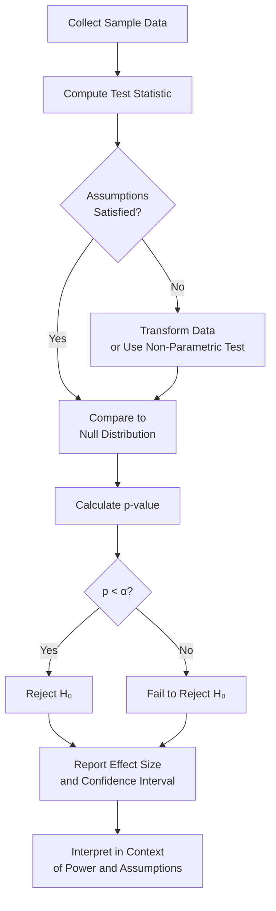
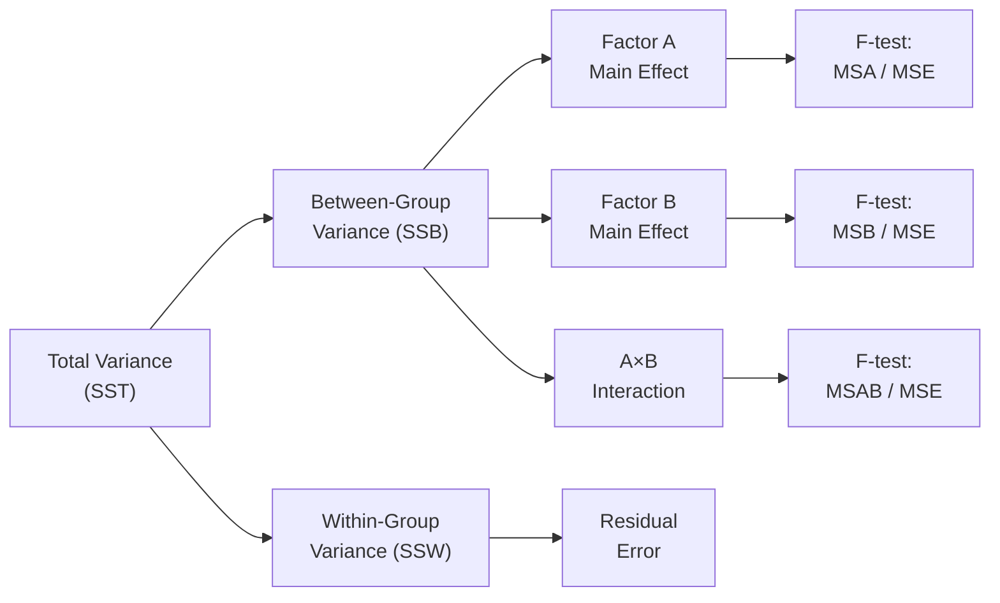
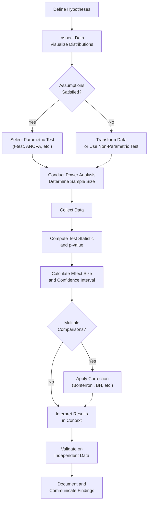

# Lesson 3: Common Statistical Tests

## 1. First-Principles Intuition & Invariants

Statistical hypothesis testing constitutes a formal decision-making framework under uncertainty, constructed on the foundation of probability theory and mathematical inference. In production systems—whether evaluating cache hit ratios, comparing algorithm runtimes, or analyzing failure modes—we require methods that quantify evidence and bound error rates. Anecdotal observation ("the system feels slower") must yield to rigorous quantification ("the 95th percentile latency increased by 12ms, p < 0.001").

The mathematical structure begins with a null hypothesis $H_0$ representing a baseline state (no effect, no difference, no association) and an alternative hypothesis $H_1$ encoding the specific effect we seek to detect. The test statistic—a function of the observed data—maps our sample into a single number whose distribution under $H_0$ is known. By comparing this statistic to its null distribution, we compute a p-value: the probability of observing data at least as extreme as ours, assuming $H_0$ is true. If $p < \alpha$ (commonly 0.05), we reject $H_0$ in favor of $H_1$.

This framework is not arbitrary preference—it is a solution to the fundamental problem of inductive inference. We never observe the entire population; we must infer properties from finite samples. The machinery of hypothesis testing provides a disciplined approach to this inference, with explicit control of Type I error (false positive) and Type II error (false negative) rates.

**Invariants and Assumptions**

Every statistical test rests on a set of mathematical assumptions—invariants that must hold for the test's conclusions to be valid:

1. **Independence**: Observations must be independent draws from the underlying distribution. Violating this—through autocorrelation, clustering, or repeated measures—inflates false positive rates because the effective sample size is smaller than the nominal count.

2. **Distributional Form**: Parametric tests (t-test, ANOVA, F-test) assume specific distributions, typically Gaussian. This assumption is justified by the Central Limit Theorem (CLT) for sufficiently large samples, but fails for small samples with heavy-tailed or skewed data.

3. **Homoscedasticity**: Many tests assume equal variance across groups. Unequal variances (heteroscedasticity) invalidate pooled variance estimates and distort test statistics.

4. **Scale of Measurement**: Parametric tests require interval or ratio scales (meaningful arithmetic operations). Ordinal data—where only rank order matters—requires non-parametric alternatives.

When these invariants are violated, the nominal Type I error rate ($\alpha = 0.05$) diverges from the actual rate. A test claiming 5% false positives may exhibit 15% or more under assumption violations. In systems contexts—evaluating whether a new load balancer reduces latency, or whether a database index improves throughput—such errors lead to incorrect architectural decisions with cascading consequences.

Consider the independence assumption. In a distributed database, query latencies from the same node within a short time window are correlated due to shared cache state, connection pooling, and OS scheduler effects. Treating 1000 measurements from a single node as 1000 independent samples yields spuriously narrow confidence intervals and inflated significance. The effective sample size may be closer to the number of independent time blocks or nodes.

**Reproducibility and Power**

A well-designed test must exhibit reproducibility: applying the test to independent samples from the same underlying distribution should yield consistent conclusions. This requires not only mathematical correctness but also careful experimental design—controlling confounding variables, randomizing treatment assignment, and collecting sufficient data to achieve adequate statistical power.

Power—the probability of correctly rejecting a false null hypothesis—depends on effect size, sample size, significance level, and test choice. A test with low power fails to detect real effects, leading to false negatives. In systems engineering, this manifests as failing to detect a real performance regression or memory leak. The relationship is formalized:

$$
\text{Power} = 1 - \beta = P(\text{reject } H_0 \mid H_1 \text{ true})
$$

where $\beta$ is the Type II error rate. For a two-sample t-test comparing means $\mu_1$ and $\mu_2$ with common standard deviation $\sigma$, the non-centrality parameter is:

$$
\delta = \frac{|\mu_1 - \mu_2|}{\sigma \sqrt{1/n_1 + 1/n_2}}
$$

Power increases with effect size $|\mu_1 - \mu_2|$, decreases with noise $\sigma$, and increases with sample size. To achieve 80% power for detecting a 10ms latency difference with $\sigma = 30$ms at $\alpha = 0.05$, we need approximately 143 samples per group. Underpowered tests waste resources and produce inconclusive results.



## 2. Core Architecture & Mechanics

### 2.1 Student's t-Test

The t-test compares means between two groups, accommodating the uncertainty introduced by estimating population variance from sample data. For two independent samples with means $\bar{X}_1, \bar{X}_2$, variances $s_1^2, s_2^2$, and sizes $n_1, n_2$, the test statistic depends on whether we assume equal population variances.

**Welch's t-test** (unequal variances) uses:

$$
t = \frac{\bar{X}_1 - \bar{X}_2}{\sqrt{\frac{s_1^2}{n_1} + \frac{s_2^2}{n_2}}}
$$

with degrees of freedom approximated by the Welch-Satterthwaite equation:

$$
\nu \approx \frac{\left(\frac{s_1^2}{n_1} + \frac{s_2^2}{n_2}\right)^2}{\frac{(s_1^2/n_1)^2}{n_1-1} + \frac{(s_2^2/n_2)^2}{n_2-1}}
$$

The t-statistic follows a Student's t-distribution with $\nu$ degrees of freedom under $H_0: \mu_1 = \mu_2$. The t-distribution converges to the standard normal as $\nu \to \infty$, reflecting increased precision in variance estimation with larger samples.

**Pooled t-test** (equal variances) estimates a common variance:

$$
s_p^2 = \frac{(n_1-1)s_1^2 + (n_2-1)s_2^2}{n_1 + n_2 - 2}
$$

$$
t = \frac{\bar{X}_1 - \bar{X}_2}{s_p\sqrt{\frac{1}{n_1} + \frac{1}{n_2}}}
$$

with $\nu = n_1 + n_2 - 2$ degrees of freedom. The pooled test has slightly higher power when variances are truly equal, but fails catastrophically when they differ substantially. Welch's test is generally preferred as it remains valid under heteroscedasticity.

**Paired t-test** handles dependent samples (e.g., before/after measurements on the same system) by analyzing differences:

$$
t = \frac{\bar{D}}{s_D / \sqrt{n}}
$$

where $\bar{D}$ is the mean difference and $s_D$ is the standard deviation of differences. This accounts for correlation between paired observations, increasing power relative to an independent-samples test.

**Implementation Considerations**

In systems programming, computing sample statistics often occurs in streaming fashion to avoid storing all data points. Welford's online algorithm computes mean and variance in a single pass with numerical stability:

```python
def welford_update(count, mean, M2, new_value):
    """
    Update running mean and sum of squared deviations.
    M2 accumulates (x_i - mean)^2; variance = M2 / (count - 1)
    """
    count += 1
    delta = new_value - mean
    mean += delta / count
    delta2 = new_value - mean
    M2 += delta * delta2
    return count, mean, M2

def welford_finalize(count, mean, M2):
    if count < 2:
        return mean, float('nan')
    variance = M2 / (count - 1)
    return mean, variance
```

This algorithm maintains numerical precision even when $\bar{X}^2 \gg \text{Var}(X)$, avoiding catastrophic cancellation in the naïve formula $s^2 = \frac{1}{n-1}\left(\sum x_i^2 - n\bar{x}^2\right)$.

For a complete two-sample t-test in Rust with Welch's approximation:

```rust
use statrs::distribution::{StudentsT, ContinuousCDF};

pub struct WelchTTest {
    mean1: f64,
    var1: f64,
    n1: usize,
    mean2: f64,
    var2: f64,
    n2: usize,
}

impl WelchTTest {
    pub fn new(sample1: &[f64], sample2: &[f64]) -> Self {
        let (mean1, var1) = Self::mean_var(sample1);
        let (mean2, var2) = Self::mean_var(sample2);
        Self {
            mean1, var1, n1: sample1.len(),
            mean2, var2, n2: sample2.len(),
        }
    }

    fn mean_var(data: &[f64]) -> (f64, f64) {
        let n = data.len();
        if n == 0 { return (0.0, 0.0); }
        
        let mean = data.iter().sum::<f64>() / n as f64;
        if n == 1 { return (mean, 0.0); }
        
        let var = data.iter()
            .map(|&x| (x - mean).powi(2))
            .sum::<f64>() / (n - 1) as f64;
        (mean, var)
    }

    pub fn statistic(&self) -> f64 {
        let se1 = self.var1 / self.n1 as f64;
        let se2 = self.var2 / self.n2 as f64;
        (self.mean1 - self.mean2) / (se1 + se2).sqrt()
    }

    pub fn degrees_of_freedom(&self) -> f64 {
        let se1 = self.var1 / self.n1 as f64;
        let se2 = self.var2 / self.n2 as f64;
        let numerator = (se1 + se2).powi(2);
        let denom1 = se1.powi(2) / (self.n1 - 1) as f64;
        let denom2 = se2.powi(2) / (self.n2 - 1) as f64;
        numerator / (denom1 + denom2)
    }

    pub fn p_value_two_tailed(&self) -> f64 {
        let t = self.statistic();
        let df = self.degrees_of_freedom();
        let dist = StudentsT::new(0.0, 1.0, df).unwrap();
        2.0 * (1.0 - dist.cdf(t.abs()))
    }
}
```

### 2.2 Analysis of Variance (ANOVA)

ANOVA extends the two-sample comparison to $k \geq 2$ groups, testing whether at least one group mean differs from the others. The fundamental insight is partitioning total variance into between-group and within-group components.

For $k$ groups with $n_i$ observations and overall sample size $N = \sum n_i$, let $\bar{X}_i$ denote the mean of group $i$ and $\bar{X}$ the grand mean. The **total sum of squares** (SST) decomposes as:

$$
\text{SST} = \sum_{i=1}^k \sum_{j=1}^{n_i} (X_{ij} - \bar{X})^2 = \text{SSB} + \text{SSW}
$$

where:

$$
\text{SSB} = \sum_{i=1}^k n_i (\bar{X}_i - \bar{X})^2 \quad \text{(between-group sum of squares)}
$$

$$
\text{SSW} = \sum_{i=1}^k \sum_{j=1}^{n_i} (X_{ij} - \bar{X}_i)^2 \quad \text{(within-group sum of squares)}
$$

The mean squares are:

$$
\text{MSB} = \frac{\text{SSB}}{k-1}, \quad \text{MSW} = \frac{\text{SSW}}{N-k}
$$

The F-statistic is the ratio:

$$
F = \frac{\text{MSB}}{\text{MSW}}
$$

Under $H_0$ (all group means equal), $F$ follows an $F$-distribution with $(k-1, N-k)$ degrees of freedom. Large $F$ values indicate greater between-group variance relative to within-group variance, providing evidence against $H_0$.

**Assumptions**:
1. Independence of observations
2. Normality within each group
3. Homoscedasticity (equal variances across groups)

The F-test is robust to mild violations of normality (especially with balanced designs and large samples) but sensitive to heteroscedasticity. Levene's test or Bartlett's test can assess homoscedasticity; if violated, use Welch's ANOVA or transform the data.

**Post-hoc Comparisons**

ANOVA indicates that at least one group differs but does not identify which pairs differ. Post-hoc tests control family-wise error rate across multiple pairwise comparisons:

- **Tukey's HSD** (Honestly Significant Difference): optimal for balanced designs, controls Type I error for all pairwise comparisons
- **Bonferroni correction**: divide $\alpha$ by the number of comparisons; conservative but simple
- **Benjamini-Hochberg**: controls false discovery rate rather than family-wise error; less conservative

Example: comparing throughput across four load-balancing algorithms (round-robin, least-connections, weighted, random). ANOVA tests whether any algorithm differs; Tukey HSD identifies which specific pairs exhibit significant differences.

```python
import numpy as np
from scipy import stats

def one_way_anova(*groups):
    """
    Perform one-way ANOVA on k independent groups.
    Returns F-statistic, p-value, and effect size (eta-squared).
    """
    k = len(groups)
    N = sum(len(g) for g in groups)
    
    # Grand mean
    all_values = np.concatenate(groups)
    grand_mean = np.mean(all_values)
    
    # Between-group sum of squares
    ssb = sum(len(g) * (np.mean(g) - grand_mean)**2 for g in groups)
    
    # Within-group sum of squares
    ssw = sum(np.sum((g - np.mean(g))**2) for g in groups)
    
    # Degrees of freedom
    df_between = k - 1
    df_within = N - k
    
    # Mean squares
    msb = ssb / df_between
    msw = ssw / df_within
    
    # F-statistic
    f_stat = msb / msw
    
    # p-value
    p_value = 1 - stats.f.cdf(f_stat, df_between, df_within)
    
    # Effect size (eta-squared)
    eta_squared = ssb / (ssb + ssw)
    
    return {
        'F': f_stat,
        'p': p_value,
        'df_between': df_between,
        'df_within': df_within,
        'eta_squared': eta_squared
    }

# Example: latency measurements (ms) for 4 algorithms
round_robin = [45.2, 47.1, 44.8, 46.5, 45.9]
least_conn = [42.1, 41.8, 43.2, 42.5, 41.9]
weighted = [43.8, 44.2, 43.5, 44.1, 43.9]
random = [48.3, 49.1, 47.8, 48.7, 49.4]

result = one_way_anova(round_robin, least_conn, weighted, random)
print(f"F({result['df_between']}, {result['df_within']}) = {result['F']:.3f}, p = {result['p']:.4f}")
print(f"Effect size (η²) = {result['eta_squared']:.3f}")
```

**Two-Way ANOVA and Interactions**

Two-way ANOVA assesses effects of two factors and their interaction. For example, evaluating cache performance across (1) cache size (small/medium/large) and (2) workload type (sequential/random). The model is:

$$
X_{ijk} = \mu + \alpha_i + \beta_j + (\alpha\beta)_{ij} + \varepsilon_{ijk}
$$

where $\alpha_i$ is the main effect of factor A (cache size), $\beta_j$ is the main effect of factor B (workload), $(\alpha\beta)_{ij}$ is the interaction, and $\varepsilon_{ijk}$ is residual error.

An interaction occurs when the effect of one factor depends on the level of another. For instance, sequential workloads may benefit more from larger caches than random workloads do, indicating a cache-size × workload interaction.



### 2.3 Chi-Square Test for Independence

The chi-square test evaluates association between categorical variables. Given a contingency table with $r$ rows and $c$ columns, observed frequencies $O_{ij}$, and expected frequencies under independence $E_{ij}$, the test statistic is:

$$
\chi^2 = \sum_{i=1}^r \sum_{j=1}^c \frac{(O_{ij} - E_{ij})^2}{E_{ij}}
$$

Expected frequencies are computed from marginal totals:

$$
E_{ij} = \frac{(\text{row } i \text{ total}) \times (\text{column } j \text{ total})}{\text{grand total}}
$$

Under $H_0$ (independence), $\chi^2$ follows a chi-square distribution with $(r-1)(c-1)$ degrees of freedom. Large $\chi^2$ values indicate dependence between the variables.

**Requirements**:
- Expected frequencies $E_{ij} \geq 5$ in at least 80% of cells (otherwise use Fisher's exact test)
- Independent observations (no repeated measures)

Example: analyzing whether system failures are associated with time of day. Rows represent failure types (network, disk, memory), columns represent time periods (morning, afternoon, night).

```c
#include <stdio.h>
#include <math.h>

typedef struct {
    int rows;
    int cols;
    double **observed;
    double **expected;
    double chi_square;
    int df;
} ChiSquareTest;

double chi_square_statistic(ChiSquareTest *test) {
    double chi2 = 0.0;
    int *row_totals = calloc(test->rows, sizeof(int));
    int *col_totals = calloc(test->cols, sizeof(int));
    int grand_total = 0;
    
    // Compute marginal totals
    for (int i = 0; i < test->rows; i++) {
        for (int j = 0; j < test->cols; j++) {
            row_totals[i] += test->observed[i][j];
            col_totals[j] += test->observed[i][j];
            grand_total += test->observed[i][j];
        }
    }
    
    // Compute expected frequencies and chi-square statistic
    for (int i = 0; i < test->rows; i++) {
        for (int j = 0; j < test->cols; j++) {
            test->expected[i][j] = (double)(row_totals[i] * col_totals[j]) / grand_total;
            double diff = test->observed[i][j] - test->expected[i][j];
            chi2 += (diff * diff) / test->expected[i][j];
        }
    }
    
    test->chi_square = chi2;
    test->df = (test->rows - 1) * (test->cols - 1);
    
    free(row_totals);
    free(col_totals);
    
    return chi2;
}
```

**Chi-Square Goodness-of-Fit**

A one-dimensional variant tests whether observed frequencies match a theoretical distribution. For $k$ categories with observed counts $O_i$ and expected proportions $p_i$:

$$
\chi^2 = \sum_{i=1}^k \frac{(O_i - Np_i)^2}{Np_i}
$$

with $k-1$ degrees of freedom (or $k-1-m$ if $m$ parameters are estimated from the data). This tests whether hash function outputs are uniformly distributed, whether error codes follow expected frequencies, or whether request arrivals match a Poisson process.

### 2.4 Non-Parametric Tests

When distributional assumptions fail—data is ordinal, heavily skewed, or contaminated with outliers—non-parametric tests provide robust alternatives. These tests operate on ranks rather than raw values, making them invariant to monotonic transformations.

**Mann-Whitney U Test** (Wilcoxon Rank-Sum Test)

Compares two independent samples without assuming normality. All observations are pooled and ranked; the test compares rank sums between groups.

For samples of size $n_1$ and $n_2$, let $R_1$ be the sum of ranks in group 1. The U statistic is:

$$
U_1 = R_1 - \frac{n_1(n_1+1)}{2}
$$

$$
U_2 = n_1 n_2 - U_1
$$

The test uses $U = \min(U_1, U_2)$. For large samples, $U$ is approximately normal:

$$
z = \frac{U - \mu_U}{\sigma_U}, \quad \mu_U = \frac{n_1 n_2}{2}, \quad \sigma_U = \sqrt{\frac{n_1 n_2 (n_1+n_2+1)}{12}}
$$

The Mann-Whitney test detects differences in central tendency (not just medians, despite common misconception—it tests whether one distribution is stochastically larger than another).

**Kruskal-Wallis Test**

The non-parametric analog of one-way ANOVA, comparing $k \geq 2$ groups. Observations are pooled and ranked; the test compares mean ranks:

$$
H = \frac{12}{N(N+1)} \sum_{i=1}^k n_i \left(\bar{R}_i - \frac{N+1}{2}\right)^2
$$

where $\bar{R}_i$ is the mean rank in group $i$ and $N = \sum n_i$. Under $H_0$, $H$ approximately follows a $\chi^2$ distribution with $k-1$ degrees of freedom.

**Wilcoxon Signed-Rank Test**

The non-parametric paired analog of the paired t-test. Compute differences $D_i = X_i - Y_i$, rank their absolute values $|D_i|$, and sum ranks of positive differences:

$$
W^+ = \sum_{D_i > 0} \text{rank}(|D_i|)
$$

For large samples, $W^+$ is approximately normal with mean $n(n+1)/4$ and variance $n(n+1)(2n+1)/24$.

```go
package stats

import (
    "sort"
)

type RankedValue struct {
    Value float64
    Group int
    Rank  float64
}

func MannWhitneyU(sample1, sample2 []float64) (float64, float64) {
    n1, n2 := len(sample1), len(sample2)
    
    // Pool and tag samples
    var pooled []RankedValue
    for _, v := range sample1 {
        pooled = append(pooled, RankedValue{Value: v, Group: 1})
    }
    for _, v := range sample2 {
        pooled = append(pooled, RankedValue{Value: v, Group: 2})
    }
    
    // Sort and assign ranks
    sort.Slice(pooled, func(i, j int) bool {
        return pooled[i].Value < pooled[j].Value
    })
    
    for i := range pooled {
        pooled[i].Rank = float64(i + 1)
    }
    
    // Handle ties by averaging ranks
    for i := 0; i < len(pooled); {
        j := i
        for j < len(pooled) && pooled[j].Value == pooled[i].Value {
            j++
        }
        if j > i+1 {
            avgRank := 0.0
            for k := i; k < j; k++ {
                avgRank += pooled[k].Rank
            }
            avgRank /= float64(j - i)
            for k := i; k < j; k++ {
                pooled[k].Rank = avgRank
            }
        }
        i = j
    }
    
    // Sum ranks for group 1
    R1 := 0.0
    for _, rv := range pooled {
        if rv.Group == 1 {
            R1 += rv.Rank
        }
    }
    
    // Compute U statistics
    U1 := R1 - float64(n1*(n1+1))/2
    U2 := float64(n1*n2) - U1
    U := U1
    if U2 < U1 {
        U = U2
    }
    
    // Z-score for large-sample approximation
    meanU := float64(n1*n2) / 2
    stdU := sqrt(float64(n1*n2*(n1+n2+1)) / 12)
    z := (U - meanU) / stdU
    
    return U, z
}
```

### 2.5 Permutation and Bootstrap Tests

When parametric assumptions are untenable and appropriate non-parametric tests are unavailable, resampling methods provide distribution-free alternatives.

**Permutation Test**

Under $H_0$ (no group effect), labels are exchangeable—any permutation of group assignments is equally likely. The test procedure:

1. Compute the test statistic on observed data (e.g., difference in means)
2. Generate the null distribution by:
   - Randomly permuting group labels
   - Recomputing the test statistic
   - Repeat $B$ times (typically 10,000)
3. The p-value is the proportion of permuted statistics at least as extreme as the observed statistic

This approach makes no distributional assumptions and exactly controls Type I error for any finite sample size, provided exchangeability holds under $H_0$.

**Bootstrap**

The bootstrap estimates sampling distributions by resampling with replacement from the observed data. To construct a confidence interval for a statistic $\theta$ (e.g., median latency, 95th percentile):

1. Draw $B$ bootstrap samples (each of size $n$, with replacement)
2. Compute $\theta^*$ for each bootstrap sample
3. The 95% confidence interval is the 2.5th and 97.5th percentiles of $\{\theta^*_1, \ldots, \theta^*_B\}$

The bootstrap is particularly valuable for complex statistics lacking closed-form distributions. For example, estimating the standard error of the 99th percentile latency or the variance of a median.

**Block Bootstrap for Dependent Data**

When observations exhibit temporal or spatial correlation (e.g., time-series latency measurements), naive bootstrap fails because resampling destroys the dependence structure. The block bootstrap resamples contiguous blocks of data, preserving local correlation while generating independent replicates at the block level.

```python
import numpy as np

def block_bootstrap_ci(data, statistic_func, block_size, n_boot=10000, alpha=0.05):
    """
    Block bootstrap confidence interval for time-series data.
    
    Parameters:
    - data: 1D array of observations
    - statistic_func: function computing the statistic of interest
    - block_size: size of blocks to resample (should capture correlation length)
    - n_boot: number of bootstrap replicates
    - alpha: significance level (0.05 for 95% CI)
    
    Returns:
    - (lower, upper) confidence interval bounds
    """
    n = len(data)
    n_blocks = int(np.ceil(n / block_size))
    
    bootstrap_stats = []
    for _ in range(n_boot):
        # Resample blocks with replacement
        block_indices = np.random.choice(n_blocks, size=n_blocks, replace=True)
        resampled = []
        for idx in block_indices:
            start = idx * block_size
            end = min(start + block_size, n)
            resampled.extend(data[start:end])
        
        # Trim to original length
        resampled = resampled[:n]
        bootstrap_stats.append(statistic_func(resampled))
    
    # Percentile confidence interval
    lower = np.percentile(bootstrap_stats, 100 * alpha / 2)
    upper = np.percentile(bootstrap_stats, 100 * (1 - alpha / 2))
    
    return lower, upper

# Example: 95% CI for median latency with autocorrelated data
latencies = np.random.lognormal(3.5, 0.4, 1000)  # Simulate latency data
lower, upper = block_bootstrap_ci(latencies, np.median, block_size=50)
print(f"95% CI for median: [{lower:.2f}, {upper:.2f}]")
```

## 3. High-Performance Optimization & Failure Modes

### 3.1 Computational Efficiency

Statistical tests in production systems must execute efficiently, especially in real-time monitoring and alerting pipelines. Latency budgets are tight: a test consuming 50ms can bottleneck a monitoring loop required to respond within 100ms SLA.

**Streaming Computation**

For unbounded data streams, maintain sufficient statistics incrementally rather than reprocessing entire datasets. Welford's algorithm (shown earlier) computes mean and variance in O(1) per update. For percentiles, use streaming quantile approximation:

- **t-digest**: Maintains a compact representation of the data distribution, enabling approximate quantile queries in O(log n) time and O(k) space, where k is the compression factor (typically 100-200).
- **Reservoir sampling**: Maintains a fixed-size random sample from a stream, enabling unbiased estimates of arbitrary statistics at the cost of increased variance.

**Parallelization**

When analyzing large batches, distribute computation across cores or nodes. For example, computing a t-test on 10 million samples can partition data into chunks, compute sufficient statistics (sum, sum-of-squares, count) per chunk in parallel, then merge:

$$
\bar{X} = \frac{\sum_i n_i \bar{X}_i}{\sum_i n_i}, \quad s^2 = \frac{\sum_i \left[(n_i-1)s_i^2 + n_i(\bar{X}_i - \bar{X})^2\right]}{\sum_i n_i - 1}
$$

This MapReduce pattern applies to many test statistics, enabling linear scaling with parallel resources.

**Vectorization**

Modern CPUs provide SIMD (Single Instruction, Multiple Data) instructions that process multiple values per cycle. Computing sums, sums-of-squares, and other aggregates can leverage SIMD for 4-8× speedups. Libraries like NumPy, Eigen, or hand-coded intrinsics (AVX2, AVX-512) exploit this parallelism.

```c
#include <immintrin.h>

// AVX2 implementation of sum-of-squares for double precision
double sum_of_squares_avx2(const double *data, size_t n) {
    __m256d sum_vec = _mm256_setzero_pd();
    size_t i;
    
    // Process 4 doubles at a time
    for (i = 0; i + 3 < n; i += 4) {
        __m256d x = _mm256_loadu_pd(&data[i]);
        __m256d x2 = _mm256_mul_pd(x, x);
        sum_vec = _mm256_add_pd(sum_vec, x2);
    }
    
    // Horizontal sum of vector
    double sum[4];
    _mm256_storeu_pd(sum, sum_vec);
    double total = sum[0] + sum[1] + sum[2] + sum[3];
    
    // Handle remaining elements
    for (; i < n; i++) {
        total += data[i] * data[i];
    }
    
    return total;
}
```

### 3.2 Common Failure Modes

**Violation of Independence**

Repeated measurements from the same entity (user, server, process) violate independence. Treating 1000 requests from 10 users as 1000 independent samples overstates evidence. Solutions:

- Aggregate per entity (e.g., compute mean latency per user), then test across entities
- Use mixed-effects models that account for within-entity correlation
- Apply cluster-robust standard errors

**Non-Normality**

Heavy-tailed distributions (e.g., latency with occasional timeouts, skewed error counts) violate normality assumptions. The CLT provides asymptotic normality of sample means, but convergence is slow for heavy tails. Strategies:

- Transform data (log, square-root, Box-Cox) to approximate normality
- Use non-parametric tests (Mann-Whitney, Kruskal-Wallis)
- Employ bootstrap to estimate sampling distribution empirically
- Increase sample size (may be impractical)

For latency data, log-transformation often induces approximate normality because latency is multiplicatively structured (each component adds delay; many components multiply effects).

**Heteroscedasticity**

Unequal variances distort pooled t-tests and ANOVA. Diagnostic: plot residuals vs. fitted values; "fanning" indicates heteroscedasticity. Remedies:

- Use Welch's t-test or Welch's ANOVA (does not assume equal variances)
- Transform data to stabilize variance (log, square-root)
- Use weighted least squares or robust standard errors

**Multiple Comparisons**

Performing $m$ independent tests, each at $\alpha = 0.05$, yields a family-wise error rate $1 - (1-\alpha)^m$. For $m=20$, the probability of at least one false positive is $1 - 0.95^{20} \approx 0.64$. This is disastrous in systems monitoring with hundreds of metrics.

Corrections:

- **Bonferroni**: Test each hypothesis at $\alpha/m$. Conservative; power decreases linearly with $m$.
- **Holm-Bonferroni**: Step-down procedure; less conservative than Bonferroni while maintaining family-wise error control.
- **Benjamini-Hochberg**: Controls false discovery rate (FDR), the expected proportion of false positives among rejections. More powerful than family-wise methods when some hypotheses are truly non-null.

For monitoring $k$ metrics, consider the Benjamini-Hochberg procedure:

1. Compute p-values $p_1, \ldots, p_k$ for each metric
2. Order them: $p_{(1)} \leq p_{(2)} \leq \cdots \leq p_{(k)}$
3. Find the largest $i$ such that $p_{(i)} \leq \frac{i}{k} \cdot \alpha$
4. Reject hypotheses corresponding to $p_{(1)}, \ldots, p_{(i)}$

This controls FDR at level $\alpha$, allowing more discoveries than Bonferroni when many real effects exist.

**Small Sample Sizes**

Low power fails to detect real effects. For a two-sample t-test, power depends on:

$$
\text{Power} = \Phi\left( \frac{\delta\sqrt{n}}{2} - z_{\alpha/2} \right) + \Phi\left( -\frac{\delta\sqrt{n}}{2} - z_{\alpha/2} \right)
$$

where $\delta = |\mu_1 - \mu_2|/\sigma$ is the standardized effect size and $\Phi$ is the standard normal CDF. To achieve 80% power for detecting a medium effect ($\delta = 0.5$) at $\alpha = 0.05$, require $n \approx 64$ per group.

Underpowered studies waste resources and produce "null" results that are uninformative (failure to reject $H_0$ does not imply $H_0$ is true—merely that evidence is insufficient). Always conduct a priori power analysis to determine required sample size.

**p-Hacking and Researcher Degrees of Freedom**

Flexibility in data analysis—choosing which outliers to exclude, which covariates to include, when to stop collecting data—inflates false positive rates. Each decision represents a fork in the analysis path; selecting paths that yield significant results is a form of multiple testing without correction.

Mitigation:

- Preregister analysis plans (specify tests, transformations, and stopping rules before seeing data)
- Report all tests performed, not just significant ones
- Use holdout validation: test hypotheses on a separate dataset
- Treat p-values as continuous evidence rather than binary thresholds

### 3.3 Concurrency and Thread Safety

In multi-threaded systems, multiple threads may update shared statistics (e.g., aggregating latency metrics from parallel request handlers). Naïve implementations with shared mutable state require synchronization, introducing contention and scalability bottlenecks.

**Lock-Free Aggregation**

Use atomic operations (compare-and-swap, fetch-and-add) to update counters and sums without locks. For variance, maintain separate per-thread accumulators and merge at query time.

```rust
use std::sync::atomic::{AtomicU64, Ordering};
use std::sync::Arc;

pub struct AtomicStats {
    count: AtomicU64,
    sum: AtomicU64,
    sum_sq: AtomicU64,
}

impl AtomicStats {
    pub fn new() -> Self {
        Self {
            count: AtomicU64::new(0),
            sum: AtomicU64::new(0),
            sum_sq: AtomicU64::new(0),
        }
    }
    
    pub fn record(&self, value: f64) {
        // Convert to integer representation for atomic operations
        // (assumes values fit in representable range)
        let value_bits = value.to_bits();
        self.count.fetch_add(1, Ordering::Relaxed);
        self.sum.fetch_add(value_bits, Ordering::Relaxed);
        let sq_bits = (value * value).to_bits();
        self.sum_sq.fetch_add(sq_bits, Ordering::Relaxed);
    }
    
    pub fn mean_and_variance(&self) -> (f64, f64) {
        let n = self.count.load(Ordering::Relaxed);
        if n == 0 {
            return (0.0, 0.0);
        }
        
        let sum = f64::from_bits(self.sum.load(Ordering::Relaxed));
        let sum_sq = f64::from_bits(self.sum_sq.load(Ordering::Relaxed));
        
        let mean = sum / n as f64;
        let variance = (sum_sq / n as f64) - (mean * mean);
        
        (mean, variance * n as f64 / (n as f64 - 1.0))
    }
}
```

Note: Atomic operations on floating-point require careful handling; the above uses bit representation. For production, consider specialized libraries (e.g., crossbeam, or thread-local aggregation with periodic merges).

**Thread-Local Accumulators**

Alternatively, maintain per-thread statistics and merge at read time, avoiding contention entirely:

```c
#include <pthread.h>

typedef struct {
    long count;
    double sum;
    double sum_sq;
} ThreadLocalStats;

__thread ThreadLocalStats local_stats = {0, 0.0, 0.0};

void record_value(double x) {
    local_stats.count++;
    local_stats.sum += x;
    local_stats.sum_sq += x * x;
}

typedef struct {
    pthread_mutex_t lock;
    long total_count;
    double total_sum;
    double total_sum_sq;
} GlobalStats;

void merge_stats(GlobalStats *global) {
    pthread_mutex_lock(&global->lock);
    global->total_count += local_stats.count;
    global->total_sum += local_stats.sum;
    global->total_sum_sq += local_stats.sum_sq;
    pthread_mutex_unlock(&global->lock);
    
    // Reset local stats after merge
    local_stats.count = 0;
    local_stats.sum = 0.0;
    local_stats.sum_sq = 0.0;
}
```

### 3.4 Numerical Stability

Floating-point arithmetic introduces rounding errors that accumulate, especially in variance computation. The naïve formula $s^2 = \frac{1}{n-1}\left(\sum x_i^2 - n\bar{x}^2\right)$ suffers catastrophic cancellation when $\bar{x}^2 \gg s^2$, yielding negative variance estimates.

**Compensated Summation (Kahan)**

Improves summation accuracy by tracking and correcting rounding errors:

```python
def kahan_sum(values):
    """Kahan compensated summation for improved numerical accuracy."""
    total = 0.0
    compensation = 0.0
    
    for x in values:
        y = x - compensation
        t = total + y
        compensation = (t - total) - y
        total = t
    
    return total
```

For variance, Welford's algorithm (shown earlier) avoids catastrophic cancellation by computing the sum of squared deviations from the running mean directly, maintaining numerical stability even when $\bar{x}$ is large relative to $s$.

### 3.5 Monitoring and Alerting

Statistical tests integrated into monitoring systems must balance sensitivity (detecting real issues) with specificity (avoiding false alarms). A naive threshold-based alert (e.g., "trigger if p < 0.05") produces excessive false positives due to multiple testing.

**Sequential Testing**

For continuous monitoring, sequential probability ratio tests (SPRT) provide optimal stopping rules. SPRT computes a likelihood ratio after each observation and stops when sufficient evidence accumulates for one hypothesis. This minimizes expected sample size while controlling error rates.

**Change-Point Detection**

Detecting when a metric shifts (e.g., latency suddenly increases) is a change-point problem. Cumulative sum (CUSUM) and exponentially weighted moving average (EWMA) charts detect persistent shifts. These methods accumulate deviations from a baseline and trigger alerts when the accumulation exceeds a threshold.

For example, a CUSUM chart for detecting increases in mean latency:

$$
S_n = \max(0, S_{n-1} + (X_n - \mu_0) - k)
$$

where $\mu_0$ is the baseline mean and $k$ is a slack parameter. Alert when $S_n > h$ for threshold $h$. This detects sustained shifts while ignoring transient noise.

```python
def cusum_detect(data, baseline_mean, slack=0.5, threshold=5.0):
    """
    CUSUM change-point detection for upward shift in mean.
    
    Parameters:
    - data: sequence of observations
    - baseline_mean: expected mean under null hypothesis
    - slack: allowance for natural variation
    - threshold: alert threshold
    
    Returns:
    - List of indices where alerts triggered
    """
    cusum = 0.0
    alerts = []
    
    for i, x in enumerate(data):
        cusum = max(0, cusum + (x - baseline_mean) - slack)
        if cusum > threshold:
            alerts.append(i)
            cusum = 0  # Reset after alert
    
    return alerts
```

**Bayesian Monitoring**

Bayesian methods update belief in hypotheses continuously as data accumulates, providing natural integration with monitoring systems. For example, a Bayesian A/B test computes posterior probabilities $P(H_A \mid \text{data})$ and $P(H_B \mid \text{data})$, allowing decisions based on probability thresholds (e.g., "deploy variant B if $P(\text{conversion rate}_B > \text{conversion rate}_A) > 0.95$").

### 3.6 Practical Workflow

A robust statistical testing workflow for systems engineering includes:

1. **Define Hypotheses**: Clearly state null and alternative hypotheses. Be specific: "mean latency of Algorithm A equals mean latency of Algorithm B" vs. "Algorithm A is faster."

2. **Check Assumptions**: Visually inspect data (histograms, Q-Q plots), test for normality (Shapiro-Wilk, Anderson-Darling), assess variance equality (Levene, Bartlett). If assumptions fail, transform data or use non-parametric alternatives.

3. **Choose Test**: Select based on data type (continuous vs. categorical), experimental design (independent vs. paired), and assumptions. Prefer robust tests (Welch's t-test, Mann-Whitney) when in doubt.

4. **Determine Sample Size**: Conduct power analysis to ensure sufficient sample size for detecting effects of practical importance. Use tools like G*Power or statistical packages (Python: statsmodels.stats.power, R: pwr).

5. **Collect Data**: Follow experimental design rigorously. Randomize treatment assignment, control confounders, ensure independence.

6. **Perform Test**: Compute test statistic and p-value. Report effect size (Cohen's d, eta-squared, odds ratio) and confidence intervals—these communicate practical significance beyond statistical significance.

7. **Interpret in Context**: A significant p-value indicates evidence against $H_0$, but does not prove $H_1$ is correct. Consider effect size, confidence intervals, and domain constraints. A statistically significant 2ms latency reduction may be meaningless if the SLA is 100ms.

8. **Account for Multiple Comparisons**: If testing multiple hypotheses, apply appropriate corrections. Document all tests performed, not just significant ones.

9. **Validate Results**: If possible, replicate findings on independent data. Conduct sensitivity analyses (e.g., varying outlier exclusion criteria) to assess robustness.

10. **Document and Communicate**: Report methodology, assumptions, diagnostics, and results transparently. Provide enough detail for reproducibility.



## 4. Advanced Topics and Extensions

### 4.1 Multivariate Tests

When analyzing multiple dependent variables simultaneously, multivariate extensions preserve overall Type I error rates. Hotelling's $T^2$ test generalizes the t-test to multivariate means; MANOVA (Multivariate Analysis of Variance) extends ANOVA.

For example, evaluating a caching strategy on both latency and throughput requires multivariate analysis—these metrics are correlated, and treating them independently inflates false positive rates.

### 4.2 Survival Analysis

In systems contexts, time-to-event data (time to failure, time to first request, session duration) requires survival analysis techniques (Kaplan-Meier estimator, Cox proportional hazards model). These methods handle censored data (observations where the event has not yet occurred by the end of observation).

### 4.3 Bayesian Hypothesis Testing

Bayesian methods compute posterior probabilities of hypotheses rather than p-values. Bayes factors quantify evidence for one hypothesis over another, providing more direct interpretations than frequentist p-values. Bayesian A/B testing allows continuous monitoring and early stopping without inflating error rates, unlike frequentist methods where peeking at data and stopping early can distort p-values.

### 4.4 Causal Inference

Statistical tests establish association, not causation. Causal inference techniques—randomized controlled trials (RCTs), instrumental variables, regression discontinuity, difference-in-differences—provide frameworks for inferring causal relationships from observational or quasi-experimental data. In systems engineering, causal inference addresses questions like "Did deploying this feature cause the latency increase?" by controlling for confounders and alternative explanations.

### 4.5 Meta-Analysis

Combining results from multiple experiments (e.g., A/B tests across different geographic regions) requires meta-analysis. Fixed-effects and random-effects models pool effect sizes, accounting for within-study and between-study variance, providing more precise overall estimates.

## 5. Summary and Best Practices

Statistical hypothesis testing provides a rigorous framework for decision-making under uncertainty in systems engineering. The key principles are:

- **Understand Assumptions**: Every test has mathematical prerequisites. Violations compromise validity. Check assumptions and use appropriate alternatives when they fail.

- **Report Effect Sizes and Confidence Intervals**: P-values indicate whether an effect exists; effect sizes indicate whether it matters. A statistically significant but practically trivial effect wastes engineering resources.

- **Control Error Rates**: Type I and Type II errors have asymmetric costs. Adjust $\alpha$ and $\beta$ based on the consequences of false positives and false negatives in your specific context.

- **Account for Multiple Comparisons**: When testing many hypotheses, apply corrections to maintain overall error rates.

- **Prioritize Reproducibility**: Document methodology completely. Preregister analyses when possible. Use version-controlled analysis scripts.

- **Use Appropriate Tools**: Parametric tests offer high power when assumptions hold; non-parametric tests provide robustness when they don't. Resampling methods (permutation, bootstrap) offer flexibility for complex scenarios.

- **Think About Power**: Underpowered tests waste resources and produce inconclusive results. Conduct a priori power analysis to determine necessary sample sizes.

- **Interpret in Context**: Statistical significance does not imply practical importance. Consider effect sizes, domain constraints, and costs of actions.

Statistical inference is not a mechanical procedure but a disciplined approach to reasoning under uncertainty. The tests and methods described here are tools—their effective application requires understanding their foundations, recognizing their limitations, and interpreting their results within the broader technical and organizational context of systems engineering.
