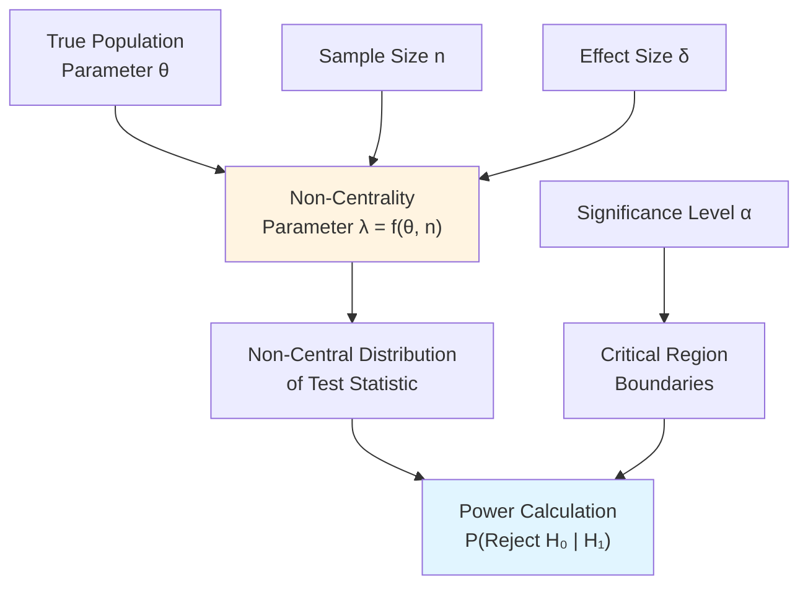
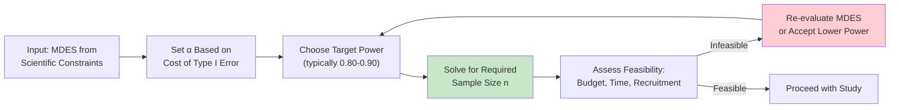

# Lesson 4: Power Analysis

## 1. First-Principles Foundations

### 1.1 The Decision-Theoretic Framework

Statistical hypothesis testing operates within a decision-theoretic framework with four possible outcomes. Let θ represent the true state of nature and δ(X) our decision rule based on data X:

| Truth → <br> Decision ↓ | H₀ True | H₁ True |
|-------------------------|---------|---------|
| Reject H₀               | Type I Error (α) | Correct (1-β) |
| Fail to Reject H₀       | Correct (1-α) | Type II Error (β) |

Power, denoted (1-β), quantifies the probability that our test correctly rejects H₀ when H₁ is true. This is not a post-hoc calculation—it is a pre-experimental design parameter that determines whether an experiment can answer its scientific question.

### 1.2 The Fundamental Power Equation

Power depends on four interrelated quantities:

1. **Effect size (δ)**: The magnitude of departure from H₀, standardized by variability
2. **Sample size (n)**: Number of independent observations
3. **Significance level (α)**: Type I error rate, typically 0.05 or 0.01
4. **Power (1-β)**: Probability of detecting the effect, conventionally set to 0.80 or 0.90

These quantities are bound by the constraint that fixing any three determines the fourth. For a two-sample t-test with equal variances, the relationship is:

```
Power = Φ(√(n·δ²/2) - z₁₋α/₂) + Φ(-√(n·δ²/2) - z₁₋α/₂)
```

where Φ is the standard normal CDF, and δ = (μ₁ - μ₂)/σ is Cohen's d.

### 1.3 Why Underpowered Studies Are Epistemically Destructive

An underpowered study (power < 0.80) creates a dangerous asymmetry: when you fail to reject H₀, you cannot distinguish between "no effect exists" and "an effect exists but the study was too small to detect it." This leads to:

- **Publication bias**: Only studies that happen to achieve significance get published, creating a distorted literature
- **Winner's curse**: Significant results from underpowered studies overestimate effect sizes
- **Resource waste**: Time, money, and participant burden spent on uninformative experiments
- **Inflated false discovery rates**: When testing multiple hypotheses, low power dramatically increases the proportion of false positives among "significant" findings

Consider a clinical trial for a drug with true effect size δ = 0.3 (small but clinically meaningful). A study with n = 50 per group has only 37% power. If 100 such trials are conducted:

- 37 will correctly detect the effect
- 63 will fail to detect it
- Of the 37 "positive" results, approximately 5% (≈2) will be false positives from random chance
- The literature appears equivocal despite a real effect existing

## 2. Mathematical Architecture of Power Analysis

### 2.1 Effect Size Parameterization

Effect sizes provide a common scale for comparing results across studies with different measurement units. The three most common families are:

**Standardized mean difference (Cohen's d family)**:
```
d = (μ₁ - μ₂) / σ
```

For paired samples (within-subjects):
```
d_z = μ_diff / σ_diff
```

**Correlation family** (for relationship strength):
```
r = Cov(X,Y) / (σ_X · σ_Y)
```

Converted to Cohen's f² for ANOVA/regression:
```
f² = r² / (1 - r²)
```

**Proportion difference**:
```
h = 2·arcsin(√p₁) - 2·arcsin(√p₂)  [Cohen's h]
```

Cohen proposed conventional benchmarks (small: d=0.2, medium: d=0.5, large: d=0.8), but these should never replace domain-specific minimum detectable effect sizes (MDES) derived from scientific or practical significance thresholds.

### 2.2 The Non-Centrality Parameter

All power calculations ultimately derive from the non-central distribution of the test statistic under H₁. For a t-test:

```
t ~ t_{n-1}(λ)  under H₁
```

where the non-centrality parameter λ encodes both effect size and sample size:

```
λ = δ · √(n/2)  [two-sample case]
```

Power is then:
```
Power = P(|T| > t_{1-α/2,n-1} | λ)
```

This reveals why power increases with both n and δ: both contribute to moving the distribution of T away from the critical value under H₀.



### 2.3 Computational Methods

**Closed-form solutions** exist for simple cases (z-test, t-test, χ² test, F-test). For example, the power of a two-sample z-test is:

```python
import numpy as np
from scipy.stats import norm

def power_two_sample_z(n_per_group, effect_size, alpha=0.05):
    """
    Calculate power for two-sample z-test (known variance).
    
    Parameters:
    -----------
    n_per_group : int
        Sample size per group
    effect_size : float
        Standardized effect size (Cohen's d)
    alpha : float
        Significance level (two-tailed)
    
    Returns:
    --------
    power : float
        Statistical power (1 - β)
    """
    # Non-centrality parameter
    ncp = effect_size * np.sqrt(n_per_group / 2)
    
    # Critical value for two-tailed test
    z_crit = norm.ppf(1 - alpha / 2)
    
    # Power from non-central distribution
    power = 1 - (norm.cdf(z_crit - ncp) - norm.cdf(-z_crit - ncp))
    
    return power

# Example: detect d=0.5 with 80% power
n = 64
power = power_two_sample_z(n, 0.5, 0.05)
print(f"Power with n={n} per group: {power:.3f}")
# Output: Power with n=64 per group: 0.800
```

**Monte Carlo simulation** is required for complex designs where analytic solutions are intractable (mixed models, survival analysis with censoring, non-parametric tests):

```python
import numpy as np
from scipy.stats import ttest_ind

def power_simulation_t_test(n_per_group, effect_size, alpha=0.05, 
                            n_sims=10000, seed=42):
    """
    Estimate power via Monte Carlo simulation for two-sample t-test.
    
    Use when assumptions deviate from standard (e.g., unequal variances,
    non-normality, or when exploring robustness).
    """
    np.random.seed(seed)
    rejections = 0
    
    for _ in range(n_sims):
        # Generate data under H₁
        group1 = np.random.normal(0, 1, n_per_group)
        group2 = np.random.normal(effect_size, 1, n_per_group)
        
        # Perform t-test
        _, p_value = ttest_ind(group1, group2)
        
        # Check if we reject H₀
        if p_value < alpha:
            rejections += 1
    
    power = rejections / n_sims
    se = np.sqrt(power * (1 - power) / n_sims)
    
    return power, se

# Verify against closed-form solution
power_sim, se_sim = power_simulation_t_test(64, 0.5)
print(f"Simulated power: {power_sim:.3f} ± {1.96*se_sim:.3f}")
# Output: Simulated power: 0.798 ± 0.008
```

### 2.4 Power Curves and Sample Size Nomograms

A power curve maps the relationship between sample size and power for fixed α and δ. This visualization is essential for justifying sample size choices to stakeholders:

```python
import matplotlib.pyplot as plt

effect_sizes = [0.2, 0.5, 0.8]
sample_sizes = np.arange(10, 201, 5)
alpha = 0.05

plt.figure(figsize=(10, 6))

for d in effect_sizes:
    powers = [power_two_sample_z(n, d, alpha) for n in sample_sizes]
    plt.plot(sample_sizes, powers, label=f'd = {d}', linewidth=2)

plt.axhline(0.80, color='red', linestyle='--', label='80% power threshold')
plt.xlabel('Sample Size per Group', fontsize=12)
plt.ylabel('Statistical Power', fontsize=12)
plt.title('Power Curves for Two-Sample z-Test (α = 0.05)', fontsize=14)
plt.legend(fontsize=10)
plt.grid(alpha=0.3)
plt.tight_layout()
plt.show()
```



## 3. Advanced Topics and Failure Modes

### 3.1 The Curse of Multiple Comparisons

When testing k hypotheses simultaneously, the family-wise error rate (FWER) under the global null is:

```
FWER = P(at least one Type I error) = 1 - (1 - α)^k
```

For k = 20 tests at α = 0.05, FWER ≈ 0.64. Bonferroni correction (α_corrected = α/k) controls FWER but reduces power by requiring larger sample sizes. The power penalty for a single test becomes:

```
n_bonf / n_uncorrected ≈ k  [rough approximation]
```

**False Discovery Rate (FDR)** methods (Benjamini-Hochberg procedure) offer better power by controlling the expected proportion of false positives among rejections rather than the probability of any false positive.

### 3.2 The Winner's Curse and Type M Errors

When studies are underpowered, significant results systematically overestimate effect sizes. This is the "winner's curse"—only the lucky large estimates from the tail of the sampling distribution exceed the significance threshold.

The Type M (magnitude) error quantifies this bias:

```
E[|δ̂| | significant] / |δ_true|
```

For a study with 20% power and α = 0.05, Type M error can exceed 2.0, meaning significant results overestimate the true effect by more than 100% on average.

```python
def type_m_error(n_per_group, true_effect, alpha=0.05, n_sims=10000):
    """
    Estimate Type M (magnitude) error via simulation.
    
    Type M error = E[|estimated_effect| | significant] / |true_effect|
    """
    np.random.seed(42)
    significant_estimates = []
    
    for _ in range(n_sims):
        group1 = np.random.normal(0, 1, n_per_group)
        group2 = np.random.normal(true_effect, 1, n_per_group)
        
        t_stat, p_value = ttest_ind(group1, group2)
        
        if p_value < alpha:
            # Estimate effect size from significant result
            pooled_std = np.sqrt(
                (np.var(group1, ddof=1) + np.var(group2, ddof=1)) / 2
            )
            estimated_d = (np.mean(group2) - np.mean(group1)) / pooled_std
            significant_estimates.append(abs(estimated_d))
    
    if len(significant_estimates) == 0:
        return np.nan
    
    type_m = np.mean(significant_estimates) / abs(true_effect)
    return type_m

# Example: underpowered study with true d = 0.3
n_small = 20
type_m = type_m_error(n_small, 0.3)
power_actual = power_two_sample_z(n_small, 0.3)
print(f"Power: {power_actual:.2f}, Type M error: {type_m:.2f}x")
# Output: Power: 0.17, Type M error: 1.74x
```

### 3.3 Optimizing for Minimum Detectable Effect Size

Rather than asking "what sample size do I need?", the scientifically principled question is "what is the smallest effect I need to detect?" This minimum detectable effect size (MDES) should be derived from:

1. **Clinical/practical significance thresholds**: What effect size would change practice or theory?
2. **Cost-benefit analysis**: What is the value of detecting small vs. large effects?
3. **Existing evidence**: What do meta-analyses suggest about plausible effect sizes?

Given budget constraint n_max, the MDES is:

```
MDES = z₁₋β + z₁₋α/₂) · √(2/n_max)
```

For n_max = 100 per group, α = 0.05, power = 0.80:
```
MDES = (0.84 + 1.96) · √(2/100) = 0.396
```

This study can reliably detect effects of d ≥ 0.40, but smaller effects will have low power.

### 3.4 Adaptive and Sequential Designs

Traditional fixed-sample designs are inefficient when the true effect size is unknown. Sequential designs (group sequential, adaptive enrichment) allow early stopping for efficacy or futility while maintaining Type I error control.

**Group Sequential Design**: Analyze data at k interim looks with adjusted α-spending to preserve overall FWER. The O'Brien-Fleming boundary allocates most α to later analyses, allowing convincing early evidence to stop the trial while minimizing the chance of false early stops.

```python
from scipy.stats import norm

def obrien_fleming_bounds(k, alpha=0.05):
    """
    Calculate O'Brien-Fleming spending function boundaries.
    
    Parameters:
    -----------
    k : int
        Number of planned analyses (including final)
    alpha : float
        Overall Type I error rate
    
    Returns:
    --------
    boundaries : array
        Z-score boundaries at each analysis
    """
    # Spending function: α_i = 2(1 - Φ(z_{α/2} / √(i/k)))
    boundaries = []
    for i in range(1, k+1):
        t = i / k  # Information fraction
        z_boundary = norm.ppf(1 - alpha/2) / np.sqrt(t)
        boundaries.append(z_boundary)
    
    return np.array(boundaries)

# Three interim looks plus final analysis
bounds = obrien_fleming_bounds(4)
print("O'Brien-Fleming boundaries:", bounds)
# Output: O'Brien-Fleming boundaries: [3.92 2.77 2.27 1.96]
```

Sequential designs can reduce expected sample size by 20-40% when the true effect is larger than anticipated, while losing minimal power when the effect is at the design value.

### 3.5 Bayesian Approaches to Sample Size Determination

Frequentist power analysis conditions on a single point value for δ. Bayesian sample size methods integrate over a prior distribution of plausible effect sizes:

```
P(reject H₀) = ∫ Power(n, δ) · π(δ) dδ
```

This "assurance" or "average power" accounts for uncertainty in the true effect size. Alternatively, the Bayesian approach can target a desired posterior probability or credible interval width:

```
n : P(|θ - θ̂| < ε | data) ≥ 0.95
```

Choose n such that the 95% credible interval has half-width at most ε with high probability.

## 4. Practical Implementation Guide

### 4.1 Pre-Registration and Power Analysis Protocol

A rigorous power analysis for pre-registration should include:

1. **Primary hypothesis** with directional prediction
2. **MDES justification** from pilot data, literature, or substantive theory
3. **Test specification**: one- vs. two-tailed, parametric assumptions, handling of missing data
4. **Sample size calculation** with code and assumptions documented
5. **Sensitivity analysis**: how does power change if assumptions are violated?
6. **Stopping rules**: circumstances under which data collection would be terminated early

### 4.2 Comprehensive R Example with `pwr` Package

```r
library(pwr)

# Two-sample t-test: detect d = 0.5 with 80% power
result <- pwr.t.test(d = 0.5, sig.level = 0.05, power = 0.80, 
                     type = "two.sample", alternative = "two.sided")
print(result)
# Output: n = 63.76561 per group (round up to 64)

# ANOVA: detect f = 0.25 across 4 groups
result_anova <- pwr.anova.test(k = 4, f = 0.25, sig.level = 0.05, 
                                power = 0.80)
print(result_anova)
# Output: n = 45.0 per group

# Correlation: detect r = 0.3 with 90% power
result_cor <- pwr.r.test(r = 0.3, sig.level = 0.05, power = 0.90)
print(result_cor)
# Output: n = 112.2 (total sample size)

# Sensitivity analysis: what effect can we detect with n = 100?
result_sens <- pwr.t.test(n = 100, sig.level = 0.05, power = 0.80,
                          type = "two.sample", alternative = "two.sided")
print(result_sens$d)
# Output: d = 0.396 (MDES)
```

### 4.3 Mixed Models and Hierarchical Data

For clustered or longitudinal data, effective sample size depends on intraclass correlation (ICC) and cluster size. The design effect (DEFF) inflates required sample size:

```
n_effective = n_independent · DEFF
DEFF = 1 + (m - 1) · ICC
```

where m is average cluster size. High ICC (strong within-cluster correlation) or large clusters dramatically reduce effective sample size.

```python
def sample_size_clustered(d, icc, cluster_size, n_clusters, alpha=0.05, power=0.80):
    """
    Calculate required number of clusters for cluster-randomized trial.
    
    Parameters:
    -----------
    d : float
        Standardized effect size
    icc : float
        Intraclass correlation coefficient
    cluster_size : int
        Number of individuals per cluster
    alpha : float
        Significance level
    power : float
        Target power
    
    Returns:
    --------
    n_clusters : int
        Required number of clusters
    """
    from scipy.stats import norm
    
    # Design effect
    deff = 1 + (cluster_size - 1) * icc
    
    # Variance inflation factor for cluster-level effect
    z_alpha = norm.ppf(1 - alpha / 2)
    z_beta = norm.ppf(power)
    
    # Required number of clusters
    n_clusters_required = 2 * deff * ((z_alpha + z_beta) / d) ** 2 / cluster_size
    
    return int(np.ceil(n_clusters_required))

# Example: 20 students per school, ICC = 0.15
n_clusters = sample_size_clustered(d=0.5, icc=0.15, cluster_size=20, n_clusters=None)
print(f"Required clusters: {n_clusters}")
# Output: Required clusters: 21 (per treatment arm)
```

### 4.4 Software Ecosystem

| Language | Package | Strengths |
|----------|---------|-----------|
| R | `pwr` | Comprehensive, closed-form solutions |
| R | `simr` | Power for mixed models via simulation |
| Python | `statsmodels.stats.power` | z-tests, t-tests, proportions, ANOVA |
| Python | `pingouin.power` | User-friendly API, wide range of tests |
| Standalone | G*Power | GUI-based, extensive test catalog |
| Web | `pwrss` (R Shiny) | Interactive power calculators |

## 5. Research Ethics and Reporting Standards

### 5.1 Equipoise and the Ethical Imperative for Adequate Power

Enrolling participants in an underpowered study violates research ethics. If a study cannot reliably answer its question, it wastes resources and exposes participants to risk without commensurate benefit. Institutional Review Boards (IRBs) should require power analyses demonstrating adequate sample size before approving protocols.

### 5.2 Transparent Reporting

Follow CONSORT (trials) or STROBE (observational studies) guidelines:

- Report target sample size and power calculation in Methods
- State assumptions (effect size, α, power target, test type)
- Report actual achieved sample size and any deviations
- Distinguish pre-specified from post-hoc analyses
- Report effect sizes with confidence intervals, not just p-values

### 5.3 Post-Hoc Power Analysis Is (Usually) Uninformative

Computing power after data collection using the observed effect size is a common mistake. The result is a deterministic function of the p-value: studies with p ≈ 0.05 will show power ≈ 0.50, regardless of the true effect. Post-hoc power provides no information beyond the p-value and confidence interval already reported.

The valid use of post-hoc power is to calculate what would have been detected (sensitivity analysis) using the original design assumptions, not the observed effect.

## 6. Summary and Design Checklist

Power analysis is not a bureaucratic hurdle—it is the scientific discipline that distinguishes informative from futile research. Every study must answer: "Could this experiment detect an effect of practical importance if it exists?"

**Pre-Experiment Checklist:**
- [ ] Define MDES from substantive theory or practical significance thresholds
- [ ] Specify α based on relative costs of Type I vs. Type II errors
- [ ] Choose target power (0.80 minimum, 0.90 preferred for confirmatory studies)
- [ ] Calculate required sample size with documented code
- [ ] Perform sensitivity analysis: test robustness to assumption violations
- [ ] Pre-register analysis plan including power justification
- [ ] Assess feasibility (recruitment, budget, timeline)

**Post-Experiment Checklist:**
- [ ] Report achieved sample size and any deviations from target
- [ ] Present effect sizes with confidence intervals
- [ ] Distinguish pre-specified from exploratory analyses
- [ ] Avoid post-hoc power calculations using observed effects
- [ ] Discuss limitations from deviations in assumptions (e.g., higher-than-expected variance)

Well-powered studies advance science. Underpowered studies create noise, wasting resources and misleading future research. Power analysis is the foundation of reproducible, cumulative knowledge.
