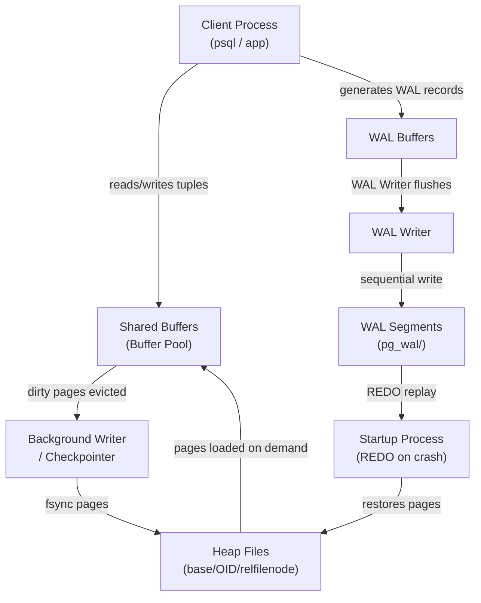
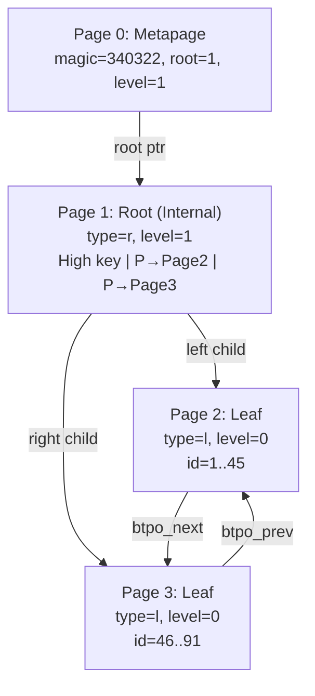
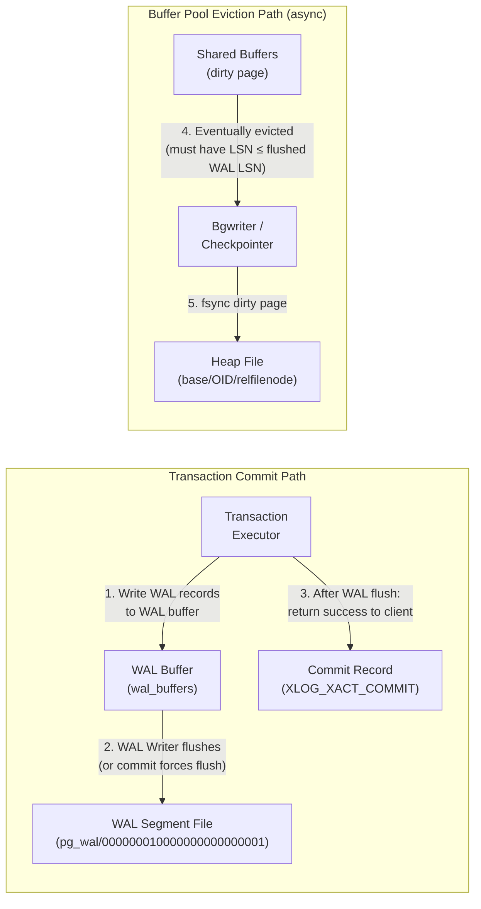
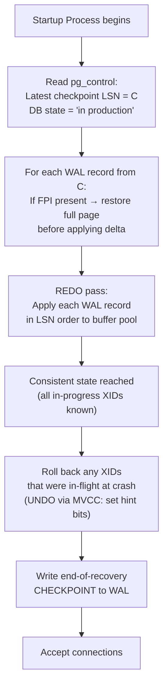

# Operational Verification Labs: PostgreSQL Internals

## Preface

This lab manual provides rigorous, hands-on operational verification of PostgreSQL's core subsystems: the slotted-page heap storage engine, the multi-version concurrency control (MVCC) protocol, and the Write-Ahead Log (WAL) crash-recovery pipeline. Each exercise is grounded in first-principles architecture. You will not merely run queries—you will understand *why* each system behaves as it does at the byte and algorithm level.

---

## 1. Architecture Overview

Before touching a terminal, establish a mental model of the three subsystems under investigation.



**Key architectural invariants:**

- WAL is written and flushed to disk *before* the corresponding dirty heap page is written (the WAL-before-data rule, enforcing durability).
- Every heap tuple carries an MVCC envelope (`xmin`, `xmax`, `ctid`) so readers never block writers.
- The buffer pool is the single point of truth for in-flight data; the on-disk heap is the authoritative durable store.

---

## 2. Environment Setup

### 2.1 Version Selection and Rationale

This lab targets **PostgreSQL 16** (current stable as of 2024). PostgreSQL 13 reached end-of-life for many distributions and lacks several introspection improvements (e.g., `pg_walinspect`, improved `pg_stat_activity` fields). All commands below are version-confirmed against PostgreSQL 16.

### 2.2 Installation

```bash
# Add the official PGDG apt repository (Debian/Ubuntu)
sudo apt-get install -y curl ca-certificates
curl -fsSL https://www.postgresql.org/media/keys/ACCC4CF8.asc \
  | sudo gpg --dearmor -o /etc/apt/trusted.gpg.d/postgresql.gpg

echo "deb https://apt.postgresql.org/pub/repos/apt $(lsb_release -cs)-pgdg main" \
  | sudo tee /etc/apt/sources.list.d/pgdg.list

sudo apt-get update
sudo apt-get install -y postgresql-16 postgresql-contrib-16

# Confirm installation
pg_lsclusters
psql --version        # expected: psql (PostgreSQL) 16.x
pg_controldata --version
pg_waldump --version
```

`postgresql-contrib-16` provides `pgbench`, `pageinspect`, `pg_buffercache`, and `pg_walinspect`—all required below.

### 2.3 Tooling Reference

| Tool | Type | Purpose |
|---|---|---|
| `psql` | Client CLI | Interactive SQL execution and meta-commands |
| `pgbench` | Client CLI | OLTP workload generation and benchmarking |
| `pg_controldata` | Server utility | Inspect cluster control file (checkpoint LSN, DB state) |
| `pg_waldump` | Server utility | Human-readable WAL record decoder |
| `pageinspect` | SQL extension | Raw page-level heap and index introspection |
| `pg_buffercache` | SQL extension | Live buffer pool state inspection |
| `pg_walinspect` | SQL extension | WAL introspection from SQL (PG 15+) |
| `pg_stat_activity` | System view | Per-backend session and wait event state |
| `pg_locks` | System view | Lock table with granted/waiting status |

### 2.4 Lab Database Initialization

```bash
# All commands run as the postgres OS user unless noted
sudo -u postgres psql <<'EOF'
-- Create an isolated lab database to avoid polluting the default cluster
CREATE DATABASE operational_lab;
\c operational_lab

-- Enable required extensions
CREATE EXTENSION IF NOT EXISTS pageinspect;
CREATE EXTENSION IF NOT EXISTS pg_buffercache;
CREATE EXTENSION IF NOT EXISTS pg_walinspect;    -- PG 15+; skip on PG 14
CREATE EXTENSION IF NOT EXISTS pg_stat_statements;

-- Confirm
SELECT name, default_version, installed_version
FROM pg_available_extensions
WHERE name IN ('pageinspect','pg_buffercache','pg_walinspect','pg_stat_statements');
EOF
```

---

## 3. Exercise 1: Storage Page Layout and Buffer Pool Inspection

### 3.1 Theoretical Foundation: The Slotted Page Format

PostgreSQL stores every table as a collection of 8 KB heap pages (the default `block_size`, compile-time configurable). Understanding the page layout is prerequisite to understanding MVCC, vacuuming, and I/O amplification.

```
┌──────────────────────────────────────────────────────────┐  offset 0
│  PageHeaderData (24 bytes)                               │
│  pd_lsn (8)  pd_checksum (2)  pd_flags (2)               │
│  pd_lower (2) pd_upper (2) pd_special (2) pd_pagesize (2)│
├──────────────────────────────────────────────────────────┤  offset 24
│  ItemId array  (4 bytes × max_tuples_per_page)           │
│  [lp_off (15 bits), lp_flags (2 bits), lp_len (15 bits)] │
├──────────────────────────────────────────────────────────┤  pd_lower
│  FREE SPACE                                              │
├──────────────────────────────────────────────────────────┤  pd_upper
│  Tuple N  (HeapTupleHeaderData + data)                   │
│  Tuple 2                                                 │
│  Tuple 1                                                 │
├──────────────────────────────────────────────────────────┤  pd_special
│  Special Space (B-tree: BTPageOpaqueData, 16 bytes)      │
└──────────────────────────────────────────────────────────┘  offset 8192
```

`pd_lower` grows *upward* as new `ItemId` slots are added; `pd_upper` grows *downward* as tuple data is appended. Free space is the gap between them. `pd_special` marks the boundary of the special area used by index access methods.

Each `ItemId` entry is a 32-bit word encoding three fields: a 15-bit offset (`lp_off`) pointing to the tuple within the page, a 2-bit flag (`lp_flags`: 0 = unused, 1 = normal, 2 = redirect, 3 = dead), and a 15-bit length (`lp_len`). This indirection is what makes HOT (Heap-Only Tuple) updates possible without index updates.

Every heap tuple begins with a `HeapTupleHeaderData` (23 bytes, padded to 24):

```
xmin   (4 bytes) — transaction ID that inserted this tuple version
xmax   (4 bytes) — transaction ID that deleted/updated this tuple (0 = live)
cid    (4 bytes) — command ID (or combo CID for same-xact visibility)
ctid   (6 bytes) — physical location (block, offset) of latest tuple version
infomask2 (2 bytes) — attribute count + HOT flags
infomask  (2 bytes) — xmin/xmax commit/abort hint bits, null bitmap presence
t_hoff (1 byte)  — offset to actual data (past header + optional null bitmap)
```

This header is what enables MVCC: each transaction sees only the tuple versions whose `xmin` committed before its snapshot and whose `xmax` did not commit before its snapshot.

### 3.2 Lab: Heap Page Inspection

```sql
\c operational_lab

-- Use FILLFACTOR 100 to pack tuples tightly and make page boundaries explicit
CREATE TABLE heap_lab (
    id      INTEGER     NOT NULL,
    payload TEXT        NOT NULL
) WITH (fillfactor = 100);

-- Insert enough rows to fill approximately one page
-- A TEXT of ~50 chars + header ≈ 90 bytes; 8192 / 90 ≈ 91 rows per page
INSERT INTO heap_lab
SELECT g, repeat('x', 50)
FROM generate_series(1, 91) AS g;

-- Force the heap to disk so pageinspect can read it
CHECKPOINT;
```

```sql
-- Step 1: Identify the relation's physical file
SELECT
    pg_relation_filepath('heap_lab')      AS file_path,
    pg_relation_filenode('heap_lab')      AS filenode,
    relpages,
    reltuples::bigint
FROM pg_class
WHERE relname = 'heap_lab';
```

```sql
-- Step 2: Inspect the raw page header
SELECT
    lower,
    upper,
    special,
    pagesize,
    8192 - upper                     AS live_tuple_bytes,
    upper - lower                    AS free_space_bytes,
    (lower - 24) / 4                 AS item_id_count
FROM page_header(get_raw_page('heap_lab', 0));
```

Expected output: `lower` ≈ 388 (96 `ItemId` slots × 4 bytes + 24 header = 408; actual varies), `upper` ≈ 464 (8192 − total tuple bytes), `free_space_bytes` ≈ 0 for a fully packed page.

```sql
-- Step 3: Decode all tuple slots on page 0
SELECT
    lp                               AS item_pointer,
    lp_off                           AS tuple_offset,
    lp_len                           AS tuple_length,
    lp_flags,                        -- 1 = normal live tuple
    t_xmin,                          -- inserting XID
    t_xmax,                          -- deleting XID (0 = live)
    t_ctid,                          -- current physical location
    t_infomask::bit(16)              AS infomask_bits,
    t_attrs[1]                       AS col_id,
    t_attrs[2]                       AS col_payload
FROM heap_page_items(get_raw_page('heap_lab', 0));
```

```sql
-- Step 4: Demonstrate MVCC versioning — update a row and inspect both versions
BEGIN;
UPDATE heap_lab SET payload = repeat('y', 50) WHERE id = 1;
-- Do NOT commit yet

-- In another session (or use a CTE trick):
-- The old tuple version has t_xmax = current XID (not yet committed)
-- The new tuple version has t_xmin = current XID, t_xmax = 0
SELECT
    lp,
    t_xmin,
    t_xmax,
    t_ctid,
    (t_infomask & x'0100'::int) != 0  AS xmin_committed,
    (t_infomask & x'0200'::int) != 0  AS xmin_invalid,
    (t_infomask & x'0400'::int) != 0  AS xmax_committed,
    (t_infomask & x'0800'::int) != 0  AS xmax_invalid
FROM heap_page_items(get_raw_page('heap_lab', 0))
WHERE lp IN (1, 92)   -- slot 1 = old version, slot 92 = new version on same page
ORDER BY lp;

ROLLBACK;
```

The `t_ctid` of the original tuple will point to the new tuple's `(block, offset)` when updated — this is the MVCC version chain pointer. After rollback, `t_xmin`/`t_xmax` hint bits will be cleared and VACUUM will eventually reclaim the dead slot.

### 3.3 Lab: Buffer Pool Inspection

The buffer pool (`shared_buffers`) caches 8 KB pages in shared memory. Every backend accesses pages exclusively through the buffer pool — there is no direct I/O to heap files during normal operation. The `pg_buffercache` extension exposes the buffer descriptor array.

```sql
CREATE EXTENSION IF NOT EXISTS pg_buffercache;

-- Inspect the buffer pool slots occupied by our heap_lab relation
SELECT
    b.bufferid,
    b.relblocknumber                  AS page_number,
    b.isdirty,
    b.usagecount,                     -- clock-sweep eviction hint (0–5)
    b.pinning_backends,               -- backends holding a pin on this buffer
    b.relforknumber                   -- 0=main, 1=FSM, 2=VM
FROM pg_buffercache b
JOIN pg_class c ON c.relfilenode = b.relfilenode
WHERE c.relname = 'heap_lab'
ORDER BY b.relblocknumber;
```

```sql
-- Aggregate: how much of shared_buffers is used, dirty, and from which databases?
SELECT
    CASE
        WHEN b.reldatabase = 0            THEN 'global'
        WHEN b.reldatabase = (SELECT oid FROM pg_database WHERE datname = current_database())
                                          THEN current_database()
        ELSE 'other db'
    END                                   AS database,
    count(*)                              AS buffers,
    count(*) FILTER (WHERE b.isdirty)     AS dirty_buffers,
    round(100.0 * count(*) / (
        SELECT setting::numeric FROM pg_settings WHERE name = 'shared_buffers'
    ), 2)                                 AS pct_of_pool,
    pg_size_pretty(count(*) * 8192::bigint) AS total_size
FROM pg_buffercache b
GROUP BY 1
ORDER BY 2 DESC;
```

The `usagecount` field implements the clock-sweep second-chance eviction algorithm: a page's count increments (up to 5) on each access and decrements by 1 during each clock-sweep pass. Only pages with `usagecount = 0` are eligible for eviction. This is why a heavily accessed page will survive many sweep passes before being replaced.

### 3.4 Lab: B-Tree Index Structure Inspection

```sql
-- Create a B-tree index with a low fillfactor to force multi-level structure
CREATE INDEX idx_heap_lab_id ON heap_lab(id) WITH (fillfactor = 70);

-- Force index to disk
CHECKPOINT;

-- Inspect B-tree metadata page (always page 0 of a B-tree index)
SELECT
    magic,          -- must be 340322 (0x53162 = BTREE_MAGIC)
    version,        -- B-tree version (currently 4 in PG 16)
    root,           -- block number of the root page
    level,          -- tree height (0 = single leaf = root)
    fastroot,       -- fast-path root (same as root when non-degenerate)
    fastlevel
FROM bt_metap('idx_heap_lab_id');
```

```sql
-- Inspect the root page
-- bt_page_stats returns aggregate stats for one B-tree page
SELECT
    blkno,
    type,           -- 'r'=root, 'i'=internal, 'l'=leaf
    live_items,
    dead_items,
    avg_item_size,
    page_size,
    free_size,
    btpo_prev,      -- left sibling (linked list of leaf pages)
    btpo_next,      -- right sibling
    btpo_level
FROM bt_page_stats('idx_heap_lab_id',
    (SELECT root FROM bt_metap('idx_heap_lab_id'))
);
```

```sql
-- Decode individual index entries on the root/leaf page
SELECT
    itemoffset,
    ctid,           -- heap tuple location this index entry points to
    itemlen,
    nulls,
    vars,
    data            -- raw key bytes (hex)
FROM bt_page_items('idx_heap_lab_id',
    (SELECT root FROM bt_metap('idx_heap_lab_id'))
)
LIMIT 20;
```



Leaf pages form a doubly-linked list (`btpo_prev`/`btpo_next`), enabling efficient range scans without returning to the root. Internal pages store separator keys and child page pointers. The PostgreSQL B-tree uses a right-link structure (Lehman-Yao protocol) for concurrent structural modifications without page-level write locks.

---

## 4. Exercise 2: Concurrency Control and Lock Graph Analysis

### 4.1 Theoretical Foundation: MVCC and Lock Modes

PostgreSQL implements **Snapshot Isolation** (SI) via MVCC. Readers take a snapshot at transaction start (or statement start in `READ COMMITTED`) and see only tuples whose inserting transaction committed before the snapshot and whose deleting transaction did not commit before the snapshot. This eliminates reader–writer blocking for heap reads.

However, writers must still coordinate to prevent the **lost update** anomaly. PostgreSQL does this through row-level tuple locks and relation-level lock modes.

The lock hierarchy, from least to most restrictive:

| Lock Mode | Acquired By | Conflicts With |
|---|---|---|
| `ACCESS SHARE` | `SELECT` | `ACCESS EXCLUSIVE` only |
| `ROW SHARE` | `SELECT FOR UPDATE/SHARE` | `EXCLUSIVE`, `ACCESS EXCLUSIVE` |
| `ROW EXCLUSIVE` | `INSERT`, `UPDATE`, `DELETE` | `SHARE`, `SHARE ROW EXCLUSIVE`, `EXCLUSIVE`, `ACCESS EXCLUSIVE` |
| `SHARE UPDATE EXCLUSIVE` | `VACUUM`, `ANALYZE`, `CREATE INDEX CONCURRENTLY` | `SHARE UPDATE EXCLUSIVE` and above |
| `SHARE` | `CREATE INDEX` | `ROW EXCLUSIVE` and above |
| `SHARE ROW EXCLUSIVE` | `CREATE TRIGGER`, some `ALTER TABLE` | `ROW EXCLUSIVE` and above |
| `EXCLUSIVE` | Rare explicit use | `ROW SHARE` and above |
| `ACCESS EXCLUSIVE` | `DROP TABLE`, `TRUNCATE`, `REINDEX`, `LOCK TABLE` | Everything |

Row-level locks (`RowShareLock`, `RowExclusiveLock`) are recorded in the heap tuple's `t_infomask` and `t_infomask2` fields — not in the lock table — which is why `pg_locks` does not show every row lock.

### 4.2 Lab: Simulating and Diagnosing Lock Contention

This exercise requires two concurrent `psql` sessions. Open two terminals and connect both to `operational_lab`.

**Session A (Terminal 1):**

```sql
\c operational_lab
-- Set a recognizable application name for diagnostics
SET application_name = 'lab_session_A';

BEGIN;
-- Acquire a row-exclusive lock on row id=1
UPDATE heap_lab SET payload = repeat('A', 50) WHERE id = 1;
-- Do NOT commit — hold the lock
```

**Session B (Terminal 2):**

```sql
\c operational_lab
SET application_name = 'lab_session_B';

BEGIN;
-- This UPDATE will block: it must acquire a RowExclusiveLock on the same tuple,
-- but Session A's uncommitted xmax prevents it from proceeding.
UPDATE heap_lab SET payload = repeat('B', 50) WHERE id = 1;
-- Session B now waits on Session A
```

**Diagnostic Session (Terminal 3):**

```sql
\c operational_lab

-- Query 1: Identify blocking and blocked backends
-- pg_blocking_pids() returns the array of PIDs blocking a given PID (PG 9.6+)
SELECT
    blocked.pid                         AS blocked_pid,
    blocked.application_name            AS blocked_app,
    blocked.query                       AS blocked_query,
    blocked.wait_event_type             AS wait_type,
    blocked.wait_event                  AS wait_event,
    blocking.pid                        AS blocking_pid,
    blocking.application_name           AS blocking_app,
    blocking.query                      AS blocking_query,
    blocking.state                      AS blocking_state
FROM pg_stat_activity AS blocked
JOIN pg_stat_activity AS blocking
    ON blocking.pid = ANY(pg_blocking_pids(blocked.pid))
WHERE cardinality(pg_blocking_pids(blocked.pid)) > 0;
```

```sql
-- Query 2: Detailed lock table — correlate relation locks with tuple locks
SELECT
    l.locktype,
    l.relation::regclass             AS relation,
    l.page,
    l.tuple,
    l.transactionid,
    l.classid,
    l.objid,
    l.mode,
    l.granted,
    a.pid,
    a.application_name,
    a.state,
    age(clock_timestamp(), a.query_start) AS lock_age
FROM pg_locks l
JOIN pg_stat_activity a ON a.pid = l.pid
WHERE l.relation = 'heap_lab'::regclass
   OR l.locktype = 'transactionid'
ORDER BY l.granted DESC, lock_age DESC;
```

```sql
-- Query 3: Construct the full wait graph as an adjacency list
-- This scales to complex multi-hop waits (e.g., A waits on B, B waits on C)
WITH RECURSIVE wait_graph AS (
    -- Base: directly blocked sessions
    SELECT
        blocked.pid             AS blocked_pid,
        blocked.application_name AS blocked_app,
        blocker.pid             AS blocker_pid,
        blocker.application_name AS blocker_app,
        1                       AS depth,
        ARRAY[blocked.pid]      AS path
    FROM pg_stat_activity blocked
    CROSS JOIN LATERAL unnest(pg_blocking_pids(blocked.pid)) AS blocker_pid_val
    JOIN pg_stat_activity blocker ON blocker.pid = blocker_pid_val
    WHERE cardinality(pg_blocking_pids(blocked.pid)) > 0

    UNION ALL

    -- Recursive: follow the chain
    SELECT
        wg.blocked_pid,
        wg.blocked_app,
        blocker.pid,
        blocker.application_name,
        wg.depth + 1,
        wg.path || blocker.pid
    FROM wait_graph wg
    JOIN pg_stat_activity sa ON sa.pid = wg.blocker_pid
    CROSS JOIN LATERAL unnest(pg_blocking_pids(wg.blocker_pid)) AS blocker_pid_val
    JOIN pg_stat_activity blocker ON blocker.pid = blocker_pid_val
    WHERE NOT blocker.pid = ANY(wg.path)   -- cycle detection
      AND wg.depth < 10
)
SELECT * FROM wait_graph ORDER BY depth, blocked_pid;
```

```mermaid
sequenceDiagram
    participant A as Session A (PID N)
    participant PG as PostgreSQL Lock Manager
    participant B as Session B (PID M)

    A->>PG: BEGIN; UPDATE row id=1
    PG->>PG: Grant RowExclusiveLock to XID_A<br/>Set t_xmax=XID_A on tuple (uncommitted)
    A->>PG: (holds lock, not committed)

    B->>PG: BEGIN; UPDATE row id=1
    PG->>PG: Check tuple t_xmax=XID_A<br/>XID_A not committed → conflict
    PG->>B: Wait on XID_A (transactionid lock)
    Note over B,PG: Session B enters wait state<br/>wait_event='relation', wait_event_type='Lock'

    A->>PG: COMMIT
    PG->>PG: Mark XID_A committed in pg_xact<br/>Release RowExclusiveLock
    PG->>B: Wake up Session B
    B->>PG: Re-evaluate tuple: t_xmax=XID_A committed<br/>tuple is dead; write new version with XID_B
    B->>PG: COMMIT
```

### 4.3 Deadlock Detection

PostgreSQL's lock manager runs a deadlock detector triggered after `deadlock_timeout` (default 1 second) whenever a lock wait begins. The detector performs a cycle search in the wait-for graph. If a cycle is found, PostgreSQL aborts the transaction with the lowest cost (usually the most recently started one).

```sql
-- Demonstrate a deadlock: requires exact timing, so run quickly

-- Session A:
BEGIN;
UPDATE heap_lab SET payload = 'A1' WHERE id = 1;
-- now immediately run Session B's first statement, then come back for A's second

-- Session B:
BEGIN;
UPDATE heap_lab SET payload = 'B2' WHERE id = 2;
UPDATE heap_lab SET payload = 'B1' WHERE id = 1;  -- blocks on Session A

-- Back in Session A:
UPDATE heap_lab SET payload = 'A2' WHERE id = 2;  -- blocks on Session B → DEADLOCK

-- PostgreSQL will detect the cycle after deadlock_timeout and abort one session:
-- ERROR:  deadlock detected
-- DETAIL:  Process N waits for ShareLock on transaction M; blocked by process N.
--          Process M waits for ShareLock on transaction N; blocked by process M.
-- HINT:  See server log for query details.
```

After the deadlock error, check the PostgreSQL log:

```bash
sudo -u postgres tail -n 50 /var/log/postgresql/postgresql-16-main.log \
  | grep -A 10 "deadlock detected"
```

### 4.4 Resolving Locks and Cleanup

```sql
-- In Session A: commit to release the lock and unblock Session B
COMMIT;

-- Optionally terminate a stuck backend (requires superuser):
-- SELECT pg_terminate_backend(pid) FROM pg_stat_activity WHERE application_name = 'lab_session_B';

-- Verify no locks remain on the relation
SELECT count(*) FROM pg_locks WHERE relation = 'heap_lab'::regclass AND granted = false;
-- Expected: 0
```

---

## 5. Exercise 3: WAL Architecture, Crash Simulation, and REDO Recovery

### 5.1 Theoretical Foundation: The WAL Protocol

The Write-Ahead Log is the cornerstone of PostgreSQL's durability and crash-recovery guarantees. It implements the **Force-Log-at-Commit** and **Steal/No-Force** buffer management policies:

- **Steal**: dirty pages may be evicted from the buffer pool to disk before the transaction commits.
- **No-Force**: dirty pages are *not* forced to disk at commit time; only WAL records are forced.
- **WAL-before-data invariant**: any dirty page write to the heap file must be preceded by writing (and flushing) all WAL records that describe modifications to that page up to the page's current LSN.

This combination achieves maximum I/O throughput (sequential WAL writes rather than random heap writes on commit) while guaranteeing durability.



Each WAL record begins with an `XLogRecord` header (24 bytes):

```
xl_tot_len  (uint32) — total length of record including header
xl_xid      (TransactionId) — originating transaction XID
xl_prev     (XLogRecPtr) — LSN of previous record (backlink)
xl_info     (uint8)  — record-type flags
xl_rmid     (RmgrId) — resource manager ID (Heap, Btree, Transaction, etc.)
xl_crc      (pg_crc32c) — CRC32C of entire record for corruption detection
```

Resource managers (RMGRs) are subsystem handlers: `RM_HEAP_ID` handles heap modifications, `RM_BTREE_ID` handles B-tree changes, `RM_XACT_ID` handles commit/abort records, `RM_CHECKPOINT_ID` handles checkpoint records, etc.

### 5.2 Lab: Pre-Crash State Setup

```sql
\c operational_lab

-- Create a crash-test table with an explicit checkpoint to establish a clean baseline
CREATE TABLE crash_test (
    id      SERIAL PRIMARY KEY,
    value   TEXT NOT NULL,
    inserted_at TIMESTAMPTZ DEFAULT now()
);

-- Record the LSN before any inserts
SELECT pg_current_wal_lsn() AS baseline_lsn \gset

-- Insert a batch that will be in WAL but potentially not yet flushed to heap
INSERT INTO crash_test (value)
SELECT 'pre_crash_row_' || g
FROM generate_series(1, 1000) AS g;

CHECKPOINT;  -- Forces dirty pages to disk AND writes a checkpoint WAL record

-- Record post-checkpoint LSN — crash recovery must replay WAL from at least here
SELECT pg_current_wal_lsn() AS post_checkpoint_lsn \gset

-- Insert another batch — these will be in WAL but heap pages may be dirty (not yet synced)
INSERT INTO crash_test (value)
SELECT 'post_checkpoint_row_' || g
FROM generate_series(1001, 2000) AS g;

-- Confirm current state
SELECT count(*) FROM crash_test;  -- should be 2000

-- Get the WAL segment file containing our recent writes
SELECT pg_walfile_name(pg_current_wal_lsn()) AS current_wal_file;
```

```bash
# Record the WAL segment name for post-crash inspection
sudo -u postgres psql -d operational_lab -tAc \
  "SELECT pg_walfile_name(pg_current_wal_lsn());"
# Example output: 000000010000000000000003
```

### 5.3 Lab: Inspect WAL Records Before the Crash

```bash
# Identify the data directory and current WAL segment
PGDATA=$(sudo -u postgres psql -tAc "SHOW data_directory;")
echo "PGDATA: $PGDATA"

# List recent WAL segment files
ls -lh "${PGDATA}/pg_wal/" | tail -10

# Decode the WAL segment — filter to our relation's heap records
# Note: pg_waldump requires the server to be stopped OR uses a secondary WAL copy
# Here we use pg_walinspect from SQL (PG 15+) which is safer on a live server:
```

```sql
-- Using pg_walinspect (live server, PG 15+) — safer than pg_waldump on a running server
SELECT
    start_lsn,
    end_lsn,
    prev_lsn,
    xid,
    resource_manager,
    record_type,
    record_length,
    main_data_length,
    fpi_length,         -- Full Page Image length (written on first modification after checkpoint)
    description
FROM pg_get_wal_records_info(
    -- Start from just before our inserts (use baseline_lsn captured above)
    pg_lsn '0/3000000',   -- adjust to actual LSN range from your session
    pg_lsn '0/4000000'
)
WHERE resource_manager IN ('Heap', 'Heap2', 'Transaction', 'XLOG')
ORDER BY start_lsn
LIMIT 50;
```

```bash
# After stopping the server, use pg_waldump for full record detail:
# (Do NOT run pg_waldump on WAL files while the server is running in production;
#  use a copy or pg_walinspect instead.)
sudo systemctl stop postgresql@16-main

pg_waldump \
  --path="${PGDATA}/pg_wal" \
  --timeline=1 \
  --start=0/3000000 \
  --rmgr=Heap \
  --rmgr=Transaction \
  2>/dev/null | head -60
```

Expected output lines (decoded WAL records):

```
rmgr: Heap        len (rec/tot):     59/    59, tx:    745, lsn: 0/030000A8, ...
    XLOG_HEAP_INSERT: rel 1663/16384/16400; off 1; flags 0x08; blkref #0: rel 1663/16384/16400 blk 0
rmgr: Transaction len (rec/tot):     46/    46, tx:    745, lsn: 0/030001E0, ...
    COMMIT 2024-01-15 10:23:45.123456 UTC
```

**Key fields to observe:**
- `fpi_length > 0`: a Full Page Image (FPI) was written — this occurs on the *first modification* of a page after a checkpoint. FPIs are required for idempotent REDO: even if the page write was torn (partial), replaying the FPI restores the entire page to a consistent pre-modification state before applying the WAL delta.
- `rmgr: XLOG` with `CHECKPOINT_ONLINE` or `CHECKPOINT_SHUTDOWN`: marks the redo start LSN.

### 5.4 Lab: Crash Simulation

```bash
# IMPORTANT: This sends SIGKILL (not SIGTERM) to the postmaster.
# SIGTERM triggers a fast shutdown (clean); SIGKILL simulates a true crash.
# pg_ctl stop -m immediate also uses SIGQUIT for immediate shutdown.

sudo -u postgres pg_ctl stop -D "${PGDATA}" -m immediate
# Or equivalently: sudo kill -9 $(head -1 "${PGDATA}/postmaster.pid")

echo "Server stopped (crash simulated). pg_controldata state should show 'in production'."

# Inspect the control file — it will NOT show 'shut down' because we crashed
pg_controldata "${PGDATA}" | grep -E "state|checkpoint|LSN|wal"
```

Expected `pg_controldata` output after a crash (not a clean shutdown):

```
Database cluster state:               in production
Latest checkpoint location:           0/3001000
Prior checkpoint location:            0/2001000
Latest checkpoint's REDO location:    0/3001000
Latest checkpoint's TimeLineID:       1
Latest checkpoint's full_page_writes: on
...
```

The state `in production` signals to the startup process that crash recovery is required. After a clean shutdown (`pg_ctl stop -m fast`), the state would read `shut down`.

### 5.5 Lab: WAL Replay and Recovery Verification

```bash
# Start PostgreSQL — the startup process will automatically perform REDO
sudo systemctl start postgresql@16-main

# Monitor the startup/recovery log
sudo journalctl -u postgresql@16-main -f &

# Wait for the server to become ready (typically 1–10 seconds for this workload)
until sudo -u postgres pg_isready; do sleep 0.5; done
echo "Server ready."
```

The PostgreSQL log during crash recovery will contain:

```
LOG:  database system was shut down at ... (incorrect — it was crashed)
LOG:  database system was not properly shut down; automatic recovery in progress
LOG:  starting point-in-time recovery to latest
LOG:  restored log file "000000010000000000000003" from archive  (if archive_command set)
LOG:  redo starts at 0/3001000
LOG:  consistent recovery state reached at 0/3001090
LOG:  redo done at 0/30020B8
LOG:  checkpoint starting: end-of-recovery immediate
LOG:  checkpoint complete: wrote 14 buffers (0.1%); ...
LOG:  database system is ready to accept connections
```

```sql
\c operational_lab

-- Verify all 2000 rows survived the crash
SELECT count(*) FROM crash_test;
-- Expected: 2000

-- Verify data integrity across both pre- and post-checkpoint batches
SELECT
    CASE
        WHEN value LIKE 'pre_crash_row_%'       THEN 'pre_checkpoint'
        WHEN value LIKE 'post_checkpoint_row_%' THEN 'post_checkpoint'
        ELSE 'other'
    END                             AS batch,
    count(*)                        AS row_count
FROM crash_test
GROUP BY 1
ORDER BY 1;
-- Expected: pre_checkpoint=1000, post_checkpoint=1000

-- Confirm no corruption via table scan (triggers checksum validation if enabled)
SELECT sum(length(value)) AS total_payload_bytes FROM crash_test;
```

```sql
-- Inspect pg_controldata state via SQL after recovery
SELECT name, setting
FROM pg_settings
WHERE name IN (
    'wal_level', 'wal_buffers', 'checkpoint_completion_target',
    'max_wal_size', 'wal_compression', 'full_page_writes'
);
```

### 5.6 Recovery Architecture: REDO Pass Internals



Crucially, PostgreSQL does **not** perform an UNDO pass in the traditional sense. Because MVCC stores all tuple versions in the heap, in-flight transactions at crash time are simply invisible to new transactions (their `xmin` is not in `pg_xact` as committed). VACUUM eventually reclaims these dead versions. This is fundamentally different from undo-log based systems (e.g., InnoDB) that must physically reverse uncommitted changes.

---

## 6. Production Diagnostic Reference

### 6.1 pg_controldata Field Glossary

```bash
pg_controldata "${PGDATA}"
```

| Field | Meaning |
|---|---|
| `Database cluster state` | `in production` = crash recovery needed; `shut down` = clean |
| `Latest checkpoint location` | LSN of the most recent complete checkpoint |
| `Latest checkpoint's REDO location` | WAL replay must start here (may differ from checkpoint LSN if checkpoint was online) |
| `Latest checkpoint's TimeLineID` | Timeline (increments on `pg_basebackup` restore or PITR) |
| `Latest checkpoint's full_page_writes` | Whether FPIs were enabled — if `off`, crash recovery relies entirely on WAL deltas |
| `Latest checkpoint's NextXID` | Next transaction ID to be assigned — critical for XID wraparound monitoring |
| `Database block size` | Compile-time page size (almost always 8192) |

### 6.2 Canonical Diagnostic Queries

```sql
-- ══════════════════════════════════════════════════════════════
-- 1. Buffer pool efficiency: hit rate by relation
-- ══════════════════════════════════════════════════════════════
SELECT
    c.relname,
    c.relkind,
    count(b.bufferid)                              AS cached_pages,
    count(b.bufferid) * 8192                       AS cached_bytes,
    round(100.0 * count(b.bufferid) / NULLIF(c.relpages, 0), 1) AS pct_of_relation_cached
FROM pg_class c
LEFT JOIN pg_buffercache b
    ON b.relfilenode = c.relfilenode
   AND b.reldatabase IN (0, (SELECT oid FROM pg_database WHERE datname = current_database()))
WHERE c.relpages > 0
  AND c.relkind IN ('r','i','t','m')
GROUP BY c.relname, c.relkind, c.relpages
ORDER BY cached_pages DESC
LIMIT 20;

-- ══════════════════════════════════════════════════════════════
-- 2. Lock wait analysis: who is blocking whom, for how long
-- ══════════════════════════════════════════════════════════════
SELECT
    blocked_locks.pid                     AS blocked_pid,
    blocked_activity.usename              AS blocked_user,
    blocked_activity.application_name     AS blocked_app,
    blocked_activity.query                AS blocked_query,
    blocked_activity.wait_event_type      AS wait_type,
    blocked_activity.wait_event           AS wait_event,
    age(now(), blocked_activity.query_start) AS wait_duration,
    blocking_locks.pid                    AS blocking_pid,
    blocking_activity.usename             AS blocking_user,
    blocking_activity.state               AS blocking_state,
    blocking_activity.query               AS blocking_query
FROM pg_catalog.pg_locks blocked_locks
JOIN pg_catalog.pg_stat_activity blocked_activity
    ON blocked_activity.pid = blocked_locks.pid
JOIN pg_catalog.pg_locks blocking_locks
    ON blocking_locks.locktype = blocked_locks.locktype
   AND blocking_locks.database IS NOT DISTINCT FROM blocked_locks.database
   AND blocking_locks.relation IS NOT DISTINCT FROM blocked_locks.relation
   AND blocking_locks.page IS NOT DISTINCT FROM blocked_locks.page
   AND blocking_locks.tuple IS NOT DISTINCT FROM blocked_locks.tuple
   AND blocking_locks.virtualxid IS NOT DISTINCT FROM blocked_locks.virtualxid
   AND blocking_locks.transactionid IS NOT DISTINCT FROM blocked_locks.transactionid
   AND blocking_locks.classid IS NOT DISTINCT FROM blocked_locks.classid
   AND blocking_locks.objid IS NOT DISTINCT FROM blocked_locks.objid
   AND blocking_locks.objsubid IS NOT DISTINCT FROM blocked_locks.objsubid
   AND blocking_locks.pid != blocked_locks.pid
JOIN pg_catalog.pg_stat_activity blocking_activity
    ON blocking_activity.pid = blocking_locks.pid
WHERE NOT blocked_locks.granted;

-- ══════════════════════════════════════════════════════════════
-- 3. WAL generation rate and checkpoint frequency
-- ══════════════════════════════════════════════════════════════
SELECT
    checkpoints_timed,
    checkpoints_req,                        -- >0 means max_wal_size is too small
    checkpoint_write_time / 1000.0          AS checkpoint_write_sec,
    checkpoint_sync_time / 1000.0           AS checkpoint_fsync_sec,
    buffers_checkpoint,
    buffers_clean,
    buffers_backend,                        -- >0 means bgwriter can't keep up
    buffers_alloc,
    pg_size_pretty(buffers_checkpoint * 8192::bigint) AS checkpoint_written_bytes,
    stats_reset
FROM pg_stat_bgwriter;

-- ══════════════════════════════════════════════════════════════
-- 4. Table bloat estimate (dead tuple accumulation)
-- ══════════════════════════════════════════════════════════════
SELECT
    relname,
    n_live_tup,
    n_dead_tup,
    round(100.0 * n_dead_tup / NULLIF(n_live_tup + n_dead_tup, 0), 1) AS dead_pct,
    last_autovacuum,
    last_autoanalyze,
    pg_size_pretty(pg_total_relation_size(oid)) AS total_size
FROM pg_stat_user_tables
ORDER BY n_dead_tup DESC
LIMIT 20;

-- ══════════════════════════════════════════════════════════════
-- 5. XID age: wraparound risk monitoring
-- ══════════════════════════════════════════════════════════════
SELECT
    datname,
    age(datfrozenxid)                        AS xid_age,
    2147483647 - age(datfrozenxid)           AS xids_until_wraparound,
    round(100.0 * age(datfrozenxid) / 2147483647, 2) AS pct_toward_wraparound
FROM pg_database
ORDER BY xid_age DESC;
-- Alert threshold: age > 1.5 billion (autovacuum_freeze_max_age default: 200M)
```

### 6.3 Operational CLI Reference

```bash
# ── pg_controldata: cluster state inspection ──────────────────────────────────
PGDATA=$(sudo -u postgres psql -tAc "SHOW data_directory;")
pg_controldata "${PGDATA}"

# ── pg_waldump: decode WAL records (use on a stopped server or WAL copy) ──────
# Decode a specific segment, filtering by resource manager
pg_waldump \
  --path="${PGDATA}/pg_wal" \
  --timeline=1 \
  --start=0/1000000 \
  --end=0/2000000 \
  --rmgr=Heap \
  --rmgr=Transaction \
  2>/dev/null

# Count record types in a WAL segment
pg_waldump --path="${PGDATA}/pg_wal" --stats=record 2>/dev/null

# ── Cluster lifecycle ──────────────────────────────────────────────────────────
sudo systemctl start  postgresql@16-main
sudo systemctl stop   postgresql@16-main      # graceful (fast shutdown)
sudo -u postgres pg_ctl stop -D "${PGDATA}" -m immediate  # crash simulation

# ── pgbench: generate a standard TPC-B-like workload ──────────────────────────
# Initialize (scale factor 10 = ~160 MB)
sudo -u postgres pgbench -i -s 10 operational_lab

# Run for 60 seconds with 8 clients, 2 worker threads
sudo -u postgres pgbench \
  -c 8 -j 2 -T 60 \
  --progress=5 \
  -d operational_lab

# ── Data directory structure reference ───────────────────────────────────────
# ${PGDATA}/
#   base/          — per-database tablespace (subdirectory = database OID)
#   global/        — cluster-wide tables (pg_database, pg_authid, ...)
#   pg_wal/        — WAL segment files (each exactly 16 MB by default)
#   pg_xact/       — transaction commit/abort status (clog)
#   pg_multixact/  — MultiXact status (for row-level shared locks)
#   pg_subtrans/   — subtransaction parent mapping
#   postgresql.conf — runtime configuration
#   pg_control     — cluster control file (read by pg_controldata)
#   postmaster.pid — PID file (deleted on clean shutdown)
```

### 6.4 Verification Checklist

After completing all exercises, confirm the following:

- `pg_controldata` shows `Database cluster state: in production` after a `kill -9` crash and `shut down` after `pg_ctl stop -m fast`.
- `heap_page_items()` on a live table shows `t_xmax = 0` for live tuples and a non-zero `t_xmax` for the old version of an updated row.
- `pg_buffercache` shows `isdirty = true` for pages modified since the last checkpoint.
- The wait-graph query returns at least one row during the two-session lock contention scenario.
- `SELECT count(*) FROM crash_test` returns 2000 after the crash recovery exercise, confirming WAL REDO correctness.
- `pg_waldump --stats=record` shows `FPIWrite` records immediately following a checkpoint (first modification of each dirty page).
- `pg_stat_bgwriter.checkpoints_req` is 0 during normal operation; a non-zero value indicates `max_wal_size` is insufficient.

---

## Appendix A: Data Page Layout — C Reference

The following is a simplified but accurate representation of the core PostgreSQL page structures, derived from `src/include/storage/bufpage.h` and `src/include/access/htup_details.h`. This is for reference only — do not use these offsets for direct file manipulation.

```c
/*
 * PageHeaderData — first 24 bytes of every 8KB heap/index page.
 * Source: src/include/storage/bufpage.h
 */
typedef struct PageHeaderData {
    PageXLogRecPtr pd_lsn;       /* 8 bytes: LSN of last WAL record on this page */
    uint16         pd_checksum;  /* 2 bytes: page checksum (if enabled) */
    uint16         pd_flags;     /* 2 bytes: PD_HAS_FREE_LINES, PD_PAGE_FULL, etc. */
    LocationIndex  pd_lower;     /* 2 bytes: offset to start of free space */
    LocationIndex  pd_upper;     /* 2 bytes: offset to end of free space */
    LocationIndex  pd_special;   /* 2 bytes: offset to start of special space */
    uint16         pd_pagesize_version; /* 2 bytes: page size (high 8) + version (low 8) */
    TransactionId  pd_prune_xid; /* 4 bytes: oldest XID on page eligible for pruning */
    /* ItemId array follows: 4 bytes × (pd_lower - SizeOfPageHeaderData) / sizeof(ItemId) */
} PageHeaderData;

/*
 * ItemId — 4-byte slot directory entry.
 * Packed bitfield: lp_off(15)|lp_flags(2)|lp_len(15)
 */
typedef struct ItemIdData {
    unsigned lp_off:15;   /* byte offset to tuple (from page start) */
    unsigned lp_flags:2;  /* LP_UNUSED=0, LP_NORMAL=1, LP_REDIRECT=2, LP_DEAD=3 */
    unsigned lp_len:15;   /* byte length of tuple */
} ItemIdData;

/*
 * HeapTupleHeaderData — variable-length prefix of every heap tuple.
 * Source: src/include/access/htup_details.h
 */
typedef struct HeapTupleHeaderData {
    union {
        HeapTupleFields t_heap;   /* xmin, xmax, cid/xvac */
        DatumTupleFields t_datum; /* for pass-by-reference composite types */
    } t_choice;
    ItemPointerData t_ctid;       /* 6 bytes: current TID (or next version's TID) */
    uint16          t_infomask2;  /* attribute count | HOT-updated | heap-only flags */
    uint16          t_infomask;   /* xmin/xmax committed/aborted hint bits | null bitmap | ... */
    uint8           t_hoff;       /* offset to data (past optional null bitmap + OID) */
    /* data follows: attribute values, possibly preceded by null bitmap */
} HeapTupleHeaderData;
```

---

## Appendix B: Further Reading

- **PostgreSQL Source Code**: `src/backend/storage/page/bufpage.c`, `src/backend/access/heap/heapam.c`, `src/backend/access/transam/xlog.c`
- **"The Internals of PostgreSQL"** (Hironobu Suzuki) — freely available at interdb.jp; covers MVCC, WAL, and VACUUM in exhaustive detail.
- **Hellerstein, Stonebraker & Hamilton, "Architecture of a Database System"** (2007) — the canonical reference for the buffer manager and log manager designs underlying PostgreSQL.
- **Ramakrishnan & Gehrke, "Database Management Systems" Ch. 16–19** — crash recovery (ARIES), concurrency control theory, and buffer management algorithms.
- **PostgreSQL Documentation, Chapter 74 (Database Physical Storage)** and **Chapter 30 (Reliability and the Write-Ahead Log)** — official authoritative reference.
