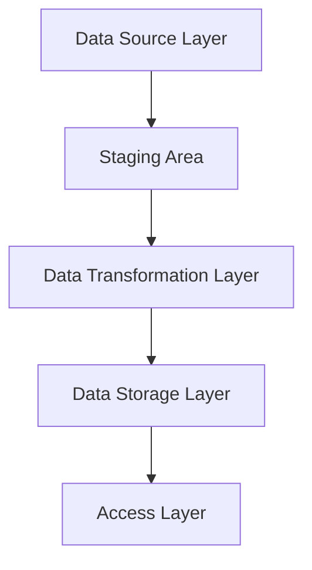

# Lesson 1: Data Warehousing Fundamentals

## 1. First-Principles Intuition & Invariants

Data warehousing is a cornerstone of modern data engineering, serving as a centralized repository for historical data that is used for reporting, analysis, and business intelligence. The concept of a data warehouse emerged from the need to consolidate data from various operational systems into a single, unified structure that supports complex queries and analytical operations. This consolidation allows organizations to gain insights that are not readily available from operational databases, which are optimized for transactional efficiency rather than analytical performance.

At its core, a data warehouse is a relational database designed to support decision-making processes. It is built on the principle of data normalization, which involves organizing data into tables and establishing relationships between them to eliminate redundancy and ensure data integrity. However, data warehousing often involves denormalization to optimize for query performance, as analytical queries typically require joining multiple tables, and denormalization can reduce the complexity and execution time of these operations.

The design of a data warehouse is guided by several invariants and principles. One of the most fundamental is the principle of data immutability, which means that once data is loaded into the warehouse, it is not modified. Instead, new data is appended, and historical data is preserved. This approach ensures data consistency and provides a complete historical record, which is crucial for trend analysis and auditing.

Another invariant is the separation of data storage and processing. Data warehouses are designed to separate the storage of data from the processing of queries, allowing for efficient scaling of each component independently. This separation is achieved through the use of distributed storage systems and query engines that can handle large volumes of data and complex analytical queries.

The concept of data lineage is also a critical invariant in data warehousing. Data lineage refers to the process of tracking the origin, transformation, and movement of data throughout its lifecycle. It is essential for ensuring data quality and compliance with regulatory requirements, as it provides a clear audit trail of how data is processed and used.

## 2. Core Architecture & Mechanics

The architecture of a data warehouse is designed to support the efficient storage and retrieval of large volumes of historical data. At a high level, a data warehouse consists of several key components, including the data source layer, the staging area, the data transformation layer, the data storage layer, and the access layer.

### Data Source Layer

The data source layer is the entry point for data into the data warehouse. It consists of various operational systems, such as transactional databases, legacy systems, and external data sources, that provide the raw data to be loaded into the warehouse. The data source layer is responsible for collecting and integrating data from these various sources, ensuring that it is in a format that can be processed by the data warehouse.

### Staging Area

The staging area is a temporary storage location where raw data is loaded and transformed before being loaded into the data warehouse. The staging area serves as a buffer between the data source layer and the data transformation layer, allowing for the validation and cleansing of data before it is loaded into the warehouse. The staging area is also used to handle data transformations that are specific to a particular data source, such as converting data formats or mapping data fields.

### Data Transformation Layer

The data transformation layer is responsible for transforming raw data into a format that is suitable for loading into the data warehouse. This transformation process involves several steps, including data cleansing, data integration, and data enrichment. Data cleansing involves removing duplicates, correcting errors, and ensuring data consistency. Data integration involves combining data from multiple sources into a single, unified structure. Data enrichment involves adding additional information to the data, such as geolocation data or demographic information, to enhance its analytical value.

### Data Storage Layer

The data storage layer is the core of the data warehouse, where the transformed data is stored in a format that is optimized for analytical queries. The data storage layer is typically implemented using a relational database management system (RDBMS) that supports complex queries and data indexing. The data storage layer is designed to support efficient data retrieval and to handle large volumes of data. It is also responsible for ensuring data consistency and integrity, as well as providing mechanisms for data backup and recovery.

### Access Layer

The access layer is the interface through which users interact with the data warehouse. It consists of various tools and applications, such as business intelligence (BI) tools, reporting tools, and data visualization tools, that allow users to query and analyze the data in the warehouse. The access layer is responsible for providing a user-friendly interface for querying the data and for ensuring that users have the appropriate access rights to the data.

To illustrate the architecture of a data warehouse, we can use a Mermaid diagram:

In this diagram, the data source layer is the entry point for raw data, which is loaded into the staging area for validation and cleansing. The data transformation layer then transforms the data into a format suitable for loading into the data storage layer, which is implemented using a relational database management system. Finally, the access layer provides users with tools and applications for querying and analyzing the data in the warehouse.

## 3. High-Performance Optimization & Failure Modes

The performance of a data warehouse is critical to its effectiveness, as it must be able to handle large volumes of data and complex analytical queries efficiently. To achieve high performance, data warehouses are designed with several optimizations and techniques.

### Concurrency Control

Concurrency control is a critical aspect of data warehouse performance, as it ensures that multiple users can query the data warehouse simultaneously without affecting the performance or consistency of the data. Data warehouses use various concurrency control mechanisms, such as locking and multi-version concurrency control (MVCC), to manage concurrent access to the data. Locking involves temporarily blocking access to a data resource to prevent other users from modifying it, while MVCC allows multiple versions of a data resource to exist simultaneously, allowing users to access the data without blocking other users.

### Resource Scaling

Data warehouses are designed to scale horizontally, meaning that they can be expanded by adding more resources, such as additional servers or storage devices, to handle increased data volumes and query loads. Horizontal scaling is achieved through the use of distributed storage systems and query engines that can distribute data and queries across multiple nodes. This allows data warehouses to handle large volumes of data and complex analytical queries efficiently.

### Boundary Edge Cases

Data warehouses must be designed to handle boundary edge cases, such as data skew and query complexity, to ensure optimal performance. Data skew occurs when certain data values are more frequent than others, leading to uneven distribution of data across the storage system. Data warehouses use various techniques, such as partitioning and indexing, to mitigate data skew and ensure even distribution of data. Query complexity is another challenge, as analytical queries can be complex and resource-intensive. Data warehouses use query optimization techniques, such as query rewriting and query caching, to optimize query performance and reduce resource consumption.

### Failure Mitigations

Data warehouses must be designed to handle failures gracefully, ensuring data consistency and availability even in the event of hardware or software failures. Data warehouses use various mechanisms, such as data replication and fault tolerance, to ensure data availability and consistency. Data replication involves creating copies of data on multiple nodes, allowing data to be accessed even if one node fails. Fault tolerance involves designing the system to continue operating even in the event of hardware or software failures, using techniques such as failover and redundancy.

In conclusion, data warehousing is a critical component of modern data engineering, providing organizations with a centralized repository for historical data that supports decision-making processes. The architecture of a data warehouse is designed to support efficient storage and retrieval of large volumes of historical data, with optimizations and techniques for handling concurrency, resource scaling, boundary edge cases, and failure modes. By understanding the architecture, design principles, and implementation of data warehouses, senior software engineers, systems programmers, and domain architects can design and implement data warehouses that meet the needs of their organizations.
