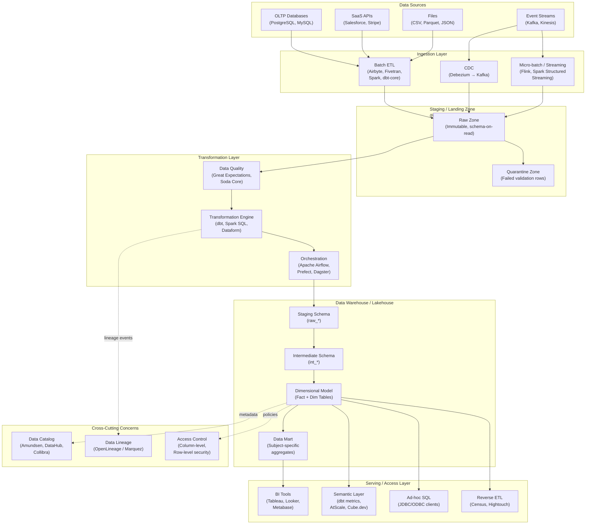
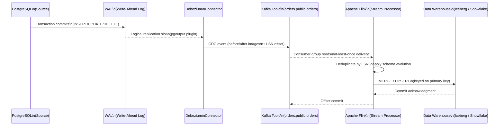
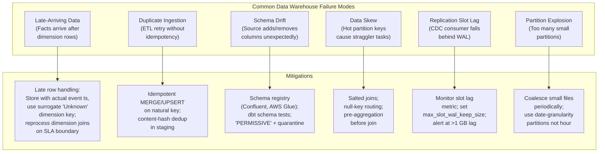
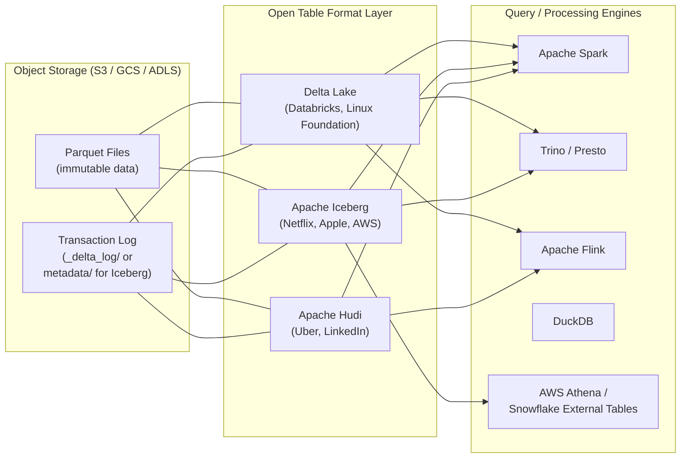
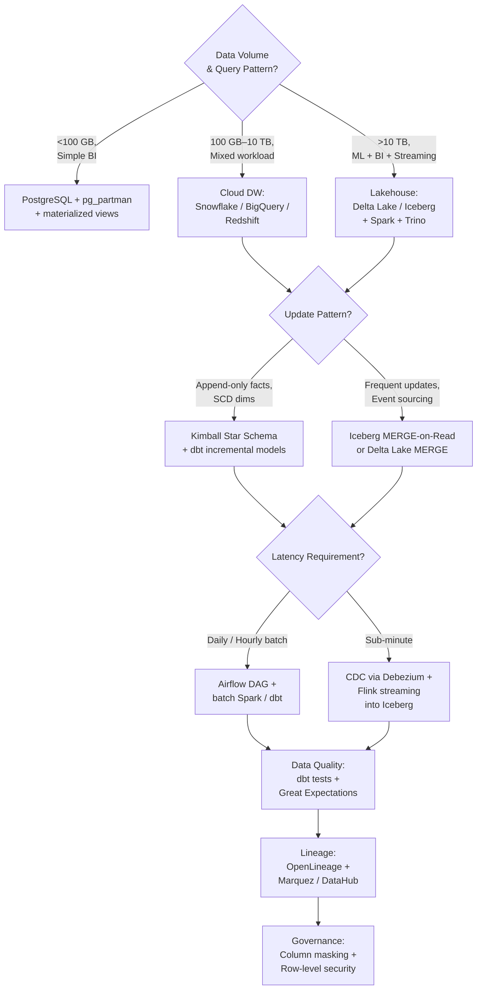

# Lesson 1: Data Warehousing Fundamentals

## 1. First-Principles Intuition & Invariants

### Why Data Warehouses Exist: The Fundamental Tension

Operational databases (OLTP systems) are engineered around a specific access pattern: low-latency reads and writes on small, well-indexed row subsets. A PostgreSQL instance serving an e-commerce checkout flow optimizes for `SELECT ... WHERE order_id = $1` or `UPDATE inventory SET qty = qty - 1 WHERE sku = $2`. The B-tree indexes, row-oriented storage layout, WAL-based durability, and tight locking semantics all serve this workload.

Analytical queries invert every one of these assumptions. A revenue analysis query needs to scan hundreds of millions of rows, aggregate across dozens of dimensions, and join fact tables to slowly-changing dimension tables — often reading 90% of the columns in a table. On a row-oriented OLTP system, this saturates I/O bandwidth because every row read pulls in columns that the query never accesses. The B-tree indexes built for point lookups are useless for range scans over dates. Lock contention between OLAP readers and OLTP writers degrades both workloads simultaneously.

This is the fundamental tension that data warehousing resolves: **read-optimized, column-oriented, batch-loaded storage, decoupled from operational write paths.**

### The Foundational Invariants

**Data immutability and append semantics.** In a canonical data warehouse, historical fact data is never updated in-place. New events are appended; corrections are expressed as new rows with version metadata or as explicit correction records. This invariant is not merely a convention — it is an architectural guarantee that enables bitmap indexes, columnar compression, and materialized aggregates to remain consistent without costly invalidation. Systems like Snowflake, BigQuery, and Redshift enforce this at the storage engine level by making base table mutations expensive (full micro-partition or file rewrites) relative to appends.

**Storage/compute decoupling.** Modern cloud data warehouses physically separate durable storage (S3, GCS, Azure Blob) from compute (virtual warehouse clusters, BigQuery slots). This decoupling means storage scales independently of compute cost and that multiple isolated compute clusters can query the same data simultaneously without I/O interference. The architectural consequence is that data does not need to be "moved" for different teams to query it — only compute allocation changes.

**Subject orientation.** A data warehouse is organized around business subjects (Customers, Products, Orders, Sessions) rather than around the operational systems that produce data. The Customer dimension in a warehouse synthesizes identity records from a CRM, an e-commerce platform, and a support ticketing system into a single, authoritative entity. This subject-oriented design is what makes cross-system analytics possible.

**Non-volatile, time-variant storage.** Loaded data persists indefinitely with no TTL-based eviction. Every row carries a temporal key (a `loaded_at` timestamp, an `effective_date`, or a snapshot date) so that the warehouse can answer questions about any historical point in time. This distinguishes a warehouse from an OLTP database, where rows are overwritten, and from an operational data store (ODS), which typically holds only a rolling window of recent data.

**Separation of concerns: ETL vs. query.** The warehouse is a consumer of transformation pipelines, not a transformation engine itself. Data arrives pre-structured. The warehouse's job is high-throughput ingestion and low-latency analytical retrieval — not business logic execution. When this boundary is violated (e.g., heavy stored procedures performing business logic inside the warehouse), performance and maintainability degrade.

---

## 2. Core Architecture & Mechanics

### The Classical Kimball vs. Inmon Architectures

Two competing philosophies have shaped data warehouse design for thirty years.

**Inmon's Enterprise Data Warehouse (EDW)** prescribes a centralized, normalized (3NF) warehouse as the single source of truth. Data marts — subject-specific, denormalized views — are derived *from* the EDW. The benefit is minimal redundancy and a single authoritative integration point. The cost is complexity: loading normalized data requires resolving foreign keys across dozens of tables before any query can be answered, and the centralized model creates organizational bottlenecks.

**Kimball's dimensional modeling** prescribes a bottom-up approach: build denormalized, query-optimized dimensional models (star schemas) for each business process, integrated via conformed dimensions (shared `date_key`, `customer_key`). The warehouse *is* the collection of these integrated dimensional models. Load performance is simpler, query performance is better for typical BI workloads, and teams can deliver incrementally. The cost is potential denormalization redundancy across subject areas.

Modern lakehouse architectures (Delta Lake, Apache Iceberg, Apache Hudi) partially dissolve this debate by providing ACID semantics and schema evolution on object storage, allowing normalized staging alongside denormalized serving layers without duplicating physical storage.

### Dimensional Modeling: Star and Snowflake Schemas

The star schema is the canonical dimensional model. A central **fact table** stores quantitative measurements of a business process (order lines, page views, sensor readings). Surrounding **dimension tables** store the descriptive context (who, what, where, when, how). Fact tables are wide (many foreign keys to dimensions, many measure columns) and deep (billions of rows). Dimension tables are narrow and shallow (thousands to millions of rows).

```sql
-- Fact table: one row per order line item
CREATE TABLE fact_order_line (
    order_line_key    BIGINT       NOT NULL,  -- surrogate key
    order_date_key    INT          NOT NULL,  -- FK to dim_date
    customer_key      INT          NOT NULL,  -- FK to dim_customer
    product_key       INT          NOT NULL,  -- FK to dim_product
    store_key         INT          NOT NULL,  -- FK to dim_store
    -- Degenerate dimension (no dim table needed)
    order_number      VARCHAR(32)  NOT NULL,
    -- Additive measures
    quantity_ordered  INT          NOT NULL,
    unit_price_usd    NUMERIC(12,4) NOT NULL,
    discount_usd      NUMERIC(12,4) NOT NULL DEFAULT 0,
    gross_revenue_usd NUMERIC(12,4) GENERATED ALWAYS AS
                      (quantity_ordered * unit_price_usd) STORED,
    net_revenue_usd   NUMERIC(12,4) GENERATED ALWAYS AS
                      (quantity_ordered * unit_price_usd - discount_usd) STORED
) PARTITION BY RANGE (order_date_key);

-- Dimension table: one row per unique customer version (SCD Type 2)
CREATE TABLE dim_customer (
    customer_key        INT          NOT NULL,  -- surrogate key
    customer_id         VARCHAR(64)  NOT NULL,  -- natural/business key
    full_name           VARCHAR(256),
    email               VARCHAR(256),
    country_iso2        CHAR(2),
    customer_segment    VARCHAR(64),
    -- SCD Type 2 validity window
    effective_date      DATE         NOT NULL,
    expiry_date         DATE         NOT NULL DEFAULT '9999-12-31',
    is_current          BOOLEAN      NOT NULL DEFAULT TRUE,
    -- Audit columns
    source_system       VARCHAR(64)  NOT NULL,
    loaded_at           TIMESTAMPTZ  NOT NULL DEFAULT NOW()
);

-- Conformed date dimension (shared across all fact tables)
CREATE TABLE dim_date (
    date_key            INT          PRIMARY KEY,  -- YYYYMMDD integer
    calendar_date       DATE         NOT NULL,
    day_of_week         SMALLINT     NOT NULL,  -- 1=Monday, 7=Sunday (ISO)
    day_name            VARCHAR(16)  NOT NULL,
    week_of_year        SMALLINT     NOT NULL,
    month_number        SMALLINT     NOT NULL,
    month_name          VARCHAR(16)  NOT NULL,
    quarter_number      SMALLINT     NOT NULL,
    year_number         SMALLINT     NOT NULL,
    is_weekend          BOOLEAN      NOT NULL,
    is_holiday          BOOLEAN      NOT NULL,
    fiscal_quarter      SMALLINT,
    fiscal_year         SMALLINT
);
```

The **snowflake schema** normalizes dimension tables into sub-dimensions (e.g., `dim_product` → `dim_product_category` → `dim_product_department`). This reduces storage marginally but requires additional joins, increasing query complexity. Modern columnar engines (Redshift, BigQuery, Snowflake) handle star schema joins so efficiently that the snowflake schema's storage savings are rarely worth the query complexity cost.

### Slowly Changing Dimensions (SCDs)

Dimensions change over time. A customer moves cities; a product changes price tier; a sales rep changes region. How the warehouse tracks these changes is called Slowly Changing Dimension (SCD) handling.

| Type | Mechanism | Historical Accuracy | Storage Cost |
|------|-----------|---------------------|--------------|
| SCD 0 | Overwrite, no history | None | Minimal |
| SCD 1 | Overwrite current row | None | Minimal |
| SCD 2 | Insert new row, expire old | Full point-in-time | 2×–10× growth |
| SCD 3 | Add "previous value" column | One prior version only | Low |
| SCD 4 | Separate history table | Full, via join | Moderate |
| SCD 6 | Hybrid (1+2+3) | Full + current on each row | High |

SCD Type 2 is the most common for analytically important attributes. The key implementation detail is that fact table joins must use the dimension surrogate key that was **current at the time of the fact event**, not the current surrogate key. This is why surrogate keys (auto-generated integers or UUIDs) are used instead of natural keys — they remain stable even as attribute values change and new rows are inserted.

### Complete Data Warehouse Architecture



### ETL vs. ELT: The Architectural Shift

The classical ETL (Extract → Transform → Load) model transformed data *before* loading it into the warehouse, often in a separate middleware layer (Informatica PowerCenter, IBM DataStage). This model made sense when warehouse compute was expensive and storage was cheap only in bulk.

Modern cloud warehouses inverted this economics: storage is cheap (S3 at ~$0.023/GB/month), compute is elastic and billed per-second, and the warehouse query engine (Snowflake, BigQuery, Redshift Spectrum) is the most powerful transformation tool available. This enabled **ELT** (Extract → Load → Transform): load raw data first, transform inside the warehouse using SQL or Spark.

dbt (data build tool) is the canonical ELT transformation framework. It compiles templated SQL (`SELECT` statements with Jinja macros) into DDL/DML, manages dependency graphs via a DAG, runs incremental models, tests data quality assertions, and generates lineage documentation — all as version-controlled SQL files.

```python
# dbt incremental model: models/mart/fct_order_lines.sql
{{
    config(
        materialized='incremental',
        unique_key='order_line_key',
        incremental_strategy='merge',
        cluster_by=['order_date_key'],
        partition_by={
            "field": "order_date_key",
            "data_type": "int64",
            "range": {"start": 20200101, "end": 20301231, "interval": 10000}
        }
    )
}}

WITH source_orders AS (
    SELECT
        ol.order_line_id,
        ol.order_id,
        ol.order_created_at,
        ol.customer_id,
        ol.product_sku,
        ol.store_id,
        ol.quantity,
        ol.unit_price_usd,
        ol.discount_usd,
        ol._loaded_at
    FROM {{ ref('stg_orders__order_lines') }} ol
    
    -- Only process rows loaded after the last warehouse run
    WHERE ol._loaded_at > (SELECT MAX(_loaded_at) FROM {{ this }})
    
),

enriched AS (
    SELECT
        {{ dbt_utils.generate_surrogate_key(['ol.order_line_id']) }} AS order_line_key,
        CAST(FORMAT_DATE('%Y%m%d', DATE(ol.order_created_at)) AS INT64) AS order_date_key,
        dc.customer_key,
        dp.product_key,
        ds.store_key,
        ol.order_id                                 AS order_number,
        ol.quantity                                 AS quantity_ordered,
        ol.unit_price_usd,
        ol.discount_usd,
        ol.quantity * ol.unit_price_usd             AS gross_revenue_usd,
        ol.quantity * ol.unit_price_usd
            - ol.discount_usd                       AS net_revenue_usd,
        ol._loaded_at
    FROM source_orders ol
    -- Join to SCD2 customer dimension: match on natural key AND validity window
    LEFT JOIN {{ ref('dim_customer') }} dc
        ON ol.customer_id = dc.customer_id
        AND DATE(ol.order_created_at) BETWEEN dc.effective_date AND dc.expiry_date
        AND dc.is_current = TRUE
    LEFT JOIN {{ ref('dim_product') }} dp
        ON ol.product_sku = dp.product_sku
        AND dp.is_current = TRUE
    LEFT JOIN {{ ref('dim_store') }} ds
        ON ol.store_id = ds.store_id
)

SELECT * FROM enriched
```

---

## 3. Columnar Storage: The Engine of Analytical Performance

Understanding *why* columnar storage outperforms row-oriented storage for analytics requires understanding the memory hierarchy and I/O access patterns.

### Row vs. Column Storage Layout

In a **row-oriented** store, all column values for a given row are stored contiguously on disk. Reading a single column across 1 million rows requires seeking through the full row width for each row:

```
Row 1: [cust_id=1001][name="Alice"][country="US"][amount=49.99][ts=2024-01-15]
Row 2: [cust_id=1002][name="Bob"][country="DE"][amount=129.00][ts=2024-01-15]
...
Row 1000000: [...]
```

In a **column-oriented** store, all values for a single column are stored contiguously:

```
cust_id column:  [1001][1002][1003]...[1000000]
amount column:   [49.99][129.00][9.99]...[850.00]
country column:  [US][DE][US]...[JP]
```

An aggregation query `SELECT SUM(amount) FROM orders WHERE country = 'US'` only needs to read the `amount` and `country` columns. In a row store, this reads 100% of the data. In a column store, it reads only 2 of N columns — a speedup proportional to N/2.

### Columnar Compression

Column co-location enables aggressive compression because values within a column share the same data type and often exhibit high cardinality similarity. Common techniques:

**Run-length encoding (RLE):** Sorted string columns (e.g., `country = 'US'` repeated 500,000 times) compress to `(US, 500000)`. Redshift achieves 10:1+ compression on low-cardinality sorted columns.

**Dictionary encoding:** Each unique value maps to a small integer. The column stores integer codes + a lookup dictionary. A `product_category` column with 200 unique values over 1 billion rows stores `ceil(log2(200)) = 8 bits` per row instead of 20+ bytes per string.

**Bit-packing / frame-of-reference:** Integer columns with a small range (e.g., `day_of_week` in [1,7]) are stored in the minimum necessary bits. Delta encoding stores differences between consecutive values rather than absolute values — ideal for monotonically increasing timestamps.

**ZSTD / Snappy / LZ4 on top:** After type-specific encoding, a general-purpose compressor further reduces size. Parquet files typically achieve 3:1–10:1 overall compression ratios over raw CSV.

### Parquet File Format Internals

Apache Parquet is the dominant open columnar storage format for data lakes and lakehouses. Its internal structure is critical to understanding query performance:

```
Parquet File
├── Row Group 0  (128 MB default)
│   ├── Column Chunk: order_date_key
│   │   ├── Page 0 (1 MB): [data pages + encoding]
│   │   └── Column Statistics: min=20240101, max=20240131, null_count=0
│   ├── Column Chunk: customer_key
│   │   └── Column Statistics: min=1, max=9847231, null_count=1203
│   └── Column Chunk: net_revenue_usd
│       └── Column Statistics: min=-50.00, max=15000.00, null_count=0
├── Row Group 1  (128 MB)
│   └── ...
└── File Footer (Thrift-encoded metadata)
    ├── Schema
    ├── Row Group Offsets
    └── Column Statistics (global)
```

Query engines exploit Parquet's statistics for **predicate pushdown** — a query `WHERE order_date_key = 20240115` can skip entire row groups whose `max < 20240115` or `min > 20240115` without reading any data pages. This is **partition pruning at the file level**, independent of any warehouse-level partitioning.

---

## 4. Data Ingestion Patterns: CDC and Batch Loading

### Change Data Capture (CDC)

CDC is the technique of capturing row-level changes (INSERT, UPDATE, DELETE) from a source OLTP database and streaming them to the warehouse with sub-minute latency. The primary mechanism is **log-based CDC**, which reads the database transaction log rather than querying the source tables — avoiding any performance impact on the OLTP system.



Debezium (backed by Red Hat/IBM) is the standard open-source CDC framework. For PostgreSQL, it uses the **logical replication protocol** (`pgoutput` or `wal2json` plugin), establishing a replication slot that causes the WAL to be retained until the slot is consumed. A critical operational concern: if the Debezium connector falls behind, the WAL grows unboundedly and can fill the disk. Replication slot lag monitoring is mandatory in production.

A CDC event payload in Debezium's envelope format:

```json
{
  "before": {
    "order_id": "ord_7843",
    "status": "pending",
    "total_usd": 149.99
  },
  "after": {
    "order_id": "ord_7843",
    "status": "shipped",
    "total_usd": 149.99
  },
  "op": "u",
  "ts_ms": 1705320045123,
  "source": {
    "version": "2.4.0.Final",
    "connector": "postgresql",
    "db": "ecommerce",
    "schema": "public",
    "table": "orders",
    "txId": 48291847,
    "lsn": 93847162,
    "snapshot": "false"
  }
}
```

### Batch Loading with Apache Spark

For high-throughput batch ingestion of large historical datasets, Apache Spark remains the dominant distributed processing engine:

```python
from pyspark.sql import SparkSession
from pyspark.sql import functions as F
from pyspark.sql.types import StructType, StructField, StringType, DecimalType, TimestampType
from delta.tables import DeltaTable

spark = SparkSession.builder \
    .appName("order_lines_ingestion") \
    .config("spark.sql.extensions", "io.delta.sql.DeltaSparkSessionExtension") \
    .config("spark.sql.catalog.spark_catalog",
            "org.apache.spark.sql.delta.catalog.DeltaCatalog") \
    .config("spark.sql.shuffle.partitions", "400") \
    .config("spark.default.parallelism", "400") \
    .getOrCreate()

RAW_PATH = "s3://data-lake/raw/orders/order_lines/"
DELTA_PATH = "s3://data-lake/warehouse/fact_order_lines/"

# Schema enforcement at ingestion: reject malformed rows early
order_line_schema = StructType([
    StructField("order_line_id",  StringType(),  nullable=False),
    StructField("order_id",       StringType(),  nullable=False),
    StructField("customer_id",    StringType(),  nullable=True),
    StructField("product_sku",    StringType(),  nullable=False),
    StructField("store_id",       StringType(),  nullable=True),
    StructField("quantity",       DecimalType(10, 0), nullable=False),
    StructField("unit_price_usd", DecimalType(12, 4), nullable=False),
    StructField("discount_usd",   DecimalType(12, 4), nullable=True),
    StructField("order_created_at", TimestampType(), nullable=False),
])

raw_df = (
    spark.read
    .schema(order_line_schema)
    .option("mode", "PERMISSIVE")          # Corrupted rows → _corrupt_record
    .option("columnNameOfCorruptRecord", "_corrupt_record")
    .parquet(RAW_PATH)
)

# Quarantine corrupted rows before any transformation
good_df = raw_df.filter(F.col("_corrupt_record").isNull()).drop("_corrupt_record")
bad_df  = raw_df.filter(F.col("_corrupt_record").isNotNull())

if bad_df.count() > 0:
    bad_df.write.mode("append").parquet("s3://data-lake/quarantine/order_lines/")

# Transformations
transformed_df = (
    good_df
    .withColumn("discount_usd",
                F.coalesce(F.col("discount_usd"), F.lit(0).cast(DecimalType(12, 4))))
    .withColumn("gross_revenue_usd",
                F.col("quantity") * F.col("unit_price_usd"))
    .withColumn("net_revenue_usd",
                F.col("quantity") * F.col("unit_price_usd") - F.col("discount_usd"))
    .withColumn("order_date_key",
                F.date_format(F.col("order_created_at"), "yyyyMMdd").cast("int"))
    .withColumn("_loaded_at", F.current_timestamp())
    # Repartition by date key to co-locate data for partition pruning
    .repartition(F.col("order_date_key"))
)

# MERGE into Delta Lake table (idempotent upsert)
if DeltaTable.isDeltaTable(spark, DELTA_PATH):
    delta_table = DeltaTable.forPath(spark, DELTA_PATH)
    (
        delta_table.alias("target")
        .merge(
            transformed_df.alias("source"),
            "target.order_line_id = source.order_line_id"
        )
        .whenMatchedUpdateAll()
        .whenNotMatchedInsertAll()
        .execute()
    )
else:
    # Initial full load
    (
        transformed_df.write
        .format("delta")
        .mode("overwrite")
        .partitionBy("order_date_key")
        .option("overwriteSchema", "true")
        .save(DELTA_PATH)
    )

spark.stop()
```

---

## 5. High-Performance Optimization & Failure Modes

### Query Execution Internals: The Volcano Model and Vectorization

The classical query execution model, the **Volcano (iterator) model** (Graefe, 1994), represents each relational operator (scan, filter, join, aggregate) as an iterator that calls `next()` on its child to pull one tuple at a time. This is elegant and composable but inefficient: every `next()` call is a virtual function dispatch, CPU branch mispredictions accumulate, and L1 cache utilization is poor because tuples are processed one at a time.

Modern columnar query engines (DuckDB, ClickHouse, Velox) use **vectorized execution**: each operator processes a *batch* of 1,024–8,192 values at a time. Within a batch, tight loops with no virtual dispatch operate on contiguous arrays that fit in L1/L2 cache. SIMD (AVX-512 on modern Intel/AMD) instructions process 8–16 values per clock cycle. The aggregate speedup over Volcano-style execution is typically 10×–100× for scan-heavy analytical workloads.

**Just-in-time (JIT) compilation** (used in HyPer, later in LLVM-based systems like Spark with Whole-Stage CodeGen, and Snowflake's query compilation) goes further: the query plan is compiled to native machine code at runtime, eliminating all interpreter overhead for the hot path.

### Partitioning Strategies

Partitioning physically divides a large table into smaller, independently addressable segments, enabling **partition pruning** — the query planner skips partitions that cannot contain qualifying rows.

**Range partitioning by date** is the most common strategy for fact tables, because the most common filter predicate in analytical queries is a date range. A query `WHERE order_date_key BETWEEN 20240101 AND 20240131` on a table partitioned monthly reads only 1 of 48 partitions (4 years of data), reducing I/O by 98%.

**Hash partitioning** distributes rows uniformly across N partitions based on a hash of a key column, eliminating data skew at the cost of needing to scan all partitions for most queries. Useful when joins on a specific key are the dominant pattern — co-locating fact and dimension rows on the same node eliminates network shuffle.

**Composite partitioning** (partition by month, sub-partition by region) provides two levels of pruning but adds operational complexity.

```sql
-- PostgreSQL declarative partitioning example
-- Parent table (no data stored here directly)
CREATE TABLE fact_order_line (
    order_line_key    BIGINT       NOT NULL,
    order_date_key    INT          NOT NULL,
    customer_key      INT          NOT NULL,
    product_key       INT          NOT NULL,
    net_revenue_usd   NUMERIC(12,4) NOT NULL
) PARTITION BY RANGE (order_date_key);

-- Monthly partitions: planner prunes to O(1) partitions for date-ranged queries
CREATE TABLE fact_order_line_2024_01
    PARTITION OF fact_order_line
    FOR VALUES FROM (20240101) TO (20240201);

CREATE TABLE fact_order_line_2024_02
    PARTITION OF fact_order_line
    FOR VALUES FROM (20240201) TO (20240301);

-- Partition-local index: only indexes rows within a single partition
CREATE INDEX ON fact_order_line_2024_01 (customer_key);
CREATE INDEX ON fact_order_line_2024_02 (customer_key);

-- Query demonstrating pruning: only fact_order_line_2024_01 is scanned
EXPLAIN ANALYZE
SELECT customer_key, SUM(net_revenue_usd)
FROM   fact_order_line
WHERE  order_date_key BETWEEN 20240101 AND 20240131
GROUP  BY customer_key;
```

### Join Strategies and Data Skew

The most expensive operation in a distributed warehouse query is the **shuffle join**: both sides of a join are repartitioned by the join key across all nodes, requiring full network data transfer. For large fact-to-fact joins, this can saturate cluster network bandwidth.

**Broadcast joins** (also called replicated joins) eliminate the shuffle for small-to-large joins: the smaller table is replicated to every node, and each node performs a local hash join against its local partition of the large table. BigQuery uses this automatically for tables under ~1 GB; Spark requires a hint (`BROADCAST`).

**Data skew** occurs when a small number of join key values account for a disproportionate fraction of rows. In a customer dimension join, `customer_id = NULL` or a default "guest" customer might appear in 30% of fact rows. All these rows hash to the same reducer, creating a straggler task that holds up the entire job. Mitigation strategies:

1. **Null-safe join keys**: Assign a random surrogate key to unknown entities rather than using NULL.
2. **Salted joins**: Append a random integer in [0, N) to the skewed key on the fact side; replicate the dimension row N times with each salt value. This spreads the load across N reducers at the cost of N× dimension replication.
3. **Pre-aggregation**: Aggregate fact rows to a coarser granularity before the join, reducing the number of rows per skewed key.

### Concurrency and Multi-Version Concurrency Control (MVCC)

Columnar warehouse systems manage read isolation through MVCC rather than row-level locking. Each write transaction creates a new **snapshot** (Snowflake: micro-partition versions; Delta Lake: transaction log entries; BigQuery: storage service versions). Readers observe a consistent snapshot at their transaction's start timestamp, unaffected by concurrent writes. Writers never block readers; readers never block writers.

The tradeoff: vacuuming/compaction is required to reclaim space from superseded versions. In Delta Lake, `VACUUM` removes Parquet files no longer referenced by the transaction log. In Snowflake, automatic storage optimization handles this transparently. Failing to vacuum Delta tables leads to unbounded storage growth and degraded file listing performance.

### Failure Modes and Mitigations



**Late-arriving data** is endemic in distributed systems: a mobile app event buffered offline for 72 hours arrives in the warehouse three days after the fact it describes. The correct handling is to store the event with its original `event_timestamp` (not the ingestion timestamp), accept that historical partitions will be appended to, and configure BI tool queries to filter on `event_timestamp` rather than `loaded_at`. SCD2 dimension joins for late facts require scanning the full dimension history, not just the current row.

**Duplicate ingestion** is the most common correctness failure. Any retry-able pipeline step that lacks idempotency will produce duplicate rows on failure + retry. The solution is deterministic surrogate key generation (SHA-256 hash of the natural key fields) combined with an `INSERT ... ON CONFLICT DO NOTHING` or `MERGE` operation on the warehouse side.

```sql
-- Idempotent upsert pattern (PostgreSQL / Redshift syntax)
INSERT INTO fact_order_line (
    order_line_key, order_date_key, customer_key,
    product_key, net_revenue_usd, _loaded_at
)
SELECT
    MD5(order_line_id::TEXT)::UUID   AS order_line_key,
    order_date_key,
    customer_key,
    product_key,
    net_revenue_usd,
    NOW()                            AS _loaded_at
FROM staging.order_lines_batch_20240115
ON CONFLICT (order_line_key) DO UPDATE
    SET net_revenue_usd = EXCLUDED.net_revenue_usd,
        _loaded_at      = EXCLUDED._loaded_at
WHERE fact_order_line.net_revenue_usd <> EXCLUDED.net_revenue_usd;
```

---

## 6. Data Lineage and Governance

### OpenLineage: The Standard Lineage Protocol

Data lineage — the ability to trace a dataset from its origin through every transformation to its current form — is not a nice-to-have feature for compliance teams. It is an operational necessity: without lineage, diagnosing the downstream blast radius of a source schema change, tracing a data quality failure to its root cause, or satisfying a GDPR right-to-erasure request across derived tables is guesswork.

**OpenLineage** (CNCF incubating project) is the open specification for lineage event emission. It defines a JSON schema for `RunEvent` objects that capture the input datasets, output datasets, job metadata, and facets (quality metrics, schema snapshots, data source metadata) for every pipeline execution.

```json
{
  "eventType": "COMPLETE",
  "eventTime": "2024-01-15T10:30:00.000Z",
  "run": {
    "runId": "d46e465b-d358-4d32-83d4-df2d10e62c5b",
    "facets": {
      "parent": {
        "_producer": "https://github.com/OpenLineage/OpenLineage/airflow",
        "run": {"runId": "9a3f1c8e-a1b2-4c3d-8e5f-2a4b6c8d0e1f"},
        "job": {"namespace": "airflow", "name": "daily_warehouse_load"}
      }
    }
  },
  "job": {
    "namespace": "dbt",
    "name": "ecommerce.fct_order_lines",
    "facets": {
      "sql": {
        "_producer": "https://github.com/OpenLineage/OpenLineage",
        "query": "SELECT ... FROM stg_orders__order_lines ..."
      }
    }
  },
  "inputs": [
    {
      "namespace": "snowflake://account.snowflakecomputing.com",
      "name": "ecommerce.staging.stg_orders__order_lines",
      "facets": {
        "schema": {
          "fields": [
            {"name": "order_line_id", "type": "VARCHAR"},
            {"name": "net_revenue_usd", "type": "NUMBER"}
          ]
        },
        "dataQualityMetrics": {
          "rowCount": 4823947,
          "bytes": 892341120,
          "columnMetrics": {
            "net_revenue_usd": {"nullCount": 0, "min": -50.0, "max": 15000.0}
          }
        }
      }
    }
  ],
  "outputs": [
    {
      "namespace": "snowflake://account.snowflakecomputing.com",
      "name": "ecommerce.mart.fct_order_lines"
    }
  ]
}
```

**Marquez** (also from the OpenLineage project) is the open-source lineage metadata server that stores and serves these events. **DataHub** (LinkedIn open-source, adopted by Airbnb, Slack, Microsoft) and **Apache Atlas** are broader data catalog platforms that consume OpenLineage events alongside schema registry metadata, ownership records, and business glossary terms.

### Column-Level Security and Row-Level Access Control

Modern warehouses enforce access control at two granularities beyond table-level permissions:

**Column-level security (CLS)** allows restricting access to specific columns (PII, financial data) without duplicating tables. In Snowflake, this is implemented via `GRANT SELECT (column_list)` on specific columns or via **Dynamic Data Masking** policies that return masked values (`***-**-XXXX` for SSNs) based on the querying role.

```sql
-- Snowflake: Dynamic Data Masking policy for PII
CREATE OR REPLACE MASKING POLICY email_mask AS (val STRING)
RETURNS STRING ->
    CASE
        WHEN CURRENT_ROLE() IN ('DATA_ANALYST_PII', 'DATA_ENGINEER') THEN val
        ELSE REGEXP_REPLACE(val, '.+@', '***@')
    END;

ALTER TABLE dim_customer
    MODIFY COLUMN email
    SET MASKING POLICY email_mask;
```

**Row-level security (RLS)** restricts which rows a user can see based on their identity or role. In BigQuery, this is implemented via row access policies; in Snowflake, via row access policies backed by a mapping table:

```sql
-- Snowflake: Row access policy (users see only their region's data)
CREATE OR REPLACE ROW ACCESS POLICY region_access_policy AS (region_code VARCHAR)
RETURNS BOOLEAN ->
    EXISTS (
        SELECT 1
        FROM   user_region_access
        WHERE  username    = CURRENT_USER()
        AND    region_code = region_code
    );

ALTER TABLE fact_order_line
    ADD ROW ACCESS POLICY region_access_policy ON (store_region_code);
```

---

## 7. Lakehouse Architecture: Convergence of Lake and Warehouse

The traditional two-tier architecture — a data lake for raw storage and a data warehouse for structured serving — creates operational friction: data duplication, ETL pipelines between tiers, schema inconsistency, and separate governance surfaces. The **lakehouse** architecture (Databricks, 2020) eliminates this by adding an ACID transaction layer directly on top of object storage, unifying the lake's flexibility with the warehouse's transactional guarantees.



**Apache Iceberg's** key innovation over Hive-style partitioning is the **manifest file** architecture: the table's current state is defined by a snapshot pointing to manifest lists, which point to manifests, which list individual data files with per-file statistics. This enables:

- **Hidden partitioning**: The partition scheme is an implementation detail tracked in metadata, not encoded in directory paths. Queries filter using predicates on actual columns; Iceberg maps these to partitions automatically.
- **Partition evolution**: The partition scheme can change without rewriting existing data files. New files use the new partition spec; old files retain their original spec. Both are queryable transparently.
- **Time travel**: Each snapshot is immutable. `SELECT * FROM orders FOR SYSTEM_TIME AS OF TIMESTAMP '2024-01-01 00:00:00'` reads the snapshot that was current at that timestamp.

```python
# Apache Iceberg with PyIceberg: creating and querying a table
from pyiceberg.catalog import load_catalog
from pyiceberg.schema import Schema
from pyiceberg.types import (
    NestedField, LongType, StringType, DecimalType, TimestampType
)
from pyiceberg.partitioning import PartitionSpec, PartitionField
from pyiceberg.transforms import DayTransform
import pyarrow as pa

catalog = load_catalog(
    "glue",
    **{
        "type": "glue",
        "warehouse": "s3://data-lake/warehouse/",
        "region_name": "us-east-1",
    }
)

schema = Schema(
    NestedField(1,  "order_line_id",  StringType(),  required=True),
    NestedField(2,  "order_created_at", TimestampType(adjust_to_utc=True), required=True),
    NestedField(3,  "customer_id",    StringType(),  required=False),
    NestedField(4,  "net_revenue_usd", DecimalType(12, 4), required=True),
)

# Hidden partitioning: partition by day derived from order_created_at
partition_spec = PartitionSpec(
    PartitionField(
        source_id=2,
        field_id=1000,
        transform=DayTransform(),
        name="order_created_at_day"
    )
)

table = catalog.create_table(
    identifier="ecommerce.fact_order_lines",
    schema=schema,
    partition_spec=partition_spec,
    properties={"write.target-file-size-bytes": "134217728"}  # 128 MB
)

# Write with PyArrow — Iceberg handles partition assignment automatically
arrow_table = pa.table({
    "order_line_id":   ["ol_001", "ol_002", "ol_003"],
    "order_created_at": pa.array(
        ["2024-01-15T10:00:00Z", "2024-01-15T11:30:00Z", "2024-01-16T09:00:00Z"],
        type=pa.timestamp("us", tz="UTC")
    ),
    "customer_id":    ["cust_1", "cust_2", "cust_3"],
    "net_revenue_usd": pa.array([49.99, 129.00, 9.99],
                                 type=pa.decimal128(12, 4)),
})

table.append(arrow_table)

# Time travel query
from datetime import datetime
snapshot_id = table.snapshot_by_timestamp(
    datetime(2024, 1, 15, 12, 0, 0).timestamp() * 1000  # milliseconds
).snapshot_id
historical_table = table.scan(snapshot_id=snapshot_id).to_arrow()
```

---

## 8. Data Quality: Contracts and Assertions

Data quality failures are the most common cause of incorrect business decisions derived from warehouses. The industry has converged on two complementary approaches: **in-pipeline assertions** (fail fast, quarantine bad data) and **post-load monitoring** (detect anomalies in what has already landed).

### dbt Tests as Quality Contracts

dbt's built-in and extensible test framework lets you express quality contracts as YAML that generates SQL assertions:

```yaml
# models/mart/schema.yml
version: 2

models:
  - name: fct_order_lines
    description: "One row per order line item, grain = order_line_id"
    columns:
      - name: order_line_key
        description: "SHA-256 surrogate key"
        tests:
          - not_null
          - unique  # enforces fact table grain
      - name: order_date_key
        tests:
          - not_null
          - dbt_utils.accepted_range:
              min_value: 20200101
              max_value: 20991231
      - name: customer_key
        tests:
          - not_null
          - relationships:
              to: ref('dim_customer')
              field: customer_key
      - name: net_revenue_usd
        tests:
          - not_null
          - dbt_utils.accepted_range:
              min_value: -500   # allow refunds
              max_value: 100000
              inclusive: true

    tests:
      # Custom test: referential integrity check with time window
      - dbt_utils.expression_is_true:
          expression: "net_revenue_usd >= -500 AND gross_revenue_usd >= 0"
      # Row count anomaly detection (>10% deviation from 7-day avg)
      - elementary.volume_anomalies:
          timestamp_column: order_created_at
          where_expression: "order_date_key >= 20240101"
```

### Great Expectations for Programmatic Quality Contracts

For non-dbt pipelines and cross-system validation, Great Expectations provides a Python-native contract framework:

```python
import great_expectations as gx
from great_expectations.core.batch import RuntimeBatchRequest
import pandas as pd

context = gx.get_context()

# Define an Expectation Suite as a data contract
suite = context.create_expectation_suite(
    "fact_order_lines.daily_load",
    overwrite_existing=True
)

validator = context.get_validator(
    batch_request=RuntimeBatchRequest(
        datasource_name="warehouse_snowflake",
        data_connector_name="default_runtime_data_connector",
        data_asset_name="fact_order_lines",
        runtime_parameters={"query": "SELECT * FROM staging.order_lines_batch_today"},
        batch_identifiers={"run_date": "2024-01-15"},
    ),
    expectation_suite=suite,
)

# Grain assertion: order_line_id must be unique and non-null
validator.expect_column_values_to_not_be_null("order_line_id")
validator.expect_column_values_to_be_unique("order_line_id")

# Domain constraint: quantity must be a positive integer
validator.expect_column_values_to_be_between(
    "quantity", min_value=1, max_value=10000
)

# Statistical assertion: revenue distribution should not shift dramatically
validator.expect_column_mean_to_be_between(
    "net_revenue_usd", min_value=50.0, max_value=500.0
)
validator.expect_column_stdev_to_be_between(
    "net_revenue_usd", min_value=0.0, max_value=1000.0
)

# Row volume: at least 50,000 rows expected in a daily load
validator.expect_table_row_count_to_be_between(
    min_value=50_000, max_value=10_000_000
)

validator.save_expectation_suite(discard_failed_expectations=False)

# Run validation and assert all expectations pass before proceeding
results = validator.validate()
if not results.success:
    failed = [
        r.expectation_config.expectation_type
        for r in results.results
        if not r.success
    ]
    raise ValueError(
        f"Data quality validation failed for batch 2024-01-15. "
        f"Failed expectations: {failed}. "
        f"Routing batch to quarantine."
    )
```

---

## Summary: Architectural Decision Reference



The architectural choices in a data warehouse are not independent: storage format determines which query engines can access data; latency requirements constrain ingestion patterns; data quality strategy must be designed before pipelines are built, not retrofitted. The invariants established in Section 1 — immutability, storage/compute decoupling, subject orientation, and temporal completeness — are not abstract principles. They are the load-bearing constraints that every component described in this lesson is built to honor.
