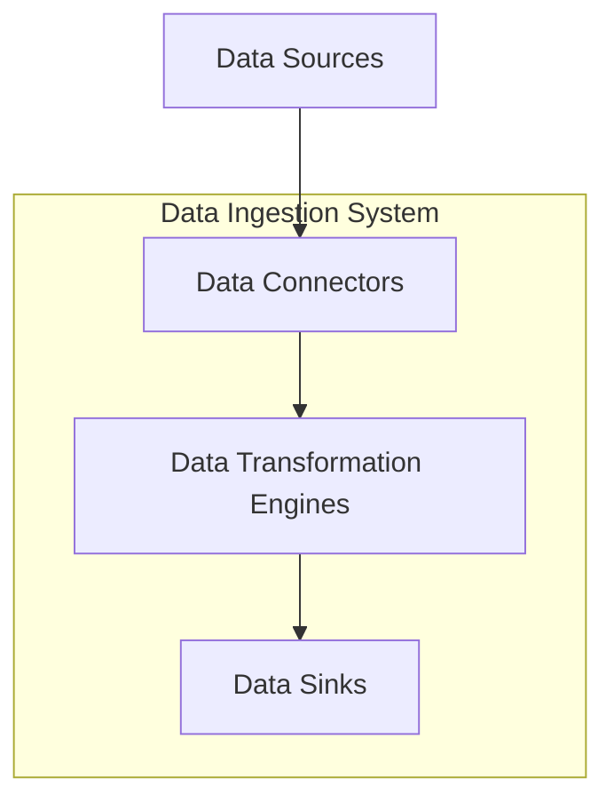

# Lesson 2: Data Ingestion Techniques

## 1. First-Principles Intuition & Invariants

Data ingestion is a foundational aspect of data engineering and systems architecture, serving as the critical first step in the data lifecycle. It involves the process of collecting, transferring, and loading data from various sources into a data system, such as a data warehouse, data lake, or real-time analytics platform. The efficiency and reliability of data ingestion directly impact the quality, timeliness, and accessibility of the data available for analysis and decision-making.

At its core, data ingestion is a complex interplay of data sources, data formats, network protocols, and storage systems. Data sources can range from structured databases and flat files to unstructured logs and streaming data from IoT devices. Each source presents unique challenges in terms of data format, volume, velocity, and variability. For instance, structured data from relational databases can be ingested using batch processing techniques, while streaming data from IoT devices requires real-time ingestion capabilities.

Data ingestion systems must handle a wide variety of data formats, including but not limited to CSV, JSON, Avro, Parquet, and Protocol Buffers. Each format has its own advantages and trade-offs in terms of readability, compression, and performance. For example, Avro and Parquet are columnar storage formats that offer efficient compression and fast read performance, making them ideal for batch processing and analytical workloads. On the other hand, JSON and Protocol Buffers are more suitable for unstructured and semi-structured data, respectively, due to their flexibility and ease of use.

Network protocols play a crucial role in data ingestion by defining the rules and mechanisms for transferring data between sources and destinations. Common protocols include HTTP/HTTPS for web-based data sources, FTP/SFTP for file transfers, and Kafka or RabbitMQ for message queuing systems. The choice of protocol depends on factors such as data volume, latency requirements, and security considerations. For instance, Kafka is a popular choice for real-time data ingestion due to its high throughput, fault tolerance, and support for distributed streaming.

Storage systems are the final destination for ingested data and must be capable of handling large volumes of data with high performance and reliability. Data warehouses, data lakes, and real-time analytics platforms are examples of storage systems that are commonly used in data ingestion pipelines. Data warehouses are optimized for structured data and provide powerful query capabilities, while data lakes are more flexible and can store both structured and unstructured data. Real-time analytics platforms, such as Apache Flink or Apache Storm, are designed to process data in real-time and provide low-latency insights.

The problem space of data ingestion is further complicated by the need to handle data at scale, with data volumes often measured in terabytes or petabytes. In such scenarios, data ingestion systems must be able to scale horizontally by distributing the workload across multiple nodes and optimizing resource utilization. Additionally, data ingestion systems must be resilient to failures, such as network partitions, node failures, and data corruption, to ensure data integrity and availability.

To address these challenges, data ingestion systems rely on a set of invariants and best practices. One such invariant is the principle of idempotency, which ensures that repeated execution of the same operation produces the same result. This principle is crucial in distributed systems, where operations may be retried due to transient failures. Another invariant is the principle of fault tolerance, which ensures that the system can continue to operate in the presence of failures. This principle is achieved through techniques such as replication, checkpointing, and recovery.

In summary, data ingestion is a critical component of data engineering and systems architecture, requiring a deep understanding of data sources, data formats, network protocols, and storage systems. Efficient and reliable data ingestion is essential for enabling timely and accurate data analysis, and it relies on a set of invariants and best practices to ensure scalability, fault tolerance, and data integrity.

## 2. Core Architecture & Mechanics

The architecture of a data ingestion system is designed to handle a wide variety of data sources, data formats, network protocols, and storage systems. At a high level, a data ingestion system consists of several key components: data sources, data connectors, data transformation engines, and data sinks. Each component plays a critical role in the data ingestion pipeline, and their interactions are governed by a set of internal data structures, algorithms, and execution models.

### Data Sources

Data sources are the origins of the data that is ingested into the system. They can range from structured databases and flat files to unstructured logs and streaming data from IoT devices. Data sources are typically categorized into two types: batch sources and streaming sources. Batch sources provide data in discrete chunks, such as daily or hourly files, while streaming sources provide data in a continuous flow, such as real-time sensor data.

Data sources are connected to the data ingestion system through data connectors, which are responsible for extracting data from the source and transforming it into a format that can be ingested by the system. Data connectors can be implemented as standalone applications or as plugins within the data ingestion system. They may also require additional configuration, such as authentication credentials or data mapping rules, to ensure that data is extracted and transformed correctly.

### Data Connectors

Data connectors are the bridges between data sources and the data ingestion system. They are responsible for extracting data from the source, transforming it into a format that can be ingested by the system, and delivering it to the data transformation engine. Data connectors can be implemented as standalone applications or as plugins within the data ingestion system. They may also require additional configuration, such as authentication credentials or data mapping rules, to ensure that data is extracted and transformed correctly.

Data connectors are designed to handle a wide variety of data sources and data formats. They may use different network protocols, such as HTTP/HTTPS, FTP/SFTP, or Kafka, to extract data from the source. They may also use different data formats, such as CSV, JSON, Avro, or Parquet, to transform data into a format that can be ingested by the system. Data connectors may also apply data transformations, such as filtering, aggregation, or enrichment, to the data before delivering it to the data transformation engine.

### Data Transformation Engines

Data transformation engines are responsible for transforming the data extracted by the data connectors into a format that can be ingested by the data sinks. They may apply a wide variety of data transformations, such as filtering, aggregation, enrichment, or normalization, to the data. Data transformation engines may also apply data validation rules to ensure that the data meets the required quality standards.

Data transformation engines are typically implemented as distributed systems, with the workload distributed across multiple nodes to optimize resource utilization and improve performance. They may use a variety of data processing frameworks, such as Apache Spark, Apache Flink, or Apache Storm, to perform data transformations. These frameworks provide powerful data processing capabilities, such as distributed data processing, fault tolerance, and scalability.

### Data Sinks

Data sinks are the final destination for the ingested data. They are responsible for storing the data in a format that can be queried and analyzed by downstream systems. Data sinks can be implemented as data warehouses, data lakes, or real-time analytics platforms. Data warehouses are optimized for structured data and provide powerful query capabilities, while data lakes are more flexible and can store both structured and unstructured data. Real-time analytics platforms, such as Apache Flink or Apache Storm, are designed to process data in real-time and provide low-latency insights.

Data sinks are typically implemented as distributed systems, with the workload distributed across multiple nodes to optimize resource utilization and improve performance. They may use a variety of storage technologies, such as HDFS, S3, or NoSQL databases, to store the data. They may also use data indexing and partitioning techniques to optimize query performance and improve data accessibility.

### Internal Data Structures, Algorithms, and Execution Models

The architecture of a data ingestion system is governed by a set of internal data structures, algorithms, and execution models. These components are designed to optimize resource utilization, improve performance, and ensure data integrity.

#### Data Structures

Data ingestion systems rely on a variety of data structures to optimize resource utilization and improve performance. For example, data connectors may use buffers to store data temporarily before delivering it to the data transformation engine. Data transformation engines may use data structures, such as hash tables or trees, to store intermediate results and optimize data processing. Data sinks may use data structures, such as indexes or partitions, to optimize query performance and improve data accessibility.

#### Algorithms

Data ingestion systems rely on a variety of algorithms to optimize resource utilization and improve performance. For example, data connectors may use algorithms, such as compression or encryption, to optimize data transfer. Data transformation engines may use algorithms, such as sorting or filtering, to optimize data processing. Data sinks may use algorithms, such as indexing or partitioning, to optimize query performance.

#### Execution Models

Data ingestion systems rely on a variety of execution models to optimize resource utilization and improve performance. For example, data connectors may use asynchronous execution models to optimize data transfer. Data transformation engines may use distributed execution models to optimize data processing. Data sinks may use parallel execution models to optimize query performance.

To illustrate the architecture of a data ingestion system, we can use a Mermaid diagram to visualize the interactions between the key components:

In this diagram, data sources are connected to the data ingestion system through data connectors, which extract data from the source and transform it into a format that can be ingested by the system. The data transformation engines apply data transformations to the data and deliver it to the data sinks, which store the data in a format that can be queried and analyzed by downstream systems.

## 3. High-Performance Optimization & Failure Modes

High-performance optimization and failure modes are critical considerations in the design and implementation of data ingestion systems. Efficient and reliable data ingestion is essential for enabling timely and accurate data analysis, and it relies on a set of techniques and best practices to optimize resource utilization, improve performance, and ensure data integrity.

### Concurrency

Concurrency is a critical aspect of high-performance data ingestion, as it allows multiple data sources to be processed simultaneously, optimizing resource utilization and improving performance. Data ingestion systems may use a variety of concurrency models, such as multithreading, multiprocessing, or asynchronous programming, to process data concurrently.

Multithreading is a concurrency model that allows multiple threads to execute concurrently within a single process. It is a popular choice for data ingestion systems, as it allows multiple data sources to be processed simultaneously, optimizing resource utilization and improving performance. Multithreading is typically implemented using thread pools, which manage a pool of threads and assign tasks to them as they become available.

Multiprocessing is a concurrency model that allows multiple processes to execute concurrently on a single machine or across multiple machines. It is a popular choice for data ingestion systems, as it allows multiple data sources to be processed simultaneously, optimizing resource utilization and improving performance. Multiprocessing is typically implemented using process pools, which manage a pool of processes and assign tasks to them as they become available.

Asynchronous programming is a concurrency model that allows tasks to be executed concurrently without blocking the main execution thread. It is a popular choice for data ingestion systems, as it allows data sources to be processed concurrently, optimizing resource utilization and improving performance. Asynchronous programming is typically implemented using event loops, which manage the execution of tasks and handle I/O operations asynchronously.

### Resource Scaling

Resource scaling is a critical aspect of high-performance data ingestion, as it allows data ingestion systems to handle large volumes of data with high performance and reliability. Data ingestion systems may use a variety of resource scaling techniques, such as horizontal scaling, vertical scaling, or auto-scaling, to optimize resource utilization and improve performance.

Horizontal scaling is a resource scaling technique that allows data ingestion systems to scale horizontally by adding more nodes to the system. It is a popular choice for data ingestion systems, as it allows data ingestion systems to handle large volumes of data with high performance and reliability. Horizontal scaling is typically implemented using distributed systems, with the workload distributed across multiple nodes to optimize resource utilization and improve performance.

Vertical scaling is a resource scaling technique that allows data ingestion systems to scale vertically by adding more resources to a single node. It is a popular choice for data ingestion systems, as it allows data ingestion systems to handle large volumes of data with high performance and reliability. Vertical scaling is typically implemented using resource management techniques, such as load balancing or resource allocation, to optimize resource utilization and improve performance.

Auto-scaling is a resource scaling technique that allows data ingestion systems to scale automatically based on demand. It is a popular choice for data ingestion systems, as it allows data ingestion systems to handle large volumes of data with high performance and reliability. Auto-scaling is typically implemented using cloud-based resource management techniques, such as auto-scaling groups or auto-scaling policies, to optimize resource utilization and improve performance.

### Boundary Edge Cases

Boundary edge cases are critical considerations in the design and implementation of data ingestion systems, as they can lead to performance bottlenecks, data corruption, or system failures. Data ingestion systems must be designed to handle a wide variety of boundary edge cases, such as data format changes, network partitions, node failures, or data corruption.

Data format changes can lead to performance bottlenecks or data corruption, as data ingestion systems may not be able to handle changes in data format. Data ingestion systems must be designed to handle data format changes gracefully, using techniques such as schema evolution or data validation to ensure data integrity.

Network partitions can lead to performance bottlenecks or system failures, as data ingestion systems may not be able to transfer data between nodes. Data ingestion systems must be designed to handle network partitions gracefully, using techniques such as replication or checkpointing to ensure data integrity and availability.

Node failures can lead to performance bottlenecks or system failures, as data ingestion systems may not be able to process data on failed nodes. Data ingestion systems must be designed to handle node failures gracefully, using techniques such as replication or failover to ensure data integrity and availability.

Data corruption can lead to performance bottlenecks or system failures, as data ingestion systems may not be able to process corrupted data. Data ingestion systems must be designed to handle data corruption gracefully, using techniques such as data validation or error detection to ensure data integrity.

### Failure Mitigations

Failure mitigations are critical considerations in the design and implementation of data ingestion systems, as they can lead to performance bottlenecks, data corruption, or system failures. Data ingestion systems must be designed to handle a wide variety of failure modes, such as data format changes, network partitions, node failures, or data corruption.

Data ingestion systems must be designed to handle data format changes gracefully, using techniques such as schema evolution or data validation to ensure data integrity. Data ingestion systems must be designed to handle network partitions gracefully, using techniques such as replication or checkpointing to ensure data integrity and availability. Data ingestion systems must be designed to handle node failures gracefully, using techniques such as replication or failover to ensure data integrity and availability. Data ingestion systems must be designed to handle data corruption gracefully, using techniques such as data validation or error detection to ensure data integrity.

In summary, high-performance optimization and failure modes are critical considerations in the design and implementation of data ingestion systems. Efficient and reliable data ingestion is essential for enabling timely and accurate data analysis, and it relies on a set of techniques and best practices to optimize resource utilization, improve performance, and ensure data integrity.
