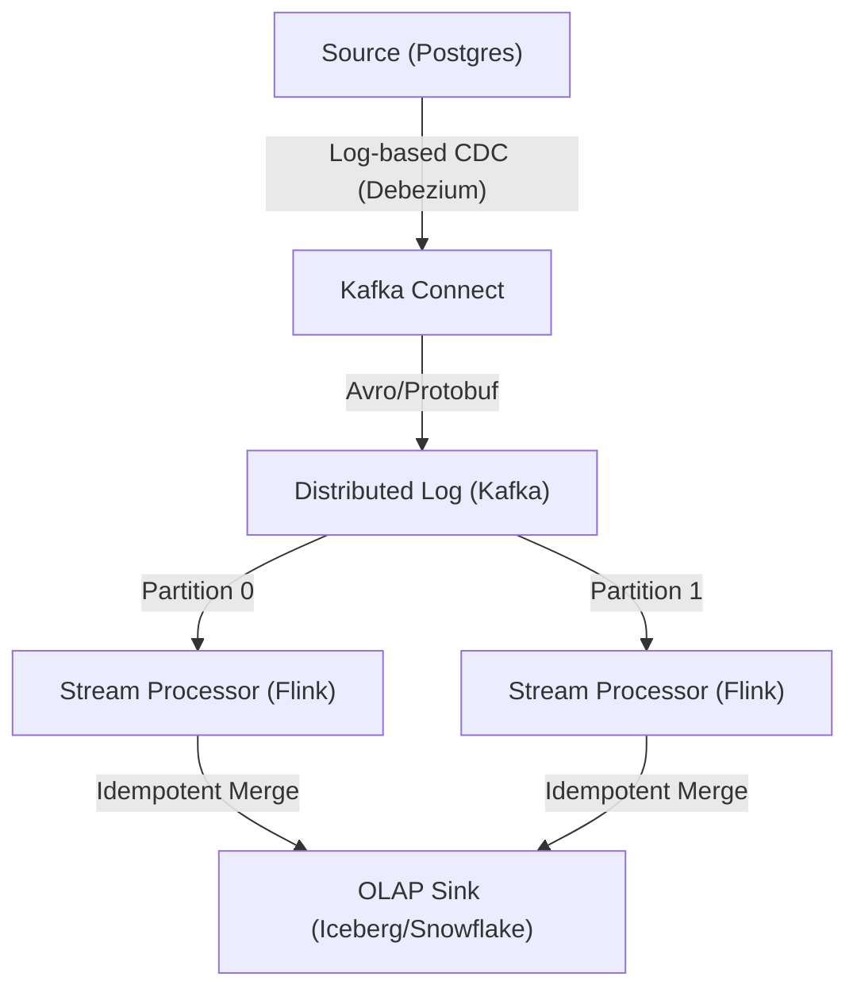

# Lesson 2: Data Ingestion Techniques

## 1. First-Principles Intuition & Invariants

Data ingestion is the architectural discipline of moving state from a source system (OLTP databases, application logs, IoT streams) to a destination system (data lake, warehouse, stream processor) while preserving fidelity and meeting latency Service Level Agreements (SLAs). The fundamental difficulty arises from the distributed nature of the systems involved: networks fail, clocks drift, and data volumes surge unpredictably.

To engineer reliable ingestion pipelines, we must adhere to strict invariants. Ignoring these leads to data loss, duplication, and corrupted downstream analytics.

### Core Invariants

1.  **Idempotency (Exactly-Once Semantics):** Replaying an ingestion event must not corrupt state. If a network timeout causes a retry, the destination must not duplicate the record. This is typically achieved via primary key constraints, deterministic hashing, or transactional log markers.
2.  **Ordering Guarantees:** For time-series or CDC (Change Data Capture) data, event ordering is critical. If `UPDATE` B follows `UPDATE` A on the source, the sink must process them in that order. Sharding strategies must guarantee that events for a specific entity (e.g., `user_id`) route to the same processing queue partition to preserve per-key ordering.
3.  **Schema Evolution:** Sources change. An ingestion system must handle additive (new column) and subtractive (dropped column) schema changes without halting the pipeline. Formats like Avro and Protobuf facilitate this via schema registries.
4.  **Backpressure Tolerance:** Producers must not overwhelm consumers. If the sink throughput drops, the ingestion system must buffer or signal producers to slow down, preventing out-of-memory (OOM) crashes.

### Data Formats: Correcting the Record

The choice of data format dictates serialization speed, compression ratio, and query performance.

*   **Avro & Protobuf (Row-based Serialization):** These are not columnar formats. Avro is a row-based binary serialization format that relies on a schema registry. It is optimized for streaming ingestion (e.g., Kafka) because it allows fast appends and schema evolution. Protobuf offers similar benefits with tighter language bindings.
*   **Parquet & ORC (Columnar Storage):** These are storage formats, not transfer formats. Parquet stores data column-wise, enabling high compression via run-length encoding and efficient analytical queries (scanning a subset of columns). They are the standard for data lake sinks (S3/HDFS) but are rarely used as the "on-the-wire" ingestion format because appending to columnar files requires rewriting the file or managing complex row groups.

### CDC: The Gold Standard for OLTP Ingestion

Polling databases for changes (query-based CDC) is inefficient and places load on the source. Log-based CDC is the first-principles solution. It reads the database's Write-Ahead Log (WAL) or Transaction Log.

*   **Mechanism:** The ingestion connector acts as a replica, reading binary log segments (e.g., Postgres `pg_logical` or MySQL `binlog`). It decodes transactions into change events.
*   **Advantage:** Minimal source impact, guaranteed ordering within transactions, and capture of hard deletes.

## 2. Core Architecture & Mechanics

Modern ingestion architectures are not monolithic ETL scripts. They are distributed systems composed of connectors, a durable transport bus, and stream processors.

### Architecture Flow

The standard high-throughput pattern decouples the source from the sink using a distributed log.



### Mechanic: Backpressure

Backpressure is the resistance created by the downstream system against the flow of upstream data. In a pipeline like `Source -> Kafka -> Flink -> Postgres`, if Postgres I/O saturates, Flink's buffers fill. Flink then stops fetching from Kafka. Kafka's consumer lag increases. If Kafka disk fills, it applies flow control to the producer (Debezium), pausing CDC.

This is implemented via **credit-based flow control** or **bounded buffers**.
*   **Reactive Streams:** Frameworks like Akka or Project Reactor use `request(n)` signals, where a subscriber tells the publisher exactly how many items it can process.
*   **Failure Mode:** If backpressure is mishandled (e.g., unbounded queues), the ingestion system experiences OOM errors or drops messages silently.

### Mechanic: Exactly-Once Semantics (EOS)

True EOS in a distributed pipeline requires atomic operations across both the input commit (offset) and the output write (sink).

1.  **Two-Phase Commit (2PC):** The processor writes data to the sink and the offset to Kafka in a single transaction. If the sink is a database, this is straightforward. If the sink is an external API, EOS is nearly impossible without idempotent API design.
2.  **Idempotent Writes:** A simpler approach. The processor might write duplicates on retry, but the sink uses `MERGE` or `UPSERT` logic to ensure the final state is correct.

## 3. High-Performance Optimization & Failure Modes

### Concurrency Models for Ingestion

Ingestion is inherently I/O bound. The choice of concurrency model dictates throughput and latency.

*   **Async I/O (Event Loop):** Used by Node.js or Python `asyncio`. A single thread handles thousands of connections via `epoll`/`kqueue`. Efficient for low-throughput, high-fan-out scenarios. Susceptible to "callback hell" and blocks on CPU-heavy tasks (like JSON parsing).
*   **Thread Pools (Java/Kafka):** The standard for Kafka Connect. A large pool of OS threads blocks on I/O. Context switching overhead is high, but it simplifies reasoning about parallelism.
*   **Actor Model (Akka/Flink):** Actors are lightweight computational entities that communicate via messages. They provide isolation (no shared state) and location transparency. Flink uses this to parallelize operators (e.g., `map`, `keyBy`) across a cluster.

### Partitioning & Data Skew

Scalability relies on parallelism, which relies on partitioning.
*   **Hash Partitioning:** `hash(key) % num_partitions`. Distributes data evenly if keys are high-cardinality.
*   **Failure Mode - Skew:** If ingesting clickstream data and one user generates 80% of traffic (a "hot key"), that partition becomes a bottleneck.
*   **Mitigation - Salting:** Add a random suffix to the key (`user_123` -> `user_123_1`, `user_123_2`) to spread load, then aggregate downstream.

### Failure Mitigations

#### The Poison Pill Problem
A "poison pill" is a malformed record that causes the ingestion processor to crash. Upon restart, the processor fetches the same record and crashes again, creating an infinite loop.
*   **Solution:** Implement a Dead Letter Queue (DLQ). If parsing fails `N` times, route the raw bytes to a DLQ topic and commit the offset, allowing the pipeline to proceed.

#### Schema Drift
The source adds a column without notifying the data team.
*   **Solution:** Use a Schema Registry. If the source sends a schema the consumer doesn't know, the registry rejects it or routes it to a quarantine topic.

---

## Implementation Examples

### Rust: High-Performance Async Ingestion (Kafka to Memory)

Rust's `tokio` runtime combined with `rdkafka` provides zero-cost abstractions for high-throughput ingestion. This example demonstrates a robust consumer with manual offset commit to ensure at-least-once semantics.

```rust
use rdkafka::config::{ClientConfig, RDKafkaLogLevel};
use rdkafka::consumer::{CommitMode, Consumer, StreamConsumer};
use rdkafka::message::{BorrowedMessage, Message};
use std::time::Duration;
use tokio::task::JoinHandle;

/// Initializes a Kafka consumer with safe defaults
fn init_consumer(brokers: &str, group_id: &str, topic: &str) -> StreamConsumer {
    let consumer: StreamConsumer = ClientConfig::new()
        .set("group.id", group_id)
        .set("bootstrap.servers", brokers)
        // Disable auto-commit to prevent data loss on crash
        .set("enable.auto.commit", "false")
        .set("auto.offset.reset", "earliest")
        .set("session.timeout.ms", "6000")
        .set("enable.partition.eof", "false")
        .set_log_level(RDKafkaLogLevel::Warning)
        .create()
        .expect("Consumer creation failed");

    consumer
        .subscribe(&[topic])
        .expect("Failed to subscribe to topic");
    consumer
}

/// Spawns a consumer task that processes messages and commits offsets manually
pub fn spawn_ingestor(
    consumer: StreamConsumer,
    processor: impl Fn(&BorrowedMessage) + Send + Sync + 'static,
) -> JoinHandle<()> {
    tokio::spawn(async move {
        loop {
            match consumer.recv().await {
                Ok(msg) => {
                    // Process the payload
                    if let Some(payload) = msg.payload() {
                        processor(msg); // User-defined processing logic
                    }
                    
                    // Commit offset synchronously after successful processing
                    // This ensures At-Least-Once semantics
                    if let Err(e) = consumer.commit_message(&msg, CommitMode::Sync) {
                        eprintln!("Failed to commit offset: {}", e);
                        // In production, route to DLQ here
                    }
                }
                Err(e) => {
                    eprintln!("Kafka error: {}", e);
                    tokio::time::sleep(Duration::from_secs(1)).await;
                }
            }
        }
    })
}
```

### Python: Idempotent CDC Sink (Upsert Pattern)

When sinking data to a database, naive `INSERT` statements fail on primary key collisions. We must use `MERGE` or `UPSERT` logic to maintain idempotency.

```python
import psycopg2
from psycopg2 import sql

def upsert_batch(conn_params: dict, table: str, records: list[dict]):
    """
    Performs an idempotent upsert (MERGE) of a batch of records into Postgres.
    If a record with the same primary key exists, it updates the fields; otherwise, it inserts.
    """
    if not records:
        return

    # Assume all records have the same keys
    columns = list(records[0].keys())
    # Assume 'id' is the primary key for conflict resolution
    pk = 'id' 
    
    # Construct the UPDATE SET clause for the ON CONFLICT path
    update_cols = [c for c in columns if c != pk]
    update_set = sql.SQL(", ").join(
        sql.SQL("{} = EXCLUDED.{}").format(sql.Identifier(c), sql.Identifier(c)) 
        for c in update_cols
    )

    query = sql.SQL("""
        INSERT INTO {table} ({cols}) 
        VALUES %s 
        ON CONFLICT ({pk}) DO UPDATE SET {update_set}
    """).format(
        table=sql.Identifier(table),
        cols=sql.SQL(", ").join(map(sql.Identifier, columns)),
        pk=sql.Identifier(pk),
        update_set=update_set
    )

    try:
        with psycopg2.connect(**conn_params) as conn:
            with conn.cursor() as cur:
                # Use execute_values for bulk insertion efficiency
                from psycopg2.extras import execute_values
                values = [[record[c] for c in columns] for record in records]
                execute_values(cur, query.as_string(conn), values)
                conn.commit()
    except Exception as e:
        # In a real pipeline, send to DLQ topic here
        print(f"Batch failed: {e}")
        raise
```

### SQL: Schema Evolution Handling

When ingesting JSON payloads where the schema might change, using a semi-structured column (like Postgres `JSONB`) allows ingestion to proceed without locking, while downstream views can extract typed fields.

```sql
-- Raw ingestion table: accepts any valid JSON
CREATE TABLE raw_events (
    event_id UUID PRIMARY KEY,
    event_time TIMESTAMPTZ NOT NULL,
    payload JSONB NOT NULL,
    processed_at TIMESTAMPTZ DEFAULT NOW()
);

-- Idempotent ingestion via ON CONFLICT
-- This handles retries safely: if the event_id is already present, we do nothing.
INSERT INTO raw_events (event_id, event_time, payload)
VALUES (
    '123e4567-e89b-12d3-a456-426614174000',
    '2023-10-27T10:00:00Z',
    '{"user_id": 42, "action": "click", "new_field": "ignore_me"}'::jsonb
)
ON CONFLICT (event_id) DO NOTHING;

-- Downstream typed view (handles schema drift gracefully)
CREATE VIEW typed_clicks AS
SELECT 
    event_id,
    event_time,
    payload->>'user_id' AS user_id,
    -- If 'action' is missing, it returns NULL rather than failing the pipeline
    payload->>'action' AS action
FROM raw_events
WHERE payload->>'action' = 'click';
