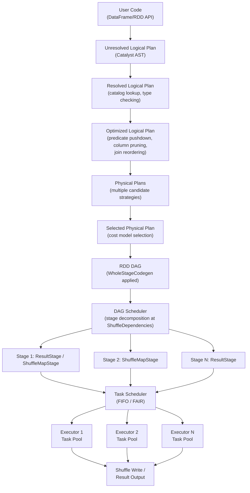
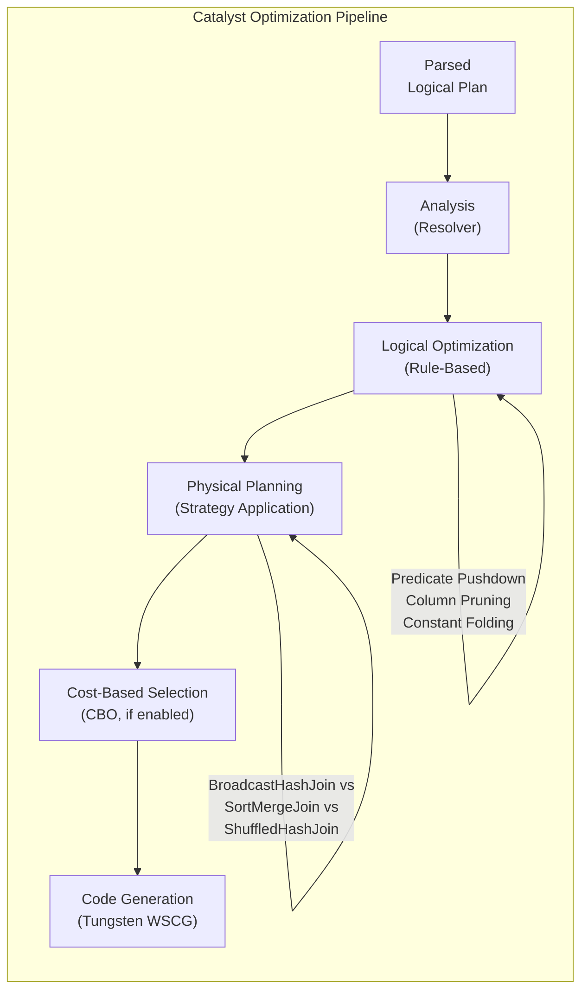
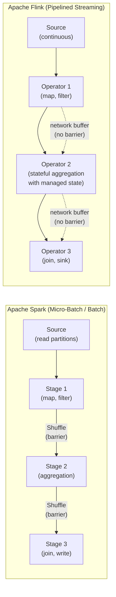

# Lesson 3: Data Processing Frameworks

## 1. First-Principles Intuition & Invariants

Processing terabytes of data reliably is fundamentally a problem of distributed systems theory, not merely a software engineering challenge. Three physical constraints govern every design decision: the cost of moving data across a network, the inevitability of hardware failure at scale, and the finite nature of per-node resources. Every architectural choice in a framework like Apache Spark is a direct response to one or more of these constraints.

### 1.1 The Cost Hierarchy of Data Movement

Modern CPU cores can execute billions of operations per second, but memory bandwidth, disk I/O, and network throughput impose hard ceilings on how fast data can be supplied to those cores. The approximate latency hierarchy for 2024-era hardware is:

| Operation | Approximate Latency | Relative Cost |
|---|---|---|
| L1 cache access | ~1 ns | 1× |
| L2 cache access | ~4 ns | 4× |
| L3 cache access | ~40 ns | 40× |
| DRAM access | ~100 ns | 100× |
| NVMe SSD random read | ~100 µs | 100,000× |
| Intra-datacenter network RTT | ~250 µs | 250,000× |
| Cross-AZ network RTT | ~1–5 ms | 1,000,000× |

This hierarchy is not incidental—it is the fundamental reason **data locality** is the dominant design principle in distributed data processing. When a framework schedules a task, the ideal outcome is that the data the task requires already resides in the RAM of the node where the task will execute. Network transfer of hundreds of gigabytes to satisfy a poorly placed task is not just slow; it saturates shared network fabric and degrades performance for every other concurrent job in the cluster.

The formal model here is the **BSP (Bulk Synchronous Parallel)** model, introduced by Valiant (1990), which describes distributed computation as alternating phases of local computation and global communication (barriers). Every shuffle operation in Spark, Flink, or Hadoop MapReduce is a BSP barrier. Minimizing the number and volume of these barriers is the central performance objective of any execution engine optimizer.

### 1.2 Fault Tolerance as a Statistical Certainty

In a cluster of *n* machines, each with an annualized failure rate (AFR) of *p*, the probability that all *n* machines survive a *t*-hour job is approximately (1 − pt/8760)ⁿ. For a 1,000-node cluster with AFR = 2% running a 24-hour job, the probability of encountering at least one failure exceeds 60%. Failures are not edge cases to be handled gracefully—they are the median execution path at scale.

This statistical reality mandates two distinct fault-tolerance strategies:

- **Lineage-based recomputation**: The system records the logical derivation of each dataset. On failure, it re-executes only the failed partition's derivation chain. This is cheap in metadata overhead but expensive when the derivation chain is long or its inputs are themselves volatile.
- **Materialization / Checkpointing**: The system periodically writes intermediate results to durable storage, truncating the lineage. This trades computation cost (redundant writes) for recovery speed (a shorter chain to re-execute from a stable snapshot).

The correct balance depends on the ratio of recomputation cost to checkpoint I/O cost—a quantity that varies per workload and must be tuned empirically.

### 1.3 Resource Abstraction and the Separation of Concerns

A data processing framework is, at its core, a **resource broker** that separates three concerns:

1. **Logical computation** — What transformations should be applied to the data (expressed by the user via a high-level API)?
2. **Physical planning** — How should those transformations be decomposed into parallelizable, schedulable units of work?
3. **Resource management** — Which cores, memory regions, and storage devices should execute which units of work, and how should contention be resolved?

Frameworks like Spark enforce this separation explicitly. Users write against the DataFrame or RDD API (logical layer). The Catalyst optimizer and DAG Scheduler handle physical planning. YARN, Mesos, or Kubernetes manages resources. This layering is what allows the same user code to run on a laptop with one executor, a 100-node YARN cluster, or a Kubernetes pod autoscaler without modification.

---

## 2. Core Architecture & Mechanics

### 2.1 The Resilient Distributed Dataset (RDD): A Formal Model

An RDD is defined formally as a 5-tuple:

```
RDD = (Partitions, Dependencies, ComputeFunction, PreferredLocations, Partitioner)
```

- **Partitions**: An ordered list of opaque partition objects, each representing a logical slice of the dataset. The number of partitions determines the maximum degree of parallelism.
- **Dependencies**: Either a **NarrowDependency** (each parent partition is consumed by at most one child partition, enabling pipelined execution) or a **ShuffleDependency** (each child partition depends on all parent partitions, requiring a network shuffle). This distinction is architecturally critical: shuffle dependencies define stage boundaries.
- **ComputeFunction**: A function `Iterator[T] => Iterator[U]` that transforms the input partition iterator into an output partition iterator. The function is serialized by the driver and shipped to executors.
- **PreferredLocations**: An optional hint to the scheduler about which HDFS blocks or cache entries are co-located with each partition, used to maximize data locality.
- **Partitioner**: For key-value RDDs, an optional `Partitioner` (e.g., `HashPartitioner`, `RangePartitioner`) that specifies how keys are mapped to partition indices, enabling co-partitioned joins without re-shuffle.

The immutability of RDDs is not a convenience property—it is a correctness invariant. Because an RDD partition cannot be mutated in place, its lineage is a pure, deterministic function of its inputs. This determinism is what makes lineage-based fault recovery correct: re-executing the same function on the same input always produces the same output.

### 2.2 DAG Execution: From Logical Plan to Physical Tasks

When a user submits an **action** (e.g., `count()`, `collect()`, `saveAsTextFile()`), Spark materializes the computation plan through a multi-stage compilation pipeline:



The DAG Scheduler's stage decomposition algorithm is straightforward: it performs a reverse topological traversal of the RDD lineage graph, inserting a stage boundary at every `ShuffleDependency`. All transformations within a stage that have only `NarrowDependency` edges are pipelined into a single task — the data never leaves the JVM between consecutive `map`, `filter`, and `flatMap` calls within the same stage. This is called **stage fusion** and is the primary mechanism for eliminating intermediate materialization overhead.

### 2.3 Tungsten: The Execution Engine Below the API

Tungsten (introduced in Spark 1.4, fully mature by 2.x) is Spark's physical execution layer. It operates below the DataFrame abstraction and addresses two bottlenecks that the JVM's standard object model imposes:

**1. Off-Heap Memory Management**

Standard Java objects carry significant overhead: each object has a 16-byte header, fields are padded for alignment, and all objects are reachable only through GC-managed heap pointers. For a `Long` stored in a Java `ArrayList`, the effective memory consumption per element is ~40 bytes rather than 8 bytes. At billion-row scale, this is a 5× memory amplification factor.

Tungsten allocates memory via `sun.misc.Unsafe` directly in off-heap native memory (or in a tightly controlled on-heap region). Data is stored in a compact columnar binary format (`UnsafeRow`) where a row of *n* fields occupies a contiguous byte buffer of exactly `8 * ceil(n/64)` bytes for the null bitmap plus the fixed-width field values, with variable-length fields stored as relative offsets. This eliminates object headers and GC pressure entirely.

**2. Whole-Stage Code Generation (WSCG)**

Rather than interpreting a physical plan as a tree of operator objects (the Volcano/iterator model), Tungsten's `WholeStageCodegenExec` compiles entire pipeline stages into a single tight Java method via Janino (a runtime Java compiler). The generated code eliminates virtual dispatch overhead, enables the JIT compiler to inline across operator boundaries, and keeps hot data in CPU registers across the entire stage rather than passing it through iterator `.next()` calls.

The practical impact is significant: for CPU-bound workloads like aggregations and joins, WSCG achieves throughput within 2–3× of hand-written C++ at the SQL layer.

### 2.4 Catalyst: The Query Optimizer

Catalyst is Spark SQL's extensible rule-based and cost-based optimizer. It operates on a tree of `Expression` and `LogicalPlan` nodes, applying transformation rules in a fixed-point loop until no more rules fire.

Key optimization passes include:

- **Predicate Pushdown**: Filters are pushed below joins and aggregations. A `WHERE ts > '2024-01-01'` clause becomes a partition pruning hint to the data source, potentially eliminating entire files from being read.
- **Column Pruning**: Columns not referenced in the query are dropped from the scan. For Parquet (a columnar format), this translates directly to skipping the I/O for entire column chunks.
- **Join Reordering**: The cost-based optimizer (CBO), enabled with `spark.sql.cbo.enabled=true`, uses column statistics (`ANALYZE TABLE`) to reorder joins from most-selective to least-selective, minimizing intermediate result sizes.
- **Broadcast Join Elision**: If one side of a join is estimated below `spark.sql.autoBroadcastJoinThreshold` (default 10 MB), Catalyst replaces a `SortMergeJoin` (which requires a full shuffle) with a `BroadcastHashJoin` (which ships the small side to every executor, eliminating the shuffle entirely). This is one of the highest-impact single optimizations available.



### 2.5 Shuffle: The Dominant Performance Cost

A shuffle is the materialization of a `ShuffleDependency`—the process of partitioning all output records of one stage by key and delivering them to the correct input partitions of the next stage. It involves:

1. **Map side (Shuffle Write)**: Each task sorts its output records by partition key and writes them to a local shuffle file on disk. The sort is performed using `TimSort` on an `UnsafeExternalSorter`, which spills to disk if the in-memory buffer (bounded by `spark.shuffle.spill.initialMemoryThreshold`) is exhausted.
2. **Reduce side (Shuffle Read)**: Each reducer task opens HTTP connections to every map task's executor and fetches the relevant partition data. This is an *all-to-all* communication pattern: in a stage with *M* map tasks and *R* reduce tasks, there are up to *M × R* network connections initiated.

The all-to-all nature of shuffle is why it is the most expensive operation in any Spark job. For a job with 10,000 map tasks and 10,000 reduce tasks, the shuffle phase may open 100 million logical connections. The **External Shuffle Service** (a long-running process on each worker node, separate from executors) exists specifically to decouple shuffle block serving from executor lifetimes, allowing executors to be killed and restarted without losing shuffle data for downstream stages.

---

## 3. High-Performance Optimization & Failure Modes

### 3.1 Memory Architecture and Tuning

Spark's memory model (since Spark 1.6) uses a **unified memory manager** that shares a single memory pool between execution memory (used for shuffles, sorts, aggregations) and storage memory (used for caching RDD/DataFrame partitions). The pool is bounded by:

```
usable_memory = (JVM Heap − 300 MB reserved) × spark.memory.fraction  (default 0.6)
```

Within `usable_memory`, storage and execution compete dynamically: execution memory can evict storage (cached data) when it needs more space, but cached data marked as `MEMORY_AND_DISK` will spill to disk rather than be lost. Storage memory cannot evict execution memory.

The remaining 40% of heap (governed by `1 - spark.memory.fraction`) is reserved for user data structures, Spark's internal metadata, and JVM overhead. Underestimating this reservation is a common cause of `java.lang.OutOfMemoryError: GC overhead limit exceeded` failures, which are distinct from Spark-managed OOM conditions.

**Critical tuning parameters:**

| Parameter | Default | Effect |
|---|---|---|
| `spark.memory.fraction` | 0.6 | Fraction of JVM heap for Spark's unified pool |
| `spark.memory.storageFraction` | 0.5 | Initial fraction of unified pool reserved for storage (evictable) |
| `spark.executor.memory` | 1g | Total JVM heap per executor |
| `spark.executor.memoryOverhead` | executor_memory × 0.1 (min 384 MB) | Off-heap memory for Tungsten, Python workers, native libs |
| `spark.sql.shuffle.partitions` | 200 | Number of post-shuffle partitions; often the single most impactful tuning knob |
| `spark.default.parallelism` | 2 × cores | Default partition count for RDD operations |

A common misconfiguration is setting `spark.executor.memory` to the full node memory without accounting for `spark.executor.memoryOverhead` and OS reservation. If the total allocation (`executor.memory + memoryOverhead`) exceeds the container memory limit enforced by YARN or Kubernetes, the container is killed with an OOM signal — a failure mode that presents identically to a node crash but is entirely self-inflicted.

### 3.2 Data Skew: Diagnosis and Remediation

Data skew occurs when the distribution of keys across partitions is uneven, causing a small number of tasks to process orders of magnitude more data than the median task. The symptom in the Spark UI is a stage where most tasks complete in seconds but a handful run for minutes or hours, with the stage duration dominated by the straggler tasks.

**Diagnosis via SQL:**
```sql
-- Identify skewed keys before processing
SELECT
    partition_key,
    COUNT(*)                                       AS row_count,
    COUNT(*) * 100.0 / SUM(COUNT(*)) OVER ()       AS pct_of_total
FROM source_table
GROUP BY partition_key
ORDER BY row_count DESC
LIMIT 20;
```

**Remediation 1: Salting for aggregations**

When computing a grouped aggregation on a skewed key, salt the key with a random integer prefix, perform a partial aggregation on the salted key, then re-aggregate without the salt:

```python
import pyspark.sql.functions as F
from pyspark.sql import SparkSession

spark = SparkSession.builder.getOrCreate()

SALT_BUCKETS = 32  # tune based on skew severity

df = spark.table("events")

# Phase 1: partial aggregation on salted key
salted = df.withColumn(
    "salted_key",
    F.concat(
        F.col("user_id").cast("string"),
        F.lit("_"),
        (F.rand() * SALT_BUCKETS).cast("int").cast("string"),
    ),
)
partial = salted.groupBy("salted_key").agg(
    F.sum("revenue").alias("partial_revenue"),
    F.count("*").alias("partial_count"),
)

# Phase 2: strip salt and merge partial results
final = (
    partial
    .withColumn("user_id", F.split(F.col("salted_key"), "_")[0].cast("long"))
    .groupBy("user_id")
    .agg(
        F.sum("partial_revenue").alias("total_revenue"),
        F.sum("partial_count").alias("total_count"),
    )
)
```

**Remediation 2: Broadcast join for skewed dimension tables**

When joining a large skewed fact table against a smaller dimension table, broadcasting the dimension table eliminates the shuffle entirely. The skew in the fact table's key distribution becomes irrelevant because each executor independently probes a local hash table built from the broadcast:

```python
from pyspark.sql.functions import broadcast

fact   = spark.table("orders")          # billions of rows, skewed on customer_id
dim    = spark.table("customers")       # millions of rows

result = fact.join(broadcast(dim), on="customer_id", how="left")
# No shuffle; each executor reads the full dim locally
```

**Remediation 3: Adaptive Query Execution (AQE)**

Spark 3.0 introduced AQE (`spark.sql.adaptive.execution.enabled=true`, default `true` in Spark 3.2+), which dynamically re-plans query stages at runtime based on shuffle statistics:

- **Dynamic coalescing**: Merges small post-shuffle partitions to avoid task scheduling overhead for tiny tasks.
- **Dynamic skew join handling**: Detects skewed map output partitions (larger than `spark.sql.adaptive.skewJoin.skewedPartitionThresholdInBytes`, default 256 MB) and splits them into sub-tasks, assigning multiple reducers to a single logical skewed partition.
- **Dynamic join strategy switching**: Downgrades a planned `SortMergeJoin` to a `BroadcastHashJoin` if the runtime size of one join side is smaller than the broadcast threshold.

AQE makes salting largely unnecessary for SQL workloads in Spark 3.x, but explicit salting remains relevant for custom RDD-level code and extreme skew scenarios.

### 3.3 Shuffle Optimization

The number of post-shuffle partitions (`spark.sql.shuffle.partitions`, default 200) is frequently the most impactful single configuration parameter. The optimal value depends on the total data volume processed by the shuffle:

```
# Rule of thumb: target 100–200 MB per post-shuffle partition
optimal_partitions = ceil(total_shuffle_bytes / (128 * 1024 * 1024))
```

Setting this too low produces large partitions that cause memory pressure and spilling. Setting it too high produces thousands of tiny tasks with scheduling overhead that exceeds computation time. With AQE enabled, the starting value matters less because small partitions are coalesced automatically, but starting with a reasonable estimate avoids wasting scheduler cycles.

**Avoid wide transformations where possible.** The following patterns generate shuffles and should be scrutinized:

```python
# AVOID: triggers full shuffle + sort
df.orderBy("timestamp")

# PREFER: sort within partitions only (no shuffle)
df.sortWithinPartitions("timestamp")

# AVOID: triggers shuffle for global distinct
df.distinct()

# PREFER: use approxCountDistinct for analytics that don't need exact counts
from pyspark.sql.functions import approx_count_distinct
df.agg(approx_count_distinct("user_id", rsd=0.02))

# AVOID: groupByKey materializes all values per key before aggregating
rdd.groupByKey().mapValues(sum)

# PREFER: reduceByKey pre-aggregates on the map side, drastically reducing shuffle volume
rdd.reduceByKey(lambda a, b: a + b)
```

### 3.4 Checkpointing Strategy

Spark supports two forms of checkpointing:

- **Reliable checkpointing** (`rdd.checkpoint()`, requires `sc.setCheckpointDir("hdfs://...")`): Serializes the RDD to HDFS or S3, truncates the lineage, and re-reads from the checkpoint on subsequent access. This is appropriate for iterative algorithms (e.g., PageRank, graph algorithms) where lineage grows with every iteration.
- **Local checkpointing** (`rdd.localCheckpoint()`): Persists to executor local disk without writing to a distributed filesystem. Faster but not fault-tolerant — if the executor hosting the checkpoint dies, the data is lost and re-computed from the full lineage. Appropriate when the goal is to truncate lineage for GC pressure relief, not for failure recovery.

```python
sc.setCheckpointDir("s3a://my-bucket/spark-checkpoints/")

# Iterative PageRank: checkpoint every 5 iterations to bound lineage depth
ranks = graph.vertices.map(lambda v: (v, 1.0 / num_vertices))

for i in range(num_iterations):
    contributions = graph.edges.join(ranks).flatMap(compute_contributions)
    ranks = contributions.reduceByKey(lambda a, b: a + b).mapValues(
        lambda r: 0.15 / num_vertices + 0.85 * r
    )
    if i % 5 == 0:
        ranks.checkpoint()
        ranks.count()  # force materialization before truncating lineage
```

Without the `count()` before `checkpoint()`, Spark may not have flushed the data to the checkpoint directory before the subsequent action accesses the (now-truncated) lineage, causing a failure.

### 3.5 Production-Grade PySpark Job Structure

The following illustrates a production-ready PySpark job with explicit schema enforcement, partition tuning, error handling, and observability hooks:

```python
"""
etl_job.py — Production PySpark ETL with schema enforcement,
partitioning strategy, and structured logging.
"""

import logging
import sys
from dataclasses import dataclass
from typing import Optional

from pyspark.sql import SparkSession, DataFrame
from pyspark.sql import functions as F
from pyspark.sql.types import (
    DoubleType,
    LongType,
    StringType,
    StructField,
    StructType,
    TimestampType,
)

logging.basicConfig(
    level=logging.INFO,
    format="%(asctime)s [%(levelname)s] %(name)s: %(message)s",
)
log = logging.getLogger(__name__)


# --- Schema Definitions (never infer schema in production) ---

RAW_EVENT_SCHEMA = StructType(
    [
        StructField("event_id",   StringType(),    nullable=False),
        StructField("user_id",    LongType(),      nullable=False),
        StructField("event_type", StringType(),    nullable=True),
        StructField("revenue",    DoubleType(),    nullable=True),
        StructField("ts",         TimestampType(), nullable=False),
        StructField("country",    StringType(),    nullable=True),
    ]
)


@dataclass(frozen=True)
class JobConfig:
    input_path:        str
    output_path:       str
    start_date:        str
    end_date:          str
    shuffle_partitions: int = 400
    broadcast_threshold_mb: int = 50


def build_spark_session(config: JobConfig) -> SparkSession:
    return (
        SparkSession.builder
        .appName("revenue-aggregation-etl")
        .config("spark.sql.shuffle.partitions", config.shuffle_partitions)
        .config(
            "spark.sql.autoBroadcastJoinThreshold",
            config.broadcast_threshold_mb * 1024 * 1024,
        )
        .config("spark.sql.adaptive.execution.enabled", "true")
        .config("spark.sql.adaptive.skewJoin.enabled", "true")
        .config("spark.serializer", "org.apache.spark.serializer.KryoSerializer")
        .config("spark.sql.parquet.compression.codec", "snappy")
        .getOrCreate()
    )


def read_events(spark: SparkSession, config: JobConfig) -> DataFrame:
    """
    Read raw events with explicit schema. Partition pruning on `ts` is
    achieved via predicate pushdown into the Parquet reader, which uses
    Hive-style directory partitioning (ts_date=YYYY-MM-DD).
    """
    log.info("Reading events from %s between %s and %s",
             config.input_path, config.start_date, config.end_date)
    return (
        spark.read
        .schema(RAW_EVENT_SCHEMA)
        .parquet(config.input_path)
        .where(F.col("ts").between(config.start_date, config.end_date))
        .where(F.col("event_type").isNotNull())
    )


def validate_and_clean(df: DataFrame) -> DataFrame:
    """
    Apply data quality rules. Rows failing validation are quarantined to
    a side output in a production system; here we filter for clarity.
    """
    return (
        df
        # Reject non-positive revenue that would corrupt aggregates
        .where(F.col("revenue").isNull() | (F.col("revenue") >= 0.0))
        # Reject future-dated events (clock skew / data corruption signal)
        .where(F.col("ts") <= F.current_timestamp())
        # Coalesce null country to unknown sentinel
        .withColumn("country", F.coalesce(F.col("country"), F.lit("UNKNOWN")))
    )


def compute_daily_revenue(df: DataFrame) -> DataFrame:
    """
    Aggregate to daily revenue per user and country. The repartition
    before the write aligns output file count with the partition
    predicate used by downstream readers.
    """
    return (
        df
        .withColumn("date", F.to_date(F.col("ts")))
        .groupBy("date", "user_id", "country")
        .agg(
            F.sum("revenue").alias("total_revenue"),
            F.count("*").alias("event_count"),
            F.countDistinct("event_id").alias("unique_events"),
        )
        # Sort within each partition for Parquet statistics efficiency
        .sortWithinPartitions("date", "user_id")
    )


def write_output(df: DataFrame, config: JobConfig) -> None:
    """
    Write partitioned Parquet. Partition by date so downstream jobs can
    apply partition pruning. The 'overwrite' mode on a specific partition
    predicate prevents re-writing untouched historical partitions.
    """
    log.info("Writing output to %s", config.output_path)
    (
        df.write
        .mode("overwrite")
        .partitionBy("date")
        .option("compression", "snappy")
        .option("maxRecordsPerFile", 1_000_000)  # bound file sizes
        .parquet(config.output_path)
    )
    log.info("Write complete")


def run(config: JobConfig) -> None:
    spark = build_spark_session(config)
    try:
        raw      = read_events(spark, config)
        clean    = validate_and_clean(raw)
        result   = compute_daily_revenue(clean)
        write_output(result, config)
    except Exception:
        log.exception("Job failed")
        sys.exit(1)
    finally:
        spark.stop()


if __name__ == "__main__":
    cfg = JobConfig(
        input_path="s3a://data-lake/raw/events/",
        output_path="s3a://data-lake/processed/daily_revenue/",
        start_date="2024-01-01",
        end_date="2024-01-31",
        shuffle_partitions=400,
    )
    run(cfg)
```

### 3.6 Failure Mode Taxonomy

The following taxonomy covers the most common production failure modes, their root causes, and their distinguishing symptoms:

```mermaid
flowchart TD
    F["Job Failure"] --> A["OOM / Container Killed"]
    F --> B["Task Timeout / Straggler"]
    F --> C["Data Corruption / Incorrect Results"]
    F --> D["Job Hangs Indefinitely"]

    A --> A1["executor.memory +\nmemoryOverhead > container limit\n→ increase memoryOverhead"]
    A --> A2["User code retains large\nobject references in closures\n→ audit closure serialization"]
    A --> A3["Unbounded collect() on\nlarge dataset to driver\n→ use write() or take()"]

    B --> B1["Data skew: single partition\nholds majority of data\n→ AQE skew join / salting"]
    B --> B2["GC pressure: frequent\nfull GC pauses on executor\n→ reduce memory.fraction,\nswitch to G1GC"]
    B --> B3["Speculation not enabled;\nslow node undetected\n→ spark.speculation=true"]

    C --> C1["Schema inference on\nevolving data source\n→ always enforce explicit schema"]
    C --> C2["Non-deterministic UDFs\nused with caching\n→ avoid random/now() in\ncached computations"]
    C --> C3["Incorrect null handling\nin custom aggregations\n→ audit UDF null semantics"]

    D --> D1["Deadlock in custom\naccumulator or barrier stage\n→ audit barrier() usage"]
    D --> D2["External shuffle service\nnot running; reducers\nblocked waiting for map output\n→ verify ESS deployment"]
    D --> D3["Network partition:\nheartbeat timeouts exhausted\n→ tune network.timeout,\ncheck cluster health"]
```



**GC Tuning:** For long-running executors processing large datasets, the default JVM GC (G1GC in modern JDKs) is usually appropriate, but requires tuning:

```bash
# In spark-submit or spark-defaults.conf
--conf spark.executor.extraJavaOptions="\
  -XX:+UseG1GC \
  -XX:G1HeapRegionSize=16m \
  -XX:+G1SummarizeRSetStats \
  -XX:InitiatingHeapOccupancyPercent=35 \
  -XX:+PrintGCDetails \
  -XX:+PrintGCDateStamps \
  -Xloggc:/tmp/executor-gc.log"
```

The `InitiatingHeapOccupancyPercent=35` setting causes G1GC to begin concurrent marking earlier than the default 45%, which reduces the likelihood of full GC pauses when execution memory is under pressure.

### 3.7 Speculative Execution and Straggler Mitigation

Speculative execution (`spark.speculation=true`, default `false`) is Spark's mechanism for detecting and mitigating straggler tasks. When enabled, Spark periodically scans running tasks; any task that has been running longer than a threshold (computed as a multiple of the median task duration in its stage) is re-launched on a different executor. The first copy to complete wins; the other is killed.

The threshold is controlled by:
- `spark.speculation.multiplier` (default 1.5): A task is speculated if its runtime exceeds `1.5 × median_task_runtime`.
- `spark.speculation.quantile` (default 0.75): Speculation is only triggered after 75% of tasks in the stage have completed.

Speculation is effective for stragglers caused by hardware heterogeneity (slow disk on one node) but is counterproductive for stragglers caused by data skew — speculating a skewed task just runs the same large partition on a different executor, consuming double the resources without reducing wall time. For skew-induced stragglers, AQE's dynamic skew handling is the correct remedy.

### 3.8 Observability: Spark UI Metrics Interpretation

The Spark UI exposes the information needed to diagnose all the failure modes above. Key metrics per stage:

| Metric | What it Reveals | Actionable Threshold |
|---|---|---|
| **Shuffle Read/Write Size** | Total data crossing the network per stage | Consistently > 100 GB/stage → review join strategy |
| **GC Time** | Fraction of task time spent in garbage collection | > 10% of task duration → tune GC or increase memory |
| **Peak Execution Memory** | High-water mark of Tungsten execution memory | Near `usable_memory` → risk of spill or OOM |
| **Task Duration Distribution** | Skew in task runtimes | Max/median ratio > 5× → data skew |
| **Spill (Memory/Disk)** | Volume of data spilled to disk during sorts/aggregations | Any spill → shuffle partitions too low or memory too small |
| **Input Size vs. Records** | Effective bytes per record | Very small → consider coalescing small files before processing |

The **SQL tab** in Spark UI renders the physical plan as an interactive DAG, annotating each node with actual runtime statistics. This is the fastest way to identify which physical operator (e.g., a specific `SortMergeJoin` or `HashAggregate`) is the bottleneck in a complex query.

---

## 4. Architectural Variants: Spark, Flink, and the Streaming Dimension

Spark's batch-centric model (DAG of stages, results materialized at stage boundaries) is not universal. Apache Flink uses a fundamentally different architecture based on **continuous pipelined dataflows** without stage barriers, which makes it better suited for low-latency streaming workloads.



The key distinction is that Spark Structured Streaming approximates stream processing by executing micro-batches — each trigger interval materializes a Spark batch job over the new data since the last checkpoint. This introduces an irreducible minimum latency equal to the trigger interval (typically 1–30 seconds). Flink's pipelined operator model can deliver end-to-end latencies in the tens of milliseconds because records are forwarded immediately from operator to operator via in-memory network buffers.

The trade-off is state management complexity. Flink's `RocksDB`-backed managed state enables stateful operators to maintain per-key state across millions of keys with bounded memory, but this requires explicit state schema management and careful handling of state backend configuration. Spark Structured Streaming's stateful operations (e.g., `mapGroupsWithState`) use the same checkpoint/batch model and are simpler to reason about but do not achieve equivalent latency.

For new systems, the choice between Spark and Flink should be driven primarily by latency requirements:

- **Latency > 1 second, batch-dominant workloads**: Spark, for its mature ecosystem, SQL support, and operational simplicity.
- **Latency < 1 second, event-driven pipelines**: Flink, for its native streaming model and efficient state management.
- **Mixed batch + streaming (Lambda/Kappa-like)**: Spark Structured Streaming for unified batch/stream semantics at moderate latency, or Flink with its `Table API` for lower-latency unified workloads.
