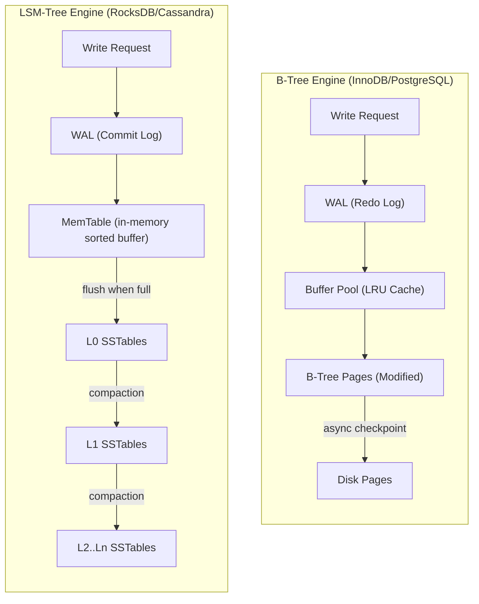
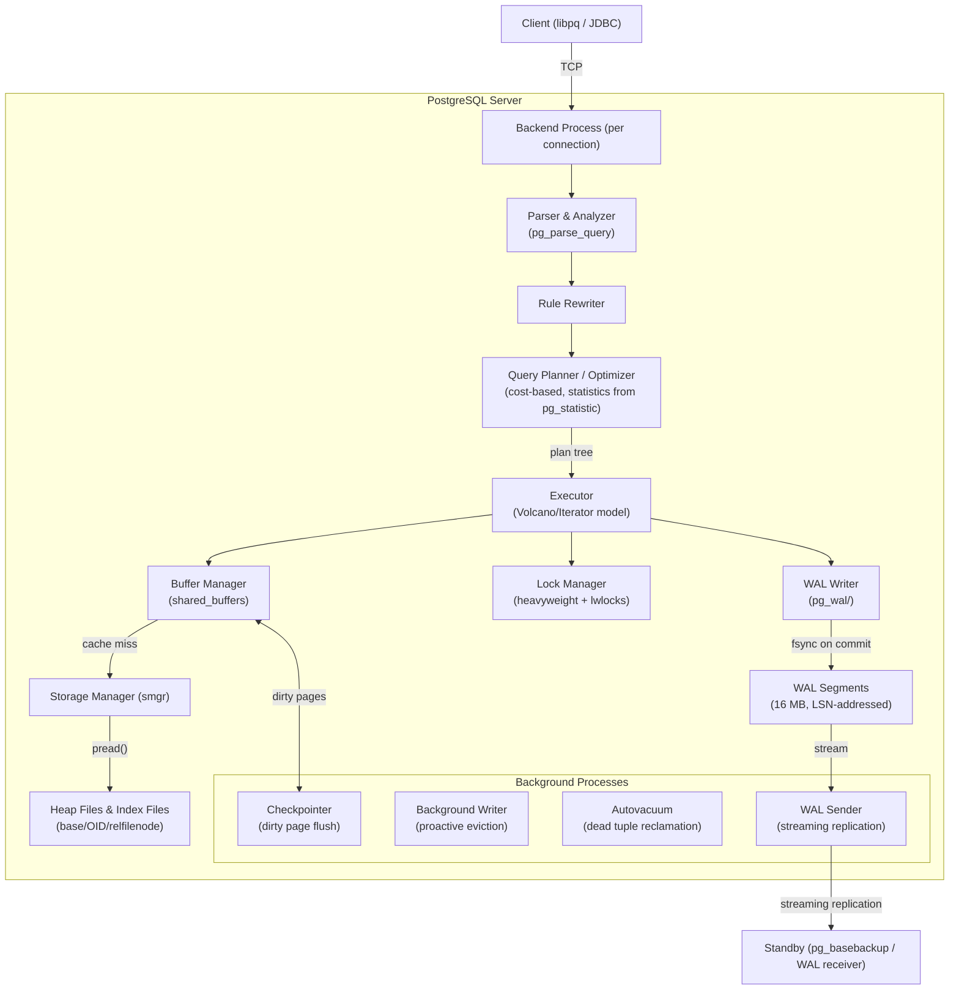
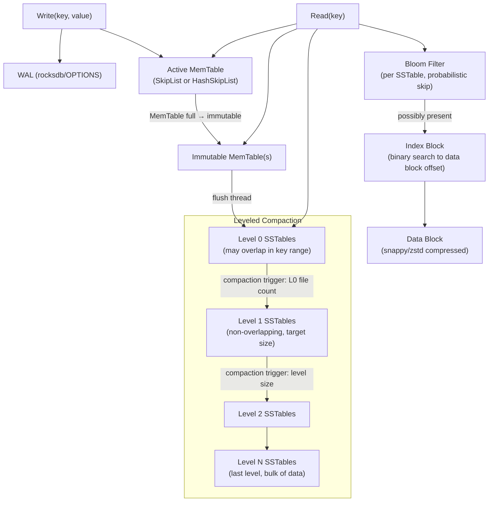
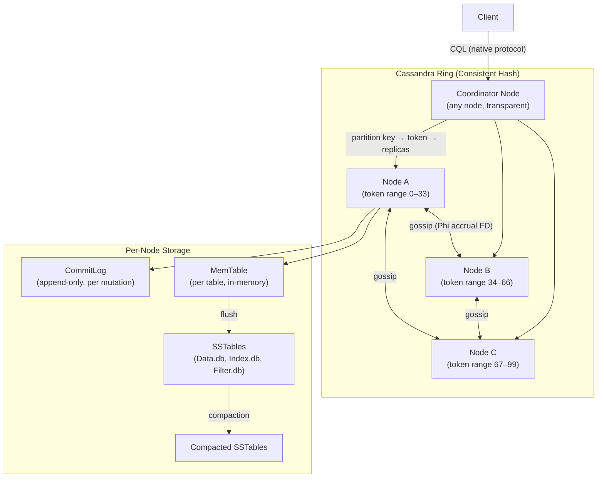
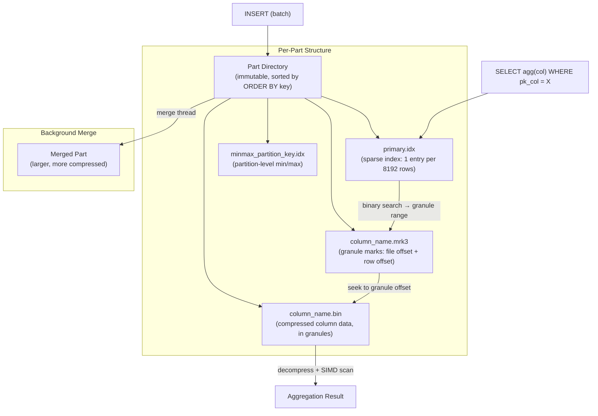
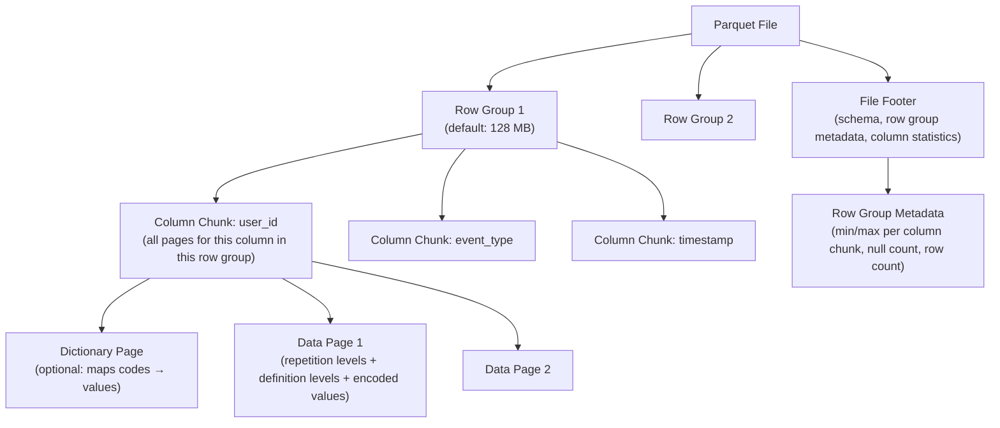
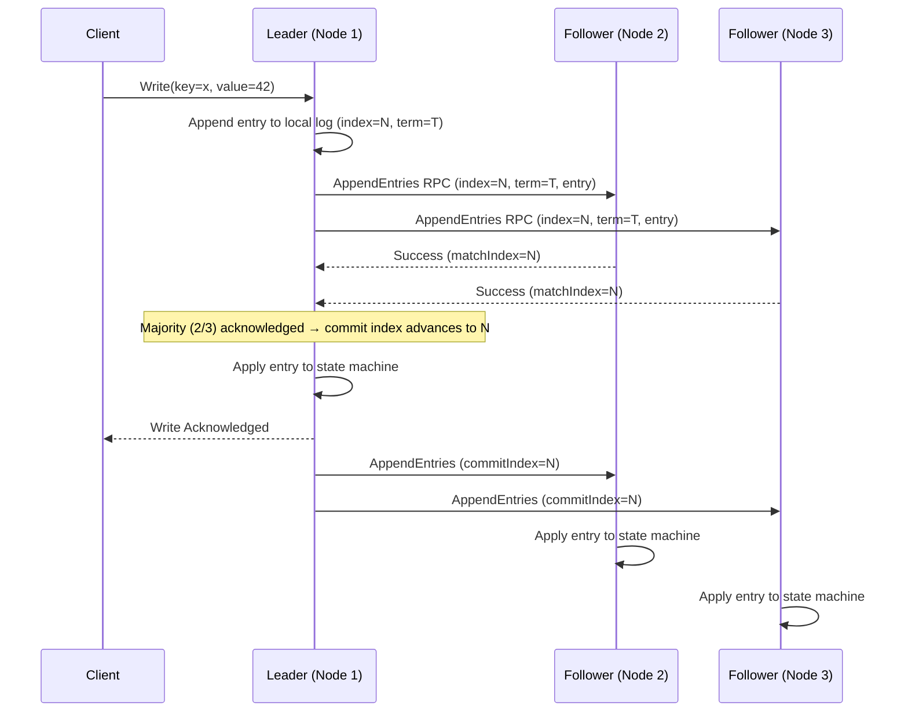
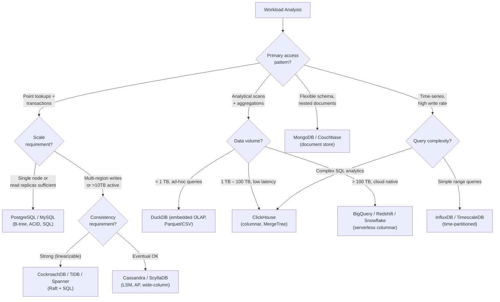

# Lesson 4: Data Storage Solutions

## 1. First-Principles Intuition & Invariants

Data storage is fundamentally a problem of durable, concurrent state management under adversarial conditions: hardware faults, network partitions, software bugs, and operator error. Before evaluating any specific technology, you must internalize the invariants that every storage system must negotiate.

### The Storage Hierarchy and Latency Reality

Every storage decision is ultimately constrained by the memory hierarchy. Numbers you must internalize (approximate, modern hardware):

| Level | Latency | Bandwidth | Volatility |
|---|---|---|---|
| L1 cache | ~1 ns | ~1 TB/s | Volatile |
| L2/L3 cache | ~10 ns | ~300 GB/s | Volatile |
| DRAM | ~100 ns | ~50 GB/s | Volatile |
| NVMe SSD (local) | ~100 µs | ~7 GB/s | Durable |
| SATA SSD | ~500 µs | ~600 MB/s | Durable |
| HDD | ~5–10 ms | ~200 MB/s | Durable |
| Network (intra-DC) | ~200 µs | ~25 Gb/s | — |
| Network (inter-DC) | ~100 ms | variable | — |

A storage engine that performs a synchronous disk fsync on every transaction commit pays the NVMe or HDD latency on the critical path. This is *why* write-ahead logs (WAL) batch fsync calls, why LSM-trees buffer writes in memory before flushing to disk, and why in-memory databases exist. Every architectural choice in a storage system is a point on the latency-durability-throughput tradeoff surface.

### ACID: A Precise Definition

Relational databases enforce ACID semantics. These are not merely desirable properties—they are formal guarantees with precise meanings:

**Atomicity** is implemented via the write-ahead log. Before any page is modified in the buffer pool, the modification is recorded in the WAL. If the process crashes mid-transaction, the recovery manager replays the log to either complete or roll back partial writes. The WAL is the mechanism; atomicity is the guarantee it provides.

**Consistency** is a database-level invariant (foreign key constraints, `CHECK` constraints, `NOT NULL`) plus any application-level invariants the transaction logic enforces. The database cannot guarantee application-level consistency; it only ensures its own structural constraints are never violated across commits. This is frequently misunderstood—C in ACID is the weakest of the four properties and is partially delegated to the application.

**Isolation** is the most nuanced property. The SQL standard defines four isolation levels (Read Uncommitted, Read Committed, Repeatable Read, Serializable), each preventing a specific class of anomalies (dirty reads, non-repeatable reads, phantom reads). Full serializability means concurrent transactions produce a result equivalent to some serial execution order. This is expensive. PostgreSQL implements Serializable Snapshot Isolation (SSI), which uses MVCC with conflict detection to achieve serializable isolation with far less lock contention than traditional 2PL (two-phase locking). MySQL InnoDB uses MVCC for Read Committed and Repeatable Read but falls back to gap locks for Repeatable Read to prevent phantom reads.

**Durability** means a committed transaction survives any single failure. This requires that the WAL record be flushed to stable storage (fsync) before the commit acknowledgment is returned to the client. Databases that skip fsync on commit (a common misconfiguration) violate durability silently—this is how data loss occurs on PostgreSQL with `synchronous_commit = off` on a crashing server.

### CAP Theorem: What It Actually Says

Eric Brewer's CAP theorem (formalized by Gilbert and Lynch, 2002) states that a distributed system cannot simultaneously guarantee all three of:

- **Consistency (C)**: Every read receives the most recent write or an error.
- **Availability (A)**: Every request receives a non-error response (not necessarily the latest write).
- **Partition Tolerance (P)**: The system continues operating despite message loss between nodes.

Since network partitions are unavoidable in any real distributed system, the practical choice is **CP vs. AP during a partition**. Zookeeper and etcd choose CP: they refuse writes if a quorum cannot be reached. Cassandra and DynamoDB choose AP: they accept writes to any available replica and reconcile divergence later (eventual consistency).

PACELC (Daniel Abadi, 2012) extends this model: even without partitions, there is a tradeoff between latency (L) and consistency (C). This is the more operationally relevant framing—most of the time, you are not experiencing a partition; you are choosing between low-latency reads and strong consistency.

### The Two Dominant Storage Engine Paradigms

**B-Tree engines** (InnoDB, PostgreSQL heap+B-tree, LMDB) are optimized for read-heavy workloads with random access patterns. The B-tree is an on-disk balanced search tree where each node is sized to match a disk page (typically 4–16 KB). Lookups are O(log_B N) disk reads where B is the branching factor (often 100–1000), making depth shallow even for billion-row tables. Updates are in-place, which requires careful locking and can cause write amplification due to page splits and cascading updates to parent nodes.

**LSM-Tree engines** (RocksDB, LevelDB, Cassandra's storage engine, ClickHouse MergeTree) are optimized for write-heavy workloads. Writes go to an in-memory buffer (MemTable) and an append-only WAL. When the MemTable fills, it is flushed to an immutable SSTable (Sorted String Table) on disk. Background compaction merges SSTables, reclaims space from deleted/overwritten keys, and maintains sorted order for efficient reads. Writes are always sequential (high throughput, SSD-friendly); reads may require checking multiple SSTables (mitigated by Bloom filters). Write amplification is shifted to background compaction rather than the write critical path.



---

## 2. Core Architecture & Mechanics

### Relational Database: PostgreSQL Internals

PostgreSQL's architecture separates concerns across distinct subsystems. Understanding each subsystem explains *why* PostgreSQL behaves as it does under load.



**Key architectural decisions in PostgreSQL:**

The buffer manager maintains a shared memory pool (`shared_buffers`). Every page access goes through this pool. On a cache miss, the storage manager issues a `pread()` syscall. The buffer replacement policy is a variant of clock-sweep (not pure LRU), which is cheaper under high concurrency because it avoids a global lock on a hot data structure.

MVCC (Multi-Version Concurrency Control) is implemented by storing multiple versions of each row in the heap. Each row version carries `xmin` (the transaction ID that created it) and `xmax` (the transaction ID that deleted/updated it). A transaction with snapshot ID `S` sees a row version if `xmin <= S < xmax` and `xmin` committed before `S` began. This means readers never block writers and writers never block readers—a critical performance property. The tradeoff is that dead row versions accumulate and must be periodically reclaimed by VACUUM, which is why autovacuum configuration is non-trivial in high-churn tables.

The query optimizer is cost-based. It queries `pg_statistic` (populated by `ANALYZE`) for column histograms, most-common-values lists, and correlation coefficients between column order and physical row order. It uses these statistics to estimate row counts for each plan node and chooses the plan with the lowest estimated total cost (in units of sequential page reads). The optimizer can generate nested loop joins, hash joins, and merge joins, and chooses among them based on estimated input cardinalities and available memory (`work_mem`).

### LSM-Tree Deep Dive: RocksDB

RocksDB (Meta/Facebook, based on LevelDB) is the reference LSM-tree implementation, embedded in MySQL (MyRocks), TiKV (TiDB's storage layer), CockroachDB's Pebble, and dozens of other systems.



A point read in RocksDB must check: active MemTable → immutable MemTables → L0 SSTables (all, since L0 files can have overlapping key ranges) → L1 → … → LN, stopping at the first found version. Bloom filters (a probabilistic set membership structure with tunable false-positive rate, typically 1%) eliminate most SSTable reads for missing keys—a Bloom filter check requires only a few memory accesses against the filter's bit array.

Write amplification in a leveled compaction scheme is O(N × size_ratio) where N is the number of levels and size_ratio is the multiplier between level sizes (typically 10). For 7 levels with ratio 10, worst-case write amplification is ~40x. Space amplification is bounded at ~1.1x (10% extra space). Tiered (size-tiered) compaction inverts this: lower write amplification (~10x) but higher space amplification (~2x) and worse worst-case read amplification. RocksDB supports both via `CompactionStyle`.

### Wide-Column Stores: Cassandra's Architecture

Apache Cassandra combines a Dynamo-style distributed system (consistent hashing, tunable consistency, gossip protocol) with a Bigtable-style storage engine (LSM-trees, SSTables). Understanding both layers is essential.



Cassandra's partition key is hashed with Murmur3 (default) to produce a 64-bit token. The consistent hash ring assigns token ranges to nodes. With `replication_factor = 3`, the coordinator writes to the 3 nodes whose token ranges cover the partition's token. `QUORUM` consistency (`(RF/2)+1 = 2` nodes) means reads and writes overlap by at least one node, ensuring the latest write is visible to subsequent reads—a property called "quorum intersection."

The coordinator handles read repair: if quorum responses disagree on a row version (detected via digest comparison), the coordinator fetches full data from divergent replicas and writes the latest version back asynchronously. This is the mechanism by which eventual consistency converges.

### Document Store: MongoDB's WiredTiger Engine

MongoDB shifted from its original MMAP storage engine to WiredTiger (acquired 2014) in MongoDB 3.2. WiredTiger uses a B-tree variant with MVCC, row-level locking (not collection-level), and document-level compression (Snappy by default, zlib, zstd available). The critical architectural property is that WiredTiger maintains its own cache (`wiredTigerCacheSizeGB`, default 50% of RAM minus 1 GB) separate from the OS page cache—this double-buffering can be a source of memory pressure and must be accounted for in capacity planning.

MongoDB's aggregation pipeline is processed as a sequence of stages (each stage is a transform on a document stream). The query planner can "push down" `$match` and `$sort` stages before `$lookup` or `$unwind` to reduce data volume early—this is analogous to predicate pushdown in relational query optimizers but requires explicit understanding of the pipeline ordering to exploit.

---

## 3. Data Warehouse Columnar Architecture

Online Analytical Processing (OLAP) workloads—full or partial table scans, aggregations over hundreds of millions of rows, complex joins between large fact and dimension tables—have fundamentally different access patterns from OLTP. Columnar storage is the correct answer for OLAP because:

1. Queries touch a small fraction of columns but all (or many) rows. Columnar layout means only the relevant columns are read from disk—I/O is proportional to columns accessed, not row width.
2. Values within a single column have high type homogeneity and often high value repetition (e.g., `country`, `status`, `product_category`), making them far more compressible than row-oriented pages.
3. SIMD (Single Instruction, Multiple Data) CPU instructions can operate on vectors of same-type values directly from columnar buffers, enabling vectorized query execution that processes 8–64 values per CPU instruction.

### ClickHouse MergeTree: Columnar LSM Architecture

ClickHouse's MergeTree engine is the most performant open-source OLAP storage engine. Its design choices are worth examining in detail.



**Sparse primary index**: Unlike a B-tree which indexes every row, ClickHouse stores one index entry per *granule* (default 8192 rows). A query on the primary key column binary-searches the sparse index to find the range of granules that could contain matching rows, then scans only those granules. This reduces index size dramatically (a 1-billion-row table with 8192-row granules has ~122,000 index entries, fitting entirely in RAM) while still providing efficient skip-scanning.

**Data skipping indexes**: Secondary indexes in ClickHouse are min/max, set, Bloom filter, or N-gram Bloom filter indexes over granule ranges. They allow the query executor to skip entire granule ranges that cannot match a predicate without reading the column data. These are fundamentally different from B-tree secondary indexes in row stores—they do not provide point-lookup efficiency; they provide granule-range skip efficiency for scan queries.

### Parquet File Format: The De Facto OLAP Interchange Format

Apache Parquet (derived from Google Dremel's nested columnar format) is the standard columnar storage format for data lakes on object storage (S3, GCS, ADLS).



Parquet's row group statistics (min/max per column chunk) enable **partition pruning at the file level** in query engines like Spark, Trino, and DuckDB. A query `WHERE ts BETWEEN '2024-01-01' AND '2024-01-31'` can skip entire row groups whose `ts` column chunk min/max does not overlap the predicate range, without reading any column data from those row groups. This is the columnar equivalent of Cassandra's partition pruning.

Parquet's encoding pipeline: values are first dictionary-encoded (mapping distinct values to integer codes), then the integer codes are bit-packed (using the minimum number of bits to represent the code range), then the byte stream is block-compressed (Snappy, LZ4, Zstd, Gzip). Dictionary encoding is especially effective for low-cardinality columns. Run-length encoding (RLE) handles runs of repeated values. These encodings compose, and query engines can often operate directly on encoded data without full decompression—a technique called *late materialization*.

---

## 4. Distributed Coordination and Consensus

Any distributed storage system that provides strong consistency must solve the consensus problem: how do N nodes agree on a single value (or sequence of values) in the presence of arbitrary node and network failures?

### Raft Consensus: The Algorithm Underlying etcd, TiKV, CockroachDB

Raft (Ongaro & Ousterhout, 2014) decomposes consensus into three relatively independent subproblems: leader election, log replication, and safety. The key safety invariant is: **at most one leader per term**. A leader is elected by winning a majority vote; since any two majorities overlap, a stale leader cannot commit entries that a new leader would not have seen.



An entry is *committed* once the leader has received acknowledgment from a majority of nodes (including itself). Committed entries are guaranteed durable: even if the leader crashes, any future leader will have the entry in its log (because winning an election requires a log at least as up-to-date as a majority of nodes). Read requests that require linearizability must go through the leader or use a *read index* mechanism (the leader confirms its leadership is current before serving the read) to avoid serving stale data from a partitioned former leader.

---

## 5. High-Performance Implementation Patterns

### WAL Implementation in C (Simplified)

The write-ahead log is the foundational durability mechanism. This example shows the core write path:

```c
#include <stdint.h>
#include <string.h>
#include <unistd.h>
#include <fcntl.h>
#include <stdlib.h>
#include <errno.h>

/*
 * WAL record format:
 *   [4-byte CRC32] [4-byte length] [payload bytes]
 *
 * CRC covers both the length field and the payload,
 * allowing the recovery scan to detect truncated or
 * corrupted records at crash-recovery time.
 */

#define WAL_HEADER_SIZE 8   /* 4 (crc) + 4 (len) */
#define WAL_SEGMENT_SIZE (16 * 1024 * 1024)  /* 16 MB, matches PostgreSQL */

typedef struct {
    int      fd;
    uint64_t current_lsn;   /* Log Sequence Number: byte offset in WAL stream */
    uint8_t  buf[WAL_SEGMENT_SIZE];
    size_t   buf_pos;
} WALWriter;

/* Minimal CRC32 (Castagnoli) — production systems use hardware CRC32C via SSE4.2 */
static uint32_t crc32c(const uint8_t *data, size_t len) {
    uint32_t crc = 0xFFFFFFFF;
    for (size_t i = 0; i < len; i++) {
        crc ^= data[i];
        for (int j = 0; j < 8; j++)
            crc = (crc >> 1) ^ (0x82F63B78 & -(crc & 1));
    }
    return crc ^ 0xFFFFFFFF;
}

/*
 * wal_append: append a record to the WAL buffer.
 *
 * Returns the LSN at which the record starts, or (uint64_t)-1 on error.
 * The caller must call wal_flush() to guarantee durability before
 * acknowledging the write to the client.
 */
uint64_t wal_append(WALWriter *wal, const uint8_t *payload, uint32_t len) {
    uint8_t  header[WAL_HEADER_SIZE];
    uint32_t crc;
    uint64_t record_lsn;

    if (wal->buf_pos + WAL_HEADER_SIZE + len > WAL_SEGMENT_SIZE) {
        /* Segment full: in production, rotate to a new segment file */
        return (uint64_t)-1;
    }

    /* Compute CRC over [len_field | payload] */
    uint32_t len_be = __builtin_bswap32(len);  /* big-endian for portability */
    crc = crc32c((uint8_t *)&len_be, 4);
    crc ^= crc32c(payload, len);               /* chain CRCs (XOR for simplicity) */

    memcpy(header + 0, &crc,    4);
    memcpy(header + 4, &len_be, 4);

    record_lsn = wal->current_lsn;
    memcpy(wal->buf + wal->buf_pos, header,  WAL_HEADER_SIZE);
    wal->buf_pos   += WAL_HEADER_SIZE;
    memcpy(wal->buf + wal->buf_pos, payload, len);
    wal->buf_pos   += len;
    wal->current_lsn += WAL_HEADER_SIZE + len;

    return record_lsn;
}

/*
 * wal_flush: write buffered WAL records to disk and fsync.
 *
 * fsync() is mandatory for durability; O_DIRECT + fdatasync() is
 * preferred in production to bypass the OS page cache for WAL writes
 * (reduces double-buffering overhead; see PostgreSQL's wal_sync_method).
 */
int wal_flush(WALWriter *wal) {
    ssize_t written = 0;
    ssize_t total   = (ssize_t)wal->buf_pos;

    while (written < total) {
        ssize_t n = write(wal->fd, wal->buf + written, total - written);
        if (n < 0) {
            if (errno == EINTR) continue;
            return -1;
        }
        written += n;
    }

    if (fdatasync(wal->fd) != 0)
        return -1;

    wal->buf_pos = 0;  /* reset buffer after successful flush */
    return 0;
}
```

The CRC32C checksum over each record is what allows crash recovery to distinguish valid records from garbage written by a partial sector write. The recovery scan reads records sequentially, verifies the CRC, and stops at the first invalid record—everything before that point is recoverable.

### LSM-Tree MemTable in Rust

The MemTable is an in-memory sorted data structure. A skip list is the standard choice (used by RocksDB and LevelDB) because it provides O(log N) insert and lookup with lock-free concurrent variants. Here is a simplified single-threaded MemTable using a `BTreeMap` to illustrate the interface semantics:

```rust
use std::collections::BTreeMap;
use std::sync::atomic::{AtomicU64, Ordering};

/// A sequence number is appended to every key to implement MVCC:
/// multiple versions of the same user key are stored with different
/// sequence numbers, enabling snapshot reads.
type SeqNum = u64;

#[derive(Debug, Clone, PartialEq, Eq, PartialOrd, Ord)]
struct InternalKey {
    user_key: Vec<u8>,
    /// Higher sequence number = newer version. Keys sort ascending by
    /// user_key, then descending by seq_num (newest first within a key).
    seq_num: std::cmp::Reverse<SeqNum>,
}

#[derive(Debug, Clone)]
enum Value {
    Put(Vec<u8>),
    Delete,  /// Tombstone: marks key as deleted for this sequence number.
}

pub struct MemTable {
    table: BTreeMap<InternalKey, Value>,
    size_bytes: usize,
    /// Monotonically increasing sequence number shared across the LSM instance.
    next_seq: AtomicU64,
}

impl MemTable {
    pub fn new() -> Self {
        Self {
            table: BTreeMap::new(),
            size_bytes: 0,
            next_seq: AtomicU64::new(1),
        }
    }

    fn alloc_seq(&self) -> SeqNum {
        self.next_seq.fetch_add(1, Ordering::Relaxed)
    }

    /// Write a key-value pair. Returns the assigned sequence number.
    pub fn put(&mut self, key: Vec<u8>, value: Vec<u8>) -> SeqNum {
        let seq = self.alloc_seq();
        let entry_size = key.len() + value.len() + 16; // internal key overhead
        self.size_bytes += entry_size;
        let ikey = InternalKey { user_key: key, seq_num: std::cmp::Reverse(seq) };
        self.table.insert(ikey, Value::Put(value));
        seq
    }

    /// Write a deletion tombstone.
    pub fn delete(&mut self, key: Vec<u8>) -> SeqNum {
        let seq = self.alloc_seq();
        self.size_bytes += key.len() + 16;
        let ikey = InternalKey { user_key: key, seq_num: std::cmp::Reverse(seq) };
        self.table.insert(ikey, Value::Delete);
        seq
    }

    /// Point lookup: returns the most recent value for `key` visible
    /// at or before `snapshot_seq`. Returns None if deleted or not found.
    pub fn get(&self, key: &[u8], snapshot_seq: SeqNum) -> Option<&[u8]> {
        // Construct the search key: user_key with seq = snapshot_seq
        // (Reverse ordering means lower Reverse value = higher seq_num = searched first)
        let search = InternalKey {
            user_key: key.to_vec(),
            seq_num: std::cmp::Reverse(snapshot_seq),
        };
        // range() gives all entries >= search, which is the first entry
        // for this user_key with seq_num <= snapshot_seq (newest visible version).
        for (ikey, val) in self.table.range(search..) {
            if ikey.user_key.as_slice() != key {
                break; // past this user_key
            }
            return match val {
                Value::Put(v) => Some(v.as_slice()),
                Value::Delete => None,
            };
        }
        None
    }

    /// Memory usage in bytes (approximate).
    pub fn size_bytes(&self) -> usize {
        self.size_bytes
    }

    /// True if the MemTable should be flushed (e.g., > 64 MB).
    pub fn should_flush(&self, threshold_bytes: usize) -> bool {
        self.size_bytes >= threshold_bytes
    }

    /// Iterate all entries in sorted order for SSTable flush.
    pub fn iter(&self) -> impl Iterator<Item = (&InternalKey, &Value)> {
        self.table.iter()
    }
}

#[cfg(test)]
mod tests {
    use super::*;

    #[test]
    fn test_mvcc_visibility() {
        let mut mt = MemTable::new();
        let seq1 = mt.put(b"foo".to_vec(), b"bar".to_vec());
        let seq2 = mt.put(b"foo".to_vec(), b"baz".to_vec());

        // Snapshot at seq1 sees "bar"
        assert_eq!(mt.get(b"foo", seq1), Some(b"bar".as_slice()));
        // Snapshot at seq2 sees "baz"
        assert_eq!(mt.get(b"foo", seq2), Some(b"baz".as_slice()));

        let seq3 = mt.delete(b"foo".to_vec());
        // Snapshot at seq3 sees deletion
        assert_eq!(mt.get(b"foo", seq3), None);
        // Snapshot at seq2 still sees "baz"
        assert_eq!(mt.get(b"foo", seq2), Some(b"baz".as_slice()));
    }
}
```

### Bloom Filter in Python (Exact Implementation)

Bloom filters are used in every SSTable to avoid unnecessary disk reads for missing keys. The filter occupies a few KB per SSTable and reduces read I/O by >99% for negative lookups (key not present in that SSTable).

```python
import math
import hashlib
import struct
from typing import Iterable


class BloomFilter:
    """
    A space-efficient probabilistic set membership filter.

    Parameters
    ----------
    expected_items : int
        Anticipated number of distinct keys in the SSTable.
    false_positive_rate : float
        Target false-positive probability (e.g., 0.01 for 1%).

    Internals
    ---------
    Optimal bit array size:
        m = -n * ln(p) / (ln 2)^2
    Optimal number of hash functions:
        k = (m / n) * ln 2

    Uses double hashing (Kirsch & Mitzenmacher, 2006) to generate k
    independent hash positions from two base hashes, avoiding the
    overhead of k separate hash function invocations.
    """

    def __init__(self, expected_items: int, false_positive_rate: float = 0.01):
        self.n = expected_items
        self.p = false_positive_rate

        # Derive optimal parameters
        self.m = max(1, math.ceil(
            -expected_items * math.log(false_positive_rate) / (math.log(2) ** 2)
        ))
        self.k = max(1, round((self.m / expected_items) * math.log(2)))

        # Bit array backed by a bytearray for cache efficiency
        self.bits = bytearray(math.ceil(self.m / 8))
        self._item_count = 0

    def _hash_pair(self, item: bytes) -> tuple[int, int]:
        """Return two independent 64-bit hashes using SHA-256 (truncated)."""
        digest = hashlib.sha256(item).digest()
        h1 = struct.unpack_from(">Q", digest, 0)[0]
        h2 = struct.unpack_from(">Q", digest, 8)[0]
        return h1, h2

    def _bit_positions(self, item: bytes) -> Iterable[int]:
        """
        Generate k bit positions via double hashing:
            pos_i = (h1 + i * h2) mod m
        This produces k approximately independent positions using only
        two underlying hash computations.
        """
        h1, h2 = self._hash_pair(item)
        for i in range(self.k):
            yield (h1 + i * h2) % self.m

    def add(self, item: bytes) -> None:
        for pos in self._bit_positions(item):
            self.bits[pos >> 3] |= (1 << (pos & 7))
        self._item_count += 1

    def __contains__(self, item: bytes) -> bool:
        """
        Returns True if item *might* be in the set (possible false positive),
        False if item is *definitely not* in the set (no false negatives).
        """
        return all(
            (self.bits[pos >> 3] >> (pos & 7)) & 1
            for pos in self._bit_positions(item)
        )

    def add_bulk(self, items: Iterable[bytes]) -> None:
        for item in items:
            self.add(item)

    @property
    def fill_ratio(self) -> float:
        """Fraction of bits set to 1. Approaches 0.5 at optimal load."""
        return sum(bin(b).count('1') for b in self.bits) / self.m

    @property
    def estimated_fpr(self) -> float:
        """Actual false positive rate given current fill."""
        return (1 - math.exp(-self.k * self._item_count / self.m)) ** self.k

    def to_bytes(self) -> bytes:
        """Serialize for storage in SSTable filter block."""
        header = struct.pack(">IId", self.m, self.k, self.p)
        return header + bytes(self.bits)

    @classmethod
    def from_bytes(cls, data: bytes) -> "BloomFilter":
        """Deserialize from SSTable filter block."""
        m, k, p = struct.unpack_from(">IId", data, 0)
        header_size = struct.calcsize(">IId")
        n_approx = max(1, round(m * math.log(2) / k))  # reverse-derive n
        bf = cls(n_approx, p)
        bf.m = m
        bf.k = k
        bf.bits = bytearray(data[header_size:])
        return bf


# --- Demonstration ---
if __name__ == "__main__":
    keys = [f"user:{i}".encode() for i in range(100_000)]
    bf = BloomFilter(expected_items=100_000, false_positive_rate=0.01)
    bf.add_bulk(keys)

    # Verify: all inserted keys must be found (no false negatives)
    assert all(k in bf for k in keys), "False negative detected — implementation error"

    # Measure false positive rate on keys never inserted
    probe_keys = [f"ghost:{i}".encode() for i in range(100_000)]
    fp_count = sum(1 for k in probe_keys if k in bf)
    print(f"False positive rate: {fp_count / len(probe_keys):.4f} (target: {bf.p})")
    print(f"Filter size: {len(bf.bits):,} bytes ({bf.m:,} bits, k={bf.k} hashes)")
    print(f"Estimated FPR: {bf.estimated_fpr:.4f}")
```

### Query Optimization: SQL Join Strategies in PostgreSQL

Understanding which join algorithm PostgreSQL chooses—and why—is essential for tuning analytical queries.

```sql
-- Create representative schema for join analysis
CREATE TABLE orders (
    order_id    BIGINT PRIMARY KEY,
    customer_id BIGINT NOT NULL,
    order_date  DATE   NOT NULL,
    total_cents BIGINT NOT NULL
);

CREATE TABLE customers (
    customer_id BIGINT PRIMARY KEY,
    country     CHAR(2) NOT NULL,
    tier        SMALLINT NOT NULL  -- 1=free, 2=pro, 3=enterprise
);

-- Populate with realistic data distribution
INSERT INTO orders
SELECT
    g,
    (random() * 999999)::BIGINT,  -- 1M distinct customers
    '2020-01-01'::DATE + (random() * 1460)::INT,
    (random() * 100000)::BIGINT
FROM generate_series(1, 10_000_000) g;

INSERT INTO customers
SELECT
    g,
    (ARRAY['US','GB','DE','FR','JP','IN','BR'])[1 + (random() * 6)::INT],
    1 + (random() * 2)::INT
FROM generate_series(1, 1_000_000) g;

CREATE INDEX ON orders(customer_id);
CREATE INDEX ON orders(order_date);
ANALYZE orders;
ANALYZE customers;

-- ===================================================================
-- Query 1: Selective filter on small table → Hash Join
--
-- When customers is filtered to a small result set (enterprise tier),
-- PostgreSQL builds a hash table from the filtered customers rows,
-- then probes it with every qualifying orders row.
-- Hash join is O(n + m) time, O(smaller_table) space.
-- ===================================================================
EXPLAIN (ANALYZE, BUFFERS, FORMAT TEXT)
SELECT
    c.customer_id,
    c.country,
    SUM(o.total_cents)   AS lifetime_value_cents,
    COUNT(o.order_id)    AS order_count,
    MAX(o.order_date)    AS last_order_date
FROM   customers c
JOIN   orders    o ON o.customer_id = c.customer_id
WHERE  c.tier = 3                         -- ~333K rows
  AND  o.order_date >= '2023-01-01'       -- ~2.5M rows
GROUP BY c.customer_id, c.country
ORDER BY lifetime_value_cents DESC
LIMIT 100;

-- ===================================================================
-- Query 2: Point lookup via index → Nested Loop Join
--
-- When the outer relation is tiny (single customer), PostgreSQL uses
-- a nested loop join with an index scan on orders(customer_id).
-- Each outer row probes the inner index: O(outer * log(inner)).
-- ===================================================================
EXPLAIN (ANALYZE, BUFFERS, FORMAT TEXT)
SELECT o.order_id, o.order_date, o.total_cents
FROM   customers c
JOIN   orders    o ON o.customer_id = c.customer_id
WHERE  c.customer_id = 42;

-- ===================================================================
-- Query 3: Window function for running total (illustrates executor model)
--
-- The Sort + WindowAgg plan nodes are always sequential in PostgreSQL's
-- Volcano iterator model. The Sort materializes all rows from the
-- partition into work_mem before WindowAgg reads them.
-- For large windows, increasing work_mem prevents spill to disk.
-- ===================================================================
EXPLAIN (ANALYZE, BUFFERS, FORMAT TEXT)
SELECT
    order_date,
    total_cents,
    SUM(total_cents) OVER (
        PARTITION BY customer_id
        ORDER BY order_date
        ROWS BETWEEN UNBOUNDED PRECEDING AND CURRENT ROW
    ) AS running_total
FROM orders
WHERE customer_id = 42
ORDER BY order_date;

-- ===================================================================
-- Partial index: index only the high-value orders.
-- A partial index is smaller (fewer pages to scan), faster to maintain
-- (fewer index insertions), and can be more selective for queries that
-- include the partial index predicate.
-- ===================================================================
CREATE INDEX idx_orders_high_value
    ON orders (customer_id, order_date)
    WHERE total_cents > 50000;

-- This query will use the partial index because its WHERE clause
-- implies total_cents > 50000:
EXPLAIN SELECT order_id FROM orders
WHERE customer_id = 42
  AND order_date >= '2023-01-01'
  AND total_cents > 50000;
```

### ETL Pipeline with Backpressure in Python

Production data pipelines must handle producer-consumer speed mismatches without unbounded memory growth. The standard pattern is bounded queues with backpressure propagation.

```python
"""
Bounded ETL pipeline with backpressure, structured error handling,
and dead-letter queue (DLQ) for failed records.

Architecture:
    [Source Reader] → [Transform Worker(s)] → [Sink Writer]
         ↓ backpressure via bounded Queue ↑
                              ↓ failed records → [DLQ Writer]

Backpressure: when the transform queue is full, the source reader blocks
on queue.put(). When the sink queue is full, transform workers block.
This propagates backpressure from the slowest stage to all upstream stages,
bounding total in-flight data at (source_queue_size + sink_queue_size) records.
"""

import queue
import threading
import logging
import time
import csv
import io
from dataclasses import dataclass, field
from typing import Iterator, Callable, Any
from contextlib import contextmanager

logging.basicConfig(
    level=logging.INFO,
    format="%(asctime)s %(levelname)-8s %(threadName)s %(message)s",
)
log = logging.getLogger(__name__)

# Sentinel object: placing this on a queue signals downstream workers to shut down.
_POISON_PILL = object()


@dataclass
class Record:
    data: dict[str, Any]
    source_offset: int  # e.g., byte offset or Kafka offset for exactly-once tracking


@dataclass
class FailedRecord:
    record: Record
    error: Exception
    stage: str


@dataclass
class PipelineStats:
    records_read: int = 0
    records_transformed: int = 0
    records_written: int = 0
    records_failed: int = 0
    _lock: threading.Lock = field(default_factory=threading.Lock)

    def increment(self, field_name: str, n: int = 1) -> None:
        with self._lock:
            current = getattr(self, field_name)
            setattr(self, field_name, current + n)


class BoundedETLPipeline:
    def __init__(
        self,
        source: Callable[[], Iterator[Record]],
        transform: Callable[[Record], Record],
        sink: Callable[[list[Record]], None],
        dlq: Callable[[FailedRecord], None],
        num_transform_workers: int = 4,
        source_queue_size: int = 1000,
        sink_queue_size: int = 500,
        sink_batch_size: int = 100,
        sink_flush_interval_s: float = 5.0,
    ):
        self.source = source
        self.transform = transform
        self.sink = sink
        self.dlq = dlq
        self.num_transform_workers = num_transform_workers
        self.sink_batch_size = sink_batch_size
        self.sink_flush_interval_s = sink_flush_interval_s

        # Bounded queues enforce backpressure
        self.source_queue: queue.Queue = queue.Queue(maxsize=source_queue_size)
        self.sink_queue: queue.Queue = queue.Queue(maxsize=sink_queue_size)
        self.dlq_queue: queue.Queue = queue.Queue(maxsize=10_000)

        self.stats = PipelineStats()
        self._errors: list[Exception] = []
        self._error_lock = threading.Lock()

    def _source_reader(self) -> None:
        """Reads from source and pushes to source_queue. Single-threaded."""
        log.info("Source reader started")
        try:
            for record in self.source():
                # blocks when source_queue is full → backpressure to source
                self.source_queue.put(record)
                self.stats.increment("records_read")
        except Exception as e:
            log.error("Source reader error: %s", e)
            with self._error_lock:
                self._errors.append(e)
        finally:
            # Signal all transform workers to stop
            for _ in range(self.num_transform_workers):
                self.source_queue.put(_POISON_PILL)
            log.info("Source reader finished, sent %d poison pills", self.num_transform_workers)

    def _transform_worker(self, worker_id: int) -> None:
        """Applies transform function; routes failures to DLQ."""
        log.info("Transform worker %d started", worker_id)
        poison_count = 0
        while True:
            item = self.source_queue.get()
            if item is _POISON_PILL:
                self.source_queue.task_done()
                # Forward one poison pill to sink queue per worker
                self.sink_queue.put(_POISON_PILL)
                break

            try:
                transformed = self.transform(item)
                # blocks when sink_queue is full → backpressure to transform
                self.sink_queue.put(transformed)
                self.stats.increment("records_transformed")
            except Exception as e:
                log.warning("Transform failed for offset %d: %s", item.source_offset, e)
                self.dlq_queue.put(FailedRecord(record=item, error=e, stage="transform"))
                self.stats.increment("records_failed")
            finally:
                self.source_queue.task_done()

        log.info("Transform worker %d finished", worker_id)

    def _sink_writer(self) -> None:
        """Batches records and writes to sink. Handles partial batches on flush timeout."""
        log.info("Sink writer started")
        batch: list[Record] = []
        poison_pills_received = 0
        last_flush = time.monotonic()

        def flush_batch() -> None:
            nonlocal batch, last_flush
            if not batch:
                return
            try:
                self.sink(batch)
                self.stats.increment("records_written", len(batch))
            except Exception as e:
                log.error("Sink write failed for batch of %d: %s", len(batch), e)
                for rec in batch:
                    self.dlq_queue.put(FailedRecord(record=rec, error=e, stage="sink"))
                    self.stats.increment("records_failed")
                with self._error_lock:
                    self._errors.append(e)
            finally:
                batch = []
                last_flush = time.monotonic()

        while True:
            try:
                # Non-blocking get with timeout to allow periodic flush
                item = self.sink_queue.get(timeout=self.sink_flush_interval_s)
            except queue.Empty:
                flush_batch()
                continue

            if item is _POISON_PILL:
                self.sink_queue.task_done()
                poison_pills_received += 1
                if poison_pills_received == self.num_transform_workers:
                    flush_batch()  # flush remaining records
                    break
                continue

            batch.append(item)
            self.sink_queue.task_done()

            if (
                len(batch) >= self.sink_batch_size
                or time.monotonic() - last_flush >= self.sink_flush_interval_s
            ):
                flush_batch()

        log.info("Sink writer finished")

    def _dlq_writer(self) -> None:
        """Drains DLQ asynchronously. Runs until poison pill."""
        log.info("DLQ writer started")
        while True:
            item = self.dlq_queue.get()
            if item is _POISON_PILL:
                self.dlq_queue.task_done()
                break
            try:
                self.dlq(item)
            except Exception as e:
                log.error("DLQ write failed: %s — record lost", e)
            finally:
                self.dlq_queue.task_done()
        log.info("DLQ writer finished")

    def run(self) -> PipelineStats:
        """Execute the pipeline. Blocks until all records are processed."""
        threads = []

        threads.append(threading.Thread(target=self._source_reader, name="SourceReader", daemon=True))
        for i in range(self.num_transform_workers):
            threads.append(threading.Thread(target=self._transform_worker, args=(i,), name=f"Transform-{i}", daemon=True))
        threads.append(threading.Thread(target=self._sink_writer, name="SinkWriter", daemon=True))
        threads.append(threading.Thread(target=self._dlq_writer, name="DLQWriter", daemon=True))

        for t in threads:
            t.start()

        # Wait for all pipeline stages to complete
        for t in threads[:-1]:  # source + transforms + sink
            t.join()

        # Signal DLQ writer to stop after all failures are recorded
        self.dlq_queue.put(_POISON_PILL)
        threads[-1].join()

        if self._errors:
            log.warning("Pipeline completed with %d non-fatal errors", len(self._errors))

        log.info(
            "Pipeline complete: read=%d transformed=%d written=%d failed=%d",
            self.stats.records_read,
            self.stats.records_transformed,
            self.stats.records_written,
            self.stats.records_failed,
        )
        return self.stats


# --- Example usage ---
def _demo():
    def source() -> Iterator[Record]:
        for i in range(10_000):
            yield Record(data={"id": i, "value": f"row_{i}", "raw_amount": str(i * 1.5)}, source_offset=i)

    def transform(r: Record) -> Record:
        if r.data["id"] % 1000 == 999:
            raise ValueError(f"Simulated transform error at offset {r.source_offset}")
        return Record(
            data={**r.data, "amount_cents": int(float(r.data["raw_amount"]) * 100)},
            source_offset=r.source_offset,
        )

    written_records = []
    write_lock = threading.Lock()

    def sink(batch: list[Record]) -> None:
        with write_lock:
            written_records.extend(batch)

    dlq_records = []
    dlq_lock = threading.Lock()

    def dlq(fr: FailedRecord) -> None:
        with dlq_lock:
            dlq_records.append(fr)

    pipeline = BoundedETLPipeline(
        source=source,
        transform=transform,
        sink=sink,
        dlq=dlq,
        num_transform_workers=4,
    )
    stats = pipeline.run()
    assert stats.records_read == 10_000
    assert stats.records_written + stats.records_failed == 10_000
    print(f"Demo complete. Written: {stats.records_written}, DLQ: {len(dlq_records)}")


if __name__ == "__main__":
    _demo()
```

---

## 6. Failure Modes and Operational Hazards

Understanding *how* storage systems fail is as important as understanding how they work. Each storage architecture has characteristic failure modes.

### Split Brain in Replicated Systems

Split brain occurs when a network partition causes two nodes to both believe they are the primary/leader and begin accepting writes independently. When the partition heals, the system has two divergent write histories that must be reconciled. In databases without a consensus protocol (older MySQL replication setups, Redis Sentinel with misconfigured quorum), this can cause permanent data loss.

The correct mitigation is a consensus-based leader election (Raft, Paxos) or STONITH (Shoot The Other Node In The Head)—a fencing mechanism that ensures the former primary is killed before the new primary begins accepting writes. Cloud databases (Aurora, AlloyDB, CockroachDB) handle this automatically via their consensus layers.

### Write Stall in LSM-Tree Engines

RocksDB write stalls occur when the compaction thread cannot keep pace with the write rate, causing L0 file count to exceed `level0_slowdown_writes_trigger` (default: 20 files). The write path is throttled. At `level0_stop_writes_trigger` (default: 36 files), all writes are blocked. Write stalls manifest as sudden latency spikes in the application and are frequently misdiagnosed as network issues.

Diagnosis: `rocksdb.estimate-pending-compaction-bytes`, `rocksdb.num-running-compactions`, the `COMPACTION_PENDING` and `COMPACTION_RUNNING` statistics in RocksDB's `GetProperty` API. Mitigation: increase compaction thread count (`max_background_jobs`), tune `write_buffer_size` and `max_write_buffer_number`, or reduce write rate upstream.

### Hot Partition in Cassandra/DynamoDB

A hot partition occurs when a disproportionate fraction of requests are routed to a single partition key, overwhelming the node(s) responsible for that token range. In DynamoDB, this triggers throttling (`ProvisionedThroughputExceededException`). In Cassandra, it manifests as elevated GC pressure on the hot node and increased tail latency cluster-wide.

Root cause is almost always a poor partition key choice: using a low-cardinality column (e.g., `status`, `date`) or a business key with highly skewed access (a single viral user). The fix is to either add a shard suffix to the partition key (distributing the load artificially) or redesign the data model with a more uniform access distribution.

### PostgreSQL Bloat and VACUUM Failure

In high-churn PostgreSQL tables, dead row versions accumulate faster than autovacuum can reclaim them. Symptoms: table file size grows without bound, query performance degrades (more pages to scan), index bloat. The worst-case scenario is **transaction ID wraparound**: PostgreSQL's 32-bit XID space wraps after ~2.1 billion transactions. If autovacuum cannot freeze old XIDs before wraparound, PostgreSQL will shut down the entire cluster with the error `database is not accepting commands to avoid wraparound data loss`. Monitoring `age(datfrozenxid)` in `pg_database` and `age(relfrozenxid)` in `pg_class` is mandatory for production PostgreSQL deployments.

---

## 7. Architecture Decision Framework

Choosing a storage system requires matching workload characteristics to architectural properties.



The key variables to characterize before making a storage decision:

1. **Read/write ratio**: LSM engines (Cassandra, RocksDB) favor write-heavy; B-tree (PostgreSQL) favors read-heavy with random access.
2. **Query shape**: point lookups vs. range scans vs. aggregations over full partitions. These require fundamentally different index structures.
3. **Consistency model**: do you need linearizable reads, or is session consistency or eventual consistency acceptable? Stronger consistency = higher latency cross-region.
4. **Data model stability**: document stores handle schema evolution well but sacrifice join efficiency; relational schemas are rigid but optimized for multi-table queries.
5. **Operational complexity**: managed cloud services (RDS, AlloyDB, DynamoDB, Bigtable) trade configurability for reduced operational burden. Self-managed clusters give control over compaction, caching, and replication topology but require deep expertise.
6. **Cost structure**: columnar warehouses charge for compute and storage separately; OLTP databases charge for provisioned IOPS. Understand the access pattern's cost profile before committing.
