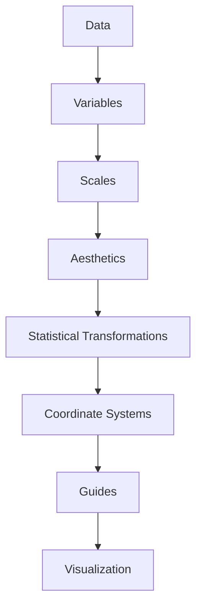

# Lesson 1: Introduction to the Grammar of Graphics

## 1. First-Principles Intuition & Invariants

Data visualization is a critical discipline that bridges the gap between raw data and human understanding. It transforms complex datasets into meaningful insights, enabling decision-makers to identify patterns, trends, and anomalies. At the heart of effective data visualization lies the Grammar of Graphics, a theoretical framework that provides a systematic approach to constructing visual representations of data. This framework, introduced by Leland Wilkinson in his seminal work "The Grammar of Graphics," is not merely a set of rules but a comprehensive language that allows for the creation of a wide variety of visualizations by combining a small set of fundamental components.

The Grammar of Graphics is grounded in the idea that any statistical graphic can be decomposed into a series of independent components, each of which can be manipulated independently to create a wide range of visualizations. These components include data, variables, scales, aesthetics, statistical transformations, coordinate systems, and guides. By understanding and mastering these components, one can construct complex and insightful visualizations that are both aesthetically pleasing and analytically rigorous.

The theoretical foundation of the Grammar of Graphics is rooted in the principles of mathematical and statistical modeling. It leverages the power of abstraction to separate the data from its visual representation, allowing for a flexible and modular approach to visualization design. This separation is crucial because it enables the visualization process to be systematic and repeatable, ensuring that the same data can be represented in multiple ways to suit different analytical needs.

One of the key invariants of the Grammar of Graphics is the distinction between data and its visual representation. Data, in this context, refers to the raw information that is to be visualized, while aesthetics refer to the visual properties of the graphic, such as color, size, and shape. By treating these components separately, the Grammar of Graphics provides a clear and consistent framework for visualizing data, regardless of the underlying dataset or the specific visualization goals.

Another invariant is the role of statistical transformations. These transformations allow for the manipulation of data before it is visualized, enabling the creation of complex visualizations that go beyond simple scatter plots or bar charts. For example, a statistical transformation might involve aggregating data, smoothing it, or applying a statistical model to it. By incorporating these transformations into the visualization process, the Grammar of Graphics provides a powerful tool for exploratory data analysis.

## 2. Core Architecture & Mechanics

The Grammar of Graphics is structured around a set of core components that work together to create a visual representation of data. These components can be visualized as a series of layers, each of which builds upon the previous one to create a complete visualization. The following diagram illustrates the core architecture of the Grammar of Graphics:

At the base of this architecture is the data, which is the raw information that is to be visualized. The variables component identifies the specific data fields that will be used in the visualization. For example, in a scatter plot, the variables might be the x and y coordinates of the data points.

The scales component defines how the variables are mapped to the visual properties of the graphic. For example, a linear scale might map a range of numerical values to a range of colors, while a categorical scale might map a set of categories to a set of shapes. Scales are crucial because they allow for the creation of visualizations that are both accurate and intuitive.

The aesthetics component specifies the visual properties of the graphic, such as color, size, and shape. These properties are mapped to the variables through the scales, allowing for the creation of visualizations that are both informative and visually appealing. For example, in a scatter plot, the color of the data points might be mapped to a categorical variable, while the size of the data points might be mapped to a numerical variable.

The statistical transformations component allows for the manipulation of data before it is visualized. These transformations can include aggregating data, smoothing it, or applying a statistical model to it. By incorporating these transformations into the visualization process, the Grammar of Graphics provides a powerful tool for exploratory data analysis.

The coordinate systems component defines the spatial arrangement of the data points in the visualization. For example, a Cartesian coordinate system might be used to create a scatter plot, while a polar coordinate system might be used to create a radar chart. Coordinate systems are crucial because they allow for the creation of visualizations that are both accurate and intuitive.

The guides component includes elements such as axes, labels, and legends, which provide context and information about the visualization. These elements are crucial because they allow the viewer to understand the meaning of the visualization and to interpret the data correctly.

Finally, the visualization component combines all of the previous components to create a complete visual representation of the data. This component is the culmination of the Grammar of Graphics, and it is what allows for the creation of complex and insightful visualizations.

## 3. High-Performance Optimization & Failure Modes

The Grammar of Graphics is a powerful framework for creating complex and insightful visualizations, but it is not without its challenges. One of the key challenges is ensuring that visualizations are both performant and scalable. This is particularly important when working with large datasets, as even small inefficiencies can lead to significant performance issues.

One way to optimize the performance of visualizations is to use efficient data structures and algorithms. For example, using a hash table to map variables to scales can significantly improve the performance of a visualization, as it allows for fast lookups and updates. Similarly, using a binary search tree to store data points can improve the performance of a scatter plot, as it allows for fast sorting and searching.

Another way to optimize the performance of visualizations is to use hardware acceleration. Modern graphics cards are highly optimized for rendering complex visualizations, and using them can significantly improve the performance of a visualization. For example, using WebGL to render a visualization in a web browser can improve the performance of the visualization, as it allows for hardware-accelerated rendering.

However, even with these optimizations, there are still potential failure modes that can arise. One common failure mode is the creation of visualizations that are too complex or overwhelming. This can happen when too many variables are mapped to too many aesthetics, or when too many statistical transformations are applied to the data. To mitigate this failure mode, it is important to keep the visualization as simple as possible, and to focus on the most important variables and transformations.

Another common failure mode is the creation of visualizations that are inaccurate or misleading. This can happen when the scales are not properly defined, or when the statistical transformations are not properly applied. To mitigate this failure mode, it is important to carefully define the scales and transformations, and to test the visualization thoroughly to ensure that it is accurate and reliable.

In conclusion, the Grammar of Graphics is a powerful framework for creating complex and insightful visualizations. By understanding and mastering the core components of the Grammar of Graphics, one can create visualizations that are both accurate and visually appealing. However, it is important to be aware of the potential challenges and failure modes that can arise, and to take steps to optimize the performance and accuracy of the visualizations.
