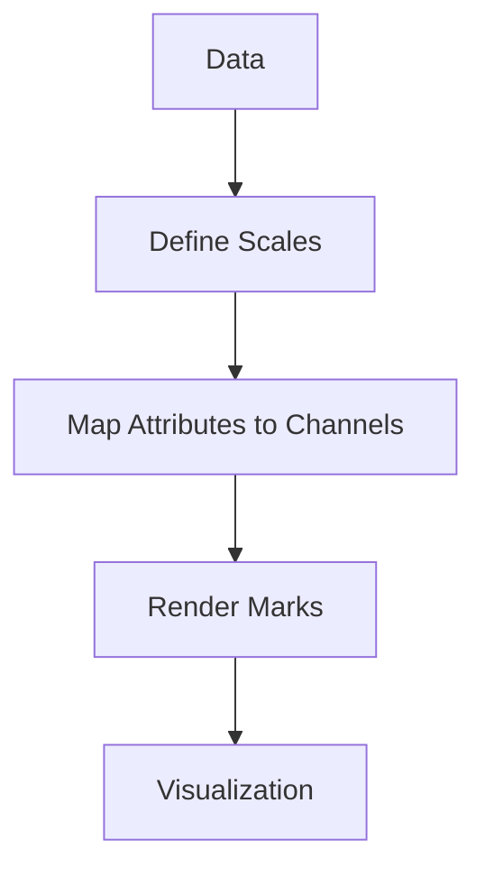

# Lesson 2: Principles of Visual Encoding

## 1. First-Principles Intuition & Invariants

Visual encoding is the cornerstone of data visualization, serving as the bridge between raw data and meaningful insights. At its core, visual encoding involves the systematic transformation of data attributes into visual properties such as position, size, color, and shape. This transformation is governed by a set of principles that ensure the visual representation is both accurate and comprehensible. The foundational work in this area is largely attributed to Leland Wilkinson's Grammar of Graphics, which provides a formal framework for understanding and constructing visual encodings.

The problem space of visual encoding is inherently multidimensional, as it requires the simultaneous consideration of both the data's intrinsic properties and the human perceptual system's capabilities. Data attributes, such as numerical values, categorical labels, and temporal sequences, must be mapped to visual channels in a way that preserves the data's structure and relationships. Simultaneously, the visual channels must be chosen and configured to align with human perceptual strengths, such as the ability to discern differences in position, color hue, and size.

A critical invariant in visual encoding is the preservation of data integrity. Any transformation applied to the data must maintain its essential characteristics and relationships. For instance, a linear scale should preserve the proportional differences between data points, while a logarithmic scale should accurately represent exponential growth. Another invariant is the consistency of visual mappings across different datasets and visualizations. Consistent mappings enable viewers to transfer their understanding from one visualization to another, enhancing the overall coherence and effectiveness of the visual communication.

The mathematical and system invariants of visual encoding are deeply rooted in the principles of scale, channel, and mark. Scales define the mapping between data attributes and visual properties, ensuring that the visual representation accurately reflects the data's structure. Channels are the visual dimensions used to convey information, such as position, size, color, and shape. Marks are the graphical elements that represent individual data points or groups of data points, such as points, lines, and bars. Together, these components form a coherent and systematic framework for visual encoding.

## 2. Core Architecture & Mechanics

To understand the mechanics of visual encoding, it is essential to dissect the internal data structures and algorithms that underpin the process. At a high level, visual encoding can be conceptualized as a series of transformations applied to the data, with each transformation corresponding to a specific visual channel.

Consider a simple example of a scatter plot, where each point represents a data record with two numerical attributes, such as height and weight. The first step in the visual encoding process is to define the scales for the x and y axes. In this case, the scales would map the numerical values of height and weight to the visual dimensions of horizontal and vertical position, respectively. The scales could be linear or logarithmic, depending on the data distribution and the desired emphasis.

Once the scales are defined, the next step is to map the data attributes to the visual channels. In the scatter plot example, the x-coordinate of each point would be determined by the height attribute, while the y-coordinate would be determined by the weight attribute. The choice of visual channels is crucial, as it affects the viewer's ability to perceive and interpret the data. For instance, using position to represent numerical values is generally more effective than using color or shape, as humans are more adept at discerning differences in position than in color hue or shape.

The final step in the visual encoding process is to render the marks, which are the graphical elements that represent individual data points or groups of data points. In the scatter plot example, the marks would be points, with each point representing a single data record. The appearance of the marks, such as their size, color, and shape, can be used to convey additional information about the data. For instance, the size of each point could represent a third numerical attribute, such as age, while the color could represent a categorical attribute, such as gender.

To illustrate the internal data structures and algorithms involved in visual encoding, we can use a simple Mermaid diagram to represent the process:

In this diagram, the data is first transformed into scales, which define the mapping between data attributes and visual properties. The scales are then used to map the data attributes to visual channels, such as position, size, and color. Finally, the marks are rendered to create the final visualization.

## 3. High-Performance Optimization & Failure Modes

Visual encoding is a computationally intensive process, especially when dealing with large datasets or complex visualizations. To ensure high performance and scalability, it is essential to optimize the internal data structures and algorithms used in the process. One key optimization is the use of efficient data structures, such as hash tables and binary search trees, to store and access the data. Another optimization is the use of parallel processing and GPU acceleration to perform the transformations and rendering in parallel.

One common failure mode in visual encoding is the misalignment of visual channels with human perceptual strengths. For instance, using color to represent numerical values can be misleading, as humans are less adept at discerning differences in color hue than in position. Another failure mode is the overuse of visual channels, which can lead to clutter and confusion. For instance, using too many different colors or shapes can overwhelm the viewer and make it difficult to interpret the data.

To mitigate these failure modes, it is essential to follow best practices in visual encoding, such as using position to represent numerical values, using color to represent categorical attributes, and using shape to represent additional dimensions. It is also essential to test and validate the visual encodings with real users, as human perception can vary widely across different individuals and cultures.

In conclusion, visual encoding is a fundamental principle of data visualization that involves the systematic transformation of data attributes into visual properties. The process is governed by a set of principles that ensure the visual representation is both accurate and comprehensible. By understanding the core architecture and mechanics of visual encoding, as well as the high-performance optimizations and failure modes, senior software engineers, systems programmers, and domain architects can create effective and efficient visualizations that communicate insights clearly and persuasively.
