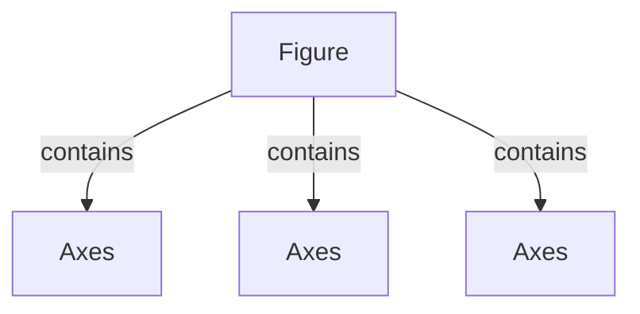

# Lesson 1: Introduction to Matplotlib

## 1. First-Principles Intuition & Invariants

Data visualization is a cornerstone of data analysis and scientific computing, providing a means to transform raw data into meaningful insights. In the realm of Python, Matplotlib stands as one of the most versatile and widely-used libraries for creating static, animated, and interactive visualizations. Its power lies in its ability to render high-quality plots with a wide variety of customization options, making it an indispensable tool for both data scientists and software engineers.

At its core, Matplotlib is a plotting library that provides a comprehensive interface for creating a wide range of static, animated, and interactive visualizations in Python. The library is built on top of NumPy, a fundamental package for scientific computing with Python, and it leverages the capabilities of the underlying operating system's graphics subsystem to render plots. The design philosophy of Matplotlib is rooted in the principle of providing a flexible and extensible framework that allows users to create complex visualizations with minimal code.

The problem space that Matplotlib addresses is the need for a powerful and flexible visualization tool that can handle a wide variety of data types and visualization styles. This includes line plots, scatter plots, bar charts, histograms, and more. Matplotlib's architecture is designed to be modular, allowing users to customize every aspect of a plot, from the colors and line styles to the labels and annotations. This modularity is achieved through a hierarchical structure of objects, where each plot is composed of a figure, which in turn contains one or more axes. Each axis represents a single plot, and it is responsible for rendering the data and labels associated with that plot.

The invariants of Matplotlib's architecture are rooted in its ability to handle a wide variety of data types and visualization styles while maintaining a consistent and intuitive interface. This is achieved through a combination of object-oriented and procedural interfaces, allowing users to choose the style that best suits their needs. The object-oriented interface provides a more flexible and extensible framework, while the procedural interface provides a simpler and more concise way to create plots.

## 2. Core Architecture & Mechanics

The core architecture of Matplotlib is built around the concept of figures and axes. A figure is a container that holds one or more axes, and each axis represents a single plot. This hierarchical structure allows users to create complex visualizations with multiple subplots, each with its own set of data and labels.

At the heart of Matplotlib's architecture is the `Figure` class, which represents the entire plot. A `Figure` object can contain one or more `Axes` objects, each of which represents a single plot. The `Axes` class is responsible for rendering the data and labels associated with a plot, and it provides a wide variety of methods for customizing the appearance of the plot.

The relationship between `Figure` and `Axes` objects can be visualized using the following Mermaid diagram:



In this diagram, a `Figure` object contains multiple `Axes` objects, each of which represents a single plot. The `Figure` object is responsible for managing the layout and rendering of the plots, while the `Axes` objects are responsible for rendering the data and labels associated with each plot.

The `Figure` class provides a wide variety of methods for customizing the appearance of the plot, including methods for setting the size and resolution of the plot, adding titles and labels, and saving the plot to a file. The `Axes` class provides a wide variety of methods for rendering data and labels, including methods for creating line plots, scatter plots, bar charts, histograms, and more.

The `pyplot` module provides a procedural interface to Matplotlib, which simplifies the process of creating plots. The `pyplot` module provides a set of functions that correspond to the methods of the `Figure` and `Axes` classes, allowing users to create plots with minimal code. For example, the `plot` function can be used to create a line plot, the `scatter` function can be used to create a scatter plot, and the `bar` function can be used to create a bar chart.

The following code snippet demonstrates how to create a simple line plot using the `pyplot` module:

```python
import matplotlib.pyplot as plt
import numpy as np

# Generate some data
x = np.linspace(0, 10, 100)
y = np.sin(x)

# Create a figure and an axes
fig, ax = plt.subplots()

# Plot the data
ax.plot(x, y)

# Set the title and labels
ax.set_title('Sine Wave')
ax.set_xlabel('x')
ax.set_ylabel('sin(x)')

# Show the plot
plt.show()
```

In this code snippet, we first import the `pyplot` module and the `numpy` module. We then generate some data using the `linspace` and `sin` functions from the `numpy` module. We create a figure and an axes using the `subplots` function from the `pyplot` module, and we plot the data using the `plot` method of the `Axes` object. We set the title and labels using the `set_title`, `set_xlabel`, and `set_ylabel` methods of the `Axes` object, and we display the plot using the `show` function from the `pyplot` module.

## 3. High-Performance Optimization & Failure Modes

Matplotlib is designed to be a high-performance visualization library, capable of rendering complex plots with a wide variety of data types and visualization styles. However, like any software system, Matplotlib is subject to a variety of performance challenges and failure modes.

One of the key challenges in high-performance visualization is the need to render plots efficiently, even when dealing with large datasets. Matplotlib addresses this challenge through a combination of optimizations, including the use of efficient data structures and algorithms, and the ability to leverage the capabilities of the underlying operating system's graphics subsystem. For example, Matplotlib uses a variety of data structures, such as arrays and dictionaries, to store and manipulate data, and it uses efficient algorithms, such as sorting and searching, to process data. Matplotlib also leverages the capabilities of the underlying operating system's graphics subsystem to render plots, allowing it to take advantage of hardware acceleration and other optimizations.

Another key challenge in high-performance visualization is the need to handle a wide variety of data types and visualization styles. Matplotlib addresses this challenge through a modular architecture that allows users to customize every aspect of a plot, from the colors and line styles to the labels and annotations. This modularity is achieved through a combination of object-oriented and procedural interfaces, allowing users to choose the style that best suits their needs. The object-oriented interface provides a more flexible and extensible framework, while the procedural interface provides a simpler and more concise way to create plots.

One of the key failure modes in high-performance visualization is the need to handle edge cases and boundary conditions. Matplotlib addresses this challenge through a combination of error handling and validation, allowing it to handle a wide variety of edge cases and boundary conditions gracefully. For example, Matplotlib includes a variety of error handling mechanisms, such as try-except blocks and assertions, to handle errors and exceptions that may arise during the rendering of a plot. Matplotlib also includes a variety of validation mechanisms, such as input validation and data validation, to ensure that the data and parameters passed to a plot are valid and consistent.

In conclusion, Matplotlib is a powerful and flexible visualization library that provides a comprehensive interface for creating a wide variety of static, animated, and interactive visualizations in Python. Its architecture is built around the concept of figures and axes, and it provides a wide variety of methods for customizing the appearance of plots. Matplotlib is designed to be a high-performance visualization library, capable of rendering complex plots efficiently, even when dealing with large datasets. However, like any software system, Matplotlib is subject to a variety of performance challenges and failure modes, and it addresses these challenges through a combination of optimizations, error handling, and validation.
