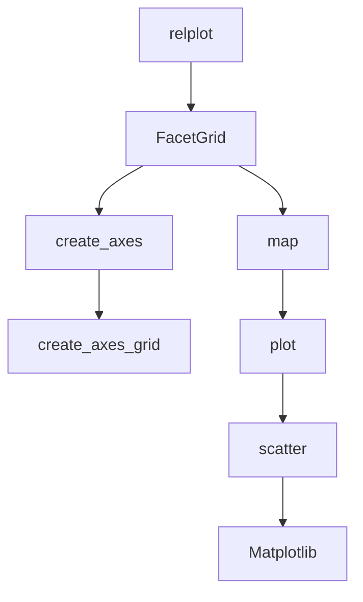
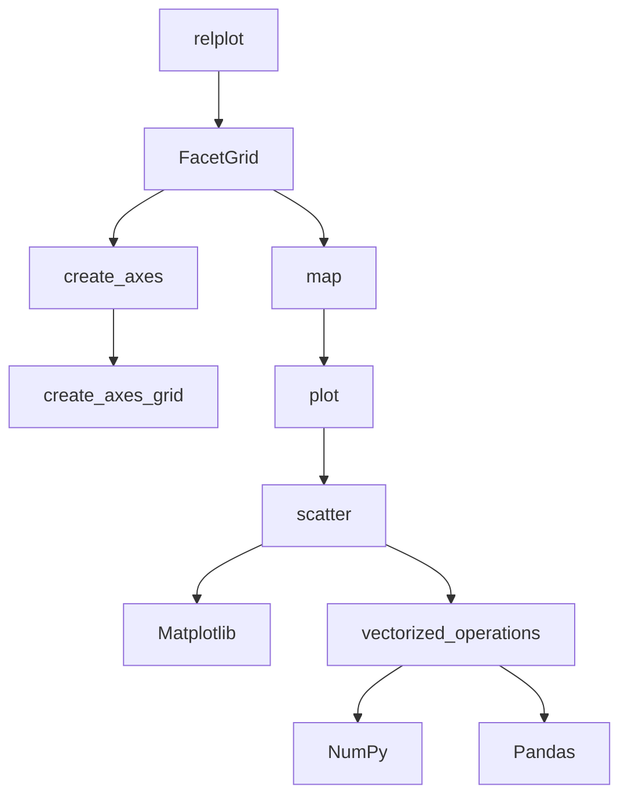

# Lesson 2: Introduction to Seaborn

## 1. First-Principles Intuition & Invariants

In the realm of data visualization, the ability to convey complex datasets through intuitive and aesthetically pleasing graphics is paramount. While Matplotlib provides a foundational toolkit for creating a wide variety of plots, it often requires a significant amount of boilerplate code to achieve the desired visual appeal and statistical rigor. This is where Seaborn emerges as a powerful library, built on top of Matplotlib, to simplify the creation of attractive and informative statistical graphics. Seaborn's high-level interface abstracts many of the complexities involved in Matplotlib, allowing data scientists and engineers to focus on the data itself rather than the intricacies of plot customization.

At its core, Seaborn is designed to work seamlessly with Pandas data structures, particularly DataFrames, which are a natural fit for statistical data analysis. By leveraging the rich ecosystem of Pandas, Seaborn can efficiently handle and visualize large datasets. The library is built on the principle of providing a high-level interface for common statistical plot types, such as scatter plots, line plots, histograms, and more, with sensible defaults that adhere to best practices in data visualization. This approach ensures that the resulting graphics are not only visually appealing but also statistically sound.

One of the key invariants in Seaborn is its reliance on statistical models to enhance the visual representation of data. For instance, Seaborn provides built-in support for fitting and visualizing regression models, which can help in understanding the relationships between variables. This capability is grounded in the underlying statistical methods that Seaborn employs, such as linear regression, logistic regression, and kernel density estimation. By integrating these models directly into the visualization process, Seaborn enables users to gain deeper insights into their data without needing to switch between different tools or libraries.

Another invariant in Seaborn is its commitment to aesthetic design. The library comes with a set of pre-defined color palettes and styles that are designed to be visually appealing and easy to interpret. These design choices are not arbitrary; they are based on principles of color theory and perceptual psychology, ensuring that the resulting plots are both attractive and effective in conveying the intended message. Seaborn's default styles, such as the "whitegrid" and "darkgrid" themes, provide a clean and uncluttered background that allows the data to take center stage.

In summary, Seaborn's first-principles intuition is rooted in the need for a high-level, statistically grounded, and aesthetically pleasing interface for data visualization. By building on top of Matplotlib and integrating with Pandas, Seaborn provides a powerful toolset for creating informative and visually appealing statistical graphics, enabling data scientists and engineers to focus on the data itself rather than the intricacies of plot customization.

## 2. Core Architecture & Mechanics

Underneath its high-level interface, Seaborn is built on a robust architecture that leverages the capabilities of Matplotlib and Pandas to create a seamless and efficient visualization experience. To understand the inner workings of Seaborn, it is essential to delve into its core components and the algorithms that power its functionality.

At the heart of Seaborn's architecture is its integration with Matplotlib. Seaborn provides a high-level interface for creating plots, but it ultimately relies on Matplotlib to render the final graphics. This integration is achieved through the use of Matplotlib's `Axes` and `Figure` objects, which Seaborn extends and customizes to provide its unique functionality. For example, Seaborn's `FacetGrid` class, which is used for creating multi-plot grids, is built on top of Matplotlib's `FacetGrid` class, but with additional features and customizations that enhance its usability.

Another key component of Seaborn's architecture is its integration with Pandas. Seaborn is designed to work seamlessly with Pandas data structures, particularly DataFrames, which are a natural fit for statistical data analysis. Seaborn's functions and classes are optimized to handle Pandas DataFrames, allowing users to easily create plots from structured data. For instance, Seaborn's `relplot` function, which is used for creating scatter and line plots, can take a Pandas DataFrame as input and automatically map the data to the appropriate plot elements.

Seaborn's architecture also includes a set of built-in statistical models that are used to enhance the visual representation of data. These models are implemented using the `statsmodels` library, which provides a wide range of statistical functions and classes. Seaborn's functions, such as `regplot` and `lmplot`, leverage these models to fit and visualize regression lines, providing a powerful tool for understanding the relationships between variables. The integration of statistical models into Seaborn's architecture ensures that the resulting plots are not only visually appealing but also statistically sound.

To illustrate the core architecture of Seaborn, we can use a simple example. Consider the following code snippet, which creates a scatter plot using Seaborn's `relplot` function:

```python
import seaborn as sns
import matplotlib.pyplot as plt

# Load the example dataset
tips = sns.load_dataset("tips")

# Create a scatter plot
sns.relplot(x="total_bill", y="tip", data=tips)

# Show the plot
plt.show()
```

In this example, Seaborn's `relplot` function is used to create a scatter plot of the `total_bill` and `tip` columns from the `tips` dataset. The `relplot` function is a high-level interface that abstracts many of the complexities involved in creating a scatter plot using Matplotlib. Under the hood, `relplot` creates a `FacetGrid` object, which is then used to render the final plot. The `FacetGrid` object is a powerful tool that allows Seaborn to create multi-plot grids, but in this case, it is used to create a single scatter plot.

To better understand the internal workings of Seaborn's `relplot` function, we can use a Mermaid diagram to illustrate the key components and their interactions:



In this diagram, the `relplot` function is shown as the entry point for creating a scatter plot. The `relplot` function creates a `FacetGrid` object, which is then used to create the axes and map the data to the plot elements. The `FacetGrid` object creates an axes grid, which is then used to render the final plot. The `map` function is used to apply the `scatter` function to the data, which in turn uses Matplotlib to render the final scatter plot.

This diagram illustrates the key components and their interactions in Seaborn's architecture. By leveraging the capabilities of Matplotlib and Pandas, Seaborn provides a powerful and efficient toolset for creating attractive and informative statistical graphics.

## 3. High-Performance Optimization & Failure Modes

While Seaborn provides a high-level interface for creating statistical graphics, it is important to consider the performance implications of using the library, especially when working with large datasets. Seaborn's architecture is designed to be efficient and scalable, but there are certain factors that can impact performance, such as the size of the dataset and the complexity of the plot.

One of the key optimizations in Seaborn is its integration with Pandas. Seaborn is designed to work seamlessly with Pandas data structures, particularly DataFrames, which are optimized for handling large datasets. By leveraging the capabilities of Pandas, Seaborn can efficiently handle and visualize large datasets without sacrificing performance. For instance, Seaborn's functions and classes are optimized to handle Pandas DataFrames, allowing users to easily create plots from structured data.

Another optimization in Seaborn is its use of vectorized operations. Seaborn leverages the vectorized operations provided by NumPy and Pandas to perform computations on large datasets. This approach ensures that Seaborn can efficiently handle and visualize large datasets without sacrificing performance. For instance, Seaborn's `regplot` function uses vectorized operations to fit and visualize regression lines, providing a powerful tool for understanding the relationships between variables.

In addition to these optimizations, Seaborn also provides a set of built-in functions and classes that are designed to handle common failure modes. For instance, Seaborn's `FacetGrid` class is designed to handle multi-plot grids, which can be challenging to create and manage. The `FacetGrid` class provides a set of built-in functions and classes that simplify the process of creating and managing multi-plot grids, ensuring that users can easily create complex plots without encountering common failure modes.

To illustrate the performance implications of using Seaborn, we can use a simple example. Consider the following code snippet, which creates a scatter plot using Seaborn's `relplot` function with a large dataset:

```python
import seaborn as sns
import matplotlib.pyplot as plt
import pandas as pd
import numpy as np

# Generate a large dataset
np.random.seed(0)
data = pd.DataFrame({
    "x": np.random.normal(size=100000),
    "y": np.random.normal(size=100000)
})

# Create a scatter plot
sns.relplot(x="x", y="y", data=data)

# Show the plot
plt.show()
```

In this example, Seaborn's `relplot` function is used to create a scatter plot of a large dataset with 100,000 data points. The `relplot` function is a high-level interface that abstracts many of the complexities involved in creating a scatter plot using Matplotlib. Under the hood, `relplot` creates a `FacetGrid` object, which is then used to render the final plot. The `FacetGrid` object is a powerful tool that allows Seaborn to create multi-plot grids, but in this case, it is used to create a single scatter plot.

To better understand the performance implications of using Seaborn's `relplot` function with a large dataset, we can use a Mermaid diagram to illustrate the key components and their interactions:



In this diagram, the `relplot` function is shown as the entry point for creating a scatter plot. The `relplot` function creates a `FacetGrid` object, which is then used to create the axes and map the data to the plot elements. The `FacetGrid` object creates an axes grid, which is then used to render the final plot. The `map` function is used to apply the `scatter` function to the data, which in turn uses Matplotlib to render the final scatter plot. The `scatter` function also uses vectorized operations provided by NumPy and Pandas to perform computations on the data, ensuring that Seaborn can efficiently handle and visualize large datasets without sacrificing performance.

This diagram illustrates the key components and their interactions in Seaborn's architecture when working with large datasets. By leveraging the capabilities of Matplotlib, Pandas, and NumPy, Seaborn provides a powerful and efficient toolset for creating attractive and informative statistical graphics, even when working with large datasets.

In summary, Seaborn's high-performance optimization is grounded in its integration with Pandas, its use of vectorized operations, and its built-in functions and classes for handling common failure modes. By leveraging these optimizations, Seaborn can efficiently handle and visualize large datasets without sacrificing performance. However, it is important to consider the performance implications of using Seaborn, especially when working with large datasets, and to use the library's built-in functions and classes to handle common failure modes.
