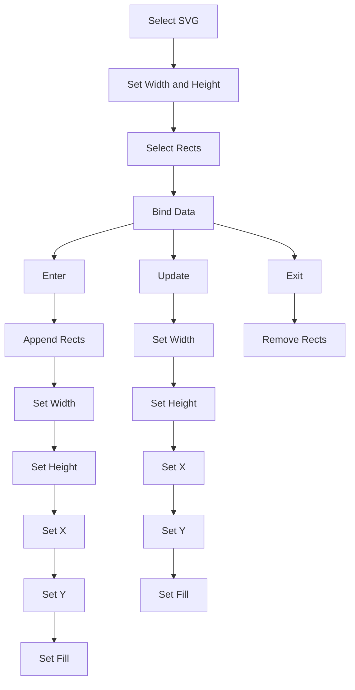

# Lesson 1: D3 Fundamentals

## 1. First-Principles Intuition & Invariants

Data visualization is a critical component of modern software engineering, enabling the transformation of raw data into meaningful insights that can drive decision-making processes. In the realm of web-based data visualization, D3.js stands out as a powerful library that empowers developers to create interactive and dynamic visualizations with fine-grained control over every aspect of the rendering process. D3.js, or Data-Driven Documents, is built on the foundation of the Document Object Model (DOM) and leverages the capabilities of modern web technologies such as HTML, CSS, and JavaScript to render scalable vector graphics (SVG) and other graphical elements.

At its core, D3.js operates on the principle of data-driven document manipulation. This means that the library is designed to bind data to the DOM and then apply transformations to the document based on that data. This approach allows developers to create highly customized visualizations that can adapt to changing data sources and user interactions. The power of D3.js lies in its ability to seamlessly integrate with other web technologies, making it a versatile tool for building complex and interactive dashboards.

To fully understand the capabilities of D3.js, it is essential to grasp the fundamental concepts of data binding, selection, and SVG manipulation. Data binding is the process of associating data with DOM elements, allowing developers to update the document in response to changes in the underlying data. Selection is the mechanism by which D3.js identifies and manipulates specific elements within the DOM, enabling developers to apply transformations and styles to targeted elements. SVG manipulation, on the other hand, involves the creation and modification of SVG elements, which are used to render graphical objects such as lines, circles, and rectangles.

The invariants of D3.js are rooted in the principles of declarative programming and functional composition. By using a declarative approach, developers can specify the desired state of the document and let D3.js handle the necessary transformations to achieve that state. This approach not only simplifies the development process but also improves the maintainability and scalability of the code. Functional composition, on the other hand, allows developers to build complex visualizations by combining simple functions, promoting code reuse and modularity.

## 2. Core Architecture & Mechanics

The architecture of D3.js is built around the concept of selections, which are the primary mechanism for interacting with the DOM. A selection is a reference to a set of DOM elements, and it provides a chainable API for applying transformations and styles to those elements. The selection API is designed to be intuitive and expressive, allowing developers to perform complex operations with minimal code.

At the heart of the selection API is the `select` and `selectAll` methods, which are used to select individual elements or groups of elements, respectively. These methods return a selection object, which can then be manipulated using a variety of methods such as `attr`, `style`, `text`, and `html`. For example, the following code snippet demonstrates how to select all `div` elements and set their `class` attribute to `bar`:

```javascript
d3.selectAll('div').attr('class', 'bar');
```

In addition to attribute and style manipulation, selections also provide methods for creating and modifying SVG elements. The `append` and `insert` methods are used to add new elements to the DOM, while the `remove` method is used to remove elements. For example, the following code snippet demonstrates how to create a new `rect` element within an existing `svg` element:

```javascript
d3.select('svg').append('rect')
    .attr('width', 50)
    .attr('height', 50)
    .attr('x', 10)
    .attr('y', 10)
    .style('fill', 'blue');
```

Data binding is a fundamental aspect of D3.js, and it is achieved through the `data` method. This method is used to associate data with a selection, and it returns a new selection that includes the data. The `data` method can be used to bind data to existing elements, or it can be used to create new elements based on the data. For example, the following code snippet demonstrates how to bind an array of numbers to a selection of `div` elements and set their `width` attribute based on the data:

```javascript
const data = [10, 20, 30, 40, 50];

d3.selectAll('div')
    .data(data)
    .attr('width', d => d * 10);
```

The `data` method also provides a powerful mechanism for handling data updates. When the data is updated, the `data` method can be used to update the selection to reflect the changes. This is achieved through the use of enter, update, and exit selections, which are used to handle new, existing, and removed elements, respectively. For example, the following code snippet demonstrates how to update a selection of `div` elements when the data changes:

```javascript
const data = [10, 20, 30, 40, 50];

const divs = d3.selectAll('div')
    .data(data);

divs.enter().append('div')
    .attr('width', d => d * 10);

divs.attr('width', d => d * 10);

divs.exit().remove();
```

To illustrate the core architecture and mechanics of D3.js, we can use a simple example that demonstrates how to create a bar chart using SVG elements. The following code snippet demonstrates how to create a bar chart using D3.js:

```javascript
const data = [10, 20, 30, 40, 50];

const svg = d3.select('svg')
    .attr('width', 500)
    .attr('height', 300);

const bars = svg.selectAll('rect')
    .data(data)
    .enter().append('rect')
    .attr('width', d => d * 10)
    .attr('height', 20)
    .attr('x', (d, i) => i * 60)
    .attr('y', 100)
    .style('fill', 'steelblue');
```

In this example, we start by selecting the `svg` element and setting its width and height. We then create a selection of `rect` elements using the `selectAll` method and bind the data to the selection using the `data` method. We use the `enter` method to create new `rect` elements for each data point, and we set the width, height, x, and y attributes of the `rect` elements using the `attr` method. Finally, we set the fill color of the `rect` elements using the `style` method.

To visualize the internal data structures and algorithms used by D3.js, we can use a Mermaid diagram to illustrate the selection and data binding process. The following diagram shows the selection and data binding process for the bar chart example:



In this diagram, we start by selecting the `svg` element and setting its width and height. We then create a selection of `rect` elements using the `selectAll` method and bind the data to the selection using the `data` method. We use the `enter` method to create new `rect` elements for each data point, and we set the width, height, x, and y attributes of the `rect` elements using the `attr` method. We also use the `update` method to update the existing `rect` elements, and we use the `exit` method to remove any `rect` elements that are no longer needed.

## 3. High-Performance Optimization & Failure Modes

D3.js is a powerful library that can be used to create highly interactive and dynamic visualizations, but it is important to consider the performance implications of using the library. One of the key factors that can impact the performance of D3.js is the size and complexity of the data being visualized. When working with large datasets, it is important to optimize the data binding and selection process to ensure that the visualization remains responsive.

One way to optimize the data binding and selection process is to use efficient data structures and algorithms. For example, when binding data to a selection, it is important to use the `key` function to ensure that the data is bound to the correct elements. The `key` function is used to specify a unique identifier for each data point, and it helps D3.js to efficiently update the selection when the data changes. For example, the following code snippet demonstrates how to use the `key` function to bind data to a selection:

```javascript
const data = [
    { id: 1, value: 10 },
    { id: 2, value: 20 },
    { id: 3, value: 30 },
    { id: 4, value: 40 },
    { id: 5, value: 50 }
];

const divs = d3.selectAll('div')
    .data(data, d => d.id);

divs.enter().append('div')
    .attr('width', d => d.value * 10);

divs.attr('width', d => d.value * 10);

divs.exit().remove();
```

In this example, we use the `key` function to specify the `id` property of each data point as the unique identifier. This helps D3.js to efficiently update the selection when the data changes.

Another way to optimize the performance of D3.js is to use efficient rendering techniques. For example, when rendering SVG elements, it is important to minimize the number of DOM elements that are created and updated. One way to achieve this is to use the `enter`, `update`, and `exit` selections to efficiently manage the lifecycle of the SVG elements. For example, the following code snippet demonstrates how to use the `enter`, `update`, and `exit` selections to efficiently manage the lifecycle of the SVG elements:

```javascript
const data = [10, 20, 30, 40, 50];

const svg = d3.select('svg')
    .attr('width', 500)
    .attr('height', 300);

const bars = svg.selectAll('rect')
    .data(data);

bars.enter().append('rect')
    .attr('width', d => d * 10)
    .attr('height', 20)
    .attr('x', (d, i) => i * 60)
    .attr('y', 100)
    .style('fill', 'steelblue');

bars.attr('width', d => d * 10);

bars.exit().remove();
```

In this example, we use the `enter` method to create new `rect` elements for each data point, and we use the `update` method to update the existing `rect` elements. We also use the `exit` method to remove any `rect` elements that are no longer needed.

In addition to performance optimization, it is important to consider the failure modes of D3.js. One of the key failure modes of D3.js is the potential for data binding errors. When binding data to a selection, it is important to ensure that the data is correctly associated with the elements. If the data is not correctly associated with the elements, it can result in incorrect or incomplete visualizations. To mitigate this risk, it is important to use the `key` function to specify a unique identifier for each data point, and to carefully test the data binding process.

Another key failure mode of D3.js is the potential for rendering errors. When rendering SVG elements, it is important to ensure that the elements are correctly positioned and styled. If the elements are not correctly positioned or styled, it can result in incorrect or incomplete visualizations. To mitigate this risk, it is important to carefully test the rendering process, and to use efficient rendering techniques to minimize the number of DOM elements that are created and updated.

In conclusion, D3.js is a powerful library that can be used to create highly interactive and dynamic visualizations. By understanding the fundamental concepts of data binding, selection, and SVG manipulation, developers can create custom visualizations that are tailored to their specific needs. By optimizing the data binding and selection process, and by using efficient rendering techniques, developers can ensure that their visualizations are responsive and performant. By carefully testing the data binding and rendering processes, developers can mitigate the risk of data binding and rendering errors, and create reliable and accurate visualizations.
