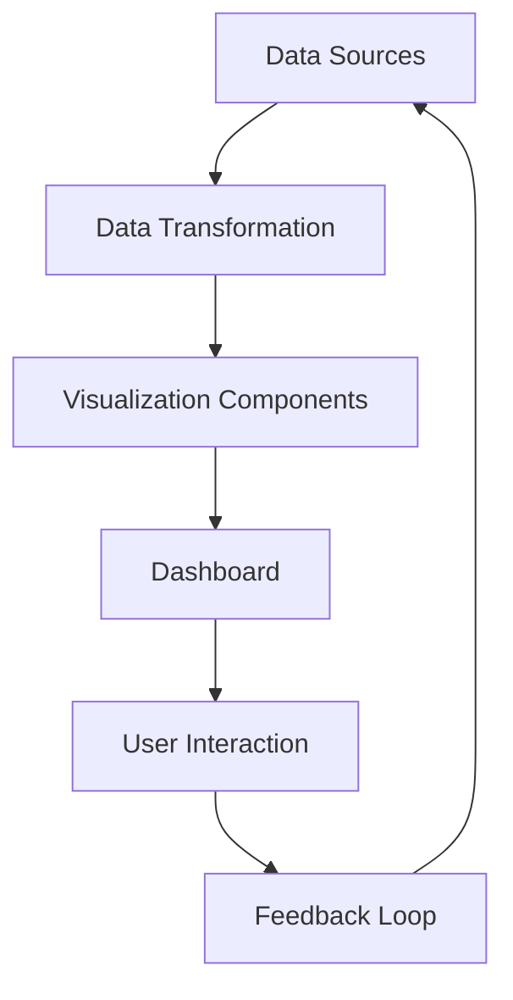

# Lesson 2: Dashboard Design Principles

## 1. First-Principles Intuition & Invariants

In the realm of data visualization, the design of dashboards is a critical juncture where data meets human cognition. Effective dashboards are not merely collections of charts and graphs; they are carefully crafted narratives that guide the viewer through a story of data, enabling them to derive meaningful insights and make informed decisions. The principles that govern dashboard design are deeply rooted in the interplay between human perception, cognitive load, and the inherent structure of the data itself.

At the heart of dashboard design lies the principle of clarity. A dashboard must present data in a way that is immediately understandable, without requiring the viewer to decipher complex legends or navigate through multiple layers of abstraction. This clarity is achieved through the judicious use of color theory, layout, and user interaction. Color, for instance, is not merely an aesthetic choice; it is a powerful tool for encoding information. The human eye is highly attuned to color differences, and by leveraging this, designers can highlight key data points, differentiate between categories, and convey the relative importance of various metrics.

Layout is another critical aspect of dashboard design. The arrangement of elements on a dashboard should be intuitive and logical, allowing the viewer to follow a natural flow of information. This flow is often guided by the principles of Gestalt psychology, which posits that the human mind perceives patterns and structures in visual data. By aligning elements, using consistent spacing, and creating visual hierarchies, designers can ensure that the most important information is immediately apparent, while secondary details are easily accessible.

User interaction is the final pillar of effective dashboard design. Dashboards should be interactive, allowing users to explore data dynamically and drill down into specific details. This interactivity is not just a nice-to-have feature; it is essential for enabling users to engage with the data and derive deeper insights. Interactive elements such as filters, tooltips, and drill-downs should be seamlessly integrated into the design, enhancing the overall user experience without overwhelming the viewer.

The invariants of dashboard design are rooted in these principles of clarity, layout, and interaction. A well-designed dashboard should adhere to these invariants, ensuring that the data is presented in a way that is both accessible and insightful. The challenge lies in balancing these principles to create a dashboard that is not only visually appealing but also functionally effective.

## 2. Core Architecture & Mechanics

To understand the mechanics of dashboard design, it is essential to delve into the internal data structures and algorithms that underpin the creation of effective visualizations. At a high level, a dashboard is a composite of various data visualizations, each serving a specific purpose in the narrative of the data. These visualizations are typically built using a combination of data sources, data transformations, and visualization components.

The data sources for a dashboard can be diverse, ranging from relational databases to cloud-based data warehouses. The choice of data source is critical, as it determines the types of data that can be visualized and the performance characteristics of the dashboard. Once the data is sourced, it must be transformed into a format that is suitable for visualization. This transformation process often involves data cleaning, aggregation, and filtering, which are performed using a variety of data processing tools and techniques.

The visualization components of a dashboard are the building blocks that bring the data to life. These components can range from simple bar charts and line graphs to more complex visualizations such as heatmaps and treemaps. Each visualization component is responsible for encoding a specific aspect of the data, and the choice of visualization is critical in ensuring that the data is presented in a way that is both accurate and meaningful.

To illustrate the architecture of a dashboard, consider the following Mermaid diagram:

In this diagram, the data sources are the starting point, providing the raw data that will be visualized. The data transformation step involves cleaning, aggregating, and filtering the data to prepare it for visualization. The visualization components are then used to create the individual visualizations that make up the dashboard. The dashboard itself is the composite of these visualizations, and it is through the dashboard that the user interacts with the data. Finally, the feedback loop allows the user's interactions to influence the data transformation and visualization processes, enabling a dynamic and interactive experience.

## 3. High-Performance Optimization & Failure Modes

The performance of a dashboard is a critical factor in its effectiveness. A dashboard that is slow to load or unresponsive to user interactions is likely to frustrate users and diminish the value of the data it presents. To ensure high performance, it is essential to optimize the data transformation and visualization processes, as well as the overall architecture of the dashboard.

One key aspect of performance optimization is efficient data transformation. This involves using optimized data processing tools and techniques to minimize the time and resources required to transform the raw data into a format suitable for visualization. This can include techniques such as indexing, caching, and parallel processing, which can significantly improve the performance of data transformation.

Another critical aspect of performance optimization is efficient visualization. This involves using optimized visualization libraries and techniques to minimize the time and resources required to render the visualizations. This can include techniques such as data sampling, level-of-detail rendering, and hardware acceleration, which can significantly improve the performance of visualization.

In addition to performance optimization, it is also essential to consider the failure modes of a dashboard. These failure modes can range from data errors and visualization artifacts to performance bottlenecks and user frustration. To mitigate these failure modes, it is essential to implement robust error handling and validation mechanisms, as well as to continuously monitor and optimize the performance of the dashboard.

In conclusion, the design of effective dashboards is a complex and multifaceted process that requires a deep understanding of human perception, cognitive load, and the inherent structure of the data. By adhering to the principles of clarity, layout, and interaction, and by optimizing the data transformation and visualization processes, designers can create dashboards that are not only visually appealing but also functionally effective. Through a combination of theoretical grounding, architectural insight, and performance optimization, designers can create dashboards that truly bring data to life.
