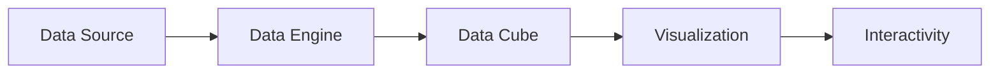

# Lesson 4: Storytelling with Data

## 1. First-Principles Intuition & Invariants

As we delve into the realm of data storytelling, it's essential to establish a foundation rooted in the principles of narrative structure and audience engagement. A compelling data story is not merely a collection of numbers and charts; it's an artfully crafted tale that weaves together insights, context, and meaning. To begin, let's consider the fundamental invariants of storytelling:

* **The Hero's Journey**: A timeless narrative structure that guides the audience through a transformative experience, from a state of uncertainty to one of understanding.
* **The Data-Driven Arc**: A logical progression from problem statement to solution, where data serves as the catalyst for insight and action.
* **The Audience's Lens**: A deep understanding of the target audience's needs, pain points, and perspectives, which informs the narrative's tone, pace, and content.

These invariants form the bedrock of effective data storytelling, allowing us to craft narratives that resonate with our audience and drive meaningful action.

## 2. Core Architecture & Mechanics

Tableau, a leading data visualization platform, provides a robust set of tools for creating interactive and engaging stories. At its core, Tableau's architecture revolves around the concept of **data cubes**, which are multidimensional arrays of data that can be sliced, diced, and analyzed from various angles. Let's dissect the internal mechanics of a Tableau data cube using a simplified Mermaid diagram:

In this diagram, we see the data source feeding into the data engine, which constructs the data cube. The data cube is then connected to the visualization layer, where the story comes alive through interactive charts and graphs. Finally, the interactivity layer enables users to explore the data in real-time, fostering a deeper understanding of the narrative.

## 3. High-Performance Optimization & Failure Modes

As we strive to create high-performance data stories, it's essential to consider the following optimization strategies and failure modes:

* **Concurrency**: Tableau's ability to handle concurrent requests and updates ensures that our data stories remain responsive and scalable.
* **Resource Scaling**: By leveraging cloud-based infrastructure and auto-scaling capabilities, we can ensure that our data stories adapt to changing demands and workloads.
* **Boundary Edge Cases**: Carefully testing our data stories for edge cases, such as extreme data volumes or unusual user interactions, helps us identify and mitigate potential failures.
* **Failure Mitigations**: Implementing robust error handling and recovery mechanisms ensures that our data stories remain resilient in the face of unexpected failures or data inconsistencies.

By mastering these optimization strategies and failure modes, we can create data stories that not only captivate our audience but also withstand the rigors of high-performance demands.

---

In this lesson, we've explored the fundamental principles of data storytelling, the core architecture of Tableau, and strategies for high-performance optimization and failure mitigation. By applying these concepts, we can craft compelling data stories that drive meaningful action and inspire our audience to take action. In the next lesson, we'll delve deeper into the art of data visualization, exploring techniques for creating effective charts, graphs, and maps that bring our data stories to life.
