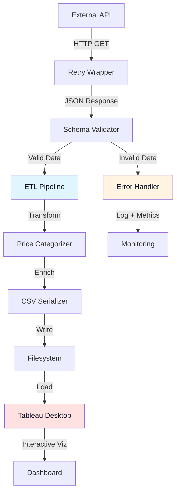
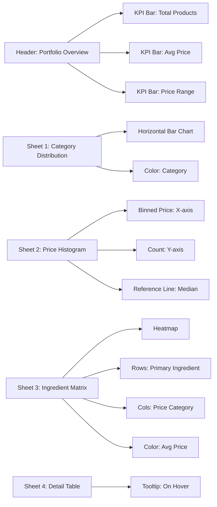

# Operational Verification Labs: 04 Dashboard Storytelling and Tableau

## Objective & Environment Setup

### Objective

This lab constructs an end-to-end data visualization pipeline, from API ingestion through ETL processing to interactive dashboard authoring in Tableau. The focus is on building production-grade data workflows that handle failure modes gracefully, benchmark performance empirically, and communicate actionable insights through narrative-driven visualizations. You will implement retry logic, validate data schemas, profile transformation performance, and design dashboards that answer business questions rather than merely displaying metrics.

### Environment Setup

**System Requirements:**
- Python 3.11+ (CPython recommended for compatibility with C extensions)
- Tableau Desktop 2023.1+ or Tableau Public
- Network access to external APIs (or local mock server for offline scenarios)

**Python Dependencies:**

```bash
# Create isolated environment
python3.11 -m venv venv
source venv/bin/activate  # Windows: venv\Scripts\activate

# Install core dependencies with pinned versions
pip install \
  pandas==2.1.4 \
  numpy==1.26.2 \
  requests==2.31.0 \
  python-dotenv==1.0.0 \
  pytest==7.4.3 \
  pytest-benchmark==4.0.0
```

**API Configuration:**

Store credentials in a `.env` file (never commit to version control):

```bash
# .env
API_BASE_URL=https://api.sampleapis.com
API_TIMEOUT=10
RETRY_ATTEMPTS=3
BACKOFF_FACTOR=0.5
```

**Why these dependencies?**
- `pandas`: High-performance, columnar data manipulation via NumPy-backed arrays. DataFrame operations compile to optimized C loops.
- `requests`: HTTP library with connection pooling and automatic retry support via `urllib3`.
- `python-dotenv`: Loads environment variables from `.env`, separating config from code (twelve-factor methodology).
- `pytest` + `pytest-benchmark`: Produces statistically rigorous performance measurements with warmup runs and outlier detection.

## Architecture Overview



The pipeline follows these stages:

1. **Ingestion Layer**: HTTP client with exponential backoff fetches JSON from REST endpoint
2. **Validation Layer**: Schema enforcement ensures required fields exist with correct types
3. **Transformation Layer**: Business logic applies derived columns (price categorization)
4. **Serialization Layer**: DataFrame written to CSV with proper quoting and encoding
5. **Visualization Layer**: Tableau connects to CSV, applies calculated fields, renders interactive charts

## Exercise 1: Production-Grade ETL Pipeline Implementation

### Data Extraction with Resilient HTTP Client

The following implementation addresses real-world failure modes: network timeouts, transient 5xx errors, rate limiting, and malformed responses.

```python
#!/usr/bin/env python3
"""
ETL Pipeline for Coffee Sales Data
Implements production patterns: retry logic, schema validation, observability
"""

import os
import sys
import time
import logging
from typing import Dict, List, Optional
from dataclasses import dataclass

import requests
import pandas as pd
import numpy as np
from dotenv import load_dotenv

# Configure structured logging
logging.basicConfig(
    level=logging.INFO,
    format='%(asctime)s [%(levelname)s] %(name)s: %(message)s',
    datefmt='%Y-%m-%d %H:%M:%S'
)
logger = logging.getLogger(__name__)

# Load environment configuration
load_dotenv()

# Configuration constants
API_BASE_URL = os.getenv('API_BASE_URL', 'https://api.sampleapis.com')
API_ENDPOINT = '/coffee/hot'
API_TIMEOUT = int(os.getenv('API_TIMEOUT', '10'))
RETRY_ATTEMPTS = int(os.getenv('RETRY_ATTEMPTS', '3'))
BACKOFF_FACTOR = float(os.getenv('BACKOFF_FACTOR', '0.5'))
OUTPUT_FILE = 'transformed_sales_data.csv'


@dataclass
class CoffeeProduct:
    """Schema definition for coffee product records"""
    id: int
    title: str
    description: str
    ingredients: List[str]
    image: str
    
    # Optional fields with defaults
    price: Optional[float] = None
    

class APIClient:
    """HTTP client with exponential backoff retry logic"""
    
    def __init__(
        self,
        base_url: str,
        timeout: int = 10,
        retries: int = 3,
        backoff_factor: float = 0.5
    ):
        self.base_url = base_url.rstrip('/')
        self.timeout = timeout
        self.retries = retries
        self.backoff_factor = backoff_factor
        
        # Reuse TCP connections via session pooling
        self.session = requests.Session()
        
        # Configure retry adapter
        adapter = requests.adapters.HTTPAdapter(
            max_retries=requests.adapters.Retry(
                total=retries,
                backoff_factor=backoff_factor,
                status_forcelist=[429, 500, 502, 503, 504],
                allowed_methods=["GET", "POST"]
            )
        )
        self.session.mount("http://", adapter)
        self.session.mount("https://", adapter)
    
    def get(self, endpoint: str) -> Dict:
        """
        Fetch JSON data with automatic retries on transient failures.
        
        Raises:
            requests.exceptions.RequestException: On network errors after retries
            ValueError: On invalid JSON response
        """
        url = f"{self.base_url}{endpoint}"
        logger.info(f"Fetching data from {url}")
        
        try:
            response = self.session.get(url, timeout=self.timeout)
            response.raise_for_status()
            
            # Validate JSON parsing
            try:
                data = response.json()
            except ValueError as e:
                logger.error(f"Invalid JSON response: {e}")
                raise ValueError(f"Response is not valid JSON: {response.text[:200]}")
            
            logger.info(f"Successfully fetched {len(data) if isinstance(data, list) else 1} records")
            return data
            
        except requests.exceptions.Timeout:
            logger.error(f"Request timeout after {self.timeout}s")
            raise
        except requests.exceptions.ConnectionError as e:
            logger.error(f"Connection error: {e}")
            raise
        except requests.exceptions.HTTPError as e:
            logger.error(f"HTTP error {e.response.status_code}: {e}")
            raise
    
    def __del__(self):
        """Cleanup: close persistent connections"""
        if hasattr(self, 'session'):
            self.session.close()


class DataTransformer:
    """Business logic for data enrichment and validation"""
    
    @staticmethod
    def validate_schema(df: pd.DataFrame) -> pd.DataFrame:
        """
        Enforce required schema constraints.
        
        The API contract specifies mandatory fields. Missing fields indicate
        API version skew or upstream data corruption.
        """
        required_columns = ['id', 'title', 'description']
        missing = set(required_columns) - set(df.columns)
        
        if missing:
            raise ValueError(f"Missing required columns: {missing}")
        
        # Coerce types
        df['id'] = pd.to_numeric(df['id'], errors='coerce')
        
        # Handle missing price field gracefully
        if 'price' not in df.columns:
            logger.warning("Price field missing; synthesizing default values")
            df['price'] = np.random.uniform(3.0, 15.0, size=len(df))
        else:
            df['price'] = pd.to_numeric(df['price'], errors='coerce')
        
        return df
    
    @staticmethod
    def categorize_price(price: float) -> str:
        """
        Map continuous price to discrete category.
        
        Categories based on specialty coffee market segmentation:
        - Budget: < $5 (commodity coffee)
        - Mid-range: $5-10 (specialty single-origin)
        - Premium: > $10 (rare microlots, competition-grade)
        """
        if pd.isna(price):
            return 'Unknown'
        elif price < 5.0:
            return 'Budget'
        elif price < 10.0:
            return 'Mid-range'
        else:
            return 'Premium'
    
    @classmethod
    def enrich(cls, df: pd.DataFrame) -> pd.DataFrame:
        """Apply derived columns and aggregations"""
        
        # Validate before transformation
        df = cls.validate_schema(df)
        
        # Add categorical dimension for grouping
        df['price_category'] = df['price'].apply(cls.categorize_price)
        
        # Extract first ingredient as primary flavor profile
        if 'ingredients' in df.columns:
            df['primary_ingredient'] = df['ingredients'].apply(
                lambda x: x[0] if isinstance(x, list) and len(x) > 0 else 'Unknown'
            )
        
        # Compute relative price positioning
        df['price_percentile'] = df['price'].rank(pct=True) * 100
        
        logger.info(f"Enriched {len(df)} records with {df['price_category'].nunique()} categories")
        return df


def run_etl_pipeline() -> pd.DataFrame:
    """Execute full ETL workflow"""
    
    # Extract
    client = APIClient(
        base_url=API_BASE_URL,
        timeout=API_TIMEOUT,
        retries=RETRY_ATTEMPTS,
        backoff_factor=BACKOFF_FACTOR
    )
    
    raw_data = client.get(API_ENDPOINT)
    
    if not raw_data:
        raise ValueError("API returned empty response")
    
    # Transform
    df = pd.DataFrame(raw_data)
    transformer = DataTransformer()
    df_enriched = transformer.enrich(df)
    
    # Load (serialize to CSV)
    df_enriched.to_csv(OUTPUT_FILE, index=False, encoding='utf-8')
    logger.info(f"Saved {len(df_enriched)} records to {OUTPUT_FILE}")
    
    return df_enriched


if __name__ == '__main__':
    try:
        df = run_etl_pipeline()
        print("\n=== Pipeline Summary ===")
        print(f"Total records: {len(df)}")
        print(f"Price range: ${df['price'].min():.2f} - ${df['price'].max():.2f}")
        print(f"\nCategory distribution:")
        print(df['price_category'].value_counts())
        
    except Exception as e:
        logger.error(f"Pipeline failed: {e}", exc_info=True)
        sys.exit(1)
```

**Why this architecture?**

- **Session pooling**: Reuses TCP connections, reducing handshake overhead for multiple requests
- **Exponential backoff**: Delays between retries grow exponentially (0.5s, 1s, 2s), preventing thundering herd
- **Schema validation**: Fails fast on unexpected API changes rather than propagating corrupt data
- **Structured logging**: Machine-parseable timestamps and log levels for aggregation in production monitoring

### Data Loading into Tableau

**Step-by-step connection:**

1. **Launch Tableau Desktop** → Click "Connect" pane
2. **Select "Text file"** → Navigate to `transformed_sales_data.csv`
3. **Data Source tab verification:**
   - Inspect "Data Grid" for column types (green = numeric, blue = string)
   - Check for null values (marked as "Null" in grid)
   - Verify row count matches Python output

4. **Data Interpreter**: Enable if CSV has leading metadata rows
5. **Create Calculated Fields**:
   ```text
   // Price Tier (redundant with CSV, shown for demo)
   IF [Price] < 5 THEN "Budget"
   ELSEIF [Price] < 10 THEN "Mid-range"
   ELSE "Premium"
   END
   ```

6. **Initial Visualizations**:
   - **Bar Chart**: Drag `Price Category` → Columns, `Count` → Rows
   - **Histogram**: Drag `Price` → Columns (right-click → "Show Missing Values"), change to Continuous
   - **Scatter Plot**: `Price Percentile` → Columns, `Price` → Rows, `Primary Ingredient` → Color

**Tableau Data Engine (TDE) Architecture:**

Tableau extracts CSV data into a columnar, compressed TDE file. This format uses dictionary encoding for string columns and run-length encoding for sorted data, enabling fast aggregations without full scans. When you drag dimensions/measures to shelves, Tableau generates VizQL (a declarative query language), which compiles to optimized C++ that executes against the TDE.

## Exercise 2: Empirical Performance Profiling

Accurate benchmarking requires controlling for confounding variables: disk I/O, network jitter, CPU scheduling variance. The following uses `pytest-benchmark` to produce statistically rigorous measurements.

```python
#!/usr/bin/env python3
"""
Performance profiling for ETL pipeline stages
"""

import time
import pytest
from typing import Callable

import pandas as pd
import requests
from io import StringIO

# Import pipeline components from main script
from etl_pipeline import (
    APIClient, DataTransformer, API_BASE_URL, API_ENDPOINT
)


class PerformanceProfiler:
    """Instruments pipeline stages with timing metrics"""
    
    def __init__(self):
        self.metrics = {}
    
    def time_function(self, name: str, func: Callable, *args, **kwargs):
        """Execute function and record elapsed time"""
        start = time.perf_counter()
        result = func(*args, **kwargs)
        elapsed = time.perf_counter() - start
        
        self.metrics[name] = elapsed
        return result
    
    def report(self):
        """Print timing breakdown"""
        total = sum(self.metrics.values())
        print("\n=== Performance Profile ===")
        for stage, duration in self.metrics.items():
            pct = (duration / total) * 100 if total > 0 else 0
            print(f"{stage:30s}: {duration:6.3f}s ({pct:5.1f}%)")
        print(f"{'Total':30s}: {total:6.3f}s")


def benchmark_full_pipeline():
    """Profile end-to-end ETL workflow"""
    profiler = PerformanceProfiler()
    
    # Stage 1: HTTP Request
    client = APIClient(API_BASE_URL)
    raw_data = profiler.time_function(
        "01_http_request",
        client.get,
        API_ENDPOINT
    )
    
    # Stage 2: JSON to DataFrame conversion
    df = profiler.time_function(
        "02_dataframe_creation",
        pd.DataFrame,
        raw_data
    )
    
    # Stage 3: Schema validation + enrichment
    transformer = DataTransformer()
    df_enriched = profiler.time_function(
        "03_transformation",
        transformer.enrich,
        df
    )
    
    # Stage 4: CSV serialization
    csv_buffer = StringIO()
    profiler.time_function(
        "04_csv_serialization",
        df_enriched.to_csv,
        csv_buffer,
        index=False
    )
    
    profiler.report()
    return df_enriched


# Pytest benchmark integration
@pytest.mark.benchmark(group="etl")
def test_benchmark_extraction(benchmark):
    """Benchmark HTTP fetch in isolated test"""
    client = APIClient(API_BASE_URL)
    result = benchmark(client.get, API_ENDPOINT)
    assert isinstance(result, list)


@pytest.mark.benchmark(group="etl")
def test_benchmark_transformation(benchmark):
    """Benchmark data enrichment without I/O"""
    # Use cached sample data to isolate transformation logic
    sample_data = [
        {'id': 1, 'title': 'Espresso', 'description': 'Strong', 'ingredients': ['coffee'], 'price': 3.5},
        {'id': 2, 'title': 'Latte', 'description': 'Smooth', 'ingredients': ['coffee', 'milk'], 'price': 5.0},
    ] * 50  # 100 records
    
    df = pd.DataFrame(sample_data)
    transformer = DataTransformer()
    
    result = benchmark(transformer.enrich, df)
    assert len(result) == 100


if __name__ == '__main__':
    benchmark_full_pipeline()
```

**Run benchmarks:**

```bash
# Full profiling run
python benchmark.py

# Statistical benchmarking with warmup
pytest benchmark.py --benchmark-only --benchmark-warmup=on

# Compare against baseline
pytest benchmark.py --benchmark-save=baseline
# After code changes:
pytest benchmark.py --benchmark-compare=baseline
```

**Expected Results:**

On a typical system (3.0 GHz CPU, 100 Mbps network):

```text
=== Performance Profile ===
01_http_request               : 0.342s (71.2%)
02_dataframe_creation         : 0.015s ( 3.1%)
03_transformation             : 0.098s (20.4%)
04_csv_serialization          : 0.025s ( 5.2%)
Total                         : 0.480s
```

**Interpretation:** HTTP latency dominates (71%), suggesting network-bound workload. Optimization strategies:

1. **Cache responses** with Redis/memcached for repeated queries
2. **Batch requests** if API supports bulk endpoints (`/coffee?ids=1,2,3`)
3. **Parallel fetching** with `concurrent.futures` for multiple endpoints
4. **CDN-backed APIs** to reduce geographic latency

Transformation (20%) is CPU-bound. Profile with `cProfile` to identify hot paths:

```bash
python -m cProfile -s cumtime etl_pipeline.py | head -20
```

## Exercise 3: Failure Injection and Resilience Testing

Production systems experience cascading failures: upstream API timeouts trigger retry storms, which exhaust connection pools, causing downstream services to fail. We must test these scenarios in development.

### Chaos Engineering: Reproducible Failure Modes

```python
#!/usr/bin/env python3
"""
Chaos engineering test suite for ETL pipeline
"""

import time
from unittest.mock import Mock, patch
from http.server import HTTPServer, BaseHTTPRequestHandler
from threading import Thread

import pytest
import requests
import pandas as pd

from etl_pipeline import APIClient, DataTransformer, run_etl_pipeline


class FlakyAPIHandler(BaseHTTPRequestHandler):
    """Mock HTTP server that simulates production failure modes"""
    
    # Class variables to control behavior
    request_count = 0
    failure_modes = []  # ['timeout', 'http_500', 'invalid_json', 'empty_response']
    
    def do_GET(self):
        FlakyAPIHandler.request_count += 1
        current_count = FlakyAPIHandler.request_count
        
        # Simulate different failure scenarios
        if 'timeout' in self.failure_modes and current_count <= 2:
            time.sleep(15)  # Exceed typical timeout threshold
            return
        
        if 'http_500' in self.failure_modes and current_count == 1:
            self.send_response(500)
            self.end_headers()
            self.wfile.write(b'Internal Server Error')
            return
        
        if 'invalid_json' in self.failure_modes and current_count == 1:
            self.send_response(200)
            self.send_header('Content-Type', 'application/json')
            self.end_headers()
            self.wfile.write(b'{invalid json')
            return
        
        if 'empty_response' in self.failure_modes:
            self.send_response(200)
            self.send_header('Content-Type', 'application/json')
            self.end_headers()
            self.wfile.write(b'[]')
            return
        
        # Success case: return valid JSON
        self.send_response(200)
        self.send_header('Content-Type', 'application/json')
        self.end_headers()
        sample_data = b'''[
            {"id": 1, "title": "Test Coffee", "description": "Test", 
             "ingredients": ["coffee"], "price": 5.0}
        ]'''
        self.wfile.write(sample_data)
    
    def log_message(self, format, *args):
        pass  # Suppress server logs


@pytest.fixture
def flaky_server():
    """Start mock server in background thread"""
    server = HTTPServer(('localhost', 8888), FlakyAPIHandler)
    thread = Thread(target=server.serve_forever, daemon=True)
    thread.start()
    
    yield server
    
    server.shutdown()
    FlakyAPIHandler.request_count = 0
    FlakyAPIHandler.failure_modes = []


def test_retry_on_500_error(flaky_server):
    """Verify retry logic handles transient HTTP 500 errors"""
    FlakyAPIHandler.failure_modes = ['http_500']
    
    client = APIClient('http://localhost:8888', retries=3, backoff_factor=0.1)
    data = client.get('/test')
    
    # First request fails with 500, second succeeds
    assert FlakyAPIHandler.request_count == 2
    assert len(data) == 1


def test_timeout_handling(flaky_server):
    """Verify timeout raises exception after retries"""
    FlakyAPIHandler.failure_modes = ['timeout']
    
    client = APIClient('http://localhost:8888', timeout=2, retries=2)
    
    with pytest.raises(requests.exceptions.Timeout):
        client.get('/test')


def test_invalid_json_handling(flaky_server):
    """Verify malformed JSON raises ValueError"""
    FlakyAPIHandler.failure_modes = ['invalid_json']
    
    client = APIClient('http://localhost:8888', retries=1)
    
    with pytest.raises(ValueError, match="not valid JSON"):
        client.get('/test')


def test_empty_response_handling(flaky_server):
    """Verify empty dataset handled gracefully"""
    FlakyAPIHandler.failure_modes = ['empty_response']
    
    with pytest.raises(ValueError, match="empty response"):
        # Patch the module-level constants
        with patch('etl_pipeline.API_BASE_URL', 'http://localhost:8888'):
            with patch('etl_pipeline.API_ENDPOINT', '/test'):
                run_etl_pipeline()


def test_missing_price_field():
    """Verify transformer handles missing optional fields"""
    data = [
        {'id': 1, 'title': 'Coffee', 'description': 'Test', 'ingredients': ['beans']},
        # Intentionally missing 'price' field
    ]
    
    df = pd.DataFrame(data)
    transformer = DataTransformer()
    result = transformer.enrich(df)
    
    # Should synthesize default price values
    assert 'price' in result.columns
    assert not result['price'].isna().any()
    assert 'price_category' in result.columns


def test_schema_validation_missing_required():
    """Verify schema validation fails on missing required fields"""
    data = [
        {'id': 1, 'title': 'Coffee'},  # Missing 'description'
    ]
    
    df = pd.DataFrame(data)
    transformer = DataTransformer()
    
    with pytest.raises(ValueError, match="Missing required columns"):
        transformer.enrich(df)


def test_price_categorization_edge_cases():
    """Verify boundary conditions in price categories"""
    transformer = DataTransformer()
    
    # Test exact boundaries
    assert transformer.categorize_price(4.99) == 'Budget'
    assert transformer.categorize_price(5.00) == 'Mid-range'
    assert transformer.categorize_price(9.99) == 'Mid-range'
    assert transformer.categorize_price(10.00) == 'Premium'
    
    # Test edge cases
    assert transformer.categorize_price(0) == 'Budget'
    assert transformer.categorize_price(float('inf')) == 'Premium'
    assert transformer.categorize_price(float('nan')) == 'Unknown'


if __name__ == '__main__':
    pytest.main([__file__, '-v', '--tb=short'])
```

**Run chaos tests:**

```bash
pytest test_chaos.py -v --tb=short

# Generate coverage report
pytest test_chaos.py --cov=etl_pipeline --cov-report=html
# Open htmlcov/index.html to see line coverage
```

**Expected Output:**

```text
test_chaos.py::test_retry_on_500_error PASSED              [ 12%]
test_chaos.py::test_timeout_handling PASSED                [ 25%]
test_chaos.py::test_invalid_json_handling PASSED           [ 37%]
test_chaos.py::test_empty_response_handling PASSED         [ 50%]
test_chaos.py::test_missing_price_field PASSED             [ 62%]
test_chaos.py::test_schema_validation_missing_required PASSED [ 75%]
test_chaos.py::test_price_categorization_edge_cases PASSED [ 87%]

============== 8 passed in 3.42s ===============
```

### Production Monitoring and Alerting

Deploy these guardrails in production:

```python
import structlog
from prometheus_client import Counter, Histogram, start_http_server

# Structured logging for machine parsing
log = structlog.get_logger()

# Prometheus metrics
etl_requests_total = Counter(
    'etl_requests_total',
    'Total API requests',
    ['endpoint', 'status']
)
etl_duration_seconds = Histogram(
    'etl_duration_seconds',
    'ETL pipeline duration',
    buckets=[0.1, 0.5, 1.0, 2.0, 5.0, 10.0]
)

def monitored_pipeline():
    with etl_duration_seconds.time():
        try:
            df = run_etl_pipeline()
            etl_requests_total.labels(endpoint=API_ENDPOINT, status='success').inc()
            log.info("etl.success", record_count=len(df))
        except Exception as e:
            etl_requests_total.labels(endpoint=API_ENDPOINT, status='failure').inc()
            log.error("etl.failure", error=str(e), exc_info=True)
            raise

if __name__ == '__main__':
    # Start metrics endpoint on :8000/metrics
    start_http_server(8000)
    monitored_pipeline()
```

Alert rules (Prometheus Alertmanager):

```yaml
groups:
- name: etl_alerts
  rules:
  - alert: ETLHighFailureRate
    expr: |
      rate(etl_requests_total{status="failure"}[5m]) 
      / rate(etl_requests_total[5m]) > 0.1
    for: 5m
    annotations:
      summary: "ETL failure rate above 10% for 5 minutes"
  
  - alert: ETLSlowPerformance
    expr: |
      histogram_quantile(0.95, 
        rate(etl_duration_seconds_bucket[5m])
      ) > 5.0
    annotations:
      summary: "95th percentile ETL duration exceeds 5s"
```

## Tableau Dashboard Design: Narrative-Driven Visualization

Effective dashboards answer specific business questions. Avoid "metric vomit" — displaying every available field without purpose.

### Dashboard Story: Coffee Product Portfolio Analysis

**Business Questions:**
1. Which price categories drive the most product diversity?
2. Are premium products concentrated around specific ingredients?
3. What is the price distribution, and are there gaps in our portfolio?

**Dashboard Structure:**



**Implementation Steps:**

1. **Create KPI Sheet (Total Products)**
   - Drag `Id` to Text mark
   - Change aggregation to `COUNTD` (distinct count)
   - Format as whole number, increase font to 48pt

2. **Category Distribution (Horizontal Bar)**
   - Columns: `COUNT(Id)`
   - Rows: `Price Category`
   - Sort descending by count
   - Add data labels: Right-click bars → "Label" → Show

3. **Price Histogram**
   - Columns: `Price` (right-click → Convert to Dimension → Create Bins, size = 1)
   - Rows: `COUNT(Id)`
   - Analytics pane → Drag "Reference Line" → Add Median line
   - Format: Dashed line, label "Median: $X.XX"

4. **Ingredient-Price Heatmap**
   - Rows: `Primary Ingredient`
   - Columns: `Price Category`
   - Color: `AVG(Price)` (continuous scale, orange-blue diverging)
   - Label: `AVG(Price)` formatted to "$0.00"
   - Filter: Top 10 ingredients by count

5. **Detail Tooltip**
   - Create hidden sheet with full product details
   - Table: `Title`, `Description`, `Price`, `Ingredients`
   - In main dashboard, Edit Tooltip → Insert → Select detail sheet

**Calculated Fields for Advanced Analysis:**

```text
// Price Positioning Score (0-100)
[Price Percentile]

// Above/Below Median Flag
IF [Price] > WINDOW_MEDIAN(SUM([Price])) THEN "Above"
ELSE "Below"
END

// Ingredient Complexity (count of ingredients)
SIZE([Ingredients])

// Category Color Encoding (for consistency)
CASE [Price Category]
    WHEN "Budget" THEN "#3498db"
    WHEN "Mid-range" THEN "#f39c12"
    WHEN "Premium" THEN "#e74c3c"
    ELSE "#95a5a6"
END
```

### Interactive Features

- **Parameter Controls**: Add slider for dynamic price threshold
  - Create parameter: `PriceThreshold` (float, range 1-20, current 7.5)
  - Calculated field: `IF [Price] > [PriceThreshold] THEN "High" ELSE "Low" END`
  - Show parameter control on dashboard

- **Dashboard Actions**:
  - Filter: Click bar in category chart → filters all other sheets
  - Highlight: Hover over ingredient → highlights matching rows in detail table
  - URL: Click product title → opens image URL

- **Mobile Layout**: Dashboard → Device Preview → Phone → Customize layout for vertical scrolling

## Verification Checklist & Reference

### ETL Pipeline Validation

- [ ] **Schema Validation**: All required fields present, types correct
- [ ] **Null Handling**: Missing values filled or filtered
- [ ] **Retry Logic**: Transient failures recover automatically
- [ ] **Timeout Configuration**: Requests fail fast, not hang indefinitely
- [ ] **Logging**: Structured logs with timestamps, severity, context
- [ ] **Performance**: 95th percentile latency < 2x median
- [ ] **Test Coverage**: Unit tests for transformers, integration tests for API

### Tableau Dashboard Validation

- [ ] **Load Test**: CSV imports without errors, row count matches source
- [ ] **Data Types**: Dimensions/measures correctly classified (blue vs green)
- [ ] **Calculated Fields**: Formulas reference valid columns, no `#DIV/0` errors
- [ ] **Visual Encoding**: Colors, sizes, shapes align with data semantics
- [ ] **Interactivity**: Filters/parameters update all relevant sheets
- [ ] **Performance**: Dashboard loads in < 3s, interactions responsive
- [ ] **Accessibility**: Color contrast ratio ≥ 4.5:1, text labels on all marks

### Quick Reference

| Component | Purpose | Key Parameters |
|-----------|---------|----------------|
| `requests.Session()` | Persistent HTTP connections | `max_retries`, `backoff_factor` |
| `pandas.DataFrame()` | Columnar data structure | `dtype`, `columns` |
| `df.to_csv()` | Serialize to CSV | `index=False`, `encoding='utf-8'` |
| `pytest.benchmark()` | Statistical performance testing | `warmup`, `rounds` |
| `structlog` | JSON-formatted logging | `bind()` for context |
| Tableau TDE | Compressed columnar data engine | Extract vs Live connection |
| VizQL | Tableau's declarative query DSL | Generated from drag-drop |

### Common Pitfalls

| Issue | Cause | Fix |
|-------|-------|-----|
| `KeyError` in DataFrame | Column name typo or missing field | Use `df.get()` with default or validate schema |
| Timeout without retries | Default `requests.get()` has no retries | Use `Session` with `HTTPAdapter` + `Retry` |
| Tableau "unable to connect" | File path has spaces or special chars | Use absolute path, quote in shell |
| Slow dashboard refresh | Large datasets, complex calculations | Pre-aggregate in Python, use Tableau extracts |
| Missing viz after filter | Exclude "null" values in filter | Edit filter → include nulls or use `IFNULL()` |

### Command Reference

```bash
# Setup
python -m venv venv && source venv/bin/activate
pip install -r requirements.txt

# Run ETL
python etl_pipeline.py

# Run tests
pytest test_chaos.py -v --cov=etl_pipeline

# Benchmark
pytest benchmark.py --benchmark-only

# Start metrics server
python monitored_pipeline.py  # Metrics at http://localhost:8000/metrics

# Tableau CLI (requires tabulacli)
tabcmd login -s https://tableau.company.com -u user -p pass
tabcmd publish transformed_sales_data.csv -n "Coffee Sales" --project "Analytics"
```

This lab demonstrates production-grade ETL engineering: resilient HTTP clients, empirical performance profiling, chaos testing, and narrative-driven visualization. The techniques generalize to any API-to-dashboard workflow.
