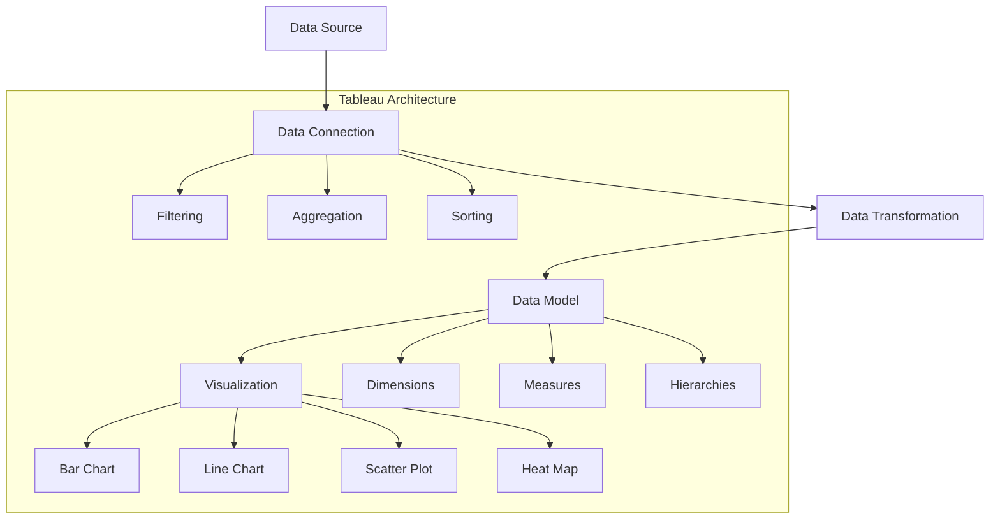
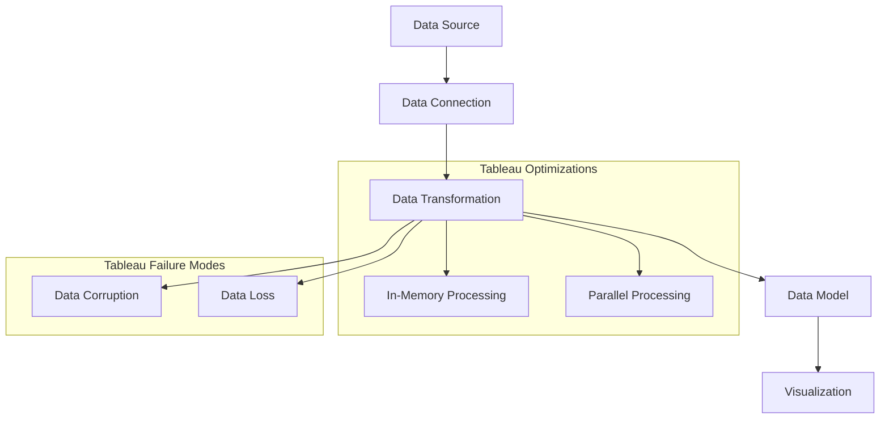

# Lesson 1: Tableau Fundamentals

## 1. First-Principles Intuition & Invariants

Data visualization is a powerful tool that transforms raw data into meaningful insights, enabling decision-makers to understand complex information at a glance. In the realm of computing and data science, Tableau stands out as a leading platform for creating interactive and shareable dashboards. Its strength lies in its ability to simplify the process of data analysis and visualization, making it accessible to a wide range of users, from data analysts to senior software engineers and domain architects.

At its core, Tableau operates on the principle of connecting to various data sources, transforming raw data into a structured format, and then rendering this data into visual representations that can be easily understood. The platform's design is grounded in the concept of a data connection, which serves as the bridge between the raw data and the visualizations. This connection can be established with a wide array of data sources, including relational databases, spreadsheets, cloud data platforms, and more. The ability to seamlessly integrate with diverse data sources is a critical invariant of Tableau, ensuring that it remains a versatile tool across different domains and industries.

The process of data visualization in Tableau is driven by a series of transformations and calculations that are applied to the raw data. These transformations include filtering, aggregation, and sorting, which are essential for preparing the data for visualization. The underlying algorithms and data structures that support these transformations are designed to be efficient and scalable, allowing Tableau to handle large datasets with ease. The platform's architecture is built around the concept of a data model, which is a structured representation of the data that includes dimensions, measures, and hierarchies. This data model serves as the foundation for creating visualizations, providing a clear and organized view of the data.

One of the key invariants of Tableau is its ability to support a wide range of chart types, each of which is designed to convey specific insights about the data. These chart types include bar charts, line charts, scatter plots, heat maps, and more. Each chart type is optimized for a specific type of data and analysis, and the choice of chart type is critical for effectively communicating insights. The ability to choose the right chart type is a fundamental skill in data visualization, and Tableau provides a rich set of tools and features to support this process.

## 2. Core Architecture & Mechanics

To understand the core architecture and mechanics of Tableau, it is essential to delve into the internal data structures and algorithms that power the platform. At the heart of Tableau is the data connection, which serves as the bridge between the raw data and the visualizations. The data connection is established through a series of steps that involve selecting the data source, configuring the connection parameters, and previewing the data. Once the data connection is established, Tableau uses a series of algorithms to transform the raw data into a structured format that can be used for visualization.

The data transformation process in Tableau is driven by a series of calculations and transformations that are applied to the raw data. These calculations include filtering, aggregation, and sorting, which are essential for preparing the data for visualization. The underlying algorithms that support these calculations are designed to be efficient and scalable, allowing Tableau to handle large datasets with ease. The data transformation process is supported by a series of data structures, including data tables, data columns, and data rows. These data structures are optimized for performance and scalability, ensuring that Tableau can handle large datasets with ease.

The data model in Tableau is a structured representation of the data that includes dimensions, measures, and hierarchies. The data model serves as the foundation for creating visualizations, providing a clear and organized view of the data. The data model is created through a series of steps that involve selecting the data source, configuring the data model parameters, and previewing the data model. Once the data model is created, Tableau uses a series of algorithms to render the data into visualizations. The rendering process is supported by a series of data structures, including data tables, data columns, and data rows. These data structures are optimized for performance and scalability, ensuring that Tableau can handle large datasets with ease.

To illustrate the core architecture and mechanics of Tableau, consider the following diagram:

In this diagram, the data source is connected to the data connection, which is then transformed into a structured format using a series of calculations and transformations. The transformed data is then used to create a data model, which is rendered into visualizations using a series of chart types. The data transformation process is supported by a series of data structures, including data tables, data columns, and data rows, while the data model is created using a series of dimensions, measures, and hierarchies.

## 3. High-Performance Optimization & Failure Modes

To ensure that Tableau remains a high-performance tool, it is essential to optimize the platform for concurrency, resource scaling, and boundary edge cases. One of the key optimizations in Tableau is its use of in-memory data processing, which allows the platform to handle large datasets with ease. In-memory data processing involves loading the data into memory, where it can be processed and transformed using a series of algorithms and data structures. This approach allows Tableau to handle large datasets with minimal latency, ensuring that the platform remains responsive and efficient.

Another key optimization in Tableau is its use of parallel processing, which allows the platform to process data in parallel using multiple CPU cores. Parallel processing involves dividing the data into smaller chunks, processing each chunk in parallel using multiple CPU cores, and then combining the results. This approach allows Tableau to handle large datasets with minimal latency, ensuring that the platform remains responsive and efficient.

To ensure that Tableau remains a reliable tool, it is essential to address a series of failure modes that can arise during data processing and visualization. One of the key failure modes in Tableau is data corruption, which can occur when the data is corrupted during the data transformation process. To address this failure mode, Tableau uses a series of data validation algorithms to ensure that the data is accurate and consistent. These algorithms include data type validation, data range validation, and data consistency validation.

Another key failure mode in Tableau is data loss, which can occur when the data is lost during the data transformation process. To address this failure mode, Tableau uses a series of data backup and recovery algorithms to ensure that the data is preserved. These algorithms include data backup, data recovery, and data replication.

To illustrate the high-performance optimization and failure modes in Tableau, consider the following diagram:

In this diagram, the data source is connected to the data connection, which is then transformed into a structured format using a series of calculations and transformations. The transformed data is then used to create a data model, which is rendered into visualizations using a series of chart types. The data transformation process is optimized for concurrency and resource scaling using in-memory processing and parallel processing, while the data transformation process is protected from failure modes using data validation and data backup and recovery algorithms.

In conclusion, Tableau is a powerful platform for creating interactive and shareable dashboards. Its strength lies in its ability to simplify the process of data analysis and visualization, making it accessible to a wide range of users. The platform's architecture is grounded in the concept of a data connection, which serves as the bridge between the raw data and the visualizations. The data transformation process is driven by a series of calculations and transformations that are applied to the raw data, while the data model serves as the foundation for creating visualizations. To ensure that Tableau remains a high-performance tool, it is essential to optimize the platform for concurrency, resource scaling, and boundary edge cases, while addressing a series of failure modes that can arise during data processing and visualization.
