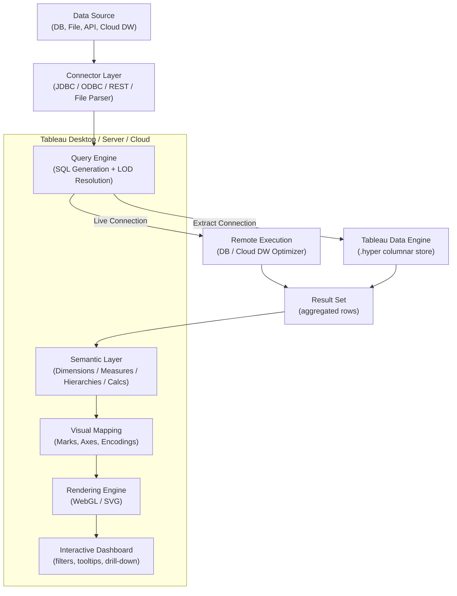
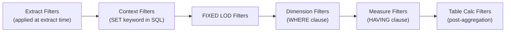
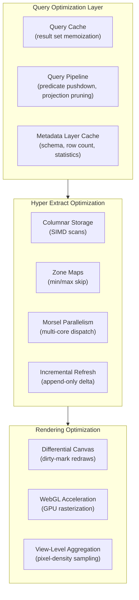
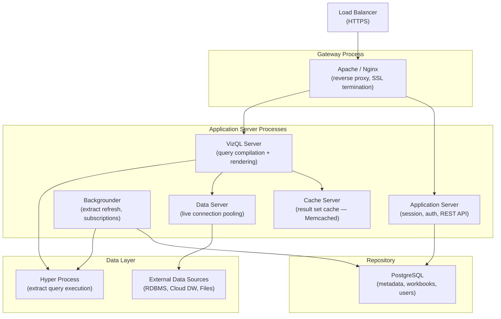
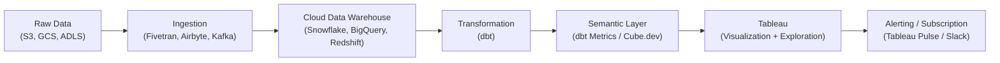

# Lesson 1: Tableau Fundamentals — Architecture, Mechanics, and Performance

---

## 1. First-Principles Intuition & Invariants

### Why Data Visualization Exists

The human visual cortex processes spatial patterns, color gradients, and relative magnitudes orders of magnitude faster than it processes tabular text. A well-constructed scatter plot of 100,000 sales transactions exposes a clustering pattern in roughly 200 milliseconds; reading the equivalent CSV would take hours. Data visualization is therefore not an aesthetic choice — it is an information-bandwidth optimization between a dataset and a human decision-maker.

Tableau operationalizes this principle through a compute pipeline that moves data from heterogeneous sources through a canonical internal representation, applies analytical transformations, and renders the result as an interactive visual artifact. Understanding *why* Tableau is designed the way it is requires understanding the invariants the system must preserve at each stage of that pipeline.

### The Four Architectural Invariants

**Invariant 1 — Source Agnosticism.** Tableau must connect to a data source without prescribing its schema. It achieves this by separating the *connector layer* (which speaks each source's protocol) from the *semantic layer* (which imposes a universal dimension/measure ontology). The connector abstracts JDBC/ODBC, proprietary REST APIs (Snowflake, BigQuery, Salesforce), and file parsers (Excel, JSON, Parquet) behind a common interface.

**Invariant 2 — Query Pushdown.** Tableau does not load full tables into the client by default. For live connections, it generates SQL (or the source's native query language) and pushes computation to the database engine. Only the aggregated result set crosses the wire. This keeps network transfer bounded and exploits the database's own query optimizer — an engine that may have terabytes of indexes and statistics unavailable to Tableau itself.

**Invariant 3 — Semantic Preservation.** A *dimension* is a categorical variable used to partition data (e.g., `Region`, `Product Category`). A *measure* is a quantitative variable subject to aggregation (e.g., `Sales`, `Profit`). This distinction is not cosmetic — it determines which aggregation functions are legal, which axes a field can occupy, and how the Level of Detail (LOD) engine resolves granularity conflicts. Tableau enforces this semantic contract throughout the pipeline.

**Invariant 4 — Incremental Interactivity.** Every filter, sort, or parameter change a user performs must produce a visual update within a latency budget (< 2 seconds for most interactive use cases). The architecture is designed around this constraint: extract caches are columnar, query plans are compiled and cached, and rendering is differential (only changed marks are redrawn).

---

## 2. Core Architecture & Mechanics

### 2.1 The Full Pipeline



### 2.2 Connector Layer and Query Pushdown

When a user creates a live connection to, say, PostgreSQL, Tableau compiles the shelf state (what fields are on Rows, Columns, Color, Size, etc.) into a SQL query. Consider a simple view: `SUM(Sales)` by `Region`, filtered to `Year = 2023`:

```sql
-- Tableau-generated SQL for a live connection
SELECT
    "Region",
    SUM("Sales") AS "sum_Sales"
FROM
    "public"."orders"
WHERE
    DATEPART('year', "Order Date") = 2023
GROUP BY
    1
ORDER BY
    2 DESC
```

Tableau wraps this in a subquery when multiple table joins, row-level security filters, or LOD expressions are involved, producing multi-layer SQL that the target database's cost-based optimizer handles. The critical insight is that Tableau's query generator must emit *semantically correct SQL for each target dialect* — PostgreSQL, BigQuery, Redshift, Snowflake, and Spark SQL all have subtly different date functions, quoting conventions, and lateral join semantics. This is managed through per-connector TDC (Tableau Datasource Customization) files and dialect XML descriptors.

### 2.3 The Hyper In-Process Analytical Database

When a user creates an **Extract** (`.hyper` file), Tableau materializes the query result into Hyper, Tableau's embedded OLAP engine (acquired via HyperDB, 2016). Hyper is a column-store with the following properties:

- **Column-oriented storage**: Each column is stored contiguously, enabling SIMD vectorized scans. Reading `SUM(Sales)` over 10 million rows touches only the `Sales` column pages, not the full row width.
- **Morsel-driven parallelism**: Hyper divides tables into fixed-size "morsels" (~100K rows) and dispatches them to a thread pool. This is the same execution model described in Leis et al. (2014) "Morsel-Driven Parallelism."
- **Zone maps**: Each column chunk stores its min/max value. A filter `Sales > 10000` can skip entire chunks without decompression.
- **Late materialization**: Predicates are applied to individual columns before rows are reconstructed, minimizing memory bandwidth.

The result is that a `.hyper` extract of a 100-million-row fact table can answer aggregation queries in tens of milliseconds on a single workstation.

### 2.4 Semantic Layer: Dimensions, Measures, and LOD Expressions

The semantic layer is Tableau's most architecturally significant innovation. It imposes an algebra on top of SQL that handles *granularity* explicitly.

**Dimensions** partition the view into distinct marks. When you place `Region` on Columns and `Category` on Rows, the view granularity becomes one mark per `(Region, Category)` pair.

**Measures** are aggregated *at the view's granularity* by default. `SUM(Sales)` means "sum of Sales within each partition defined by all dimensions in the view."

**Level of Detail (LOD) Expressions** allow an aggregation to be computed at a *different* granularity than the view, then joined back. This is the key mechanism that makes complex analytical patterns expressible without sub-queries written by hand:

```
// FIXED LOD: compute customer lifetime value independent of view granularity
{ FIXED [Customer ID] : SUM([Sales]) }

// INCLUDE LOD: add a finer grain than the view
{ INCLUDE [Order ID] : SUM([Sales]) }

// EXCLUDE LOD: aggregate at a coarser grain than the view
{ EXCLUDE [Month] : SUM([Sales]) }
```

Tableau compiles a `FIXED` LOD into a SQL subquery with an independent `GROUP BY`, then joins the result back to the main query on the fixed dimension keys. The order of filter evaluation matters: **FIXED LOD expressions evaluate before dimension filters but after context filters**, which is a source of subtle bugs and must be understood for correctness.

The filter evaluation order is:



Misplacing a filter in this order — for instance, applying a year filter as a dimension filter when you need it to constrain a FIXED LOD — produces incorrect aggregation results silently.

### 2.5 Calculated Fields and the Expression Compiler

Tableau's expression language compiles to SQL or, for Hyper extracts, to native Hyper SQL. The compiler performs type inference, null-safety injection, and dialect translation. Consider:

```
// Tableau calculated field
IF DATEDIFF('day', [Order Date], [Ship Date]) > 7
    THEN "Late"
    ELSE "On Time"
END
```

This compiles to PostgreSQL as:

```sql
CASE
    WHEN DATE_PART('day', "Ship Date"::timestamp - "Order Date"::timestamp) > 7
        THEN 'Late'
    ELSE 'On Time'
END
```

And to BigQuery as:

```sql
CASE
    WHEN DATE_DIFF("Ship Date", "Order Date", DAY) > 7
        THEN 'Late'
    ELSE 'On Time'
END
```

The dialect abstraction layer is what allows the same workbook to run against different databases without modification — a critical requirement for enterprise deployments that migrate from on-premises data warehouses to cloud platforms.

### 2.6 Visual Mapping and the Marks Card

Tableau's visual encoding model maps data fields to graphical channels via the **Marks card**. This is a direct implementation of Bertin's semiology of graphics (1967) and Cleveland & McGill's (1984) perceptual ranking of graphical encodings:

| Channel | Accuracy Rank | Best For |
|---|---|---|
| Position (x/y axis) | 1 | Quantitative comparison |
| Length | 2 | Part-to-whole, ranking |
| Angle/Slope | 3 | Trend, proportion (use sparingly) |
| Area | 4 | Magnitude (bubble charts) |
| Color Hue | 5 | Categorical distinction |
| Color Saturation | 6 | Ordered/sequential values |
| Shape | 7 | Small categorical sets |

Tableau enforces these mappings through the shelf system: placing a measure on the x-axis assigns it the highest-accuracy positional channel automatically. The VizQL (Visualization Query Language) interpreter translates shelf state into a declarative visual specification, which the rendering engine then executes.

---

## 3. High-Performance Optimization & Failure Modes

### 3.1 Optimization Architecture



**Query Caching.** Tableau caches result sets keyed on the normalized query string. Identical queries from different users on Tableau Server hit the same cache entry, dramatically reducing database load in multi-user deployments. Cache invalidation occurs on extract refresh or when the underlying live data changes (for live connections, Tableau relies on TTL or explicit cache flush).

**Incremental Extract Refresh.** Rather than reloading a full extract, Tableau can append only new rows since the last refresh using an `INCREMENTAL BY` clause on a date/integer column. This is correct only when the source data is append-only (insert-only fact tables). Using incremental refresh on data that is updated in place produces stale results, because existing rows are never re-read.

**View-Level Aggregation (VLA).** When a view contains more marks than pixels (e.g., a scatter plot of 1 million points on a 1920×1080 display), Tableau aggregates marks to pixel granularity before rendering. This is not a lossless operation — it means the user sees a statistical summary of the data, not the data itself. Tableau labels this behavior as "mark aggregation" and surfaces it in the status bar.

### 3.2 Performance Anti-Patterns

The following patterns consistently degrade Tableau performance and represent architectural failure modes in dashboard design:

**Anti-Pattern 1 — Cross-Database Joins on Live Connections.** Joining a live Snowflake table to a live PostgreSQL table forces Tableau to execute a *federated join in memory* on the Tableau Server process. Neither database handles the join; Tableau fetches both result sets and merges them locally. For large tables, this produces out-of-memory failures and multi-minute query times. The correct architecture is to materialize the join in a data warehouse or use a Hyper extract.

**Anti-Pattern 2 — Non-Additive Measures Without LOD Discipline.** Measures like `COUNTD([Customer ID])` (count distinct) are non-additive: `COUNTD` for Region A + `COUNTD` for Region B ≠ `COUNTD` for the union. Tableau handles this correctly within a single query, but combining `COUNTD` with FIXED LOD expressions or blended data sources can produce double-counting or over-aggregation. The correct approach is to push `COUNT DISTINCT` to the database and return only the scalar result.

**Anti-Pattern 3 — Deeply Nested Table Calculations.** Table calculations (RUNNING_SUM, WINDOW_AVG, RANK, etc.) execute *after* the query returns, in Tableau's local process. Nesting table calculations (a table calc that references another table calc) requires multiple sequential passes over the partition, with O(n²) behavior in pathological cases. For window functions expressible in SQL, using a custom SQL query or a database view to push them into the query engine is always faster.

**Anti-Pattern 4 — Overloaded Dashboards.** Each worksheet on a dashboard fires an independent query. A dashboard with 12 worksheets issues 12 queries sequentially (or in limited parallelism). The queries are not merged. Each adds network round-trip latency. The correct architecture is to consolidate data sources, use dashboard extensions sparingly, and design for the minimum number of queries required.

### 3.3 Failure Modes and Root Causes

| Failure Mode | Root Cause | Mitigation |
|---|---|---|
| Stale extract data | Incremental refresh on mutable source | Switch to full refresh; validate source append-only assumption |
| LOD expression returns NULL | FIXED LOD on dimension with no matching rows after context filter | Pre-join dimension table; use `ZN()` null guard |
| Cross-database join OOM | In-process merge of large live result sets | Materialize join in warehouse; use single-source extract |
| Slow live query | Missing index on GROUP BY / filter columns | Add database indexes on dimension key columns |
| Incorrect COUNTD | Blended data source with one-to-many link | Restructure blend; push aggregation to primary source |
| Dashboard render timeout | Too many marks / VLA threshold exceeded | Reduce data granularity; use extract with aggregation |
| Filter order bug | Dimension filter applied before FIXED LOD | Convert to context filter or restructure LOD expression |

### 3.4 Tableau Server Architecture for Production Deployments

Tableau Server is a distributed application composed of several processes that can be scaled independently across nodes:



The **VizQL Server** process is the most resource-intensive: it compiles VizQL to SQL, executes queries, caches results, and renders views. In high-concurrency deployments, this process is scaled horizontally across multiple nodes. The **Backgrounder** process handles all asynchronous work: extract refreshes, subscription emails, flow runs. It is CPU and I/O intensive during batch windows and should be isolated to dedicated nodes in large deployments.

---

## 4. Practical Implementation: Building a Production-Grade Analytics Pipeline

The following Python example demonstrates how to programmatically interact with Tableau's ecosystem using the Tableau Server Client (TSC) library — the official Tableau Python SDK — to automate extract refreshes and publish workbooks. This is a production pattern used in DataOps pipelines.

```python
"""
tableau_ops.py — Production DataOps integration for Tableau Server.

Requires: tableauserverclient>=0.25, python>=3.10
"""
import os
import logging
import time
from pathlib import Path
from dataclasses import dataclass

import tableauserverclient as TSC

logging.basicConfig(
    level=logging.INFO,
    format="%(asctime)s [%(levelname)s] %(name)s: %(message)s"
)
logger = logging.getLogger("tableau_ops")


@dataclass(frozen=True)
class TableauConfig:
    server_url: str
    site_name: str          # empty string = Default site
    token_name: str
    token_secret: str
    project_name: str


def _authenticate(cfg: TableauConfig) -> tuple[TSC.Server, TSC.PersonalAccessTokenAuth]:
    """Create a server session using a Personal Access Token (PAT).

    PATs are preferred over username/password in production because they
    can be scoped, rotated, and revoked without changing user credentials.
    """
    tableau_auth = TSC.PersonalAccessTokenAuth(
        token_name=cfg.token_name,
        personal_access_token=cfg.token_secret,
        site_id=cfg.site_name,
    )
    server = TSC.Server(cfg.server_url, use_server_version=True)
    # use_server_version=True fetches the server API version on connect,
    # ensuring the client uses the highest mutually supported API version.
    return server, tableau_auth


def trigger_extract_refresh(cfg: TableauConfig, datasource_name: str, poll_interval_s: int = 10) -> None:
    """Trigger a full extract refresh and poll until completion.

    Uses the Tableau REST API's Job model. Extract refresh jobs are
    asynchronous — the API returns a job ID immediately and the caller
    must poll for completion.

    Args:
        cfg: Tableau connection configuration.
        datasource_name: Exact name of the published data source to refresh.
        poll_interval_s: Seconds between job status polls.

    Raises:
        RuntimeError: If the extract refresh job fails on the server.
        LookupError: If no data source matching datasource_name is found.
    """
    server, tableau_auth = _authenticate(cfg)

    with server.auth.sign_in(tableau_auth):
        # Retrieve the target project ID for scoped search
        all_projects, _ = server.projects.get()
        project = next(
            (p for p in all_projects if p.name == cfg.project_name), None
        )
        if project is None:
            raise LookupError(f"Project '{cfg.project_name}' not found.")

        # Paginate through data sources in the project
        request_options = TSC.RequestOptions()
        request_options.filter.add(
            TSC.Filter(TSC.RequestOptions.Field.ProjectName,
                       TSC.RequestOptions.Operator.Equals,
                       cfg.project_name)
        )
        all_datasources, _ = server.datasources.get(request_options)
        datasource = next(
            (ds for ds in all_datasources if ds.name == datasource_name), None
        )
        if datasource is None:
            raise LookupError(
                f"Data source '{datasource_name}' not found in project '{cfg.project_name}'."
            )

        logger.info("Triggering full extract refresh for '%s' (id=%s)", datasource_name, datasource.id)
        job: TSC.JobItem = server.datasources.refresh(datasource)
        logger.info("Refresh job queued: job_id=%s", job.id)

        # Poll for job completion
        while job.finish_code == -1:  # -1 = still running
            time.sleep(poll_interval_s)
            job = server.jobs.get_by_id(job.id)
            logger.info("Job %s status: finish_code=%s progress=%s%%",
                        job.id, job.finish_code, job.progress)

        if job.finish_code != 0:
            raise RuntimeError(
                f"Extract refresh job {job.id} failed with finish_code={job.finish_code}. "
                f"Status: {job.status_notes}"
            )

        logger.info("Extract refresh completed successfully: job_id=%s", job.id)


def publish_workbook(
    cfg: TableauConfig,
    twbx_path: Path,
    overwrite: bool = True,
) -> TSC.WorkbookItem:
    """Publish a packaged workbook (.twbx) to Tableau Server.

    Args:
        cfg: Tableau connection configuration.
        twbx_path: Path to the .twbx file on the local filesystem.
        overwrite: If True, overwrites an existing workbook with the same name.

    Returns:
        The published WorkbookItem with server-assigned metadata.
    """
    if not twbx_path.exists():
        raise FileNotFoundError(f"Workbook not found: {twbx_path}")

    server, tableau_auth = _authenticate(cfg)

    with server.auth.sign_in(tableau_auth):
        all_projects, _ = server.projects.get()
        project = next(
            (p for p in all_projects if p.name == cfg.project_name), None
        )
        if project is None:
            raise LookupError(f"Project '{cfg.project_name}' not found.")

        workbook_item = TSC.WorkbookItem(project_id=project.id)
        publish_mode = (
            TSC.Server.PublishMode.Overwrite if overwrite
            else TSC.Server.PublishMode.CreateNew
        )

        logger.info("Publishing workbook '%s' to project '%s'", twbx_path.name, cfg.project_name)
        published = server.workbooks.publish(
            workbook_item=workbook_item,
            file=str(twbx_path),
            mode=publish_mode,
        )
        logger.info("Workbook published: id=%s, content_url=%s", published.id, published.content_url)
        return published


if __name__ == "__main__":
    config = TableauConfig(
        server_url=os.environ["TABLEAU_SERVER_URL"],
        site_name=os.environ.get("TABLEAU_SITE_NAME", ""),
        token_name=os.environ["TABLEAU_TOKEN_NAME"],
        token_secret=os.environ["TABLEAU_TOKEN_SECRET"],
        project_name=os.environ.get("TABLEAU_PROJECT_NAME", "Default"),
    )

    trigger_extract_refresh(config, datasource_name="Sales Pipeline")
    publish_workbook(config, twbx_path=Path("dashboards/sales_pipeline.twbx"))
```

### 4.1 Connecting to Hyper Directly for ETL

The `pantab` library wraps Tableau's Hyper API to read/write `.hyper` files using pandas DataFrames — bypassing Tableau Desktop/Server entirely. This is the correct pattern for programmatic extract generation in a data pipeline:

```python
"""
hyper_writer.py — Write a pandas DataFrame directly to a Hyper extract.

Requires: pantab>=3.0, pandas>=2.0, tableauhyperapi>=0.0.18479
"""
import pandas as pd
import pantab

def write_dataframe_to_hyper(df: pd.DataFrame, output_path: str, table_name: str = "Extract") -> None:
    """Serialize a DataFrame to a Tableau Hyper extract file.

    pantab uses the Hyper API's native columnar writer, which is
    significantly faster than exporting to CSV and importing through
    Tableau Desktop for large DataFrames (>1M rows).

    Column type mapping:
        int64   -> BIGINT
        float64 -> DOUBLE PRECISION
        object  -> TEXT
        bool    -> BOOLEAN
        datetime64[ns] -> TIMESTAMP WITHOUT TIME ZONE
    """
    pantab.frame_to_hyper(
        df,
        output_path,
        table=table_name,
    )
    print(f"Wrote {len(df):,} rows to {output_path} (table='{table_name}')")


def read_hyper_to_dataframe(hyper_path: str, table_name: str = "Extract") -> pd.DataFrame:
    """Read a Hyper extract back into a pandas DataFrame for validation."""
    df = pantab.frame_from_hyper(hyper_path, table=table_name)
    return df


if __name__ == "__main__":
    # Synthetic sales data
    df = pd.DataFrame({
        "Order ID":      pd.array(range(1, 100_001), dtype="int64"),
        "Region":        (["North", "South", "East", "West"] * 25_000),
        "Sales":         pd.array([float(i * 1.5) for i in range(100_000)], dtype="float64"),
        "Order Date":    pd.date_range("2022-01-01", periods=100_000, freq="1min"),
        "Shipped":       pd.array([True, False] * 50_000, dtype="bool"),
    })

    write_dataframe_to_hyper(df, "output/sales.hyper", table_name="Orders")

    # Validation round-trip
    df_back = read_hyper_to_dataframe("output/sales.hyper", table_name="Orders")
    assert len(df_back) == len(df), "Row count mismatch after Hyper round-trip"
    print("Round-trip validation passed.")
```

---

## 5. Visual Design Principles Grounded in Perceptual Science

Tableau's effectiveness depends not just on correct configuration but on applying perceptual science to encoding choices. The following principles are supported by empirical research in information visualization:

**Pre-attentive attributes.** Certain visual properties — color, size, motion, orientation — are processed by the visual system in parallel before conscious attention is engaged (Treisman & Gelade, 1980). Tableau's Color, Size, and Shape channels on the Marks card map directly to pre-attentive attributes. Using more than one or two pre-attentive attributes simultaneously causes interference — the user must serially decode each attribute instead of perceiving the pattern holistically.

**Color as a semantic channel, not decoration.** Sequential color palettes (single-hue gradient) encode magnitude. Diverging palettes (two-hue gradient through a neutral midpoint) encode deviation from a reference. Categorical palettes encode nominal distinction. Using a sequential palette for categorical data forces viewers to infer ordinal meaning that does not exist. Tableau's default palette behavior is correct for most cases; overriding it to use a "prettier" palette often introduces perceptual distortion.

**The lie factor.** Edward Tufte's *lie factor* = (size of effect in graphic) / (size of effect in data). A truncated y-axis, a 3D pie chart, or dual axes with inconsistent scaling all inflate the lie factor. Tableau's default is to start axes at zero for bar charts (correct) and to auto-range for line charts (can mislead if the range is narrow). Both choices should be evaluated against the data's actual variance structure.

**Data-ink ratio.** Maximize the proportion of ink devoted to data-carrying information. Tableau's default themes include grid lines, axis labels, and borders that may not all be necessary. Removing redundant elements (e.g., both a color legend and direct labels on a bar chart) reduces cognitive load.

---

## 6. Connections to the Broader Ecosystem

Tableau does not exist in isolation. Its production role is as the presentation layer in a broader data stack:



In this architecture, dbt manages SQL-based transformations and defines metrics canonically in YAML. Tableau connects downstream of the semantic layer. This separation of concerns means that business logic (what constitutes "revenue," how churn is defined) lives in the data warehouse tier, not embedded in Tableau calculated fields — which would create multiple, inconsistent definitions across workbooks.

The governance principle is: **computed fields that have a business-wide canonical definition belong in the warehouse or semantic layer, not in Tableau**. Tableau calculated fields are appropriate for view-specific, exploratory, or presentation-layer transformations only.

---

## Summary

Tableau's architecture is a layered pipeline: connectors abstract source heterogeneity, the query engine pushes computation to the database, the Hyper columnar store accelerates extract-based analysis, the semantic layer provides a correct and consistent algebra over dimensions and measures, and the VizQL rendering engine maps the result to perceptually grounded visual encodings. Each layer has specific performance characteristics, failure modes, and design constraints. Effective use of Tableau requires understanding these layers — not just the user interface — so that workbooks are built on a foundation that scales to production data volumes and delivers analytically correct results.
