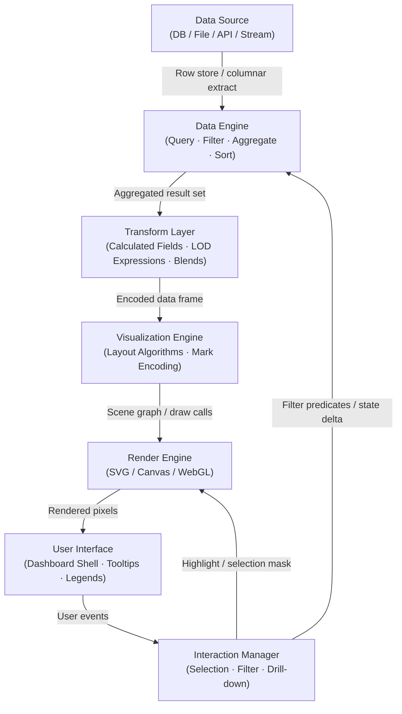
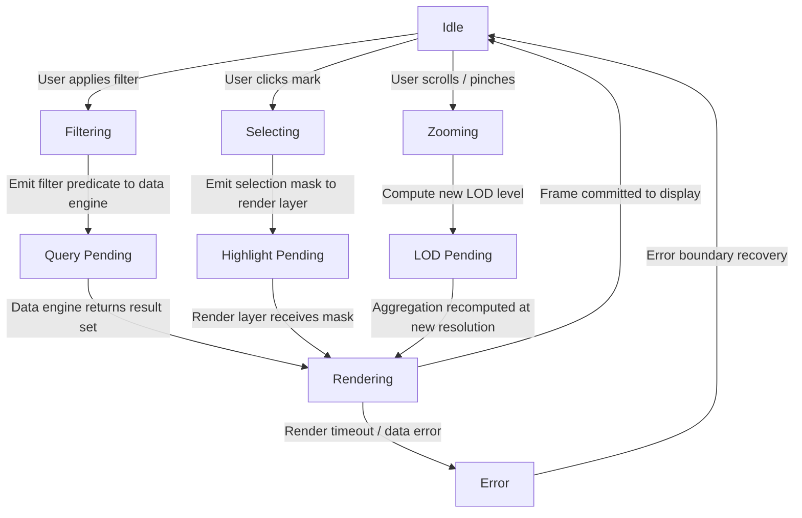
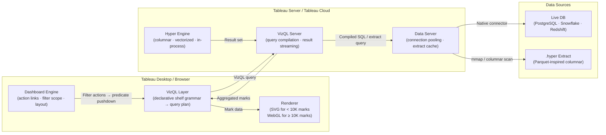
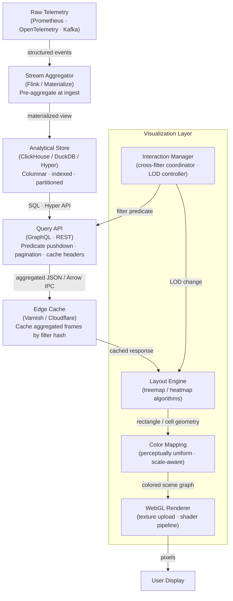

# Lesson 3: Advanced Visualizations

## 1. First-Principles Intuition & Invariants

Effective data visualization is not decoration — it is a lossless (or deliberately lossy) compression of a high-dimensional dataset into a two-dimensional perceptual space such that the structure a human must discover is immediately apparent. The discipline sits at the intersection of information theory, perceptual psychology, and computational geometry, and understanding why a visualization works (or fails) demands fluency in all three.

### The Information-Theoretic Foundation

Shannon entropy provides the first lens. A visualization encodes $n$ data dimensions into a fixed set of visual channels: position, length, area, angle, color hue, color saturation/luminance, texture, and shape. Bertin's semiotics of graphics (1967) ranks these channels by their discriminability and quantitative accuracy. Position along a common scale is the most precise channel; color hue is among the least precise for quantitative comparison but highly effective for categorical separation. The practical implication is that the highest-variance, most decision-critical dimension of your data should map to the most discriminable visual channel available.

```
Discriminability ranking (Cleveland & McGill, 1984):
1. Position on common scale
2. Position on non-aligned scale
3. Length
4. Angle / slope
5. Area
6. Volume
7. Color saturation / density
8. Color hue
```

This ranking is not subjective preference — it is derived from psychophysical experiments measuring the accuracy with which subjects recover encoded quantities. Violations produce systematically biased readings. A pie chart assigns angle and area to quantitative comparison; a bar chart assigns length and position on a common scale. This is why bar charts support more accurate quantity estimation for the same data.

### Perceptual Invariants

Three invariants govern the correctness of any quantitative encoding:

**Monotonicity:** The visual encoding must be a monotonic function of the underlying value. Reversing a color scale (mapping high values to cool colors after users have been trained to expect warm-means-high) breaks this invariant and causes systematic misinterpretation.

**Proportionality (or declared non-proportionality):** Area encodings must be proportional to data values. A bar chart where the y-axis does not start at zero breaks the length-proportionality invariant and exaggerates differences. If a non-zero baseline is deliberate, it must be explicitly annotated.

**Perceptual linearization:** Human vision perceives luminance on a roughly logarithmic scale (Weber-Fechner law). A linear color ramp in RGB space does not produce perceptually uniform steps. This is why perceptually uniform color spaces — CIELAB, or the Oklab approximation — are required for quantitative color encodings. Matplotlib's `viridis` and `cividis` colormaps were engineered with this constraint explicitly.

### Algorithmic Invariants for Space-Filling Layouts

A treemap is a recursive rectangle-packing problem governed by one hard constraint: the area of each leaf rectangle must be exactly proportional to its data value. The layout algorithm is free to choose how to partition the space, subject to readability constraints on aspect ratio.

The naive slice-and-dice algorithm always cuts in the same direction, producing highly elongated rectangles (aspect ratio → ∞ as depth increases). The squarified algorithm (Bruls, Huizing, van Wijk, 2000) selects the cutting direction at each step to minimize the worst-case aspect ratio of the current row, targeting an aspect ratio of 1 (square). The invariant being optimized is:

$$\text{worst aspect ratio} = \max\left(\frac{w^2 \cdot v_{\max}}{s^2}, \frac{s^2}{w^2 \cdot v_{\min}}\right)$$

where $w$ is the row width, $s$ is the total area of values in the current row, and $v_{\max}$, $v_{\min}$ are the maximum and minimum values. The algorithm adds rectangles to the current row as long as doing so improves (reduces) this ratio; otherwise it closes the row and opens a new one.

The ordered treemap variant (Bederson, Shneiderman, Wattenberg, 2002) adds the constraint that siblings must be ordered by value, which improves stability when data is updated — a critical property for live dashboards where layout thrashing disorients users.

---

## 2. Core Architecture & Mechanics

### Layered Abstraction Stack



Each layer has a well-defined contract with its neighbors, and the performance budget for the entire pipeline must stay under ~100 ms for interactions to feel instantaneous (Doherty threshold). Violations at any layer accumulate.

### Data Engine: Columnar Foundations

The data engine underpins everything. Modern visualization back-ends — Tableau's Hyper engine, DuckDB, Apache Arrow Flight — use columnar, vectorized execution for two foundational reasons:

1. **Cache locality:** Aggregation queries read a single column sequentially. Row-oriented storage would force reading irrelevant column data between each relevant value, saturating memory bandwidth.
2. **SIMD vectorization:** With values of uniform type packed contiguously, the CPU can apply the same operation to 8–32 values per clock cycle using AVX-512 or NEON instructions.

The following demonstrates this in practice using DuckDB (which powers many embedded analytics pipelines) for a heatmap aggregation:

```sql
-- Aggregate CPU utilization into a 24×7 heatmap (hour × weekday)
-- without pulling raw rows into the visualization layer
SELECT
    EXTRACT(hour  FROM ts)::INTEGER  AS hour_of_day,
    EXTRACT(isodow FROM ts)::INTEGER AS day_of_week,   -- 1=Mon … 7=Sun
    AVG(cpu_pct)                     AS mean_cpu,
    PERCENTILE_CONT(0.95)
        WITHIN GROUP (ORDER BY cpu_pct) AS p95_cpu,
    COUNT(*)                         AS sample_count
FROM   system_metrics
WHERE  ts BETWEEN $1 AND $2
  AND  host_id = ANY($3)
GROUP  BY 1, 2
ORDER  BY 1, 2;
```

The result is a 168-row frame regardless of how many raw samples exist in the time window. The visualization layer never touches raw data — it operates exclusively on this aggregated frame.

### Squarified Treemap Algorithm

The following is a complete, production-correct implementation in Python. It handles floating-point precision, degenerate single-node trees, and zero-value leaves (which must be excluded before layout to avoid division-by-zero).

```python
from __future__ import annotations
from dataclasses import dataclass, field
from typing import Sequence
import math


@dataclass
class Rect:
    x: float
    y: float
    w: float
    h: float

    @property
    def area(self) -> float:
        return self.w * self.h

    @property
    def shorter_side(self) -> float:
        return min(self.w, self.h)


@dataclass
class Node:
    label: str
    value: float                           # must be > 0
    color: str = "#4C72B0"
    children: list["Node"] = field(default_factory=list)
    rect: Rect = field(default=None, init=False)


def _worst_ratio(row: list[float], w: float) -> float:
    """
    Compute the worst aspect ratio for a candidate row.
    Bruls et al. (2000) eq. 2: max(w²·r_max/s², s²/(w²·r_min))
    where s = sum of values in the row.
    """
    if not row:
        return math.inf
    s = sum(row)
    r_max = max(row)
    r_min = min(row)
    return max(w * w * r_max / (s * s), s * s / (w * w * r_min))


def _layout_row(row: list[float], rect: Rect, nodes: list[Node]) -> Rect:
    """
    Assign rectangles to `nodes` for the current `row` within `rect`.
    Returns the remaining unused rectangle.
    """
    total_row = sum(row)
    total_rect = rect.area
    if total_rect == 0:
        return rect

    if rect.w >= rect.h:
        # horizontal strip along the left edge
        strip_w = total_row / rect.h if rect.h else 0
        y_cursor = rect.y
        for node, v in zip(nodes, row):
            cell_h = (v / total_row) * rect.h if total_row else 0
            node.rect = Rect(rect.x, y_cursor, strip_w, cell_h)
            y_cursor += cell_h
        return Rect(rect.x + strip_w, rect.y, rect.w - strip_w, rect.h)
    else:
        # horizontal strip along the top edge
        strip_h = total_row / rect.w if rect.w else 0
        x_cursor = rect.x
        for node, v in zip(nodes, row):
            cell_w = (v / total_row) * rect.w if total_row else 0
            node.rect = Rect(x_cursor, rect.y, cell_w, strip_h)
            x_cursor += cell_w
        return Rect(rect.x, rect.y + strip_h, rect.w, rect.h - strip_h)


def squarify(nodes: list[Node], rect: Rect, total: float | None = None) -> None:
    """
    Assign Rect objects to each node in `nodes` using the squarified layout.
    Modifies nodes in-place.  Nodes with value <= 0 are silently skipped.
    """
    nodes = [n for n in nodes if n.value > 0]
    if not nodes:
        return

    if total is None:
        total = sum(n.value for n in nodes)

    # Normalize values to fill rect.area exactly
    scale = rect.area / total if total else 0
    scaled = [n.value * scale for n in nodes]

    row_values: list[float] = []
    row_nodes:  list[Node]  = []
    remaining_rect = rect

    for i, (node, sv) in enumerate(zip(nodes, scaled)):
        candidate = row_values + [sv]
        if not row_values or _worst_ratio(candidate, remaining_rect.shorter_side) <= \
                             _worst_ratio(row_values,  remaining_rect.shorter_side):
            row_values.append(sv)
            row_nodes.append(node)
        else:
            remaining_rect = _layout_row(row_values, remaining_rect, row_nodes)
            row_values = [sv]
            row_nodes  = [node]

    if row_values:
        _layout_row(row_values, remaining_rect, row_nodes)

    # Recurse for nodes with children
    for node in nodes:
        if node.children and node.rect is not None:
            squarify(node.children, node.rect)


# ── Example usage ──────────────────────────────────────────────────────────────
if __name__ == "__main__":
    root_children = [
        Node("kernel",    40.0, children=[
            Node("scheduler", 18.0),
            Node("mm",        12.0),
            Node("fs",        10.0),
        ]),
        Node("userspace", 30.0, children=[
            Node("libc",      14.0),
            Node("libssl",     9.0),
            Node("app",        7.0),
        ]),
        Node("drivers",   20.0),
        Node("firmware",  10.0),
    ]

    canvas = Rect(0, 0, 800, 600)
    squarify(root_children, canvas)

    for node in root_children:
        r = node.rect
        print(f"{node.label:12s}  x={r.x:6.1f}  y={r.y:6.1f}  "
              f"w={r.w:6.1f}  h={r.h:6.1f}  area={r.area:8.1f}")
```

### Heatmap: Color Mapping and Perceptual Correctness

The critical engineering decision in a heatmap is not the data aggregation — it is the mapping from scalar value to color. A naïve linear interpolation in sRGB space produces perceptually non-uniform steps: the yellow-to-green transition looks larger than the green-to-blue transition even when the underlying values differ by the same amount. This is because sRGB is not a uniform perceptual color space.

The correct approach is to interpolate in a perceptually uniform space such as CIELAB or Oklab, then convert to sRGB for rendering.

```python
import numpy as np
from colorspacious import cspace_convert   # pip install colorspacious


def perceptually_uniform_colormap(
    value: float,
    vmin: float,
    vmax: float,
    *,
    low_lab:  tuple[float, float, float] = (20.0, -5.0, -30.0),   # dark blue
    high_lab: tuple[float, float, float] = (95.0, -5.0,  80.0),   # bright yellow
    gamma: float = 1.0,
) -> tuple[int, int, int]:
    """
    Map a scalar `value` in [vmin, vmax] to an sRGB triplet via CIELAB
    interpolation.  gamma > 1 compresses low values; gamma < 1 expands them.

    Returns (r, g, b) each in [0, 255].
    Raises ValueError if vmin >= vmax.
    """
    if vmin >= vmax:
        raise ValueError(f"vmin ({vmin}) must be < vmax ({vmax})")

    t = np.clip((value - vmin) / (vmax - vmin), 0.0, 1.0) ** gamma
    lab = np.array(low_lab) + t * (np.array(high_lab) - np.array(low_lab))

    # cspace_convert handles the CIELAB → XYZ → sRGB pipeline
    rgb_linear = cspace_convert(lab[np.newaxis, :], "CIELab", "sRGB1")[0]
    rgb_linear = np.clip(rgb_linear, 0.0, 1.0)

    # Apply sRGB gamma (IEC 61966-2-1) for display
    mask = rgb_linear <= 0.0031308
    rgb_srgb = np.where(
        mask,
        12.92 * rgb_linear,
        1.055 * np.power(rgb_linear, 1.0 / 2.4) - 0.055,
    )
    return tuple((np.clip(rgb_srgb, 0, 1) * 255).astype(np.uint8).tolist())


def render_heatmap_ascii(matrix: np.ndarray) -> None:
    """Debug utility: render a matrix as ASCII shading."""
    ramp = " ░▒▓█"
    vmin, vmax = matrix.min(), matrix.max()
    for row in matrix:
        line = ""
        for v in row:
            t = (v - vmin) / (vmax - vmin + 1e-9)
            line += ramp[int(t * (len(ramp) - 1))]
        print(line)


# ── Example: 24×7 CPU heatmap ───────────────────────────────────────────────
rng   = np.random.default_rng(42)
# Synthetic: higher utilization during working hours Mon–Fri
data  = rng.uniform(5, 30, (24, 7))
data[8:18, 0:5] += rng.uniform(30, 60, (10, 5))   # workday peak
data  = np.clip(data, 0, 100)

print("ASCII preview (hour × weekday):")
render_heatmap_ascii(data)
```

### Interactive Dashboard State Machine

An interactive dashboard is a reactive system. When a user clicks a data point, the event must fan out to every dependent visualization. The correct mental model is a directed acyclic graph of reactive computations, not a central mutable state object.



The key architectural decision is **where filters are applied**. Pushing filter predicates down to the data engine (predicate pushdown) means only the necessary rows are transferred and aggregated. Applying filters in the visualization layer after fetching full result sets wastes bandwidth and CPU. All mature visualization systems implement filter pushdown, but developers who build custom integrations frequently miss this optimization.

### Cross-Filter Propagation in Practice

```go
// cross_filter.go — minimal cross-filter coordinator
// Each chart registers itself; when any chart emits a selection,
// all other charts receive a filter predicate derived from that selection.

package viz

import (
	"context"
	"sync"
)

// Predicate is a composable filter condition passed to the data engine.
type Predicate struct {
	Column   string
	Operator string   // "IN", "RANGE", "EQ"
	Values   []any
}

// Chart is the interface each visualization component must implement.
type Chart interface {
	ID() string
	ApplyFilter(ctx context.Context, predicates []Predicate) error
	ClearFilter(ctx context.Context) error
}

// CrossFilterCoordinator fans out selection events to all registered charts
// except the one that originated the selection.
type CrossFilterCoordinator struct {
	mu     sync.RWMutex
	charts map[string]Chart
}

func NewCoordinator() *CrossFilterCoordinator {
	return &CrossFilterCoordinator{charts: make(map[string]Chart)}
}

func (c *CrossFilterCoordinator) Register(chart Chart) {
	c.mu.Lock()
	defer c.mu.Unlock()
	c.charts[chart.ID()] = chart
}

func (c *CrossFilterCoordinator) Deregister(id string) {
	c.mu.Lock()
	defer c.mu.Unlock()
	delete(c.charts, id)
}

// Publish is called by a chart when the user makes a selection.
// predicates encodes the user's selection as data-layer filter conditions.
func (c *CrossFilterCoordinator) Publish(
	ctx context.Context,
	sourceID string,
	predicates []Predicate,
) error {
	c.mu.RLock()
	targets := make([]Chart, 0, len(c.charts))
	for id, ch := range c.charts {
		if id != sourceID {
			targets = append(targets, ch)
		}
	}
	c.mu.RUnlock()

	var wg sync.WaitGroup
	errs := make(chan error, len(targets))

	for _, ch := range targets {
		wg.Add(1)
		go func(ch Chart) {
			defer wg.Done()
			if err := ch.ApplyFilter(ctx, predicates); err != nil {
				errs <- err
			}
		}(ch)
	}

	wg.Wait()
	close(errs)

	for err := range errs {
		if err != nil {
			return err  // return first error; production code would collect all
		}
	}
	return nil
}
```

---

## 3. High-Performance Optimization & Failure Modes

### The Rendering Budget

Achieving 60 fps requires that every frame complete within 16.6 ms. For interactive data visualizations this budget is shared across:

| Phase | Typical budget | Techniques to stay within budget |
|---|---|---|
| Data query / aggregation | ≤ 5 ms (cached) | Materialized aggregates, incremental update |
| Layout computation | ≤ 2 ms | Incremental re-layout, spatial indices |
| Encode → scene graph | ≤ 3 ms | Dirty-flag diffing, object pooling |
| GPU upload & draw | ≤ 4 ms | Instanced rendering, texture atlases |
| Composite & present | ≤ 2 ms | Layer caching, avoid overdraw |

Exceeding any single budget causes jank. The usual culprit is synchronous layout computation triggered by DOM mutations — a pattern common in D3-based dashboards where `.attr()` calls on SVG nodes alternate with layout reads, causing layout thrashing.

### WebGL Heatmap Rendering

For heatmaps with more than ~50,000 cells, SVG and Canvas 2D are too slow. The correct approach is to upload the aggregated matrix as a texture and shade it in a fragment shader. The GPU processes all cells in parallel.

```glsl
// fragment shader: heatmap.frag
// Encodes a 2D data matrix (uploaded as a floating-point texture)
// into a perceptually uniform color using a viridis approximation.

precision highp float;

uniform sampler2D u_data;     // R32F texture: normalized [0,1] values
uniform vec2      u_resolution;
uniform float     u_opacity;

// Polynomial approximation of the viridis colormap.
// Fits from Matplotlib source (matplotlib/cm.py _viridis_data).
vec3 viridis(float t) {
    t = clamp(t, 0.0, 1.0);
    vec3 c0 = vec3( 0.2777, 0.0054, 0.3341);
    vec3 c1 = vec3( 0.1056, 0.4737, 0.3917);
    vec3 c2 = vec3(-0.3308, 0.2156, 0.0957);
    vec3 c3 = vec3( 0.4482,-0.0383,-0.1575);
    vec3 c4 = vec3(-0.1725,-0.0773, 0.1263);
    vec3 c5 = vec3( 0.0217, 0.0197,-0.0243);
    return c0 + t*(c1 + t*(c2 + t*(c3 + t*(c4 + t*c5))));
}

void main() {
    vec2 uv    = gl_FragCoord.xy / u_resolution;
    float val  = texture2D(u_data, uv).r;    // already normalized by CPU
    vec3  color = viridis(val);
    gl_FragColor = vec4(color, u_opacity);
}
```

The CPU side uploads the matrix once and re-uploads only the changed cells on update (using `texSubImage2D`), not the entire texture.

### Level-of-Detail (LOD) for Large Datasets

LOD in a heatmap context means varying the grid resolution based on the viewport. At zoom level $z$, the optimal bin width is proportional to $2^{-z}$ of the total data extent. Requesting finer granularity than one screen pixel per bin is wasteful; requesting coarser granularity blurs meaningful structure.

```python
def compute_lod_bins(
    data_extent: tuple[float, float],
    viewport_px: int,
    zoom_level: float,
    max_bins: int = 2048,
) -> int:
    """
    Return the number of histogram bins appropriate for the current viewport.

    Parameters
    ----------
    data_extent : (min, max) of the axis in data coordinates
    viewport_px : width or height of the viewport in physical pixels
    zoom_level  : fractional zoom multiplier (1.0 = fit-to-screen)
    max_bins    : hard upper limit (GPU texture size / memory budget)
    """
    visible_range = (data_extent[1] - data_extent[0]) / zoom_level
    # One bin per pixel is the theoretical maximum useful resolution
    bins = int(min(viewport_px, max_bins))
    return max(bins, 1)
```

### Failure Modes and Mitigations

**Treemap layout divergence** occurs when a node's value is exactly zero or negative. The squarified algorithm's ratio formula divides by the sum of the row; a zero forces a 0/0 division and an infinite aspect ratio. Mitigation: strip zero/negative values before layout and render them as a separate "other" category with a distinct visual treatment.

**Color scale saturation clipping.** When the data contains outliers with values 10× the median, a linear color scale compresses 90% of the values into an indistinguishable band near the low end. Users see only the outliers. Mitigation: apply a symmetric log scale (`symlog`, available in Matplotlib and D3) or clip at the 1st/99th percentiles with explicit out-of-range indicators.

**Race conditions in cross-filtering.** If a user fires two rapid selections, two concurrent queries can resolve in reverse order, leaving the dashboard in a stale state. Mitigation: assign an incrementing sequence number to each query. On resolution, discard any result whose sequence number is less than the last committed sequence number. This is the same pattern used in React's `useEffect` cleanup for async operations.

**Dashboard state divergence** arises when a filter is applied to one visualization but a dependent visualization fails to re-query (network error, timeout). The two charts now display inconsistent slices of data. Mitigation: maintain a version vector on the dashboard state; a chart that fails to apply a filter increments its own error flag and renders a stale-data warning overlay rather than silently displaying wrong data.

**WebGL context loss.** Browsers can revoke a WebGL context under memory pressure. A visualization that does not handle the `webglcontextlost` / `webglcontextrestored` events will go blank with no recovery. Mitigation: register both event handlers; on restoration, re-upload all textures and re-compile shaders from cached source strings.

```javascript
// Minimal WebGL context loss recovery
canvas.addEventListener("webglcontextlost", (e) => {
  e.preventDefault();          // required to allow restoration
  cancelAnimationFrame(rafId);
}, false);

canvas.addEventListener("webglcontextrestored", () => {
  // Re-initialize all GPU resources from CPU-side copies
  initShaders();
  uploadAllTextures();
  rafId = requestAnimationFrame(renderLoop);
}, false);
```

---

## 4. Practical Tableau Architecture Deep-Dive

The concepts above manifest concretely in Tableau's internal architecture. Understanding this architecture helps engineers make correct decisions about extract vs. live connection, LOD expressions, and dashboard action configuration.



### VizQL: The Declarative Query Language

Tableau's shelf grammar (rows, columns, color, size, detail, filters) is compiled by the VizQL layer into a query plan that is semantically equivalent to a SQL query with GROUP BY clauses derived from the dimensions placed on shelves. A calculated field using a Level of Detail (LOD) expression such as `{FIXED [Region] : SUM([Sales])}` compiles to a correlated subquery or window function, depending on the target database's dialect.

The critical insight is that **every mark on a Tableau worksheet corresponds to exactly one row in the aggregated query result**. If a view produces 500,000 marks from 500,000 rows of an aggregated query, Tableau switches from SVG to WebGL rendering automatically, but query performance is now the bottleneck, not rendering. The correct fix is to add additional aggregation (coarser date truncation, fewer dimensions) rather than to increase rendering budget.

### Hyper Engine Internals

Tableau's Hyper engine (acquired via the PanDB acquisition in 2016, later open-sourced as the `tableauhyperapi`) is a fully vectorized, morsel-driven parallel query engine. Its design lineage traces to the HyPer database system (Kemper & Neumann, 2011) from TU Munich. Key properties:

- **Morsel-driven parallelism:** query execution is divided into morsels (chunks of ~10,000 rows). Worker threads steal morsels from a global queue, providing adaptive load balancing without static partitioning.
- **Code generation:** Hyper compiles query plans to LLVM IR, then to native machine code. This eliminates the interpreter overhead present in volcano-model engines.
- **Mixed OLTP/OLAP:** Hyper maintains a hot (MVCC-managed, row-oriented) region for recent inserts and a cold (PAX-layout, compressed) region for historical data. Queries automatically span both regions.

For visualization workloads, the practical implication is that incremental refreshes of a `.hyper` extract (appending yesterday's data) are fast because only the hot region is modified, while analytic scans hit the cold region's compressed, vectorized path.

---

## 5. Synthesis: Building a Production-Grade Visualization Pipeline

The following diagram integrates all layers discussed above into a reference architecture for a production metrics dashboard.



The key production decisions at each boundary:

- **Agg → Store:** pre-aggregate at the finest granularity you will ever query. Re-aggregating coarser granularities from fine is cheap; going finer than what was stored is impossible without re-processing raw data.
- **API → CDN:** cache keys must include all filter parameters. A cache miss on a novel filter combination should trigger an async pre-warm of adjacent filter combinations (speculative prefetch).
- **Interact → API:** debounce rapid filter changes with a 150–200 ms delay before issuing a new query. This prevents query storms on slider-based range filters.
- **ColorMap → GLRenderer:** encode the color mapping as a 1D lookup texture (256 × 1 RGBA) uploaded once to the GPU, then reference it in the fragment shader. This decouples colormap changes from data re-uploads.

This architecture scales from thousands to hundreds of millions of data points by keeping the visualization layer's data contract fixed: it always receives a small, pre-aggregated frame, never raw rows.
