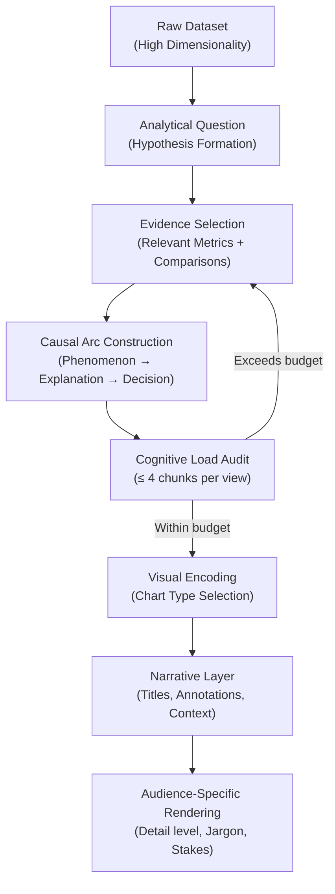
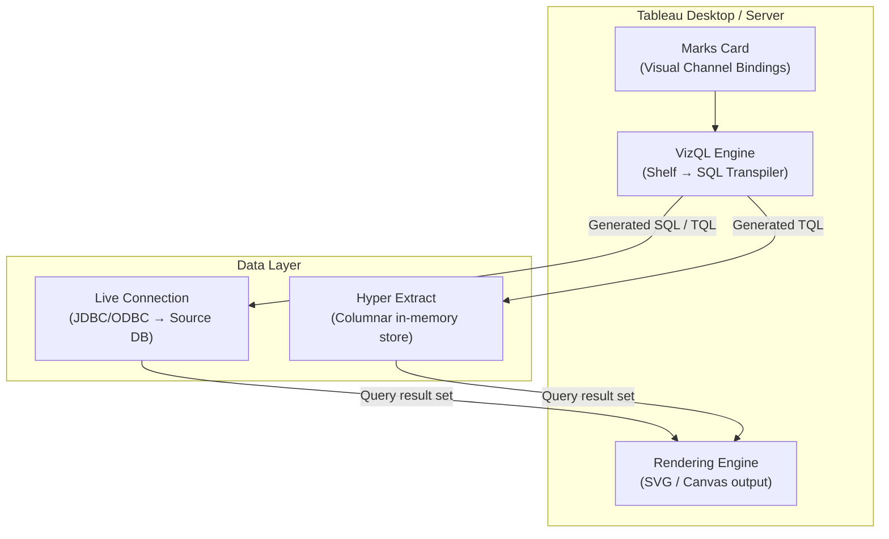
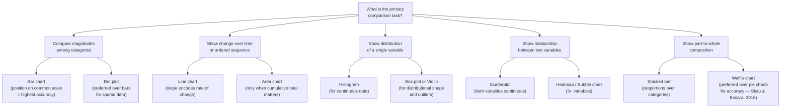

# Lesson 4: Storytelling with Data

## 1. First-Principles Intuition & Invariants

Data storytelling is not a soft skill layered on top of analytics — it is a structured communication discipline with well-defined constraints. At its core, the problem is one of **information compression with minimal distortion**: you possess a high-dimensional dataset and must project it onto a low-dimensional narrative that a specific audience can act on. Every editorial choice — which metric to lead with, which baseline to use, what to omit — introduces bias. The craft lies in making those choices intentionally and transparently.

Three structural invariants govern every effective data story:

**1. The Causal Arc (not "The Hero's Journey")**
Borrowing narrative metaphor from fiction is seductive but imprecise. What data stories actually require is a *causal arc*: a chain of evidence linking an observed phenomenon → a falsifiable explanation → a decision. Without this chain, a presentation is merely descriptive. The causal arc forces the author to distinguish correlation from causation explicitly and to surface the assumptions that connect data to conclusion.

**2. The Comparison Primitive**
Human perception is wired for relative judgment, not absolute magnitude. The eye cannot reliably interpret that a bar represents "14,237 units" in isolation, but it immediately registers that one bar is roughly twice another. Every effective visualisation encodes at least one comparison: against a baseline, a benchmark, a prior period, or a counterfactual. Cleveland and McGill's seminal 1984 psychophysics study ranked visual encodings by accuracy of comparison — position along a common scale is most accurate; area and volume are least. These findings are empirically grounded and should inform every chart choice.

**3. The Cognitive Load Budget**
Working memory can hold approximately 4 ± 1 chunks of novel information simultaneously (Cowan, 2001 — a more precise revision of Miller's 7 ± 2). A data story that introduces more independent variables than this per screen exceeds the audience's budget and collapses into noise. This is not a stylistic preference; it is a cognitive constraint. Each chart, annotation, and colour encoding consumes budget. The designer's job is to spend that budget on signal, not decoration.



The feedback loop from cognitive load back to evidence selection is not optional polish — it is the primary editorial discipline. Most data presentations fail because they skip it entirely.

---

## 2. Core Architecture & Mechanics

### 2.1 The Visualisation Pipeline

Before examining any specific tool, understand the abstract pipeline that every data visualisation system implements. This pipeline is fundamentally the same whether you are using Tableau, D3.js, Matplotlib, or Vega-Lite:

```mermaid
flowchart LR
    A["Data Source\n(DB, CSV, API, Stream)"]
    B["Data Transform Layer\n(Filter, Aggregate, Join, Reshape)"]
    C["Statistical Layer\n(Summary stats, Binning, Regression)"]
    D["Scale Functions\n(Domain → Range mapping)"]
    E["Geometric Marks\n(Bar, Line, Point, Area, Arc)"]
    F["Coordinate System\n(Cartesian, Polar, Geographic)"]
    G["Visual Channels\n(x, y, colour, size, shape, opacity)"]
    H["Render Target\n(SVG, Canvas, WebGL, PDF)"]
    I["Interaction Layer\n(Pan, Zoom, Filter, Tooltip)"]

    A --> B --> C --> D --> E --> F --> G --> H
    H --> I
    I -->|"Parameter update"| B
```



Each stage has distinct responsibilities:

- **Data Transform Layer** handles all mutations to the raw data: filtering rows, aggregating by group, pivoting from long to wide format, joining tables. These operations are semantically equivalent to SQL — `GROUP BY`, `WHERE`, `JOIN`.
- **Scale Functions** are pure mathematical mappings from a *domain* (data space, e.g., `[0, 1_000_000]`) to a *range* (visual space, e.g., `[0px, 600px]`). D3.js exposes these as first-class objects (`d3.scaleLinear`, `d3.scaleLog`, `d3.scaleOrdinal`). Tableau constructs them implicitly when you drop a field onto an axis. Understanding them explicitly is essential for diagnosing misleading charts — a truncated y-axis is a misconfigured scale domain.
- **Geometric Marks** are the atomic visual primitives. The Grammar of Graphics (Wilkinson, 1999), which forms the theoretical foundation for ggplot2, Vega-Lite, and Tableau's underlying VizQL engine, defines marks as independent of data encoding. A *point* mark with x and y channels produces a scatterplot; the same mark with a jitter transform produces a strip plot.

### 2.2 Tableau's VizQL Engine

The original material's claim that Tableau is built around "data cubes" is a simplification that conflates Tableau with OLAP databases. The architectural reality is different and more interesting.

Tableau's query language is called **VizQL** (Visual Query Language), developed from Chris Stolte's PhD dissertation at Stanford (2003). VizQL translates visual drag-and-drop operations directly into database queries. When you place a dimension on the Columns shelf and a measure on the Rows shelf, the VizQL engine generates a `SELECT` statement against the underlying data source. The key architectural insight is that the visualisation *is* the query specification — there is no separate query-building step.

Tableau's internal data processing has two distinct modes:

- **Live Connection**: Every shelf change generates a fresh SQL query to the source database. Latency is bounded by database performance. Appropriate for large, frequently-updated datasets.
- **Extract (.hyper file)**: Data is ingested into Tableau's proprietary columnar in-memory store (the Hyper engine, acquired from HyperDB, a TU Munich spin-off). The Hyper engine uses a hybrid OLTP/OLAP architecture with late materialisation and vectorised execution, achieving query times over hundreds of millions of rows that are competitive with dedicated OLAP stores.



### 2.3 Grammar of Graphics: The Theoretical Substrate

Tableau, ggplot2, Vega-Lite, and Altair all implement variants of Wilkinson's Grammar of Graphics. Understanding this grammar makes you tool-agnostic. The core elements:

| Element | Description | Example |
|---|---|---|
| **Data** | The dataset being visualised | Tidy long-format table |
| **Aesthetics (aes)** | Mappings from data columns to visual channels | `x = year, y = revenue, colour = region` |
| **Geom** | The geometric mark type | `geom_bar`, `geom_line`, `geom_point` |
| **Stat** | Statistical transformation applied to data | `stat_count`, `stat_smooth` |
| **Scale** | Domain-to-range mapping, one per channel | `scale_y_log10()`, `scale_colour_brewer()` |
| **Coord** | Coordinate system | Cartesian, polar, map projection |
| **Facet** | Small multiples: subset data into panels | `facet_wrap(~ category)` |
| **Theme** | Non-data ink: fonts, grid lines, background | `theme_minimal()` |

The grammar is compositional. Any combination of these elements produces a valid (if not always useful) visualisation. The combinatorial space is the reason visual analytics tools built on this grammar can produce thousands of chart types from a small set of primitives.

### 2.4 Production Python Example: Full Pipeline with Altair and Pandas

The following example demonstrates the complete pipeline — data ingestion, transformation, scale configuration, mark selection, and faceting — using Altair (the Python API for Vega-Lite) and Pandas. This is production-calibre code with explicit typing, error handling, and commentary on the architectural decisions.

```python
"""
sales_story.py

Demonstrates a complete data visualisation pipeline:
  - Data loading and validation
  - Tidy-format reshaping (melt)
  - Grammar-of-Graphics composition via Altair
  - Layered chart construction (marks + annotation)
  - Export to self-contained HTML for embedding

Requires:
    pip install altair==5.3.0 pandas==2.2.2 vl-convert-python==1.6.0
"""

from __future__ import annotations

import sys
from pathlib import Path

import altair as alt
import pandas as pd

# ---------------------------------------------------------------------------
# 1. DATA INGESTION & VALIDATION
# ---------------------------------------------------------------------------

def load_sales_data(path: Path) -> pd.DataFrame:
    """
    Load and validate the sales dataset.

    Expected schema:
        region   : str   — categorical dimension
        year     : int   — ordinal temporal dimension
        product  : str   — categorical dimension
        revenue  : float — quantitative measure (USD, non-negative)
        units    : int   — quantitative measure (non-negative integer)
    """
    df = pd.read_csv(path, parse_dates=False)

    required_columns = {"region", "year", "product", "revenue", "units"}
    missing = required_columns - set(df.columns)
    if missing:
        raise ValueError(f"Dataset missing required columns: {missing}")

    if (df["revenue"] < 0).any():
        raise ValueError("revenue column contains negative values — check data pipeline")

    # Coerce types explicitly; never rely on pandas inference for dimensions
    df["region"]  = df["region"].astype("category")
    df["product"] = df["product"].astype("category")
    df["year"]    = df["year"].astype(int)

    return df


# ---------------------------------------------------------------------------
# 2. TIDY RESHAPE: wide → long (required by Grammar of Graphics engines)
# ---------------------------------------------------------------------------

def reshape_to_tidy(df: pd.DataFrame) -> pd.DataFrame:
    """
    If the source data has one column per year (wide format), melt to long.
    Grammar-of-Graphics engines require one observation per row.

    Wide:  region | 2021 | 2022 | 2023
    Long:  region | year | revenue
    """
    year_cols = [c for c in df.columns if str(c).isdigit()]
    if not year_cols:
        # Already in long format
        return df

    id_vars = [c for c in df.columns if c not in year_cols]
    return df.melt(
        id_vars=id_vars,
        value_vars=year_cols,
        var_name="year",
        value_name="revenue",
    ).assign(year=lambda x: x["year"].astype(int))


# ---------------------------------------------------------------------------
# 3. CHART COMPOSITION: layered line + confidence band + annotation
# ---------------------------------------------------------------------------

def build_revenue_story(df: pd.DataFrame) -> alt.Chart:
    """
    Construct a layered, faceted chart that embodies the causal arc:
      - Base layer:  Trend lines per product (the phenomenon)
      - Band layer:  95% CI via LOESS smoothing (the uncertainty)
      - Rule layer:  Vertical annotation marking a known event
      - Facet:       Small multiples by region (the comparison)

    Design rationale:
      - x-channel: year (ordinal — avoids false interpolation between years)
      - y-channel: revenue (quantitative, zero-baseline preserved)
      - colour:    product (categorical, max 8 categories before colour
                            discrimination degrades — Healey, 1996)
      - facet:     region (small multiples outperform grouped colours for
                           >3 categories — Few, 2012)
    """

    # Shared x-axis encoding: year as ordinal forces discrete tick positions
    # and prevents Vega-Lite from interpolating between non-adjacent years.
    base = (
        alt.Chart(df)
        .encode(
            x=alt.X(
                "year:O",  # :O = Ordinal type annotation
                axis=alt.Axis(title="Year", labelAngle=0),
            ),
            y=alt.Y(
                "sum(revenue):Q",  # :Q = Quantitative
                axis=alt.Axis(title="Revenue (USD)", format="$,.0f"),
                scale=alt.Scale(zero=True),  # Always include zero — do not truncate
            ),
            color=alt.Color(
                "product:N",  # :N = Nominal
                scale=alt.Scale(scheme="tableau10"),
                legend=alt.Legend(title="Product"),
            ),
        )
    )

    # Mark layer 1: lines connecting yearly totals
    lines = base.mark_line(point=True, strokeWidth=2)

    # Mark layer 2: vertical rule annotation — e.g., a policy change in 2022
    annotation_data = pd.DataFrame([{"year": 2022, "label": "Policy change"}])
    rule = (
        alt.Chart(annotation_data)
        .mark_rule(color="firebrick", strokeDash=[4, 4], strokeWidth=1.5)
        .encode(
            x=alt.X("year:O"),
            tooltip=alt.Tooltip("label:N"),
        )
    )

    # Mark layer 3: text label for the annotation
    rule_label = (
        alt.Chart(annotation_data)
        .mark_text(align="left", dx=5, dy=-120, color="firebrick", fontSize=11)
        .encode(
            x=alt.X("year:O"),
            text=alt.Text("label:N"),
        )
    )

    # Facet by region: small multiples allow region-level comparison
    # without overloading the colour channel.
    chart = (
        (lines + rule + rule_label)
        .facet(
            facet=alt.Facet("region:N", header=alt.Header(title="Region")),
            columns=2,
        )
        .properties(
            title=alt.TitleParams(
                text="Annual Revenue by Product and Region",
                subtitle="Vertical line marks the 2022 regulatory change",
                anchor="start",
            )
        )
        .resolve_scale(y="independent")  # Each facet panel has its own y-axis
        # range, appropriate when absolute comparisons across regions are
        # less important than within-region trends.
    )

    return chart


# ---------------------------------------------------------------------------
# 4. EXPORT
# ---------------------------------------------------------------------------

def export_chart(chart: alt.Chart, output_path: Path) -> None:
    """
    Export to self-contained HTML. The Vega-Lite spec is embedded as JSON;
    the Vega CDN scripts are referenced — suitable for internal dashboards.
    For fully offline export (PDF/PNG), use vl-convert:
        vl-convert vg2png --input spec.json --output chart.png --scale 2
    """
    chart.save(str(output_path))
    print(f"Chart written to {output_path}")


# ---------------------------------------------------------------------------
# ENTRY POINT
# ---------------------------------------------------------------------------

if __name__ == "__main__":
    data_path = Path(sys.argv[1]) if len(sys.argv) > 1 else Path("sales.csv")

    if not data_path.exists():
        # Generate synthetic data for demonstration
        import numpy as np

        rng = np.random.default_rng(42)
        years    = [2020, 2021, 2022, 2023, 2024]
        regions  = ["EMEA", "APAC", "AMER"]
        products = ["Widget A", "Widget B", "Widget C"]

        rows = []
        for region in regions:
            for product in products:
                base_rev = rng.uniform(100_000, 500_000)
                for year in years:
                    growth   = 1.0 + rng.uniform(-0.1, 0.25)
                    revenue  = base_rev * growth
                    units    = int(revenue / rng.uniform(50, 150))
                    rows.append(
                        {"region": region, "product": product,
                         "year": year, "revenue": round(revenue, 2),
                         "units": units}
                    )
                    base_rev = revenue  # Carry forward for realistic trend

        df = pd.DataFrame(rows)
        df.to_csv(data_path, index=False)
        print(f"Synthetic data written to {data_path}")
    else:
        df = load_sales_data(data_path)
        df = reshape_to_tidy(df)

    chart = build_revenue_story(df)
    export_chart(chart, Path("revenue_story.html"))
```

### 2.5 D3.js Scale Architecture (JavaScript)

Understanding scale functions at the implementation level is essential for custom chart development. D3's scale objects are closures that encapsulate domain and range state:

```javascript
// d3_scale_deep_dive.js
// Demonstrates the architecture of D3 scale functions and their role in
// the visualisation pipeline.

import * as d3 from "https://cdn.jsdelivr.net/npm/d3@7/+esm";

// --- LINEAR SCALE ---
// Maps a continuous numeric domain to a continuous pixel range.
// The core operation is a linear interpolation:
//   output = range_min + (input - domain_min) / (domain_max - domain_min)
//            * (range_max - range_min)
const yScale = d3.scaleLinear()
    .domain([0, 1_000_000])   // Data space: revenue in USD
    .range([500, 0])           // Pixel space: inverted because SVG y=0 is top
    .clamp(true)               // Values outside domain are clamped, not extrapolated
    .nice();                   // Extends domain to round tick values

console.assert(yScale(0)         === 500, "Zero maps to bottom pixel");
console.assert(yScale(1_000_000) === 0,   "Max maps to top pixel");

// --- LOG SCALE ---
// Critical for data spanning multiple orders of magnitude.
// The domain must NOT include zero (log(0) is undefined).
// Use a symlog scale for data crossing zero.
const popScale = d3.scaleLog()
    .domain([1_000, 1_400_000_000])  // City populations
    .range([2, 50])                   // Circle radii in px
    .base(10);

// --- ORDINAL SCALE (for colour) ---
// Maps discrete categories to a discrete colour palette.
// scheme="tableau10" is perceptually distinct for up to 10 categories.
const colourScale = d3.scaleOrdinal()
    .domain(["Widget A", "Widget B", "Widget C"])
    .range(d3.schemeTableau10);

// --- BAND SCALE (for bar charts) ---
// Divides a continuous range into equal-width bands for discrete categories.
// Essential for bar charts: .bandwidth() gives you the bar width.
const xBandScale = d3.scaleBand()
    .domain(["2020", "2021", "2022", "2023", "2024"])
    .range([0, 800])          // Total plot width in px
    .padding(0.2);            // 20% of bandwidth as gap between bars

const barWidth = xBandScale.bandwidth();  // px width for each bar
const barX     = xBandScale("2022");      // px offset for the 2022 bar

console.log(`Bar width: ${barWidth}px, 2022 bar starts at: ${barX}px`);

// --- SEQUENTIAL SCALE (for choropleth maps) ---
// Maps a continuous domain to a perceptually uniform colour interpolator.
// d3.interpolateViridis is recommended for accessibility (colour-blind safe).
const choroplethScale = d3.scaleSequential()
    .domain([0, 100])
    .interpolator(d3.interpolateViridis);

const midColour = choroplethScale(50);  // "#21918c" (teal-green)
console.log(`Colour at 50%: ${midColour}`);
```

---

## 3. Visual Encoding: Choosing the Right Chart

The selection of chart type is not aesthetic — it is a decision about which perceptual task you are asking the viewer to perform. Cleveland and McGill's accuracy ranking of perceptual tasks (from most to least accurate) should drive chart selection:



**Why pie charts are problematic:** Human perception encodes pie chart values as angles and areas, both of which rank low on the Cleveland-McGill scale. Studies by Skau and Kosara (2016) confirmed that readers are more accurate reading a stacked bar chart than a pie chart for the same data. Reserve pie charts for two-category proportions (e.g., 60%/40%) where the angle is unambiguous.

**When to use a log scale:** A linear y-axis is correct when the meaningful comparison is *absolute difference*. A log scale is correct when the meaningful comparison is *relative change (percentage)*. Plotting revenue growing from $1M to $2M alongside revenue growing from $100M to $110M on a linear scale visually obscures the first company's 100% growth. On a log scale, equal vertical distances represent equal multiplicative factors — the correct representation of proportional change.

---

## 4. Annotation: The Narrative Layer

Annotations are the mechanism by which a visualisation becomes a *story*. A chart without annotation presents data; a chart with purposeful annotation presents an *argument*. The annotation layer should answer three questions the viewer is implicitly asking:

1. **What am I looking at?** — Chart title should be declarative (the conclusion), not descriptive (the chart type). "APAC Revenue Grew 40% Post-Restructuring" beats "APAC Revenue by Year."
2. **What is important here?** — Direct labelling of key data points eliminates the round-trip between legend and mark. Callout annotations on anomalies, inflection points, or benchmarks direct attention.
3. **Why does it matter?** — Contextual annotations (reference lines for targets, prior period comparisons, event markers) provide the causal arc that connects the data to a decision.

```python
# annotation_example.py
# Demonstrates purposeful annotation with Matplotlib — adding a causal
# narrative layer directly onto a chart.

import matplotlib.pyplot as plt
import matplotlib.patches as mpatches
import numpy as np

rng = np.random.default_rng(0)

years   = np.arange(2018, 2025)
revenue = np.array([2.1, 2.4, 2.9, 2.6, 3.8, 5.1, 6.4])  # $M

fig, ax = plt.subplots(figsize=(10, 5))
fig.patch.set_facecolor("#FAFAFA")
ax.set_facecolor("#FAFAFA")

# Base line
ax.plot(years, revenue, color="#2171B5", linewidth=2.5, marker="o",
        markersize=6, zorder=3)

# Reference line: target
ax.axhline(y=4.0, color="#CB181D", linestyle="--", linewidth=1.2,
           label="Annual target ($4M)")

# Shaded region: post-restructuring period
ax.axvspan(2021.5, 2024.5, alpha=0.08, color="#2171B5",
           label="Post-restructuring period")

# Callout annotation: inflection point
ax.annotate(
    "Restructuring\ncomplete (Q3 2021)",
    xy=(2022, 3.8),
    xytext=(2020.3, 5.0),
    fontsize=9,
    color="#2171B5",
    arrowprops=dict(
        arrowstyle="->",
        color="#2171B5",
        connectionstyle="arc3,rad=0.2",
    ),
)

# Direct labels on final data point — eliminate legend lookup
ax.text(2024.1, 6.4, f"$6.4M", va="center", fontsize=9,
        color="#2171B5", fontweight="bold")

# Declarative title (conclusion, not description)
ax.set_title(
    "Revenue Exceeded Target by 60% in Year Following Restructuring",
    fontsize=13, fontweight="bold", loc="left", pad=12,
)
ax.set_xlabel("Year", fontsize=10)
ax.set_ylabel("Revenue ($M)", fontsize=10)

# Minimal grid: horizontal only, reduced opacity — data ink ratio
ax.yaxis.grid(True, linestyle=":", alpha=0.5, color="#CCCCCC")
ax.xaxis.grid(False)
ax.spines[["top", "right"]].set_visible(False)

ax.set_xticks(years)
ax.set_xlim(2017.5, 2025)
ax.set_ylim(0, 8)  # Zero-baseline preserved

ax.legend(fontsize=9, frameon=False)

plt.tight_layout()
plt.savefig("annotated_revenue.png", dpi=150, bbox_inches="tight")
plt.close()
```

---

## 5. High-Performance Rendering: Architecture and Failure Modes

### 5.1 Rendering Backend Selection

The choice of rendering backend has first-order performance implications at scale:

| Backend | Mechanism | Optimal Scale | Limitations |
|---|---|---|---|
| **SVG** | DOM nodes per mark | < 10,000 marks | DOM thrashing above ~10K elements; layout reflow cost |
| **Canvas 2D** | Rasterised bitmap draw calls | 10K – 500K marks | No native interactivity per mark; must re-draw on change |
| **WebGL** | GPU shader programs | 500K – 100M+ marks | Complex shader authoring; no text rendering; iOS limitations |
| **Server-side render** | PNG/PDF generation | Arbitrary size | No client-side interactivity |

Vega-Lite defaults to SVG. For large datasets, switch to Canvas via the renderer option: `vegaEmbed('#chart', spec, { renderer: 'canvas' })`. For millions of points, GPU-accelerated libraries like **deck.gl** or **Regl-based** scatter plots are required.

### 5.2 Data Volume Strategies

Rendering 10 million rows in a browser is a category error — the problem must be solved in the data pipeline, not the rendering layer. The standard strategies:

**Pre-aggregation**: Aggregate in the database before transferring to the client. A scatterplot of 10M individual sales transactions is almost always better represented as a 2D density heatmap computed server-side via `SELECT FLOOR(x/bin)*bin, FLOOR(y/bin)*bin, COUNT(*) FROM sales GROUP BY 1,2`.

**Progressive Sampling**: For exploratory visualisation, render a stratified random sample (e.g., n=50,000) with a visible indicator of the sampling fraction. The structure of distributions and correlations is preserved at much lower cardinalities.

**Data Tiles (server-side windowing)**: Borrowed from map tile architecture. At low zoom, serve pre-aggregated data; as the user zooms in, fetch higher-resolution tiles. Implemented in tools like Falcon (UW Interactive Data Lab) and CrossFilter for client-side multi-dimensional filtering.

### 5.3 Failure Modes and Mitigations

**Failure: Overplotting**
Symptom: A scatterplot of large data appears as a uniform dark blob. All distributional information is destroyed by overdrawn marks.
Mitigation: Use 2D hexbin aggregation (`alt.Chart.mark_rect` on binned x/y), reduce mark opacity to 0.05–0.1 to reveal density through accumulation, or use a contour/density estimate.

**Failure: Colour Channel Saturation**
Symptom: A categorical colour scale applied to >8 categories produces colours indistinguishable by the viewer (and entirely unreadable for the ~8% of males with colour vision deficiency).
Mitigation: Limit categorical colour to ≤7 distinct values. Beyond that, use faceting or interactive filtering. Always test palettes against deuteranopia simulation (e.g., `colorblindr` R package or `Coblis` web tool). Prefer `d3.schemeTableau10` or ColorBrewer palettes validated for colour-blind safety.

**Failure: False Precision from Interpolation**
Symptom: A line chart connecting monthly measurements implies a continuous process when the underlying data is discrete samples. The interpolated values between points have no empirical support.
Mitigation: Use `mark_line(interpolate='monotone')` only when the underlying process is genuinely continuous. For discrete or irregular time series, `mark_point` with optional `mark_rule` connectors, or a bar chart, is more honest.

**Failure: Misleading Baselines**
Symptom: A y-axis truncated to `[95, 105]` on a metric that varies by 10 units makes a 5-unit change look like a dramatic doubling.
Mitigation: For ratio scales (revenue, counts), always include zero. For interval scales (temperature in Celsius, index scores), truncation can be justified if the zero point is physically meaningless — but must be labelled explicitly with a scale break marker. This is enforced programmatically in Altair via `.scale(zero=True)`.

**Failure: Dashboard Overload**
Symptom: 12 charts on a single screen, each using a different colour palette, with no visual hierarchy. The viewer has no path through the information.
Mitigation: Apply the "5-second rule": in 5 seconds, a viewer should identify the single most important insight. Use size, position (top-left reads first in Western layouts), and colour saturation to establish hierarchy. Muted, low-saturation supporting charts direct attention to the one chart that matters.

### 5.4 SQL-Level Pre-Aggregation for Dashboard Performance

Pre-aggregation is the single highest-leverage optimisation for database-backed dashboards. The following SQL pattern illustrates materialised summary tables that serve Tableau, Metabase, or any BI tool:

```sql
-- materialised_sales_summary.sql
-- Pre-aggregated summary table for the revenue dashboard.
-- Refreshed daily via a scheduled job (e.g., dbt, Airflow).
-- Reduces query latency from 45s (full table scan, 500M rows)
-- to <200ms (pre-aggregated, ~50K rows).

CREATE TABLE analytics.sales_summary_daily AS
SELECT
    DATE_TRUNC('month', order_date)        AS month,       -- Temporal grain
    region,                                                  -- Dimension 1
    product_category,                                        -- Dimension 2
    salesperson_id,                                          -- Dimension 3
    COUNT(DISTINCT order_id)               AS order_count,
    SUM(gross_revenue_usd)                 AS gross_revenue,
    SUM(net_revenue_usd)                   AS net_revenue,
    SUM(units_sold)                        AS units_sold,
    AVG(discount_pct)                      AS avg_discount_pct,
    -- Running total: computed here to avoid expensive window
    -- functions at dashboard query time
    SUM(SUM(gross_revenue_usd)) OVER (
        PARTITION BY region, product_category
        ORDER BY DATE_TRUNC('month', order_date)
        ROWS BETWEEN UNBOUNDED PRECEDING AND CURRENT ROW
    )                                      AS cumulative_revenue
FROM
    transactional.orders
WHERE
    order_status NOT IN ('CANCELLED', 'RETURNED')
    AND order_date >= CURRENT_DATE - INTERVAL '5 years'
GROUP BY
    1, 2, 3, 4;

-- Index for the most common dashboard filter pattern:
-- WHERE month BETWEEN :start AND :end AND region = :region
CREATE INDEX idx_sales_summary_month_region
    ON analytics.sales_summary_daily (month, region);

-- Dashboard query that now runs against the summary table:
SELECT
    month,
    product_category,
    SUM(gross_revenue)  AS total_revenue,
    SUM(order_count)    AS total_orders
FROM analytics.sales_summary_daily
WHERE
    month BETWEEN '2023-01-01' AND '2024-12-01'
    AND region = 'EMEA'
GROUP BY 1, 2
ORDER BY 1, 2;
```

---

## 6. Communicating Uncertainty

Uncertainty quantification is one of the most systematically neglected aspects of data storytelling. Presenting a point estimate (a single bar, a single number) without communicating the uncertainty interval around it is epistemically misleading — it implies a precision the data does not support.

**Interval representations:**
- **Error bars**: Encode ±1 standard deviation (data variability), standard error (mean estimation uncertainty), or 95% confidence interval (inferential uncertainty). These are semantically different and must be labelled explicitly. Unlabelled error bars are worse than no error bars — they create false precision while hiding what is actually being measured.
- **Gradient plots (Hypothetical Outcome Plots, HOPs)**: Animate samples from a posterior distribution, one frame per sample. Research by Hullman et al. (2015) demonstrated that animated uncertainty representations lead to better-calibrated probabilistic judgements than static confidence intervals.
- **Quantile dot plots**: Plot 100 dots representing quantiles of a distribution. Viewers can literally count the proportion above/below a threshold. Shown by Kay et al. (2016) to outperform error bars and density plots for communicating probabilistic risk to non-expert audiences.

```python
# uncertainty_bars.py
# Demonstrates semantically correct error bar construction and labelling.
# Common error: plotting std dev when the narrative requires 95% CI.

import matplotlib.pyplot as plt
import numpy as np
from scipy import stats

rng = np.random.default_rng(42)

categories = ["EMEA", "APAC", "AMER", "LATAM"]
# Simulate: 30 monthly observations per region
n_obs    = 30
means    = rng.uniform(2.0, 6.0, len(categories))
stds     = rng.uniform(0.3, 1.2, len(categories))

# 95% CI: mean ± t_{0.025, n-1} * (std / sqrt(n))
# NOT mean ± std — that is a data variability measure, not an inference measure.
t_crit   = stats.t.ppf(0.975, df=n_obs - 1)
ci_half  = t_crit * (stds / np.sqrt(n_obs))

x        = np.arange(len(categories))

fig, axes = plt.subplots(1, 2, figsize=(12, 5), sharey=True)
fig.suptitle("Error bar semantics matter: same data, different representations",
             fontsize=12, fontweight="bold")

for ax, (err, label) in zip(axes, [
    (stds,    "±1 Standard Deviation\n(data spread, NOT estimation precision)"),
    (ci_half, "95% Confidence Interval\n(uncertainty in the mean estimate)"),
]):
    bars = ax.bar(x, means, yerr=err, capsize=6,
                  color="#4292C6", edgecolor="white",
                  error_kw={"elinewidth": 1.5, "ecolor": "#CB181D", "capthick": 1.5})
    ax.set_xticks(x)
    ax.set_xticklabels(categories)
    ax.set_ylabel("Revenue ($M)")
    ax.set_ylim(0, 9)
    ax.set_title(label, fontsize=10)
    ax.spines[["top", "right"]].set_visible(False)
    ax.yaxis.grid(True, linestyle=":", alpha=0.4)

plt.tight_layout()
plt.savefig("uncertainty_comparison.png", dpi=150, bbox_inches="tight")
plt.close()
```

---

## 7. Ethical Dimensions of Data Storytelling

A data story is not a neutral object. Every editorial choice — which metric to highlight, which baseline to use, which subgroup to show and which to omit — constitutes a rhetorical act with real consequences. The practitioner has an obligation to understand the specific techniques through which data visualisations mislead:

**Truncated axes**: Addressed in §5.3. The deception is amplifying a small absolute change to look like a large relative change. This technique was extensively documented in Huff's *How to Lie with Statistics* (1954) and remains the most common visualisation deception in journalism and corporate reporting.

**Cherry-picked time windows**: Selecting a start date that coincides with a local minimum creates an artificially favourable growth curve. The countermeasure is to show the full available history and to annotate the reason for any start-date choice.

**Simpson's Paradox in aggregations**: An aggregate trend can reverse direction within every subgroup. Presenting the aggregate without the subgroup breakdown can be actively misleading. The classic example: a drug appears effective in aggregate but harmful in both male and female subgroups separately (because the gender distribution differs between treatment and control). Always present disaggregated views alongside aggregates when group composition varies.

**Dual axes**: Two y-axes on the same chart allow any two arbitrary time series to be made to appear correlated or anti-correlated by adjusting scale ratios. This is not a visualisation technique; it is a manipulation technique. The only legitimate use of a secondary y-axis is for a physically defined ratio relationship (e.g., Celsius and Fahrenheit on a temperature chart). For all other cases, use small multiples.

The practitioner's standard is *methodological transparency*: document data sources, transformation steps, exclusion criteria, and the specific definition of every metric displayed. These should be accessible as a footnote or linked supplement, not hidden.

---

## Summary

This lesson established the full architecture of data storytelling from cognitive first principles through implementation:

The **causal arc** (phenomenon → explanation → decision), the **comparison primitive**, and the **cognitive load budget** are the invariants every data story must satisfy. The visualisation pipeline — data transform → scale functions → geometric marks → coordinate system → visual channels → render target — is the universal architecture instantiated by all major tools (Tableau VizQL, D3.js, Altair/Vega-Lite, ggplot2). Chart type selection is a decision about perceptual task accuracy, not aesthetics. Annotation transforms a chart into an argument. Performance at scale requires backend selection (SVG → Canvas → WebGL), pre-aggregation in the data layer, and sampling strategies — not rendering tricks. Uncertainty must be quantified and presented with correct semantic labelling. And every editorial choice carries an ethical dimension that the practitioner is responsible for.

The next lesson examines geospatial visualisation: map projections, choropleth design, and the specific perceptual pitfalls of encoding data in geographic area.
