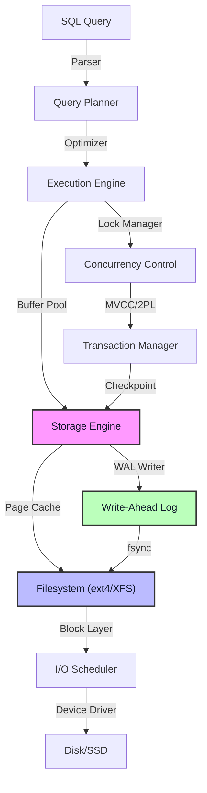

# Operational Verification Labs: Database Internals Core Infrastructure

## Objective

This lab establishes a production-grade environment for deep inspection, tracing, and performance analysis of database systems at the kernel and application layers. You will configure system-level observability primitives, compile instrumented binaries, and deploy isolated database instances for rigorous testing of storage engines, query execution, concurrency control, and I/O subsystems.

## Prerequisites

- Root or sudo access on a Linux system (kernel 4.19+ recommended for eBPF support)
- At least 8GB RAM and 50GB free disk space
- Basic understanding of system calls, file descriptors, and memory management
- Familiarity with SQL and relational database concepts

---

## Required Toolchain & Dependencies

### Core Development Tools

**Git** – Version control and dependency management for database source code:
```bash
sudo apt-get install -y git
```

**GCC/Clang** – C/C++ compilers for building database engines from source (PostgreSQL, SQLite, MySQL, RocksDB):
```bash
sudo apt-get install -y build-essential clang llvm
```
Use `clang` for better static analysis and sanitizer support during development builds.

**Make/CMake** – Build automation:
```bash
sudo apt-get install -y make cmake ninja-build
```

**Rust toolchain** (optional, for modern storage engines like TiKV, Databend):
```bash
curl --proto '=https' --tlsv1.2 -sSf https://sh.rustup.rs | sh
source $HOME/.cargo/env
```

### Isolation & Containerization

**Docker** – Isolated database instances with controlled resource limits:
```bash
sudo apt-get install -y docker.io docker-compose
sudo systemctl enable --now docker
sudo usermod -aG docker $USER
```

Verify installation:
```bash
docker run --rm hello-world
```

### Kernel-Level Observability

**linux-tools** – Provides `perf`, `trace-cmd`, and kernel tracing utilities:
```bash
sudo apt-get install -y linux-tools-$(uname -r) linux-tools-generic
```

**bpftrace/bcc-tools** – Modern eBPF-based tracing (superior to ftrace for dynamic instrumentation):
```bash
sudo apt-get install -y bpfcc-tools bpftrace
```

**sysdig** – System call and network activity inspection with Lua scripting:
```bash
curl -s https://s3.amazonaws.com/download.draios.com/stable/install-sysdig | sudo bash
```

**strace** – System call tracer for single-process debugging:
```bash
sudo apt-get install -y strace
```

### Load Generation & Benchmarking

**stress-ng** – CPU, memory, I/O, and disk stress testing:
```bash
sudo apt-get install -y stress-ng
```

**sysbench** – Database-specific benchmarking (OLTP workloads):
```bash
sudo apt-get install -y sysbench
```

**fio** – Flexible I/O tester for storage subsystem characterization:
```bash
sudo apt-get install -y fio
```

---

## Kernel Configuration for Deep Observability

### Why Kernel Tracing Matters for Databases

Database performance is constrained by kernel subsystems: the page cache, filesystem layer (ext4, XFS, Btrfs), block I/O scheduler, and memory allocator. Enabling kernel tracing exposes:

- **Page cache hit/miss ratios** – Critical for buffer pool tuning
- **fsync latency** – Measures durability overhead (WAL flushes)
- **Block I/O patterns** – Identifies random vs. sequential access
- **Memory pressure** – Detects thrashing, swap activity, and OOM behavior

### Enable ftrace (Legacy Tracing Framework)

Ftrace is the kernel's built-in tracer for function calls and events. While eBPF is more powerful, ftrace remains useful for basic tracing.

```bash
# Enable ftrace subsystem
echo 1 | sudo tee /proc/sys/kernel/ftrace_enabled

# Set ftrace buffer size (16MB per CPU)
echo 16384 | sudo tee /sys/kernel/debug/tracing/buffer_size_kb

# Enable function graph tracer (shows call hierarchy)
echo function_graph | sudo tee /sys/kernel/debug/tracing/current_tracer
```

### Configure Kernel Logging

Kernel `printk` controls console log verbosity. The format is: `console_loglevel default_message_loglevel minimum_console_loglevel default_console_loglevel`.

```bash
# Set detailed kernel logging (level 7 = debug)
echo "kernel.printk = 7 4 1 7" | sudo tee -a /etc/sysctl.conf
sudo sysctl -p
```

**Interpretation**:
- **7** (console_loglevel): Print all messages up to DEBUG level to console
- **4** (default_message_loglevel): Default severity for `printk()` without explicit level
- **1** (minimum_console_loglevel): Lowest level allowed on console (KERN_ALERT)
- **7** (default_console_loglevel): Default console verbosity at boot

### Enable eBPF and Performance Events

Modern tracing relies on eBPF (extended Berkeley Packet Filter) for safe, JIT-compiled kernel instrumentation.

```bash
# Enable perf events (required for bpftrace, perf)
echo 1 | sudo tee /proc/sys/kernel/perf_event_paranoid

# Allow unprivileged eBPF (use cautiously in production)
echo 0 | sudo tee /proc/sys/kernel/unprivileged_bpf_disabled

# Enable kernel address exposure for symbol resolution
echo 0 | sudo tee /proc/sys/kernel/kptr_restrict
```

### Disable Transparent Huge Pages (THP)

Most databases (PostgreSQL, MongoDB, Redis) recommend disabling THP due to unpredictable latency spikes during compaction.

```bash
echo never | sudo tee /sys/kernel/mm/transparent_hugepage/enabled
echo never | sudo tee /sys/kernel/mm/transparent_hugepage/defrag
```

Make persistent across reboots by adding to `/etc/rc.local` or a systemd unit.

### Kernel Debugging Environment Variables

```bash
# Disable kernel debugger break-on-panic (continue execution)
export KDB_NOBREAK=1

# Preserve kernel ring buffer on crash
export GRUB_CMDLINE_LINUX="crashkernel=384M"
```

Update GRUB configuration:
```bash
sudo update-grub
sudo reboot
```

---

## Environment Validation

### Verify Kernel Tracing

Check that ftrace is operational:
```bash
sudo cat /sys/kernel/debug/tracing/available_tracers
# Expected output: function_graph function nop
```

Test eBPF availability:
```bash
bpftrace -e 'BEGIN { printf("eBPF working\n"); exit(); }'
```

### Verify perf

Profile a simple command:
```bash
perf stat ls
```

You should see CPU cycles, instructions, and cache statistics.

### System Resource Baseline

Capture baseline metrics before running database workloads:
```bash
# CPU topology
lscpu

# Memory available
free -h

# Disk I/O scheduler (should be 'mq-deadline' or 'none' for NVMe)
cat /sys/block/sda/queue/scheduler

# Filesystem mount options (look for 'noatime', 'data=ordered')
mount | grep ' / '
```

---

## Database System Architecture Context

Understanding the layers you will observe:



**Key observations**:
- **Buffer Pool** (e.g., PostgreSQL shared_buffers, InnoDB buffer pool): In-memory cache of disk pages. Tracing page evictions reveals working set size.
- **WAL (Write-Ahead Log)**: Sequential writes for durability. `fsync()` calls here dominate write latency.
- **Page Cache**: Kernel's filesystem cache. Double-buffering (buffer pool + page cache) can waste memory.
- **I/O Scheduler**: Reorders and merges I/O requests. Databases often bypass this with direct I/O (`O_DIRECT`).

---

## Sample Tracing Workflow: PostgreSQL fsync Latency

### Setup

1. Install PostgreSQL:
```bash
sudo apt-get install -y postgresql postgresql-contrib
sudo systemctl start postgresql
```

2. Create test database:
```bash
sudo -u postgres psql -c "CREATE DATABASE tracetest;"
```

3. Enable query logging in `/etc/postgresql/*/main/postgresql.conf`:
```
log_statement = 'all'
log_duration = on
```

### Trace fsync System Calls

```bash
# Trace all fsync calls with latency
sudo bpftrace -e '
tracepoint:syscalls:sys_enter_fsync {
    @start[tid] = nsecs;
}
tracepoint:syscalls:sys_exit_fsync /@start[tid]/ {
    $lat = (nsecs - @start[tid]) / 1000;
    @fsync_us = hist($lat);
    delete(@start[tid]);
}
interval:s:5 { print(@fsync_us); clear(@fsync_us); }
'
```

### Generate Write Load

```bash
sudo -u postgres pgbench -i -s 50 tracetest
sudo -u postgres pgbench -c 10 -j 4 -T 60 tracetest
```

### Interpret Results

The histogram shows fsync latency distribution. Look for:
- **Bimodal distributions**: Indicates disk write cache vs. actual platter writes
- **Long tail (>10ms)**: Suggests I/O scheduler inefficiency or slow storage
- **Spikes during checkpoints**: WAL buffer flushes create latency bursts

---

## Storage I/O Profiling

### Baseline Disk Performance

Measure raw disk throughput before database testing:

```bash
# Sequential write throughput
fio --name=seqwrite --rw=write --bs=1M --size=4G --numjobs=1 --runtime=60 --group_reporting

# Random read IOPS (simulates index lookups)
fio --name=randread --rw=randread --bs=4K --size=4G --numjobs=4 --runtime=60 --group_reporting

# Fsync latency (simulates WAL commits)
fio --name=syncwrite --rw=write --bs=4K --size=1G --fsync=1 --numjobs=1 --runtime=60 --group_reporting
```

---

## Summary: Environment Readiness

You now have:
- Kernel-level tracing enabled (ftrace, eBPF, perf)
- System call and I/O observability (sysdig, bpftrace, strace)
- Load generation tools (sysbench, stress-ng, fio)
- Isolated database containers (Docker)
- Baseline performance metrics

**Next steps**: Deploy specific database systems (PostgreSQL, MySQL, SQLite, RocksDB) and profile query execution, lock contention, and storage engine internals using the tracing stack.

**Warning**: Kernel tracing incurs overhead (5-15% CPU). Disable in production or use sampling-based profilers (`perf record -F 99`).
