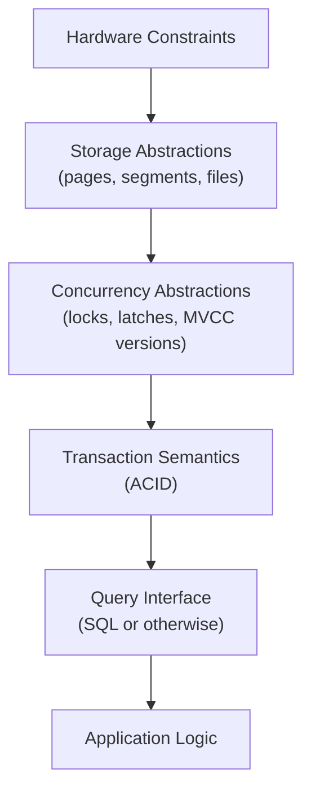
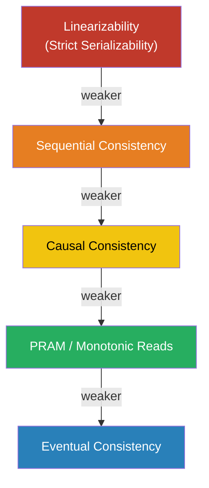
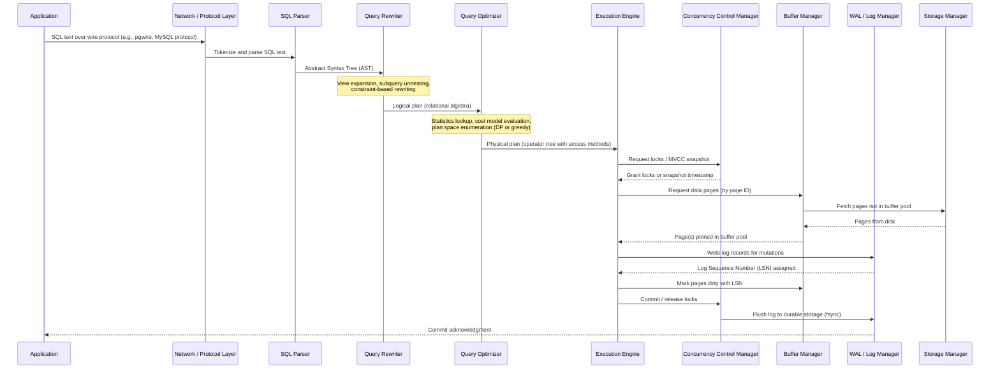
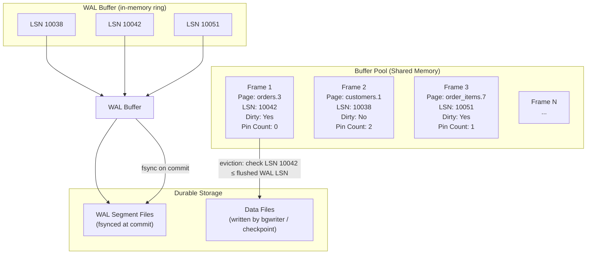
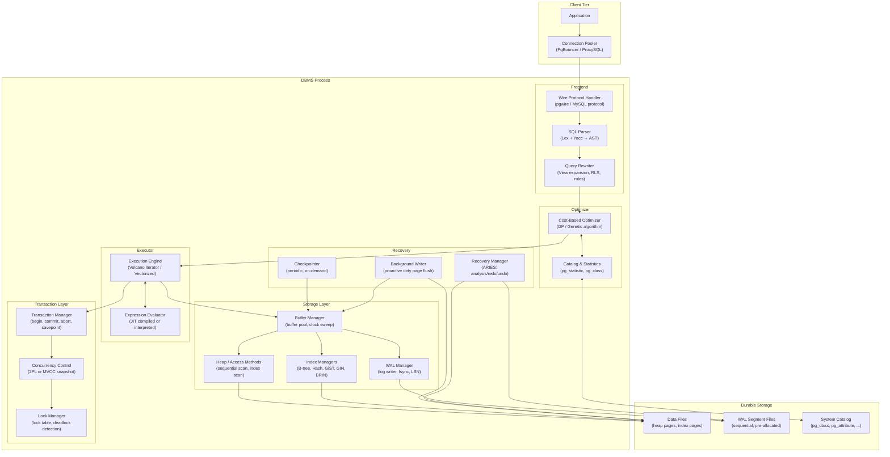

# Lesson 1: Foundations & System Invariants

## Curriculum Roadmap

This masterclass on database internals builds from first principles to production-grade architectural reasoning. Each module is a prerequisite for the next — understanding storage layouts before query optimization, and understanding concurrency before distributed consensus, is not optional. The sequence reflects the actual dependency graph of the systems themselves.

| Module | Topic | Core Concern |
|--------|-------|--------------|
| 1 | Foundations & System Invariants | Problem space, guarantees, component architecture |
| 2 | Data Models & Schema Design | Relational, document, columnar, graph — physical implications |
| 3 | Concurrency Control & Transaction Management | MVCC, locking, serializability, deadlock |
| 4 | Indexing & Query Optimization | B-trees, LSM-trees, cost models, plan enumeration |
| 5 | Storage Engines & File Systems | Page management, buffer pools, WAL, compaction |
| 6 | Distributed Systems & Replication | Consensus, replication lag, partition tolerance |
| 7 | Security & Privacy | AuthN/AuthZ, encryption at rest and in transit, audit |
| 8 | Advanced Topics & Research Frontiers | Learned indexes, vectorized execution, HTAP, NewSQL |

---

## 1. First-Principles Mental Model & Problem Space

A database system exists because two hardware realities are in permanent tension: **RAM is fast but volatile; disk is durable but slow.** Every design decision in a DBMS — from page size to transaction protocol — is ultimately an attempt to reconcile this tension while simultaneously handling concurrent, potentially conflicting access from many clients.

Before examining any implementation, establish this hierarchy in your mental model:



Each layer hides complexity from the layer above and relies on guarantees from the layer below. Violations of lower-layer invariants (e.g., a torn write on disk) propagate upward and corrupt every abstraction built on top of them.

### Why Databases Exist: The Persistence Problem

A naive approach to persistence is to serialize application state to a flat file. This fails at scale for three distinct reasons:

1. **Random access cost**: Files are byte streams. Finding record 10,000 without an index requires reading records 1–9,999 first. On spinning disk, random I/O is 100–1000× more expensive than sequential I/O. Even on NVMe SSDs, sequential access outperforms random access by a factor of 4–10× in throughput.

2. **Concurrent mutation**: POSIX does not guarantee that a `write(2)` syscall is atomic beyond a single filesystem block (typically 512 bytes or 4 KiB). Two processes writing to the same file at overlapping offsets produce undefined interleaving. A DBMS replaces this with a protocol-enforced serialization point.

3. **Crash consistency**: If a process crashes mid-write, the file is left in a partially updated state. Without a recovery mechanism, the data is permanently corrupt. Write-ahead logging (WAL) solves this by recording *intent* before *effect*, allowing incomplete operations to be replayed or undone.

A DBMS addresses all three problems simultaneously. It is not merely a convenient API layer — it is a correctness substrate.

### The I/O Hierarchy and Its Implications

Understanding database internals requires internalizing the access latency and bandwidth characteristics of modern hardware:

| Level | Typical Latency | Bandwidth | Persistence |
|-------|----------------|-----------|-------------|
| L1 cache | ~1 ns | ~1 TB/s | No |
| L3 cache | ~10 ns | ~300 GB/s | No |
| DRAM | ~100 ns | ~50–100 GB/s | No |
| NVMe SSD | ~100 µs | ~5–10 GB/s | Yes |
| SATA SSD | ~500 µs | ~500 MB/s | Yes |
| HDD (sequential) | ~2 ms | ~200 MB/s | Yes |
| HDD (random) | ~10 ms | ~1 MB/s effective | Yes |
| Network (LAN) | ~100 µs | ~12.5 GB/s | — |

These numbers drive fundamental design choices. A B-tree with a node size equal to one OS page (4 KiB) minimizes I/O amplification when fetching a single record. An LSM-tree trades random reads for sequential writes, which is rational when the workload is write-heavy. A buffer pool exists because the gap between DRAM and NVMe is roughly 1000×; caching hot pages in memory collapses that latency for repeated access.

---

## 2. Fundamental System Guarantees & Non-Negotiable Invariants

### 2.1 ACID: A Formal Treatment

ACID is not a marketing acronym — it is a precise specification of transaction semantics, originally formalized by Härder and Reuter in their 1983 paper *"Principles of Transaction-Oriented Database Recovery."*

**Atomicity** guarantees that a transaction's writes are either all visible or none are visible. The implementation mechanism is an undo log: before overwriting a page, the DBMS writes the old value to a log segment. If the transaction aborts (voluntarily or due to a crash), the undo log is replayed in reverse to restore prior state. InnoDB's undo log is stored in the system tablespace (or a dedicated undo tablespace in MySQL 8.0+). PostgreSQL implements atomicity differently — through MVCC heap visibility rules rather than an undo log, keeping old row versions in-place in the heap.

**Consistency** is the only ACID property that is *application-defined*, not system-enforced. It means a transaction transforms the database from one state that satisfies all defined integrity constraints to another such state. The DBMS enforces the constraints (foreign keys, CHECK constraints, NOT NULL); the application defines them. A system can be fully ACID-compliant and still store logically inconsistent data if no constraints are defined.

**Isolation** governs the visibility of intermediate transaction state to concurrent transactions. The ANSI SQL standard defines four isolation levels in terms of three anomalies:

| Anomaly | Definition |
|---------|------------|
| Dirty Read | Reading uncommitted data written by another transaction |
| Non-Repeatable Read | Re-reading a row returns different values because another committed transaction modified it |
| Phantom Read | Re-executing a range query returns different rows because another committed transaction inserted or deleted rows |

| Isolation Level | Dirty Read | Non-Repeatable Read | Phantom Read |
|----------------|-----------|---------------------|--------------|
| Read Uncommitted | Possible | Possible | Possible |
| Read Committed | Prevented | Possible | Possible |
| Repeatable Read | Prevented | Prevented | Possible |
| Serializable | Prevented | Prevented | Prevented |

> **Important correction to common misconceptions**: MySQL InnoDB's `REPEATABLE READ` prevents phantoms in practice via gap locks, but this is an implementation detail, not a SQL standard guarantee. PostgreSQL's `REPEATABLE READ` uses MVCC snapshot isolation, which eliminates phantoms but technically admits write skew anomalies — write skew is not in the ANSI SQL anomaly list, which is a known deficiency of the original standard (Berenson et al., 1995, *"A Critique of ANSI SQL Isolation Levels"*).

**Durability** guarantees that committed data survives a crash. This is implemented via the write-ahead logging (WAL) protocol: a log record describing a change must be flushed to durable storage *before* the data page containing that change is considered committed. The key invariant is:

```
LSN(log record) must reach durable storage before LSN(data page dirty bit is cleared)
```

Where LSN is a Log Sequence Number — a monotonically increasing identifier for log records. This invariant is enforced by the buffer manager's page eviction policy (the STEAL/FORCE dichotomy, discussed in Module 5).

### 2.2 Consistency Models in Distributed Systems

When a database spans multiple nodes, the ACID "C" becomes insufficient. The distributed systems literature uses a richer vocabulary of consistency models ordered by their strength:



**Linearizability** (Herlihy & Wing, 1990) is the gold standard: every operation appears to take effect atomically at some point between its invocation and response, and all operations are consistent with a single global timeline. This is what most engineers mean when they say "strong consistency." Achieving linearizability across nodes requires coordination — either a quorum protocol (Paxos, Raft) or a primary-replica model with synchronous replication.

**Sequential consistency** (Lamport, 1979) relaxes the real-time ordering constraint: operations appear to execute in some sequential order consistent with each process's program order, but that order need not match wall-clock time. This is the memory model of many CPUs (x86 is TSO — Total Store Order, slightly weaker than sequential consistency).

**Causal consistency** preserves happens-before relationships: if operation A causally precedes B, all nodes see A before B. Operations without a causal relationship may be seen in different orders by different nodes. Amazon DynamoDB's conditional writes and CRDTs (Conflict-free Replicated Data Types) operate in this model.

**Eventual consistency** only guarantees convergence: if writes stop, all replicas will *eventually* agree. Without additional session guarantees (monotonic reads, read-your-writes), this model exposes applications to severe anomalies. Cassandra with consistency level ONE operates here by default.

The CAP theorem (Brewer, 2000; formally proved by Gilbert & Lynch, 2002) establishes that a distributed system cannot simultaneously guarantee Consistency, Availability, and Partition tolerance. When a network partition occurs, a system must choose between returning a potentially stale (or error) response (CP) or returning whatever data it has (AP). Critically, **CAP's "Consistency" means linearizability**, not ACID consistency — a frequent source of confusion.

The PACELC model (Abadi, 2012) extends CAP by noting that even without a partition, there is a latency/consistency trade-off: lower latency requires weaker consistency because coordination takes time.

### 2.3 The Storage Model Invariant

Regardless of architecture, every DBMS must maintain one invariant: **the logical data model and the physical data layout must remain consistent**. When a row is updated, the index entries pointing to that row must reflect the update. This is the root cause of write amplification — a single logical write fan-outs to multiple physical writes (the heap page, each index, the WAL, potentially a secondary replica).

For a table with *k* indexes, a single row update costs at minimum *k+1* page writes plus WAL entries. This is not a deficiency to be engineered away — it is a fundamental consequence of maintaining multiple access paths to the same data.

---

## 3. High-Level Architecture: Request Lifecycle

Understanding a DBMS requires tracing a query from submission to result. The following diagram shows the complete control flow for a read-write transaction in a single-node DBMS:



Each stage deserves a detailed examination:

### 3.1 Protocol & Network Layer

Clients communicate with a DBMS over a wire protocol. PostgreSQL uses the **Frontend/Backend Protocol** (pq protocol v3), which is a message-oriented binary protocol over TCP. MySQL uses a similar binary protocol. This layer handles authentication, SSL/TLS negotiation, and message framing. The protocol is stateful — a connection carries session-level state (current transaction, session variables, prepared statement cache).

Connection overhead is non-trivial: PostgreSQL forks a new OS process per connection (a deliberate design choice for isolation and simplicity). At 10,000 concurrent connections, this becomes a scalability bottleneck, which is why connection poolers (PgBouncer, PgPool-II) are standard in production PostgreSQL deployments. MySQL uses threads rather than processes, with lower per-connection overhead.

### 3.2 Parser and Query Rewriter

The parser converts SQL text into an internal representation — typically an Abstract Syntax Tree (AST). This is a syntactic operation: it validates grammar but not semantics. A query referencing a non-existent table passes the parser successfully.

The rewriter (sometimes called the analyzer or semantic analyzer) resolves names against the system catalog (looking up table OIDs, column types, function signatures), expands views to their defining subqueries, and applies rule-based rewrites. In PostgreSQL, this is the `pg_rewrite` rule system; it is also the mechanism used to implement updatable views and row-level security policies.

A critical rewriter optimization is **predicate pushdown**: moving filter conditions as close to the data source as possible to minimize the rows flowing through subsequent operators. This is a logical transformation that is semantics-preserving but can dramatically reduce intermediate result sizes.

### 3.3 Query Optimizer

The query optimizer is arguably the most intellectually complex component of a DBMS. Its job is to find the lowest-cost physical execution plan for a given logical query. The search space grows super-exponentially with the number of joined tables — for *n* tables, there are *n!* possible join orderings and *2^n* possible subsets for bushy plans.

PostgreSQL's optimizer uses dynamic programming (Selinger-style) for up to `join_collapse_limit` tables (default 8), then falls back to a greedy algorithm. The cost model estimates operator costs in units of "sequential page fetches," with random I/O, CPU, and tuple processing costs expressed as configurable multipliers (`seq_page_cost`, `random_page_cost`, `cpu_tuple_cost`, etc.).

The optimizer consults **statistics** stored in `pg_statistic` (populated by `ANALYZE`): column histograms, most-common-values lists, and correlation coefficients between column values and physical row order. Poor statistics — from a table that has grown significantly since the last `ANALYZE` run — are the most common cause of bad query plans in production.

```sql
-- Inspect planner statistics for a column in PostgreSQL
SELECT
    attname,
    n_distinct,
    correlation
FROM pg_stats
WHERE tablename = 'orders'
  AND attname = 'customer_id';

-- Inspect the actual execution plan with runtime statistics
EXPLAIN (ANALYZE, BUFFERS, FORMAT TEXT)
SELECT o.id, c.name, SUM(oi.quantity * oi.unit_price) AS total
FROM orders o
JOIN customers c ON c.id = o.customer_id
JOIN order_items oi ON oi.order_id = o.id
WHERE o.created_at >= NOW() - INTERVAL '30 days'
GROUP BY o.id, c.name
ORDER BY total DESC
LIMIT 100;
```

The `BUFFERS` option reveals cache behavior: `shared hit` indicates a page was found in the buffer pool (no disk I/O); `shared read` indicates a disk fetch. This is essential for diagnosing I/O-bound queries.

### 3.4 Execution Engine

The execution engine instantiates the physical plan as a tree of **operator nodes** (iterators). The classic model — introduced by Volcano/Iterator (Graefe, 1990) — has each operator implement a `next()` interface: calling `next()` on the root operator pulls one tuple at a time through the entire plan tree. This is the **pull model** or **iterator model**.

```
Root: Sort
  └── Aggregate (SUM, GROUP BY)
        └── Hash Join (orders ⋈ order_items)
              ├── Index Scan (orders.created_at >= ...)
              └── Sequential Scan (order_items)
```

The iterator model has poor CPU cache behavior: each `next()` call involves a virtual function dispatch and potentially touches many different cache lines. Modern execution engines use **vectorized execution** (Boncz et al., MonetDB/X100, 2005) or **compiled execution** (LLVM JIT, as in PostgreSQL 11+ and CockroachDB) to process batches of tuples at once, dramatically improving CPU efficiency via SIMD and loop unrolling.

```c
/*
 * Simplified iterator interface — the foundation of Volcano-style execution.
 * Every physical operator implements this interface.
 */
typedef struct TupleTableSlot TupleTableSlot;

typedef struct PlanState {
    /* function pointer — the virtual dispatch mechanism */
    TupleTableSlot *(*ExecProcNode)(struct PlanState *node);
    struct PlanState *lefttree;   /* left child operator */
    struct PlanState *righttree;  /* right child operator */
    /* ... additional state: expression context, slot, instrumentation ... */
} PlanState;

/*
 * Pulling one tuple from the plan tree:
 *   - If the root is a Sort node, it materializes all input first.
 *   - If the root is a HashJoin, it lazily probes on demand.
 */
TupleTableSlot *
ExecProcNode(PlanState *node)
{
    return node->ExecProcNode(node);
}
```

This is structurally similar to PostgreSQL's actual `src/backend/executor/execProcNode.c`.

### 3.5 Concurrency Control Manager

The CCM enforces isolation. There are two dominant paradigms:

**Two-Phase Locking (2PL)**: Transactions acquire locks before accessing data and release them only after committing or aborting. In the first phase (growing), only lock acquisitions occur. In the second phase (shrinking), only releases occur. Strict 2PL — where all locks are held until commit — is the most common variant and prevents cascading aborts.

**Multi-Version Concurrency Control (MVCC)**: Instead of blocking readers with locks, the system maintains multiple versions of each row. Writers create new versions; readers access the version visible at their snapshot timestamp. MVCC allows reads and writes to proceed concurrently without locking conflicts, at the cost of version storage and garbage collection overhead. PostgreSQL, MySQL InnoDB, Oracle, and CockroachDB all use MVCC.

The interaction between MVCC and WAL is subtle. In PostgreSQL:

- Each row version has `xmin` (the transaction ID that created it) and `xmax` (the transaction ID that deleted it, or 0 if live).
- A snapshot is a set of transaction IDs that were in-progress at snapshot time (`xmin`, `xmax`, `xip_list` in `pg_snapshot`).
- A row version is visible to a snapshot if its `xmin` committed before the snapshot was taken and its `xmax` either has not committed or committed after the snapshot was taken.

```sql
-- Inspect live and dead row versions in PostgreSQL (requires pageinspect extension)
CREATE EXTENSION IF NOT EXISTS pageinspect;

SELECT
    t_xmin,
    t_xmax,
    t_ctid,
    t_infomask::bit(16) AS infomask
FROM heap_page_items(get_raw_page('orders', 0))
LIMIT 20;
```

Dead tuples (versions no longer visible to any active snapshot) accumulate over time and must be reclaimed by **VACUUM**. This is the fundamental cost of PostgreSQL's MVCC implementation — the heap becomes fragmented with dead tuples, and VACUUM must periodically traverse the heap to reclaim space. This is why `autovacuum` tuning is critical in write-heavy PostgreSQL deployments.

### 3.6 Buffer Manager

The buffer manager is the memory/disk interface. It maintains the **buffer pool** — a fixed-size region of shared memory divided into page-sized frames. When an operator requests a page, the buffer manager checks if it is already in the pool (a hit) or must be fetched from disk (a miss). On a miss with a full pool, it must evict an existing page to make room.

The eviction policy is critical:

- **LRU (Least Recently Used)**: The standard default. Vulnerable to sequential scans that thrash the entire pool.
- **LRU-K**: Track the *k*-th most recent access, not the most recent. PostgreSQL uses a variant called **clock sweep**, which approximates LRU with low overhead.
- **ARC (Adaptive Replacement Cache)**: Maintains two LRU lists — recently used (T1) and frequently used (T2) — plus ghost entries. Used in ZFS. Adapts to workload mix automatically.

A dirty page (one with modifications not yet written to disk) cannot be evicted without first writing it to disk. This write-back must respect the WAL invariant: the log records covering the dirty page must be on durable storage before the page is written (the **WAL-before-data** rule, enforced by checking that the page's LSN is ≤ the flushed LSN of the WAL).



### 3.7 WAL and Recovery Manager

The Write-Ahead Log is a sequential, append-only file that records every modification made to data pages before those modifications are applied. It is the single source of truth for recovery.

**ARIES (Algorithm for Recovery and Isolation Exploiting Semantics)** (Mohan et al., IBM Research, 1992) is the definitive recovery algorithm. It assumes:

1. **STEAL**: The buffer manager *may* write a dirty page to disk before the transaction that dirtied it commits (necessary to avoid holding all dirty pages in memory indefinitely).
2. **NO-FORCE**: The buffer manager is *not required* to write all dirty pages to disk when a transaction commits (necessary for good commit performance — only the WAL, not all data pages, need be fsynced).

ARIES recovery proceeds in three passes:

```
1. Analysis Pass (forward scan from last checkpoint):
   - Reconstruct which transactions were active at crash time (loser transactions)
   - Reconstruct the dirty page table (pages that had unflushed modifications)

2. Redo Pass (forward scan from earliest dirty page LSN):
   - Repeat all logged operations, even those from committed transactions
   - Brings disk state to exactly the state it was at crash time
   - This includes operations from uncommitted (loser) transactions

3. Undo Pass (backward scan from crash point):
   - Rollback all loser transactions by applying CLRs (Compensation Log Records)
   - CLRs are themselves logged, making undo restartable
```

The key insight of ARIES is that redo is **unconditional** — it replays even uncommitted changes. Undo then cleans them up. This allows STEAL/NO-FORCE, which is essential for performance, while guaranteeing correctness.

```python
"""
Simplified ARIES-style log record structures.
In a real implementation, these are binary-encoded and written
to a WAL segment file (typically 16 MiB segments in PostgreSQL).
"""
from dataclasses import dataclass, field
from enum import Enum, auto
from typing import Optional

class LogRecordType(Enum):
    UPDATE     = auto()   # Before/after image of a page modification
    COMMIT     = auto()   # Transaction commit marker
    ABORT      = auto()   # Transaction abort marker
    BEGIN      = auto()   # Transaction begin marker
    CLR        = auto()   # Compensation Log Record (undo action log)
    CHECKPOINT = auto()   # Fuzzy checkpoint record

@dataclass
class LogRecord:
    lsn: int                          # Log Sequence Number (monotonically increasing)
    prev_lsn: int                     # LSN of the previous record for this transaction
    txn_id: int                       # Transaction identifier
    record_type: LogRecordType
    page_id: Optional[int] = None     # Page modified (for UPDATE records)
    before_image: Optional[bytes] = None  # Pre-update page delta (for undo)
    after_image: Optional[bytes] = None   # Post-update page delta (for redo)
    undo_next_lsn: Optional[int] = None   # For CLRs: next LSN to undo

@dataclass
class DirtyPageTableEntry:
    page_id: int
    rec_lsn: int  # The LSN of the first log record that dirtied this page
                  # Redo must begin from min(rec_lsn) across all dirty pages

@dataclass
class TransactionTableEntry:
    txn_id: int
    status: str         # 'active', 'committed', 'aborted'
    last_lsn: int       # Most recent log record for this transaction

def aries_analysis(log: list[LogRecord],
                   checkpoint_txn_table: list[TransactionTableEntry],
                   checkpoint_dirty_page_table: list[DirtyPageTableEntry]):
    """
    Analysis pass: scan forward from checkpoint.
    Reconstructs the transaction table and dirty page table at crash time.
    """
    txn_table = {e.txn_id: e for e in checkpoint_txn_table}
    dpt = {e.page_id: e for e in checkpoint_dirty_page_table}

    for record in log:  # forward scan from checkpoint LSN
        txn_id = record.txn_id

        if record.record_type == LogRecordType.BEGIN:
            txn_table[txn_id] = TransactionTableEntry(txn_id, 'active', record.lsn)

        elif record.record_type in (LogRecordType.UPDATE, LogRecordType.CLR):
            if txn_id in txn_table:
                txn_table[txn_id].last_lsn = record.lsn
            if record.page_id and record.page_id not in dpt:
                # First time we see this page dirtied after checkpoint
                dpt[record.page_id] = DirtyPageTableEntry(record.page_id, record.lsn)

        elif record.record_type == LogRecordType.COMMIT:
            if txn_id in txn_table:
                txn_table[txn_id].status = 'committed'

        elif record.record_type == LogRecordType.ABORT:
            if txn_id in txn_table:
                txn_table[txn_id].status = 'aborted'

    # Loser transactions: active at crash time (not committed or aborted)
    losers = [e for e in txn_table.values() if e.status == 'active']
    redo_lsn = min((e.rec_lsn for e in dpt.values()), default=0)

    return txn_table, dpt, losers, redo_lsn
```

---

## 4. The Component Architecture in Detail

The following diagram refines the high-level DBMS architecture to show the actual dependency and data flow relationships between components:



### 4.1 The System Catalog

Every DBMS maintains a **system catalog** — a set of tables (or B-trees, or hash tables) that store metadata about the database itself: table names, column names and types, index definitions, constraint definitions, user accounts, and statistics. In PostgreSQL, this is a set of regular heap tables prefixed with `pg_` (e.g., `pg_class`, `pg_attribute`, `pg_index`, `pg_statistic`). The catalog is itself stored in the database and can be queried with SQL.

This recursive self-description is powerful: the same code paths used to query user tables are used to query catalog tables. It also creates a bootstrapping challenge — the catalog must be accessible before any user queries can be processed, which is why PostgreSQL maintains a small in-memory catalog cache (the `relcache` and `catcache`) initialized from the catalog files at startup.

### 4.2 Lock Manager

The lock manager maintains a **lock table** — typically a hash table keyed on the lockable object (relation OID, page ID, tuple TID, or advisory lock key). Each entry contains a list of granted locks and a list of waiting locks. Lock modes and their compatibility define the protocol:

```
PostgreSQL lock mode compatibility matrix (excerpt):
                AS  RS  RE  SU  S   SE  E   AE
AccessShare     ✓   ✓   ✓   ✓   ✓   ✓   ✓   ✗
RowShare        ✓   ✓   ✓   ✓   ✓   ✓   ✗   ✗
RowExclusive    ✓   ✓   ✓   ✓   ✗   ✗   ✗   ✗
ShareUpdateExcl ✓   ✓   ✓   ✗   ✗   ✗   ✗   ✗
Share           ✓   ✓   ✗   ✗   ✓   ✗   ✗   ✗
ShareRowExcl    ✓   ✓   ✗   ✗   ✗   ✗   ✗   ✗
Exclusive       ✓   ✗   ✗   ✗   ✗   ✗   ✗   ✗
AccessExclusive ✗   ✗   ✗   ✗   ✗   ✗   ✗   ✗
```

Deadlock detection is typically implemented via a **waits-for graph**: nodes are transactions, edges represent "transaction A is waiting for a lock held by transaction B." A cycle in this graph indicates a deadlock. PostgreSQL runs deadlock detection periodically (every `deadlock_timeout`, default 1 second) rather than on every lock request, trading detection latency for overhead reduction.

### 4.3 Checkpointing

A **checkpoint** is a point in the WAL stream from which recovery can begin, without needing to replay the entire WAL from the beginning of time. During a checkpoint:

1. All dirty pages in the buffer pool are flushed to disk.
2. A checkpoint record is written to the WAL with the current LSN.
3. Future recovery need only replay WAL from this checkpoint LSN onward.

Checkpoints are expensive — flushing all dirty pages causes I/O spikes. PostgreSQL mitigates this with **fuzzy checkpoints**: the checkpoint process spreads dirty page writes over a configurable time window (`checkpoint_completion_target`, default 0.9 of the checkpoint interval), smoothing I/O at the cost of a slightly longer potential recovery time.

The trade-off between checkpoint frequency and recovery time is a classic systems design tension:

- Frequent checkpoints → shorter recovery time, but higher steady-state I/O overhead.
- Infrequent checkpoints → longer recovery time, but lower steady-state I/O overhead.

`checkpoint_timeout` (default 5 minutes in PostgreSQL) and `max_wal_size` (default 1 GiB) together govern checkpoint frequency in PostgreSQL. `max_wal_size` triggers a checkpoint if the WAL grows beyond this limit, preventing unbounded WAL growth.

---

## 5. Physical Storage Layout: Pages, Tuples, and Slotted Pages

A DBMS manages storage at the granularity of **pages** (also called blocks). A page is a fixed-size unit, typically 4 KiB or 8 KiB, that maps directly to one or more filesystem blocks. All I/O between the buffer manager and disk is in page-sized units.

### 5.1 Slotted Page Layout

The near-universal internal format for heap pages is the **slotted page** layout:

```
┌─────────────────────────────────────────────────────────────────┐
│  Page Header (24 bytes in PostgreSQL)                           │
│  - LSN (8 bytes): WAL position of last modification             │
│  - Checksum (2 bytes): optional page-level checksum             │
│  - Flags (2 bytes): page version, freeze state                  │
│  - pd_lower (2 bytes): offset to end of slot array             │
│  - pd_upper (2 bytes): offset to start of tuple data           │
│  - pd_special (2 bytes): offset to special space (indexes)     │
├─────────────────────────────────────────────────────────────────┤
│  Slot Array (grows downward from pd_lower)                      │
│  - Slot 0: (offset=8192, length=52)  → Tuple 0                 │
│  - Slot 1: (offset=8140, length=47)  → Tuple 1                 │
│  - Slot 2: (offset=0,    length=0)   → Dead slot (vacuumed)    │
│  - Slot 3: (offset=8093, length=38)  → Tuple 3                 │
│  ...                                                            │
│  FREE SPACE (between pd_lower and pd_upper)                     │
│  ...                                                            │
│  Tuple Data (grows upward from pd_upper)                        │
│  - Tuple 3: [t_xmin][t_xmax][t_ctid][null_bitmap][col_data...] │
│  - Tuple 1: [t_xmin][t_xmax][t_ctid][null_bitmap][col_data...] │
│  - Tuple 0: [t_xmin][t_xmax][t_ctid][null_bitmap][col_data...] │
├─────────────────────────────────────────────────────────────────┤
│  Special Space (index-specific metadata, 0 bytes for heap)      │
└─────────────────────────────────────────────────────────────────┘
```

The slotted page design allows tuples to be physically rearranged (e.g., after VACUUM's compaction of dead tuples) without invalidating external references, because external references point to the slot number, not the physical offset. The tuple's physical address (`ctid` in PostgreSQL — a composite of block number and slot number) can change after a VACUUM FULL or CLUSTER operation, but ordinary VACUUM preserves ctids.

### 5.2 Tuple Header and MVCC Visibility

Each heap tuple in PostgreSQL carries an 23-byte header:

```c
/*
 * Simplified HeapTupleHeaderData — from PostgreSQL src/include/access/htup_details.h
 * The actual struct is 23 bytes with careful alignment.
 */
typedef struct HeapTupleHeaderData {
    /* MVCC visibility fields */
    TransactionId t_xmin;    /* 4 bytes: XID of inserting transaction */
    TransactionId t_xmax;    /* 4 bytes: XID of deleting/locking transaction */

    /* Physical addressing */
    ItemPointerData t_ctid;  /* 6 bytes: TID of latest version of this tuple */
                             /* Points to self if this is the latest version */

    /* Attribute and null bitmap metadata */
    uint16 t_infomask2;      /* 2 bytes: number of attributes + flags */
    uint16 t_infomask;       /* 2 bytes: has nulls? has varwidth attrs? frozen? */
    uint8  t_hoff;           /* 1 byte: offset to user data from start of header */

    /* Variable-length null bitmap follows if t_infomask & HEAP_HASNULL */
    /* User attribute data follows at t_hoff offset */
} HeapTupleHeaderData;
```

An UPDATE in PostgreSQL does not modify a tuple in place. Instead, it:
1. Marks the old tuple's `t_xmax` with the updating transaction's XID.
2. Inserts a new tuple version with `t_xmin` set to the updating transaction's XID.
3. Sets the old tuple's `t_ctid` to point to the new version.

This chain of versions forms the **version chain** for a row. It enables MVCC visibility — a reader with an old snapshot follows the chain until it finds the version whose `t_xmin` committed before the snapshot and whose `t_xmax` either is 0 or committed after the snapshot.

---

## 6. The Write Path: End-to-End with Rust Pseudocode

To cement the architecture, trace a single `UPDATE` statement from application to durable commit:

```rust
/// Simplified write path for a single-row UPDATE.
/// Real implementations involve far more state tracking, error handling,
/// and interaction with the system catalog.

use std::sync::Arc;

type Lsn = u64;
type PageId = u64;
type Xid = u32;

struct BufferManager {
    // In-memory pool of fixed-size page frames
    // Real: shared memory region, latch per frame, clock sweep hand
}

struct WalManager {
    current_lsn: Lsn,
    // Real: in-memory ring buffer flushed to WAL segment files
}

struct ConcurrencyControl {
    // Real: MVCC snapshot array or lock table
}

impl WalManager {
    /// Write a log record and return its LSN.
    /// The record is buffered in memory; fsync is deferred until commit.
    fn write_log_record(&mut self, xid: Xid, before: &[u8], after: &[u8], page_id: PageId) -> Lsn {
        self.current_lsn += 1;
        // serialize: LSN | prev_lsn | xid | UPDATE | page_id | before | after
        // append to in-memory WAL ring buffer
        self.current_lsn
    }

    /// Flush all buffered log records to durable storage (fsync).
    /// This is the commit barrier — must complete before ACKing the client.
    fn flush_to_lsn(&self, lsn: Lsn) -> std::io::Result<()> {
        // pwrite() + fdatasync() on the WAL segment file
        // After this returns Ok, the transaction is durable
        Ok(())
    }
}

impl BufferManager {
    /// Pin a page into the buffer pool. Returns a mutable reference.
    /// Increments the pin count — prevents eviction while pinned.
    fn fetch_page(&mut self, page_id: PageId) -> &mut [u8] {
        // 1. Probe buffer pool hash table for page_id
        // 2. On miss: select eviction victim (clock sweep), write back if dirty
        //    (but only if victim's LSN <= flushed WAL LSN — WAL before data)
        // 3. Issue read I/O for page_id
        // 4. Return pointer to frame
        todo!()
    }

    /// Mark a page as dirty with the LSN of the modification.
    /// The buffer manager will not evict this page until WAL is flushed past this LSN.
    fn mark_dirty(&mut self, page_id: PageId, lsn: Lsn) {
        // Set frame's dirty flag and record the page LSN
        // bgwriter will eventually flush this to disk
    }
}

/// Execute a single UPDATE statement.
fn execute_update(
    xid: Xid,
    table_page_id: PageId,
    slot_index: u16,
    new_tuple_data: &[u8],
    wal: &mut WalManager,
    buf: &mut BufferManager,
    _cc: &mut ConcurrencyControl,
) -> Result<(), Box<dyn std::error::Error>> {

    // Step 1: Acquire row-level lock (or check MVCC visibility).
    // For 2PL: acquire X lock on (page_id, slot_index).
    // For MVCC: check t_xmax == 0 on the current tuple version.
    // (omitted for brevity)

    // Step 2: Fetch the page containing the target row.
    let page = buf.fetch_page(table_page_id);

    // Step 3: Read the before-image from the slot.
    // In PostgreSQL, this is the existing HeapTupleHeader + data.
    let before_image = read_slot(page, slot_index).to_vec();

    // Step 4: Write the WAL record BEFORE modifying the page.
    // This is the WAL protocol invariant. If we crash after writing the log
    // but before modifying the page, redo will re-apply the change.
    // If we crash after modifying the page but the log was not written,
    // the modification is lost — which is acceptable because the transaction
    // is not committed (STEAL/NO-FORCE).
    let modification_lsn = wal.write_log_record(
        xid,
        &before_image,
        new_tuple_data,
        table_page_id,
    );

    // Step 5: Apply the modification to the in-memory page.
    // For PostgreSQL-style MVCC UPDATE:
    //   a. Set old tuple's t_xmax = xid (mark as deleted by this transaction)
    //   b. Insert new tuple version with t_xmin = xid
    // For in-place update (InnoDB-style): modify the row directly,
    //   with the before-image preserved in the undo log segment.
    write_slot(page, slot_index, new_tuple_data);

    // Step 6: Mark the page dirty with the modification LSN.
    buf.mark_dirty(table_page_id, modification_lsn);

    // Step 7: Write a COMMIT log record and flush the WAL.
    // After flush_to_lsn() returns, the transaction is durable.
    // The data page may still be only in memory — that is fine.
    let commit_lsn = wal.write_log_record(xid, &[], &[], 0 /* commit record */);
    wal.flush_to_lsn(commit_lsn)?;

    // Step 8: Release locks (Strict 2PL: at commit time).
    // For MVCC: no explicit release needed; snapshot isolation handles visibility.

    // Client is now ACKed. The transaction is committed and durable.
    Ok(())
}

fn read_slot(_page: &[u8], _slot: u16) -> &[u8] { todo!() }
fn write_slot(_page: &mut [u8], _slot: u16, _data: &[u8]) {}
```

---

## 7. Summary of Foundational Invariants

The following invariants are non-negotiable. Any implementation that violates them is incorrect by definition:

1. **WAL-before-data**: A log record describing a page modification must reach durable storage before the modified page can be considered part of a committed transaction. Formally: `flush_lsn(WAL) >= page_lsn(dirty_page)` before eviction of that dirty page.

2. **Atomicity via undo**: Every modification to a page must have a corresponding undo record in the log before the modification is applied. If the transaction aborts, undo records are replayed in reverse order to restore prior state.

3. **Monotonic LSN assignment**: Log Sequence Numbers are strictly monotonically increasing. No two log records share an LSN. This guarantees that the WAL is a totally ordered history of all database modifications.

4. **Snapshot isolation**: A transaction's read set is fixed at the moment the snapshot is acquired. Subsequent commits by other transactions are invisible to the snapshot. The snapshot must be consistent: it reflects exactly the set of transactions that had committed before the snapshot was taken.

5. **Page-level write atomicity**: The storage subsystem must guarantee that a page write is atomic at the page granularity — a partial page write (a "torn write") must not occur. PostgreSQL's optional `full_page_writes` feature writes the first modification to each page after a checkpoint as a full-page image in the WAL, protecting against torn writes on file systems that do not guarantee atomic 4 KiB or 8 KiB writes (most do not, at the hardware level).

6. **Index-heap consistency**: For every index entry referencing a heap tuple, the heap tuple must exist and be accessible via the slot referenced by the index entry. This invariant is maintained by the access method framework — index inserts and heap inserts are WAL-logged atomically within the same transaction, and VACUUM cleans both heap and index entries together.

---

## Further Reading

- Stonebraker, M. & Hellerstein, J. (eds.). *Readings in Database Systems* (5th ed.). MIT Press. — The canonical survey; freely available at redbook.io.
- Ramakrishnan, R. & Gehrke, J. *Database Management Systems* (3rd ed.). McGraw-Hill. — The standard graduate textbook for systems internals.
- Kleppmann, M. *Designing Data-Intensive Applications*. O'Reilly, 2017. — Excellent coverage of the distributed systems layer; complements the systems internals perspective.
- Mohan, C. et al. "ARIES: A Transaction Recovery Method Supporting Fine-Granularity Locking and Partial Rollbacks Using Write-Ahead Logging." *ACM TODS*, 1992. — Essential primary source for recovery algorithms.
- Berenson, H. et al. "A Critique of ANSI SQL Isolation Levels." *SIGMOD*, 1995. — Establishes the formal anomaly-based framework used throughout this curriculum.
- Boncz, P. et al. "MonetDB/X100: Hyper-Pipelining Query Execution." *CIDR*, 2005. — The foundational paper on vectorized execution.
- Graefe, G. "Volcano — An Extensible and Parallel Query Evaluation System." *IEEE TKDE*, 1994. — The iterator model, still the basis of most production executors.
- PostgreSQL Global Development Group. *PostgreSQL Documentation*, Chapters 69–73 (Internals). https://www.postgresql.org/docs/current/internals.html — Primary source for all PostgreSQL-specific implementation details cited above.
