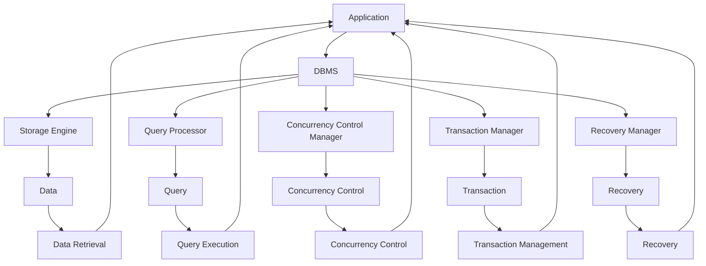

# Lesson 1: Foundations & System Invariants

## Curriculum Roadmap
This masterclass curriculum on Data/Database Internals is designed to provide a deep, unshakeable theoretical grounding in the core principles and architecture of modern databases. The curriculum is structured to build from foundational concepts to advanced topics, ensuring that participants gain a comprehensive understanding of the systems they work with. The modules are as follows:

1. **Foundations & System Invariants**: Establishing the first-principles mental model, understanding the problem space, and delving into fundamental system guarantees and non-negotiable invariants.
2. **Data Models & Schema Design**: Exploring various data models, schema design principles, and their implications on performance and scalability.
3. **Concurrency Control & Transaction Management**: Analyzing mechanisms for ensuring data consistency and integrity in concurrent environments.
4. **Indexing & Query Optimization**: Understanding indexing strategies, query optimization techniques, and their impact on database performance.
5. **Storage Engines & File Systems**: Delving into the architecture of storage engines and their interaction with underlying file systems.
6. **Distributed Systems & Replication**: Examining distributed database architectures, replication strategies, and fault tolerance mechanisms.
7. **Security & Privacy**: Covering security best practices, encryption, and privacy-preserving techniques in databases.
8. **Advanced Topics & Research Frontiers**: Exploring cutting-edge research in database systems, including NewSQL, NoSQL, and emerging paradigms.

## 1. First-Principles Mental Model & Problem Space

Databases are the backbone of modern software systems, serving as the primary means of storing, retrieving, and managing data. The existence of databases is rooted in the fundamental need to efficiently organize and access large volumes of information. At its core, a database system is a software application that interacts with the underlying hardware to provide a structured interface for data manipulation. This interface is typically defined by a database management system (DBMS), which abstracts the complexities of data storage and retrieval, allowing developers to focus on application logic.

The problem space addressed by databases is multifaceted, encompassing a wide range of challenges related to data management. These challenges include:

- **Data Integrity**: Ensuring that data remains accurate and consistent over time, even in the presence of concurrent access and updates.
- **Performance**: Optimizing data access and manipulation to meet the performance requirements of applications, which can vary widely in terms of latency, throughput, and scalability.
- **Scalability**: Designing systems that can handle increasing amounts of data and user requests without degradation in performance.
- **Security**: Protecting data from unauthorized access, ensuring data privacy, and maintaining compliance with regulatory requirements.
- **Availability**: Ensuring that data is accessible and available to users, even in the event of hardware failures or other disruptions.

To address these challenges, database systems employ a variety of techniques and architectures. At the heart of these techniques is the need to balance trade-offs between different system properties. For example, the choice of data model and indexing strategy can significantly impact performance and scalability, while the design of concurrency control mechanisms can affect data integrity and system availability.

## 2. Fundamental System Guarantees & Non-Negotiable Invariants

Database systems provide several fundamental guarantees and non-negotiable invariants that are essential for their correct and efficient operation. These guarantees and invariants are rooted in the principles of data integrity, consistency, and performance. The following are some of the key guarantees and invariants:

### Data Integrity

Data integrity is a critical guarantee provided by database systems, ensuring that data remains accurate and consistent over time. This guarantee is achieved through a combination of mechanisms, including:

- **Atomicity**: Ensuring that transactions are executed as a single, indivisible unit of work. If any part of a transaction fails, the entire transaction is rolled back, leaving the database in a consistent state.
- **Consistency**: Ensuring that transactions bring the database from one valid state to another, maintaining the integrity of the data. This is achieved through the enforcement of constraints and the use of concurrency control mechanisms.
- **Isolation**: Ensuring that concurrent transactions do not interfere with each other, allowing them to execute independently without affecting the outcome of other transactions. This is achieved through the use of isolation levels, such as Read Committed, Repeatable Read, and Serializable.
- **Durability**: Ensuring that once a transaction has been committed, its effects are permanent and will not be lost in the event of a system failure. This is achieved through the use of write-ahead logging and other persistence mechanisms.

### Consistency Models

Consistency models define the guarantees provided by a database system regarding the visibility of updates made by concurrent transactions. The choice of consistency model can significantly impact the performance and scalability of a database system. Some of the key consistency models include:

- **Strong Consistency**: Ensuring that all nodes in a distributed system see the same data at the same time. This model provides the highest level of consistency but can be challenging to achieve in distributed systems.
- **Eventual Consistency**: Allowing nodes in a distributed system to see different data at different times, with the guarantee that all nodes will eventually converge to the same state. This model provides better performance and scalability but at the cost of reduced consistency.
- **Bounded Staleness**: Allowing nodes to see data that is up to a certain age, with the guarantee that the data will be updated within a specified time window. This model provides a balance between consistency and performance.

### Performance Guarantees

Performance is a critical factor in the design and operation of database systems. To achieve high performance, database systems employ a variety of techniques, including:

- **Indexing**: Using indexes to speed up data retrieval operations, reducing the amount of data that needs to be scanned.
- **Query Optimization**: Analyzing and optimizing queries to improve performance, using techniques such as query rewriting, predicate pushdown, and join ordering.
- **Caching**: Using in-memory caching to reduce the amount of time spent accessing data from disk, improving response times for frequently accessed data.
- **Parallelism**: Using parallel processing techniques to distribute workloads across multiple processors or nodes, improving throughput and reducing latency.

### Non-Negotiable Invariants

In addition to the fundamental guarantees, database systems rely on several non-negotiable invariants that ensure their correct and efficient operation. These invariants include:

- **ACID Properties**: The ACID properties (Atomicity, Consistency, Isolation, and Durability) are non-negotiable invariants that ensure the correctness of transactions in a database system.
- **Data Consistency**: Ensuring that data remains consistent across the system, even in the presence of concurrent access and updates.
- **Data Integrity**: Ensuring that data remains accurate and consistent over time, even in the event of system failures or other disruptions.
- **Performance**: Ensuring that the database system meets the performance requirements of applications, providing low latency and high throughput.

## 3. High-Level Process & Component Architecture

To understand the architecture of a database system, it is essential to examine its high-level process and component architecture. A typical database system consists of several key components, including:

- **Storage Engine**: The storage engine is responsible for managing the physical storage of data, including data organization, indexing, and data retrieval. The storage engine is a critical component of the database system, as it directly impacts performance and scalability.
- **Query Processor**: The query processor is responsible for parsing, optimizing, and executing queries. The query processor is a critical component of the database system, as it directly impacts the performance and efficiency of data retrieval operations.
- **Concurrency Control Manager**: The concurrency control manager is responsible for ensuring data consistency and integrity in concurrent environments. The concurrency control manager is a critical component of the database system, as it directly impacts the performance and scalability of the system.
- **Transaction Manager**: The transaction manager is responsible for managing transactions, ensuring that they are executed atomically, consistently, and durably. The transaction manager is a critical component of the database system, as it directly impacts the correctness and reliability of the system.
- **Recovery Manager**: The recovery manager is responsible for ensuring that the database system can recover from failures, maintaining data consistency and integrity. The recovery manager is a critical component of the database system, as it directly impacts the availability and reliability of the system.

The following Mermaid diagram represents the core data and control flow in a typical database system:

In this diagram, the application interacts with the DBMS, which in turn interacts with the various components of the database system. The storage engine manages the physical storage of data, while the query processor parses, optimizes, and executes queries. The concurrency control manager ensures data consistency and integrity in concurrent environments, while the transaction manager manages transactions, ensuring that they are executed atomically, consistently, and durably. The recovery manager ensures that the database system can recover from failures, maintaining data consistency and integrity.

By understanding the high-level process and component architecture of a database system, participants can gain a deeper understanding of the systems they work with, enabling them to design and implement more efficient and reliable database solutions.
