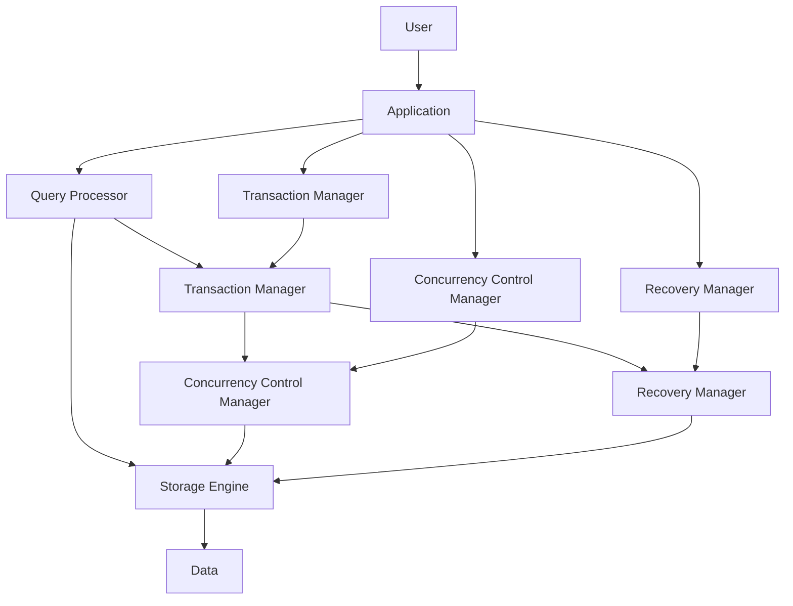

# Lesson 1: Foundations & System Invariants

## Curriculum Roadmap
This masterclass curriculum on 'Core' within the domain of 'Computing' and discipline of 'Data/Database Internals' is designed to provide a deep, unshakeable theoretical grounding in the architecture and operation of modern databases. The curriculum is structured to build a comprehensive understanding of the foundational principles, system invariants, and architectural components that underpin robust and efficient database systems. The modules are as follows:

1. **Foundations & System Invariants**: Establishing the first-principles mental model, understanding the problem space, and defining the fundamental system guarantees and non-negotiable invariants.
2. **Data Models & Schema Design**: Exploring various data models, schema design principles, and the impact of schema evolution on database performance and consistency.
3. **Concurrency Control & Transaction Management**: Delving into concurrency control mechanisms, transaction isolation levels, and the challenges of maintaining consistency in a multi-user environment.
4. **Indexing & Query Optimization**: Investigating indexing strategies, query optimization techniques, and the role of the query planner in efficient data retrieval.
5. **Storage Engines & Data Layout**: Analyzing the architecture of storage engines, data layout techniques, and the trade-offs between different storage formats.
6. **Distributed Systems & Replication**: Examining distributed database architectures, replication strategies, and the challenges of consistency and availability in distributed environments.
7. **Security & Privacy**: Discussing security measures, data encryption, access control mechanisms, and privacy-preserving techniques in databases.
8. **Performance Tuning & Monitoring**: Providing strategies for performance tuning, monitoring database health, and diagnosing performance bottlenecks.
9. **Case Studies & Best Practices**: Applying the learned concepts through real-world case studies and best practices in database design and management.

## 1. First-Principles Mental Model & Problem Space

The advent of databases as a core component of modern software systems is rooted in the fundamental need to manage and retrieve large volumes of data efficiently and reliably. The problem space that databases address is multifaceted, encompassing data persistence, data integrity, data retrieval, and data scalability. At its core, a database system is a software system that organizes, stores, and provides access to data in a structured format, enabling efficient data manipulation and retrieval.

Historically, the evolution of databases has been driven by the need to solve specific problems in data management. Early database systems, such as hierarchical and network databases, were designed to address specific use cases in industries like banking and telecommunications. However, these systems were limited in their ability to handle complex queries and large datasets. The relational model, introduced by E.F. Codd in 1970, revolutionized the field by providing a formal mathematical foundation for data representation and manipulation. The relational model introduced the concept of tables, rows, and columns, along with a powerful query language (SQL) that enabled complex data operations.

The problem space of databases has expanded significantly since the introduction of the relational model. Modern databases must handle vast amounts of data, support diverse data types, provide real-time data access, and ensure data consistency and integrity in distributed environments. The challenges of managing these requirements have led to the development of a wide range of database technologies, including NoSQL databases, distributed databases, and in-memory databases.

At a fundamental level, the problem space of databases can be broken down into several key areas:

- **Data Persistence**: Ensuring that data is stored reliably and can be retrieved even in the event of system failures.
- **Data Integrity**: Maintaining the accuracy and consistency of data through mechanisms like constraints, triggers, and transactions.
- **Data Retrieval**: Providing efficient mechanisms for querying and retrieving data, including indexing and query optimization.
- **Scalability**: Designing systems that can handle increasing amounts of data and user requests without degradation in performance.
- **Concurrency Control**: Managing simultaneous access to data by multiple users or processes to ensure data consistency and prevent conflicts.
- **Security**: Protecting data from unauthorized access and ensuring compliance with regulatory requirements.

Understanding these fundamental challenges is crucial for designing and implementing robust database systems. The first-principles mental model of databases involves recognizing the underlying data structures, algorithms, and system components that enable efficient data management and retrieval.

## 2. Fundamental System Guarantees & Non-Negotiable Invariants

The design and implementation of a database system are guided by a set of fundamental system guarantees and non-negotiable invariants that ensure its correctness, reliability, and efficiency. These guarantees and invariants are rooted in the principles of data consistency, data integrity, and system performance. The following sections detail the key guarantees and invariants that form the foundation of a robust database system.

### Data Consistency

Data consistency is a fundamental guarantee in database systems, ensuring that the data remains accurate and consistent across all transactions. Consistency is achieved through mechanisms like transactions, which provide atomicity, isolation, durability, and consistency (ACID properties). The ACID properties are non-negotiable invariants that must be maintained in a database system:

- **Atomicity**: Ensures that a transaction is treated as a single unit of work. All operations within a transaction must either complete successfully or be rolled back in their entirety.
- **Consistency**: Ensures that a transaction brings the database from one valid state to another, maintaining the integrity of the data.
- **Isolation**: Ensures that concurrent transactions do not interfere with each other, providing a consistent view of the data.
- **Durability**: Ensures that once a transaction is committed, its effects are permanent and survive system failures.

The consistency guarantee is critical for maintaining the integrity of the data and ensuring that the database remains in a valid state. Violations of consistency can lead to data corruption, inconsistencies, and other issues that can compromise the reliability of the database system.

### Data Integrity

Data integrity is another fundamental guarantee in database systems, ensuring that the data remains accurate and consistent over time. Data integrity is achieved through mechanisms like constraints, triggers, and transactions. Constraints are rules that define the valid values and relationships within the data, such as primary keys, foreign keys, and check constraints. Triggers are stored procedures that are automatically executed in response to specific events, such as insertions, updates, or deletions. Transactions provide atomicity, isolation, durability, and consistency, ensuring that data modifications are performed reliably and consistently.

Data integrity is critical for maintaining the accuracy and reliability of the data. Violations of data integrity can lead to data corruption, inconsistencies, and other issues that can compromise the reliability of the database system. Ensuring data integrity is a non-negotiable invariant in any database system.

### System Performance

System performance is a critical guarantee in database systems, ensuring that the database can handle large volumes of data and user requests efficiently. Performance is achieved through mechanisms like indexing, query optimization, and caching. Indexing provides efficient mechanisms for querying and retrieving data, reducing the time required to locate and retrieve specific data items. Query optimization techniques, such as query rewriting and cost-based optimization, enable the query planner to generate efficient execution plans that minimize the time and resources required to execute queries. Caching provides mechanisms for storing frequently accessed data in memory, reducing the time required to retrieve data from disk.

System performance is critical for ensuring that the database can handle large volumes of data and user requests efficiently. Violations of system performance can lead to slow response times, degraded performance, and other issues that can compromise the usability of the database system. Ensuring system performance is a non-negotiable invariant in any database system.

### Non-Negotiable Invariants

In addition to the fundamental guarantees of data consistency, data integrity, and system performance, there are several non-negotiable invariants that must be maintained in a database system. These invariants are rooted in the principles of data consistency, data integrity, and system performance and are critical for ensuring the correctness, reliability, and efficiency of the database system.

- **Atomicity**: Ensures that a transaction is treated as a single unit of work. All operations within a transaction must either complete successfully or be rolled back in their entirety.
- **Consistency**: Ensures that a transaction brings the database from one valid state to another, maintaining the integrity of the data.
- **Isolation**: Ensures that concurrent transactions do not interfere with each other, providing a consistent view of the data.
- **Durability**: Ensures that once a transaction is committed, its effects are permanent and survive system failures.
- **Data Integrity**: Ensures that the data remains accurate and consistent over time, through mechanisms like constraints, triggers, and transactions.
- **System Performance**: Ensures that the database can handle large volumes of data and user requests efficiently, through mechanisms like indexing, query optimization, and caching.

These non-negotiable invariants are critical for ensuring the correctness, reliability, and efficiency of the database system. Violations of these invariants can lead to data corruption, inconsistencies, and other issues that can compromise the reliability of the database system.

## 3. High-Level Process & Component Architecture

The architecture of a database system is a complex and intricate system of components and processes that work together to manage and retrieve data efficiently and reliably. The high-level architecture of a database system can be broken down into several key components and processes, including the storage engine, query processor, transaction manager, and concurrency control manager. The following sections provide an overview of the high-level architecture of a database system.

### Storage Engine

The storage engine is the core component of a database system, responsible for managing the storage and retrieval of data. The storage engine is responsible for storing data in a structured format, providing efficient mechanisms for querying and retrieving data, and ensuring data consistency and integrity. The storage engine is typically implemented as a separate module, allowing it to be optimized for specific use cases and data types.

The storage engine is responsible for several key functions:

- **Data Storage**: Storing data in a structured format, such as tables, rows, and columns, and providing efficient mechanisms for querying and retrieving data.
- **Data Consistency**: Ensuring data consistency through mechanisms like transactions, which provide atomicity, isolation, durability, and consistency (ACID properties).
- **Data Integrity**: Ensuring data integrity through mechanisms like constraints, triggers, and transactions.
- **Data Retrieval**: Providing efficient mechanisms for querying and retrieving data, including indexing and query optimization.

The storage engine is a critical component of the database system, responsible for managing the storage and retrieval of data efficiently and reliably. The storage engine is typically implemented as a separate module, allowing it to be optimized for specific use cases and data types.

### Query Processor

The query processor is the component of the database system responsible for processing and executing queries. The query processor is responsible for parsing and validating queries, generating execution plans, and executing queries against the storage engine. The query processor is typically implemented as a separate module, allowing it to be optimized for specific query types and data access patterns.

The query processor is responsible for several key functions:

- **Query Parsing**: Parsing and validating queries, ensuring that they are syntactically correct and semantically valid.
- **Query Optimization**: Generating execution plans that minimize the time and resources required to execute queries, using techniques like query rewriting and cost-based optimization.
- **Query Execution**: Executing queries against the storage engine, using the execution plan generated by the query optimizer.

The query processor is a critical component of the database system, responsible for processing and executing queries efficiently and reliably. The query processor is typically implemented as a separate module, allowing it to be optimized for specific query types and data access patterns.

### Transaction Manager

The transaction manager is the component of the database system responsible for managing transactions. The transaction manager is responsible for ensuring that transactions are executed atomically, consistently, isolated, and durably (ACID properties). The transaction manager is typically implemented as a separate module, allowing it to be optimized for specific transaction types and data access patterns.

The transaction manager is responsible for several key functions:

- **Transaction Management**: Managing the execution of transactions, ensuring that they are executed atomically, consistently, isolated, and durably (ACID properties).
- **Concurrency Control**: Managing concurrent access to data by multiple transactions, ensuring that transactions do not interfere with each other and providing a consistent view of the data.
- **Recovery Management**: Managing recovery in the event of system failures, ensuring that the database can be restored to a consistent state.

The transaction manager is a critical component of the database system, responsible for managing transactions efficiently and reliably. The transaction manager is typically implemented as a separate module, allowing it to be optimized for specific transaction types and data access patterns.

### Concurrency Control Manager

The concurrency control manager is the component of the database system responsible for managing concurrent access to data by multiple transactions. The concurrency control manager is responsible for ensuring that transactions do not interfere with each other and providing a consistent view of the data. The concurrency control manager is typically implemented as a separate module, allowing it to be optimized for specific transaction types and data access patterns.

The concurrency control manager is responsible for several key functions:

- **Concurrency Control**: Managing concurrent access to data by multiple transactions, ensuring that transactions do not interfere with each other and providing a consistent view of the data.
- **Lock Management**: Managing locks on data items, ensuring that transactions do not interfere with each other and providing a consistent view of the data.
- **Deadlock Detection and Resolution**: Detecting and resolving deadlocks, ensuring that transactions can proceed without being blocked indefinitely.

The concurrency control manager is a critical component of the database system, responsible for managing concurrent access to data efficiently and reliably. The concurrency control manager is typically implemented as a separate module, allowing it to be optimized for specific transaction types and data access patterns.

### High-Level Process & Component Architecture Diagram

The following Mermaid diagram represents the core data and control flow in a database system:

In this diagram, the user interacts with the application, which submits queries to the query processor. The query processor parses and validates the queries, generates execution plans, and executes the queries against the storage engine. The storage engine manages the storage and retrieval of data, ensuring data consistency and integrity. The transaction manager manages the execution of transactions, ensuring that they are executed atomically, consistently, isolated, and durably (ACID properties). The concurrency control manager manages concurrent access to data by multiple transactions, ensuring that transactions do not interfere with each other and providing a consistent view of the data. The recovery manager manages recovery in the event of system failures, ensuring that the database can be restored to a consistent state.

This high-level architecture provides a clear overview of the core components and processes in a database system, highlighting the interactions between the user, application, query processor, storage engine, transaction manager, concurrency control manager, and recovery manager. Understanding this architecture is critical for designing and implementing robust database systems that can handle large volumes of data and user requests efficiently and reliably.
