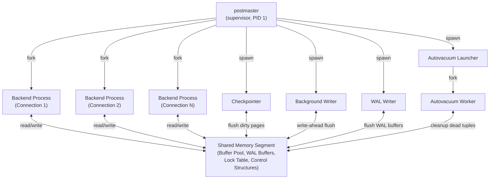
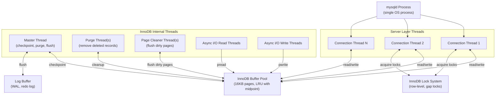
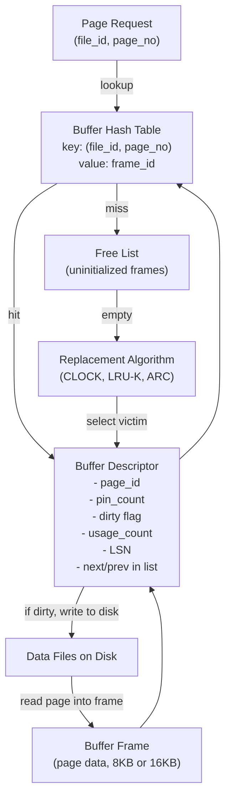
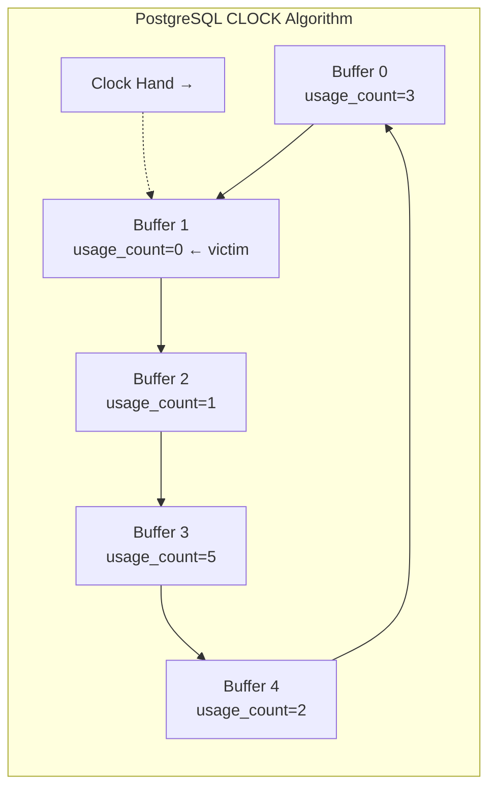
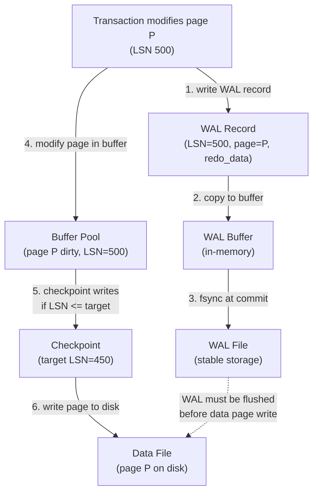
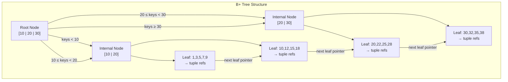
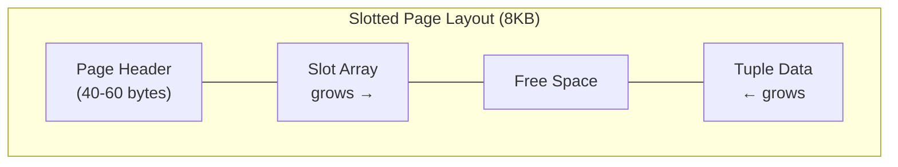
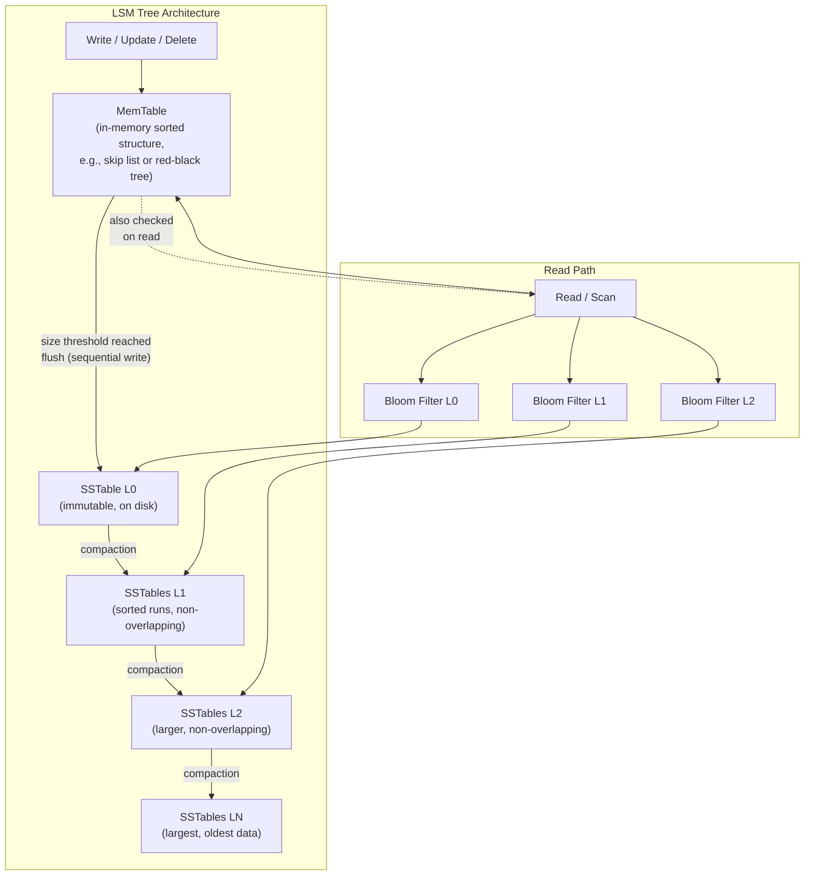
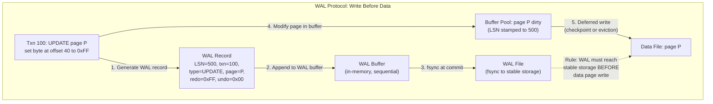

# Lesson 2: Core Architecture & Memory Subsystems

## 1. Process, Threading & Concurrency Architecture

### 1.1 The Two Fundamental Database Process Models

Every relational database management system must answer a foundational architectural question: should each client connection be served by a separate OS process, or by a thread within a single process? This choice ripples through every subsystem—memory layout, IPC mechanisms, crash isolation, and scheduling behavior.

PostgreSQL and Oracle (prior to 12c) chose the **multi-process model**: a supervisory daemon forks a dedicated backend process for each incoming connection. All backend processes share a single large shared memory segment for the buffer pool, WAL buffers, lock tables, and control structures. Communication between backends happens through this shared memory, coordinated by System V or POSIX shared memory primitives and lightweight semaphores.

MySQL (InnoDB), SQL Server, and modern Oracle chose the **multi-threaded model**: a single OS process hosts all connections as threads within a shared address space. Thread creation is cheaper than process creation, and all threads inherently share memory without explicit shared memory segments. The trade-off is that a bug in any thread can corrupt the entire process, and thread-level isolation requires disciplined software engineering rather than hardware-enforced page tables.

| Dimension | Multi-Process (PostgreSQL) | Multi-Threaded (MySQL/InnoDB) |
|---|---|---|
| Connection overhead | Fork + exec (~1-2ms) | Thread creation (~50-200μs) |
| Memory isolation | Hardware-enforced (page tables) | Software-enforced (discipline only) |
| Crash containment | One backend crash ≠ server crash | One thread crash = entire server down |
| IPC mechanism | Shared memory + semaphores | Direct memory access (same address space) |
| Scaling ceiling | Process limits (PID space) | Thread limits (often higher) |
| Shared buffers | Explicit shmget/mmap | Implicit (global heap) |

### 1.2 PostgreSQL: Multi-Process Architecture

PostgreSQL's process model centers on the `postmaster`, a supervisory process that listens for incoming connections and forks a dedicated backend process for each client. The postmaster monitors all child processes and restarts a backend if it crashes, preserving other connections.



The background processes are not optional: the **checkpointer** periodically writes all dirty buffer pool pages to disk and records a checkpoint LSN in the WAL, establishing a recovery starting point. The **background writer** (bgwriter) proactively flushes dirty buffers ahead of checkpoint time to spread I/O and avoid burst latency. The **WAL writer** flushes WAL buffer contents to WAL segment files on disk. The **autovacuum launcher** monitors table statistics and spawns **autovacuum workers** to reclaim space from dead tuples produced by MVCC.

Prior to PostgreSQL 15, a separate **statistics collector** process aggregated runtime stats via UDP. Since PG 15, statistics reside in a shared memory hash table, eliminating the separate process and reducing latency for stats queries.

### 1.3 MySQL/InnoDB: Multi-Threaded Architecture

MySQL runs as a single `mysqld` process. Each client connection is serviced by a **connection handler thread**. InnoDB, the default storage engine, maintains its own internal thread pool for background maintenance tasks:



The InnoDB **master thread** is the primary background worker. In older versions it handled checkpointing, purge, and flushing in a single loop. Modern MySQL splits these responsibilities across dedicated **page cleaner threads** (flushing dirty pages) and **purge threads** (removing delete-marked records), allowing parallelism. InnoDB uses native asynchronous I/O (Linux AIO via `io_submit`/`io_getevents`, or `libaio`) with dedicated I/O threads for read and write operations.

### 1.4 Connection Handling: Thread-per-Connection vs Thread Pools

The default model in both PostgreSQL and MySQL is **thread-per-connection** (or process-per-connection for PostgreSQL): each client gets a dedicated execution context that blocks on I/O. This model is simple to reason about but does not scale beyond a few thousand concurrent connections because each connection consumes memory for its stack and per-connection state, and context-switching overhead grows with the number of runnable threads.

Thread pool architectures multiplex many connections over a smaller pool of worker threads. A listener accepts connections and enqueues work items; idle workers dequeue and execute queries, returning to the pool when the query completes or yields on I/O. This is the approach used by MySQL Enterprise Thread Pool, MariaDB thread pool, PgBouncer (at the connection pooling layer outside PostgreSQL), and is the native model in SQL Server.

The key architectural trade-off is between simplicity and resource efficiency. Thread-per-connection offers predictable per-connection latency (no queueing delay) and straightforward session state management (thread-local storage). Thread pools reduce memory pressure and context-switch overhead at high connection counts but introduce queueing latency and require careful handling of long-running queries that would monopolize a worker.

### 1.5 OS Scheduler Implications for Databases

Database workloads are typically I/O-bound with bursts of CPU-intensive query processing. The OS scheduler directly affects tail latency and throughput.

Linux's **Completely Fair Scheduler (CFS)**, the default from kernel 2.6.23 through 6.5, maintained per-task `vruntime` in a red-black tree and selected the leftmost node (lowest vruntime) for execution. As of Linux 6.6, CFS was replaced by **EEVDF** (Earliest Eligible Virtual Deadline First), which maintains the red-black tree structure but adds eligibility checks and virtual deadlines to improve latency for interactive and short-running tasks. Both schedulers aim for proportional fairness but differ in how they handle latency-sensitive workloads.

Databases are sensitive to scheduler latency for two reasons. First, background processes like the checkpointer and WAL writer must run promptly to prevent WAL buildup and checkpoint spikes. Second, query execution threads that block on I/O must be quickly rescheduled when I/O completes. NUMA-aware memory allocation is critical for large buffer pools: if buffer pool pages are allocated on a distant NUMA node, every access incurs inter-socket memory latency (typically 100-300ns additional). PostgreSQL and MySQL both support NUMA-aware allocation, and production deployments should use `numactl --interleave=all` or equivalent to distribute buffer pool pages across NUMA nodes.

### 1.6 Internal Synchronization: Latches vs Locks

Database systems distinguish between two categories of concurrency control that are often conflated:

**Latches** are lightweight, short-duration synchronization primitives that protect internal data structures. A latch protects a buffer header while a thread reads or modifies a page in the buffer pool. Latch duration is measured in microseconds and does not follow transaction semantics—a latch is released as soon as the in-memory operation completes. Latches never participate in deadlock detection because the latch acquisition order is carefully designed to prevent cycles. Implementations use spinlocks (busy-wait for very short waits) backed by fallback to OS futexes or sleep queues for longer waits.

**Locks** are heavyweight, transaction-duration synchronization primitives that enforce ACID isolation. A row lock acquired by a transaction is held until commit or abort. Locks participate in the lock manager's deadlock detection graph and use a wait-for graph to detect cycles. Lock acquisition may block for seconds or minutes while another transaction completes.

The **latch coupling protocol** (also called crabbing) is used for B+ tree traversal: a thread latches a parent node, latches the child node, then releases the parent. This prevents other threads from modifying the tree structure during traversal while minimizing the critical section duration. For concurrent B+ tree modifications, systems use additional techniques like B-link trees (sibling pointers at every level) to allow deadlock-free concurrent modifications.

```c
/* Simplified latch implementation: spinlock with futex fallback */
#include <stdatomic.h>
#include <linux/futex.h>
#include <sys/syscall.h>
#include <unistd.h>

typedef struct {
    _Atomic uint32_t state;  /* 0 = free, 1 = held, 2 = held with waiters */
} latch_t;

static inline void latch_acquire(latch_t *l) {
    /* Fast path: try to acquire with a single CAS */
    uint32_t expected = 0;
    if (atomic_compare_exchange_strong(&l->state, &expected, 1))
        return;

    /* Slow path: mark that we are waiting, then futex */
    expected = 1;
    if (atomic_compare_exchange_strong(&l->state, &expected, 2) ||
        expected == 2) {
        /* Spin briefly before sleeping */
        for (int i = 0; i < 100; i++) {
            if (atomic_load(&l->state) == 0) {
                expected = 0;
                if (atomic_compare_exchange_strong(&l->state, &expected, 2))
                    return;
            }
            __builtin_ia32_pause();
        }
        /* Futex wait: kernel parks this thread until woken */
        syscall(SYS_futex, &l->state, FUTEX_WAIT, 2, NULL, NULL, 0);
    }
}

static inline void latch_release(latch_t *l) {
    /* If state was 2 (waiters present), wake one waiter via futex */
    uint32_t prev = atomic_fetch_sub(&l->state, 1);
    if (prev == 2) {
        atomic_store(&l->state, 0);
        syscall(SYS_futex, &l->state, FUTEX_WAKE, 1, NULL, NULL, 0);
    }
}
```

## 2. Memory Subsystems & Buffer Management

### 2.1 Virtual Memory Foundations

Database buffer pools operate at the intersection of virtual memory and storage I/O. Understanding the memory hierarchy is essential for understanding why buffer pool design matters.

On x86-64, virtual-to-physical address translation traverses a multi-level page table. The standard 4-level paging uses PML4 (Page Map Level 4) → PDPT (Page Directory Pointer Table) → PD (Page Directory) → PT (Page Table) → physical page frame. Each level is indexed by 9 bits of the virtual address, and the final 12 bits select a byte within the 4KB page. Processors with 5-level paging (LA57) add a PML5 level above PML4, extending the virtual address space from 48 to 57 bits.

The **Translation Lookaside Buffer (TLB)** caches recent page table walks. A TLB miss triggers a hardware page table walk (4-5 sequential memory accesses), costing 100-500ns depending on cache behavior. For a database with a multi-gigabyte buffer pool accessed via 4KB pages, the TLB can hold only thousands of entries, leading to frequent TLB misses on large scans. **Huge pages** (2MB on x86-64, or 1GB via `MAP_HUGETLB` with `__MAP_HUGE_2GB`) reduce TLB pressure by a factor of 512 or 262144 respectively. PostgreSQL supports `huge_pages = on` in `postgresql.conf`, and InnoDB supports `innodb_use_huge_pages = 1`. Production databases with buffer pools exceeding 32GB should always evaluate huge page usage, as the TLB miss rate can become a measurable fraction of query latency.

When the OS modifies a page table entry (e.g., during page eviction or mprotect), it must invalidate stale TLB entries. On SMP systems, this requires an inter-processor interrupt (IPI) called a **TLB shootdown**, which stalls all cores briefly. Databases that frequently mmap and munmap files can trigger excessive TLB shootdowns, which is one reason many databases prefer `pread`/`pwrite` over memory-mapped I/O for large workloads.

### 2.2 The Buffer Pool: Architecture

The buffer pool is the single most performance-critical memory structure in a database. It is a cache of disk-resident pages in RAM, organized as a fixed-size array of page frames. Each frame holds one page from the database files. The buffer pool must answer two questions efficiently: given a page identifier, is it in memory? And if the pool is full, which page should be evicted?



The lookup mechanism is a hash table mapping `(file_id, page_no)` to a buffer descriptor. The descriptor contains metadata: the page identifier, a pin count (how many threads are currently accessing this page), a dirty flag (has the page been modified since read from disk), the page's log sequence number (LSN, used for WAL consistency), and the replacement algorithm's metadata (usage count for CLOCK, timestamps for LRU-K).

When a thread requests a page, the hash table is probed. On a hit, the pin count is incremented and the page pointer returned. On a miss, a free frame is obtained from the free list, or if the free list is empty, the replacement algorithm selects a victim. If the victim is dirty, it must be written to disk (or more precisely, its WAL records must be flushed first per the WAL protocol). The requested page is then read from disk into the frame, the hash table is updated, and the pin count set to 1.

The pin count mechanism prevents eviction of a page that is currently in use. A page with pin_count > 0 is skipped by the replacement algorithm. Threads must call `unpin` when done with a page, decrementing the pin count. Failing to unpin is a bug that causes a permanent buffer leak.

### 2.3 Page Replacement Algorithms

The replacement algorithm determines which page to evict when the buffer pool is full. The ideal algorithm (Belady's optimal) evicts the page whose next reference is farthest in the future, but this requires future knowledge. Practical algorithms approximate this:

**CLOCK** (used by PostgreSQL): All buffer descriptors are arranged in a circular list. Each has a `usage_count` (0-5). A clock hand sweeps through the list. When a victim is needed, the hand checks each buffer: if `usage_count > 0`, it decrements it and moves on; if `usage_count == 0`, the buffer is selected as victim (provided it is not pinned). When a page is accessed, its `usage_count` is incremented (capped at 5). This approximates LRU without maintaining a linked list: pages accessed frequently have high usage counts and survive multiple sweeps, while one-time accesses are evicted quickly.

**LRU-K** (used by SQL Server, K=2): Each page records the timestamps of its last K references. The victim is the page whose K-th most recent reference is oldest. This distinguishes between a page accessed once (likely a sequential scan) and a page accessed twice (likely a hot page), giving better hit ratios than plain LRU for scan-heavy workloads.

**Adaptive Replacement Cache (ARC)**: Maintains two lists—recently used and frequently used—and dynamically adjusts the partition between them based on workload characteristics. If scans are evicting useful pages, ARC shifts capacity toward the frequently-used list. PostgreSQL and some commercial databases have experimented with ARC variants.

**InnoDB's modified LRU**: InnoDB splits its LRU list into a "young" region (top 5/8) and an "old" region (bottom 3/8). New pages are inserted at the boundary between young and old, not at the head. A page is promoted to the young region only if it is accessed again after `innodb_old_blocks_time` milliseconds (default 1000). This prevents a full table scan from flooding the young region with pages that will never be accessed again.



### 2.4 Dirty Page Management and Checkpointing

A page becomes dirty when a transaction modifies it in the buffer pool. The modified page must eventually be written to disk, but the timing is governed by the **write-ahead logging (WAL) protocol**: the WAL record describing the modification must be flushed to stable storage before the dirty page can be written to disk. This ensures that if a crash occurs during the page write, the WAL contains enough information to reconstruct or redo the modification.

Most databases use a **steal, no-force** buffer management policy. "Steal" means the buffer manager is allowed to write dirty pages to disk before the transaction that modified them has committed (stealing buffer frames from the transaction). "No-force" means dirty pages are not forced to disk at commit time. This maximizes buffer pool flexibility and minimizes commit latency, but requires the WAL to contain both redo and undo information so that uncommitted changes can be rolled back during recovery.

The **flush list** (or dirty page list) tracks all dirty buffers, ordered by the oldest modification LSN. The checkpointer periodically scans this list and writes dirty pages whose LSN is below the current checkpoint LSN target. The checkpoint LSN is recorded in the WAL, establishing that all data pages modified by WAL records before this LSN have been written to disk. On recovery, the system starts redo from the checkpoint LSN.



A **fuzzy checkpoint** does not stop transaction processing; it records the WAL insert position at the start of the checkpoint and allows concurrent modifications. Pages modified after the checkpoint start LSN are not written by this checkpoint. PostgreSQL uses fuzzy checkpointing with a phased approach: it first writes a checkpoint start record, flushes dirty buffers, then writes a checkpoint end record with the redo pointer. This spreads I/O over time and avoids the latency spike of a full synchronous checkpoint.

### 2.5 I/O Modes: Buffered vs Direct I/O

When a database reads a page from disk, it has two options for OS interaction:

**Buffered I/O** (default): reads and writes go through the OS page cache. When the database reads a page, the OS first checks its page cache; if present (page cache hit), no disk I/O occurs. The database buffer pool and OS page cache both hold copies of the same page, wasting memory. This is called **double buffering**. The OS page cache also uses its own LRU eviction, which may conflict with the database's replacement algorithm.

**Direct I/O** (`O_DIRECT` on Linux): bypasses the OS page cache. Reads and writes go directly between the database buffer pool and the disk (or device cache). This eliminates double buffering and gives the database full control over caching. PostgreSQL can use `O_DIRECT` for WAL writes. InnoDB defaults to `O_DIRECT` for data files (`innodb_flush_method = O_DIRECT`), bypassing the OS page cache while still using `fsync` to flush the device cache.

```rust
// Simplified buffer pool manager demonstrating core concepts
use std::collections::HashMap;
use std::sync::{Arc, Mutex, Condvar};
use std::fs::File;
use std::io::{Read, Write, Seek, SeekFrom};
use std::path::PathBuf;

const PAGE_SIZE: usize = 8192;        // 8 KB pages (PostgreSQL default)
const BUFFER_POOL_SIZE: usize = 1024; // 1024 frames = 8 MB pool

type PageId = u64;
type FileId = u32;

#[derive(Debug, Clone, Copy, PartialEq)]
enum BufferState { Free, Clean, Dirty }

struct BufferDescriptor {
    file_id: FileId,
    page_id: PageId,
    state: BufferState,
    pin_count: u32,
    usage_count: u8,    // For CLOCK algorithm (0-5)
    lsn: u64,            // Log sequence number of last modification
    data: Box<[u8; PAGE_SIZE]>,
}

struct BufferPool {
    descriptors: Vec<BufferDescriptor>,
    page_table: HashMap<(FileId, PageId), usize>, // (file, page) -> frame index
    free_list: Vec<usize>,
    clock_hand: usize,
    file_handles: HashMap<FileId, File>,
    // Concurrency: a single mutex for simplicity. Production databases
    // use per-buffer-header latches and a partitioned hash table.
    mutex: Mutex<()>,
    cv: Condvar, // Used to wait when all buffers are pinned
}

impl BufferPool {
    fn new() -> Self {
        let mut descriptors = Vec::with_capacity(BUFFER_POOL_SIZE);
        let mut free_list = Vec::with_capacity(BUFFER_POOL_SIZE);

        for i in 0..BUFFER_POOL_SIZE {
            descriptors.push(BufferDescriptor {
                file_id: 0,
                page_id: 0,
                state: BufferState::Free,
                pin_count: 0,
                usage_count: 0,
                lsn: 0,
                data: Box::new([0u8; PAGE_SIZE]),
            });
            free_list.push(i);
        }

        BufferPool {
            descriptors,
            page_table: HashMap::new(),
            free_list,
            clock_hand: 0,
            file_handles: HashMap::new(),
            mutex: Mutex::new(()),
            cv: Condvar::new(),
        }
    }

    /// Fetch a page into the buffer pool. Returns the frame index.
    /// The caller is responsible for calling unpin_page when done.
    fn fetch_page(&mut self, file_id: FileId, page_id: PageId) -> Result<usize, String> {
        // Fast path: page already in buffer pool
        if let Some(&frame_idx) = self.page_table.get(&(file_id, page_id)) {
            let desc = &mut self.descriptors[frame_idx];
            desc.pin_count += 1;
            if desc.usage_count < 5 {
                desc.usage_count += 1;
            }
            return Ok(frame_idx);
        }

        // Slow path: need to find a free frame or evict
        let frame_idx = self.find_victim_frame()?;

        // If the victim was dirty, write it back to disk first
        // (WAL protocol requires WAL to be flushed before data page write)
        let victim = &mut self.descriptors[frame_idx];
        if victim.state == BufferState::Dirty {
            self.flush_page(frame_idx)?;
        }

        // Remove old mapping if the frame was in use
        if victim.state != BufferState::Free {
            self.page_table.remove(&(victim.file_id, victim.page_id));
        }

        // Read the requested page from disk
        let offset = (page_id * PAGE_SIZE as u64) as u64;
        let file = self.file_handles.get_mut(&file_id)
            .ok_or_else(|| format!("File {} not open", file_id))?;
        file.seek(SeekFrom::Start(offset))
            .map_err(|e| format!("Seek failed: {}", e))?;
        file.read_exact(&mut victim.data)
            .map_err(|e| format!("Read failed: {}", e))?;

        // Update the descriptor
        victim.file_id = file_id;
        victim.page_id = page_id;
        victim.state = BufferState::Clean;
        victim.pin_count = 1;
        victim.usage_count = 1;
        victim.lsn = 0;

        // Insert into page table
        self.page_table.insert((file_id, page_id), frame_idx);

        Ok(frame_idx)
    }

    /// CLOCK replacement: sweep through buffers, decrementing usage_count.
    /// A buffer with usage_count=0 and pin_count=0 is the victim.
    fn find_victim_frame(&mut self) -> Result<usize, String> {
        loop {
            let idx = self.clock_hand;
            self.clock_hand = (self.clock_hand + 1) % BUFFER_POOL_SIZE;

            // Try free list first
            if let Some(free_idx) = self.free_list.pop() {
                return Ok(free_idx);
            }

            let desc = &mut self.descriptors[idx];
            if desc.pin_count == 0 {
                if desc.usage_count == 0 {
                    return Ok(idx); // Found a victim
                } else {
                    desc.usage_count -= 1; // Give it a second chance
                }
            }
            // If we've gone all the way around and everything is pinned,
            // this would be a buffer pool starvation condition.
            // Production systems wait on a condition variable.
        }
    }

    /// Mark a page as dirty (modified in buffer pool).
    fn mark_dirty(&mut self, frame_idx: usize, lsn: u64) {
        let desc = &mut self.descriptors[frame_idx];
        desc.state = BufferState::Dirty;
        desc.lsn = lsn; // Track latest modification LSN for WAL protocol
    }

    /// Unpin a page, making it eligible for eviction.
    fn unpin_page(&mut self, frame_idx: usize) {
        let desc = &mut self.descriptors[frame_idx];
        if desc.pin_count > 0 {
            desc.pin_count -= 1;
        }
    }

    /// Write a dirty page back to disk.
    fn flush_page(&mut self, frame_idx: usize) -> Result<(), String> {
        let desc = &mut self.descriptors[frame_idx];
        if desc.state != BufferState::Dirty {
            return Ok(());
        }

        // WAL protocol: ensure WAL records up to this page's LSN
        // are flushed to stable storage before writing the data page.
        // In a real system, this calls wal_flush_upto(desc.lsn).
        let offset = (desc.page_id * PAGE_SIZE as u64) as u64;
        let file = self.file_handles.get_mut(&desc.file_id)
            .ok_or_else(|| format!("File {} not open", desc.file_id))?;
        file.seek(SeekFrom::Start(offset))
            .map_err(|e| format!("Seek failed: {}", e))?;
        file.write_all(&desc.data)
            .map_err(|e| format!("Write failed: {}", e))?;
        file.sync_data()
            .map_err(|e| format!("Fsync failed: {}", e))?;

        desc.state = BufferState::Clean;
        Ok(())
    }

    /// Checkpoint: flush all dirty pages up to a target LSN.
    fn checkpoint(&mut self, target_lsn: u64) -> Result<(), String> {
        for i in 0..BUFFER_POOL_SIZE {
            let desc = &self.descriptors[i];
            if desc.state == BufferState::Dirty && desc.lsn <= target_lsn {
                self.flush_page(i)?;
            }
        }
        Ok(())
    }
}
```

## 3. Data Structures & On-Disk Binary Layouts

### 3.1 B+ Trees: The Dominant Index Structure

The original content referred to "B-trees," but production databases almost universally use **B+ trees**, a variant with a critical structural difference: internal nodes store only routing keys and child pointers, while all data (or tuple references) resides in leaf nodes. This separation allows internal nodes to achieve very high fanout (hundreds of keys per node), keeping the tree shallow (typically 2-4 levels for tables with billions of rows).



The leaf nodes are linked via **next-leaf pointers**, enabling efficient range scans: once the starting leaf is found via tree traversal, the scan follows leaf pointers without revisiting internal nodes. This is why `SELECT ... WHERE id BETWEEN 100 AND 200` on an indexed column is O(log n + k) rather than O(k log n).

The fanout of a B+ tree node depends on the page size and key size. With 16KB pages (InnoDB) and 8-byte integer keys plus 6-byte child page pointers, an internal node holds approximately 16,384 / (8 + 6) ≈ 1,170 keys. A three-level B+ tree can index approximately 1,170 × 1,170 × (16,384 / row_size) rows. For 200-byte rows, that is approximately 1,170 × 1,170 × 81 ≈ 110 million rows in a 3-level tree. A fourth level pushes this to over 100 billion.

PostgreSQL uses a variant called a **B-link tree**, which adds sibling pointers at every level (not just leaves). This allows concurrent inserts and splits to proceed without blocking readers, because a reader that finds its expected key has moved during a split can follow the sibling pointer to the correct node.

```c
/* B+ tree page structures (simplified, inspired by InnoDB/PostgreSQL) */

#include <stdint.h>
#include <stddef.h>

#define PAGE_SIZE 16384  /* InnoDB default */
#define BTREE_MAX_KEYS 1170

typedef uint32_t page_id_t;

/* Internal node: stores keys and child page pointers */
typedef struct {
    page_id_t page_id;          /* This page's ID on disk */
    uint16_t level;              /* 0 = leaf, >0 = internal */
    uint16_t n_keys;             /* Number of keys in this node */
    page_id_t parent;            /* Parent page ID (0 = root) */
    page_id_t right_sibling;     /* B-link tree: sibling at same level */
    uint64_t lsn;                /* Last modification LSN for WAL */
    /* Followed by:
     *   key_t keys[BTREE_MAX_KEYS];        (sorted)
     *   page_id_t child_pages[BTREE_MAX_KEYS + 1];
     * For internal nodes, child_pages[i] contains keys < keys[i],
     * and child_pages[n_keys] contains keys >= keys[n_keys-1].
     */
} btree_internal_node_t;

/* Leaf node: stores keys and tuple references (or inline data) */
typedef struct {
    page_id_t page_id;
    uint16_t level;              /* Always 0 for leaves */
    uint16_t n_keys;
    page_id_t parent;
    page_id_t next_leaf;         /* Leaf chaining for range scans */
    uint64_t lsn;
    /* Followed by:
     *   key_t keys[BTREE_MAX_KEYS];        (sorted)
     *   tuple_ref_t tuple_refs[BTREE_MAX_KEYS];
     * tuple_ref_t contains (page_id, slot_index) pointing
     * into the heap/table data pages.
     */
} btree_leaf_node_t;

/* Search within a B+ tree node (binary search on sorted keys) */
int btree_node_search(const int64_t *keys, uint16_t n_keys, int64_t target) {
    int lo = 0, hi = n_keys - 1;
    while (lo <= hi) {
        int mid = lo + (hi - lo) / 2;
        if (keys[mid] == target)
            return mid;
        if (keys[mid] < target)
            lo = mid + 1;
        else
            hi = mid - 1;
    }
    /* Return the child index: lo is the first key >= target */
    return lo;
}

/* Recursive B+ tree lookup: returns the leaf page and slot */
typedef struct {
    page_id_t leaf_page;
    uint16_t slot;
    int found;
} btree_search_result_t;

btree_search_result_t btree_lookup(
    page_id_t root_page,
    int64_t key,
    buffer_pool_t *pool  /* fetch_page, unpin_page */
) {
    page_id_t current = root_page;

    for (;;) {
        int frame = pool->fetch_page(current);
        uint16_t level = read_page_level(frame);
        uint16_t n_keys = read_page_key_count(frame);
        int64_t *keys = read_page_keys(frame);

        if (level == 0) {
            /* Leaf node: search for exact match */
            int slot = btree_node_search(keys, n_keys, key);
            btree_search_result_t result = {
                .leaf_page = current,
                .slot = (uint16_t)slot,
                .found = (slot < n_keys && keys[slot] == key)
            };
            pool->unpin_page(current);
            return result;
        }

        /* Internal node: find child to descend into */
        int child_idx = btree_node_search(keys, n_keys, key);
        page_id_t *children = read_page_children(frame);
        current = children[child_idx];
        pool->unpin_page(frame); /* Latch coupling: release parent */
    }
}
```

### 3.2 Slotted Page Architecture

The original content claimed that fields are "typically stored in a fixed-length format." This is incorrect for virtually all modern databases. Variable-length records are the norm, and they are managed through **slotted pages** (also called slotted page or indirection layer pages).

A slotted page has four regions growing towards each other:



```c
/* Slotted page implementation (PostgreSQL-inspired) */

#define PAGE_SIZE 8192
#define PAGE_HEADER_SIZE 24
#define SLOT_SIZE 4   /* 2 bytes offset + 2 bytes length */

/* Page header at the start of every page */
typedef struct {
    uint64_t page_lsn;        /* LSN of last WAL record affecting this page */
    uint16_t checksum;         /* Page checksum for corruption detection */
    uint16_t pd_lower;         /* Offset to start of free space (after slot array) */
    uint16_t pd_upper;         /* Offset to end of free space (before last tuple) */
    uint16_t pd_special;       /* Offset to start of special area (opaque data) */
    uint16_t n_tuples;          /* Number of valid tuples (slot entries) */
} page_header_t;

/* Each slot entry in the slot array */
typedef struct {
    uint16_t offset;           /* Byte offset of tuple data within page */
    uint16_t length;           /* Length of tuple data in bytes */
} item_id_t;

/*
 * Memory layout of a slotted page:
 *
 * +-------------------+  offset 0
 * | page_header_t     |  (24 bytes)
 * +-------------------+  offset 24
 * | item_id_t[0]       |  (slot 0: offset=8150, length=42)
 * | item_id_t[1]       |  (slot 1: offset=8080, length=70)
 * | item_id_t[2]       |  (slot 2: offset=8010, length=50)
 * | ...               |
 * +-------------------+  offset = pd_lower (free space start)
 * |                   |
 * |   FREE SPACE      |
 * |                   |
 * +-------------------+  offset = pd_upper (free space end)
 * | tuple[2] data     |  (grows leftward)
 * | tuple[1] data     |
 * | tuple[0] data     |
 * +-------------------+  offset = PAGE_SIZE (or pd_special)
 * | special area      |  (opaque data for index, etc.)
 * +-------------------+
 */

/* Insert a tuple into a slotted page.
 * Returns the slot index on success, -1 if page is full. */
int slotted_page_insert(uint8_t *page, const uint8_t *tuple, uint16_t len) {
    page_header_t *hdr = (page_header_t *)page;

    /* Check if there is enough free space.
     * Need: SLOT_SIZE for the new slot + len bytes for tuple data */
    uint16_t free_space = hdr->pd_upper - hdr->pd_lower;
    if (free_space < (uint16_t)(SLOT_SIZE + len))
        return -1; /* Page full */

    /* Grow slot array downward (toward higher addresses) */
    item_id_t *new_slot = (item_id_t *)(page + PAGE_HEADER_SIZE
                                       + hdr->n_tuples * SLOT_SIZE);

    /* Grow tuple data upward (toward lower addresses) */
    hdr->pd_upper -= len;
    new_slot->offset = hdr->pd_upper;
    new_slot->length = len;

    /* Copy tuple data into the page */
    memcpy(page + hdr->pd_upper, tuple, len);

    /* Update header metadata */
    hdr->n_tuples++;
    hdr->pd_lower += SLOT_SIZE;

    return hdr->n_tuples - 1;
}

/* Read a tuple from a slotted page by slot index. */
int slotted_page_read(const uint8_t *page, int slot,
                      uint8_t *out, uint16_t *len_out) {
    const page_header_t *hdr = (const page_header_t *)page;
    if (slot < 0 || slot >= hdr->n_tuples)
        return -1;

    const item_id_t *item = (const item_id_t *)(page + PAGE_HEADER_SIZE
                                                + slot * SLOT_SIZE);
    if (item->offset == 0) /* Tombstone: tuple was deleted */
        return -1;

    memcpy(out, page + item->offset, item->length);
    *len_out = item->length;
    return 0;
}

/* Delete a tuple: mark its slot as a tombstone. */
void slotted_page_delete(uint8_t *page, int slot) {
    page_header_t *hdr = (page_header_t *)page;
    if (slot < 0 || slot >= hdr->n_tuples)
        return;

    item_id_t *item = (item_id_t *)(page + PAGE_HEADER_SIZE + slot * SLOT_SIZE);
    item->offset = 0; /* Tombstone marker; space is NOT reclaimed
                       * until page is vacuumed/compacted. */
}
```

The slot array provides an **indirection layer** between the logical tuple identifier (page + slot) and the physical location of tuple data within the page. When a tuple is updated and the new version is larger, the database can place the new tuple elsewhere in the page and update the slot to point to the new location, without changing the tuple identifier. This is critical for index stability: secondary indexes reference tuple IDs (page, slot), and if the physical location changed, every index would need updating.

### 3.3 Tuple/Record Layout

Within a tuple, the layout follows a specific convention:

```c
/* Tuple header (PostgreSQL-inspired, simplified) */
typedef struct {
    uint32_t xmin;            /* Transaction ID that inserted this tuple */
    uint32_t xmax;            /* Transaction ID that deleted/updated this tuple */
    uint16_t cid;             /* Command ID within transaction (for visibility) */
    uint16_t n_columns;       /* Number of columns in this tuple */
    uint8_t  null_bitmap[];   /* Variable-length: 1 bit per nullable column */
    /* Followed by column data:
     *   - Fixed-length columns first (aligned to their natural boundary)
     *   - Variable-length columns last (with a length prefix)
     *   - Large values may be TOASTed (stored out-of-line)
     */
} heap_tuple_header_t;
```

The `xmin` and `xmax` fields are the foundation of PostgreSQL's MVCC implementation. When a transaction inserts a tuple, it writes its transaction ID to `xmin`. When a transaction updates a tuple, it does not modify the existing tuple in place. Instead, it writes a new version of the tuple with a new `xmin`, and sets the old tuple's `xmax` to the updating transaction's ID. A snapshot determines which tuples are visible: a tuple is visible if `xmin` is committed and less than the snapshot's xmin horizon, and `xmax` is either invalid (not yet deleted) or belongs to a transaction that is not visible in the snapshot.

Alignment padding between columns is not merely wasteful: most CPU architectures require aligned access for atomic reads of multi-byte values. PostgreSQL pads columns to their natural alignment boundary (e.g., a 4-byte integer at a 4-byte boundary). The column order in the physical tuple may differ from the logical column order defined in the schema, as the database may reorder columns to minimize padding. Variable-length fields (text, bytea, varchar) store a length prefix followed by the data, or an out-of-line TOAST pointer if the value exceeds a threshold (PostgreSQL TOASTs values larger than approximately 2KB, compressing them first if possible).

### 3.4 LSM Trees: Write-Optimized Storage

Log-Structured Merge trees (LSM trees) are the primary alternative to B+ trees for write-heavy workloads. Used by LevelDB, RocksDB, Cassandra, HBase, and CockroachDB, LSM trees optimize for write throughput by converting all writes to sequential appends.



The write path is simple: insert into an in-memory sorted structure called the **MemTable** (typically a skip list or red-black tree). When the MemTable reaches a size threshold, it is frozen and written to disk as an immutable **SSTable** (Sorted String Table) at level 0. This write is purely sequential, avoiding the random I/O that B+ tree insertions require for page splits and updates.

SSTables at level 0 may overlap in key ranges. Periodic **compaction** merges overlapping SSTables, removing duplicate keys (keeping the newest version) and tombstones (deletion markers), and produces non-overlapping SSTables at the next level. Each level is typically 10x larger than the previous (leveled compaction), or levels may contain multiple non-overlapping runs of similar size (size-tiered compaction).

The read path checks the MemTable first, then each SSTable level from newest to oldest. To avoid reading every SSTable, each SSTable is paired with a **bloom filter**: a probabilistic data structure that can quickly determine if a key is definitely not present. Bloom filter negatives are certain; positives require a disk read to confirm. This makes point lookups efficient when the bloom filters are well-tuned.

The fundamental trade-off between B+ trees and LSM trees involves three forms of amplification:

| Metric | B+ Tree | LSM Tree |
|---|---|---|
| Write amplification | High: each write may cause page split, dirty page flush | Low: sequential append to MemTable, periodic compaction |
| Read amplification | Low: 2-4 disk reads per lookup | Medium: multiple SSTable checks (mitigated by bloom filters) |
| Space amplification | Low: in-place updates, minimal overhead | Higher: multiple versions coexist until compaction, tombstones |
| Best for | Read-heavy, point queries, OLTP | Write-heavy, time-series, large datasets |

### 3.5 Write-Ahead Logging (WAL)

Write-ahead logging is the mechanism that ensures durability and atomicity in the presence of crashes. The protocol is simple but its implications are profound: before any data page modification is written to disk, the log record describing that modification must be flushed to stable storage.

The WAL record contains enough information to **redo** the modification (replay it during recovery) and **undo** it (roll back an uncommitted transaction). The standard recovery algorithm is **ARIES** (Algorithm for Recovery and Isolation Exploiting Semantics), which proceeds in three phases:

1. **Analysis**: Scan the WAL forward from the last checkpoint to determine which transactions were active at crash time and which pages were dirty.
2. **Redo**: Replay all modifications from the earliest dirty page LSN forward, restoring the database to its state at crash time.
3. **Undo**: Roll back all transactions that were active (uncommitted) at crash time, processing their log records in reverse order.

```c
/* WAL record structure (ARIES-inspired) */

typedef enum {
    WAL_UPDATE,     /* Page modification: contains redo + undo info */
    WAL_COMMIT,      /* Transaction commit */
    WAL_ABORT,       /* Transaction abort */
    WAL_CHECKPOINT,  /* Checkpoint marker */
    WAL_BEGIN,       /* Transaction begin */
    WAL_COMPENSATION /* CLR: Compensation Log Record (undo of a previous undo) */
} wal_record_type_t;

typedef struct {
    uint64_t lsn;              /* Log Sequence Number: monotonic, globally unique */
    uint64_t prev_lsn;        /* LSN of previous record for same transaction */
    uint32_t txn_id;           /* Transaction this record belongs to */
    wal_record_type_t type;    /* Record type */
    uint16_t length;           /* Total record length including payload */
    /* Type-specific payload follows: */

    /* For WAL_UPDATE: */
    struct {
        uint32_t file_id;       /* File containing modified page */
        uint32_t page_id;       /* Page number within file */
        uint16_t offset;        /* Byte offset within page */
        uint16_t data_len;      /* Length of modified data */
        uint8_t  redo_data[];   /* New value (for redo) */
        /* Followed by:
         *   uint8_t undo_data[];   Old value (for undo)
         */
    } update;

    /* For WAL_CHECKPOINT: */
    struct {
        uint64_t checkpoint_lsn;  /* Redo start point */
        uint32_t active_txn_count; /* Number of active transactions */
        uint32_t active_txn_ids[];  /* Array of active transaction IDs */
    } checkpoint;

    /* For WAL_COMPENSATION (CLR):
     * During undo, we write CLRs so that if a crash occurs during
     * recovery, the undo is not repeated. A CLR contains redo info
     * only (to redo the undo operation) and the next undo LSN
     * (skipping the undone operation). */
} wal_record_t;
```



The WAL protocol ensures that if a crash occurs at any point, the log on disk contains a complete history of modifications. During recovery, the redo phase replays all WAL records from the checkpoint LSN forward, ensuring all committed changes are present. The undo phase rolls back transactions whose commit record was not found in the log, restoring atomicity.

### 3.6 Free Space Management

Databases need to quickly find pages with enough free space to insert new tuples. Scanning every page on every insert is prohibitively expensive, so databases maintain a separate metadata structure:

**PostgreSQL** uses a **Free Space Map (FSM)**: a tree structure where each leaf entry corresponds to a data page and stores a single byte (0-255) representing the page's free space category. The tree allows O(log n) lookup for pages with sufficient free space. The FSM is stored in a separate file (`<table_oid>_fsm`) and updated lazily—pages may have slightly more or less free space than the FSM indicates, and the actual check happens at insert time.

**InnoDB** uses a **File Space Management (FSP)** system organized around extents (1MB blocks, 64 pages of 16KB each). Each tablespace has an FSP header containing a free extent list, a full extent list, and per-extent bitmaps. Segments (indexes) allocate extents from the FSP and track their own free and full extents. This two-level allocation (segment → extent → page) balances allocation speed with fragmentation control.

```c
/* Simplified free space map (PostgreSQL-style) */

#define FSM_PAGES_PER_LEAF 1
#define FSM_TREE_DEPTH 3   /* Supports ~256^3 pages */
#define FSM_CATEGORIES 256 /* 0 = full, 255 = mostly empty */

/* FSM is a binary tree stored as an array (heap-like layout).
 * Root is at index 0. Children of node i are at 2i+1 and 2i+2.
 * Each node stores the MAX of its children's free space category.
 * This allows O(log n) search: start at root, descend toward
 * the child with sufficient space. */

uint8_t fsm_search(const uint8_t *fsm, size_t fsm_size,
                   uint8_t min_category, size_t *out_page) {
    size_t node = 0;

    while (node < fsm_size) {
        size_t left = 2 * node + 1;
        size_t right = 2 * node + 2;

        if (left >= fsm_size) {
            /* Leaf node: this is a data page */
            if (fsm[node] >= min_category) {
                *out_page = node;
                return fsm[node];
            }
            return 0; /* Not enough space */
        }

        /* Internal node: descend to child with sufficient space */
        if (fsm[left] >= min_category) {
            node = left;
        } else if (fsm[right] >= min_category) {
            node = right;
        } else {
            return 0; /* No child has enough space */
        }
    }
    return 0;
}

/* After inserting/deleting on a data page, update the FSM.
 * Propagate the new category up the tree. */
void fsm_update(uint8_t *fsm, size_t fsm_size, size_t page_idx,
                uint8_t new_category) {
    size_t node = page_idx;
    fsm[node] = new_category;

    /* Propagate upward */
    while (node > 0) {
        size_t parent = (node - 1) / 2;
        size_t left = 2 * parent + 1;
        size_t right = 2 * parent + 2;

        uint8_t max_child = 0;
        if (left < fsm_size) max_child = fsm[left];
        if (right < fsm_size && fsm[right] > max_child)
            max_child = fsm[right];

        if (fsm[parent] == max_child)
            break; /* No change, stop propagating */

        fsm[parent] = max_child;
        node = parent;
    }
}
```

### 3.7 Tablespace and File Organization

The physical layout of database files varies by system:

PostgreSQL stores each table in a separate file named by its OID (Object Identifier) in a directory named by the database OID within the tablespace directory. Large tables are split into 1GB segment files (`<oid>`, `<oid>.1`, `<oid>.2`, ...) to avoid filesystem file size limits. Indexes, FSMs, and visibility maps each get their own files. The default tablespace is `base/` in the data directory.

InnoDB stores all tables and indexes in a single tablespace by default (`ibdata1`, `ibdata2`, ...), though `innodb_file_per_table` (default since MySQL 5.6) creates a `.ibd` file per table. Each file is internally divided into pages, which are grouped into extents (64 consecutive pages), which are grouped into segments (typically one per index).

This file organization matters because it determines how the database maps logical page IDs to physical byte offsets, how the OS filesystem handles fragmentation, and how backup tools interact with the storage layer. For example, PostgreSQL's per-file approach means `rsync` can back up individual tables, but file creation overhead and inode pressure become concerns with thousands of tables. InnoDB's shared tablespace approach avoids inode pressure but makes per-table recovery more complex.
