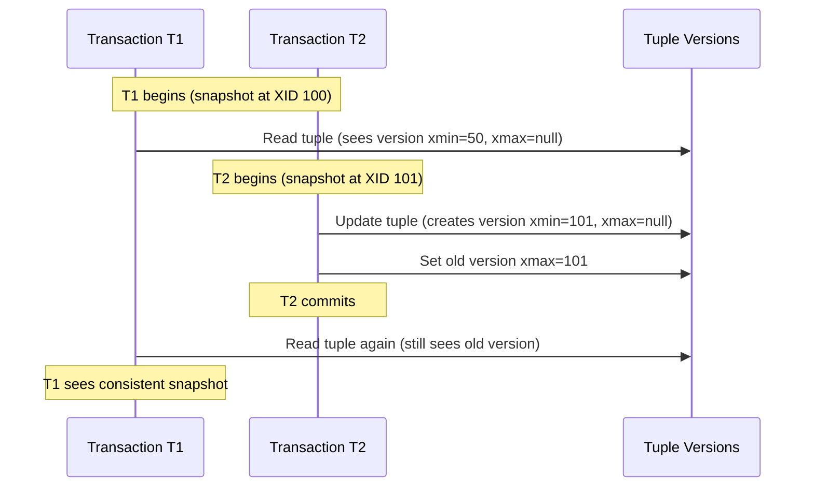
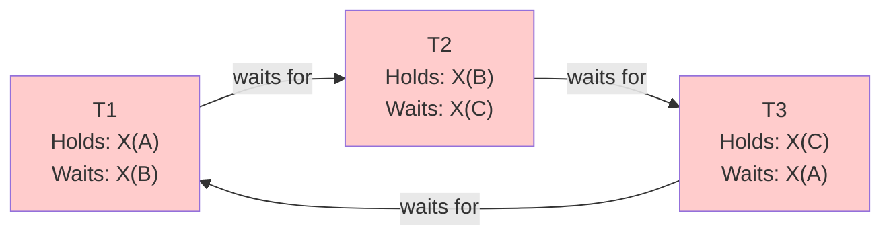
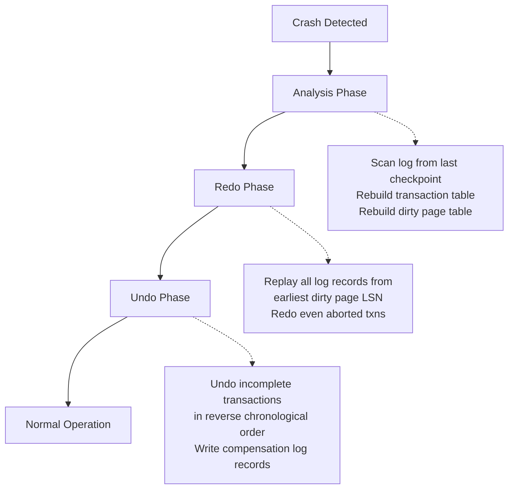
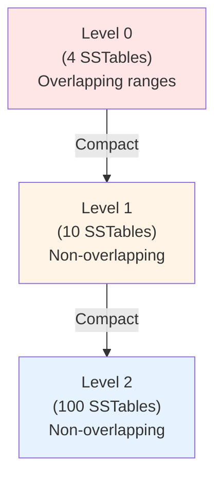
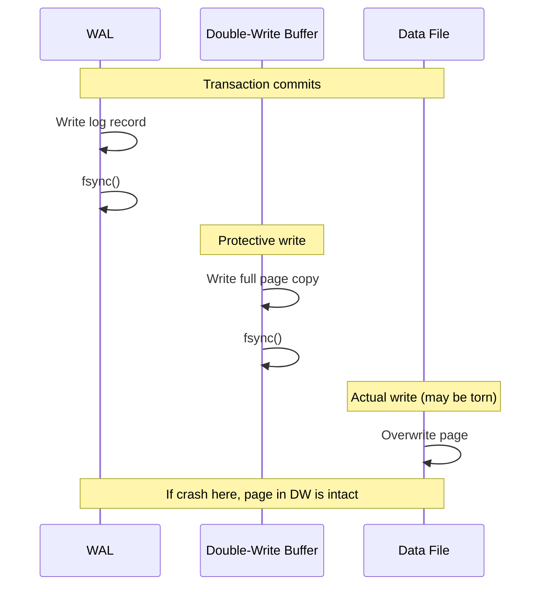

# Lesson 3: Advanced Internal Mechanics & Reliability

Modern database systems are precision-engineered state machines built atop layers of interacting concurrency control, logging, and recovery protocols. Understanding these internals is essential for diagnosing performance bottlenecks, reasoning about failure scenarios, and designing systems that maintain correctness guarantees under concurrency and crash conditions. This lesson examines the architectural foundations that enable databases to provide ACID semantics, high throughput, and reliable recovery.

## 1. Concurrency Control, Lock Scheduling & Conflict Graphs

Concurrency control mechanisms determine when transactions can access shared data and how conflicts between concurrent operations are resolved. The choice of concurrency control protocol fundamentally shapes a database's performance characteristics, isolation guarantees, and scalability limits.

### Multi-Version Concurrency Control (MVCC)

MVCC maintains multiple temporal versions of each data item, allowing readers and writers to operate on different snapshots simultaneously. When a transaction T writes to a tuple, the system does not overwrite the existing version in place. Instead, it creates a new version timestamped with T's transaction ID (or commit timestamp). Readers see the most recent version committed before their snapshot timestamp, ensuring snapshot isolation without blocking writers.

**Core MVCC invariants:**

- Each tuple version carries a `xmin` (creating transaction ID) and `xmax` (deleting transaction ID).
- A version is visible to transaction T if `xmin` committed before T's snapshot and `xmax` is either null or committed after T's snapshot.
- Writers acquire exclusive locks on the logical tuple (not individual versions), preventing write-write conflicts while allowing concurrent reads.

**PostgreSQL-style visibility example:**

```c
typedef struct HeapTupleHeaderData {
    TransactionId xmin;  // Transaction that inserted this version
    TransactionId xmax;  // Transaction that deleted/updated this version
    CommandId cid;       // Command ID within transaction
    ItemPointerData ctid; // Current TID (for updated tuples, points to newer version)
    // ... additional metadata
} HeapTupleHeaderData;

bool HeapTupleSatisfiesMVCC(HeapTuple htup, Snapshot snapshot) {
    TransactionId xmin = HeapTupleHeaderGetXmin(htup->t_data);
    TransactionId xmax = HeapTupleHeaderGetXmax(htup->t_data);
    
    // Tuple created after our snapshot
    if (!TransactionIdPrecedes(xmin, snapshot->xmax)) {
        return false;
    }
    
    // Tuple deleted before our snapshot
    if (TransactionIdIsValid(xmax) && 
        TransactionIdPrecedes(xmax, snapshot->xmin)) {
        return false;
    }
    
    // Check visibility against snapshot's active transaction list
    return XidVisibleInSnapshot(xmin, snapshot) &&
           (!TransactionIdIsValid(xmax) || 
            !XidVisibleInSnapshot(xmax, snapshot));
}
```

MVCC eliminates reader-writer contention but introduces version chain maintenance overhead. Old versions must be pruned via vacuum processes once no active transaction needs them. The system must also prevent transaction ID wraparound by freezing ancient tuples.



### Lock-Free Data Structures

Lock-free data structures use atomic compare-and-swap (CAS) operations to coordinate concurrent access without blocking. A lock-free queue suitable for database buffer pool management might use a linked list with atomic pointer updates:

```c
typedef struct node {
    void *data;
    struct node *next;
} node_t;

typedef struct {
    node_t *head;
    node_t *tail;
} lfqueue_t;

bool enqueue(lfqueue_t *q, void *data) {
    node_t *new_node = malloc(sizeof(node_t));
    new_node->data = data;
    new_node->next = NULL;
    
    while (true) {
        node_t *tail = atomic_load(&q->tail);
        node_t *next = atomic_load(&tail->next);
        
        // Check tail is still consistent
        if (tail == atomic_load(&q->tail)) {
            if (next == NULL) {
                // Tail is indeed last node, try to link new node
                if (atomic_compare_exchange_weak(&tail->next, &next, new_node)) {
                    // Swing tail to new node (may fail, others will fix)
                    atomic_compare_exchange_weak(&q->tail, &tail, new_node);
                    return true;
                }
            } else {
                // Tail lagging, help other thread advance it
                atomic_compare_exchange_weak(&q->tail, &tail, next);
            }
        }
    }
}
```

The ABA problem arises when a value changes from A to B and back to A between a thread's read and CAS. Solutions include tagged pointers (storing a version counter in unused pointer bits) or hazard pointers for safe memory reclamation.

Lock-free structures trade deterministic latency for average-case throughput. Under high contention, CAS retry loops can degrade to worse-than-lock performance. They excel in read-heavy workloads or scenarios where lock holder preemption would cause cascading delays.

### Latches vs. Locks

Database systems distinguish between **locks** (logical, transaction-duration) and **latches** (physical, short-duration):

| Aspect | Latches | Locks |
|--------|---------|-------|
| Granularity | In-memory structures (pages, buffers) | Logical data items (tuples, rows) |
| Duration | Microseconds (critical section) | Transaction lifetime |
| Deadlock Detection | Not needed (held briefly) | Required (wait-for graph) |
| Implementation | Spinlock, mutex, RWLock | Lock manager hash table |

Latches protect buffer pool pages during reads/writes. A typical B-tree traversal acquires latches in "crabbing" fashion:

```c
// Crabbing protocol: hold parent latch until child safely latched
BTreeNode* btree_search(BTree *tree, Key key) {
    BTreeNode *node = tree->root;
    latch_acquire_shared(&node->latch);
    
    while (!node->is_leaf) {
        BTreeNode *child = find_child_for_key(node, key);
        latch_acquire_shared(&child->latch);
        latch_release(&node->latch);  // Release parent
        node = child;
    }
    
    return node;  // Caller must release latch
}
```

For writes, optimistic latching upgrades shared to exclusive only when modification is necessary, avoiding unnecessary exclusive latches on read paths.

### Deadlock Detection via Wait-For Graphs

A **wait-for graph** (WFG) is a directed graph where nodes represent transactions and edges represent blocking relationships. Transaction T1 → T2 means T1 waits for a lock held by T2. A cycle in the WFG indicates a deadlock.



**Detection algorithms:**

- **Timeout-based:** Abort transactions exceeding a wait threshold. Simple but may abort non-deadlocked transactions.
- **Periodic cycle detection:** Run depth-first search on WFG every N milliseconds. O(T + E) where T = transactions, E = edges.
- **Edge insertion detection:** Check for cycles when adding each WFG edge. More overhead per lock request but immediate detection.

**Victim selection heuristics:**

- Youngest transaction (minimize wasted work)
- Transaction holding fewest locks (minimize cascading aborts)
- Transaction with lowest priority (application-defined)

**Wound-Wait vs. Wait-Die:**

Both use timestamps to prevent deadlocks preemptively:

- **Wound-Wait:** Older transaction (smaller timestamp) preempts younger. Younger transactions wait for older.
- **Wait-Die:** Older transaction waits for younger. Younger transactions abort (die) rather than wait for older.

```python
# Wound-Wait example
def request_lock(txn, resource):
    holder = lock_table[resource]
    if holder is None:
        lock_table[resource] = txn
        return True
    elif txn.timestamp < holder.timestamp:
        # Older txn wounds younger
        abort_transaction(holder)
        lock_table[resource] = txn
        return True
    else:
        # Younger txn waits
        wait_for_graph.add_edge(txn, holder)
        return False
```

Wound-Wait tends to favor older transactions, reducing restart cascades in long-running workloads.

## 2. Write-Ahead Logging & Crash Recovery State Machines

Write-ahead logging (WAL) ensures durability by persisting changes to a sequential log before applying them to data pages. The **WAL protocol** mandates:

1. **Log-before-commit:** All transaction log records must reach stable storage before commit returns.
2. **Log-before-data:** A page's LSN (log sequence number) must be ≤ the log's flushed LSN before the page is written to disk.

These invariants ensure that after a crash, the system can reconstruct committed state by replaying the log.

### ARIES Recovery Protocol

ARIES (Algorithms for Recovery and Isolation Exploiting Semantics) is the foundational recovery protocol used in DB2, SQL Server, and many modern systems. It consists of three phases:



**Phase 1: Analysis**

Starting from the last checkpoint, scan forward through the log to reconstruct:
- **Transaction table:** Active transactions and their state (committed, aborted, in-progress)
- **Dirty page table (DPT):** Pages modified since last checkpoint and their `recLSN` (earliest log record that dirtied the page)

**Phase 2: Redo**

Starting from the minimum `recLSN` in the DPT, replay all log records (including those from aborted transactions). For each log record:

1. Check if the page is in the DPT and `recLSN ≤ log_record.LSN`
2. Read the page from disk and check its `pageLSN`
3. If `pageLSN < log_record.LSN`, apply the change (idempotent redo)

**Idempotency is critical:** Redo must be repeatable without side effects, as the system may crash during recovery.

**Phase 3: Undo**

For each transaction still active after redo, walk backward through its log records and undo each operation. Write **compensation log records (CLRs)** for each undo action. CLRs are redo-only records that ensure undos are not themselves undone.

```c
typedef struct {
    LSN lsn;           // This record's LSN
    LSN prev_lsn;      // Previous log record for this transaction
    TransactionId xid;
    uint8_t type;      // INSERT, DELETE, UPDATE, COMMIT, ABORT, CLR
    PageID page_id;
    uint16_t offset;
    uint16_t length;
    char data[];       // Before/after images
} LogRecord;

void aries_undo_pass(TransactionTable *xact_table, LogManager *log) {
    // Collect all active transactions' last LSN
    PriorityQueue *undo_queue = pq_create();
    for (Transaction *txn : xact_table->active) {
        pq_insert(undo_queue, txn->last_lsn);
    }
    
    while (!pq_empty(undo_queue)) {
        LSN lsn = pq_extract_max(undo_queue);
        LogRecord *rec = log_read(log, lsn);
        
        if (rec->type == CLR) {
            // CLRs point to next record to undo
            if (rec->undo_next_lsn != INVALID_LSN) {
                pq_insert(undo_queue, rec->undo_next_lsn);
            }
        } else {
            // Undo the operation and write CLR
            undo_operation(rec);
            LSN clr_lsn = write_clr(log, rec);
            
            // Continue with previous record in transaction
            if (rec->prev_lsn != INVALID_LSN) {
                pq_insert(undo_queue, rec->prev_lsn);
            }
        }
    }
}
```

### Checkpointing Strategies

Checkpoints reduce recovery time by periodically capturing a consistent snapshot of the system state. The **fuzzy checkpoint** approach (used in ARIES) does not block transactions:

1. Begin checkpoint: Record all active transactions and dirty page table
2. Continue normal operation (transactions may commit/abort, pages may be dirtied)
3. End checkpoint: Write checkpoint record with captured state

On recovery, start from the checkpoint but still need to analyze/redo/undo from the checkpoint's state, accounting for work that happened during the checkpoint.

**Checkpoint record structure:**

```c
typedef struct {
    LSN checkpoint_lsn;
    LSN min_rec_lsn;      // Minimum recLSN from dirty page table
    TransactionId active_xids[];
    LSN active_last_lsn[];
    PageID dirty_pages[];
    LSN dirty_page_rec_lsn[];
} CheckpointRecord;
```

### Physiological Logging

ARIES uses **physiological logging:** logical within a page, physical to the page. Log records identify the page and logical operation (e.g., "delete tuple at slot 5") rather than byte-level changes. This balances space efficiency with flexibility for page reorganization.

**Contrast with alternatives:**

| Logging Type | Granularity | Size | Flexibility |
|--------------|-------------|------|-------------|
| Physical | Byte-level diffs | Large | None (exact page layout) |
| Physiological | Page + logical op | Medium | Page reorganization OK |
| Logical | High-level op | Small | Requires more undo logic |

## 3. Compaction, Eviction & Garbage Collection Engines

As databases execute updates and deletes, storage becomes fragmented with dead tuple versions, requiring background maintenance to reclaim space and maintain performance.

### MVCC Tuple Cleanup: Vacuum

In MVCC systems like PostgreSQL, old tuple versions accumulate until no transaction can see them. The **vacuum process** scans tables to:

1. Identify dead tuples (xmax committed before oldest active transaction's snapshot)
2. Mark space as reusable in the page's free space map
3. Update visibility maps to track all-visible pages (optimization for index-only scans)
4. Truncate relation files if trailing pages are entirely empty

**Aggressive vacuum** goes further by freezing tuples (setting xmin to `FrozenTransactionId = 2`) to prevent transaction ID wraparound. Without freezing, the 32-bit transaction ID space would wrap after 2^31 transactions, causing ancient tuples to appear as future tuples.

```python
# Simplified vacuum logic
def vacuum_page(page, oldest_xmin):
    dead_tuples = []
    for tuple in page.tuples:
        if tuple.xmax != INVALID_XID and tuple.xmax < oldest_xmin:
            dead_tuples.append(tuple)
    
    for tuple in dead_tuples:
        page.mark_unused(tuple.offset, tuple.length)
        page.free_space += tuple.length
    
    # Freeze ancient tuples to prevent XID wraparound
    for tuple in page.tuples:
        if tuple.xmin < freeze_limit:
            tuple.xmin = FROZEN_XID
```

### LSM-Tree Compaction

Log-structured merge (LSM) trees used in RocksDB, Cassandra, and LevelDB batch writes into sorted memory tables (memtables) flushed to immutable disk files (SSTables). Over time, SSTables accumulate and overlap, requiring **compaction** to merge sorted runs and remove obsolete versions.

**Leveled compaction strategy:**



Level 0 contains overlapping SSTables (direct memtable flushes). When L0 reaches threshold, compact into L1. Each level is ~10× larger than the previous. Reads must check all L0 files but only one file per lower level (using bloom filters for efficient negative lookups).

**Size-tiered vs. leveled trade-offs:**

| Strategy | Write Amplification | Read Amplification | Space Amplification |
|----------|---------------------|--------------------|--------------------|
| Size-tiered | Low | High (many overlapping files) | High (many obsolete versions) |
| Leveled | High (repeated rewriting) | Low (minimal overlaps) | Low (aggressive compaction) |

### Buffer Pool Eviction Policies

The buffer pool caches disk pages in memory. When full, the eviction policy determines which page to replace. Beyond naïve LRU:

**CLOCK (Second Chance):** Circular list with reference bit. Scan clockwise, clear reference bit for each page with ref=1, evict first page with ref=0.

**LRU-K:** Track last K accesses. Evict page with oldest K-th access (resists one-time sequential scans).

**ARC (Adaptive Replacement Cache):** Dynamically balances recent vs. frequent pages using two LRU lists (recent one-hit, frequent multi-hit) and ghost entries to learn workload patterns.

```rust
struct ARCCache {
    t1: LRUList,  // Recent pages (seen once)
    t2: LRUList,  // Frequent pages (seen multiple times)
    b1: LRUList,  // Ghost entries evicted from t1
    b2: LRUList,  // Ghost entries evicted from t2
    p: usize,     // Target size for t1 (adaptive)
    capacity: usize,
}

impl ARCCache {
    fn access(&mut self, page_id: PageId) -> Option<Page> {
        if let Some(page) = self.t1.get(page_id).or_else(|| self.t2.get(page_id)) {
            // Hit: move from t1 to t2 (now frequent)
            if self.t1.contains(page_id) {
                self.t1.remove(page_id);
                self.t2.insert(page_id, page);
            }
            return Some(page);
        }
        
        // Miss: check ghost entries to adapt
        if self.b1.contains(page_id) {
            self.p = min(self.capacity, self.p + max(b2.len() / b1.len(), 1));
        } else if self.b2.contains(page_id) {
            self.p = max(0, self.p - max(b1.len() / b2.len(), 1));
        }
        
        // Load page and insert into t1
        let page = self.load_from_disk(page_id);
        self.replace();
        self.t1.insert(page_id, page);
        Some(page)
    }
    
    fn replace(&mut self) {
        // Evict from t1 or t2 based on adaptive target p
        if self.t1.len() >= self.p {
            let evicted = self.t1.evict_lru();
            self.b1.insert(evicted.id, ghost);
        } else {
            let evicted = self.t2.evict_lru();
            self.b2.insert(evicted.id, ghost);
        }
    }
}
```

## 4. Failure Domains & Byzantine Edge Cases

Real-world storage and network failures introduce failure modes beyond clean crashes. Production databases must detect and mitigate these edge cases.

### Disk Corruption: Silent Data Corruption

Modern disks return corrupted data without signaling errors ("silent corruption") due to:
- **Bit rot:** Magnetic decay over time
- **Misdirected writes:** Firmware writes to wrong sector
- **Torn pages:** Partial sector write leaves mixed old/new data

**Detection mechanisms:**

**Checksums:** Store a checksum (CRC32, XXHash) with each page. On read, recompute and verify.

```c
typedef struct {
    uint32_t checksum;  // Stored at page start or end
    LSN page_lsn;
    TransactionId xmin_horizon;
    uint16_t tuple_count;
    char data[PAGE_SIZE - sizeof(PageHeader)];
} Page;

bool verify_page(Page *page) {
    uint32_t stored = page->checksum;
    page->checksum = 0;
    uint32_t computed = crc32(page, PAGE_SIZE);
    page->checksum = stored;
    return stored == computed;
}
```

**ZFS/Btrfs approach:** Merkle tree of checksums. Data blocks checksummed, metadata blocks checksum data block checksums, root block checksums metadata. Any corruption detectable from root.

### Partial Writes: Torn Pages

A system crash during a page write may leave the page partially updated. If the WAL record for this update was flushed but the page write was torn, redo will apply changes atop corrupted data.

**Double-write buffer (InnoDB):** Before overwriting a page in the data file, write the entire page to a sequential double-write buffer. On crash, recovery checks if the data file page is corrupt (checksum mismatch); if so, restore from double-write buffer.



**Page LSN verification:** Each page stores the LSN of the last log record applied to it. On recovery redo, skip applying a log record if `page_lsn >= log_record.lsn` (already applied). This provides idempotency even with torn pages, assuming checksums detect corruption.

### Network Partitions: Split-Brain Scenarios

Distributed databases face the CAP theorem: under network partition, choose between consistency (block operations) or availability (allow divergence). A **split-brain** occurs when multiple partitions independently accept writes, leading to conflicting states.

**Quorum-based replication (Raft, Paxos):** Require majority agreement for commits. A partition with < majority nodes cannot commit, preventing split-brain.

**Fencing tokens:** Linearizable storage systems issue monotonically increasing fencing tokens with each lease grant. Clients include the token with writes. The storage system rejects writes with stale tokens.

```python
class FencedLock:
    def __init__(self):
        self.current_token = 0
        self.held_by = None
    
    def acquire(self, client_id):
        self.current_token += 1
        self.held_by = client_id
        return self.current_token
    
    def write(self, client_id, token, data):
        if token < self.current_token:
            raise StaleTokenError("Another client holds lock")
        if client_id != self.held_by:
            raise UnauthorizedError("Lock not held by this client")
        # Perform write
```

**Last-write-wins (LWW) vs. vector clocks:** LWW uses timestamps to resolve conflicts (loses data). Vector clocks track causality, allowing application-level conflict resolution for concurrent updates.

### Byzantine Fault Tolerance

Byzantine faults involve arbitrary behavior: malicious nodes, corrupted memory, or software bugs causing incorrect outputs. Traditional consensus algorithms (Raft, Paxos) assume crash-stop failures; Byzantine Fault Tolerant (BFT) protocols tolerate up to f malicious nodes among 3f+1 total nodes.

**PBFT (Practical Byzantine Fault Tolerance):**

1. Client sends request to primary
2. Primary broadcasts PRE-PREPARE to all replicas
3. Replicas validate and send PREPARE messages
4. After receiving 2f PREPARE messages, send COMMIT
5. After receiving 2f+1 COMMIT messages, execute operation

The 2f+1 threshold ensures at least f+1 honest nodes agree, which overlaps any other quorum of 2f+1, preventing conflicting commits.

**Application to databases:** BFT is expensive (3-10× overhead) and rarely used in traditional databases. Blockchain systems like Hyperledger Fabric use PBFT variants for permissioned consensus. Most databases assume trusted infrastructure and focus on crash recovery and network partition tolerance.

### Mitigation Taxonomy

| Failure Mode | Detection | Mitigation |
|--------------|-----------|------------|
| Disk corruption | Checksums, scrubbing | RAID, replication, restore from backup |
| Partial writes | LSN verification, checksums | Double-write buffer, page LSN, idempotent redo |
| Network partition | Heartbeat timeout, quorum loss | Quorum writes, fencing tokens, partition-aware routing |
| Byzantine faults | Cryptographic signatures, state comparison | BFT consensus (PBFT), trusted execution environments |
| Transaction ID wraparound | Monitoring next_xid | Aggressive vacuum with tuple freezing |
| Lock escalation deadlock | Timeout, WFG cycles | Deadlock detection, victim selection heuristics |

---

## Summary

This lesson examined the lower-level mechanisms that enable database reliability:

- **Concurrency control** through MVCC, lock-free structures, latches, and deadlock detection balances throughput with isolation guarantees.
- **Write-ahead logging** with ARIES-style recovery provides crash resilience through analysis, redo, and undo phases, with checkpointing to bound recovery time.
- **Compaction and garbage collection** in MVCC and LSM-based systems reclaim space from obsolete versions, with eviction policies managing in-memory buffer pools.
- **Failure domain mitigation** addresses disk corruption, partial writes, network partitions, and Byzantine faults through checksums, double-write buffers, quorum protocols, and BFT consensus where necessary.

Mastery of these internals equips you to diagnose pathological performance, reason about correctness under concurrent load and failures, and make informed architectural choices when building or operating database systems.
