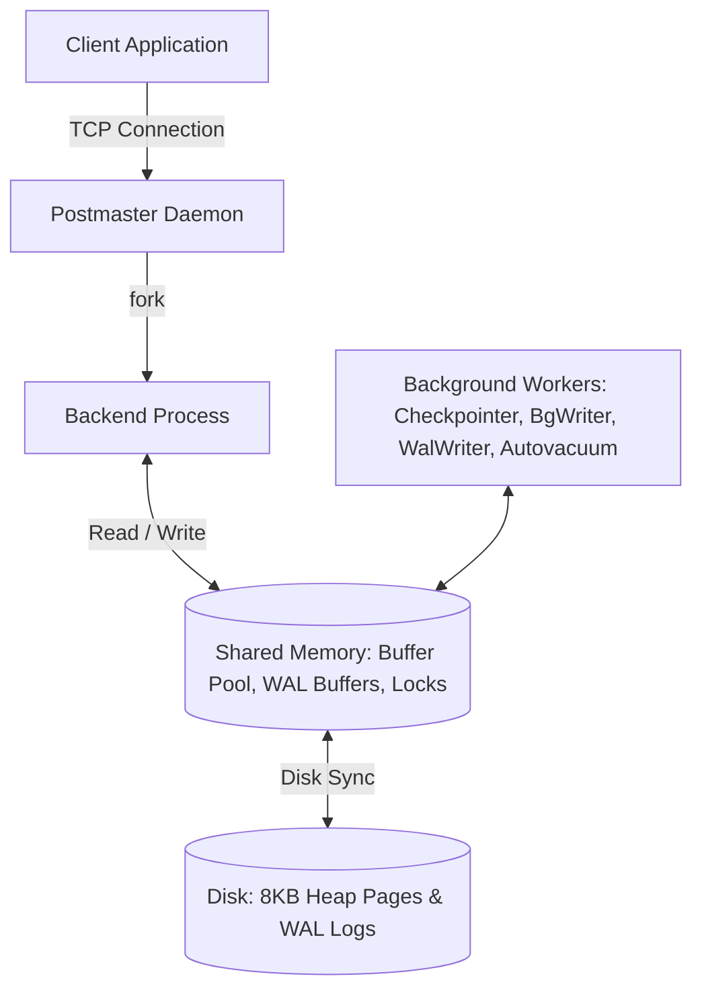

# PostgreSQL: Foundational Course Index & Storage Invariants

Welcome to the PostgreSQL Relational Engine & Systems Engineering Curriculum. This course is constructed for systems engineers, database administrators, and infrastructure architects who need first-principles mastery of PostgreSQL internals.

PostgreSQL does not treat the relational database as a black box; its process model, shared memory subsystem, heap page layout, and write-ahead logging (WAL) are directly anchored in POSIX kernel primitives and classical systems architecture.

---

## Pedagogical Course Modules

*   [Lesson 1: Architecture, Process Model & Shared Memory Subsystems](./lesson_01_architecture_and_process_model.md)
    *Deconstructs the Postmaster daemon, process-per-connection model, shared memory segment allocation, buffer pool management, and background worker coordination.*
*   [Lesson 2: Multiversion Concurrency Control (MVCC), WAL & Vacuum Engine](./lesson_02_mvcc_wal_and_vacuum.md)
    *Rigorous analysis of tuple visibility (`xmin`, `xmax`, `t_infomask`), transaction wraparound horizons, Write-Ahead Logging (WAL) state machines, and the Autovacuum freezing cycle.*
*   [Lesson 3: Cost-Based Query Planning & Advanced Indexing Mechanics](./lesson_03_query_planning_and_indexing.md)
    *Dissects the query lifecycle (Parse, Rewrite, Plan, Execute), optimizer cost equations, B-Tree (Lehman-Yao) concurrency, and GIN/BRIN specialized indexes.*
*   [Lesson 4: High Availability, Streaming Replication & Connection Pooling](./lesson_04_high_availability_and_replication.md)
    *Covers physical WAL streaming, replication slot invariants, Patroni/etcd distributed consensus failover, and PgBouncer transaction-mode pooling.*
*   [Operational Labs & Kernel-Level Inspection](./LABS.md)
    *Hands-on terminal exercises deploying `pageinspect`, `pg_buffercache`, `pg_waldump`, and benchmarking MVCC page bloat in live environments.*
