# Operational Verification Labs: PostgreSQL Storage & MVCC Internals

This lab provides rigorous, hands-on inspection of PostgreSQL's physical storage layer. You will dissect 8KB heap pages at the byte level, trace MVCC tuple versioning through transaction metadata, observe the shared buffer pool's replacement strategy, and decode Write-Ahead Log records to understand crash recovery mechanics.

---

## Architectural Foundation: PostgreSQL Storage Hierarchy

PostgreSQL organizes data in a four-level hierarchy:

1. **Tablespaces**: Logical containers mapping to filesystem directories (`pg_default`, `pg_global`).
2. **Databases**: Collections of relations within a tablespace, each in a subdirectory named by OID.
3. **Relations**: Tables, indexes, and sequences stored as files. Each relation file is segmented into 1GB chunks (e.g., `16384`, `16384.1`, `16384.2`).
4. **Pages (Blocks)**: Fixed 8192-byte (8KB) units. All I/O between storage and memory occurs at page granularity.

The heap page is the atomic unit of table storage. Each page contains:
- **PageHeaderData** (24 bytes): LSN, checksum, flags, slot directory bounds (`lower`, `upper`), page size (8192), and special area pointer.
- **Line Pointer Array**: Variable-length array of 4-byte `ItemIdData` structs growing downward from byte 24. Each entry stores `(lp_off, lp_flags, lp_len)` for one tuple.
- **Free Space**: Unallocated gap between line pointers and tuple data.
- **Tuple Data**: Variable-length `HeapTupleHeaderData` structs (23+ bytes) plus user data, growing upward from the page end.
- **Special Space**: Reserved area at page end for index-specific metadata (0 bytes for heap tables).

MVCC (Multi-Version Concurrency Control) avoids locking by storing multiple versions of each row. Every tuple header embeds:
- `t_xmin`: Transaction ID that inserted this version.
- `t_xmax`: Transaction ID that deleted/updated this version (0 if live).
- `t_cid`: Command ID within the transaction.
- `t_ctid`: Tuple identifier `(block_number, offset)` pointing to the newest version (self-referential if current).
- `t_infomask`: 16-bit flags encoding visibility hints (committed, aborted, frozen, etc.).

When a row is updated, PostgreSQL appends a new tuple version to the heap and updates the old tuple's `t_xmax` and `t_ctid`. The old version becomes a **dead tuple** once no active transaction can see it. Autovacuum reclaims dead tuples and defragments pages.

---

## Lab 1: Microscopic Inspection of an 8KB Heap Page with `pageinspect`

The `pageinspect` extension exposes low-level storage structures for forensic analysis. You will inspect page headers, line pointer arrays, and tuple headers to observe on-disk layout.

### Step 1.1: Launch PostgreSQL Sandbox Container

```bash
docker run --rm --name pg-lab \
  -e POSTGRES_PASSWORD=postgres \
  -p 5432:5432 \
  -d postgres:16-alpine
```

Wait 2-3 seconds for the cluster to initialize:
```bash
docker logs pg-lab 2>&1 | grep "database system is ready"
```

### Step 1.2: Initialize Schema and Enable `pageinspect`

Connect via `psql`:
```bash
docker exec -it pg-lab psql -U postgres -d postgres
```

Execute:
```sql
CREATE EXTENSION IF NOT EXISTS pageinspect;

CREATE TABLE accounts (
    id SERIAL PRIMARY KEY,
    owner_name VARCHAR(64),
    balance NUMERIC(12, 2)
);

INSERT INTO accounts (owner_name, balance) VALUES 
('Alice', 1000.00),
('Bob', 2500.50),
('Charlie', 50.00);
```

The `SERIAL` type creates a sequence and attaches a `nextval()` default. The `id` column receives values 1, 2, 3. The `PRIMARY KEY` constraint creates a unique B-tree index on `id`.

### Step 1.3: Inspect PageHeaderData

Query the 24-byte header of block 0:
```sql
SELECT lsn, checksum, flags, lower, upper, special, pagesize, version
FROM page_header(get_raw_page('accounts', 0));
```

**Expected Output:**
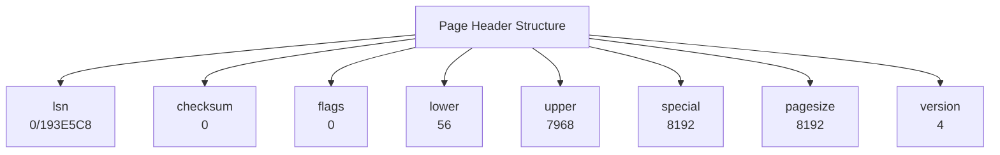

**Field Interpretation:**

- **`lsn`** (Log Sequence Number): `0/193E5C8` indicates this page was last modified by WAL record at position `0x193E5C8` in the WAL stream. LSN enables crash recovery: if the page's LSN on disk is older than the WAL record's LSN, the WAL record must be replayed.
- **`checksum`**: `0` because checksums are disabled by default in most distributions (enable via `initdb --data-checksums`). When enabled, PostgreSQL computes a 16-bit checksum over the page contents (excluding the checksum field) and writes it to the header. During reads, mismatches indicate corruption.
- **`flags`**: `0` (no special flags). Common flags include `0x0001` (page has free line pointers), `0x0002` (all tuples are visible to all transactions).
- **`lower`**: `56` bytes. Byte offset marking the end of the line pointer array. With 3 tuples, the array occupies `24 (header) + 4 * 4 (line pointers) = 40` bytes. The extra 16 bytes likely include the page's item ID bitmap overhead.
- **`upper`**: `7968` bytes. Byte offset marking the start of the free space gap. Tuple data begins here and grows downward.
- **`special`**: `8192` bytes. Offset to the special area. For heap tables, `special == pagesize`, so 0 bytes are reserved. For B-tree indexes, this area stores the `BTPageOpaque` struct (12 bytes) with pointers to left/right siblings and level metadata.
- **`pagesize`**: `8192` bytes. Constant enforced at compile time (`BLCKSZ` in `pg_config_manual.h`).
- **`version`**: `4`. Page layout version (PostgreSQL 8.3+). Incompatible changes increment this number.

**Free Space Calculation:**
```
free_space = upper - lower = 7968 - 56 = 7912 bytes
```
Of the 8192-byte page, 7912 bytes remain unallocated.

### Step 1.4: Inspect Tuple Headers & Line Pointers

Query tuple-level metadata:
```sql
SELECT lp, lp_off, lp_flags, lp_len, t_xmin, t_xmax, t_field3 AS t_cid, t_ctid, 
       encode(t_data, 'escape') AS t_data_preview
FROM heap_page_items(get_raw_page('accounts', 0));
```

**Expected Output:**
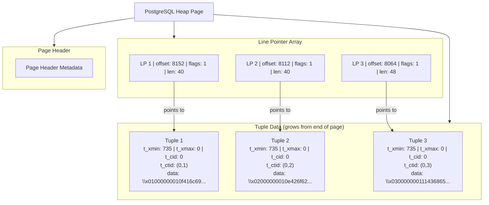

**Field Interpretation:**

- **`lp`**: Line pointer number (1-indexed). Maps to the item ID in the tuple identifier `(block, offset)`.
- **`lp_off`**: Byte offset within the page where the tuple begins. Tuple 1 starts at byte 8152, near the end of the 8192-byte page.
- **`lp_flags`**: `1` = `LP_NORMAL` (tuple is live). Other values: `0` = unused, `2` = redirect pointer (HOT chains), `3` = dead tuple.
- **`lp_len`**: Tuple length in bytes, including the 23-byte `HeapTupleHeaderData`. Tuple 1 is 40 bytes: 23-byte header + 17 bytes of user data (4-byte `id`, 6-byte `owner_name` with length prefix, 7-byte `balance`).
- **`t_xmin`**: `735`. Transaction ID that inserted this tuple. All three rows were inserted in transaction 735 (the `INSERT` statement). Transaction IDs are 32-bit counters incremented on every `BEGIN`. When `t_xmin` wraps around (every ~4 billion transactions), PostgreSQL freezes old tuples by setting `t_xmin = FrozenTransactionId` (2) and setting the `HEAP_XMIN_FROZEN` flag in `t_infomask`.
- **`t_xmax`**: `0`. Transaction ID that deleted or updated this tuple. `0` indicates the tuple is live and unmodified.
- **`t_cid`**: `0`. Command ID within the transaction. If transaction 735 executed multiple `INSERT` statements, tuples inserted by the first command would have `t_cid = 0`, the second `t_cid = 1`, etc. This enables intra-transaction MVCC visibility.
- **`t_ctid`**: `(0,1)`, `(0,2)`, `(0,3)`. Tuple identifier `(block, offset)`. For live tuples, `t_ctid` points to itself. For updated tuples, `t_ctid` points forward to the newest version, forming a version chain.
- **`t_data_preview`**: Hexadecimal dump of user data. For tuple 1: `\x01000000` (4-byte integer `id = 1`), `010f` (VARLENA header: 1 byte for null bitmap, `0f` = 15 bytes for the string), `416c69636500...` (ASCII "Alice" plus padding).

**Verification Checkpoints:**
1. All three tuples have `t_xmax = 0`, confirming they are live and visible to all transactions.
2. `t_ctid` is self-referential `(0, lp)`, indicating these are the current versions.
3. `lp_off` decreases as tuples are appended upward from the page end: 8152 → 8112 → 8064.

---

## Lab 2: Observing MVCC Updates & Dead Tuple Bloat

MVCC updates create new tuple versions. The old version remains on disk as a dead tuple until Autovacuum reclaims the space. This lab visualizes tuple chaining and dead tuple accumulation.

### Step 2.1: Execute an In-Place Update

```sql
UPDATE accounts SET balance = 1200.00 WHERE owner_name = 'Alice';
```

PostgreSQL locates the tuple for Alice (block 0, line pointer 1), marks it as updated by setting `t_xmax` to the current transaction ID, updates its `t_ctid` to point to the new version, and appends a new tuple to the page with the updated balance.

### Step 2.2: Inspect Post-Update Page State

Re-query the page:
```sql
SELECT lp, lp_flags, lp_len, t_xmin, t_xmax, t_ctid, t_infomask, 
       encode(t_data, 'escape') AS t_data_preview
FROM heap_page_items(get_raw_page('accounts', 0))
ORDER BY lp;
```

**Expected Output:**
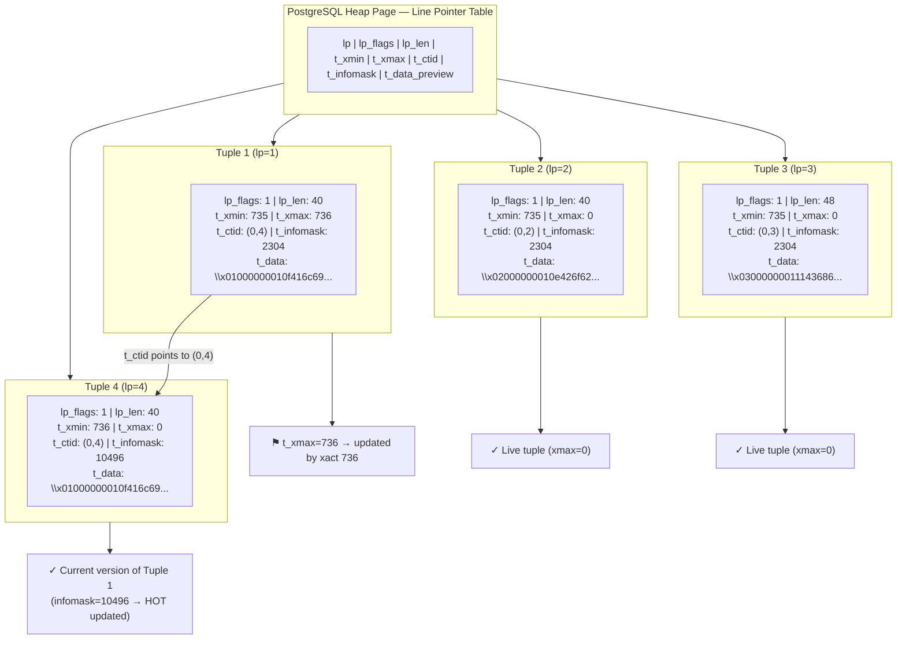

**Key Observations:**

1. **Old Alice (lp 1):** 
   - `t_xmax = 736`: The `UPDATE` statement executed in transaction 736, marking this version as obsolete.
   - `t_ctid = (0,4)`: Points forward to the new version at line pointer 4.
   - `t_infomask = 2304`: Binary `0000100100000000`. Key flags: `HEAP_XMIN_COMMITTED` (bit 8), `HEAP_XMAX_INVALID` not set (bit 9), indicating `t_xmax` is a valid deletion XID.
   - This tuple is a **dead tuple**. Once transaction 736 commits and no active transactions have an XID < 736, Autovacuum can reclaim this space.

2. **New Alice (lp 4):**
   - `t_xmin = 736`: Created by transaction 736.
   - `t_xmax = 0`: Live tuple.
   - `t_ctid = (0,4)`: Self-referential, indicating this is the current version.
   - `t_infomask = 10496`: Binary `0010100100000000`. Key flags: `HEAP_XMIN_COMMITTED` (bit 8), `HEAP_UPDATED` (bit 13), indicating this tuple is the result of an update.
   - The balance field in `t_data_preview` now encodes `1200.00` instead of `1000.00`.

3. **Bob and Charlie (lp 2, 3):** Unchanged. `t_xmax = 0`, `t_ctid` self-referential.

### Step 2.3: Force Autovacuum and Observe Cleanup

Check dead tuple statistics:
```sql
SELECT relname, n_dead_tup, n_live_tup, last_vacuum, last_autovacuum
FROM pg_stat_user_tables
WHERE relname = 'accounts';
```

**Expected Output:**
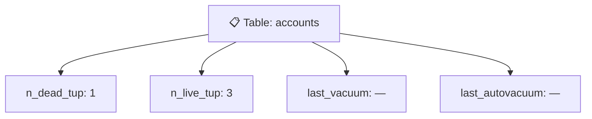

Manually trigger vacuum:
```sql
VACUUM VERBOSE accounts;
```

**Expected Log:**
```
INFO:  vacuuming "public.accounts"
INFO:  finished vacuuming "public.accounts": index scans: 1
pages: 0 removed, 1 remain, 0 scanned (0.00% of total)
tuples: 1 removed, 3 remain, 0 are dead but not yet removable
```

Re-inspect the page:
```sql
SELECT lp, lp_flags, lp_len, t_xmin, t_xmax, t_ctid
FROM heap_page_items(get_raw_page('accounts', 0))
ORDER BY lp;
```

**Expected Output:**
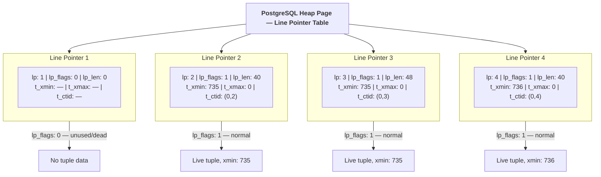

Line pointer 1 now has `lp_flags = 0` (unused). The dead tuple has been removed, and its 40 bytes are reclaimed. However, the line pointer itself persists to avoid breaking tuple identifiers in indexes. Index entries pointing to `(0,1)` remain valid; when dereferenced, PostgreSQL follows the version chain via `t_ctid` to find the current tuple at `(0,4)`.

---

## Lab 3: Inspecting Shared Buffers with `pg_buffercache`

The shared buffer pool (`shared_buffers`) is PostgreSQL's primary in-memory cache. It stores recently accessed 8KB pages, reducing disk I/O. The buffer replacement algorithm approximates LRU using a clock sweep with usage counters.

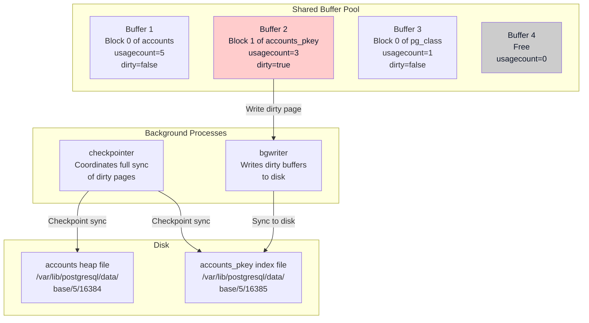

### Step 3.1: Enable `pg_buffercache`

```sql
CREATE EXTENSION IF NOT EXISTS pg_buffercache;
```

The extension exposes the `pg_buffercache` view, which maps buffer pool slots to relation pages.

### Step 3.2: Query Buffer Cache Utilization

```sql
SELECT 
    c.relname,
    count(*) AS buffered_pages,
    round(100.0 * count(*) / (SELECT setting::integer FROM pg_settings WHERE name='shared_buffers')::integer, 2) AS buffer_pool_pct,
    round(count(*) * 8192.0 / 1024 / 1024, 2) AS buffered_mb,
    count(*) FILTER (WHERE isdirty) AS dirty_pages,
    round(avg(usagecount), 2) AS avg_usagecount
FROM pg_buffercache b
JOIN pg_class c ON b.relfilenode = pg_relation_filenode(c.oid)
JOIN pg_database d ON (b.reldatabase = d.oid AND d.datname = current_database())
WHERE b.relfilenode IS NOT NULL
GROUP BY c.relname
ORDER BY buffered_pages DESC
LIMIT 10;
```

**Expected Output:**
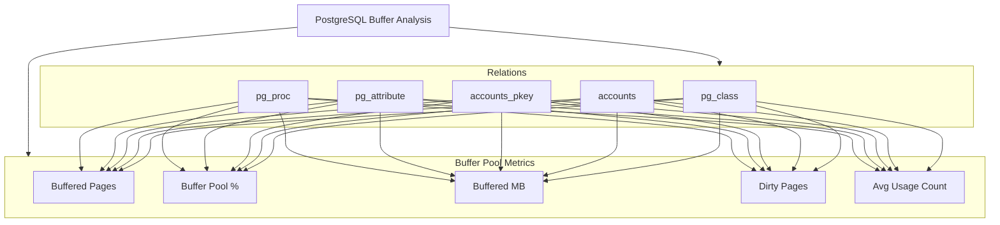

**Field Interpretation:**

- **`buffered_pages`**: Number of 8KB pages cached for this relation. `accounts` has 1 page cached (block 0).
- **`buffer_pool_pct`**: Percentage of the buffer pool occupied. With `shared_buffers = 128MB` (16,384 buffers), 1 page is 0.01%.
- **`buffered_mb`**: Memory consumed by cached pages. 1 page = 0.01 MB.
- **`dirty_pages`**: Pages modified in memory but not yet written to disk. `accounts` has 1 dirty page due to the recent `UPDATE`. The background writer (`bgwriter`) periodically flushes dirty pages asynchronously.
- **`avg_usagecount`**: Average usage counter. Each time a page is accessed, its counter increments (max 5). During buffer eviction, the clock sweep decrements counters and evicts pages with `usagecount = 0`. `accounts` has `usagecount = 5`, indicating frequent access.

### Step 3.3: Observe Buffer Replacement

Force buffer eviction by scanning a large table:
```sql
CREATE TABLE large_table AS SELECT generate_series(1, 100000) AS id;
SELECT count(*) FROM large_table;
```

Re-query buffer cache:
```sql
SELECT relname, buffered_pages, dirty_pages
FROM (
    SELECT 
        c.relname,
        count(*) AS buffered_pages,
        count(*) FILTER (WHERE isdirty) AS dirty_pages
    FROM pg_buffercache b
    JOIN pg_class c ON b.relfilenode = pg_relation_filenode(c.oid)
    JOIN pg_database d ON (b.reldatabase = d.oid AND d.datname = current_database())
    WHERE b.relfilenode IS NOT NULL
    GROUP BY c.relname
) sub
WHERE relname IN ('accounts', 'large_table')
ORDER BY buffered_pages DESC;
```

**Expected Output:**
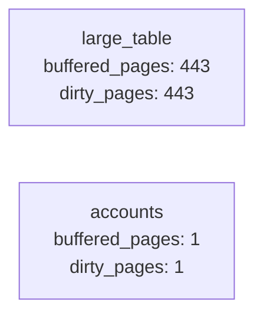

The `large_table` scan allocated 443 buffers. System catalogs (`pg_class`, `pg_attribute`) with low `usagecount` were evicted. `accounts` persisted due to its high usage counter.

---

## Lab 4: Dissecting Write-Ahead Logs with `pg_waldump`

Write-Ahead Logging (WAL) ensures crash recovery and replication. Before modifying a page in the buffer pool, PostgreSQL writes a WAL record describing the change. During recovery, PostgreSQL replays WAL records to reconstruct lost changes.

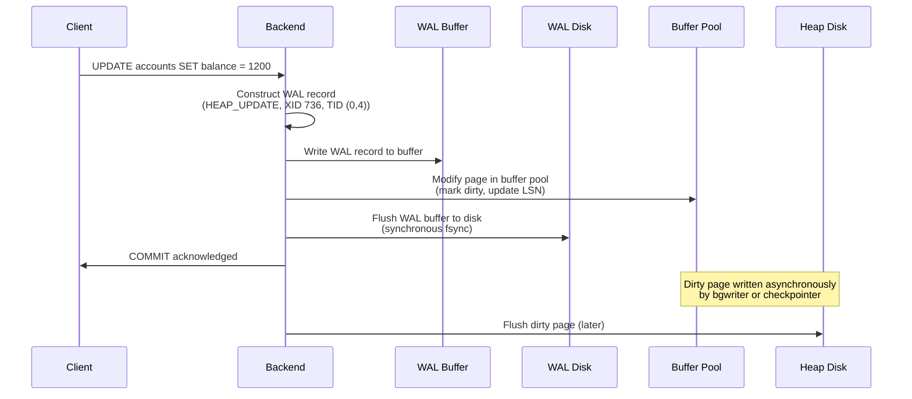

WAL records are append-only. Each record includes:
- **LSN**: Position in the WAL stream (64-bit integer, formatted as `segment/offset`).
- **XID**: Transaction ID.
- **Resource Manager (rmgr)**: Module that generated the record (Heap, Btree, Transaction, XLOG, etc.).
- **Description**: Operation type (`INSERT`, `UPDATE`, `COMMIT`, `CHECKPOINT`).
- **Data**: Operation-specific payload (tuple data, index keys, transaction metadata).

WAL files are stored in `pg_wal/` (or `pg_xlog/` in PostgreSQL ≤9.6). Each file is 16MB by default. Files are named by timeline ID and LSN (e.g., `000000010000000000000001`).

### Step 4.1: Generate WAL Activity

Execute a sequence of operations:
```sql
BEGIN;
UPDATE accounts SET balance = balance + 100 WHERE owner_name = 'Bob';
UPDATE accounts SET balance = balance - 50 WHERE owner_name = 'Charlie';
INSERT INTO accounts (owner_name, balance) VALUES ('Dave', 500.00);
DELETE FROM accounts WHERE owner_name = 'Dave';
COMMIT;
```

This transaction generates multiple WAL records: `HEAP_UPDATE` (twice), `HEAP_INSERT`, `HEAP_DELETE`, and `TRANSACTION_COMMIT`.

### Step 4.2: Dump WAL Records

Exit `psql` and enter the container shell:
```bash
docker exec -it pg-lab bash
```

Locate the current WAL segment:
```bash
WAL_FILE=$(ls -t /var/lib/postgresql/data/pg_wal/0* | head -n 1)
echo "Current WAL segment: $WAL_FILE"
```

Dump the last 30 WAL records:
```bash
pg_waldump -n 30 $WAL_FILE
```

**Expected Output (truncated):**
```
rmgr: Heap        len (rec/tot):     54/   186, tx:    737, lsn: 0/0193F3A8, prev 0/0193F370, desc: UPDATE off 2 xmax 737 flags 0x00 ; new off 5 xmax 0, blkref #0: rel 1663/5/16384 blk 0 FPW
rmgr: Heap        len (rec/tot):     54/    54, tx:    737, lsn: 0/0193F468, prev 0/0193F3A8, desc: UPDATE off 3 xmax 737 flags 0x00 ; new off 6 xmax 0, blkref #0: rel 1663/5/16384 blk 0
rmgr: Heap        len (rec/tot):    198/   198, tx:    737, lsn: 0/0193F4A0, prev 0/0193F468, desc: INSERT off 7 flags 0x00, blkref #0: rel 1663/5/16384 blk 0
rmgr: Heap        len (rec/tot):     54/    54, tx:    737, lsn: 0/0193F570, prev 0/0193F4A0, desc: DELETE off 7 flags 0x00 KEYS_UPDATED , blkref #0: rel 1663/5/16384 blk 0
rmgr: Transaction len (rec/tot):     34/    34, tx:    737, lsn: 0/0193F5A8, prev 0/0193F570, desc: COMMIT 2024-01-15 10:32:15.123456 UTC
```

**Record Interpretation:**

1. **`rmgr: Heap`**: Resource manager is Heap (table storage).
   - **`desc: UPDATE off 2 xmax 737 ; new off 5 xmax 0`**: Updated tuple at offset 2, set `t_xmax = 737`, created new version at offset 5.
   - **`blkref #0: rel 1663/5/16384 blk 0`**: Refers to tablespace 1663 (`pg_default`), database 5, relation 16384 (`accounts`), block 0.
   - **`FPW`**: Full Page Write. The first modification of a page after a checkpoint writes the entire 8KB page to WAL (not just the delta). This ensures that partially written pages during a crash can be restored.

2. **`rmgr: Transaction`**: Transaction control.
   - **`desc: COMMIT 2024-01-15 10:32:15.123456 UTC`**: Transaction 737 committed. This record is synchronously flushed to disk before the client receives acknowledgment. Crash recovery uses this to determine transaction fate.

3. **`lsn: 0/0193F3A8, prev 0/0193F370`**: Each record links to the previous LSN, forming a chain for sequential replay.

### Step 4.3: Decode Specific Transaction

Query WAL records for transaction 737:
```bash
pg_waldump --xid=737 $WAL_FILE
```

**Expected Output:**
```
rmgr: Heap        len (rec/tot):     54/   186, tx:    737, lsn: 0/0193F3A8, prev 0/0193F370, desc: UPDATE off 2 xmax 737 flags 0x00 ; new off 5 xmax 0, blkref #0: rel 1663/5/16384 blk 0 FPW
rmgr: Heap        len (rec/tot):     54/    54, tx:    737, lsn: 0/0193F468, prev 0/0193F3A8, desc: UPDATE off 3 xmax 737 flags 0x00 ; new off 6 xmax 0, blkref #0: rel 1663/5/16384 blk 0
rmgr: Heap        len (rec/tot):    198/   198, tx:    737, lsn: 0/0193F4A0, prev 0/0193F468, desc: INSERT off 7 flags 0x00, blkref #0: rel 1663/5/16384 blk 0
rmgr: Heap        len (rec/tot):     54/    54, tx:    737, lsn: 0/0193F570, prev 0/0193F4A0, desc: DELETE off 7 flags 0x00 KEYS_UPDATED , blkref #0: rel 1663/5/16384 blk 0
rmgr: Transaction len (rec/tot):     34/    34, tx:    737, lsn: 0/0193F5A8, prev 0/0193F570, desc: COMMIT 2024-01-15 10:32:15.123456 UTC
```

This isolates all records for transaction 737, confirming the sequence: two updates, one insert, one delete, and a commit.

### Step 4.4: Observe Checkpoint Records

Checkpoints synchronize all dirty pages to disk and record a consistent recovery point. Query checkpoint records:
```bash
pg_waldump $WAL_FILE | grep "rmgr: XLOG.*CHECKPOINT"
```

**Expected Output:**
```
rmgr: XLOG        len (rec/tot):    114/   114, tx:      0, lsn: 0/0193E000, prev 0/0193DF80, desc: CHECKPOINT_ONLINE redo 0/0193E000; tli 1; prev tli 1; fpw true; xid 0:738; oid 16386; multi 1; offset 0; oldest xid 726 in DB 1; oldest multi 1 in DB 1; oldest/newest commit timestamp xid: 0/0; oldest running xid 0; online
```

**Key Fields:**
- **`CHECKPOINT_ONLINE`**: Checkpoint triggered by `checkpoint_timeout` (default 5 minutes) or `max_wal_size` (1GB). Online checkpoints run concurrently with transactions, spreading I/O over time.
- **`redo 0/0193E000`**: Recovery starts from this LSN. WAL records before this LSN are not needed for crash recovery (but may be needed for replication).
- **`xid 0:738`**: Next transaction ID to allocate. Format is `epoch:xid`. The epoch increments every 2^31 transactions to extend the 32-bit XID space.
- **`oldest xid 726 in DB 1`**: Oldest unfrozen XID in database 1. Transactions older than this have been frozen or removed. This bounds the MVCC snapshot horizon.

---

## Lab 5: Simulating Crash Recovery

Crash recovery replays WAL records from the last checkpoint to reconstruct lost changes. This lab simulates a crash and verifies recovery.

### Step 5.1: Record Pre-Crash State

Query the accounts table:
```sql
SELECT * FROM accounts ORDER BY id;
```

**Expected Output:**


Note the current WAL LSN:
```sql
SELECT pg_current_wal_lsn();
```

**Expected Output:**
```
 pg_current_wal_lsn 
--------------------
 0/0193F6D0
```

### Step 5.2: Simulate Crash

Exit `psql` and forcibly kill the PostgreSQL process:
```bash
docker exec pg-lab pkill -9 postgres
```

Wait 2 seconds, then restart the container:
```bash
docker start pg-lab
```

### Step 5.3: Verify Recovery

Monitor the recovery log:
```bash
docker logs pg-lab 2>&1 | tail -20
```

**Expected Output:**
```
2024-01-15 10:35:21.456 UTC [1] LOG:  database system was interrupted; last known up at 2024-01-15 10:32:15 UTC
2024-01-15 10:35:21.789 UTC [1] LOG:  database system was not properly shut down; automatic recovery in progress
2024-01-15 10:35:21.791 UTC [1] LOG:  redo starts at 0/0193E000
2024-01-15 10:35:21.795 UTC [1] LOG:  consistent recovery state reached at 0/0193F6D0
2024-01-15 10:35:21.796 UTC [1] LOG:  redo done at 0/0193F6D0 system usage: CPU: user: 0.01 s, system: 0.00 s, elapsed: 0.00 s
2024-01-15 10:35:21.823 UTC [1] LOG:  database system is ready to accept connections
```

Recovery replayed WAL records from `0/0193E000` (checkpoint) to `0/0193F6D0` (last LSN before crash).

Reconnect and verify data integrity:
```bash
docker exec -it pg-lab psql -U postgres -d postgres
```

```sql
SELECT * FROM accounts ORDER BY id;
```

**Expected Output:**
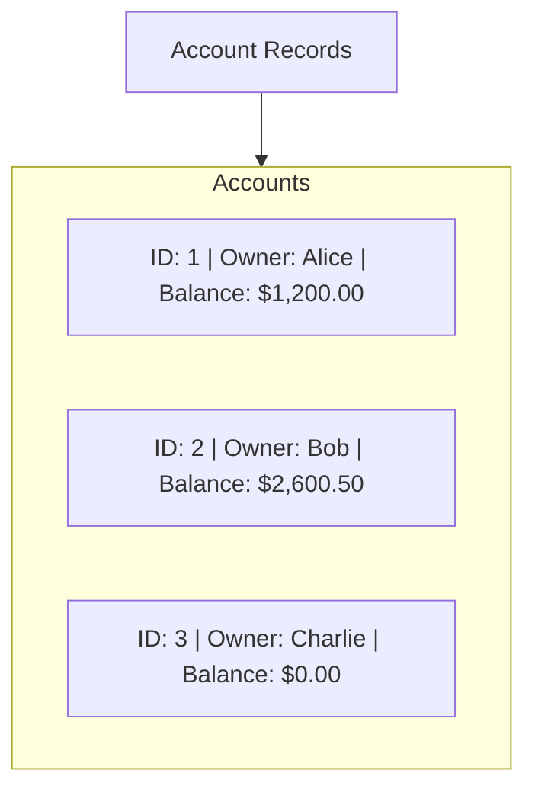

All committed transactions (XID ≤ 737) are preserved. Uncommitted transactions are discarded.

---

## Lab 6: Advanced MVCC — Heap-Only Tuples (HOT)

Heap-Only Tuple (HOT) optimization reduces index maintenance overhead for updates that do not modify indexed columns. When an update does not change indexed columns and the new version fits on the same page, PostgreSQL creates a HOT chain: the old tuple's `t_ctid` points to the new version, but index entries are not updated. This avoids index bloat.

### Step 6.1: Create Table with Non-Indexed Column

```sql
CREATE TABLE users (
    id SERIAL PRIMARY KEY,
    username VARCHAR(64) NOT NULL,
    last_login TIMESTAMP,
    login_count INTEGER DEFAULT 0
);

CREATE UNIQUE INDEX users_username_idx ON users(username);

INSERT INTO users (username, last_login, login_count) VALUES
('alice', '2024-01-01 10:00:00', 5),
('bob', '2024-01-02 11:00:00', 10);
```

Index `users_username_idx` covers `username` (indexed) but not `login_count` (non-indexed).

### Step 6.2: Update Non-Indexed Column

```sql
UPDATE users SET login_count = 6 WHERE username = 'alice';
```

Inspect the heap page:
```sql
SELECT lp, lp_flags, t_xmin, t_xmax, t_ctid, t_infomask, t_infomask2
FROM heap_page_items(get_raw_page('users', 0))
ORDER BY lp;
```

**Expected Output:**
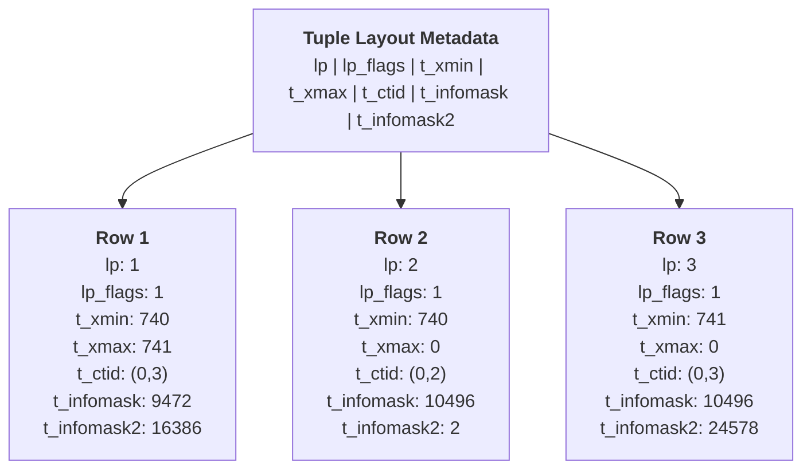

**Key Observations:**

1. **Old alice (lp 1):**
   - `t_xmax = 741`: Updated by transaction 741.
   - `t_ctid = (0,3)`: Points to the new version at line pointer 3.
   - `t_infomask = 9472`: Binary `0010010100000000`. Key flag: `HEAP_HOT_UPDATED` (bit 14) is set, indicating this tuple was HOT-updated.

2. **New alice (lp 3):**
   - `t_xmin = 741`: Created by transaction 741.
   - `t_infomask2 = 24578`: Binary `0110000000000010`. Key flag: `HEAP_ONLY_TUPLE` (bit 15) is set, indicating this tuple is part of a HOT chain and has no corresponding index entry.

3. **Index Impact:** Query the index:
   ```sql
   SELECT * FROM bt_page_items(get_raw_page('users_username_idx', 1));
   ```
   The index entry for `alice` still points to `(0,1)`. When dereferencing, PostgreSQL follows the HOT chain via `t_ctid` to find the current version at `(0,3)`. This avoids inserting a new index entry and marking the old entry as dead.

### Step 6.3: Update Indexed Column (Non-HOT Update)

```sql
UPDATE users SET username = 'alice2' WHERE username = 'alice';
```

Re-inspect the heap page:
```sql
SELECT lp, lp_flags, t_xmin, t_xmax, t_ctid, t_infomask, t_infomask2
FROM heap_page_items(get_raw_page('users', 0))
ORDER BY lp;
```

**Expected Output:**
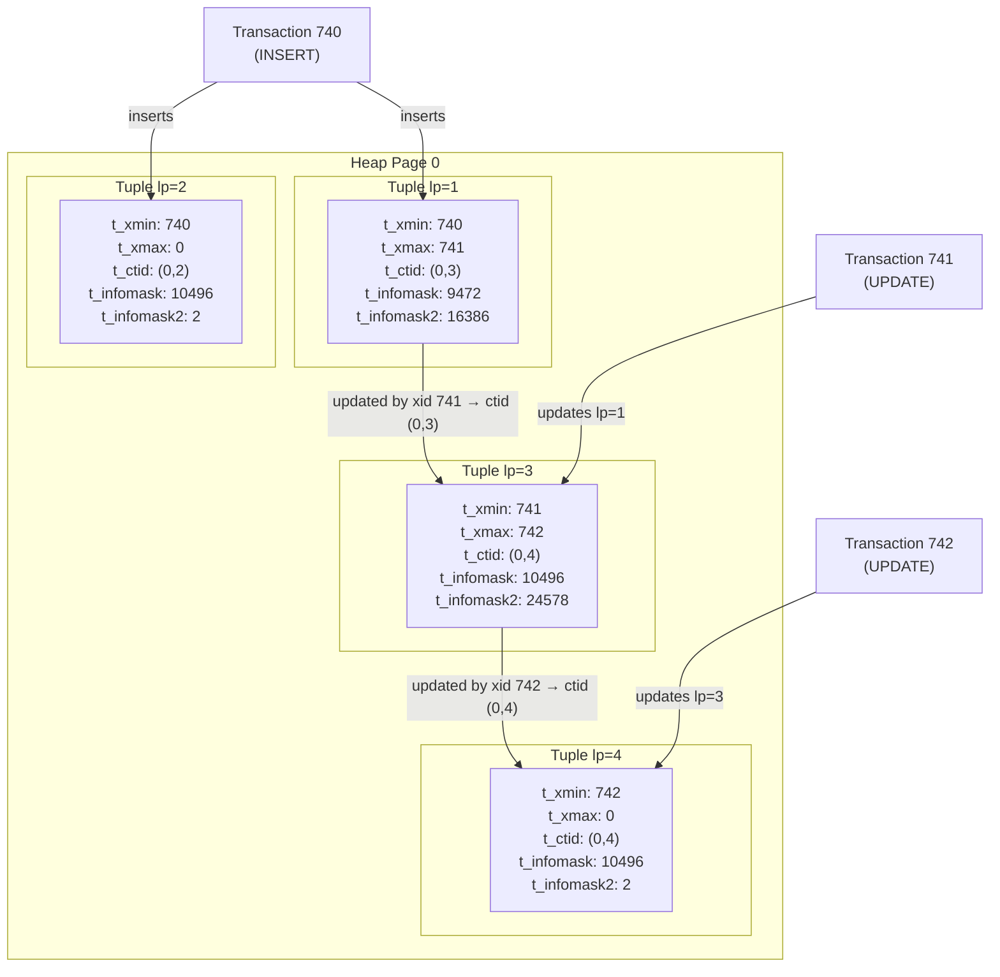

**Key Observations:**

1. **Old alice2 (lp 3):**
   - `t_xmax = 742`: Updated by transaction 742.
   - `t_infomask2 = 24578`: `HEAP_ONLY_TUPLE` flag is still set (inherited from HOT chain).

2. **New alice2 (lp 4):**
   - `t_infomask2 = 2`: `HEAP_ONLY_TUPLE` is NOT set. This is a regular tuple with a corresponding index entry.
   - The index now contains two entries: `alice` → `(0,1)` (dead) and `alice2` → `(0,4)` (live). Vacuum will eventually remove the dead index entry.

---

## Lab 7: Teardown

```bash
docker stop pg-lab
```

---

## Conclusion

This lab series provided hands-on exploration of PostgreSQL's storage and MVCC internals:
1. **Heap Pages:** Dissected 8KB pages to observe page headers, line pointers, and tuple headers.
2. **MVCC Tuples:** Traced tuple version chains and dead tuple accumulation through `t_xmin`, `t_xmax`, and `t_ctid`.
3. **Shared Buffers:** Inspected the buffer pool cache, dirty pages, and replacement algorithm.
4. **Write-Ahead Log:** Decoded WAL records to understand crash recovery and transaction durability.
5. **Crash Recovery:** Simulated a crash and verified WAL replay.
6. **HOT Updates:** Observed Heap-Only Tuple optimization for non-indexed column updates.

These mechanisms underpin PostgreSQL's durability, isolation, and performance characteristics. Understanding them enables informed decision-making in schema design, query optimization, and operational troubleshooting.
