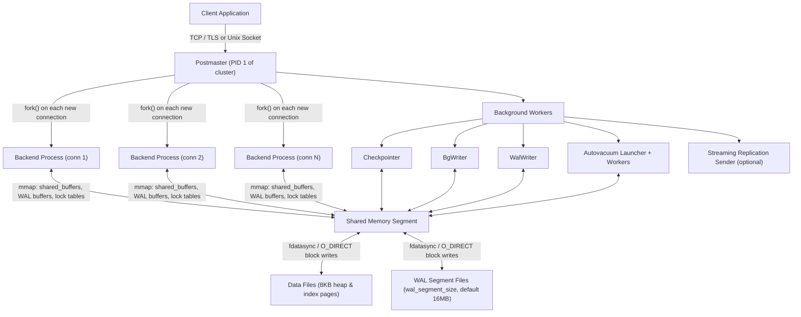
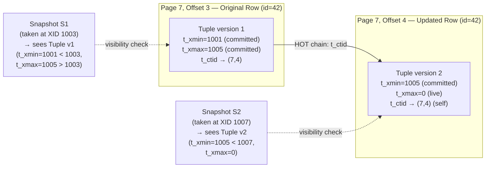
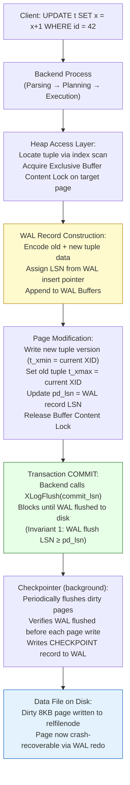

# Lesson 1: Foundations & Storage Invariants

This course is constructed for systems engineers, database administrators, and infrastructure architects who require first-principles mastery of PostgreSQL internals. The material assumes fluency with operating systems concepts (virtual memory, process isolation, file I/O semantics) and comfort reading C structures and SQL DDL.

PostgreSQL does not treat the relational database as an opaque black box. Its process model, shared memory architecture, heap page layout, and write-ahead logging (WAL) are directly anchored in POSIX kernel primitives and classical systems architecture. Reasoning about database performance, concurrency contention, and recovery state machines requires understanding the foundational invariants that govern how data transitions from client processes into volatile shared memory and then into persistent storage — and how that path is made safe against partial failure at every step.

---

## 1. The Relational Contract & First-Principles Systems Philosophy

A relational database engine exists to resolve a fundamental physical tension: persistent storage media (NVMe SSDs, SATA SSDs, spinning magnetic disks) have high latency and block-oriented access patterns, while client applications demand microsecond-scale transaction isolation, arbitrary predicate queries, and strict atomicity, consistency, isolation, and durability (ACID) guarantees. Bridging this gap requires that the database engine itself act as a specialized operating system layer — managing its own virtual memory (the buffer pool), its own I/O scheduler (checkpointer, background writer), its own process scheduler (autovacuum), and its own fault-recovery journal (WAL).

PostgreSQL does exactly this. It operates as an operating system within an operating system, interposing itself between kernel storage abstractions and application semantics.

### 1.1 The Process Model

Unlike modern database engines that adopt a multi-threaded architecture — such as MySQL InnoDB, Microsoft SQL Server, or Oracle — PostgreSQL maintains a strict **process-per-connection** model inherited from its UC Berkeley POSTGRES lineage (Stonebraker et al., 1987). The postmaster daemon is the root supervisor process. Every client connection causes the postmaster to call `fork()`, producing a dedicated **backend worker process** that inherits a file descriptor pointing into shared memory segments but has its own private virtual address space for stack, local variables, and execution context.



The rationale for `fork()`-based isolation is not mere historical inertia. It provides three concrete guarantees:

**Process Memory Isolation.** A memory corruption event, wild pointer dereference, or buffer overrun in one backend process terminates only that session via `SIGSEGV`. The kernel enforces the address space boundary. In a multi-threaded server, a single corrupted write through a shared pointer can destroy heap allocations belonging to unrelated concurrent transactions — a failure mode that is essentially undebuggable in production. PostgreSQL trades some per-connection memory overhead (each backend costs roughly 5–10MB of private RSS) for hard fault containment.

**Coordinated Shared State via Explicit Shared Memory.** Inter-process coordination uses a precisely allocated POSIX (or System V, depending on configuration) shared memory region mapped identically into every backend's virtual address space. This region holds the buffer pool, WAL buffers, the lock manager's shared data structures, the process array, and other global state. All access to this region is mediated by lightweight spinlocks and semaphores (latches), never by OS-level file locking or advisory locks.

**Kernel as Active Partner.** PostgreSQL does not attempt to bypass the kernel for safety-critical operations. It relies on `fdatasync()` to enforce durable write ordering on WAL segments, on `O_DIRECT` or `fsync()` to manage the relationship between the kernel page cache and actual storage media, and on POSIX signal semantics (`SIGTERM`, `SIGQUIT`, `SIGUSR1`) for inter-process communication within the cluster. The kernel is treated as a trusted, documented contract — not a hazard to route around.

### 1.2 Shared Memory Anatomy

The shared memory segment is allocated once at cluster startup by the postmaster and sized by the GUC (Grand Unified Configuration) parameter `shared_buffers`. As of PostgreSQL 14+, the default allocation mechanism is dynamic shared memory (DSM) via `mmap()`, though `System V shmget()` remains available via the `dynamic_shared_memory_type` GUC.

The segment contains:
- **Buffer pool** (`shared_buffers`): The primary cache of 8KB disk pages, organized as a clock-sweep LRU approximation.
- **WAL buffers** (`wal_buffers`): A circular in-memory ring of WAL record segments awaiting flush to disk, default-sized at 1/32 of `shared_buffers` (minimum 64KB, maximum 16MB).
- **Lock tables**: Fixed-size hash tables for heavyweight lock (relation, transaction, page-level) bookkeeping.
- **Proc array**: One `PGPROC` slot per backend, holding each transaction's current XID, snapshot state, and lock wait information.
- **CLOG (Commit Log) buffers**: A cached view of transaction status (committed, aborted, in-progress) stored durably in `pg_xact/`.
- **Background worker control structures**: Coordination state for autovacuum, logical replication workers, and custom background workers registered via `RegisterBackgroundWorker()`.

---

## 2. Slotted-Page Binary Format & Physical Heap Layout

At the lowest physical storage layer, tables and indexes are stored as collections of fixed-size **8192-byte disk pages** (also called *blocks*). The 8KB size is not arbitrary: it matches the most common OS virtual memory page size multiple and aligns naturally with the I/O block size of most storage controllers. The GUC `block_size` is a compile-time constant (`--with-blocksize`) and cannot be changed without rebuilding PostgreSQL from source; the overwhelming majority of production clusters use the default.

An individual table relation is broken into **1GB segment files** on disk: `base/<dboid>/<relfilenode>`, `base/<dboid>/<relfilenode>.1`, `base/<dboid>/<relfilenode>.2`, and so on. The 1GB segment limit was chosen to remain compatible with file systems and operating system file size constraints common at the time of PostgreSQL's design; modern file systems have no such practical limits, but the segmentation behavior is preserved for portability.

### 2.1 The Slotted Page Layout

PostgreSQL uses a classical **slotted page** architecture (also called a directory page) to accommodate variable-length rows, in-place logical deletes, and HOT (Heap-Only Tuple) chain rewrites without requiring full-page compaction on every change.

```text
Byte Offset
0       +-----------------------------------------------------------------------+
        | PageHeaderData (24 bytes)                                             |
        |   pd_lsn        [8 bytes] : LSN of last WAL record modifying page    |
        |   pd_checksum   [2 bytes] : Page-level CRC-32C checksum (if enabled) |
        |   pd_flags      [2 bytes] : PD_HAS_FREE_LINES, PD_PAGE_FULL, etc.    |
        |   pd_lower      [2 bytes] : Byte offset → end of ItemId array        |
        |   pd_upper      [2 bytes] : Byte offset → start of lowest tuple      |
        |   pd_special    [2 bytes] : Offset to special space (0 on heap pages)|
        |   pd_pagesize_version [2 bytes] : Encodes page size + format version |
        |   pd_prune_xid  [4 bytes] : Oldest non-frozen XID on page (for prune)|
24      +-----------------------------------------------------------------------+
        | ItemIdData Array (line pointer directory, 4 bytes each)               |
        |   ItemId[1] : lp_off=7900, lp_flags=LP_NORMAL, lp_len=92             |
        |   ItemId[2] : lp_off=7800, lp_flags=LP_NORMAL, lp_len=97             |
        |   ItemId[3] : lp_off=0,    lp_flags=LP_DEAD,   lp_len=0  (vacuumable)|
        |   ItemId[4] : lp_off=7700, lp_flags=LP_REDIRECT, lp_len=0 (HOT head)|
        |               ↓  pd_lower grows downward as items are added           |
        +-----------------------------------------------------------------------+
        |                                                                       |
        |                       FREE SPACE                                      |
        |                   (pd_upper - pd_lower bytes)                         |
        |                                                                       |
        +-----------------------------------------------------------------------+
        |               ↑  pd_upper grows upward as tuples are added            |
        |   HeapTuple[2] : HeapTupleHeaderData + null bitmap + attribute data  |
        |   HeapTuple[1] : HeapTupleHeaderData + null bitmap + attribute data  |
8192    +-----------------------------------------------------------------------+
        | Special Space (0 bytes on heap; used by B-tree, GiST, etc.)          |
        +-----------------------------------------------------------------------+
```

The layout enforces a **two-pointer growth invariant**:

- `pd_lower` starts at byte 24 (end of `PageHeaderData`) and advances downward (toward higher byte offsets) each time a new `ItemIdData` entry is appended to the directory.
- `pd_upper` starts at byte 8192 (or `8192 - pd_special`) and retreats upward (toward lower byte offsets) each time a new tuple is physically inserted at the page bottom.
- The free space available for a new insert is exactly `pd_upper - pd_lower`. An insert that requires `sizeof(ItemIdData) + MAXALIGN(tuple_length)` bytes can proceed only when this difference is large enough. Otherwise, the page is considered full.

This geometry achieves two goals simultaneously. First, the indirection layer (the `ItemId` array) means that tuples can be physically relocated within a page during compaction (`VACUUM FULL`, page pruning) without invalidating external references, because those references encode `(block_number, item_index)` as a `tid` (tuple identifier), not a raw byte offset. Second, variable-length tuples can be packed from the bottom of the page upward without requiring the directory to predict their sizes in advance.

### 2.2 Heap Tuple Header: `HeapTupleHeaderData`

Every row stored on a heap page is prefixed by a 23-byte header (`HeapTupleHeaderData` in `src/include/access/htup_details.h`), followed by an optional null bitmap and optional OID field, before reaching the user attribute data:

```c
/*
 * Verbatim from src/include/access/htup_details.h (PostgreSQL 16)
 * Presented here for annotation purposes.
 */
typedef struct HeapTupleFields {
    TransactionId t_xmin;   /* XID of inserting transaction */
    TransactionId t_xmax;   /* XID of deleting/locking transaction (0 = live) */
    union {
        CommandId   t_cid;  /* command identifier within inserting/deleting xact */
        TransactionId t_xvac; /* used by VACUUM FULL during tuple migration */
    } t_field3;
} HeapTupleFields;

typedef struct HeapTupleHeaderData {
    union {
        HeapTupleFields t_heap;
        DatumTupleFields t_datum; /* used for composite type datums */
    } t_choice;

    ItemPointerData t_ctid;     /* TID of this tuple, or of an updated version */
    uint16          t_infomask2;/* number of attributes + flags (HOT, KEY_SHARE) */
    uint16          t_infomask; /* visibility flags: XMIN_COMMITTED, XMAX_LOCKED, etc. */
    uint8           t_hoff;     /* byte offset from header start to user data */
    /* BITMAPSET null bitmap follows here if HEAP_HASNULL is set in t_infomask */
    /* User attribute data begins at (char *)tup + t_hoff                      */
} HeapTupleHeaderData;
```

Each field serves a precise mechanical purpose:

- **`t_xmin`**: The 32-bit transaction ID (XID) of the transaction that `INSERT`ed this tuple version. The MVCC visibility check evaluates whether `t_xmin` committed before the reader's snapshot was taken.
- **`t_xmax`**: The XID of the transaction that `DELETE`d or `UPDATE`d this tuple version. Zero means the tuple is live. If `t_xmax` is set to a committed XID, the tuple is dead to all future snapshots and eligible for reclamation by VACUUM.
- **`t_cid`**: The command identifier within the transaction. This distinguishes visibility within a single transaction: a `SELECT` issued after an `INSERT` in the same transaction must see the inserted row, but a cursor opened before the insert must not. `t_cid` encodes this sub-transaction ordering.
- **`t_ctid`**: The physical location of this tuple as `(block, offset)`. On a live unmodified tuple, `t_ctid` points to itself. When a tuple is updated via a HOT update (Heap-Only Tuple), `t_ctid` of the old version points forward to the new version on the same page, forming a chain that the visibility logic can traverse without touching the index.
- **`t_infomask`**: A 16-bit flags word encoding cached visibility state. The most important bits include `HEAP_XMIN_COMMITTED` (the inserting XID is known committed — avoids re-examining `pg_xact`), `HEAP_XMIN_INVALID` (inserting XID aborted — tuple is invisible to everyone), `HEAP_XMAX_COMMITTED`, `HEAP_XMAX_INVALID`, `HEAP_UPDATED` (this is a non-HOT update), and `HEAP_HOT_UPDATED` (this was updated via HOT chain).
- **`t_infomask2`**: Encodes the number of non-null attributes (lower 11 bits) and additional flags including `HEAP_KEYS_UPDATED` (a column covered by a unique index was changed, precluding HOT).
- **`t_hoff`**: The byte offset from the start of `HeapTupleHeaderData` to the first user attribute. This offset is at minimum 23 bytes and padded to a MAXALIGN boundary (8 bytes on 64-bit systems). An optional null bitmap of `ceil(natts / 8)` bytes is inserted between the header and user data when any attribute is NULL.

### 2.3 Examining the Raw Page Layout

PostgreSQL ships a contrib extension, `pageinspect`, that exposes raw page internals via SQL. This is indispensable for internalizing the slotted page model:

```sql
-- Install the extension (requires superuser)
CREATE EXTENSION IF NOT EXISTS pageinspect;

-- Create a simple demonstration table
CREATE TABLE storage_demo (
    id      BIGINT      GENERATED ALWAYS AS IDENTITY,
    payload TEXT        NOT NULL,
    amount  NUMERIC(12,2)
);

INSERT INTO storage_demo (payload, amount)
SELECT
    repeat(md5(i::text), 2),
    (random() * 10000)::numeric(12,2)
FROM generate_series(1, 50) AS s(i);

-- Inspect the raw PageHeaderData for page 0 of the relation
SELECT
    lower,
    upper,
    special,
    pagesize,
    version,
    prune_xid
FROM page_header(get_raw_page('storage_demo', 0));

-- Inspect all ItemId (line pointer) entries on page 0
SELECT
    lp,
    lp_off,
    lp_flags,  -- 0=LP_UNUSED, 1=LP_NORMAL, 2=LP_REDIRECT, 3=LP_DEAD
    lp_len
FROM heap_page_items(get_raw_page('storage_demo', 0))
ORDER BY lp;

-- Inspect tuple-level MVCC header fields for every item on the page
SELECT
    lp,
    t_xmin,
    t_xmax,
    t_field3  AS t_cid,
    t_ctid,
    t_infomask::bit(16)   AS infomask_bits,
    t_infomask2::bit(16)  AS infomask2_bits,
    t_hoff
FROM heap_page_items(get_raw_page('storage_demo', 0))
WHERE lp_flags = 1  -- LP_NORMAL only
ORDER BY lp;
```

The output concretely demonstrates that `pd_lower` advances by 4 bytes per inserted tuple (one `ItemId` entry) and `pd_upper` retreats by the MAXALIGN-padded tuple size, exactly as the invariant predicts.

---

## 3. The Four Non-Negotiable Storage Invariants

All relational correctness, concurrency, and durability in PostgreSQL are reducible to four immutable invariants. Violating any one of them produces either silent data corruption, phantom reads, or irrecoverable on-disk inconsistency.

### Invariant 1: The Write-Ahead Logging (WAL) Contract

$$\forall \text{ dirty page } P: \text{WAL\_flush\_LSN} \ge P.pd\_lsn \quad \text{before } P \text{ is written to storage}$$

**The Rule.** A dirty buffer page may never be flushed from the buffer pool to its data file on disk until all WAL records describing modifications to that page have been durably written (via `fdatasync` or equivalent) to the WAL segment files. The page's `pd_lsn` field encodes the Log Sequence Number of the most recent WAL record that modified it. The WAL flush position must meet or exceed this LSN before the page flush proceeds.

**Mechanical Rationale.** Consider the failure scenario where this invariant is violated: a backend modifies a buffer page, the buffer manager decides to evict and flush that page to disk, but the corresponding WAL records for the modification still sit in WAL buffers in volatile RAM. A power failure at this instant leaves the data file containing the new page version without any corresponding redo log entries to describe how that state was reached. Crash recovery (`REDO` from the last checkpoint) cannot reconstruct the database's consistent state — the write is effectively lost to an unrecoverable partial state. The WAL invariant guarantees that crash recovery via `REDO` replay can always reconstruct any page from its pre-modification state by replaying WAL records in LSN order.

This is an implementation of the ARIES (Algorithm for Recovery and Isolation Exploiting Semantics) protocol, specifically the "WAL protocol" subprinciple: *a page must not be written to disk before the log records describing the changes to that page are written to stable storage* (Mohan et al., 1992).

The WAL is written as a sequential append-only byte stream, making it substantially faster to persist than random writes to data pages. The `WalWriter` background process flushes WAL buffers to disk periodically (controlled by `wal_writer_delay`, default 200ms). Backend processes flush WAL synchronously on transaction commit when `synchronous_commit = on`, ensuring that the commit record is durable before the client receives a success acknowledgment.

```mermaid
sequenceDiagram
    participant BE as Backend Process
    participant WB as WAL Buffers (shared mem)
    participant BP as Buffer Pool (shared mem)
    participant WF as WAL Segment File (disk)
    participant DF as Data File (disk)

    BE->>WB: Append WAL record (page modification)<br/>Assign LSN = current insert pointer
    BE->>BP: Modify buffer page<br/>Set pd_lsn = assigned LSN

    Note over WB,WF: WAL flush must precede data page flush
    WB->>WF: fdatasync() WAL up to pd_lsn (WalWriter or commit)
    WF-->>WB: Flush confirmed; WAL flush LSN ≥ pd_lsn

    BP->>DF: Checkpointer/BgWriter may now flush dirty page
    DF-->>BP: Page eviction complete
```

**Checkpoint Mechanics.** The checkpointer daemon periodically advances the checkpoint LSN by: (1) flushing all dirty buffer pages whose `pd_lsn` is below the new checkpoint target (after ensuring WAL up to that point is flushed), and (2) writing a `CHECKPOINT` record to WAL. On crash recovery, PostgreSQL reads the control file (`pg_control`) to find the latest checkpoint record, then replays all WAL records with LSN greater than the checkpoint LSN. The older WAL segments are no longer needed for recovery and can be recycled or archived.

### Invariant 2: Reader-Writer Non-Blocking Concurrency (MVCC)

**The Rule.** Readers never block writers, and writers never block readers. The visibility of a tuple version to a given transaction is determined purely by evaluating the transaction's snapshot against the tuple's `t_xmin` and `t_xmax` fields — no shared read locks on row data are acquired.

**Mechanical Rationale.** Classical lock-based concurrency (as in DB2 or early SQL Server) acquires shared locks on rows that readers scan. A long-running analytical query holding shared locks on a hot row blocks any writer that needs an exclusive lock on that same row, and vice versa. At high concurrency, this produces severe lock contention and convoy effects.

PostgreSQL's MVCC model avoids this entirely by treating all updates as **append-only tuple versioning**. When a row is `UPDATE`d:

1. The existing tuple version is not modified in place. Its `t_xmax` is set to the updating transaction's XID, marking it as deleted from the perspective of future transactions.
2. A new tuple version is written to the page (either the same page, in the case of a HOT update, or a new page if the row grew). This new version has `t_xmin` set to the updating transaction's XID and `t_xmax = 0`.
3. A `SELECT` running concurrently takes a snapshot at statement start. The snapshot captures the set of all in-progress XIDs at that moment. Visibility evaluation for each scanned tuple is:

```
tuple is visible to snapshot S if:
    t_xmin is committed AND t_xmin < S.xmax AND t_xmin ∉ S.xip_list
    AND (t_xmax = 0
         OR t_xmax is aborted
         OR t_xmax > S.xmax
         OR t_xmax ∈ S.xip_list)
```

No lock is taken on the row during this visibility evaluation. The reader traverses old and new tuple versions side by side in the page, consulting `pg_xact` (the commit log) or cached `t_infomask` hint bits to determine which version falls within its snapshot window.

**The MVCC Bloat Consequence.** The unavoidable trade-off of append-only versioning is **table bloat**: dead tuple versions accumulate in the heap until VACUUM reclaims them. A hot-row `UPDATE` loop that runs thousands of times per second will rapidly fill pages with dead tuples, degrading scan performance. Autovacuum is the mechanism that enforces liveness by removing dead tuples, updating the free space map (FSM), and reclaiming page space for future inserts.



### Invariant 3: Single-Writer Heap Page Latching

**The Rule.** Modifying any shared buffer page requires holding an **Exclusive Buffer Content Lock** (the buffer pin plus an exclusive latch). Reading a shared buffer page safely requires holding a **Shared Buffer Content Lock**.

**Mechanical Rationale.** MVCC provides logical transaction isolation at the tuple level, but it does not by itself prevent two backend processes from simultaneously writing different bytes into the same 8KB buffer in shared memory. Such a race condition would corrupt the binary page structure — for example, two concurrent inserts updating `pd_lower` and `pd_upper` simultaneously would leave the page in an inconsistent state where item pointers overlap with tuple data.

PostgreSQL buffer latches are not heavyweight advisory locks (which are tracked in the lock manager and are transactional). They are short-duration, non-transactional synchronization primitives implemented as:

- A lightweight spinlock protecting the buffer header metadata (pin count, state flags, content lock state) — `BufferDescPadded.buf_hdr.state` using atomic operations.
- A `LWLock` (`content_lock`) embedded in each buffer descriptor, used for the actual exclusive/shared content lock that protects the page bytes during structural modification.

The key operational insight is that buffer latches are **held only for the duration of a single page access** — a few microseconds at most — not for the duration of a transaction. A transaction performing a table scan acquires a shared latch on each page it reads, reads the page, then releases the latch immediately before moving to the next page. This is distinct from MVCC tuple-level visibility, which is stateless (snapshot-based) and requires no held lock. Latches exist purely to guarantee that the binary representation of the page is structurally coherent during any given read or write operation.

### Invariant 4: Transaction ID Modular Horizon & Freeze Boundary

$$\forall \text{ live unforzen tuple } T: \quad XID_{\text{current}} - T.t\_xmin < 2^{31}$$

**The Rule.** No live, non-frozen tuple may have a `t_xmin` value that is more than $2^{31} - 1$ transactions older than the current transaction counter. Autovacuum enforces this by **freezing** ancient tuples — replacing their `t_xmin` with the special frozen XID value `FrozenTransactionId = 2`, which is defined to be in the past relative to every possible XID.

**Mechanical Rationale.** PostgreSQL uses 32-bit unsigned transaction IDs. The 32-bit counter wraps around modulo $2^{32}$ after approximately 4.29 billion transactions. PostgreSQL uses **modular arithmetic** to establish a total ordering of transactions within a window: given two XIDs $A$ and $B$, $A$ is considered to have happened *before* $B$ if $(B - A) \mod 2^{32} < 2^{31}$. This works correctly so long as no two relevant XIDs are more than $2^{31}$ apart.

If autovacuum is neglected and a table accumulates unfrozen tuples with XIDs that are $2^{31}$ or more transactions old, the modular arithmetic reverses: those ancient XIDs now appear to be *in the future* relative to the current counter. The rows, which were previously visible, become **invisible** to all new transactions — effectively disappearing. This catastrophic data loss event is the **XID wraparound problem**.

PostgreSQL mitigates this by tracking the age of the oldest unfrozen XID across the cluster (available in `pg_database.datfrozenxid` and `pg_class.relfrozenxid`) and triggering autovacuum `FREEZE` passes when any table approaches `vacuum_freeze_max_age` transactions of unfrozen age (default: 200 million transactions). At the extreme threshold of `autovacuum_freeze_max_age` (default: 400 million transactions), PostgreSQL will force-freeze tables even against user preferences. At 3 million transactions before the hard wraparound boundary, the postmaster shuts down and refuses new connections, requiring a manual `VACUUM FREEZE` to recover.

```sql
-- Monitor XID age across all databases in the cluster
-- Age approaching 1.5 billion is a serious operational warning
SELECT
    datname,
    age(datfrozenxid)                             AS db_xid_age,
    2147483647 - age(datfrozenxid)                AS transactions_until_wraparound,
    pg_size_pretty(pg_database_size(datname))     AS db_size
FROM pg_database
WHERE datallowconn
ORDER BY age(datfrozenxid) DESC;

-- Monitor per-table XID age to identify freeze candidates
SELECT
    n.nspname                                     AS schema,
    c.relname                                     AS table,
    age(c.relfrozenxid)                           AS table_xid_age,
    c.relpages,
    pg_size_pretty(pg_total_relation_size(c.oid)) AS total_size
FROM pg_class c
JOIN pg_namespace n ON n.oid = c.relnamespace
WHERE c.relkind = 'r'
  AND age(c.relfrozenxid) > 100000000  -- Tables older than 100M transactions
ORDER BY age(c.relfrozenxid) DESC
LIMIT 20;
```

PostgreSQL 14 introduced the `relfrozenxid`-based lazy scanning strategy in autovacuum, and PostgreSQL 16 added `vacuum_freeze_min_age` and `vacuum_multixact_freeze_min_age` refinements that allow more aggressive freezing on write-heavy tables to reduce the operational risk window.

---

## 4. The Buffer Pool: Shared Memory as a First-Class Database Citizen

The buffer pool (sized by `shared_buffers`) is the single most performance-critical component of a running PostgreSQL instance. It is a fixed-size array of 8KB buffer slots in shared memory, each described by a `BufferDesc` (buffer descriptor) that tracks the buffer's current page identity (`(relfilenode, forknum, blocknum)`), its pin count (number of backends currently accessing it), its dirty flag, and its content lock state.

### 4.1 Clock-Sweep Page Replacement

PostgreSQL uses a **clock-sweep algorithm** (a hardware-inspired approximation of LRU) to select victim pages for eviction when the buffer pool is full and a new page must be loaded. Each buffer descriptor maintains a `usage_count` (0–5). When a backend accesses a page, its `usage_count` is incremented (up to the maximum of 5). The clock-sweep hand scans buffers in circular order: if `usage_count > 0`, it decrements the count and advances; if `usage_count == 0`, that buffer is selected for eviction. A dirty eviction candidate must be flushed to disk (after WAL flush per Invariant 1) before the slot can be reused.

This design avoids the per-access cost of maintaining a true LRU doubly-linked list (which would require global locking on every buffer touch) while still concentrating evictions on buffers with low recent-access frequency.

### 4.2 Buffer Pinning Protocol

Before any backend can read or modify a page's bytes, it must **pin** the buffer — incrementing the pin count in the buffer descriptor atomically. A pinned buffer cannot be evicted by the clock-sweep. The sequence for a page access is:

```
1. Compute buffer tag: (relfilenode, fork, block_number)
2. Acquire BufMappingLock (partition) to look up the buffer tag in the
   shared buffer hash table.
3. If found: increment refcount (pin), release BufMappingLock,
   acquire content lock (shared or exclusive).
4. If not found: select a victim buffer (clock-sweep), flush if dirty,
   update buffer tag in hash table, load page from disk into buffer,
   acquire content lock.
5. Perform read or write operation on page bytes.
6. Release content lock.
7. Unpin buffer (decrement refcount).
```

A backend that holds a buffer pin but not the content lock is in a legal intermediate state: it has reserved the buffer slot against eviction but is not reading the bytes. This is used during complex multi-step operations (e.g., B-tree page splits) where a backend must keep multiple buffer pins simultaneously.

---

## 5. The WAL Subsystem: Anatomy of a Log Record

WAL records are the atomic unit of recovery information. Every change to a data or catalog page — `INSERT`, `UPDATE`, `DELETE`, index split, catalog update — is first encoded as a WAL record and appended to the WAL buffer before the corresponding buffer page is modified.

### 5.1 WAL Record Structure

A WAL record (from `src/include/access/xlogrecord.h`) consists of:

```c
typedef struct XLogRecord {
    uint32          xl_tot_len;   /* total length of entire record */
    TransactionId   xl_xid;       /* xact id of issuing transaction */
    XLogRecPtr      xl_prev;      /* pointer to previous record in log stream */
    uint8           xl_info;      /* flag bits (depends on rmgr) */
    RmgrId          xl_rmid;      /* resource manager for this record */
    /* 2 bytes padding */
    pg_crc32c       xl_crc;       /* CRC for this record */
    /* XLogRecordBlockHeader(s) follow, then XLogRecordDataHeader(Short|Long) */
    /* Block image data (full-page writes if enabled) follow */
    /* Main data follows last */
} XLogRecord;
```

Each record is associated with a **Resource Manager** (`rmgr`) — a subsystem-specific module that knows how to replay the record during crash recovery. Important resource managers include:

| RmgrId | Resource Manager | Covers |
|--------|-----------------|--------|
| 0 | `XLOG` | Checkpoint, full-page writes, timeline switches |
| 10 | `Heap` | INSERT, DELETE, UPDATE, HOT update, freeze |
| 11 | `Heap2` | VACUUM, multi-insert, prune |
| 2 | `Transaction` | COMMIT, ABORT, PREPARE, savepoints |
| 3 | `Storage` | Relation file creation, extension, truncation |
| 6 | `Btree` | B-tree page split, delete, vacuum |
| 20 | `Logical` | Logical replication decode records |

### 5.2 Full-Page Writes

When `full_page_writes = on` (the default), the first modification to a page after a checkpoint writes the **entire 8KB page image** into the WAL record as a full-page write (FPW), not just the delta. This handles a critical failure scenario unique to storage devices that use 4KB or 512-byte physical sectors but present a 4096 or 512-byte atomic write unit: a torn page write.

If the storage subsystem writes only the first half of a PostgreSQL 8KB page before a power failure, the page is internally inconsistent. Generic delta-based WAL redo (which assumes the pre-image bytes are intact) cannot reconstruct the page correctly from a torn-page state. The full-page write in WAL provides a complete, self-consistent baseline image from which redo can proceed safely regardless of whether the original page write completed.

The performance cost of FPWs is the dominant reason why `checkpoint_completion_target` and `checkpoint_timeout` are tuned conservatively in write-heavy workloads: shorter checkpoint intervals increase FPW frequency.

---

## 6. Architecture Summary

The following diagram synthesizes the full write path of a single `UPDATE` statement from client submission to durable storage, integrating all four storage invariants:



| Architectural Subsystem | Design Implementation | Systems Rationale |
|:---|:---|:---|
| **Concurrency Architecture** | Multi-process (`fork()` per connection) | Hard address-space isolation; one crash terminates one session |
| **Shared State** | POSIX/System V shared memory (`mmap`) | All backends read/write the same physical buffer frames |
| **Page Granularity** | Fixed 8192-byte slotted pages | Aligns with OS page size multiples; fixed buffer pool slot sizing |
| **Row Insertion Geometry** | ItemId array grows ↓, tuples grow ↑ | Variable-width rows with stable indirect addressing via `tid` |
| **Crash Recovery** | ARIES-protocol WAL with full-page writes | Guarantees redo correctness even after torn-page partial writes |
| **Visibility Model** | Append-only tuple versioning (`t_xmin`/`t_xmax`) | Zero read-lock contention; enables snapshot isolation |
| **Page Replacement** | Clock-sweep LRU approximation | Avoids global LRU list lock contention at high concurrency |
| **XID Safety** | Autovacuum freeze (modular 2³¹ window) | Prevents XID wraparound silent data disappearance |

---

## 7. Recommended Exploration

The following exercises build physical intuition for the concepts introduced in this lesson.

**Exercise 1: Measure the slotted page geometry directly.**

```sql
-- Capture pd_lower and pd_upper before and after a single insert
-- to confirm the exact byte-level accounting.
CREATE TABLE geom_test (val TEXT);

SELECT lower, upper, upper - lower AS free_space
FROM page_header(get_raw_page('geom_test', 0));
-- Table has 0 rows; free_space should equal 8192 - 24 = 8168 bytes minus special.

INSERT INTO geom_test VALUES (repeat('x', 100));

SELECT lower, upper, upper - lower AS free_space
FROM page_header(get_raw_page('geom_test', 0));
-- pd_lower advances by 4 bytes (one ItemId).
-- pd_upper retreats by MAXALIGN(23 + 1 + 100) bytes (header + null bitmap byte + data).
-- Verify the exact retreat matches MAXALIGN(tuple_length) on your platform.
```

**Exercise 2: Observe MVCC tuple versioning in raw page data.**

```sql
CREATE TABLE mvcc_demo (id INT, val TEXT);
INSERT INTO mvcc_demo VALUES (1, 'initial');

-- Record the current XID before the update
SELECT txid_current();

UPDATE mvcc_demo SET val = 'updated' WHERE id = 1;

-- Both tuple versions are physically present on the page.
-- The old version has t_xmax set; the new version has t_xmin set.
SELECT lp, t_xmin, t_xmax, t_ctid, t_infomask::bit(16)
FROM heap_page_items(get_raw_page('mvcc_demo', 0));
```

**Exercise 3: Inspect XID age and freeze status across the cluster.**

```sql
-- Check whether any tables in the current database are approaching
-- the vacuum_freeze_max_age threshold (default 200M transactions).
SELECT
    relname,
    age(relfrozenxid) AS xid_age,
    pg_size_pretty(pg_total_relation_size(oid)) AS size
FROM pg_class
WHERE relkind = 'r'
ORDER BY age(relfrozenxid) DESC
LIMIT 10;
```

**Further Reading:**
- Stonebraker, M. et al. *The Design of POSTGRES*. ACM SIGMOD, 1987.
- Mohan, C. et al. *ARIES: A Transaction Recovery Method Supporting Fine-Granularity Locking and Partial Rollbacks Using Write-Ahead Logging*. ACM TODS 17(1), 1992.
- PostgreSQL source: `src/backend/storage/buffer/bufmgr.c` (buffer manager), `src/backend/access/heap/heapam.c` (heap access), `src/backend/access/transam/xlog.c` (WAL).
- PostgreSQL documentation, Chapter 74: *Database Physical Storage*.
