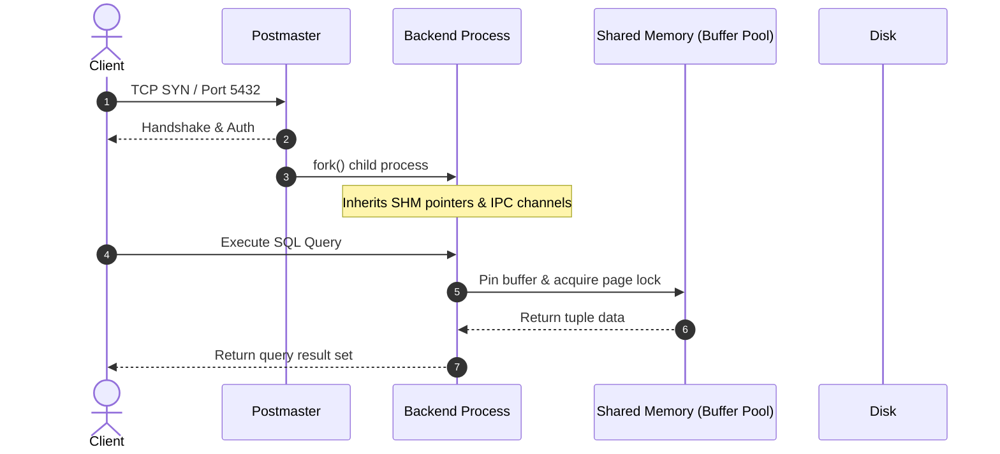
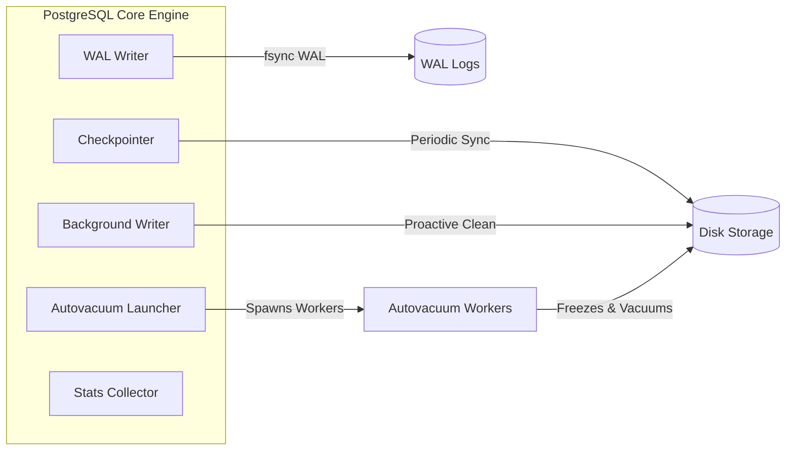

# Lesson 2: Architecture, Process Model & Shared Memory Subsystems

## 1. The Postmaster Daemon and Process-per-Connection Model

Unlike threaded relational database management systems such as MySQL or Microsoft SQL Server, PostgreSQL adheres strictly to a multi-process architecture rooted in UNIX philosophy. At the apex of the process hierarchy sits the Postmaster daemon (`postgres`), which acts as the supervisor, socket listener, and lifecycle orchestrator.

When a client application initiates a TCP connection to the PostgreSQL server (typically on port 5432), the Postmaster accepts the connection, performs initial TLS and authentication handshakes, and executes a POSIX `fork()` system call to spawn a dedicated backend process (`postgres: user db host [client]`). This dedicated worker inherits file descriptors and shared memory pointers from the parent, dedicating its compute execution exclusively to servicing the client's session.



### The Architectural Trade-Offs of Multi-Process Isolation
This architecture yields substantial resilience advantages:
1. **Memory Isolation:** Because each backend process runs in its own virtual address space protected by hardware page tables (MMU), a segmentation fault, memory leak, or illegal memory access in one backend process cannot directly corrupt the private memory heap of other active sessions.
2. **Crash Resilience:** If a backend process encounters an unrecoverable failure (such as a hardware memory error or panicking C extension), the Postmaster receives `SIGCHLD`, immediately flags shared memory as potentially tainted, terminates all sibling backends via `SIGQUIT`, and initiates crash recovery from the latest WAL checkpoint without requiring an operating system reboot.
3. **Memory Overhead:** The drawback is operating system overhead. A fork-per-connection architecture incurs per-process memory footprints (allocating stack space, local process memory such as `work_mem` and `maintenance_work_mem`, and kernel process table entries). Consequently, PostgreSQL cannot scale to tens of thousands of direct concurrent connections without an external connection pooler like PgBouncer.

---

## 2. Shared Memory Architecture & Buffer Pool Mechanics

While backend processes run in distinct address spaces, they coordinate access to data files, transaction states, and lock tables through an operating system shared memory segment allocated via POSIX `shm_open()` or System V IPC.

```
+-----------------------------------------------------------------------------------+
|                        PostgreSQL Shared Memory Segment                           |
+--------------------------+-----------------------+--------------------------------+
| Buffer Pool              | WAL Buffers           | Lock Manager & ProcArray       |
| (shared_buffers: 8KB pp) | (wal_buffers: ~16MB)  | (Heavyweight locks, LWLock)    |
+--------------------------+-----------------------+--------------------------------+
```

### 2.1. The Buffer Pool (`shared_buffers`)
PostgreSQL interacts with disk storage in fixed-size blocks called **pages**, which default to 8192 bytes (8KB). Disk I/O isorders of magnitude slower than DRAM access; hence, PostgreSQL reserves a massive continuous cache in shared memory governed by the configuration parameter `shared_buffers` (typically sized between 25% and 40% of total host RAM).

When a backend requires a tuple from a relation, it executes the following access protocol:
1. **Hash Lookup:** It checks the buffer mapping hash table to determine if the requested `(RelFileNode, ForkNumber, BlockNumber)` is already present in `shared_buffers`.
2. **Buffer Cache Hit:** If the page exists, the backend pins the buffer tag (incrementing its reference count to prevent eviction) and acquires a shared lock (`LWLock`) on the page header to read the requested tuple.
3. **Buffer Cache Miss & Double Buffering:** If the page is absent, the backend allocates a free buffer slot (or evicts an unpinned page using the Clock Sweep algorithm) and issues a POSIX `read()` or `pread()` system call. Notice that this leads to **double buffering**: the block is read from storage into the Linux Kernel Page Cache before being copied into PostgreSQL's `shared_buffers`.

### 2.2. The Clock-Sweep Eviction Algorithm
Rather than maintaining an expensive Least Recently Used (LRU) linked list protected by global mutexes (which would create intolerable lock contention across dozens of concurrent CPU cores), PostgreSQL implements a circular **Clock Sweep** algorithm:
- Each buffer header maintains a `usage_count` integer (ranging from 0 to 5).
- Whenever a backend accesses a page, it increments its `usage_count` (capped at 5).
- When a new buffer slot must be found, a global clock hand iterates through the circular buffer array:
  - If a page has `usage_count > 0`, the hand decrements `usage_count` by 1 and advances to the next slot.
  - If a page has `usage_count == 0` and its pin count is 0, this buffer is selected as the eviction victim.
  - If the victim page is dirty (modified in memory), it is written to disk before being reused.

---

## 3. Specialized Background Worker Processes

To ensure backends remain focused on servicing interactive queries with minimal latency, PostgreSQL offloads asynchronous maintenance, durability, and coordination to dedicated background processes spawned and monitored by the Postmaster.



### 3.1. The Checkpointer Process
The Checkpointer guarantees crash-recovery bounds. Every `checkpoint_timeout` (default 5 minutes) or when WAL volume reaches `max_wal_size`:
1. It flushes all currently dirty shared buffers out to disk via `write()` and executes `fsync()` on underlying file descriptors.
2. It writes a special `CHECKPOINT` record into the WAL stream containing the Redo Log Sequence Number (LSN).
3. Any WAL segment generated prior to this Redo LSN can be safely recycled, bounding the time needed for crash recovery upon restart.

### 3.2. The Background Writer (`bgwriter`)
If backends had to execute synchronous disk writes whenever the Clock Sweep landed on a dirty page, client latency would exhibit catastrophic spikes. The `bgwriter` process continuously scans shared buffers ahead of client backends, writing dirty pages to disk asynchronously so that client workers almost always find pristine, clean pages ready for immediate allocation.

### 3.3. The WAL Writer (`walwriter`)
The Write-Ahead Log records every transaction mutation before that mutation is applied to shared heap pages. While committing transactions normally invoke synchronous WAL flushing, the `walwriter` periodically issues asynchronous batch `fsync()` operations, amortizing storage write amplification during high-throughput workloads.

### 3.4. The Autovacuum Launcher & Workers
Because MVCC generates new tuple versions on every `UPDATE` and leaves dead row headers on `DELETE`, tables accumulate bloat over time. The Autovacuum Launcher periodically examines the system catalog statistics, spawning transient worker processes (`autovacuum worker`) to reclaim dead tuple slots, prevent Transaction ID wraparound, and refresh optimizer statistics via `ANALYZE`.
