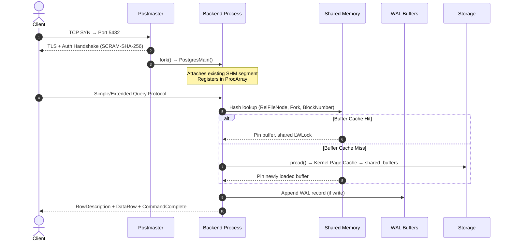
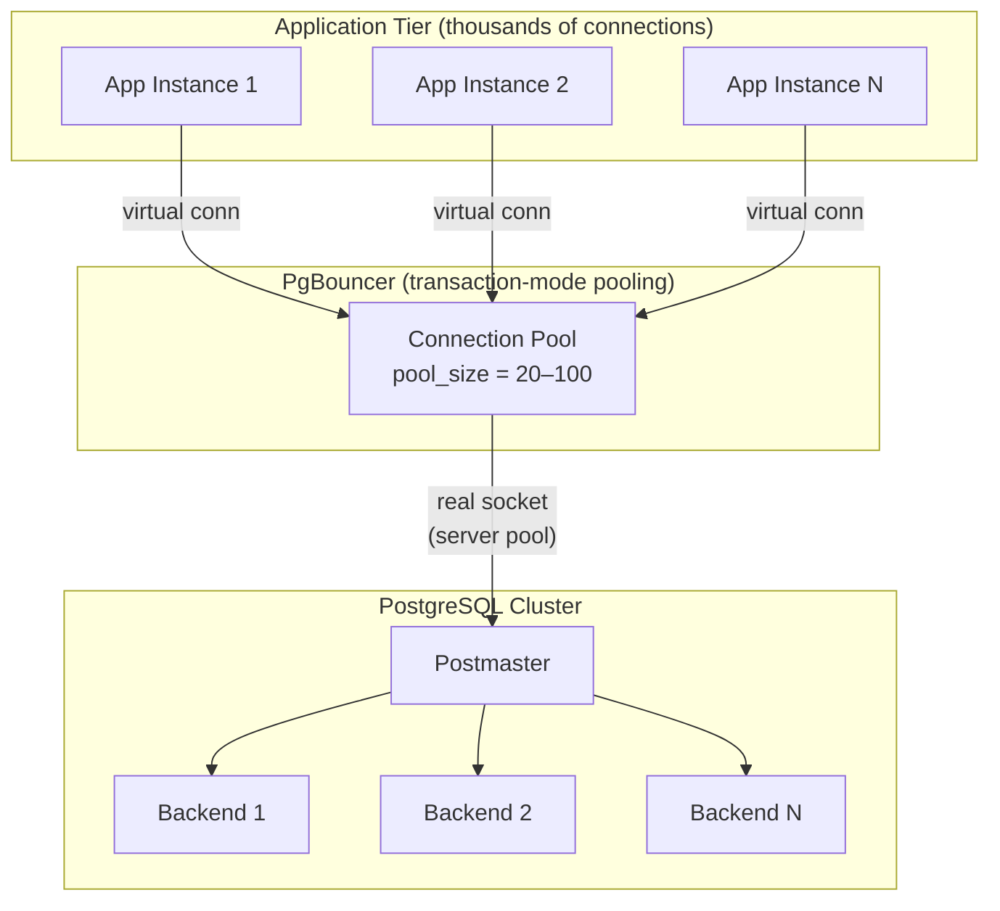
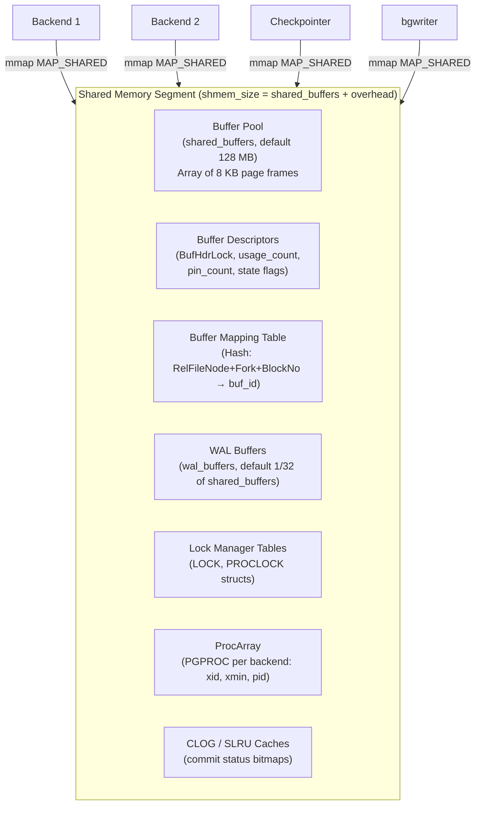
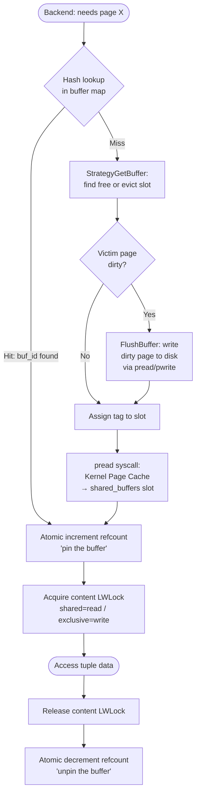
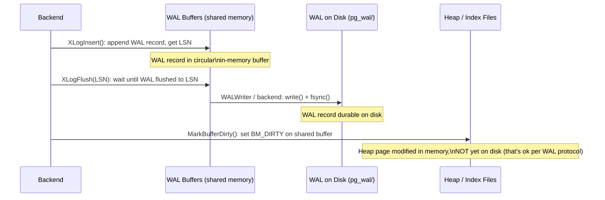
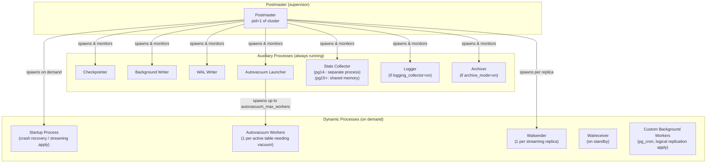
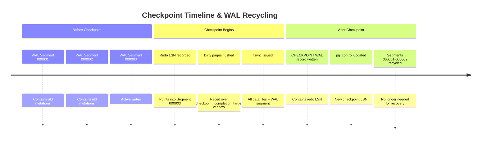
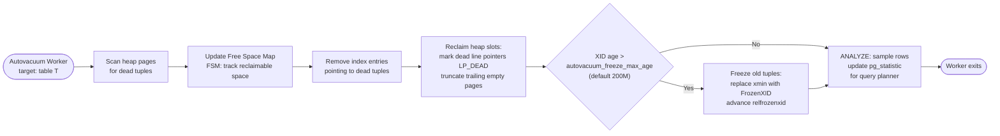
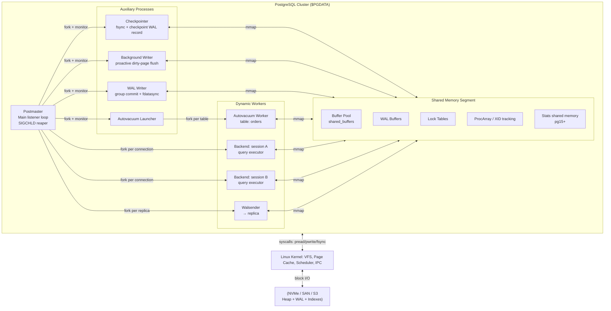

# Lesson 2: Architecture, Process Model & Shared Memory Subsystems

## 1. The Postmaster Daemon and Process-per-Connection Model

Unlike threaded database engines such as MySQL or Microsoft SQL Server—which multiplex client sessions across a shared OS thread pool within a single address space—PostgreSQL adheres strictly to a **multi-process architecture** rooted in UNIX philosophy. Each client session receives its own dedicated OS process, isolated by hardware-enforced virtual memory boundaries. At the apex of the process hierarchy sits the **Postmaster** (`postgres`), which acts as the supervisor, socket listener, and lifecycle orchestrator for the entire cluster.

When a client initiates a TCP connection to the server (port 5432 by default), the Postmaster accepts the socket, performs the initial TLS negotiation and authentication handshake (password, GSSAPI, SCRAM-SHA-256, `pg_hba.conf` policy evaluation), then executes a POSIX `fork(2)` system call to spawn a dedicated **backend process**. That child process inherits the parent's open file descriptors, shared memory attachment mappings, and IPC channel registrations. After `fork()`, the child immediately calls the `PostgresMain()` entry point—which is the main query execution loop—while the Postmaster returns to its `accept(2)` loop awaiting the next incoming connection.



### 1.1 Why `fork()` Instead of Threads

The choice of `fork()` over `pthread_create()` is not accidental nor merely historical—it reflects a deliberate correctness trade-off with deep architectural consequences.

In a multi-threaded model, all threads share the same virtual address space and heap. A single errant pointer write in one thread can silently corrupt data structures used by every concurrent session, including the buffer pool, the transaction commit log, and the lock manager. Such corruption may not manifest until far later, making root-cause analysis extraordinarily difficult. By contrast, `fork()` gives each backend its own **hardware-isolated address space** enforced by the CPU's Memory Management Unit (MMU). The kernel's page tables map each process's virtual addresses to independent physical pages. A segmentation fault (`SIGSEGV`) in one backend terminates only that process; shared memory and all other backends remain intact.

A secondary motivation is **signal-based lifecycle management**. The Postmaster relies on `SIGCHLD` delivery when a child terminates, which is a clean, well-understood UNIX mechanism for reaping processes. The equivalent in a threaded model—detecting thread death, cleaning up thread-local state, and preventing deadlocks across surviving threads—is substantially more complex and error-prone.

### 1.2 Crash Recovery via SIGCHLD

If a backend process encounters an unrecoverable failure, the kernel delivers `SIGCHLD` to the Postmaster. The Postmaster's `SIGCHLD` handler calls `reaper()`, which inspects the child's exit status via `waitpid(2)`. If the exit was abnormal (non-zero status, killed by a signal other than `SIGTERM`), the Postmaster:

1. Marks shared memory as potentially tainted by setting the `ProcGlobal->startupBufferPinWaitBufId` flag.
2. Broadcasts `SIGQUIT` to all remaining backend children and auxiliary processes—`SIGQUIT` instructs PostgreSQL processes to terminate immediately without attempting graceful cleanup.
3. Calls `StartupDataBase()`, which launches the startup process to replay WAL from the most recent consistent checkpoint, restoring the cluster to a transactionally consistent state.

This entire recovery sequence is bounded by `recovery_target` parameters and typically completes in seconds for OLTP workloads, without requiring an OS reboot.

### 1.3 The Connection Scalability Problem

The process-per-connection model's principal liability is **memory and scheduling overhead**. Each backend allocates:

- A kernel process control block (PCB) and virtual memory descriptor (~50–100 KB of kernel memory on Linux).
- A private stack and heap, including local copies of GUC parameters, catalog caches, and executor state.
- `work_mem` for sort and hash operations (not pre-allocated, but reserved in virtual address space).
- File descriptor table entries (each relation, index, and WAL segment opened by the session).

At 500+ concurrent connections, the aggregate overhead of kernel scheduling, process context switching, and cache thrashing across hundreds of hot CPU caches becomes a measurable throughput penalty—even when most sessions are idle. Empirically, direct connection counts above ~300–500 on commodity hardware begin to degrade throughput. This is why production deployments universally front PostgreSQL with a **connection pooler** (PgBouncer in transaction-mode pooling being the canonical choice), which multiplexes thousands of application-layer connections onto a small pool of actual backend processes.



---

## 2. Shared Memory Architecture & Buffer Pool Mechanics

While backend processes occupy distinct virtual address spaces, they coordinate access to data pages, transaction states, and locking infrastructure through a **shared memory segment** that all PostgreSQL processes attach to at startup. On Linux, PostgreSQL allocates this segment using POSIX `shm_open(2)` / `mmap(2)` with `MAP_SHARED`, or falls back to System V IPC (`shmget(2)`) depending on the kernel configuration and `dynamic_shared_memory_type` GUC. The key insight is that all these processes map the **same physical memory pages** into their respective virtual address spaces: writes by one process are immediately visible to all others without any data copying.



### 2.1 Anatomy of a Buffer Descriptor

Every slot in the buffer pool has a corresponding **buffer descriptor** (`BufferDesc` in `src/include/storage/buf_internals.h`). Understanding its fields is essential to understanding how concurrent access is safely coordinated:

```c
/*
 * Simplified from PostgreSQL src/include/storage/buf_internals.h
 * (actual struct uses atomic types for thread-safe access in some paths)
 */
typedef struct BufferDesc {
    BufferTag   tag;            /* (RelFileNode, ForkNumber, BlockNumber) */
    int         buf_id;         /* buffer's index in pool array (0-based) */

    /* State word: packed bitfield (pg_atomic_uint32) */
    /* Bits: BM_LOCKED | BM_DIRTY | BM_VALID | BM_TAG_VALID |            */
    /*       BM_IO_IN_PROGRESS | BM_IO_ERROR | BM_JUST_DIRTIED           */
    pg_atomic_uint32 state;

    int         wait_backend_pid; /* pid waiting for I/O to complete */

    /* LWLock protecting the descriptor's tag and state fields */
    LWLock      buf_hdr_lock;

    /* Refcount: number of backends currently pinning this buffer */
    /* (accessed via atomic ops, not under buf_hdr_lock)                  */
    pg_atomic_uint32 refcount;

    int         usage_count;    /* clock-sweep recency counter (0–5) */
    int         freeNext;       /* freelist linkage */
} BufferDesc;
```

The `state` word packs several flags into a single atomic 32-bit integer so that common transitions (e.g., marking a buffer dirty) can be executed with a single compare-and-swap (CAS) instruction rather than acquiring a mutex.

### 2.2 The Buffer Access Protocol in Detail

When a backend needs a specific page, it executes the following sequence inside `ReadBuffer()` / `ReadBufferExtended()`:

**Step 1 — Hash Lookup.** The backend hashes the `BufferTag` `(RelFileNode, ForkNumber, BlockNumber)` using a partitioned hash table (`NUM_BUFFER_PARTITIONS = 128` partitions, each protected by its own `LWLock`). This partitioning reduces lock contention dramatically: rather than a single global hash table lock serializing all buffer lookups, contention is spread across 128 independent lock domains. The backend acquires only the partition lock covering its hash bucket, checks for the tag, and releases the lock immediately after recording the `buf_id`.

**Step 2 — Pin the Buffer.** On a cache hit, the backend atomically increments the buffer's `refcount` (pin count) using `pg_atomic_fetch_add_u32()`. Pinning is the mechanism that prevents the Clock Sweep eviction algorithm from stealing the buffer while the backend is using it—the eviction path refuses to evict any buffer with `refcount > 0`.

**Step 3 — Acquire Content Lock.** For reading, the backend acquires a **shared** `LWLock` on the buffer's content lock. For writing (before modifying a tuple), it acquires an **exclusive** `LWLock`. This is a lightweight lock (implemented as an OS-level futex on Linux, `pthread_mutex` on some platforms), not a heavyweight advisory lock. It is released as soon as the read or write to the in-memory page completes.

**Step 4 — Cache Miss: I/O Path.** On a miss, the backend calls `StrategyGetBuffer()` to obtain a free slot (described below), sets the buffer's tag, marks it `BM_IO_IN_PROGRESS`, releases the partition lock, then issues `smgrread()` → `mdread()` → `FileRead()` → `pread(2)`. The `pread(2)` call copies the block from the **kernel page cache** into the buffer pool slot, introducing the well-known **double-buffering** effect: the block occupies both the kernel's page cache (managed by the VFS layer) and PostgreSQL's `shared_buffers`. This is unavoidable when using buffered I/O, which is why `effective_cache_size` is used by the query planner to account for OS-level caching—it does not allocate memory but tells the planner how much of the filesystem cache it can assume is available.



### 2.3 The Clock-Sweep Eviction Algorithm

Maintaining a strict Least Recently Used (LRU) list would require updating a doubly-linked list under a global mutex on every single buffer access—this would create a serialization bottleneck catastrophic at dozens of concurrent cores. PostgreSQL instead uses a **Clock Sweep** approximation, which is a hardware-cache-friendly, O(1) amortized eviction policy requiring no global linked-list updates.

The algorithm operates as follows:

- Each `BufferDesc` carries a `usage_count` field, an integer in the range `[0, 5]`.
- When a backend accesses (pins) a buffer, it sets `usage_count` to `min(usage_count + 1, 5)` using a non-blocking atomic update. The cap of 5 prevents frequently-accessed hot pages from becoming permanently immune to eviction.
- A global **clock hand** (`StrategyControl->nextVictimBuffer`) advances monotonically through the circular buffer array. When `StrategyGetBuffer()` needs a free slot, it spins the clock hand:
  - If `refcount > 0` → buffer is pinned, skip.
  - If `usage_count > 0` → decrement `usage_count` by 1, advance hand.
  - If `usage_count == 0` and `refcount == 0` → this buffer is the eviction victim.
- If the victim has the `BM_DIRTY` flag set, it must be written to disk before the slot can be reused. This write is a synchronous `pwrite(2)` on the backend's execution path—a source of write latency for unlucky backends. The Background Writer's purpose is to prevent this by proactively cleaning dirty pages so the clock hand finds clean victims.

This algorithm is a close analogue of the **Second Chance** (or NRU, Not Recently Used) page replacement algorithm used in OS virtual memory managers, adapted for the specific constraint that PostgreSQL's buffer pool is a fixed-size, pre-allocated array in shared memory rather than a dynamically-managed heap.

---

## 3. Write-Ahead Logging and Durability Primitives

Before examining the background process hierarchy, it is necessary to understand the WAL subsystem, since several background processes exist specifically to manage WAL flushing and recovery bounds.

The **Write-Ahead Log** is a sequential append-only log stored in `$PGDATA/pg_wal/`. Its fundamental invariant—the **WAL protocol**—states: *no modified data page may be written to its permanent location on disk until the WAL record describing that modification has first been flushed to durable storage.* This guarantees that any incomplete modification caused by a crash can be **redone** from the WAL during recovery.

Each WAL record is identified by its **Log Sequence Number (LSN)**, a monotonically increasing `uint64` byte offset within the logical WAL stream (`XLogRecPtr` in PostgreSQL source). LSNs are the universal clock of PostgreSQL's durability and replication systems.



WAL segments are fixed-size files (default 16 MB, configurable at `initdb` time with `--wal-segsize`). The WAL writer and backends write to WAL buffers in shared memory; those buffers are periodically flushed to the WAL segment files on disk.

---

## 4. Specialized Background Worker Processes

The Postmaster spawns a set of **auxiliary processes** at cluster startup. These are distinct from user-spawned backends: they perform continuous or periodic maintenance tasks that must not burden interactive query latency. All auxiliary processes are monitored by the Postmaster via `SIGCHLD`; if any dies abnormally, the Postmaster treats it as a crash event and initiates cluster recovery.



### 4.1 The Checkpointer Process

The Checkpointer is the process responsible for establishing **recovery bounds**—the guarantee that crash recovery will complete within a predictable time window. Without periodic checkpoints, WAL would grow unboundedly and crash recovery would need to replay the entire WAL history from the beginning of time.

A checkpoint is triggered by one of two conditions:
- **Time-based:** `checkpoint_timeout` seconds have elapsed since the last checkpoint (default: 5 minutes).
- **WAL-volume-based:** The WAL stream has grown by more than `max_wal_size` bytes beyond the last checkpoint LSN (default: 1 GB).

The checkpoint procedure is intentionally **spread over time** (controlled by `checkpoint_completion_target`, default 0.9) to avoid a thundering-herd I/O spike. The Checkpointer does not write all dirty buffers at once; it iterates through shared buffers and issues writes paced to complete within `checkpoint_timeout × checkpoint_completion_target` seconds. The sequence is:

1. Record the current WAL insert position as the **redo LSN** (the point from which replay must begin if a crash occurs immediately after this checkpoint).
2. Iterate through all dirty shared buffers, issuing `write(2)` for each. This flushes data from `shared_buffers` into the kernel page cache.
3. Issue `fsync(2)` on all data files and the WAL segment, flushing kernel page cache to durable storage.
4. Write a `XLOG_CHECKPOINT_ONLINE` or `XLOG_CHECKPOINT_SHUTDOWN` WAL record containing the redo LSN, the transaction ID horizon, and the list of active transactions.
5. Update `pg_control` (a small binary file in `$PGDATA/global/pg_control`) with the checkpoint LSN. This is the first file read during crash recovery—it identifies where to begin WAL replay.

After a successful checkpoint, all WAL segments with LSNs **prior to the redo LSN** are no longer needed for crash recovery and can be recycled (renamed and reused) or removed.



### 4.2 The Background Writer (`bgwriter`)

The Background Writer's sole mission is to **proactively clean dirty buffers** so that the Clock Sweep eviction algorithm finds clean pages ready for immediate reuse, eliminating synchronous write latency from the backend's execution path.

The `bgwriter` wakes periodically (controlled by `bgwriter_delay`, default 200 ms) and scans a limited number of buffers per round (controlled by `bgwriter_lru_maxpages`, default 100 buffers per round, with write amplification throttled by `bgwriter_lru_multiplier`). It writes dirty pages with `usage_count` near zero—pages the Clock Sweep is likely to target next—to their heap files, clearing the `BM_DIRTY` flag. The key distinction from the Checkpointer is that the Background Writer does **not** `fsync()` the files it writes; it merely flushes data from `shared_buffers` to the kernel page cache. The Checkpointer is responsible for the durable `fsync()` barrier.

The practical effect: backends executing `SELECT` or `INSERT` workloads rarely need to perform synchronous writes themselves. The `buffers_clean` metric in `pg_stat_bgwriter` tracks how effectively the bgwriter is running ahead of backends. A high `buffers_backend` count (backends forced to write dirty pages themselves) indicates the bgwriter is under-configured relative to write workload.

### 4.3 The WAL Writer (`walwriter`)

Transactions that modify data must have their WAL records flushed to disk before returning `COMMIT` acknowledgment to the client (when `synchronous_commit = on`). Without a dedicated WAL writer, every committing transaction would individually issue `write(2)` + `fsync(2)` on the WAL file—a severe write amplification problem.

The `walwriter` runs in a tight loop with configurable sleep intervals (`wal_writer_delay`, default 200 ms; `wal_writer_flush_after`, default 1 MB). It performs **group commit**: it coalesces the WAL records of multiple concurrently committing transactions into a single `write()` + `fdatasync()` call. A transaction waiting for WAL flush calls `XLogFlush()`, which puts it to sleep on a condition variable; the WAL writer wakes, flushes, then broadcasts to all waiting backends simultaneously. This batching behavior means that at high transaction rates, the per-transaction fsync cost is amortized across many transactions, dramatically improving throughput.

The impact is quantifiable: on NVMe storage with ~100 µs fsync latency, a single-threaded commit loop achieves ~10,000 TPS. With group commit via the WAL writer, the same hardware can sustain 50,000–100,000+ TPS because many transactions share each fsync.

### 4.4 The Autovacuum Launcher and Workers

PostgreSQL's MVCC implementation stores each tuple version as a separate physical row on the heap page, identified by a `(xmin, xmax)` transaction ID pair. An `UPDATE` does not modify the existing tuple in place; it inserts a new tuple version with the new data and marks the old version's `xmax` with the deleting transaction's ID. A `DELETE` only marks `xmax`—the physical row remains on the page. This design allows concurrent readers to see old versions without blocking writers, but it means **dead tuple accumulation** is a fundamental characteristic of the storage model, not an edge case.

Without reclamation, two critical failure modes emerge:

1. **Table Bloat:** Heap pages fill with dead tuples, reducing effective page density and forcing sequential scans to read far more pages than necessary.
2. **Transaction ID Wraparound:** PostgreSQL uses 32-bit transaction IDs (`xid`). With ~4.3 billion possible values and circular arithmetic, an XID that was once "in the future" eventually becomes "in the past." If a table has not been vacuumed to advance its `relfrozenxid`, tuples with old XIDs become invisible as the counter wraps, causing **data loss**. This is a hard constraint, not a theoretical concern.

The **Autovacuum Launcher** is a persistent process that wakes every `autovacuum_naptime` seconds (default 60 s) and queries `pg_stat_user_tables` for tables where `n_dead_tup / (n_live_tup + n_dead_tup)` exceeds `autovacuum_vacuum_scale_factor` (default 0.2 = 20%), or where `n_mod_since_analyze` exceeds the analyze threshold. For each qualifying table, it asks the Postmaster to fork an **Autovacuum Worker** process (up to `autovacuum_max_workers` = 3 concurrently by default).

Each worker executes the following on its target table:



The XID freeze operation is worth emphasizing: when autovacuum writes `FrozenTransactionId` (special XID 2) into a tuple's `xmin`, it is permanently marking that tuple as "visible to all future transactions regardless of snapshot." This breaks the XID comparison cycle and allows the cluster's transaction counter to safely advance past the 32-bit boundary without rendering the tuple invisible. Tables that have not been vacuumed within `autovacuum_freeze_max_age` transactions (default 200 million) will trigger an aggressive **anti-wraparound vacuum**, which ignores normal cost-delay throttling and forcibly freezes all pages of the table.

### 4.5 The Statistics Collector (pg_stat_*)

In PostgreSQL 14 and earlier, a dedicated **Stats Collector** process received statistics messages (tuple counts, block I/O counts, function call counts) via UDP sockets from backends and aggregated them into `pg_stat_*` views stored in flat files in `$PGDATA/pg_stat_tmp/`. This architecture had a known flaw: stats were always slightly stale because they were updated asynchronously.

In **PostgreSQL 15**, the Stats Collector process was **eliminated entirely**. Statistics are now maintained directly in shared memory in dynamically-allocated hash tables, updated by backends in-place using atomic operations. The `pg_stat_*` views query this shared memory directly, providing much lower latency and more accurate statistics. This is a material architectural change that improved autovacuum decision quality, as the launcher now reads live statistics rather than a recently-flushed snapshot.

---

## 5. The Full Process Hierarchy: A Unified View

The following diagram synthesizes the complete runtime process model for a running PostgreSQL 16 cluster under production load:



---

## 6. Practical Tuning Implications

The architectural concepts above translate directly into concrete configuration decisions.

**`shared_buffers`:** Set to 25–40% of total RAM. Larger values reduce kernel page cache space; PostgreSQL's sequential scan workloads benefit more from OS page cache than from `shared_buffers` hits (since PostgreSQL issues `fadvise(POSIX_FADV_SEQUENTIAL)` hints for large scans). The sweet spot depends on the workload's random vs. sequential I/O ratio.

**`wal_buffers`:** The default auto-tuning (`-1`, which sets `1/32 of shared_buffers`, capped at 16 MB) is adequate for most workloads. For write-intensive systems, increase to 64 MB. WAL buffers only need to hold WAL generated between consecutive WAL writer flushes, so very large values yield no benefit.

**`checkpoint_timeout` / `max_wal_size`:** These two parameters jointly control checkpoint frequency. Increasing `max_wal_size` (e.g., to 4–8 GB on NVMe) reduces checkpoint frequency, reduces write amplification, and smooths I/O at the cost of longer potential crash recovery time. The relationship is: `recovery_time ≈ WAL_generated_since_checkpoint / redo_replay_rate`. On modern hardware with NVMe, WAL replay rates exceed 500 MB/s, so 8 GB of WAL replays in ~16 seconds—acceptable for most SLAs.

**`autovacuum_vacuum_cost_delay`:** Autovacuum is throttled by a cost-delay mechanism to avoid starving interactive queries for I/O. Each vacuum operation accumulates a cost (8 per buffer hit, 20 per buffer miss, 2 per buffer dirtied); when the cost exceeds `autovacuum_vacuum_cost_limit` (default 200), the worker sleeps `autovacuum_vacuum_cost_delay` ms (default 2 ms). On fast NVMe storage, this throttling is often too conservative. Setting `autovacuum_vacuum_cost_delay = 0` on NVMe systems disables throttling entirely, allowing autovacuum to run at full speed—this is frequently the correct choice for high-write OLTP deployments.

**`max_connections`:** Set conservatively (100–300) and deploy PgBouncer in transaction-mode pooling. Each additional idle backend consumes ~5–10 MB of RAM and kernel scheduling overhead. The `pg_stat_activity` view's `state = 'idle'` rows are the clearest signal that connections are being wasted.

---

## Summary

PostgreSQL's architecture is a coherent system of deliberate trade-offs: process isolation buys crash safety at the cost of connection scalability; the buffer pool's Clock Sweep approximation buys lock-free scalability at the cost of LRU precision; WAL's sequential append-only design buys durability at the cost of write amplification managed by background flushing; and MVCC's tuple-versioning design buys lock-free reads at the cost of dead tuple accumulation managed by autovacuum. Each background process exists specifically to handle one of these ongoing maintenance obligations—keeping the visible query-serving surface of the system clean, fast, and within safe operational bounds.
