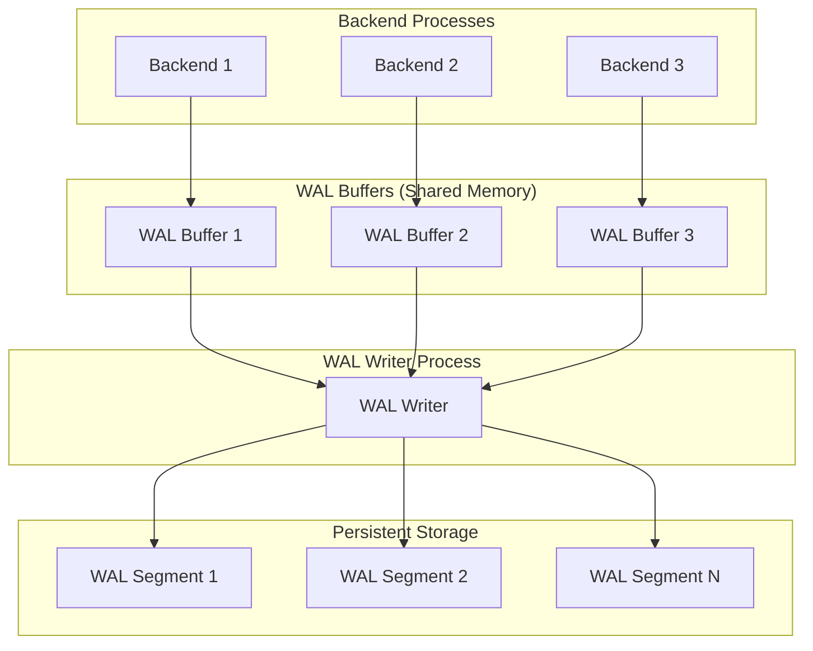
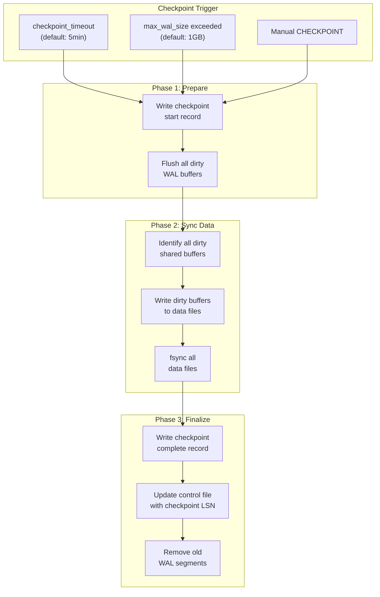
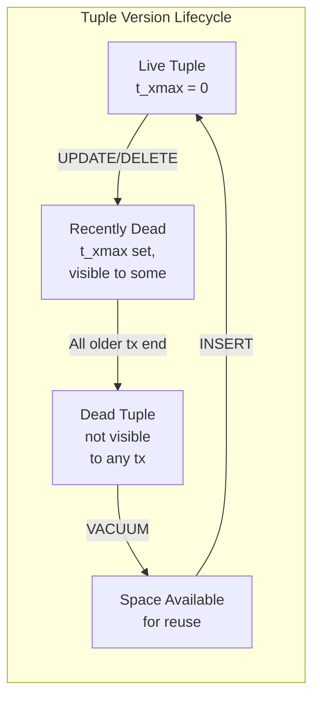
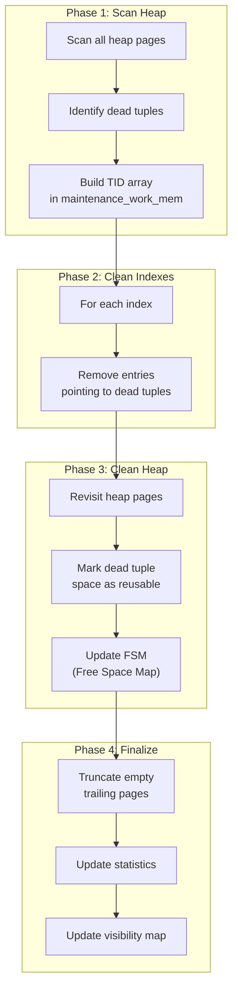
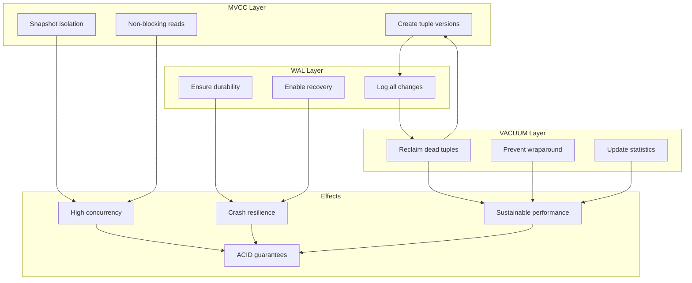

# Lesson 03: MVCC, WAL, and VACUUM

## Introduction

PostgreSQL's architecture rests on three foundational pillars that together deliver ACID guarantees, concurrent access, and crash recovery: Multi-Version Concurrency Control (MVCC), the Write-Ahead Log (WAL), and the VACUUM process. Understanding these mechanisms at a deep level is essential for building high-performance, reliable systems.

This lesson provides a comprehensive exploration of how PostgreSQL manages concurrent transactions, ensures durability, and maintains data integrity through these interconnected subsystems.

## 1. Multi-Version Concurrency Control (MVCC)

### 1.1 First Principles

Traditional locking-based concurrency control creates contention: readers block writers, writers block readers. MVCC eliminates this by maintaining multiple versions of each row, allowing transactions to operate on consistent snapshots without blocking.

**Core Invariants:**

1. **Snapshot Isolation**: Each transaction sees a consistent snapshot of the database as it existed at transaction start
2. **Non-blocking Reads**: Readers never block writers, writers never block readers
3. **Version Visibility**: Each tuple version has visibility metadata determining which transactions can see it

### 1.2 Transaction IDs and Tuple Visibility

PostgreSQL uses a 32-bit transaction ID (XID) counter that wraps around at 2³² transactions. Every transaction receives a sequential XID.

**Tuple Header Structure:**

```c
typedef struct HeapTupleHeaderData {
    TransactionId t_xmin;        // XID that inserted this version
    TransactionId t_xmax;        // XID that deleted/updated this version
    CommandId     t_cid;         // Command ID within transaction
    ItemPointerData t_ctid;      // Current tuple ID (for updates)
    uint16        t_infomask2;   // Flags and field count
    uint16        t_infomask;    // Various flag bits
    uint8         t_hoff;        // Header offset
    bits8         t_bits[1];     // Null bitmap (variable length)
} HeapTupleHeaderData;
```

**Visibility Rules:**

A tuple version is visible to transaction T with XID = T_xid and snapshot time T_snap if:

```
VISIBLE(tuple, T) ⟺ 
    (tuple.t_xmin < T_snap) ∧                    // Inserted before snapshot
    (tuple.t_xmin committed at T_snap) ∧         // Inserting tx committed
    (tuple.t_xmax = 0 ∨                          // Not deleted, OR
     (tuple.t_xmax > T_snap ∨                    // Deleted after snapshot, OR
      tuple.t_xmax not committed at T_snap))     // Deleting tx not committed
```

### 1.3 Transaction Snapshots

A snapshot captures the state of all transactions at a point in time:

```c
typedef struct SnapshotData {
    TransactionId xmin;          // Lowest still-running XID
    TransactionId xmax;          // Highest assigned XID + 1
    uint32        xcnt;          // Number of XIDs in xip[]
    TransactionId *xip;          // Array of in-progress XIDs
    SubTransactionId subxcnt;    // Subtransaction count
    SubTransactionId *subxip;    // In-progress subtransaction IDs
} SnapshotData;
```

**Snapshot Visibility Algorithm:**

```python
def is_visible(tuple_xmin, tuple_xmax, snapshot):
    """
    Determine if a tuple version is visible to a snapshot.
    """
    # Check if inserting transaction is visible
    if tuple_xmin >= snapshot.xmax:
        return False  # Inserted after snapshot
    
    if tuple_xmin >= snapshot.xmin:
        if tuple_xmin in snapshot.xip:
            return False  # Inserting tx still in progress
    
    # Check if tuple is not deleted or deletion is not visible
    if tuple_xmax == 0:
        return True  # Not deleted
    
    if tuple_xmax >= snapshot.xmax:
        return True  # Deleted after snapshot
    
    if tuple_xmax >= snapshot.xmin:
        if tuple_xmax in snapshot.xip:
            return True  # Deleting tx still in progress
    
    # Deleted by committed transaction before snapshot
    return False
```

### 1.4 MVCC Implementation Example

```sql
-- Setup demonstration table
CREATE TABLE mvcc_demo (
    id SERIAL PRIMARY KEY,
    value TEXT,
    version INT DEFAULT 1
);

-- Insert initial data
INSERT INTO mvcc_demo (value) VALUES ('initial');

-- Check tuple visibility metadata
CREATE EXTENSION IF NOT EXISTS pageinspect;

-- View tuple header information
SELECT lp, t_xmin, t_xmax, t_field3 as t_cid_or_xvac, t_ctid
FROM heap_page_items(get_raw_page('mvcc_demo', 0));
```

**Concurrent Transaction Scenario:**

```sql
-- Session 1: Begin transaction
BEGIN;
SELECT txid_current();  -- Get XID, assume returns 1000

-- Session 2: Begin concurrent transaction
BEGIN;
SELECT txid_current();  -- Returns 1001

-- Session 1: Update row
UPDATE mvcc_demo SET value = 'updated_v1' WHERE id = 1;
-- Creates new tuple version with t_xmin=1000, old tuple t_xmax=1000

-- Session 2: Query sees old version (Session 1 not committed)
SELECT * FROM mvcc_demo WHERE id = 1;
-- Returns 'initial' because tuple with t_xmin=1000 is not visible

-- Session 1: Commit
COMMIT;

-- Session 2: Still sees old version (snapshot taken at BEGIN)
SELECT * FROM mvcc_demo WHERE id = 1;
-- Still returns 'initial'

-- Session 2: Commit and start new transaction
COMMIT;
BEGIN;
SELECT * FROM mvcc_demo WHERE id = 1;
-- Now returns 'updated_v1'
```

### 1.5 MVCC Overhead and Bloat

Each update creates a new tuple version, leaving the old version as "dead" until VACUUM removes it.

**Bloat Calculation:**

```sql
-- Function to estimate table bloat
CREATE OR REPLACE FUNCTION table_bloat_estimate(tablename TEXT)
RETURNS TABLE(
    table_name TEXT,
    real_size_bytes BIGINT,
    estimated_live_bytes BIGINT,
    estimated_dead_bytes BIGINT,
    bloat_ratio NUMERIC
) AS $$
BEGIN
    RETURN QUERY
    SELECT 
        tablename::TEXT,
        pg_total_relation_size(tablename::regclass) AS real_size_bytes,
        (SELECT reltuples * 
         (SELECT AVG(pg_column_size(t.*)) FROM (SELECT * FROM tablename LIMIT 1000) t)
        )::BIGINT AS estimated_live_bytes,
        (pg_total_relation_size(tablename::regclass) - 
         (SELECT reltuples * 
          (SELECT AVG(pg_column_size(t.*)) FROM (SELECT * FROM tablename LIMIT 1000) t)
         ))::BIGINT AS estimated_dead_bytes,
        ROUND(
            (pg_total_relation_size(tablename::regclass)::NUMERIC / 
             NULLIF((SELECT reltuples * 
                     (SELECT AVG(pg_column_size(t.*)) FROM (SELECT * FROM tablename LIMIT 1000) t)
                    ), 0)) - 1.0
        , 2) AS bloat_ratio
    FROM pg_class
    WHERE relname = tablename;
END;
$$ LANGUAGE plpgsql;

-- Check bloat
SELECT * FROM table_bloat_estimate('mvcc_demo');
```

### 1.6 Transaction ID Wraparound

The 32-bit XID space wraps around at 2³² (4.3 billion transactions). PostgreSQL uses modulo-2³² arithmetic with a special comparison function.

**XID Comparison:**

```
Transaction ages are compared using:
age(xid) = (current_xid - xid) mod 2³²

XIDs are considered "in the past" if:
age(xid) < 2³¹ (approximately 2.1 billion transactions)
```

**Wraparound Prevention:**

```sql
-- Check transaction age
SELECT datname, age(datfrozenxid) as xid_age, 
       2^31::bigint - age(datfrozenxid) as xids_until_wraparound
FROM pg_database
ORDER BY age(datfrozenxid) DESC;

-- Configure aggressive autovacuum for wraparound prevention
ALTER TABLE critical_table SET (
    autovacuum_freeze_min_age = 50000000,
    autovacuum_freeze_max_age = 200000000,
    autovacuum_freeze_table_age = 150000000
);
```

## 2. Write-Ahead Logging (WAL)

### 2.1 Durability Guarantees

WAL ensures the D in ACID: durability. All changes are written to a sequential log before being applied to data files, enabling crash recovery and replication.

**Core Principle:**

```
∀ change C: log(C) must be persisted to disk before data(C) is visible to other transactions
```

This is the **Write-Ahead Protocol**: the log record must reach stable storage before the data page.

### 2.2 WAL Record Structure

WAL is organized into segments (typically 16MB files) containing sequential records.

**WAL Record Format:**

```c
typedef struct XLogRecord {
    uint32        xl_tot_len;      // Total length of record
    TransactionId xl_xid;          // Transaction ID
    XLogRecPtr    xl_prev;         // Pointer to previous record
    uint8         xl_info;         // Flag bits
    RmgrId        xl_rmid;         // Resource manager ID
    uint16        xl_crc;          // CRC of record data
} XLogRecord;
```

**Record Types:**

- **XLOG_HEAP_INSERT**: Insert new tuple
- **XLOG_HEAP_DELETE**: Delete tuple
- **XLOG_HEAP_UPDATE**: Update tuple
- **XLOG_HEAP_HOT_UPDATE**: Heap-Only Tuple update
- **XLOG_XACT_COMMIT**: Transaction commit
- **XLOG_XACT_ABORT**: Transaction abort
- **XLOG_CHECKPOINT**: Checkpoint record

### 2.3 WAL Insertion and Flushing

**WAL Buffer Architecture:**



**WAL Flush Triggers:**

1. **Transaction Commit**: Backend flushes WAL up to commit record
2. **WAL Buffer Full**: WAL writer flushes when buffers reach threshold
3. **Checkpoint**: All dirty WAL buffers flushed
4. **WAL Segment Switch**: Forced flush on segment boundary

**Flush Mechanism:**

```python
def wal_insert_and_flush(record):
    """
    Pseudo-code for WAL insertion with durability guarantee.
    """
    # 1. Reserve space in WAL buffer
    lsn = reserve_wal_space(len(record))
    
    # 2. Copy record to WAL buffer
    copy_to_wal_buffer(record, lsn)
    
    # 3. For commit records, ensure persistence
    if record.type == COMMIT:
        # Wait for WAL to be flushed up to this LSN
        wait_for_wal_flush(lsn)
    
    return lsn

def wait_for_wal_flush(lsn):
    """
    Block until WAL is persisted up to given LSN.
    """
    while get_last_flushed_lsn() < lsn:
        # Trigger flush if not already in progress
        if not wal_flush_in_progress():
            trigger_wal_flush()
        
        # Wait for flush to complete
        sleep_on_latch()
```

### 2.4 Log Sequence Numbers (LSN)

An LSN is a 64-bit integer representing a byte offset into the WAL stream:

```
LSN = (segment_number << 32) | offset_within_segment
```

**LSN Operations:**

```sql
-- Current WAL insert position
SELECT pg_current_wal_insert_lsn();

-- Current WAL flush position (persisted to disk)
SELECT pg_current_wal_flush_lsn();

-- Calculate WAL distance in bytes
SELECT pg_wal_lsn_diff(pg_current_wal_lsn(), '0/0');

-- Find WAL file for a given LSN
SELECT pg_walfile_name('0/1A2B3C4D');
```

### 2.5 Checkpoints

Checkpoints establish recovery points by flushing all dirty buffers to disk.

**Checkpoint Process:**



**Checkpoint Configuration:**

```sql
-- View checkpoint statistics
SELECT 
    checkpoints_timed,
    checkpoints_req,
    checkpoint_write_time,
    checkpoint_sync_time,
    buffers_checkpoint,
    buffers_clean,
    buffers_backend
FROM pg_stat_bgwriter;

-- Configure checkpoint behavior
ALTER SYSTEM SET checkpoint_timeout = '10min';
ALTER SYSTEM SET checkpoint_completion_target = 0.9;
ALTER SYSTEM SET max_wal_size = '2GB';
ALTER SYSTEM SET min_wal_size = '1GB';
SELECT pg_reload_conf();
```

**Checkpoint Smoothing:**

The `checkpoint_completion_target` parameter spreads I/O over the checkpoint interval:

```
write_rate = dirty_buffers / (checkpoint_timeout × checkpoint_completion_target)
```

### 2.6 Crash Recovery

Recovery replays WAL records from the last checkpoint to restore the database to a consistent state.

**Recovery Algorithm:**

```python
def crash_recovery():
    """
    Simplified crash recovery process.
    """
    # 1. Read control file to find last checkpoint
    checkpoint_lsn = read_control_file().checkpoint_lsn
    
    # 2. Read checkpoint record to get REDO point
    checkpoint_record = read_wal_record(checkpoint_lsn)
    redo_lsn = checkpoint_record.redo_lsn
    
    # 3. Replay all WAL from REDO point
    current_lsn = redo_lsn
    while not end_of_wal(current_lsn):
        record = read_wal_record(current_lsn)
        
        # Apply record to data files
        apply_wal_record(record)
        
        current_lsn = next_wal_record(current_lsn)
    
    # 4. Create new checkpoint
    checkpoint()
    
    # 5. Database is consistent and ready
    return RECOVERY_COMPLETE
```

**WAL Replay Verification:**

```sql
-- During recovery, check progress
SELECT pg_last_wal_replay_lsn();

-- Check if in recovery mode
SELECT pg_is_in_recovery();

-- For standby servers, check replay lag
SELECT 
    pg_last_wal_receive_lsn() - pg_last_wal_replay_lsn() AS replay_lag_bytes,
    EXTRACT(EPOCH FROM (now() - pg_last_xact_replay_timestamp())) AS replay_lag_seconds;
```

### 2.7 WAL Levels and Replication

PostgreSQL supports three WAL levels controlling the amount of information logged:

```sql
-- Configure WAL level
ALTER SYSTEM SET wal_level = 'replica';  -- minimal, replica, or logical
SELECT pg_reload_conf();

-- For replication, configure:
ALTER SYSTEM SET max_wal_senders = 10;
ALTER SYSTEM SET wal_keep_size = '1GB';
ALTER SYSTEM SET archive_mode = 'on';
ALTER SYSTEM SET archive_command = 'cp %p /mnt/archive/%f';
```

**WAL Level Comparison:**

| Level | Use Case | Logged Information |
|-------|----------|-------------------|
| minimal | Single-server only | Operations needed for crash recovery |
| replica | Physical replication | + Full page images after checkpoints |
| logical | Logical replication/CDC | + Column-level change information |

## 3. VACUUM Process

### 3.1 Purpose and Necessity

VACUUM serves three critical functions:

1. **Reclaim space** from dead tuples created by MVCC
2. **Freeze old XIDs** to prevent wraparound
3. **Update statistics** for the query planner

### 3.2 Dead Tuple Accumulation

Every UPDATE and DELETE leaves behind dead tuples visible only to older transactions.

**Tuple Lifecycle:**



**Dead Tuple Detection:**

```sql
-- Query to find tables with highest dead tuple ratio
SELECT 
    schemaname,
    tablename,
    n_live_tup,
    n_dead_tup,
    ROUND(100.0 * n_dead_tup / NULLIF(n_live_tup + n_dead_tup, 0), 2) AS dead_ratio,
    last_vacuum,
    last_autovacuum
FROM pg_stat_user_tables
WHERE n_dead_tup > 0
ORDER BY n_dead_tup DESC
LIMIT 20;
```

### 3.3 VACUUM Algorithm

**Standard VACUUM Process:**



**VACUUM Implementation Pseudocode:**

```python
def vacuum_table(table_oid):
    """
    Simplified VACUUM algorithm.
    """
    dead_tuple_ids = []
    oldest_xmin = get_oldest_xmin()  # Oldest transaction that could see tuples
    
    # Phase 1: Scan heap and identify dead tuples
    for page in scan_heap_pages(table_oid):
        for tuple in page.tuples:
            if is_dead(tuple, oldest_xmin):
                dead_tuple_ids.append(tuple.tid)
                
                # If memory limit reached, process batch
                if len(dead_tuple_ids) * 6 > maintenance_work_mem:
                    vacuum_indexes(table_oid, dead_tuple_ids)
                    vacuum_heap_pages(table_oid, dead_tuple_ids)
                    dead_tuple_ids = []
    
    # Phase 2: Process remaining dead tuples
    if dead_tuple_ids:
        vacuum_indexes(table_oid, dead_tuple_ids)
        vacuum_heap_pages(table_oid, dead_tuple_ids)
    
    # Phase 3: Truncate empty pages at end
    truncate_empty_pages(table_oid)
    
    # Phase 4: Update statistics
    update_statistics(table_oid)

def is_dead(tuple, oldest_xmin):
    """
    A tuple is dead if it's not visible to any active transaction.
    """
    if tuple.t_xmax == 0:
        return False  # Not deleted
    
    if tuple.t_xmax >= oldest_xmin:
        return False  # Deleted by tx that some active tx might see
    
    if not is_committed(tuple.t_xmax):
        return False  # Deleting tx aborted
    
    return True
```

### 3.4 VACUUM FULL vs. Regular VACUUM

**Regular VACUUM:**
- Non-blocking (concurrent with reads/writes)
- Marks dead tuple space as reusable
- Does not reduce table size
- Fast, incremental

**VACUUM FULL:**
- Acquires exclusive lock (blocks all operations)
- Rewrites entire table, reclaiming all dead space
- Reduces table size
- Slow, resource-intensive

```sql
-- Regular VACUUM
VACUUM VERBOSE ANALYZE mvcc_demo;

-- VACUUM FULL (use sparingly)
VACUUM FULL mvcc_demo;

-- Compare table sizes
SELECT 
    pg_size_pretty(pg_total_relation_size('mvcc_demo')) AS total_size,
    pg_size_pretty(pg_relation_size('mvcc_demo')) AS table_size,
    pg_size_pretty(pg_indexes_size('mvcc_demo')) AS indexes_size;
```

### 3.5 Autovacuum

Autovacuum is a background daemon that automatically triggers VACUUM when thresholds are met.

**Autovacuum Trigger Logic:**

```
A table is vacuumed when:
n_dead_tuples > autovacuum_vacuum_threshold + (autovacuum_vacuum_scale_factor × n_live_tuples)

Default: 50 + (0.2 × n_live_tuples)
```

**Global Configuration:**

```sql
-- View current autovacuum settings
SELECT name, setting, unit, short_desc
FROM pg_settings
WHERE name LIKE 'autovacuum%'
ORDER BY name;

-- Configure autovacuum daemon
ALTER SYSTEM SET autovacuum = on;
ALTER SYSTEM SET autovacuum_max_workers = 3;
ALTER SYSTEM SET autovacuum_naptime = '1min';
ALTER SYSTEM SET autovacuum_vacuum_threshold = 50;
ALTER SYSTEM SET autovacuum_vacuum_scale_factor = 0.2;
ALTER SYSTEM SET autovacuum_vacuum_cost_delay = '2ms';
ALTER SYSTEM SET autovacuum_vacuum_cost_limit = 200;
SELECT pg_reload_conf();
```

**Per-Table Tuning:**

```sql
-- Aggressive autovacuum for high-churn table
ALTER TABLE high_activity_table SET (
    autovacuum_vacuum_threshold = 100,
    autovacuum_vacuum_scale_factor = 0.01,  -- Vacuum at 1% dead tuples
    autovacuum_vacuum_cost_delay = 0,       -- No delay (faster)
    autovacuum_vacuum_cost_limit = -1       -- No limit
);

-- Disable autovacuum for append-only table
ALTER TABLE append_only_table SET (
    autovacuum_enabled = false
);

-- Check last autovacuum times
SELECT 
    schemaname,
    relname,
    last_vacuum,
    last_autovacuum,
    vacuum_count,
    autovacuum_count
FROM pg_stat_user_tables
ORDER BY last_autovacuum NULLS FIRST;
```

### 3.6 Freezing Tuples

To prevent XID wraparound, VACUUM "freezes" old tuples by replacing their t_xmin with FrozenTransactionId (2).

**Freeze Thresholds:**

```sql
-- View freeze parameters
SHOW vacuum_freeze_min_age;      -- Default: 50,000,000
SHOW vacuum_freeze_table_age;    -- Default: 150,000,000
SHOW autovacuum_freeze_max_age;  -- Default: 200,000,000

-- Check which tables need freezing
SELECT 
    c.oid::regclass AS table_name,
    age(c.relfrozenxid) AS xid_age,
    pg_size_pretty(pg_total_relation_size(c.oid)) AS size,
    CASE 
        WHEN age(c.relfrozenxid) > current_setting('autovacuum_freeze_max_age')::int * 0.9 
        THEN 'URGENT'
        WHEN age(c.relfrozenxid) > current_setting('autovacuum_freeze_max_age')::int * 0.75 
        THEN 'WARNING'
        ELSE 'OK'
    END AS status
FROM pg_class c
WHERE c.relkind IN ('r', 't')  -- Regular tables and TOAST tables
ORDER BY age(c.relfrozenxid) DESC
LIMIT 20;
```

**Manual Freeze:**

```sql
-- Force aggressive freezing
VACUUM FREEZE mvcc_demo;

-- This sets t_xmin = FrozenTransactionId (2) for all tuples older than vacuum_freeze_min_age
```

### 3.7 Visibility Map

The visibility map (VM) tracks pages where all tuples are visible to all transactions and frozen. This allows VACUUM to skip scanning these pages.

**VM Structure:**

Each table has a visibility map with 2 bits per page:
- Bit 0: All tuples visible (all-visible)
- Bit 1: All tuples frozen (all-frozen)

```sql
-- Check visibility map for a table
SELECT * FROM pg_visibility_map('mvcc_demo');

-- Summary statistics
SELECT * FROM pg_visibility_map_summary('mvcc_demo');
```

**Index-Only Scans:**

The visibility map enables index-only scans by indicating which heap pages need to be checked:

```sql
-- Create index
CREATE INDEX idx_mvcc_value ON mvcc_demo(value);

-- Ensure table is fully visible
VACUUM mvcc_demo;

-- Index-only scan (check EXPLAIN output for "Heap Fetches: 0")
EXPLAIN (ANALYZE, BUFFERS) 
SELECT value FROM mvcc_demo WHERE value > 'a';
```

### 3.8 Free Space Map

The Free Space Map (FSM) tracks available space in each page for efficient tuple insertion.

**FSM Properties:**

- Stored separately from heap (tablename_fsm)
- Granular to ~1/256th of a page
- Updated by VACUUM
- Consulted by INSERT to find pages with space

```sql
-- View free space in pages
SELECT * FROM pg_freespace('mvcc_demo');

-- Get average free space percentage
SELECT 
    AVG(avail) * 100.0 / 8192 AS avg_free_percent
FROM pg_freespace('mvcc_demo');
```

## 4. Integration and Performance

### 4.1 The Interplay: MVCC, WAL, and VACUUM

These three mechanisms work together to provide ACID properties:



### 4.2 Monitoring and Tuning

**Comprehensive Monitoring Query:**

```sql
CREATE OR REPLACE VIEW system_health AS
SELECT
    -- MVCC metrics
    (SELECT count(*) FROM pg_stat_activity WHERE state = 'active') AS active_connections,
    (SELECT age(datfrozenxid) FROM pg_database WHERE datname = current_database()) AS db_xid_age,
    
    -- WAL metrics
    pg_current_wal_lsn() AS current_wal_lsn,
    pg_wal_lsn_diff(pg_current_wal_lsn(), '0/0') / 1024 / 1024 AS wal_mb_since_start,
    (SELECT count(*) FROM pg_ls_waldir()) AS wal_file_count,
    
    -- VACUUM metrics
    (SELECT count(*) FROM pg_stat_user_tables WHERE last_autovacuum IS NULL) AS tables_never_vacuumed,
    (SELECT max(n_dead_tup) FROM pg_stat_user_tables) AS max_dead_tuples,
    
    -- Checkpoint metrics
    (SELECT checkpoints_timed FROM pg_stat_bgwriter) AS timed_checkpoints,
    (SELECT checkpoints_req FROM pg_stat_bgwriter) AS requested_checkpoints,
    
    -- Buffer metrics
    (SELECT buffers_checkpoint FROM pg_stat_bgwriter) AS checkpoint_buffers,
    (SELECT buffers_backend FROM pg_stat_bgwriter) AS backend_buffers;

-- Check system health
SELECT * FROM system_health;
```

**Performance Tuning Checklist:**

```sql
-- 1. Optimize MVCC overhead
-- Monitor transaction ID consumption
SELECT datname, age(datfrozenxid), 
       2^31::bigint - age(datfrozenxid) AS xids_remaining
FROM pg_database
ORDER BY age(datfrozenxid) DESC;

-- 2. Tune WAL generation
-- Reduce full-page writes with checksums
ALTER SYSTEM SET full_page_writes = on;  -- Keep on for safety
ALTER SYSTEM SET wal_compression = on;   -- Compress full-page images
SELECT pg_reload_conf();

-- 3. Optimize VACUUM scheduling
-- Identify tables that need aggressive autovacuum
SELECT 
    schemaname || '.' || relname AS table,
    n_dead_tup,
    n_live_tup,
    ROUND(100.0 * n_dead_tup / NULLIF(n_live_tup + n_dead_tup, 0), 2) AS dead_pct,
    last_autovacuum
FROM pg_stat_user_tables
WHERE n_dead_tup > 1000
ORDER BY n_dead_tup DESC;

-- 4. Monitor checkpoint performance
-- Requested checkpoints indicate insufficient max_wal_size
SELECT 
    checkpoints_timed,
    checkpoints_req,
    ROUND(100.0 * checkpoints_req / NULLIF(checkpoints_timed + checkpoints_req, 0), 2) AS req_pct
FROM pg_stat_bgwriter;

-- If req_pct > 10%, increase max_wal_size
ALTER SYSTEM SET max_wal_size = '4GB';
SELECT pg_reload_conf();
```

### 4.3 Optimization Patterns

**Hot Update Optimization:**

Heap-Only Tuple (HOT) updates avoid index maintenance when updated columns are not indexed:

```sql
-- Table structure for HOT updates
CREATE TABLE hot_demo (
    id SERIAL PRIMARY KEY,
    indexed_col TEXT,
    non_indexed_col TEXT,
    updated_at TIMESTAMP DEFAULT now()
);

CREATE INDEX idx_indexed ON hot_demo(indexed_col);

-- Fill factor reserves space for HOT updates
ALTER TABLE hot_demo SET (fillfactor = 80);
VACUUM FULL hot_demo;

-- HOT update (no index maintenance)
UPDATE hot_demo SET non_indexed_col = 'new_value', updated_at = now() WHERE id = 1;

-- Non-HOT update (requires index update)
UPDATE hot_demo SET indexed_col = 'new_value' WHERE id = 1;

-- Check HOT update statistics
SELECT 
    schemaname,
    relname,
    n_tup_upd,
    n_tup_hot_upd,
    ROUND(100.0 * n_tup_hot_upd / NULLIF(n_tup_upd, 0), 2) AS hot_update_pct
FROM pg_stat_user_tables
WHERE n_tup_upd > 0
ORDER BY n_tup_upd DESC;
```

**Partitioning for VACUUM:**

Large tables benefit from partitioning to make VACUUM operations faster and more targeted:

```sql
-- Partitioned table
CREATE TABLE events (
    id BIGSERIAL,
    event_time TIMESTAMP NOT NULL,
    data JSONB
) PARTITION BY RANGE (event_time);

-- Monthly partitions
CREATE TABLE events_2024_01 PARTITION OF events
    FOR VALUES FROM ('2024-01-01') TO ('2024-02-01');

CREATE TABLE events_2024_02 PARTITION OF events
    FOR VALUES FROM ('2024-02-01') TO ('2024-03-01');

-- VACUUM can process each partition independently
VACUUM ANALYZE events_2024_01;

-- Drop old partitions instead of DELETE + VACUUM
DROP TABLE events_2023_01;
```

### 4.4 Troubleshooting Common Issues

**Long-Running Transactions:**

Long transactions prevent VACUUM from reclaiming space:

```sql
-- Find long-running transactions
SELECT 
    pid,
    usename,
    application_name,
    state,
    age(clock_timestamp(), xact_start) AS xact_age,
    age(clock_timestamp(), query_start) AS query_age,
    query
FROM pg_stat_activity
WHERE xact_start IS NOT NULL
ORDER BY xact_start;

-- Terminate blocking transaction (use cautiously)
SELECT pg_terminate_backend(12345);
```

**Checkpoint Storms:**

Frequent requested checkpoints cause I/O spikes:

```sql
-- Identify checkpoint storms
SELECT 
    checkpoints_timed,
    checkpoints_req,
    CASE 
        WHEN checkpoints_req > checkpoints_timed THEN 'CHECKPOINT STORM'
        ELSE 'OK'
    END AS status
FROM pg_stat_bgwriter;

-- Solution: increase max_wal_size
ALTER SYSTEM SET max_wal_size = '4GB';
ALTER SYSTEM SET checkpoint_timeout = '15min';
SELECT pg_reload_conf();
```

**Bloat Recovery:**

Excessive bloat requires intervention:

```sql
-- Identify bloated tables
SELECT 
    schemaname || '.' || tablename AS table,
    pg_size_pretty(pg_total_relation_size(schemaname || '.' || tablename)) AS size,
    n_dead_tup,
    ROUND(100.0 * n_dead_tup / NULLIF(n_live_tup, 0), 2) AS dead_pct
FROM pg_stat_user_tables
WHERE n_dead_tup > 10000
ORDER BY n_dead_tup DESC;

-- Progressive bloat remediation
-- 1. Try regular VACUUM first
VACUUM VERBOSE ANALYZE bloated_table;

-- 2. If bloat persists, try aggressive settings
ALTER TABLE bloated_table SET (
    autovacuum_vacuum_scale_factor = 0.01,
    autovacuum_vacuum_threshold = 100
);

-- 3. Last resort: VACUUM FULL during maintenance window
-- WARNING: acquires exclusive lock
BEGIN;
SET lock_timeout = '5s';
VACUUM FULL bloated_table;
COMMIT;

-- 4. Consider pg_repack for online rebuild
-- pg_repack --table bloated_table database_name
```

## 5. Advanced Topics

### 5.1 Logical Decoding and Replication

Logical replication uses WAL to stream row-level changes:

```sql
-- Configure logical replication
ALTER SYSTEM SET wal_level = 'logical';
ALTER SYSTEM SET max_replication_slots = 10;
SELECT pg_reload_conf();

-- Create publication (on source)
CREATE PUBLICATION my_pub FOR TABLE mvcc_demo;

-- Create subscription (on destination)
CREATE SUBSCRIPTION my_sub
    CONNECTION 'host=source_host dbname=source_db user=replicator'
    PUBLICATION my_pub;

-- Monitor replication lag
SELECT 
    slot_name,
    plugin,
    pg_size_pretty(pg_wal_lsn_diff(pg_current_wal_lsn(), confirmed_flush_lsn)) AS replication_lag_bytes
FROM pg_replication_slots;
```

### 5.2 TOAST (The Oversized-Attribute Storage Technique)

Large column values are stored out-of-line in TOAST tables, with their own MVCC semantics:

```sql
-- TOAST demonstration
CREATE TABLE toast_demo (
    id SERIAL PRIMARY KEY,
    large_text TEXT,
    large_bytea BYTEA
);

-- Insert large value (> 2KB triggers TOAST)
INSERT INTO toast_demo (large_text) 
VALUES (repeat('x', 10000));

-- Find TOAST table
SELECT 
    relname,
    reltoastrelid::regclass AS toast_table
FROM pg_class
WHERE relname = 'toast_demo';

-- TOAST tables also need VACUUM
SELECT 
    schemaname,
    relname,
    n_dead_tup
FROM pg_stat_user_tables
WHERE relname LIKE 'pg_toast%'
ORDER BY n_dead_tup DESC;
```

### 5.3 Extension: pg_stat_statements

Monitor query performance and WAL generation per query:

```sql
-- Enable extension
CREATE EXTENSION IF NOT EXISTS pg_stat_statements;

-- Configure
ALTER SYSTEM SET shared_preload_libraries = 'pg_stat_statements';
ALTER SYSTEM SET pg_stat_statements.track = 'all';
-- Restart required after shared_preload_libraries change

-- Find queries generating most WAL
SELECT 
    query,
    calls,
    total_exec_time,
    mean_exec_time,
    wal_bytes,
    wal_records
FROM pg_stat_statements
ORDER BY wal_bytes DESC
LIMIT 10;

-- Identify bloat-causing queries
SELECT 
    query,
    calls,
    rows,
    rows / NULLIF(calls, 0) AS rows_per_call
FROM pg_stat_statements
WHERE query LIKE '%UPDATE%' OR query LIKE '%DELETE%'
ORDER BY rows DESC
LIMIT 10;
```

## 6. Best Practices Summary

### 6.1 MVCC Best Practices

1. **Keep transactions short**: Long transactions prevent VACUUM from reclaiming space
2. **Use appropriate isolation levels**: READ COMMITTED for most workloads, REPEATABLE READ when needed
3. **Monitor transaction ID age**: Prevent wraparound emergencies
4. **Design for HOT updates**: Keep frequently updated columns separate from indexed columns
5. **Use appropriate fill factors**: Reserve space in pages for updates

### 6.2 WAL Best Practices

1. **Size max_wal_size appropriately**: Balance checkpoint frequency with recovery time
2. **Enable WAL compression**: Reduce I/O for full-page writes
3. **Monitor checkpoint frequency**: Requested checkpoints indicate configuration issues
4. **Use synchronous_commit wisely**: Trade durability for performance only when appropriate
5. **Archive WAL for PITR**: Enable point-in-time recovery with archive_mode

### 6.3 VACUUM Best Practices

1. **Trust autovacuum**: Let it run automatically for most tables
2. **Tune per-table settings**: Aggressive settings for high-churn tables
3. **Monitor dead tuple ratios**: Alert on tables exceeding 20% dead tuples
4. **Schedule manual VACUUM**: During low-traffic periods for critical tables
5. **Never disable autovacuum globally**: Only disable for specific tables with good reason
6. **Plan for VACUUM FULL**: Requires exclusive lock, do during maintenance windows

### 6.4 Monitoring Checklist

```sql
-- Daily health check queries
-- 1. Transaction ID age
SELECT max(age(datfrozenxid)) FROM pg_database;  -- Alert if > 1.5 billion

-- 2. Bloated tables
SELECT count(*) FROM pg_stat_user_tables 
WHERE n_dead_tup > greatest(1000, n_live_tup * 0.2);  -- Alert if > 0

-- 3. Checkpoint frequency
SELECT checkpoints_req FROM pg_stat_bgwriter;  -- Should be < 10% of total

-- 4. Replication lag
SELECT pg_wal_lsn_diff(pg_current_wal_lsn(), replay_lsn) 
FROM pg_stat_replication;  -- Alert if > 100MB

-- 5. Long transactions
SELECT count(*) FROM pg_stat_activity 
WHERE state = 'idle in transaction' 
AND xact_start < now() - interval '5 minutes';  -- Alert if > 0
```

## Conclusion

PostgreSQL's MVCC, WAL, and VACUUM mechanisms form an intricate system that delivers robust ACID guarantees while maintaining high concurrency. Understanding these internals enables you to:

- Design schemas that minimize bloat through HOT updates
- Configure autovacuum appropriately for your workload
- Diagnose and resolve performance issues related to dead tuples, checkpoints, or transaction ID wraparound
- Make informed decisions about replication, backup, and recovery strategies

These mechanisms represent decades of refinement in database engineering. By mastering them, you gain not just operational knowledge but a deep understanding of the tradeoffs inherent in transactional database design.

The key insight: MVCC provides concurrency through versioning, WAL provides durability through logging, and VACUUM maintains sustainability by reclaiming resources. Together, they enable PostgreSQL to handle demanding production workloads with reliability and performance.
