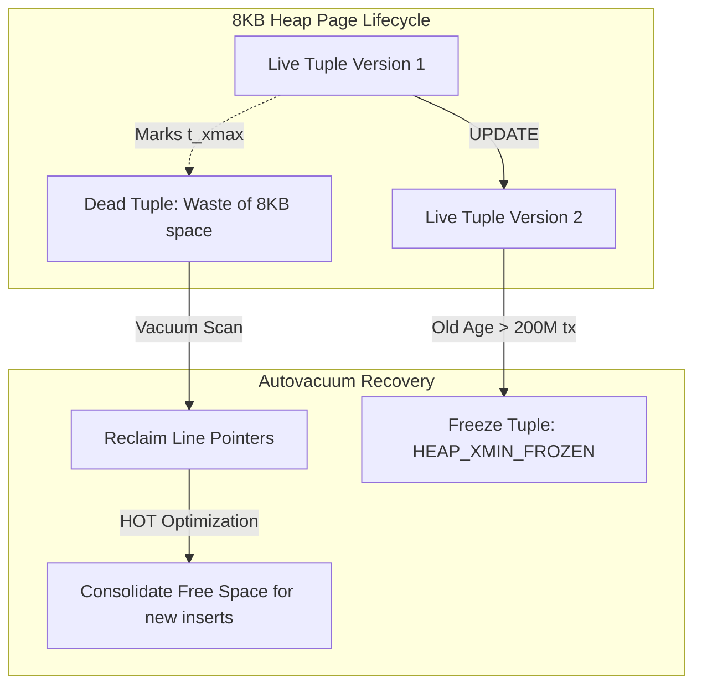

# Lesson 3: Multiversion Concurrency Control (MVCC), WAL & Vacuum Engine

## 1. Physical Heap Page Layout & The Anatomy of a Tuple

In PostgreSQL, every relation table and index is stored physically on the filesystem as a collection of 8KB pages inside `$PGDATA/base/<db_oid>/<relfilenode>`. If a table exceeds 1GB, PostgreSQL splits it into 1GB segment files (`<relfilenode>.1`, `<relfilenode>.2`).

To understand how concurrency and mutations occur without locking readers, we must inspect the microscopic layout of an 8KB data page.

```
+-----------------------------------------------------------------------+
| PageHeaderData (24 bytes: LSN, checksum, flags, pd_lower, pd_upper)   |
+-----------------------------------------------------------------------+
| ItemIdData Array (Line pointers: 4 bytes each, grows downward ------>)|
| [lp_1: offset, flags, len] [lp_2] [lp_3] ...                          |
+-----------------------------------------------------------------------+
|                          <---- FREE SPACE ---->                       |
+-----------------------------------------------------------------------+
| (<------ HeapTupleData: grows upward from bottom of page)             |
| [Tuple 3 Payload]                                                     |
| [Tuple 2 Payload]                                                     |
| [Tuple 1 Payload: HeapTupleHeaderData (23 bytes) + Column Values]     |
+-----------------------------------------------------------------------+
| Special Space (Index-specific metadata: 0 bytes in heap tables)       |
+-----------------------------------------------------------------------+
```

### The 23-Byte `HeapTupleHeaderData` Structure
Every row on disk is prefixed by a compact 23-byte C structure:
1. **`t_xmin` (4 bytes, `TransactionId`):** The transaction ID that inserted this tuple version.
2. **`t_xmax` (4 bytes, `TransactionId`):** The transaction ID that deleted or updated this tuple version (set to `0` if the row is still alive and has never been mutated).
3. **`t_cid` (4 bytes, `CommandId`):** The intra-transaction statement identifier, ensuring a statement sees earlier mutations executed within the same transaction.
4. **`t_ctid` (6 bytes, `ItemPointerData`):** The physical pointer `(block_number, offset)` pointing to the current version of this row. If an `UPDATE` occurred, `t_ctid` points forward to the new tuple version (forming an update chain).
5. **`t_infomask` & `t_infomask2` (4 bytes, bit flags):** Status bits that avoid expensive lookups into the global transaction status log (`pg_xact`). Key flags include `HEAP_XMIN_COMMITTED`, `HEAP_XMIN_ABORTED`, `HEAP_XMAX_COMMITTED`, and `HEAP_XMAX_IS_EXCL_LOCKED`.

---

## 2. MVCC Visibility Invariants & The Snapshot State Machine

PostgreSQL enforces the ANSI SQL isolation levels (Read Committed, Repeatable Read, Serializable) via **Snapshots**. A database snapshot is essentially an immutable view of active transactions captured at statement or transaction start.

A snapshot is represented internally by `SnapshotData`:
- **`xmin`:** The lowest active transaction ID in the database when the snapshot was taken. All transactions strictly lower than this `xmin` are guaranteed to have either already committed or aborted.
- **`xmax`:** The highest transaction ID assigned when the snapshot was taken. Any tuple inserted by a transaction $\ge \text{xmax}$ is completely invisible to this snapshot.
- **`xip[]`:** An array of transaction IDs that were currently running (uncommitted) at the instant the snapshot was created.

```
       xmin (Committed/Aborted)                 xmax (Future / Invisible)
<-------------------|--------------------------------------|-------------------> Transaction IDs
                    |   Active Transaction In-Flight Array |
                    |   xip = [105, 108, 112]              |
```

### Tuple Visibility Rule
For a reading backend operating with snapshot $S$, a tuple is visible if and only if:
1. `t_xmin` has committed AND (`t_xmin < S.xmin` OR (`t_xmin < S.xmax` AND `t_xmin` is NOT in `S.xip`)).
2. `t_xmax` is 0, OR `t_xmax` aborted, OR `t_xmax` is currently in-flight (`t_xmax` in `S.xip`), OR `t_xmax > S.xmax`.

Because readers check these mathematical visibility bounds without waiting for locks, **readers never block writers, and writers never block readers**.

---

## 3. The Write-Ahead Log (WAL) & ARIES Crash Recovery

To maintain the **Durability** property of ACID without paying the catastrophic cost of writing random 8KB dirty pages to disk on every transaction commit, PostgreSQL implements the classical **Write-Ahead Logging** protocol (inspired by Mohan's ARIES algorithm).

### 3.1. The Fundamental WAL Invariant
> **The WAL Invariant:** No dirty heap or index page in `shared_buffers` may be written to persistent disk storage until the corresponding WAL records describing all mutations to that page have been flushed and fsynced to disk.

Each page header contains `pd_lsn`—a 64-bit integer representing the Log Sequence Number of the last WAL record that modified that page. When the checkpointer or bgwriter attempts to flush page $P$ to disk, it asserts:

$$\text{flushed\_to\_disk\_LSN} \ge P.\text{pd\_lsn}$$

### 3.2. WAL Record Format & Log Sequence Numbers (LSN)
WAL is stored as a sequence of 16MB files in `$PGDATA/pg_wal/`. An LSN is a 64-bit byte offset within this continuous logical stream, displayed in hexadecimal as `SegmentID/Offset` (e.g., `0/16B2D40`).

When a transaction executes an `INSERT`:
1. The backend appends a binary `XLOG_HEAP_INSERT` record to `wal_buffers`.
2. The backend modifies the tuple inside the shared buffer page in RAM and updates `page.pd_lsn = current_lsn`.
3. Upon `COMMIT`, the backend calls `XLogFlush()` to fsync the WAL stream up to the commit record LSN, releases locks, and acknowledges success to the client application.

---

## 4. The Autovacuum Subsystem & The Transaction ID Wraparound Horizon

While MVCC provides lock-free concurrency, it introduces **table bloat**:
- An `UPDATE` does not overwrite the row in place; it inserts a brand new tuple with `t_xmin = current_tx` and marks the old tuple's `t_xmax = current_tx`.
- A `DELETE` simply writes `t_xmax = current_tx` without freeing disk space.

Over time, pages become filled with **dead tuples** (tuples where `t_xmax` is older than the oldest running transaction snapshot).



### 4.1. Heap-Only Tuples (HOT) Optimization
Normally, when a tuple is updated, index entries must also be created pointing to the new tuple's `(block, offset)`. This causes index bloat.
PostgreSQL provides **HOT (Heap-Only Tuples)** optimization:
If an `UPDATE` does not modify any indexed columns, and the new tuple fits inside the *exact same 8KB heap page* as the old tuple:
1. The old tuple's line pointer chains directly to the new tuple within the page.
2. Index pointers continue pointing to the original line pointer without requiring index modification.
3. Subsequent `SELECT` queries traversing the page execute lightweight pruning in memory, recycling space immediately.

### 4.2. The 32-Bit Transaction ID Wraparound Catastrophe
Because `TransactionId` in PostgreSQL is a 32-bit unsigned integer, there are only $2^{32} \approx 4.29 \text{ billion}$ possible transaction IDs. To allow continuous operation, PostgreSQL treats transaction numbers modulo $2^{32}$ on a circular ring:
- Any transaction ID within $2^{31}$ numbers ahead of $X$ is considered in the **future**.
- Any transaction ID within $2^{31}$ numbers behind $X$ is considered in the **past**.

If a database continues writing transactions for billions of operations without maintenance, the circular horizon advances. Eventually, ancient transaction IDs that created initial reference data would wrap around and appear to be in the **future**, causing the entire database to suddenly become empty or invisible!

To prevent this catastrophic failure mode:
1. Autovacuum performs **Tuple Freezing**: when a tuple's `t_xmin` is older than `vacuum_freeze_min_age`, Autovacuum sets the `HEAP_XMIN_FROZEN` bit in `t_infomask`.
2. Once frozen, the tuple is treated as permanently older than all existing or future transactions, preventing wraparound data loss.
3. If the database reaches `autovacuum_freeze_max_age` (default 200 million transactions), PostgreSQL enters emergency aggressive autovacuum mode, warning the administrator before rejecting writes.
