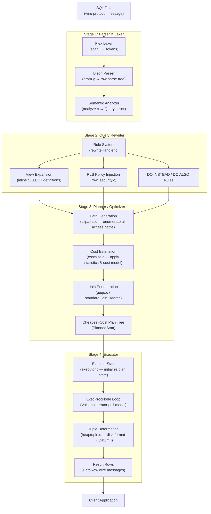
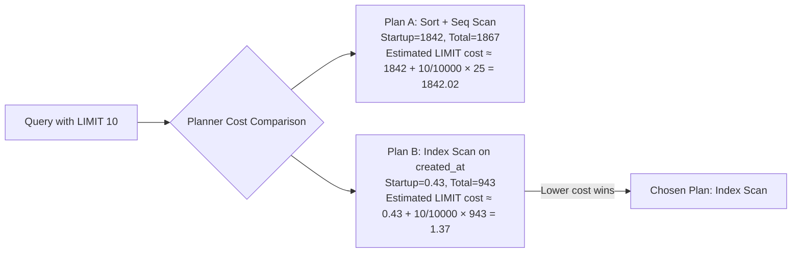
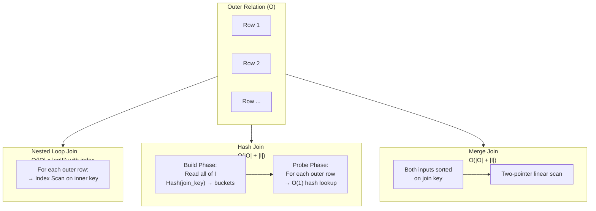
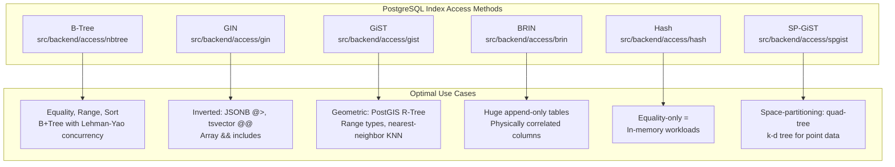
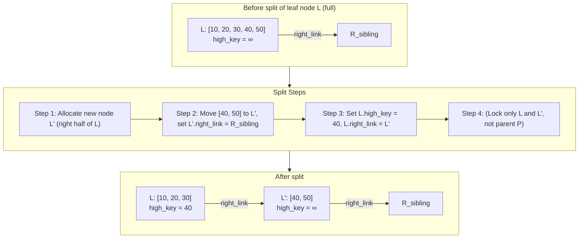
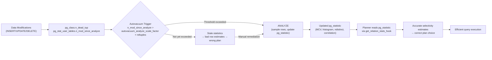
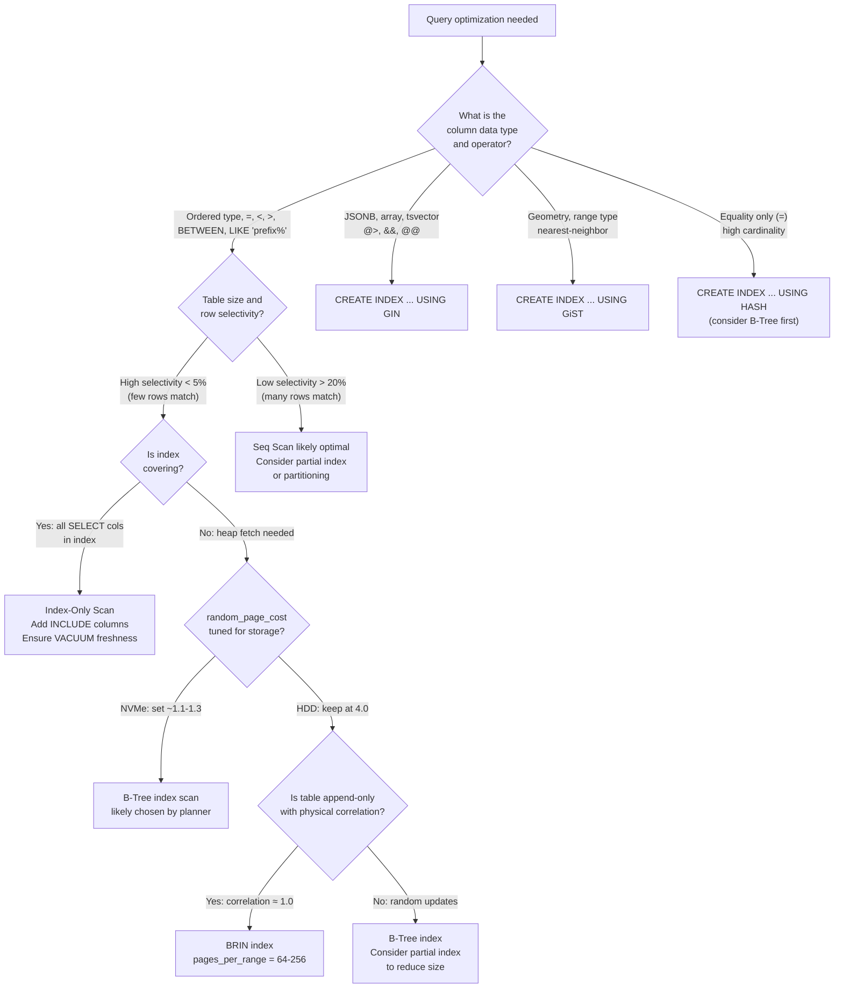

# Lesson 4: Cost-Based Query Planning & Advanced Indexing Mechanics

## 1. The Query Processing Pipeline

When a client application submits a SQL query string, the query traverses four sequential architectural stages inside the backend process (one OS process per connection) before results stream back across the wire. Understanding each stage is critical for diagnosing slow queries, surprising plan choices, and correctness issues with views or row-level security.



Each stage produces a distinct in-memory tree representation. The parser produces a raw `List` of `RawStmt` nodes; the semantic analyzer transforms these into `Query` structs that resolve table OIDs, column attribute numbers, and function OIDs against the system catalogs. The rewriter operates on `Query` trees and may replace a single query with an entire list of queries (via `DO ALSO` rules). The planner operates on `Query` trees and emits `PlannedStmt` containing a tree of `Plan` nodes. The executor wraps each `Plan` node in a corresponding `PlanState` node that holds runtime state (hash tables, sort tuplesort objects, cursors into relations), keeping the immutable plan tree shareable across parallel workers.

### 1.1. The Parser and Semantic Analyzer

PostgreSQL's parser is generated from `src/backend/parser/gram.y` (Bison) and `src/backend/parser/scan.l` (Flex). These are standard toolchain-generated files; the grammar closely tracks the SQL standard while extending it with PostgreSQL-specific syntax. The raw parse tree uses generic `Node` structs with no catalog lookups — it knows nothing about whether `users` is a table, a view, or a function-returning-set. This separation means the parser can operate without a database connection and is used by tools like `pg_query` for syntax validation.

The semantic analyzer (`analyze.c`, `transformStmt()`) resolves every name against `pg_class`, `pg_attribute`, `pg_proc`, and `pg_type`, producing fully typed expression trees (`Expr` subtypes: `Var`, `Const`, `FuncExpr`, `OpExpr`, etc.). Type coercions are inserted here, not in the planner.

### 1.2. The Query Rewriter

The rewriter (`rewriteHandler.c`) expands views by substituting their stored `Query` tree inline — this is why a view does not impose a materialization boundary. Views are purely syntactic macros at this layer. Row-Level Security policies are injected as additional `WHERE` clause qualifications and join conditions on the `Query` tree at this stage, ensuring they cannot be bypassed by any path the planner subsequently selects.

### 1.3. The Volcano Iterator Execution Model

The PostgreSQL executor implements the classical **Volcano/Iterator Model** (Graefe, 1994). Every plan node implements a uniform three-function interface:

| Function | Responsibility |
|---|---|
| `ExecInitNode()` | Allocate `PlanState`, open relations, initialize hash tables, allocate sort buffers |
| `ExecProcNode()` | Pull and return the next tuple (or `NULL` on exhaustion) |
| `ExecEndNode()` | Release all resources, close relations, free memory |

The parent node calls `ExecProcNode(child)` on demand. The child pulls from its own children recursively. This creates a demand-driven pull pipeline: no intermediate result set is fully materialized unless a **blocking node** (a node that must consume all input before yielding any output) intervenes. The canonical blocking nodes are:

- **Sort** (`tuplesort.c`): must read and sort all input rows before returning `TupleTableSlot` number one.
- **Hash** (the build phase of Hash Join): must read the entire inner relation before the probe phase begins.
- **Materialize**: explicitly spools its input into a tuplestore, used when the input must be re-scanned (e.g., the inner side of a Nested Loop that is not an index scan).
- **Aggregate** (non-streaming modes): GroupAggregate in sorted mode is pipelined; HashAggregate must fully build its hash table first.

For OLTP workloads, this pull model is highly efficient because the executor can short-circuit early (`LIMIT 1`, cursor fetches) without producing rows the client will never consume. For analytical queries involving large sorts or hash aggregations, the blocking behavior is the dominant cost and is what `EXPLAIN (ANALYZE, BUFFERS)` exposes via the `Sort Method` and `Batches` fields.

---

## 2. Cost-Based Optimizer Mathematics

PostgreSQL's Cost-Based Optimizer (CBO) is a **bottom-up dynamic programming** optimizer. For queries with up to `join_collapse_limit` (default 8) join relations, it enumerates all possible join orderings, all access paths for each relation, and all join algorithm alternatives, selecting the minimum-cost plan tree. For queries exceeding this threshold, it falls back to the **GEQO** (Genetic Query Optimizer) heuristic to avoid factorial plan-space explosion.

The optimizer does not measure actual CPU cycles or I/O latency. It computes a **dimensionless cost scalar** expressed in units of "sequential 8 KB page reads," allowing I/O and CPU costs to be summed into a single comparable number. The accuracy of the entire model depends on the quality of the **table statistics** stored in `pg_statistic` and surfaced via `pg_stats`.

### 2.1. The Statistics Foundation

Before examining cost equations, it is essential to understand what the planner actually knows. The `ANALYZE` command (also run by Autovacuum) samples up to `default_statistics_target × 300` rows per column (default 100 × 300 = 30,000 rows) and stores:

- `pg_class.reltuples` and `pg_class.relpages`: estimated row count and page count for the relation.
- `pg_statistic.stanullfrac`: fraction of NULL values.
- `pg_statistic.stadistinct`: number of distinct values (positive = exact count; negative = fraction of total rows, e.g., `-0.3` means 30% of rows are distinct).
- `pg_statistic.stavalues` / `pg_statistic.staattach`: Most Common Values (MCV) list with frequencies, and an equal-depth histogram of the value distribution for range estimation.
- `pg_statistic_ext`: Extended statistics across multiple columns (created with `CREATE STATISTICS`), capturing cross-column correlations and multi-variate MCV lists — critical when two columns are functionally dependent (e.g., `city` and `zip_code`).

The **selectivity** of a predicate — the estimated fraction of rows that survive a `WHERE` clause condition — is derived entirely from these statistics. An inaccurate row estimate in the middle of a large join tree cascades into catastrophically wrong join algorithm and join order choices downstream.

### 2.2. The Five Core Cost Parameters

The optimizer calibrates its model against five parameters settable per session or at the server level:

| Parameter | Default | Meaning |
|---|---|---|
| `seq_page_cost` | `1.0` | Cost to fetch one 8 KB page via sequential I/O |
| `random_page_cost` | `4.0` | Cost to fetch one 8 KB page via random I/O (seek + rotational latency) |
| `cpu_tuple_cost` | `0.01` | Cost to process and project one row through the executor |
| `cpu_index_tuple_cost` | `0.005` | Cost to evaluate one index entry during index traversal |
| `cpu_operator_cost` | `0.0025` | Cost to evaluate one `WHERE` clause operator or function call |

The ratio `random_page_cost / seq_page_cost` is the single most important tuning lever. The default ratio of `4.0` reflects spinning disk (HDD) seek latency. Modern NVMe SSDs have seek latency within 10–20% of sequential latency, so the ratio should be set to `1.1`–`1.3` on NVMe-backed instances. Setting this correctly causes the optimizer to prefer index scans that it would otherwise dismiss as too expensive due to random I/O.

Additionally, `effective_cache_size` does **not** allocate memory — it is a hint to the optimizer about the total amount of memory available for disk caching (OS page cache + `shared_buffers`). A higher value reduces the effective cost of random I/O for relations that are likely cached, shifting the optimizer toward index scans.

### 2.3. Sequential Scan Cost Model

For a relation $R$ containing $N_p$ heap pages and $N_t$ tuples, with a `WHERE` clause containing $k$ operator evaluations per row:

$$\text{Cost}_{\text{SeqScan}} = \underbrace{N_p \cdot \text{seq\_page\_cost}}_{\text{I/O component}} + \underbrace{N_t \cdot \text{cpu\_tuple\_cost}}_{\text{tuple processing}} + \underbrace{N_t \cdot k \cdot \text{cpu\_operator\_cost}}_{\text{predicate evaluation}}$$

The I/O component dominates for large relations on disk. The CPU components dominate for heavily cached OLTP tables that fit in `shared_buffers`. This is why `seq_page_cost` and `random_page_cost` are sometimes set equal or even inverted on heavily cached database servers where nearly every page read is a shared buffer hit.

### 2.4. Index Scan Cost Model

An index scan on a B-Tree index with selectivity $s$ (fraction of rows returned) incurs both index traversal cost and heap fetch cost:

$$\text{Cost}_{\text{IndexScan}} = \underbrace{(\log_b N_t) \cdot \text{cpu\_index\_tuple\_cost}}_{\text{B-Tree descent}} + \underbrace{(s \cdot N_t) \cdot \text{random\_page\_cost}}_{\text{heap page fetches}} + \underbrace{(s \cdot N_t) \cdot \text{cpu\_tuple\_cost}}_{\text{tuple processing}}$$

where $b$ is the B-Tree branching factor (typically 200–400 for integer keys on 8 KB pages). The critical insight is the `random_page_cost` term: each qualifying index entry potentially fetches a different heap page. For high selectivity $s$ (e.g., 50% of a 1 M-row table), this term becomes `500,000 × random_page_cost = 2,000,000` cost units, far exceeding a sequential scan's `~1,000` page reads. This is why the optimizer will refuse to use a B-Tree index for high-selectivity queries — the random I/O penalty makes a sequential scan cheaper.

### 2.5. Index-Only Scan: Eliminating Heap Fetches

An **Index-Only Scan** (available since PostgreSQL 9.2) returns data directly from the index leaf pages without visiting heap pages, eliminating the `random_page_cost` heap fetch term entirely — but only when:
1. All columns referenced in `SELECT` and `WHERE` are present in the index (the index is "covering").
2. The **visibility map** (`pg_visibility`) indicates the heap page is all-visible (all rows on the page are visible to all current transactions, meaning no dead tuples exist that require tuple-level visibility checks).

If the visibility map bit is not set for a heap page, the executor must still visit the heap page to perform visibility checking, partially negating the benefit. `VACUUM` is what sets visibility map bits. Tables with heavy `UPDATE`/`DELETE` workloads that are under-vacuumed will see poor Index-Only Scan performance even with covering indexes.

### 2.6. Startup Cost vs. Total Cost

```sql
EXPLAIN SELECT * FROM orders WHERE customer_id = 42 ORDER BY created_at;
```
```
Sort  (cost=1842.33..1867.33 rows=10000 width=96)
  ->  Index Scan using idx_orders_customer on orders
        (cost=0.43..943.00 rows=10000 width=96)
        Index Cond: (customer_id = 42)
```

The cost notation `A..B` encodes two distinct metrics:

- **Startup cost (`A`):** Estimated cost before the node emits its first tuple. `0.43` for the Index Scan reflects B-Tree descent cost. `1842.33` for Sort reflects the cost to read and sort all 10,000 input rows — the Sort node cannot yield row #1 until it has seen row #10,000.
- **Total cost (`B`):** Estimated cost to retrieve all rows from the node.

This distinction is critical for `LIMIT` queries. When a `LIMIT` clause is present, the optimizer weighs the fraction of total cost it expects to pay. A plan with high startup cost but low per-tuple cost (e.g., Merge Join on pre-sorted indexes) may lose to a plan with zero startup cost and higher total cost (Nested Loop + Index Scan) when only the first 10 rows are needed. The planner applies a `cursor_tuple_fraction` scaling factor (default `0.1`, meaning it optimizes for returning 10% of rows) to cost plans under a `LIMIT`.



---

## 3. Relational Join Mechanics

When joining two relations — the **outer** relation $O$ (the one that drives the loop or probe) and the **inner** relation $I$ — the optimizer selects among three physical join algorithms. The choice is governed by: estimated cardinality of each input, available memory (`work_mem`), presence of indexes on join keys, and whether inputs arrive pre-sorted.



### 3.1. Nested Loop Join

For each row in the outer relation, the executor scans the inner relation. The key behaviors:

**Without an index:** Complexity is $O(|O| \times |I|)$. At scale this is unusable: joining a 10,000-row outer with a 1,000,000-row inner requires $10^{10}$ row comparisons. The optimizer will strongly prefer Hash Join or Merge Join in this case.

**With a B-Tree index on the inner join key:** The inner scan becomes an Index Scan costing $O(\log |I|)$ per outer row, yielding $O(|O| \log |I|)$ overall. This is the dominant plan for OLTP queries where the outer relation is filtered to a very small set (1–100 rows via a highly selective predicate on the outer table). The startup cost is effectively zero: the first outer row immediately drives the first inner index lookup.

**Parameterized Index Scans:** PostgreSQL specifically implements **parameterized paths** — the outer row's join key value is passed as a runtime parameter (`$1`, `$2`, ...) into the inner index scan's index condition. This is exposed in `EXPLAIN` output as `Index Cond: (inner.id = $1)` and is the mechanism that makes Nested Loop the workhorse of OLTP join execution.

**Inner relation re-scanning:** If the inner relation is a subquery or CTE without an index, PostgreSQL may insert a `Materialize` node above it, spooling the inner result into a tuplestore on first execution and replaying from the spool for subsequent outer rows, avoiding re-execution of the inner subquery.

### 3.2. Hash Join

Hash Join is the optimizer's choice for joining large, unindexed relations or when no useful sort order exists. It proceeds in two phases:

**Build Phase:** The executor reads the entire inner relation and inserts each row into an in-memory hash table. The hash table is sized to fit in `work_mem`. The hash function maps the join key to a bucket; collisions are handled by chaining.

**Probe Phase:** The executor scans the outer relation sequentially. For each outer row, it hashes the join key and performs an $O(1)$ bucket lookup in the hash table, checking equality on the full key to handle hash collisions.

**Grace Hash Join (Multi-Batch):** When the inner relation exceeds `work_mem`, PostgreSQL spills to disk using the **Grace Hash Join** algorithm. The inner relation is partitioned into $B$ batches by hashing the join key modulo $B$. Only one batch resides in memory at a time; the remaining batches are written to temporary files in `pgsql_tmp/`. The outer relation is similarly partitioned: an outer row hashed to partition $k$ can only match inner rows in partition $k$, so each partition pair is joined independently. The `EXPLAIN (ANALYZE)` output reports `Batches: N` and `Memory Usage: X kB`; `Batches > 1` indicates spill to disk and is a signal that `work_mem` should be increased for this query class.

```sql
-- Force a Hash Join and observe multi-batch behavior
SET work_mem = '4MB';
EXPLAIN (ANALYZE, BUFFERS, FORMAT TEXT)
SELECT o.id, c.name
FROM orders o
JOIN customers c ON o.customer_id = c.id
WHERE o.created_at > now() - interval '30 days';
/*
Hash Join  (cost=18340.00..64820.00 rows=250000 width=48)
           (actual time=312.4..1842.1 rows=247891 loops=1)
  Hash Cond: (o.customer_id = c.id)
  Buffers: shared hit=4821 read=22140, temp read=18420 written=18420
  ->  Seq Scan on orders o  ...
  ->  Hash  (cost=9800.00..9800.00 rows=200000 width=36)
            (actual time=301.2..301.2 rows=200000 loops=1)
        Buckets: 131072  Batches: 4  Memory Usage: 3187kB
        ->  Seq Scan on customers c  ...
*/
```

The `temp read=18420 written=18420` in `Buffers` confirms disk spill. Raising `work_mem` to `'16MB'` would collapse `Batches` to `1` and eliminate the temporary file I/O.

### 3.3. Merge Join

Merge Join requires both input streams to be ordered by the join keys. It then advances two pointers simultaneously through the sorted streams, joining rows with equal keys. Time complexity is $O(|O| + |I|)$ with minimal memory overhead beyond buffering equal-key groups.

The optimizer considers Merge Join attractive when:
- Both inputs have B-Tree indexes on the join keys (the index scan already delivers sorted output for free).
- The sort of one or both inputs has already been paid for by a higher-level `ORDER BY` or a prior join in a multi-table query.
- `work_mem` is too small for a Hash Join of large relations.

The subtle cost: Merge Join has nonzero startup cost because even if the inputs arrive sorted, the executor must handle "mark and restore" for cases where the outer relation has duplicate join keys — it must re-scan the matching group in the inner relation for each duplicate outer row, requiring a rewind capability on the inner stream.

### 3.4. Join Order Enumeration

For an $n$-table join, there are $(2n-2)!/(n-1)!$ possible join trees (considering bushy trees). PostgreSQL's standard planner uses dynamic programming to enumerate all left-deep and some bushy join trees up to `join_collapse_limit = 8` tables. The DP table stores the cheapest path found for each subset of relations, building up from single-relation paths to the full $n$-way join. For $n > \text{geqo\_threshold}$ (default 12), PostgreSQL switches to the GEQO genetic algorithm, which explores the join space heuristically and may not find the globally optimal plan.

---

## 4. Advanced Indexing Architectures

PostgreSQL implements indexes as a pluggable **access method API** (`src/include/access/amapi.h`). Each index type registers a set of callback functions (`aminsert`, `amgettuple`, `amgetbitmap`, `ambulkdelete`, `amvacuumcleanup`, etc.) and declares which operator classes it supports. This architecture makes PostgreSQL's indexing system fundamentally extensible — PostGIS's `gist_geometry_ops`, the `pgvector` extension's `hnsw` and `ivfflat` methods, and `pg_trgm`'s GIN/GiST indexes are all implemented as standard access method plugins.



| Index Type | Physical Structure | Optimal Use Case | Approximate Index Size (1B rows) |
|---|---|---|---|
| B-Tree | Lehman-Yao concurrent B+ Tree | Equality, range, sort on ordered types | ~50 GB |
| GIN | Inverted posting lists with pending buffer | JSONB `@>`, `tsvector @@`, array `&&` | Varies by cardinality |
| GiST | Generalized Search Tree (R-Tree variant) | PostGIS geometry, range types, KNN | Varies |
| BRIN | Block range min/max summary | Huge append-only timeseries with physical correlation | ~5–50 MB |
| Hash | Chained hash table | Equality only, in-memory fits | ~25 GB |
| SP-GiST | Space-partitioned tree (quad/k-d/radix) | IP routing (inet), point data, text prefix | Varies |

### 4.1. B-Tree: The Lehman-Yao Concurrent B+ Tree

Standard B-Tree implementations require a **top-down split protocol**: before descending to a leaf node for insertion, the traversal must preemptively split any full nodes encountered, holding write locks on parent nodes to prevent concurrent readers from seeing an inconsistent tree during the split. This creates a lock chain from root to leaf that serializes all concurrent insertions.

**Lehman & Yao (1981)** eliminate the upward lock propagation by augmenting each node with two fields:

- **High Key (`P_HIKEY`):** The supremum of all keys stored in this subtree. Any key greater than the high key does not belong in this subtree.
- **Right-Link Pointer:** A pointer to the right sibling at the same tree level.

The PostgreSQL implementation (`nbtree`) uses this to implement **bottom-up splits with no parent locking:**



A concurrent reader traversing for key `45` descends to `L`, reads `high_key = 40`, recognizes that `45 > 40`, follows the right-link to `L'`, and finds the key — without having held a lock on the parent or stalled behind the split. The parent's downlink to `L'` is inserted asynchronously, in a separate step, with only a brief write lock on the parent. This design is why B-Tree indexes in PostgreSQL maintain high insert throughput under heavy concurrent write workloads.

**Page layout detail:** PostgreSQL B-Tree leaf pages use the standard `PageData` layout: a 24-byte page header, a line pointer array (item ID array growing from the front), and tuple data growing from the back. The high key occupies item slot 1 (`P_HIKEY = 1`), and actual index tuples occupy slots 2 through `PageGetMaxOffsetNumber()`. Each index tuple stores `(IndexTuple header | key data | heap TID)`, where the heap TID is the physical pointer `(block_number, offset_within_block)` to the corresponding heap row.

### 4.2. Generalized Inverted Index (GIN)

A standard B-Tree maps `key → TID` (each key appears at most once per row). GIN inverts this: a single heap row may contain multiple **items** (array elements, JSONB keys, lexemes in a tsvector), and GIN maps `item → list_of_TIDs` (the **posting list**).

**Physical structure:**
- **Pending List:** A temporary unsorted list of `(item, TID)` pairs written as a standard heap relation. New entries are appended here first when `fastupdate = on` (default). This makes individual inserts cheap — appending to a heap page rather than updating a potentially deeply nested posting list.
- **Main B-Tree:** The primary index structure maps each distinct item value to a posting list. For high-cardinality items (many TIDs), the posting list is stored in its own overflow pages.
- **Cleanup (Autovacuum / `gin_clean_pending_list`):** Autovacuum merges the pending list into the main B-Tree periodically, performing the expensive posting list updates in one batch rather than per-row.

```
GIN Index for tsvector column containing:
  Row 1: 'postgresql' | 'query' | 'plan'
  Row 2: 'query' | 'optimizer' | 'cost'
  Row 3: 'postgresql' | 'index' | 'gin'

Main B-Tree (item → posting list):
  'cost'         → [TID:2]
  'gin'          → [TID:3]
  'index'        → [TID:3]
  'optimizer'    → [TID:2]
  'plan'         → [TID:1]
  'postgresql'   → [TID:1, TID:3]
  'query'        → [TID:1, TID:2]
```

A query `WHERE document @@ to_tsquery('postgresql & query')` resolves to: intersect posting list for `'postgresql'` = `{1,3}` with posting list for `'query'` = `{1,2}`, yielding `{1}`.

**GIN for JSONB:** The `jsonb_ops` opclass indexes every key and every scalar value, mapping `'key'` entries and `'"key"=>"value"'` entries into the inverted structure. This enables `@>` (containment), `?` (key existence), and `?|` / `?&` operators. The `jsonb_path_ops` opclass indexes only the hash of each complete path-to-value, producing a smaller index but supporting only `@>`.

**When GIN is not ideal:** GIN trades write amplification for read speed. The pending list must be flushed before queries can see the latest rows (the flush happens before a GIN scan if the pending list is nonempty). Tables with high insert rates into GIN-indexed columns should monitor `pg_stat_user_indexes.idx_scan` versus pending list size, and may need to tune `gin_pending_list_limit` or disable `fastupdate` and increase `work_mem` for bulk loads.

### 4.3. Generalized Search Tree (GiST)

GiST is a template index framework — it defines a balanced tree structure and a consistent traversal algorithm, but delegates the key decomposition and predicate logic to a user-defined **operator class** via seven required support functions: `consistent`, `union`, `compress`, `decompress`, `penalty`, `picksplit`, and `same`.

This framework allows completely different physical structures to be built on top of GiST:

- **R-Tree (PostGIS):** Keys are bounding boxes in 2D space. `union` computes the minimum bounding rectangle (MBR) of two boxes. `consistent` checks whether the query MBR overlaps/contains the node MBR. This enables `ST_Intersects`, `ST_DWithin`, and KNN (`<->` operator) queries.
- **Range Types:** Keys are ranges `[lower, upper)`. `union` computes the spanning range. `consistent` checks overlap, containment, adjacency.
- **KNN Search:** GiST supports ordered scans via the `distance` support function, enabling `ORDER BY geometry <-> point LIMIT 10` to execute as a best-first traversal of the R-Tree, returning the 10 nearest neighbors without scanning the entire index.

GiST is inherently lossy at internal nodes: the `consistent` function may return true for a subtree that ultimately contains no matching rows (a false positive), because the bounding box of a node contains the bounding boxes of all entries, which may overlap even when the actual geometries do not. This is why `EXPLAIN` for a GiST-based spatial query shows a "Recheck Cond" — the executor must re-verify the exact predicate on the heap row after the index returns a candidate TID.

### 4.4. Block Range Index (BRIN)

BRIN exploits a property that B-Tree cannot: **physical correlation between column values and heap block numbers**. If rows are physically inserted in timestamp order (append-only workloads: event logs, IoT telemetry, financial trades, audit tables), then the `MIN(ts)` and `MAX(ts)` within any contiguous block range are tightly bounded.

```
Heap layout for append-only event log (physical correlation = 1.0):

Block 0:    events with ts ∈ [2024-01-01 00:00, 2024-01-01 00:05]
Block 1:    events with ts ∈ [2024-01-01 00:05, 2024-01-01 00:10]
...
Block 128:  events with ts ∈ [2024-01-11 00:00, 2024-01-11 00:05]

BRIN index (pages_per_range = 128):
  Range 0   (blocks 0–127):   min=2024-01-01, max=2024-01-10
  Range 1   (blocks 128–255): min=2024-01-11, max=2024-01-20
  ...

Query: WHERE ts BETWEEN '2024-01-11' AND '2024-01-15'
  → Range 0 max (2024-01-10) < query min (2024-01-11) → SKIP entire 1 MB
  → Range 1 overlaps → scan blocks 128–255
```

**Size advantage:** A BRIN index stores one `(min, max, hasnulls)` tuple per range. At 128 pages per range = 1 MB per range, a 1 TB table (131,072 pages) requires only `131072 / 128 = 1024` BRIN entries — roughly `1024 × ~30 bytes = ~30 KB` for a single-column BRIN index. Compare this to a B-Tree index on the same 1 billion rows, which requires storing a pointer and key for every row, consuming tens of gigabytes.

**Critical limitation:** BRIN is effective **only** when `correlation` (the statistical correlation between column values and physical row order, viewable in `pg_stats.correlation`) is close to `1.0` or `-1.0`. For a randomly ordered or frequently-updated table where rows with early timestamps are scattered across all heap blocks, the `(min, max)` range for every BRIN block range will span the entire value domain, and no blocks can be skipped. `SELECT correlation FROM pg_stats WHERE tablename = 'events' AND attname = 'created_at'` should return a value near `1.0` before a BRIN index is used in production.

```sql
-- Production BRIN example for a partitioned IoT telemetry table
CREATE TABLE sensor_readings (
    reading_id  bigint        NOT NULL,
    sensor_id   int           NOT NULL,
    recorded_at timestamptz   NOT NULL,
    temperature float4,
    humidity    float4
) PARTITION BY RANGE (recorded_at);

-- BRIN on the append-only partition (never updated, inserts only)
CREATE INDEX idx_brin_readings_ts
    ON sensor_readings USING BRIN (recorded_at)
    WITH (pages_per_range = 64);  -- 64 × 8KB = 512KB per range

-- Confirm physical correlation before relying on the index
SELECT correlation
FROM pg_stats
WHERE tablename = 'sensor_readings' AND attname = 'recorded_at';
-- Expected: correlation ≈ 0.998 for append-only table
```

### 4.5. Partial Indexes: Surgical Index Coverage

A partial index includes only the rows satisfying a `WHERE` predicate. This is not merely a size optimization — it changes the selectivity estimates the optimizer uses and eliminates index maintenance overhead for excluded rows entirely.

```sql
-- Full index: 10M rows, most orders are 'completed' (90%)
CREATE INDEX idx_orders_status ON orders (status);  -- 10M entries

-- Partial index: only the 100K 'pending' rows the app queries constantly
CREATE INDEX idx_orders_pending ON orders (created_at)
    WHERE status = 'pending';  -- 100K entries, tiny, always cached in shared_buffers

-- The optimizer will use idx_orders_pending ONLY when the query predicate
-- implies the index predicate: WHERE status = 'pending' AND created_at > ...
-- For WHERE status = 'completed', it cannot use idx_orders_pending at all.
```

Partial indexes are particularly effective for:
- **Soft-delete patterns:** `WHERE deleted_at IS NULL` indexes only live rows.
- **Status queues:** `WHERE processed = false` indexes only unprocessed jobs.
- **Sparse non-null columns:** `WHERE optional_field IS NOT NULL` skips the majority-null rows.

### 4.6. Expression Indexes: Indexing Computed Values

PostgreSQL can index an arbitrary, deterministic (immutable) expression, not just column values. The optimizer uses an expression index when the query's `WHERE` clause contains the identical expression:

```sql
-- Case-insensitive email lookups fail to use a plain index on email:
-- WHERE lower(email) = 'user@example.com' cannot use idx_users_email

-- Expression index on lower(email):
CREATE INDEX idx_users_lower_email ON users (lower(email));

-- Now this query uses the expression index:
EXPLAIN SELECT * FROM users WHERE lower(email) = 'user@example.com';
-- Index Scan using idx_users_lower_email on users
--   Index Cond: (lower(email) = 'user@example.com')

-- Composite expression index for time-bucketed queries:
CREATE INDEX idx_events_hour ON events (date_trunc('hour', occurred_at), event_type);
-- Enables efficient: WHERE date_trunc('hour', occurred_at) = '2024-06-01 14:00' AND event_type = 'click'
```

The expression must be declared `IMMUTABLE` for PostgreSQL to index it safely (the same input must always produce the same output, so the index value remains valid across transactions). `lower()` and `date_trunc()` are built-in immutable functions. User-defined functions must be explicitly marked `IMMUTABLE` in `CREATE FUNCTION`.

---

## 5. Reading EXPLAIN Output: A Diagnostic Framework

Understanding `EXPLAIN (ANALYZE, BUFFERS)` output is the primary skill for query optimization. The output is a tree reflecting the executor's plan node tree; reading it bottom-up (innermost, leftmost nodes first) corresponds to execution order.

```sql
EXPLAIN (ANALYZE, BUFFERS, FORMAT TEXT)
SELECT
    c.name,
    COUNT(o.id)       AS order_count,
    SUM(o.total_cents) AS revenue_cents
FROM customers c
JOIN orders o ON o.customer_id = c.id
WHERE c.region = 'EMEA'
  AND o.created_at >= '2024-01-01'
GROUP BY c.id, c.name
ORDER BY revenue_cents DESC
LIMIT 20;
```

```
Limit  (cost=24830.15..24830.20 rows=20 width=52)
       (actual time=312.44..312.45 rows=20 loops=1)
  ->  Sort  (cost=24830.15..24855.15 rows=10000 width=52)
            (actual time=312.43..312.44 rows=20 loops=1)
        Sort Key: (sum(o.total_cents)) DESC
        Sort Method: top-N heapsort  Memory: 27kB
        ->  HashAggregate  (cost=24330.00..24430.00 rows=10000 width=52)
                           (actual time=308.11..310.22 rows=9847 loops=1)
              Group Key: c.id, c.name
              Batches: 1  Memory Usage: 2321kB
              ->  Hash Join  (cost=1840.00..22080.00 rows=450000 width=24)
                             (actual time=28.43..241.50 rows=447923 loops=1)
                    Hash Cond: (o.customer_id = c.id)
                    Buffers: shared hit=18420 read=4821
                    ->  Seq Scan on orders o
                          (cost=0.00..18200.00 rows=500000 width=16)
                          (actual time=0.08..98.33 rows=478201 loops=1)
                          Filter: (created_at >= '2024-01-01')
                          Rows Removed by Filter: 221799
                          Buffers: shared hit=14200 read=4100
                    ->  Hash  (cost=1600.00..1600.00 rows=19200 width=24)
                               (actual time=27.90..27.90 rows=19243 loops=1)
                          Buckets: 32768  Batches: 1  Memory Usage: 1183kB
                          ->  Seq Scan on customers c
                                (cost=0.00..1600.00 rows=19200 width=24)
                                (actual time=0.05..18.44 rows=19243 loops=1)
                                Filter: (region = 'EMEA')
                                Rows Removed by Filter: 60757
                                Buffers: shared hit=4220 read=721
Planning Time: 1.84 ms
Execution Time: 312.88 ms
```

**Diagnostic observations from this plan:**

1. **Row estimate accuracy:** The Hash Join estimated `rows=450000`; actual was `rows=447923`. This is an excellent estimate (< 1% error), indicating up-to-date statistics. A large discrepancy here (e.g., estimated 1000, actual 450000) would indicate stale statistics and mandate `ANALYZE`.

2. **Filter efficiency:** `Rows Removed by Filter: 221799` on the `orders` Seq Scan means the index on `created_at` was not used. With `Buffers: shared hit=14200 read=4100`, we read 4100 pages from disk. Adding `CREATE INDEX idx_orders_created_at ON orders (created_at)` and re-running would potentially convert this to an Index Scan or Bitmap Index Scan, reducing `read` to near zero.

3. **Sort optimization:** `Sort Method: top-N heapsort Memory: 27kB` indicates PostgreSQL optimized the `LIMIT 20` by using a **bounded heap sort** (maintaining only the top-20 candidates), costing $O(N \log 20)$ rather than a full $O(N \log N)$ sort. This is the runtime expression of the startup cost optimization described in §2.6.

4. **Buffers:** `shared hit=18420 read=4821` for the Hash Join node — 4,821 blocks were read from disk (not in `shared_buffers`). This translates to `4821 × 8 KB = ~37 MB` of physical I/O for this single query execution. Multiply by query frequency to understand disk I/O load.

---

## 6. Statistics Maintenance and the Optimizer Feedback Loop

The optimizer is only as accurate as the statistics it consults. Statistics decay as data changes; this manifests as plan regressions.



**Practical interventions when the optimizer chooses wrong:**

```sql
-- 1. Check statistics freshness
SELECT relname, n_live_tup, n_dead_tup, last_analyze, last_autoanalyze
FROM pg_stat_user_tables
WHERE relname = 'orders';

-- 2. Check per-column statistics quality
SELECT attname, n_distinct, correlation, most_common_vals, most_common_freqs
FROM pg_stats
WHERE tablename = 'orders' AND attname IN ('status', 'customer_id', 'created_at');

-- 3. Increase statistics target for a selective column with skewed distribution
ALTER TABLE orders ALTER COLUMN status SET STATISTICS 500;
ANALYZE orders;

-- 4. Create extended statistics for correlated columns
-- (prevents "independence assumption" under-estimates for multi-column WHERE clauses)
CREATE STATISTICS stat_orders_status_region ON status, region FROM orders;
ANALYZE orders;
-- Now WHERE status = 'pending' AND region = 'EMEA' uses joint frequency, not product of marginals

-- 5. Force a specific plan for debugging (never in production without testing)
SET enable_seqscan = off;   -- forces index usage for diagnosis
SET enable_hashjoin = off;  -- forces Merge Join or Nested Loop
EXPLAIN (ANALYZE) SELECT ...;
RESET enable_seqscan;
RESET enable_hashjoin;
```

**Extended Statistics (`CREATE STATISTICS`):** Introduced in PostgreSQL 10 and significantly enhanced in subsequent versions, this feature addresses the fundamental independence assumption: without extended statistics, the planner estimates the selectivity of `WHERE a = 1 AND b = 2` as `P(a=1) × P(b=2)`, assuming the two conditions are statistically independent. When `a` and `b` are correlated (e.g., `city` and `postal_code`, or `order_status` and `payment_method`), this product rule drastically underestimates selectivity, leading to overestimated row counts, bad join algorithm choices, and wrong join orders. `CREATE STATISTICS` stores multi-variate MCVs and functional dependency statistics, allowing the planner to compute `P(a=1 AND b=2)` directly from the joint frequency table.

---

## 7. Putting It Together: Index Strategy Decision Framework



This decision framework synthesizes the architectural principles covered in this lesson: index type selection, storage medium tuning, covering indexes, partial indexes, and BRIN's physical correlation requirement. Each branch corresponds to a cost model trade-off, not an arbitrary rule — the underlying mathematics of `random_page_cost`, selectivity, and the heap fetch penalty is what drives the planner to the same conclusions when statistics are accurate.
