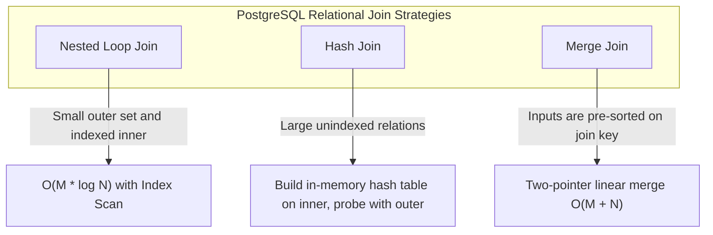

# Lesson 4: Cost-Based Query Planning & Advanced Indexing Mechanics

## 1. The Query Processing Pipeline

When a client application submits a SQL query string to its backend process, the query traverses four sequential architectural stages before results stream back across the network:

```
[SQL Text] 
   |
   v
1. Parser & Lexer (Flex & Bison) --------> Parse Tree (Syntax & Semantic Validation)
   |
   v
2. Query Rewriter -----------------------> Query Tree (Views, RLS, & Rules Expanded)
   |
   v
3. Query Planner & Optimizer ------------> Execution Plan (Cost-optimized Tree of PlanNodes)
   |
   v
4. Executor -----------------------------> Volcano Iterator Model (ExecProcNode() Tuples)
```

### 1.1. The Volcano Iterator Execution Model
The PostgreSQL Executor implements the classical **Volcano Iterator Model** (also known as the Pipeline Execution Model). Every node in the execution plan (e.g., `Seq Scan`, `Index Scan`, `Hash Join`, `Sort`) implements a uniform interface anchored by `ExecProcNode()`:
- Parent nodes demand a tuple from child nodes on demand by calling `ExecProcNode(child)`.
- The child node evaluates its predicates, pulls a single row from its input stream or shared buffer page, and returns the tuple up the tree.
- This iterator pattern avoids materializing entire intermediate tables in memory unless an explicit blocking node (such as `Sort` or `Materialize`) requires full set materialization.

---

## 2. Cost-Based Optimizer Mathematics

PostgreSQL features one of the most sophisticated Cost-Based Optimizers (CBO) in distributed computing. The optimizer evaluates potential execution paths (e.g., sequential scan vs. index scan, nested loop vs. hash join) and computes a unitless scalar **cost estimate** representing estimated execution time measured in arbitrary I/O units.

### 2.1. The Cost Equation Framework
The optimizer calibrates its model against five fundamental cost parameters:
- `seq_page_cost` (default `1.0`): The cost to read one 8KB disk page sequentially.
- `random_page_cost` (default `4.0` for HDDs, typically set to `1.1`–`1.5` on NVMe SSDs): The cost to read one 8KB disk page via random access.
- `cpu_tuple_cost` (default `0.01`): The CPU time required to process and deserialize one row.
- `cpu_index_tuple_cost` (default `0.005`): The CPU time to evaluate one index entry during an index traversal.
- `cpu_operator_cost` (default `0.0025`): The CPU time to evaluate a `WHERE` clause comparison operator.

For a pure sequential scan across relation $R$ containing $N_{\text{pages}}$ disk blocks and $N_{\text{tuples}}$ rows, the total estimated cost is:

$$\text{Cost}_{\text{SeqScan}} = (N_{\text{pages}} \times \text{seq\_page\_cost}) + (N_{\text{tuples}} \times \text{cpu\_tuple\_cost}) + (N_{\text{tuples}} \times \text{cpu\_operator\_cost})$$

### 2.2. The Startup Cost vs. Total Cost Metric
When inspecting an execution plan via `EXPLAIN`:
```sql
EXPLAIN SELECT * FROM users WHERE active = true ORDER BY created_at;
-- Sort  (cost=120.45..125.45 rows=2000 width=64)
--   ->  Seq Scan on users  (cost=0.00..35.00 rows=2000 width=64)
```
Notice the cost syntax: `cost=120.45..125.45`.
1. **Startup Cost (`120.45`):** The cost incurred before the node can emit its very first tuple. For a `Seq Scan`, startup cost is `0.00`. For a `Sort` node, the startup cost is high because every single input row must be read and sorted in `work_mem` before the first minimum row can be yielded.
2. **Total Cost (`125.45`):** The cumulative cost to execute the node to completion, yielding all matching rows.

---

## 3. Relational Join Mechanics

When joining two relations (an **outer** relation $O$ and an **inner** relation $I$), the optimizer selects between three core algorithms:



### 3.1. Nested Loop Join
For every row in the outer relation, the executor scans the inner relation. 
- Without an index on the inner relation, this is $O(|O| \times |I|)$ and disastrously slow for large datasets.
- However, if the inner relation has a B-Tree index on the join key, the inner scan is an index lookup $O(\log |I|)$, resulting in overall complexity $O(|O| \log |I|)$. This is optimal when the outer relation is filtered down to a tiny result set (e.g., 1 to 10 rows).

### 3.2. Hash Join
1. **Build Phase:** The executor reads the entire inner relation, hashes the join keys, and inserts the tuples into an in-memory hash table sized by `work_mem`.
2. **Probe Phase:** The executor scans the outer relation sequentially, hashes each outer row's join key, and performs an $O(1)$ lookup in the hash table.
If the inner table exceeds `work_mem`, PostgreSQL switches to **Multi-Batch Hash Join**, partitioning the hash table into batches and spilling overflow buckets out to temporary disk files.

### 3.3. Merge Join
If both inputs are already ordered by the join keys (either via B-Tree index order or an explicit `Sort` node), the executor steps through both streams using two advancing pointers. This executes in linear time $O(|O| + |I|)$ with minimal memory overhead.

---

## 4. Advanced Indexing Architectures

PostgreSQL supports six distinct index access methods, each tailored to specific data structures and query access patterns.

```
+------------+-----------------------------------+-----------------------------------------+
| Index Type | Underlying Physical Data Structure| Optimal Use Case                        |
+------------+-----------------------------------+-----------------------------------------+
| B-Tree     | Lehman-Yao Concurrency B+ Tree    | Equality (=), Range (<, >, BETWEEN), Sort|
| GIN        | Generalized Inverted Index        | Full-text search, JSONB, Array inclusion|
| GiST       | Generalized Search Tree           | Geospatial (PostGIS R-Tree), Range types|
| BRIN       | Block Range Index                 | Huge Append-Only Timeseries, Sensor Logs|
+------------+-----------------------------------+-----------------------------------------+
```

### 4.1. B-Tree & The Lehman-Yao Algorithm
Standard B-Trees require complex upward locking during node splits, which limits concurrent write throughput. PostgreSQL implements the **Lehman & Yao (1981)** high-concurrency B-Tree algorithm:
- Every internal and leaf node contains a **high key** (specifying the upper bound of keys in that subtree) and a **right-link pointer** pointing to its right sibling on the same tree level.
- When an insertion causes a leaf node to split:
  1. The new right sibling is created, half the keys are moved, and the right-link is spliced into place.
  2. The inserting backend only holds a write lock on the split node; it does not lock the parent node.
  3. Concurrent readers reading a key higher than the node's high key simply traverse the right-link horizontally without getting blocked or reading inconsistent data.

### 4.2. Generalized Inverted Index (GIN)
In an inverted index, the mapping is inverted: instead of mapping `RowID -> Values`, GIN maps `Element -> List of RowIDs (Posting List)`.
- Ideal for `jsonb` containment operators (`@>`), full-text search tsvectors, and arrays.
- Because inserting into an inverted index requires updating posting lists across many distinct keys, GIN provides `fastupdate = on`: new entries are initially appended to an unsorted pending list in memory and flushed to the main index structure in batches by Autovacuum.

### 4.3. Block Range Index (BRIN)
For massive multi-terabyte append-only tables (such as IoT telemetry, financial trades, or system audit logs) where rows are physically ordered by timestamp or sequence:
- A B-Tree index on 1 billion rows requires tens of gigabytes of RAM.
- **BRIN** divides the table into contiguous ranges of 8KB blocks (e.g., 128 blocks = 1MB range) and records only the `(min_value, max_value)` for each range.
- A BRIN index on 1 billion rows can occupy merely 500 kilobytes, allowing the optimizer to instantly skip hundreds of gigabytes of irrelevant disk blocks during range scans.
