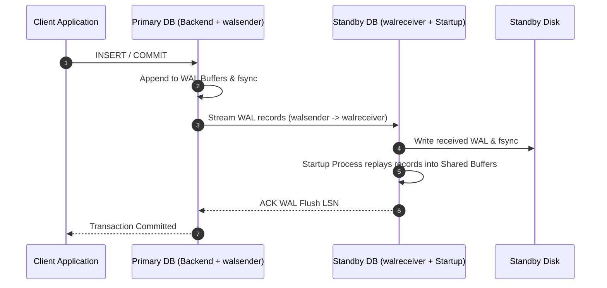
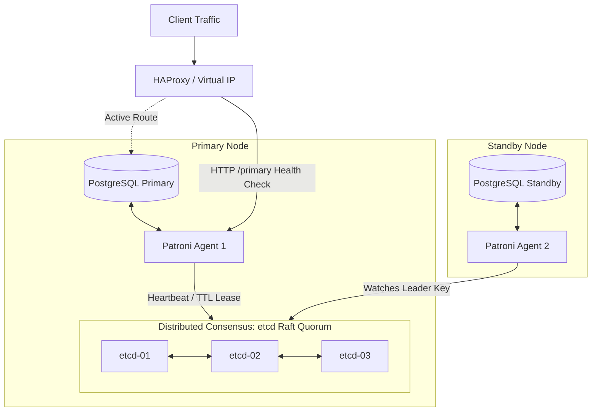

# Lesson 5: High Availability, Streaming Replication & Connection Pooling

## 1. Physical Streaming Replication Architecture

PostgreSQL achieves enterprise High Availability (HA) by streaming its Write-Ahead Log (WAL) byte-for-byte from a Read/Write **Primary** node to one or more Read-Only **Standby** replicas over a persistent TCP replication protocol connection.



### 1.1. The Replication Process Pair: `walsender` & `walreceiver`
1. On the Primary node, the Postmaster spawns a specialized backend process called **`walsender`**. This process monitors `wal_buffers` and the `$PGDATA/pg_wal/` directory, streaming binary WAL chunks to the standby as soon as they are written.
2. On the Standby node, a dedicated **`walreceiver`** process connects to the primary via the replication connection, receives the incoming byte stream, writes it directly into its local `pg_wal` folder, and issues an `fsync()`.
3. Concurrently, the Standby's **Startup Process** acts as a continuous crash-recovery engine, replaying the newly written WAL records into its local shared buffer pool.

---

## 2. Synchronous vs. Asynchronous Replication & The CAP Theorem

Replication behavior is governed by the `synchronous_commit` configuration setting, representing a direct operational trade-off between write latency and data durability.

```
+--------------------------+-------------------------------------------------------------+---------------------+
| synchronous_commit Level | When Primary Commits to Client                              | Data Loss on Crash? |
+--------------------------+-------------------------------------------------------------+---------------------+
| off                      | Immediately upon writing to memory (before local WAL fsync) | Yes (local buffer)  |
| local / on (Asynchronous)| Immediately after Primary flushes WAL to local disk         | Possible (Lag gap)  |
| remote_write             | Standby OS has accepted WAL into RAM, but not yet fsynced   | Extremely unlikely  |
| on (with sync replica)   | Standby has fsynced WAL to disk storage                     | Zero (RPO = 0)      |
| remote_apply             | Standby Startup process has replayed WAL into memory        | Zero (Read-your-own)|
+--------------------------+-------------------------------------------------------------+---------------------+
```

### 2.1. Replication Slots & The Inactive Standby Danger
Historically, replication used simple WAL polling. If a replica lagged behind, the primary might delete old WAL segments that the replica still needed, causing the replica to fail permanently with a broken replication timeline.

PostgreSQL solved this via **Physical Replication Slots**:
- A replication slot on the Primary registers the exact LSN that the Standby has confirmed receiving.
- **The Slot Invariant:** The Primary's Checkpointer is strictly prohibited from removing or recycling any WAL file on disk containing LSNs higher than the slot's acknowledged LSN.
- **The Operational Trap:** If a Standby node goes offline for hours or is decommissioned without removing its replication slot, the Primary will continuously hoard WAL files. If `max_slot_wal_keep_size` is not configured, this will fill the Primary's root disk to 100%, causing the entire primary database cluster to crash immediately!

---

## 3. High Availability Orchestration via Patroni & Distributed Consensus

PostgreSQL does not natively implement automated leader election, health heartbeats, or fencing (split-brain prevention). To run production zero-downtime clusters, industry standard architectures deploy **Patroni** coordinated by a distributed consensus store (etcd or Consul).



### 3.1. The Leader Lease & Split-Brain Mitigation
1. **TTL Leader Key:** The primary's Patroni daemon continuously renews a temporary key (lease) in etcd (e.g., `/service/batman/leader`) with a 10-second Time-To-Live (TTL).
2. **Automated Failover:** If the primary host freezes or suffers a network partition, its heartbeat fails to renew the lease. The key expires.
3. **Consensus Election:** Standby Patroni daemons observe the lease expiration. The standby that has replayed the furthest WAL LSN acquires the leader key in etcd.
4. **Fencing (STONITH):** The newly elected node promotes its local PostgreSQL instance via `pg_ctl promote`. The old primary, noticing its lease is lost, aggressively demotes itself via `pg_ctl stop -m immediate` to prevent two primaries from ever accepting divergent writes simultaneously.

---

## 4. Connection Pooling Mechanics with PgBouncer

Because PostgreSQL allocates a distinct operating system process per connection, high-frequency web applications (which frequently open thousands of concurrent ephemeral connections) can exhaust system memory, cause catastrophic context-switching overhead, and saturate kernel process limits.

To solve this, PostgreSQL clusters deploy **PgBouncer**, an ultra-lightweight single-threaded event-driven connection pooler written in C using `libevent`.

```
[10,000 Client App Connections] 
             |
             v
   [ PgBouncer Pooler ] (Translates 10,000 idle clients into 50 multiplexed backends)
             |
             v
[ 50 PostgreSQL Dedicated Backends ]
```

### 4.1. Pooling Modes Compared
PgBouncer operates in three distinct pooling modes:
1. **Session Pooling:** A server connection is leased to a client for the entire duration of the client's connection and returned only when the client disconnects. Provides minimal concurrency savings.
2. **Transaction Pooling (Production Standard):** A server connection is assigned to a client only for the exact duration of a single database transaction (`BEGIN ... COMMIT`). Once committed, the server connection returns to the pool immediately. Ten thousand clients with small transaction duties can easily run on just 50 server connections.
   - *Limitation:* Session-level state features (e.g., `PREPARE` statements without named descriptors, `LISTEN`/`NOTIFY`, and temporary tables) cannot be used because consecutive transactions from the same client may execute on different underlying PostgreSQL processes.
3. **Statement Pooling:** The connection is returned after each discrete SQL statement. Does not support multi-statement transactions; used only for simple analytics aggregators.
