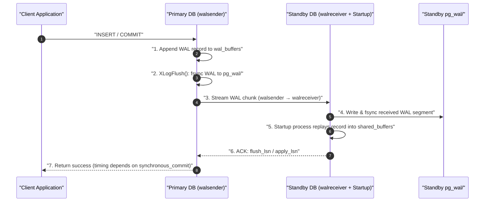
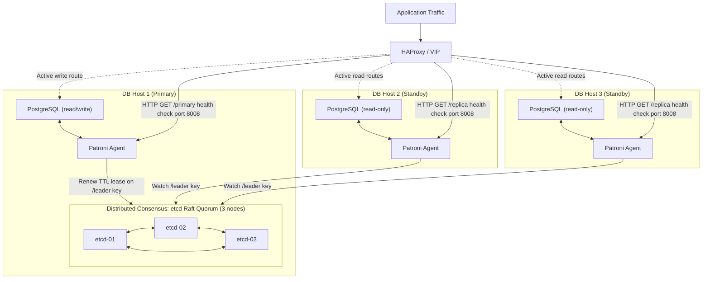
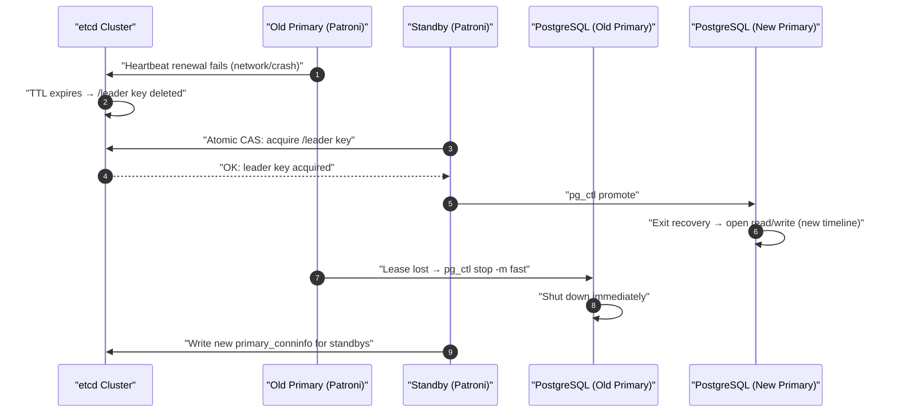
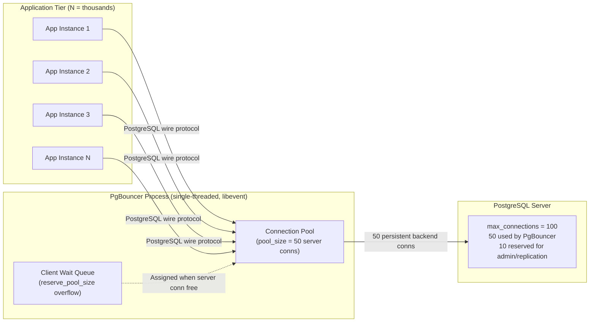
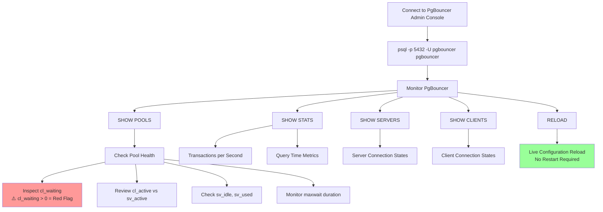
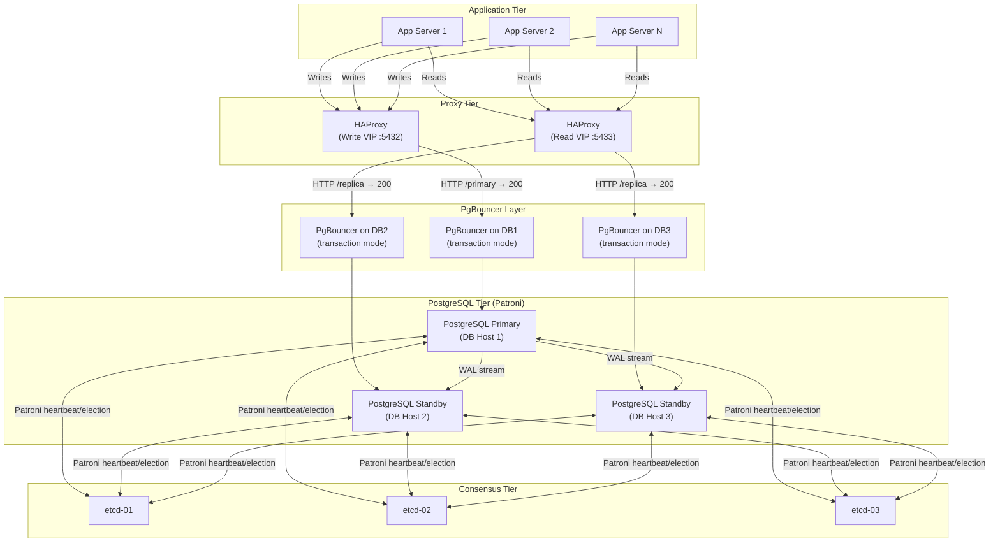

# Lesson 5: High Availability, Streaming Replication & Connection Pooling

## 1. Physical Streaming Replication Architecture

PostgreSQL achieves enterprise High Availability (HA) by streaming its Write-Ahead Log (WAL) byte-for-byte from a read/write **Primary** node to one or more read-only **Standby** replicas over a persistent TCP replication protocol connection. This is not logical replication (which ships row-level change events); it is a physical byte stream of WAL records that the standby applies to reconstruct an identical on-disk page layout.

The WAL itself is the source of truth. Every INSERT, UPDATE, DELETE, or DDL operation first writes a WAL record describing the change, then modifies the in-memory buffer pool. The heap and index files are considered a cache of the WAL. This is why a standby applying the same WAL stream ends up with a bit-for-bit identical data directory.



Steps 3–6 define the replication lag. Under `synchronous_commit = on` with a named synchronous standby, step 7 is blocked until step 4 completes. Under the default asynchronous mode, step 7 returns after step 2, and steps 3–6 happen concurrently in the background.

### 1.1. The Replication Process Pair: `walsender` and `walreceiver`

On the **Primary**, the Postmaster spawns a dedicated **`walsender`** backend process for each connected replica. This is a full PostgreSQL backend process (with its own shared memory attachment and system catalog access), but its sole purpose is to tail `pg_wal/` and ship WAL records. `walsender` reads from the WAL circular buffer (`wal_buffers`) when records are still in memory, falling back to reading segment files from disk when the replica lags. The replication protocol used over this connection is a PostgreSQL-specific binary streaming protocol, documented in the frontend/backend protocol as the "copy both" message flow.

On the **Standby**, the **`walreceiver`** process establishes a libpq replication connection to the primary using the connection string stored in `primary_conninfo` (in `postgresql.auto.conf` or `recovery.conf` for older versions). It receives the byte stream and writes it directly into its local `pg_wal/` directory. After each write, it calls `fsync()` on the WAL file and reports back to the primary with three LSN positions:

- `received_lsn`: highest WAL byte received off the network.
- `flushed_lsn`: highest WAL byte durably written to standby disk.
- `applied_lsn`: highest WAL byte replayed into shared buffers by the Startup process.

Concurrently, the Standby's **Startup process** functions as a perpetual crash-recovery loop. In normal crash recovery, the startup process reads WAL once and exits. In Hot Standby mode, it loops indefinitely—waiting for `walreceiver` to deliver new WAL, then replaying each record into the shared buffer pool, making read queries against the standby possible.

The standby is not writable. Any attempt to write data files directly is rejected at the storage manager level. It can, however, execute read-only queries via the **Hot Standby** feature, introduced in PostgreSQL 9.0, which runs queries concurrently with WAL replay using conflict resolution logic (`hot_standby_feedback`, `max_standby_streaming_delay`).

### 1.2. WAL Segments, LSNs, and the `pg_wal/` Directory

WAL is written into 16 MB segment files (configurable at `initdb` time with `--wal-segsize`). Each segment is named by its Log Sequence Number (LSN) offset, e.g., `000000010000000000000001`. An LSN is a 64-bit byte offset into the WAL stream, printed as `X/YYYYYYYY`. You can inspect current LSN positions at runtime:

```sql
-- On the primary: current write position
SELECT pg_current_wal_lsn();

-- On the standby: replication lag in bytes and time
SELECT
    sender_host,
    write_lsn,
    flush_lsn,
    replay_lsn,
    write_lag,
    flush_lag,
    replay_lag
FROM pg_stat_replication;

-- On the standby itself: how far behind is local replay?
SELECT
    now() - pg_last_xact_replay_timestamp() AS replication_delay;
```

---

## 2. Synchronous vs. Asynchronous Replication and the Durability Spectrum

The `synchronous_commit` GUC governs at which point in the replication pipeline the primary returns success to the client. It is not a binary on/off setting—it defines five distinct durability levels, each representing a different position on the latency-vs-data-loss tradeoff curve.

| `synchronous_commit` Level | Primary Returns to Client When... | Data Loss on Crash? | Added Latency |
|---|---|---|---|
| `off` | WAL record is in `wal_buffers` (memory), before local disk flush | Yes — up to `wal_writer_delay` (default 200 ms) of writes | None (async memory write) |
| `local` | Primary has flushed WAL to its own disk (`fsync` complete) | Yes — replication lag gap on standby | None beyond local fsync |
| `remote_write` | Standby OS kernel has accepted WAL into its page cache (write syscall returned), but not yet fsynced | Extremely unlikely; requires simultaneous primary crash + standby OS/power failure before kernel flush | One network RTT |
| `on` (with sync replica) | Standby has called `fsync()` and WAL is durable on standby disk | Zero — RPO = 0 for committed transactions | One network RTT + standby fsync |
| `remote_apply` | Standby Startup process has replayed WAL into its shared buffers | Zero — read-your-own-writes guaranteed on standby | One network RTT + standby fsync + replay time |

`synchronous_commit` is a **per-transaction** parameter. You can set it session-wide or override it for individual transactions, which is a powerful production pattern:

```sql
-- High-durability write: payment ledger entry
BEGIN;
SET LOCAL synchronous_commit = on;
INSERT INTO payment_ledger (account_id, amount, created_at)
VALUES (42, -150.00, now());
COMMIT;

-- Low-durability write: ephemeral session event log
-- Accept up to 200ms data loss in exchange for no replication latency
BEGIN;
SET LOCAL synchronous_commit = off;
INSERT INTO session_events (session_id, event_type, ts)
VALUES ('abc123', 'page_view', now());
COMMIT;
```

### 2.1. The `synchronous_standby_names` Configuration

Synchronous replication only activates when `synchronous_standby_names` is non-empty. This GUC specifies which standby(s) must acknowledge before the primary confirms a commit. It supports multiple quorum policies:

```ini
# Require ALL listed standbys to confirm (maximum durability, maximum latency impact)
synchronous_standby_names = 'FIRST 1 (standby1, standby2)'

# Require any 1 of the listed standbys (useful with 2+ replicas for HA without
# blocking on a single slow standby)
synchronous_standby_names = 'ANY 1 (standby1, standby2, standby3)'

# Legacy syntax: require exactly standby1, with standby2 as priority fallback
synchronous_standby_names = 'standby1, standby2'
```

The standby's application name is set via `primary_conninfo`:
```ini
primary_conninfo = 'host=primary-db port=5432 application_name=standby1'
```

If `synchronous_standby_names` names a standby that is currently offline, **all synchronous commits on the primary will block indefinitely**. This is intentional—it is the guarantee. For production, `ANY 1 (replica1, replica2)` is the common pattern: durability is maintained as long as at least one of the named replicas is reachable.

### 2.2. Physical Replication Slots: The Invariant and the Operational Trap

Before replication slots (introduced in PostgreSQL 9.4), the primary had no way to know which WAL segments a lagging replica still needed. The operator had to manually tune `wal_keep_size` (formerly `wal_keep_segments`) to retain enough WAL history. Under-provisioning this value would cause the replica to fall off the WAL timeline irreversibly.

**Physical Replication Slots** solve this with a formal durability contract:

> The primary's checkpoint and WAL archival processes are strictly prohibited from removing or recycling any WAL segment containing LSNs at or above the slot's `restart_lsn`.

Each slot tracks two LSNs:
- `restart_lsn`: the oldest WAL position the connected replica might need to re-read (set on reconnect).
- `confirmed_flush_lsn`: the highest WAL position the replica has explicitly acknowledged as flushed (physical slots don't use this; it is the logical slot field).

```sql
-- Inspect all replication slots and their retained WAL
SELECT
    slot_name,
    plugin,
    slot_type,
    active,
    restart_lsn,
    pg_size_pretty(
        pg_wal_lsn_diff(pg_current_wal_lsn(), restart_lsn)
    ) AS retained_wal
FROM pg_replication_slots;
```

**The Operational Trap:** If a standby goes offline and its slot is not dropped, the primary accumulates WAL indefinitely. With default configuration (`max_slot_wal_keep_size = -1`, meaning unlimited), this will fill the primary's disk to 100% and crash the entire cluster with:

```
FATAL: could not write to file "pg_wal/xlogtemp.NNNN": No space left on device
```

This is not a recoverable error while the disk is full. The correct mitigations are:

1. **Set a hard cap** to prevent disk exhaustion (PostgreSQL 13+):
   ```ini
   # Allow at most 10 GB of WAL retention per slot
   max_slot_wal_keep_size = 10GB
   ```
   When the limit is exceeded, the slot is invalidated and the replica must be rebuilt from a base backup. This is a **deliberate trade-off**: data safety (not crashing the primary) over replica availability.

2. **Drop orphaned slots immediately** when decommissioning a standby:
   ```sql
   SELECT pg_drop_replication_slot('my_standby_slot');
   ```

3. **Monitor proactively**. Alert when retained WAL exceeds a threshold:
   ```sql
   SELECT slot_name, pg_size_pretty(
       pg_wal_lsn_diff(pg_current_wal_lsn(), restart_lsn)
   ) AS lag
   FROM pg_replication_slots
   WHERE active = false;
   ```

---

## 3. High Availability Orchestration with Patroni and Distributed Consensus

PostgreSQL has no built-in mechanism for leader election, health checking, or fencing. It is a database engine, not a distributed system coordinator. Running a production zero-downtime PostgreSQL cluster therefore requires a separate orchestration layer. The de facto industry standard is **Patroni**, an open-source Python daemon developed at Zalando.

Patroni coordinates cluster state through a **distributed consensus store**—most commonly a 3- or 5-node etcd cluster using the Raft consensus algorithm, though Consul, ZooKeeper, and Kubernetes API server are also supported backends.



### 3.1. The Leader Lease Mechanism

Patroni uses etcd's atomic TTL key operations to implement a distributed lock:

1. **Acquisition:** When a node first becomes leader (after winning a failover election or at initial cluster bootstrap), its Patroni daemon writes the key `/service/<cluster-name>/leader` with its own hostname as the value and a TTL of `ttl` seconds (default: 30).

2. **Renewal:** The primary's Patroni daemon renews this key every `loop_wait` seconds (default: 10), resetting the TTL counter. As long as the primary is healthy and network-reachable to etcd, the key never expires.

3. **Expiration:** If the primary's Patroni daemon cannot reach etcd (network partition, host freeze, process crash), it fails to renew the lease. After the TTL elapses, etcd automatically deletes the key. This is the atomic, distributed signal that the primary has vacated leadership.

4. **Election:** All standby Patroni daemons watch the `/leader` key. On deletion, they race to atomically acquire it using etcd's `Create` operation (which only succeeds if the key does not exist). The standby with the highest replayed LSN is preferred via a pre-election negotiation step, but ultimately it is a first-writer-wins race on the consensus store.

### 3.2. Fencing and Split-Brain Prevention

**Split-brain**—two nodes both believing they are the primary and accepting writes—is the most catastrophic failure mode in a replicated database. It produces divergent transaction histories that cannot be automatically merged.

Patroni's defense is two-layered:

**Layer 1 — Self-Demotion:** A Patroni primary that loses its etcd lease (whether due to a genuine failure or a network partition that healed) will immediately call `pg_ctl stop -m fast` on its local PostgreSQL instance. It does not wait for queries to finish. This ensures that even if the old primary is still reachable by some clients, it stops accepting writes before the new primary is promoted.

**Layer 2 — STONITH via `pg_ctl promote`:** The newly elected leader's Patroni agent calls `pg_ctl promote` (or writes `promote` to the trigger file), which signals the standby's Startup process to exit recovery mode and open the cluster for read/write traffic. This irreversibly advances the cluster timeline ID, making the old primary's WAL timeline divergent and unacceptable to any new replica.



### 3.3. The Patroni REST API and HAProxy Health Checks

Patroni exposes an HTTP REST API (default port 8008) on each node. HAProxy uses this for routing without requiring any application-level awareness of topology:

```haproxy
# /etc/haproxy/haproxy.cfg
backend postgres_primary
    option httpchk GET /primary
    http-check expect status 200
    default-server inter 3s fall 3 rise 2 on-marked-down shutdown-sessions
    server db1 10.0.0.1:5432 maxconn 100 check port 8008
    server db2 10.0.0.2:5432 maxconn 100 check port 8008
    server db3 10.0.0.3:5432 maxconn 100 check port 8008

backend postgres_replicas
    option httpchk GET /replica
    http-check expect status 200
    balance leastconn
    default-server inter 3s fall 3 rise 2 on-marked-down shutdown-sessions
    server db1 10.0.0.1:5432 maxconn 100 check port 8008
    server db2 10.0.0.2:5432 maxconn 100 check port 8008
    server db3 10.0.0.3:5432 maxconn 100 check port 8008
```

Patroni's `/primary` endpoint returns HTTP 200 only when the local node is the current leader and PostgreSQL is accepting read/write connections. It returns HTTP 503 on standbys. The `/replica` endpoint returns 200 on healthy standbys and 503 on the primary. This allows HAProxy to automatically reroute traffic within seconds of a failover without any manual intervention or DNS TTL delays.

---

## 4. Connection Pooling with PgBouncer: Architecture and Mechanics

PostgreSQL's process-per-connection model is a deliberate architectural choice that provides strong process isolation, simplified memory management (each backend has its own stack and work_mem allocations), and crash containment. The cost is that each connection consumes 5–10 MB of resident memory plus a system process, and PostgreSQL's internal process scheduler is not designed to efficiently multiplex thousands of simultaneous connections.

A PostgreSQL instance configured with `max_connections = 500` is not an invitation to open 500 simultaneous active connections—it is a hard ceiling. At 500 active connections, the shared memory structures (proc arrays, lock tables) become contention hotspots, and context-switching overhead between processes degrades throughput significantly. The practical performance cliff is typically around 100–200 active connections on modern hardware, depending on workload.

**PgBouncer** is an ultra-lightweight, single-threaded, event-driven connection multiplexer written in C using `libevent`. It presents itself to clients as a PostgreSQL server (implementing the PostgreSQL wire protocol), and maintains a small pool of long-lived backend connections to the actual PostgreSQL instance.



PgBouncer's single-threaded design is not a limitation—it is an optimization. For a pure connection multiplexer, the bottleneck is network I/O, not CPU. `libevent` provides efficient epoll-based I/O multiplexing, allowing a single thread to manage tens of thousands of client sockets with microsecond dispatch latency. This is the same architectural choice as Nginx and Redis.

### 4.1. Pooling Modes: Mechanism and Trade-offs

PgBouncer operates in one of three modes, configured globally per pool or per database section in `pgbouncer.ini`.

**Session Pooling** (`pool_mode = session`)

A server connection is assigned to a client for the entire lifetime of the client's TCP connection. It is returned to the pool only when the client disconnects. Session-level state (prepared statements, `SET` variables, advisory locks, `LISTEN` subscriptions, temporary tables) is fully preserved. The only benefit over direct connections is limiting the total number of server-side processes—there is no multiplexing within a session. Use this mode when applications use session-level features that cannot be reset between connections, as a migration stepping stone, or when the connection count itself (not concurrency) is the bottleneck.

**Transaction Pooling** (`pool_mode = transaction`) — the production standard

A server connection is checked out from the pool at the start of a transaction (`BEGIN` or the first statement in autocommit mode) and returned immediately at `COMMIT` or `ROLLBACK`. Between transactions, the client holds no server connection. This is the mode that enables 10,000 application connections to share 50 server connections, because typical web applications spend the vast majority of their connection lifetime idle between requests.

The trade-off is real and must be understood:

- **Named prepared statements** (`PREPARE foo AS ...`) survive within a PostgreSQL backend process, not within a PgBouncer client session. If client A prepares `foo` on backend connection 7, then client B executes on backend connection 7, it sees `foo`. Worse, if client A switches to backend connection 3, `PREPARE foo` will fail or misbehave. Solution: use the extended query protocol (which PgBouncer handles via `prepare_threshold`), or avoid server-side named prepared statements entirely in transaction mode.
- **`SET` configuration parameters** survive until the connection is reset. PgBouncer mitigates this by tracking `SET` commands and issuing `RESET ALL` (or selective resets) when returning a connection to the pool, configured via `server_reset_query`.
- **`LISTEN`/`NOTIFY`** subscriptions are process-local and incompatible with transaction pooling because the client's backend assignment changes between transactions.
- **Temporary tables** are session-scoped in PostgreSQL and will persist on the backend connection after the client's transaction ends, visible to the next client assigned that connection. Use `ON COMMIT DROP` or avoid temporary tables entirely in transaction pooling mode.
- **Advisory locks** taken with `pg_advisory_lock()` (session-level) will not be released between transactions.

**Statement Pooling** (`pool_mode = statement`)

The server connection is returned after every individual SQL statement, even within a `BEGIN/COMMIT` block. Multi-statement transactions are explicitly unsupported and will be rejected with an error if attempted. This mode is functionally compatible only with single-statement autocommit workloads—bulk analytics pipelines or simple read-only aggregation. It is rarely appropriate for OLTP applications.

### 4.2. PgBouncer Configuration for Production

```ini
; /etc/pgbouncer/pgbouncer.ini

[databases]
; Route "appdb" on the PgBouncer port to the actual PostgreSQL instance
appdb = host=10.0.0.1 port=5432 dbname=appdb

[pgbouncer]
listen_addr = 0.0.0.0
listen_port = 5432

; Production default: transaction pooling
pool_mode = transaction

; Maximum server connections per (database, user) pair
default_pool_size = 50

; Minimum idle server connections kept warm
min_pool_size = 10

; Extra connections above default_pool_size for clients that have been
; waiting longer than reserve_pool_timeout seconds
reserve_pool_size = 10
reserve_pool_timeout = 5.0

; Hard ceiling on total server connections across ALL pools
max_db_connections = 90

; Maximum clients that can be waiting for a connection (beyond this: reject)
max_client_conn = 10000

; Authentication: use PostgreSQL's own HBA file for auth pass-through
auth_type = scram-sha-256
auth_file = /etc/pgbouncer/userlist.txt

; When returning a connection to the pool, execute this to sanitize state.
; "DISCARD ALL" is safest but slowest; for performance, tune to your needs.
server_reset_query = DISCARD ALL

; Do not use server_reset_query in statement pooling mode
server_reset_query_always = 0

; Close server connections idle longer than this (seconds)
server_idle_timeout = 600

; Close client connections idle longer than this (seconds)  
client_idle_timeout = 0

; TLS for client connections
client_tls_sslmode = require
client_tls_cert_file = /etc/ssl/certs/pgbouncer.crt
client_tls_key_file = /etc/ssl/private/pgbouncer.key

; Logging
logfile = /var/log/pgbouncer/pgbouncer.log
pidfile = /var/run/pgbouncer/pgbouncer.pid
log_connections = 0  ; Disable in production to reduce log volume
log_disconnections = 0
log_stats = 1
stats_period = 60
```

### 4.3. Monitoring PgBouncer via the Admin Console

PgBouncer exposes a virtual `pgbouncer` database with pseudo-tables for runtime introspection:



A non-zero `cl_waiting` value means clients are queued waiting for a free server connection. Persistent `cl_waiting` indicates `default_pool_size` is too low for the current workload or that query durations are too long, keeping server connections checked out.

### 4.4. The `server_reset_query` and State Contamination

When PgBouncer returns a server connection to the pool, it optionally executes `server_reset_query` to sanitize any state the previous client left behind. The options in increasing order of safety and cost:

```sql
-- Cheapest: only resets local parameter changes from SET commands
-- Does NOT close cursors, temp tables, or prepared statements
RESET ALL;

-- Safest: closes cursors, removes temp tables, deallocates prepared statements,
-- resets all parameters, unlocks advisory locks, resets sequence caches
DISCARD ALL;
```

In transaction pooling mode, `DISCARD ALL` is the correct default because a server connection may have been used by many different clients since it was last fully reset. The overhead of `DISCARD ALL` is a few hundred microseconds—negligible compared to the cost of a new backend connection (which involves fork, shared memory attachment, and authentication).

---

## 5. Putting It Together: Production HA + Pooling Architecture

The complete production architecture combines all three layers: Patroni-managed PostgreSQL streaming replication for HA, HAProxy for topology-aware routing, and PgBouncer for connection multiplexing.



This architecture delivers:

- **RPO = 0** for write-committed data with `synchronous_commit = on` and `ANY 1 (replica2, replica3)`.
- **RTO < 30 seconds** for automated failover via Patroni (TTL expiry + election + promote + HAProxy health check convergence).
- **Connection scalability** to tens of thousands of application connections via PgBouncer transaction pooling against a correctly sized `max_connections` on PostgreSQL (typically 100–300).
- **Read scalability** by distributing read-only queries across multiple standbys via the HAProxy replica backend.

The three tiers are independently scalable and independently failure-tolerant: losing an etcd node does not affect query processing; losing a PgBouncer node requires only an HAProxy backend reconfiguration; losing the primary triggers an automated Patroni failover without application code changes.
