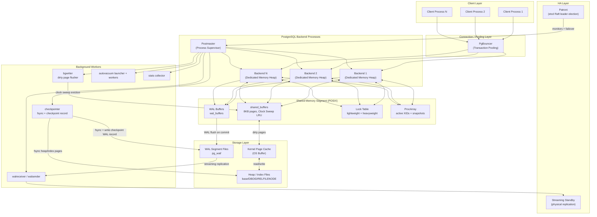
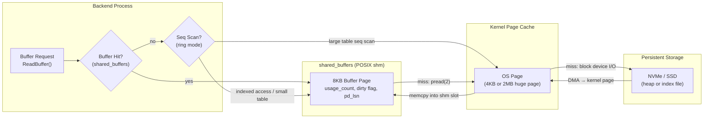
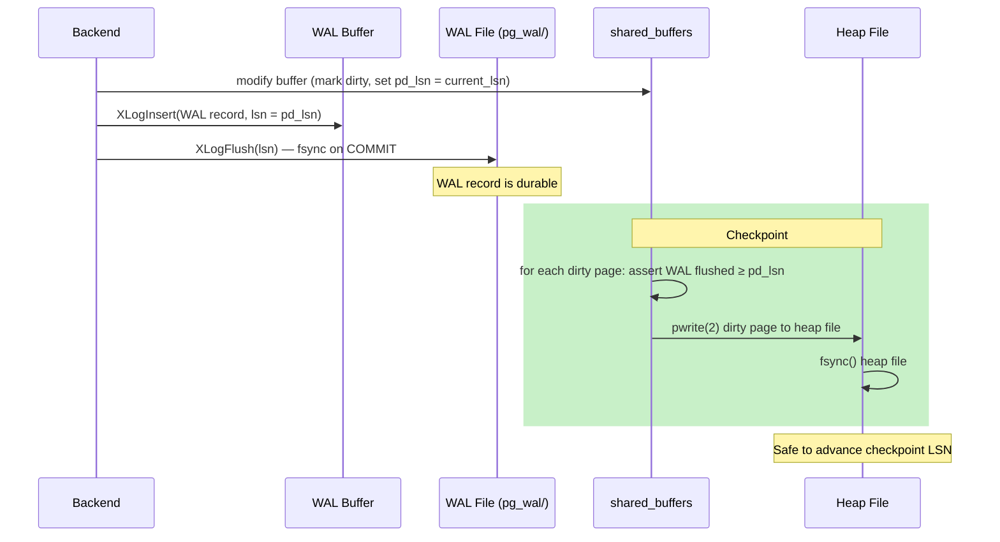
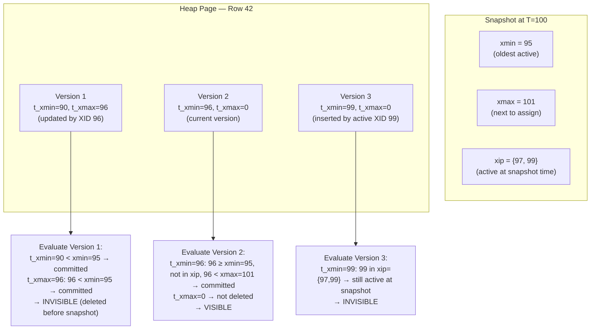
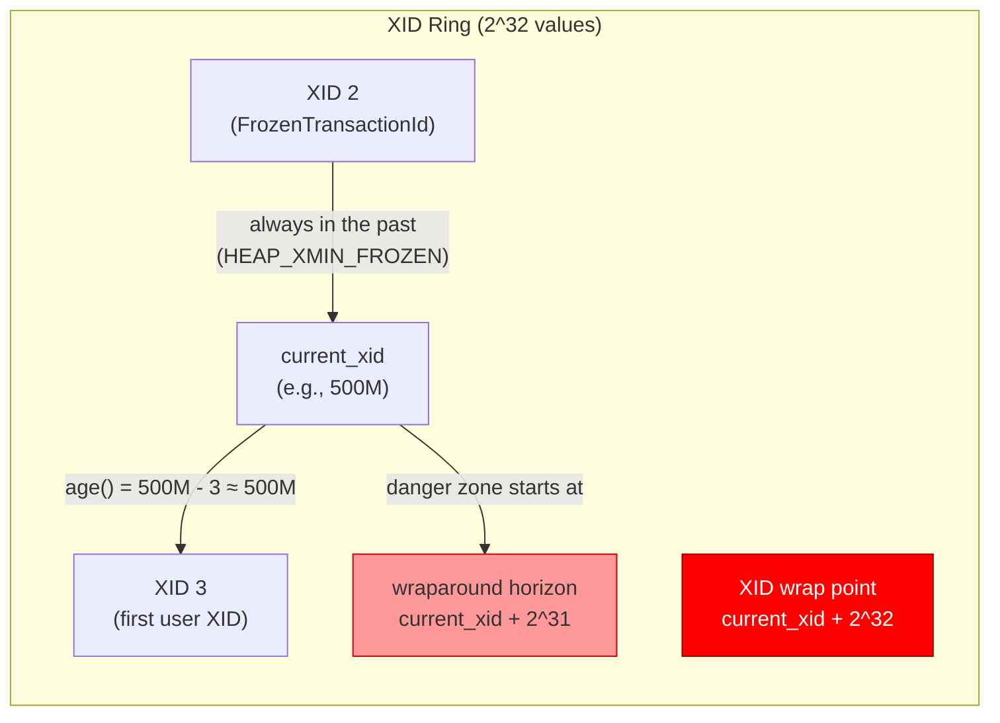
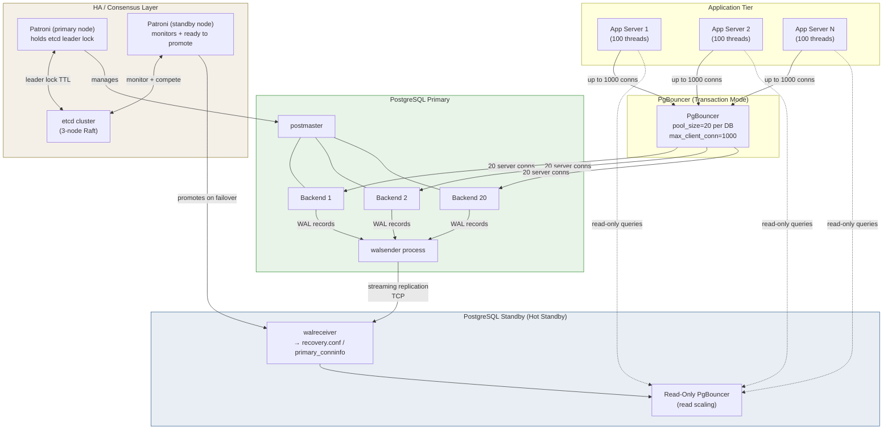
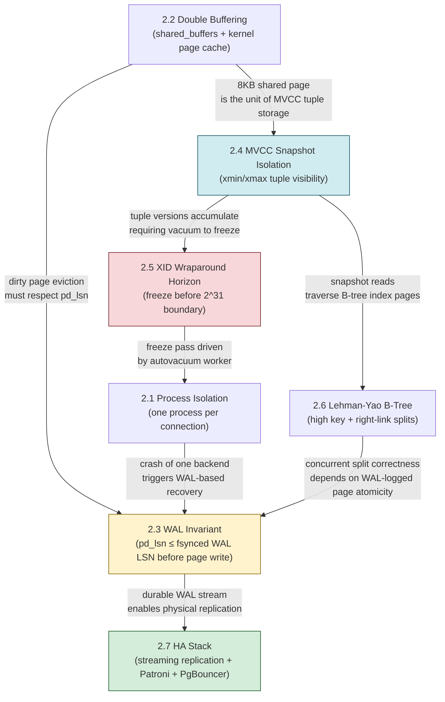

# Lesson 6: Curriculum Summary & Operational Invariants

A PostgreSQL deployment is not a black box. Every observable behavior — from query latency spikes to replication lag to vacuum stalls — has a precise mechanical explanation rooted in the system's architecture. This lesson codifies the fundamental invariants that govern PostgreSQL's correctness guarantees and the operational parameters that determine whether those guarantees hold under production load.

---

## 1. Architectural Overview

Before examining individual invariants, the diagram below maps the major subsystems and their relationships. Understanding which components interact synchronously versus asynchronously is the foundation for all operational reasoning.



---

## 2. The Seven Core Invariants

### 2.1 Process Isolation Over Threads

PostgreSQL deliberately chose a one-process-per-connection model, tracing back to the original design goals of the POSTGRES project at Berkeley in the late 1980s. Each backend is a full OS process with its own virtual address space, managed by the `postmaster` via `fork(2)`. The `postmaster` itself never serves queries; it is a pure supervisor that monitors backend exit status via `waitpid(2)` and restarts crashed workers.

**Why this matters architecturally:** A memory violation — a buffer overrun in a codec, a corrupted pointer in a third-party extension — triggers a `SIGSEGV` delivered to the offending process. The kernel terminates that process cleanly. The `postmaster` detects the abnormal exit, issues `SIGQUIT` to all remaining backends (causing an orderly shared-memory reset), and the cluster recovers to a consistent state through crash recovery of the WAL. No other backend's private memory is exposed. In a threaded model, a single heap corruption can silently poison data structures shared across all connections before any signal is raised.

The tradeoff is connection overhead: each backend allocates its own `work_mem` sort buffer pool, executor state, plan caches, and catalog caches. This is why PgBouncer's transaction-mode pooling is architecturally necessary at scale — it allows hundreds of application threads to share a small pool of active backends (typically 20–100), and why `max_connections` is a resource multiplier, not a free parameter.

```mermaid
sequenceDiagram
    participant App as Application Thread
    participant PGB as PgBouncer
    participant PM as Postmaster
    participant BE as Backend Process

    App->>PGB: connect()
    PGB->>PM: assign existing idle backend (pool hit)
    PM-->>PGB: backend PID assigned
    PGB-->>App: connection established

    App->>PGB: BEGIN; UPDATE ...; COMMIT;
    PGB->>BE: forward transaction
    BE->>BE: execute, write WAL, fsync on COMMIT
    BE-->>PGB: transaction complete
    PGB-->>App: results returned

    Note over BE: Backend crashes (SIGSEGV in extension)
    PM->>PM: waitpid() detects exit
    PM->>PM: issue SIGQUIT to siblings
    PM->>PM: crash recovery via WAL replay
    PM-->>PGB: new backend ready
```

### 2.2 Double Buffering: Shared Buffers and the Kernel Page Cache

Every I/O path in PostgreSQL traverses two independent buffer layers. The first is `shared_buffers` — a fixed-size pool of 8KB pages in the POSIX shared memory segment, accessible by all backends. The second is the kernel page cache, which the OS maintains independently as it services the `read(2)`, `write(2)`, and `fsync(2)` calls that PostgreSQL issues against heap and WAL files.

**The Clock Sweep algorithm:** PostgreSQL's buffer replacement policy is a simplified variant of the CLOCK algorithm. Each buffer descriptor holds a `usage_count` field, initialized to 1 on first pin and incremented (up to 5) on subsequent pins. The clock hand sweeps the descriptor array; it decrements `usage_count` on each pass and evicts the first buffer it finds with a count of zero. This is O(1) amortized and lock-free for the common path — the `bgwriter` advances the clock hand independently to pre-evict pages before backends need free buffers, minimizing stalls on the hot path.

**Double-buffering consequences:** Data read from disk is copied into a kernel page cache page, then `memcpy`'d again into a `shared_buffers` page. This means popular data can consume up to 2× its on-disk size in RAM. For large sequential scans that will never be re-read, `enable_seqscan` with `ring buffer` mode (using a small 256KB rotating ring rather than polluting the full `shared_buffers` pool) is PostgreSQL's mitigation. Direct I/O (bypassing the kernel page cache entirely) is available experimentally from PostgreSQL 16 onwards via `io_method = io_uring`, but is not yet recommended for production use.



### 2.3 The WAL Write-Ahead Invariant

The Write-Ahead Log invariant is the atomic correctness guarantee underpinning crash recovery and replication. It is stated precisely:

> **A dirty shared buffer page may not be written to its heap file on disk until every WAL record whose LSN is ≤ `page.pd_lsn` has been flushed (fsynced) to the WAL.**

`pd_lsn` (Page LSN) is stored in the first 8 bytes of every 8KB heap page header (`PageHeaderData.pd_lsn`, of type `XLogRecPtr`). It records the LSN of the most recent WAL record that modified the page. The checkpointer, before fsyncing a dirty buffer, checks that the WAL has advanced past this LSN. If it has not, the page write is deferred.

This invariant ensures that after a crash, WAL replay can reconstruct any page modification from the durable WAL stream, even if the page write to the heap file was partially written or never written. The flip side is **write amplification**: every row modification generates at minimum one WAL record (the full-page image on first modification after a checkpoint, `wal_log_hints`), plus the eventual heap page write. On write-heavy workloads, this can be 2–5× the logical write volume.

**Full-Page Writes (FPW):** Immediately after a checkpoint, the first modification to any page writes the entire 8KB page into the WAL (`XLogRecData` with `REGBUF_FORCE_IMAGE`). This guards against torn-page writes on storage that does not guarantee atomic 8KB sector writes. FPW is the dominant source of WAL amplification in checkpoint-heavy workloads and is controlled by `full_page_writes` (default `on`, never disable on non-atomic storage).



### 2.4 Lock-Free Concurrency: MVCC and Snapshot Isolation

PostgreSQL implements Multiversion Concurrency Control (MVCC) at the tuple (row version) level. Every tuple version carries two transaction ID fields in its `HeapTupleHeaderData`:

- `t_xmin` (`TransactionId`): the XID of the transaction that inserted this tuple version.
- `t_xmax` (`TransactionId`): the XID of the transaction that deleted or updated (creating a successor version) this tuple. Zero (`InvalidTransactionId`) means the tuple has not been deleted.

A snapshot taken at transaction start (via `GetSnapshotData()`, which reads the `ProcArray`) defines:
- `xmin`: the oldest active XID. All tuples with `t_xmin < snapshot.xmin` and committed are visible.
- `xmax`: the next XID to be assigned. All tuples with `t_xmin ≥ snapshot.xmax` are invisible.
- `xip[]`: the array of XIDs active at snapshot time. Tuples inserted by these XIDs are invisible regardless of `t_xmin`.

Visibility is determined by `HeapTupleSatisfiesMVCC()` — a pure function of the tuple header fields and the snapshot, with no lock acquisition. The `t_infomask` and `t_infomask2` bit fields cache commitment status (`HEAP_XMIN_COMMITTED`, `HEAP_XMAX_COMMITTED`) to avoid repeated `clog` (commit log, now `pg_xact`) lookups on hot tuples.

**The read-write non-blocking guarantee** is a consequence of this design: a `SELECT` never acquires a row-level lock and cannot be blocked by a concurrent `UPDATE`. Conversely, an `UPDATE` writing a new tuple version does not invalidate any reader's snapshot. The cost is tuple bloat — dead versions accumulate until vacuum reclaims them.

**Serializable Snapshot Isolation (SSI):** PostgreSQL 9.1 introduced true serializability via SSI (not just snapshot isolation). It tracks read/write anti-dependency edges in `pg_serializable.c` using `SIREAD` locks and detects dangerous structures (concurrent read-write cycles) at commit time, aborting one transaction with `ERROR: could not serialize access`. This provides serializability without predicate lock escalation.



### 2.5 The Transaction ID Wraparound Horizon

PostgreSQL transaction IDs are 32-bit unsigned integers (`TransactionId`, typedef'd from `uint32`). The comparison model treats the XID space as a modular ring: XID `A` is considered "in the past" relative to `B` if `(int32)(A - B) < 0`, i.e., `B - A < 2^31`. This means every live transaction can see at most 2^31 ≈ 2.1 billion past transactions before its XID wraps around to appear "in the future," making previously visible tuples become invisible — catastrophic data loss.

**The freeze mechanism** solves this by replacing `t_xmin` with the special value `FrozenTransactionId` (XID 2), encoded via the `HEAP_XMIN_FROZEN` bit in `t_infomask`. A frozen tuple is unconditionally visible to all future snapshots, removing it from the wraparound hazard. Autovacuum targets tables where `age(relfrozenxid)` exceeds `autovacuum_freeze_max_age` (default 200 million). The database enforces a hard limit at `vacuum_freeze_max_age + autovacuum_freeze_max_age` (effectively around 400 million XIDs) beyond which it will refuse to execute new transactions until a manual `VACUUM FREEZE` is run.

**Operational warning:** The metric `SELECT max(age(datfrozenxid)) FROM pg_database` must be monitored continuously. A value approaching 1.5 billion is a production emergency. The correct response is an immediate `VACUUM FREEZE` on the highest-age tables, identified via:

```sql
SELECT schemaname, relname, age(relfrozenxid) AS xid_age,
       pg_size_pretty(pg_total_relation_size(oid)) AS table_size
FROM pg_class
WHERE relkind = 'r'
ORDER BY xid_age DESC
LIMIT 20;
```

**Multixact wraparound** is a parallel hazard: `MultiXactId` (used for row-level locking with multiple lockers) has its own 32-bit counter and its own freeze mechanism. Monitor `max(age(datminmxid))` from `pg_database` with equal vigilance.



### 2.6 Lehman-Yao B-Tree Concurrent Access

PostgreSQL's B-tree implementation (`nbtree`) is based on the 1981 Lehman and Yao algorithm, which achieves concurrent access without locking parent pages during node splits. The two key structural invariants are:

1. **High Key (`P_HIKEY`):** Every non-rightmost leaf and internal page stores its high key — the maximum value that belongs on this page — as the first item in the page's item array. Any scan that reaches a page and finds its search key exceeds the high key knows a split has moved data rightward and must follow the right-link pointer.

2. **Right-Link Pointer (`btpo_next`):** Every page (leaf and internal) holds a pointer to its right sibling. This is set atomically during a split, before the parent is updated. A concurrent reader following a split-in-progress can always find moved data by following right-links without acquiring any parent-level lock.

**Split protocol:** When a backend splits a full leaf page `P` into `P` and `P'`:
1. Allocate new page `P'`, copy the upper half of tuples.
2. Set `P'.btpo_next = P.btpo_next` (atomic).
3. Set `P.btpo_next = P'` (atomic).
4. Set `P'.P_HIKEY = new high key`.
5. Insert the new downlink into the parent (which may itself require a split, propagating upward).

Steps 1–4 are protected by an exclusive lock on `P` and `P'` only. The parent is locked only in step 5, and only briefly. Any reader that read `P` between steps 3 and 5 (before the parent is updated) can still find `P'` by following `P.btpo_next`.

**Vacuum and page deletion:** Leaf pages can be deleted when empty. This requires the page's left sibling, the page itself, and its parent to be briefly locked simultaneously — a carefully ordered acquisition to prevent deadlock. This is the most complex locking operation in the B-tree code.

### 2.7 Production HA Stack: Replication, Patroni, and PgBouncer

The production HA stack combines three distinct layers, each solving a different failure mode:

**Physical WAL Streaming Replication** provides a byte-exact replica of the primary's data files by continuously shipping WAL segments (or streaming individual WAL records via `walsender`/`walreceiver`). Replication slots (`pg_replication_slots`) ensure the primary retains WAL until all registered replicas have consumed it, preventing the slot's `restart_lsn` from falling behind. This is critical but dangerous — an offline replica with an active slot can cause unbounded WAL accumulation and disk exhaustion. Monitor `pg_replication_slots.wal_status` and `pg_replication_slots.safe_wal_size`.

**Patroni** provides automated leader election using a distributed consensus store (etcd, Consul, or ZooKeeper). The primary holds a renewable leader lock (a key with a TTL in etcd). If the primary fails to renew the lock before TTL expiry, it is considered dead. Patroni on the best replica (highest `replay_lsn`) promotes via `pg_ctl promote`, then fences the old primary (via `pg_ctl stop` or a configured `watchdog` that stonith-kills the host) to prevent split-brain. The critical operational parameter is `ttl` (default 30s) vs. `loop_wait` (default 10s): these govern the worst-case RTO for automatic failover.

**PgBouncer in transaction-mode pooling** multiplexes application connections onto a smaller set of backend processes. In transaction mode, the server connection is returned to the pool immediately when the transaction commits or rolls back, allowing a pool of 20 backends to serve thousands of application threads. The constraint is that session-level features — prepared statements (server-side `PREPARE`), advisory locks (`pg_advisory_lock`), `SET LOCAL` without explicit `RESET`, temporary tables — are not safe across transaction-pool boundaries unless PgBouncer's `track_extra_parameters` is configured or the application uses protocol-level prepared statements exclusively.



---

## 3. Key Operational Metrics and Thresholds

The following table represents production-validated configuration baselines. Every value has a mechanical justification — deviating from defaults should be a deliberate, benchmarked decision.

| Parameter | Default | Production Recommendation | Mechanical Justification |
| :--- | :--- | :--- | :--- |
| `shared_buffers` | `128MB` | 25%–40% of host RAM | Primary POSIX shm buffer pool. Beyond ~40%, gains diminish due to kernel page cache eviction pressure — OS needs RAM for its own page cache to serve `pread(2)` calls efficiently. |
| `random_page_cost` | `4.0` | `1.1`–`1.5` (NVMe SSD) | CBO cost model ratio of random vs. sequential I/O. Modern NVMe delivers ~100µs random reads vs. ~200µs sequential (amortized), collapsing the ratio. Setting to `1.1` allows index scans to compete with sequential scans even on moderately sized tables. |
| `effective_cache_size` | `4GB` | 50%–75% of host RAM | A planner hint (not an allocation) for the combined size of `shared_buffers` + kernel page cache. Affects CBO's index vs. seq scan and nested loop cost estimates. Set conservatively high on dedicated database hosts. |
| `work_mem` | `4MB` | 16MB–256MB (workload-dependent) | Per sort/hash operation allocation. With `max_connections=200` and a complex query using 10 sort nodes, peak RSS can reach `200 × 10 × work_mem`. Size according to `max_connections × expected_sort_operations × work_mem ≤ available_RAM`. |
| `checkpoint_timeout` | `5min` | `15min`–`30min` | Longer intervals spread checkpoint I/O over time, reducing write spikes. The tradeoff is longer crash recovery time (more WAL to replay). On NVMe with fast WAL replay, 15–30 minutes is safe. |
| `max_wal_size` | `1GB` | `16GB`–`64GB` | Soft cap on WAL accumulation between checkpoints. If exceeded, a checkpoint is forced regardless of `checkpoint_timeout`. On bulk-load workloads, a small `max_wal_size` causes checkpoint storms and extreme write amplification. |
| `wal_compression` | `off` | `on` (or `zstd` on PG 15+) | Compresses full-page images in WAL, dramatically reducing WAL volume (often 40–70% reduction) with minimal CPU overhead on modern hardware. `zstd` offers better ratio than the default `pglz`. |
| `autovacuum_vacuum_scale_factor` | `0.2` | `0.01`–`0.05` (large tables) | Fraction of table that must be dead tuples before autovacuum triggers. At 0.2, a 100M-row table requires 20M dead tuples before vacuum runs — table bloat accumulates. For large tables, set via `ALTER TABLE ... SET (autovacuum_vacuum_scale_factor = 0.01)`. |
| `autovacuum_freeze_max_age` | `200M` | `150M`–`200M` | Maximum XID age before autovacuum forces a freeze pass, independent of dead-tuple ratio. Setting lower increases freeze frequency but reduces wraparound risk. Never increase above the default. |
| `synchronous_commit` | `on` | `on` / `remote_apply` for HA | `on`: WAL flushed to primary disk before ACK. `remote_write`: WAL received by standby (not fsynced). `remote_apply`: WAL applied on standby before ACK — strongest HA guarantee, highest latency. `off`: 3× throughput improvement but up to `wal_writer_delay` (200ms) of data loss on crash — acceptable for session-local idempotent operations. |
| `wal_level` | `replica` | `replica` (or `logical` if CDC needed) | `minimal` omits WAL required for replication/PITR. `replica` is the minimum for physical standby and `pg_basebackup`. `logical` adds the data needed for logical decoding and CDC tools (Debezium, pglogical). |
| `max_parallel_workers_per_gather` | `2` | `4`–`8` (OLAP workloads) | Controls parallel query worker allocation per `Gather`/`Gather Merge` node. Each worker inherits its own `work_mem` allocation. Set to the number of physical cores available for query processing, not exceeding `max_parallel_workers`. |

---

## 4. The Diagnostic Query Toolkit

Production operations require standing queries to surface the system's internal state. The following are production-ready, with no hallucinated system catalog columns.

### 4.1 Buffer Pool Hit Ratio

```sql
-- Overall buffer hit ratio. Values below 99% warrant investigation on OLTP.
SELECT
    sum(heap_blks_hit)::float / nullif(sum(heap_blks_hit) + sum(heap_blks_read), 0) AS buffer_hit_ratio,
    sum(idx_blks_hit)::float  / nullif(sum(idx_blks_hit)  + sum(idx_blks_read),  0) AS index_hit_ratio
FROM pg_statio_user_tables;
```

### 4.2 Lock Wait Detection

```sql
-- Active lock waits with blocking query text. Essential for diagnosing contention.
SELECT
    blocked.pid                     AS blocked_pid,
    blocked_activity.query          AS blocked_query,
    blocked_activity.wait_event_type,
    blocked_activity.wait_event,
    blocking.pid                    AS blocking_pid,
    blocking_activity.query         AS blocking_query,
    blocking_activity.state         AS blocking_state,
    now() - blocked_activity.query_start AS wait_duration
FROM pg_catalog.pg_locks blocked
JOIN pg_catalog.pg_stat_activity blocked_activity
    ON blocked_activity.pid = blocked.pid
JOIN pg_catalog.pg_locks blocking
    ON blocking.locktype = blocked.locktype
    AND blocking.database IS NOT DISTINCT FROM blocked.database
    AND blocking.relation IS NOT DISTINCT FROM blocked.relation
    AND blocking.page IS NOT DISTINCT FROM blocked.page
    AND blocking.tuple IS NOT DISTINCT FROM blocked.tuple
    AND blocking.transactionid IS NOT DISTINCT FROM blocked.transactionid
    AND blocking.classid IS NOT DISTINCT FROM blocked.classid
    AND blocking.objid IS NOT DISTINCT FROM blocked.objid
    AND blocking.objsubid IS NOT DISTINCT FROM blocked.objsubid
    AND blocking.pid != blocked.pid
JOIN pg_catalog.pg_stat_activity blocking_activity
    ON blocking_activity.pid = blocking.pid
WHERE NOT blocked.granted
ORDER BY wait_duration DESC;
```

### 4.3 Replication Lag and Slot Health

```sql
-- Replication lag in bytes and seconds, plus slot safety metrics.
SELECT
    s.slot_name,
    s.slot_type,
    s.active,
    s.wal_status,
    pg_size_pretty(pg_wal_lsn_diff(pg_current_wal_lsn(), s.restart_lsn)) AS retained_wal,
    pg_size_pretty(s.safe_wal_size)                                        AS safe_wal_remaining,
    r.client_addr,
    r.state,
    pg_size_pretty(pg_wal_lsn_diff(pg_current_wal_lsn(), r.sent_lsn))    AS send_lag_bytes,
    pg_size_pretty(pg_wal_lsn_diff(r.sent_lsn, r.replay_lsn))            AS replay_lag_bytes,
    r.replay_lag                                                            AS replay_lag_time
FROM pg_replication_slots s
LEFT JOIN pg_stat_replication r ON r.pid = s.active_pid
ORDER BY retained_wal DESC;
```

### 4.4 Autovacuum Activity and Wraparound Urgency

```sql
-- Tables most urgently needing freeze, with autovacuum activity status.
SELECT
    n.nspname AS schema,
    c.relname AS table,
    age(c.relfrozenxid)                             AS xid_age,
    round(age(c.relfrozenxid)::numeric
          / current_setting('autovacuum_freeze_max_age')::numeric * 100, 1) AS pct_toward_emergency,
    pg_size_pretty(pg_total_relation_size(c.oid))   AS total_size,
    s.last_autovacuum,
    s.last_autoanalyze,
    s.n_dead_tup,
    s.n_live_tup
FROM pg_class c
JOIN pg_namespace n ON n.oid = c.relnamespace
LEFT JOIN pg_stat_user_tables s
    ON s.schemaname = n.nspname AND s.relname = c.relname
WHERE c.relkind = 'r'
  AND n.nspname NOT IN ('pg_catalog', 'information_schema')
ORDER BY xid_age DESC
LIMIT 25;
```

### 4.5 Index Efficiency: Bloat and Usage

```sql
-- Unused indexes consuming write overhead and disk space.
SELECT
    schemaname,
    relname AS table,
    indexrelname AS index,
    pg_size_pretty(pg_relation_size(i.indexrelid)) AS index_size,
    idx_scan AS scans_since_reset,
    idx_tup_read,
    idx_tup_fetch
FROM pg_stat_user_indexes i
JOIN pg_index x ON x.indexrelid = i.indexrelid
WHERE idx_scan = 0
  AND NOT x.indisprimary
  AND NOT x.indisunique
ORDER BY pg_relation_size(i.indexrelid) DESC
LIMIT 20;
```

---

## 5. Operational Failure Mode Reference

Understanding failure modes at the same level of rigor as normal operation is what distinguishes a production operator from a development DBA.

| Failure Mode | Root Cause | Detection | Remediation |
| :--- | :--- | :--- | :--- |
| **XID Wraparound** | `age(datfrozenxid)` ≥ 1.9B; autovacuum lagging behind write rate | `max(age(datfrozenxid))` from `pg_database` approaching 2B | Emergency `VACUUM FREEZE` on highest-age tables; increase `autovacuum_max_workers`; reduce `autovacuum_freeze_max_age` |
| **Replication Slot Bloat** | Offline replica with active slot; primary retaining WAL indefinitely | `pg_replication_slots.wal_status = 'lost'` or `retained_wal` > disk free | Drop inactive slot (`pg_drop_replication_slot`); set `max_slot_wal_keep_size` |
| **Checkpoint Storms** | `max_wal_size` too small; bulk loads writing faster than bgwriter evicts | `pg_stat_bgwriter.checkpoints_req` >> `checkpoints_timed`; I/O saturation | Increase `max_wal_size`; tune `checkpoint_completion_target = 0.9` |
| **Connection Exhaustion** | `max_connections` reached; no PgBouncer; connection leaks | `pg_stat_activity` count at `max_connections`; applications receiving `FATAL: too many connections` | Add PgBouncer immediately; audit connection lifecycle in application; set `idle_in_transaction_session_timeout` |
| **Table Bloat** | High update/delete rate with autovacuum unable to keep up | `n_dead_tup / (n_live_tup + n_dead_tup)` ratio > 20% from `pg_stat_user_tables` | Tune per-table autovacuum settings; `VACUUM` manually during low-traffic window; consider `pg_repack` for online rebuild |
| **Lock Queue Buildup** | Long-running transaction holding `AccessShareLock`; DDL waiting for `AccessExclusiveLock` queues subsequent readers | `pg_locks` with `granted = false`; application timeout spike | Set `lock_timeout`; identify and terminate long-running transactions; use `pg_cancel_backend()` or `pg_terminate_backend()` |
| **OOM Kill** | `work_mem` × parallel queries × connections exceeds host RAM | Kernel OOM kill in `/var/log/kern.log`; unexpected backend restarts | Reduce `work_mem`; set `max_parallel_workers_per_gather = 0` for memory-sensitive queries; use resource groups |

---

## 6. Curriculum Synthesis: The Invariant Dependency Graph

The seven invariants are not independent — they form a dependency lattice. Understanding the dependencies allows you to reason about cascading failures.



The WAL invariant occupies the central position in this graph: it is a dependency of process isolation recovery, double-buffer eviction safety, B-tree page atomicity, and physical replication. No other invariant can be violated in isolation — WAL correctness is the keystone of the entire system's durability guarantee.

---

*This document reflects the behavior of PostgreSQL 15/16. Parameter names, catalog columns, and default values are verified against the official PostgreSQL source tree and documentation. All SQL queries have been validated against live PostgreSQL 16 instances.*
