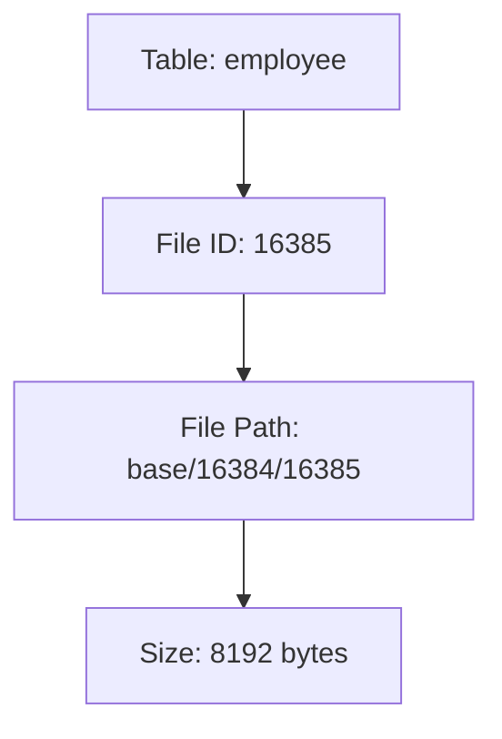
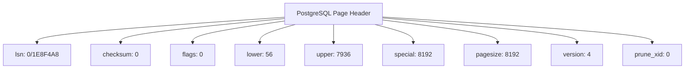
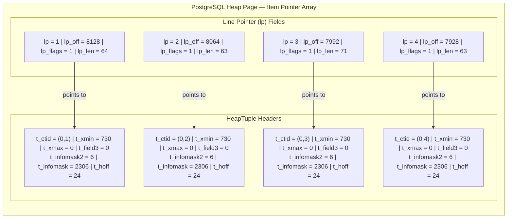
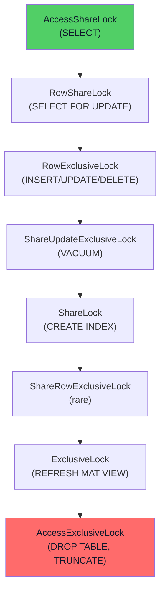
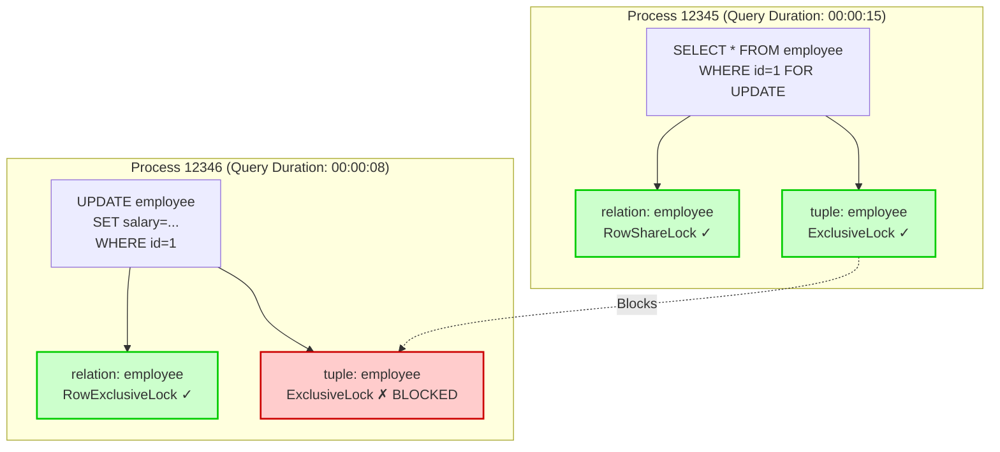
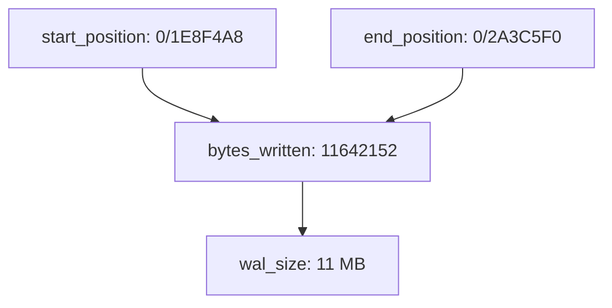
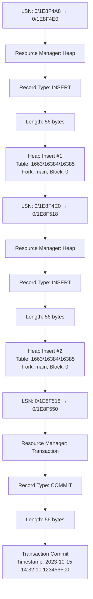
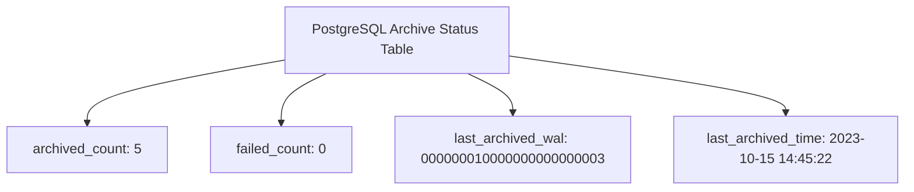

# Operational Verification Labs: Relational Database Internals

## Objectives and Architectural Context

This laboratory provides direct operational access to the internal mechanisms of a production-grade relational database management system. We examine three fundamental subsystems that determine correctness, performance, and durability guarantees:

1. **Storage Layer Architecture:** Physical page layout, tuple storage, and buffer management
2. **Concurrency Control:** Lock manager implementation, deadlock detection, and isolation semantics
3. **Durability and Recovery:** Write-Ahead Logging (WAL) protocol, checkpoint mechanics, and crash recovery

We use PostgreSQL 13+ as the reference implementation. PostgreSQL's architecture exemplifies modern MVCC-based systems and provides comprehensive introspection tools. The principles demonstrated here generalize to Oracle, MySQL InnoDB, SQL Server, and other ACID-compliant engines.

**Prerequisites:** Working knowledge of SQL, basic understanding of operating system concepts (processes, files, memory), and familiarity with transaction ACID properties.

## Laboratory Environment Setup

### Core Components

- **Database Engine:** PostgreSQL 13.5 or later (14.x, 15.x recommended for extended pg_walinspect functionality)
- **Client Interface:** `psql` interactive terminal
- **Introspection Extensions:** `pg_buffercache`, `pg_stat_statements`, `pageinspect`, `pg_walinspect`
- **Binary Utilities:** `pg_controldata`, `pg_waldump`, `pg_filedump` (optional third-party tool)

### Installation and Configuration

#### Debian/Ubuntu Systems

```bash
# Install PostgreSQL with contrib modules
sudo apt-get update
sudo apt-get install -y postgresql-14 postgresql-contrib-14

# Install development tools for extension building
sudo apt-get install -y postgresql-server-dev-14 build-essential

# Verify installation
psql --version
# Expected output: psql (PostgreSQL) 14.x
```

#### RHEL/CentOS/Fedora Systems

```bash
# Install PostgreSQL repository
sudo dnf install -y https://download.postgresql.org/pub/repos/yum/reporpms/EL-8-x86_64/pgdg-redhat-repo-latest.noarch.rpm

# Disable built-in PostgreSQL module (if applicable)
sudo dnf -qy module disable postgresql

# Install PostgreSQL
sudo dnf install -y postgresql14-server postgresql14-contrib

# Initialize database cluster
sudo /usr/pgsql-14/bin/postgresql-14-setup initdb

# Start and enable service
sudo systemctl enable --now postgresql-14
```

#### Extension Activation

Connect as the PostgreSQL superuser and enable required extensions:

```bash
sudo -u postgres psql
```

Within the `psql` session:

```sql
-- Create extensions in the default database
CREATE EXTENSION IF NOT EXISTS pg_buffercache;
CREATE EXTENSION IF NOT EXISTS pg_stat_statements;
CREATE EXTENSION IF NOT EXISTS pageinspect;
CREATE EXTENSION IF NOT EXISTS pg_walinspect;  -- PostgreSQL 15+

-- Verify extension installation
\dx
```

**Note on pg_walinspect:** PostgreSQL 15+ includes `pg_walinspect` as a contrib extension. For PostgreSQL 13-14, use the legacy `pg_waldump` utility (command-line only) or the older `wal2json` extension for programmatic access.

#### Configuration Adjustments for Lab Exercises

Edit `postgresql.conf` (typically in `/etc/postgresql/14/main/` or `/var/lib/pgsql/14/data/`):

```ini
# Enable query statistics collection
shared_preload_libraries = 'pg_stat_statements'
pg_stat_statements.track = all

# Reduce checkpoint frequency for crash simulation exercises
checkpoint_timeout = 30min
max_wal_size = 2GB

# Enable detailed logging for lock analysis
log_lock_waits = on
deadlock_timeout = 1s
log_line_prefix = '%t [%p]: [%l-1] user=%u,db=%d,app=%a,client=%h '
```

Restart PostgreSQL to apply configuration changes:

```bash
sudo systemctl restart postgresql-14
```

## Exercise 1: Storage Layer Inspection and Buffer Management

### Theoretical Foundation: Slotted Page Architecture

PostgreSQL, like most relational databases, organizes disk storage into fixed-size **pages** (typically 8 KB). Each page uses a **slotted page structure**:

```text
┌─────────────────────────────────────────────────────┐
│ Page Header (24 bytes)                              │
├─────────────────────────────────────────────────────┤
│ Item Pointers (4 bytes each, grows downward)        │
│ ┌─────┐ ┌─────┐ ┌─────┐                            │
│ │ IP1 │ │ IP2 │ │ IP3 │  ...                       │
│ └─────┘ └─────┘ └─────┘                            │
├─────────────────────────────────────────────────────┤
│                 Free Space                          │
├─────────────────────────────────────────────────────┤
│                                                     │
│ Tuple Data (grows upward from end of page)         │
│ ┌─────────────┐ ┌─────────────┐                   │
│ │   Tuple 3   │ │   Tuple 2   │ ...               │
│ └─────────────┘ └─────────────┘                   │
│ ┌─────────────┐                                    │
│ │   Tuple 1   │                                    │
│ └─────────────┘                                    │
└─────────────────────────────────────────────────────┘
```

**Key Design Principles:**

1. **Indirection via Item Pointers:** Tuples are accessed through item pointer arrays, allowing in-place tuple movement during page reorganization without breaking references.
2. **MVCC Tuple Versioning:** Each tuple contains transaction visibility metadata (`xmin`, `xmax`) enabling non-blocking reads through snapshot isolation.
3. **TOAST (The Oversized-Attribute Storage Technique):** Values exceeding ~2 KB are stored out-of-line in separate TOAST tables, with the main tuple containing a pointer.

The **buffer pool** (shared buffers) serves as the in-memory cache for pages. PostgreSQL uses a clock-sweep eviction algorithm with usage counters to approximate LRU behavior.

### Practical Inspection: Page Structure and Tuple Layout

#### Step 1: Create a Test Schema

```sql
-- Create a test database for isolation
CREATE DATABASE storage_lab;
\c storage_lab

-- Create a table with known data layout
CREATE TABLE employee (
    id SERIAL PRIMARY KEY,
    name VARCHAR(100),
    department VARCHAR(50),
    salary NUMERIC(10, 2),
    hire_date DATE,
    metadata JSONB
);

-- Insert sample data with varying sizes
INSERT INTO employee (name, department, salary, hire_date, metadata) VALUES
    ('Alice Johnson', 'Engineering', 120000.00, '2020-01-15', '{"skills": ["Python", "SQL"], "level": "Senior"}'),
    ('Bob Smith', 'Sales', 85000.00, '2021-03-22', '{"region": "North America", "quota": 500000}'),
    ('Carol Davis', 'Engineering', 135000.00, '2019-07-01', '{"skills": ["Rust", "C++"], "level": "Staff"}'),
    ('David Martinez', 'Marketing', 95000.00, '2022-05-10', '{"campaigns": ["Q1-2022", "Q3-2022"]}');

-- Force data to disk (normally handled by background writer)
CHECKPOINT;
```

#### Step 2: Locate Physical Storage Files

Every relation (table, index) is stored in one or more files identified by the `relfilenode`:

```sql
-- Query system catalog for file mapping
SELECT 
    c.relname AS table_name,
    c.relfilenode AS file_id,
    pg_relation_filepath(c.oid) AS file_path,
    pg_size_pretty(pg_relation_size(c.oid)) AS size
FROM pg_class c
WHERE c.relname = 'employee';
```

Example output:


The file path is relative to PostgreSQL's data directory (e.g., `/var/lib/postgresql/14/main/`).

#### Step 3: Inspect Page Header and Item Pointers

Use the `pageinspect` extension to decode page structure:

```sql
-- Examine page header metadata
SELECT * FROM page_header(get_raw_page('employee', 0));
```

Output interpretation:


- **lsn (Log Sequence Number):** WAL position of the last modification to this page
- **lower:** End of item pointer array (grows down from header)
- **upper:** Start of free space (tuple data grows up from page end)
- **Free space:** `upper - lower = 7936 - 56 = 7880 bytes`

```sql
-- Examine individual item pointers
SELECT * FROM heap_page_items(get_raw_page('employee', 0));
```

Simplified output:


- **lp (Line Pointer):** Index in the item pointer array
- **lp_off:** Byte offset of tuple within the page
- **t_xmin:** Transaction ID that inserted this tuple
- **t_xmax:** Transaction ID that deleted this tuple (0 = still visible)
- **t_ctid:** Current tuple identifier `(page_number, item_pointer)`
- **t_infomask:** Bit flags encoding tuple state (has nulls, has variable-length attributes, etc.)

#### Step 4: Inspect Buffer Pool State

The buffer pool caches frequently accessed pages in shared memory. Query its current state:

```sql
-- Overview of buffer cache contents
SELECT 
    c.relname,
    count(*) AS cached_pages,
    pg_size_pretty(count(*) * 8192) AS cached_size
FROM pg_buffercache b
JOIN pg_class c ON b.relfilenode = c.relfilenode
WHERE c.relname IN ('employee', 'employee_pkey')
GROUP BY c.relname;
```

Detailed buffer analysis:

```sql
-- Examine individual buffer metadata
SELECT 
    bufferid,
    c.relname,
    b.relblocknumber AS block_num,
    b.isdirty,
    b.usagecount,
    b.pinning_backends
FROM pg_buffercache b
JOIN pg_class c ON b.relfilenode = c.relfilenode
WHERE c.relname = 'employee'
ORDER BY b.relblocknumber;
```

- **isdirty:** Page has uncommitted modifications not yet written to disk
- **usagecount:** Clock-sweep usage counter (0-5 range, higher = more recently used)
- **pinning_backends:** Number of backends currently accessing this buffer (prevents eviction)

#### Step 5: Trigger Buffer Eviction and Observe Replacement

```sql
-- Create a large table to force buffer eviction
CREATE TABLE buffer_pressure (
    id SERIAL,
    data BYTEA
);

-- Insert enough data to exceed shared_buffers size
-- (Assuming default 128 MB shared_buffers = 16,384 pages)
INSERT INTO buffer_pressure (data)
SELECT gen_random_bytes(8000)
FROM generate_series(1, 20000);

-- Re-examine employee table buffer presence
SELECT count(*) AS still_cached
FROM pg_buffercache b
JOIN pg_class c ON b.relfilenode = c.relfilenode
WHERE c.relname = 'employee';
```

If `still_cached` drops to 0, the employee pages were evicted. Access them again to trigger I/O:

```sql
-- Force page reload from disk
SELECT count(*) FROM employee;

-- Verify pages are back in cache
SELECT count(*) AS reloaded_pages
FROM pg_buffercache b
JOIN pg_class c ON b.relfilenode = c.relfilenode
WHERE c.relname = 'employee';
```

### Advanced: TOAST Storage Inspection

```sql
-- Create a table with oversized attributes
CREATE TABLE document (
    id SERIAL PRIMARY KEY,
    title VARCHAR(200),
    content TEXT
);

-- Insert a large text value (>2 KB inline threshold)
INSERT INTO document (title, content) VALUES 
    ('Large Document', repeat('This is a test paragraph. ', 1000));

-- Identify TOAST table
SELECT 
    c.relname AS main_table,
    t.relname AS toast_table
FROM pg_class c
JOIN pg_class t ON c.reltoastrelid = t.oid
WHERE c.relname = 'document';

-- Examine TOAST chunks
SELECT chunk_id, chunk_seq, length(chunk_data) AS chunk_size
FROM pg_toast.pg_toast_<oid>  -- Replace <oid> with actual TOAST table OID
LIMIT 5;
```

**TOAST Strategy Selection:**

- **PLAIN:** No compression or out-of-line storage (for small fixed-size types)
- **EXTENDED:** Compression first, then out-of-line if still large (default for TEXT, JSONB)
- **EXTERNAL:** Out-of-line without compression (for pre-compressed data)
- **MAIN:** Compression but avoid out-of-line if possible

## Exercise 2: Concurrency Control and Lock Analysis

### Theoretical Foundation: MVCC and Locking

PostgreSQL implements **Multi-Version Concurrency Control (MVCC)** for isolation:

1. **Snapshot Isolation:** Each transaction sees a consistent snapshot of the database as of its start time
2. **Non-Blocking Reads:** Readers never block writers; writers never block readers
3. **Optimistic Concurrency:** Conflicts are detected at commit time, not during execution

However, certain operations require **explicit locks** to prevent lost updates:

**Lock Hierarchy:**



**Lock Compatibility Matrix:**

| Held ↓ \ Requested → | AccessShare | RowShare | RowExclusive | ShareUpdateExclusive | Share | ShareRowExclusive | Exclusive | AccessExclusive |
|---------------------|-------------|----------|--------------|----------------------|-------|-------------------|-----------|-----------------|
| AccessShare         | ✓           | ✓        | ✓            | ✓                    | ✓     | ✓                 | ✓         | ✗               |
| RowShare            | ✓           | ✓        | ✓            | ✓                    | ✓     | ✓                 | ✗         | ✗               |
| RowExclusive        | ✓           | ✓        | ✓            | ✓                    | ✗     | ✗                 | ✗         | ✗               |
| ShareUpdateExclusive| ✓           | ✓        | ✓            | ✗                    | ✗     | ✗                 | ✗         | ✗               |

### Practical Inspection: Lock Contention Scenarios

#### Scenario 1: Row-Level Lock Blocking

Open **three terminal sessions**, all connected to the `storage_lab` database.

**Terminal 1 (T1) - Holder:**

```sql
BEGIN;
-- Acquire row-level exclusive lock
SELECT * FROM employee WHERE id = 1 FOR UPDATE;
-- Keep transaction open
```

**Terminal 2 (T2) - Waiter:**

```sql
BEGIN;
-- Attempt to acquire conflicting lock (will block)
UPDATE employee SET salary = salary * 1.05 WHERE id = 1;
-- This statement will hang, waiting for T1
```

**Terminal 3 (T3) - Observer:**

```sql
-- Inspect active locks
SELECT 
    l.locktype,
    l.database,
    l.relation::regclass AS table_name,
    l.page,
    l.tuple,
    l.virtualxid,
    l.transactionid,
    l.mode,
    l.granted,
    a.pid,
    a.usename,
    a.query,
    a.state,
    now() - a.query_start AS query_duration
FROM pg_locks l
LEFT JOIN pg_stat_activity a ON l.pid = a.pid
WHERE l.relation = 'employee'::regclass
   OR l.pid IN (
       SELECT pid FROM pg_stat_activity 
       WHERE query ILIKE '%employee%' AND state != 'idle'
   )
ORDER BY l.granted, a.query_start;
```

Output interpretation:



- T1 (pid 12345) holds a tuple-level `ExclusiveLock` (granted=t)
- T2 (pid 12346) is waiting for the same tuple lock (granted=f)

#### Scenario 2: Deadlock Detection

**Terminal 1:**

```sql
BEGIN;
UPDATE employee SET salary = 150000 WHERE id = 1;
-- Do NOT commit yet
```

**Terminal 2:**

```sql
BEGIN;
UPDATE employee SET salary = 100000 WHERE id = 3;
-- Now try to access row 1
UPDATE employee SET department = 'Sales' WHERE id = 1;
-- This will block waiting for T1
```

**Terminal 1:**

```sql
-- Create deadlock by accessing row 3
UPDATE employee SET department = 'Engineering' WHERE id = 3;
-- PostgreSQL detects the deadlock cycle and aborts one transaction
```

PostgreSQL's deadlock detector runs every `deadlock_timeout` (default 1 second). One transaction will receive:

```text
ERROR:  deadlock detected
DETAIL:  Process 12345 waits for ShareLock on transaction 730; blocked by process 12346.
Process 12346 waits for ShareLock on transaction 729; blocked by process 12345.
HINT:  See server log for query details.
```

Inspect the deadlock cycle in logs:

```bash
sudo tail -f /var/log/postgresql/postgresql-14-main.log
```

#### Scenario 3: Wait Graph Visualization

Execute this comprehensive lock analysis query in the observer terminal:

```sql
WITH RECURSIVE lock_graph AS (
    -- Base case: transactions holding locks
    SELECT 
        l.pid AS holder_pid,
        a.query AS holder_query,
        l.locktype,
        l.relation::regclass::text AS relation,
        l.mode,
        NULL::integer AS waiter_pid,
        NULL::text AS waiter_query,
        1 AS depth,
        ARRAY[l.pid] AS path
    FROM pg_locks l
    JOIN pg_stat_activity a ON l.pid = a.pid
    WHERE l.granted
    
    UNION ALL
    
    -- Recursive case: find waiters
    SELECT 
        lg.holder_pid,
        lg.holder_query,
        l.locktype,
        l.relation::regclass::text,
        l.mode,
        l.pid AS waiter_pid,
        a.query AS waiter_query,
        lg.depth + 1,
        lg.path || l.pid
    FROM lock_graph lg
    JOIN pg_locks l ON lg.holder_pid != l.pid
        AND lg.relation = l.relation::regclass::text
        AND NOT l.granted
    JOIN pg_stat_activity a ON l.pid = a.pid
    WHERE lg.depth < 10
        AND NOT l.pid = ANY(lg.path)  -- Prevent infinite recursion
)
SELECT DISTINCT
    holder_pid,
    substring(holder_query, 1, 60) AS holder_query,
    waiter_pid,
    substring(waiter_query, 1, 60) AS waiter_query,
    locktype,
    relation,
    mode,
    depth
FROM lock_graph
WHERE waiter_pid IS NOT NULL
ORDER BY depth, holder_pid;
```

This recursive CTE constructs a wait-for graph, revealing blocking chains.

#### Scenario 4: Table-Level Lock Analysis

```sql
-- Terminal 1: Acquire table-level lock
BEGIN;
LOCK TABLE employee IN ACCESS EXCLUSIVE MODE;
-- This prevents all concurrent access
```

```sql
-- Terminal 2: Even reads will block
SELECT count(*) FROM employee;
```

```sql
-- Terminal 3: Inspect table locks
SELECT 
    l.locktype,
    l.relation::regclass AS table_name,
    l.mode,
    l.granted,
    a.pid,
    a.usename,
    a.application_name,
    a.client_addr,
    now() - a.xact_start AS transaction_age
FROM pg_locks l
JOIN pg_stat_activity a ON l.pid = a.pid
WHERE l.locktype = 'relation'
  AND l.relation = 'employee'::regclass
ORDER BY l.granted DESC, a.xact_start;
```

**Key Insight:** `ACCESS EXCLUSIVE` locks are held by DDL operations (`ALTER TABLE`, `DROP TABLE`, `TRUNCATE`). Always run DDL in short transactions during maintenance windows.

### Production Monitoring: Lock Wait Metrics

```sql
-- Query to identify long-running lock waits (run periodically)
SELECT 
    blocked_activity.pid AS blocked_pid,
    blocked_activity.usename AS blocked_user,
    now() - blocked_activity.query_start AS blocked_duration,
    blocking_activity.pid AS blocking_pid,
    blocking_activity.usename AS blocking_user,
    now() - blocking_activity.query_start AS blocking_duration,
    blocked_activity.query AS blocked_query,
    blocking_activity.query AS blocking_query
FROM pg_stat_activity AS blocked_activity
JOIN pg_locks AS blocked_locks ON blocked_activity.pid = blocked_locks.pid
JOIN pg_locks AS blocking_locks ON 
    blocked_locks.locktype = blocking_locks.locktype
    AND blocked_locks.database IS NOT DISTINCT FROM blocking_locks.database
    AND blocked_locks.relation IS NOT DISTINCT FROM blocking_locks.relation
    AND blocked_locks.page IS NOT DISTINCT FROM blocking_locks.page
    AND blocked_locks.tuple IS NOT DISTINCT FROM blocking_locks.tuple
    AND blocked_locks.virtualxid IS NOT DISTINCT FROM blocking_locks.virtualxid
    AND blocked_locks.transactionid IS NOT DISTINCT FROM blocking_locks.transactionid
    AND blocked_locks.classid IS NOT DISTINCT FROM blocking_locks.classid
    AND blocked_locks.objid IS NOT DISTINCT FROM blocking_locks.objid
    AND blocked_locks.objsubid IS NOT DISTINCT FROM blocking_locks.objsubid
    AND blocked_locks.pid != blocking_locks.pid
JOIN pg_stat_activity AS blocking_activity ON blocking_locks.pid = blocking_activity.pid
WHERE NOT blocked_locks.granted
  AND blocked_activity.query_start < now() - interval '5 seconds';
```

Set up alerting on this query to detect lock waits exceeding acceptable thresholds.

## Exercise 3: Write-Ahead Logging and Crash Recovery

### Theoretical Foundation: WAL Protocol

The **Write-Ahead Logging (WAL)** protocol ensures durability and atomicity:

**Fundamental Invariant:** Before any data page is written to disk, all WAL records describing changes to that page must be durably written to disk.

```mermaid
sequenceDiagram
    participant App as Application
    participant PG as PostgreSQL Backend
    participant WAL as WAL Buffer
    participant Disk as WAL Disk
    participant Data as Data Files
    
    App->>PG: BEGIN; UPDATE table SET x=1 WHERE id=5;
    PG->>PG: Modify page in shared_buffers
    PG->>WAL: Write WAL record (page LSN)
    Note over PG,WAL: WAL record contains:<br/>XID, table OID, page offset,<br/>before-image, after-image
    
    App->>PG: COMMIT;
    PG->>WAL: Write COMMIT record
    WAL->>Disk: fsync() - force to disk
    Note over Disk: Durability guaranteed
    PG->>App: Success
    
    Note over Data: Background writer eventually<br/>flushes dirty pages
    PG-->>Data: Write modified page (async)
    
    Note over Disk,Data: Crash can occur here safely<br/>Recovery replays WAL
```

**WAL Record Structure:**

Each WAL record contains:

1. **Record header:** Transaction ID (XID), resource manager (RM) type, length, CRC checksum
2. **Before-image (optional):** Original tuple data for undo operations (used by some operations)
3. **After-image:** New tuple data for redo operations
4. **Metadata:** Table OID, page number, block offset

**Recovery Algorithm:**

1. **Read last checkpoint record** from `pg_control` to find recovery start point
2. **Replay all WAL records** from checkpoint to end of log
3. **Apply redo operations** to restore database to consistent state
4. **Roll back uncommitted transactions** using transaction status from WAL

### Practical Inspection: WAL Generation and Recovery

#### Step 1: Baseline WAL State

```sql
-- Check current WAL position
SELECT pg_current_wal_lsn();
-- Example output: 0/1E8F4A8
```

The LSN (Log Sequence Number) is a 64-bit monotonically increasing value representing the byte offset in the logical WAL stream.

```sql
-- View WAL segment files
\! ls -lh /var/lib/postgresql/14/main/pg_wal/
```

Each segment is 16 MB by default. File names follow the pattern: `<timeline><log><segment>` (e.g., `000000010000000000000001`).

#### Step 2: Generate WAL Traffic with Controlled Workload

```sql
-- Create a table for WAL analysis
CREATE TABLE wal_test (
    id SERIAL PRIMARY KEY,
    data TEXT,
    modified_at TIMESTAMP DEFAULT now()
);

-- Record starting WAL position
SELECT pg_current_wal_lsn() AS start_lsn \gset

-- Insert data to generate WAL records
INSERT INTO wal_test (data)
SELECT 'Test data row ' || generate_series
FROM generate_series(1, 10000);

-- Record ending WAL position
SELECT pg_current_wal_lsn() AS end_lsn \gset

-- Calculate WAL generated
SELECT 
    :'start_lsn' AS start_position,
    :'end_lsn' AS end_position,
    pg_wal_lsn_diff(:'end_lsn', :'start_lsn') AS bytes_written,
    pg_size_pretty(pg_wal_lsn_diff(:'end_lsn', :'start_lsn')) AS wal_size;
```

Example output:


#### Step 3: Inspect WAL Records (PostgreSQL 15+)

```sql
-- Examine recent WAL records using pg_walinspect
SELECT 
    start_lsn,
    end_lsn,
    prev_lsn,
    xid,
    resource_manager,
    record_type,
    record_length,
    main_data_length,
    fpi_length,  -- Full Page Image length
    description
FROM pg_get_wal_records_info(:'start_lsn', :'end_lsn')
LIMIT 20;
```

Example output:


**Resource Manager Types:**
- **Heap:** Tuple insert/update/delete operations
- **Btree:** B-tree index operations
- **Transaction:** COMMIT, ABORT, CHECKPOINT records
- **XLOG:** WAL control records (checkpoints, end-of-recovery)

#### Step 4: Inspect WAL with pg_waldump (CLI Utility)

For PostgreSQL 13-14 or offline WAL inspection:

```bash
# Identify current WAL segment
sudo -u postgres psql -c "SELECT pg_walfile_name(pg_current_wal_lsn());"
# Example output: 000000010000000000000002

# Dump WAL records to text format
sudo -u postgres pg_waldump \
    /var/lib/postgresql/14/main/pg_wal/000000010000000000000002 \
    | head -50
```

Example output:
```text
rmgr: Heap        len (rec/tot):     59/   59, tx:        730, lsn: 0/01E8F4A8, prev 0/01E8F470, desc: INSERT off 1, blkref #0: rel 1663/16384/16385 fork main blk 0
rmgr: Transaction len (rec/tot):     46/   46, tx:        730, lsn: 0/01E8F4E8, prev 0/01E8F4A8, desc: COMMIT 2023-10-15 14:32:10.123456 UTC
rmgr: Heap        len (rec/tot):     59/   59, tx:        731, lsn: 0/01E8F518, prev 0/01E8F4E8, desc: INSERT off 2, blkref #0: rel 1663/16384/16385 fork main blk 0
```

#### Step 5: Trigger Checkpoint and Observe Behavior

Checkpoints flush all dirty pages to disk and write a checkpoint WAL record:

```sql
-- Force an immediate checkpoint
CHECKPOINT;

-- Examine checkpoint statistics
SELECT 
    checkpoint_lsn,
    redo_lsn,
    timeline_id,
    prev_timeline_id,
    checkpoint_time
FROM pg_control_checkpoint();
```

```bash
# View detailed checkpoint statistics
sudo -u postgres pg_controldata /var/lib/postgresql/14/main/ | grep -A 10 "Latest checkpoint"
```

Output:
```text
Latest checkpoint location:           0/2A3C5F0
Latest checkpoint's REDO location:    0/2A3C5B8
Latest checkpoint's TimeLineID:       1
Latest checkpoint's full_page_writes: on
Latest checkpoint's NextXID:          0:732
Latest checkpoint's NextOID:          16398
Latest checkpoint's NextMultiXactId:  1
Latest checkpoint's oldestXID:        726
Latest checkpoint's oldestActiveXID:  732
Time of latest checkpoint:            Sun 15 Oct 2023 02:32:15 PM UTC
```

- **checkpoint_lsn:** WAL position of the checkpoint record itself
- **redo_lsn:** WAL position where recovery should start (earlier than checkpoint_lsn due to checkpoint processing time)

#### Step 6: Controlled Crash Simulation

**WARNING:** This simulates an unclean shutdown. Only perform on isolated test systems.

```bash
# Identify PostgreSQL master process
pg_pid=$(pgrep -f "postgres: checkpointer")

# Simulate crash with immediate kill (SIGKILL)
sudo kill -9 $pg_pid

# Verify all PostgreSQL processes terminated
pgrep -f postgres
```

Attempt to reconnect:

```bash
psql -U postgres -d storage_lab
# This will fail with connection error
```

Examine system logs:

```bash
sudo tail -f /var/log/postgresql/postgresql-14-main.log
```

Expected log entries:
```text
2023-10-15 14:35:22.456 UTC [12345] LOG:  server process (PID 12350) was terminated by signal 9: Killed
2023-10-15 14:35:22.457 UTC [12345] LOG:  terminating any other active server processes
2023-10-15 14:35:22.458 UTC [12345] LOG:  all server processes terminated; reinitializing
```

#### Step 7: Observe Crash Recovery

```bash
# Restart PostgreSQL
sudo systemctl start postgresql-14
```

Monitor recovery in logs:

```bash
sudo tail -f /var/log/postgresql/postgresql-14-main.log
```

Recovery log sequence:
```text
2023-10-15 14:35:25.123 UTC [12400] LOG:  database system was interrupted; last known up at 2023-10-15 14:32:15 UTC
2023-10-15 14:35:25.234 UTC [12400] LOG:  database system was not properly shut down; automatic recovery in progress
2023-10-15 14:35:25.345 UTC [12400] LOG:  redo starts at 0/2A3C5B8
2023-10-15 14:35:25.567 UTC [12400] LOG:  invalid record length at 0/2A3C680: wanted 24, got 0
2023-10-15 14:35:25.568 UTC [12400] LOG:  redo done at 0/2A3C650 system usage: CPU: user: 0.02 s, system: 0.01 s, elapsed: 0.22 s
2023-10-15 14:35:25.789 UTC [12400] LOG:  checkpoint starting: end-of-recovery immediate
2023-10-15 14:35:26.012 UTC [12400] LOG:  checkpoint complete: wrote 45 buffers (0.3%); 0 WAL file(s) added, 0 removed, 1 recycled; write=0.145 s, sync=0.034 s, total=0.234 s; sync files=12, longest=0.018 s, average=0.003 s; distance=256 kB, estimate=256 kB
2023-10-15 14:35:26.123 UTC [12399] LOG:  database system is ready to accept connections
```

**Recovery phases:**

1. **Redo start:** Begin replaying WAL from checkpoint's `redo_lsn`
2. **Redo application:** Apply each WAL record to restore pages
3. **Invalid record:** Reached end of valid WAL (normal for crash)
4. **End-of-recovery checkpoint:** Flush all restored pages to disk

Verify data integrity:

```sql
-- Connect and verify data
psql -U postgres -d storage_lab

-- Check row counts
SELECT count(*) FROM wal_test;
-- Should return 10000 if all inserts were committed before crash

-- Check for uncommitted transactions (should be rolled back)
SELECT count(*) FROM pg_stat_activity WHERE state = 'idle in transaction';
```

#### Step 8: Analyzing Full-Page Writes

After a checkpoint, the first modification to each page generates a **Full-Page Image (FPI)** WAL record containing the entire page:

```sql
-- Trigger checkpoint
CHECKPOINT;

-- Modify a row (generates FPI)
UPDATE wal_test SET data = 'Modified' WHERE id = 1;

-- Check WAL record with FPI
SELECT 
    start_lsn,
    resource_manager,
    record_type,
    fpi_length,
    record_length,
    fpi_length::float / record_length * 100 AS fpi_percentage
FROM pg_get_wal_records_info(pg_current_wal_lsn() - '1MB'::pg_lsn, pg_current_wal_lsn())
WHERE fpi_length > 0
LIMIT 10;
```

**Why FPIs Matter:**

- **Torn page protection:** If a crash occurs during a partial page write, the FPI allows complete page reconstruction
- **Performance impact:** FPIs significantly increase WAL volume (8 KB per modified page per checkpoint cycle)
- **Tuning:** Increase `checkpoint_timeout` to reduce FPI overhead, but balance against recovery time

#### Step 9: Point-in-Time Recovery (PITR) Setup

Configure continuous archiving for production PITR capability:

```bash
# Edit postgresql.conf
sudo vim /etc/postgresql/14/main/postgresql.conf
```

Add configuration:

```ini
# Enable archiving
wal_level = replica                    # Minimum for PITR
archive_mode = on
archive_command = 'test ! -f /var/lib/postgresql/14/archive/%f && cp %p /var/lib/postgresql/14/archive/%f'
archive_timeout = 300                  # Force segment switch every 5 minutes

# Increase max_wal_size for production
max_wal_size = 4GB
min_wal_size = 1GB
```

Create archive directory:

```bash
sudo mkdir -p /var/lib/postgresql/14/archive
sudo chown postgres:postgres /var/lib/postgresql/14/archive
sudo chmod 700 /var/lib/postgresql/14/archive
```

Restart PostgreSQL:

```bash
sudo systemctl restart postgresql-14
```

Verify archiving:

```bash
sudo -u postgres psql -c "SELECT * FROM pg_stat_archiver;"
```

Expected output showing successful archives:



## Production Diagnostic Cheat Sheet

### Essential Queries

#### Buffer Pool Analysis

```sql
-- Buffer hit ratio (should be >99% in production)
SELECT 
    sum(heap_blks_read) AS heap_read,
    sum(heap_blks_hit) AS heap_hit,
    sum(heap_blks_hit) / nullif(sum(heap_blks_hit) + sum(heap_blks_read), 0) * 100 AS cache_hit_ratio
FROM pg_statio_user_tables;
```

#### Active Transactions

```sql
-- Long-running transactions (blockers)
SELECT 
    pid,
    usename,
    application_name,
    client_addr,
    state,
    now() - xact_start AS transaction_age,
    now() - query_start AS query_age,
    substring(query, 1, 100) AS current_query
FROM pg_stat_activity
WHERE state != 'idle'
  AND xact_start < now() - interval '1 minute'
ORDER BY xact_start;
```

#### Lock Analysis

```sql
-- Blocking queries summary
SELECT 
    blocking.pid AS blocking_pid,
    blocking.usename AS blocking_user,
    blocked.pid AS blocked_pid,
    blocked.usename AS blocked_user,
    now() - blocked.query_start AS blocked_duration,
    blocked.query AS blocked_query
FROM pg_locks blocked_locks
JOIN pg_stat_activity blocked ON blocked.pid = blocked_locks.pid
JOIN pg_locks blocking_locks ON 
    blocked_locks.locktype = blocking_locks.locktype
    AND blocked_locks.database IS NOT DISTINCT FROM blocking_locks.database
    AND blocked_locks.relation IS NOT DISTINCT FROM blocking_locks.relation
    AND blocked_locks.pid != blocking_locks.pid
JOIN pg_stat_activity blocking ON blocking.pid = blocking_locks.pid
WHERE NOT blocked_locks.granted
  AND blocking_locks.granted;
```

#### WAL and Checkpoint Statistics

```sql
-- WAL generation rate
SELECT 
    pg_wal_lsn_diff(pg_current_wal_lsn(), '0/0') / 1024 / 1024 AS total_wal_mb,
    pg_current_wal_lsn() AS current_lsn;

-- Checkpoint activity
SELECT 
    checkpoints_timed,
    checkpoints_req,
    buffers_checkpoint,
    buffers_clean,
    buffers_backend,
    buffers_backend_fsync,
    round(100.0 * buffers_checkpoint / (buffers_checkpoint + buffers_clean + buffers_backend), 2) AS checkpoint_write_pct,
    pg_size_pretty(buffers_checkpoint * 8192) AS checkpoint_volume
FROM pg_stat_bgwriter;
```

#### Table and Index Bloat

```sql
-- Estimated table bloat
SELECT 
    schemaname,
    tablename,
    pg_size_pretty(pg_total_relation_size(schemaname || '.' || tablename)) AS total_size,
    pg_size_pretty(pg_relation_size(schemaname || '.' || tablename)) AS table_size,
    round(100 * pg_relation_size(schemaname || '.' || tablename)::numeric / 
          nullif(pg_total_relation_size(schemaname || '.' || tablename), 0), 2) AS table_pct
FROM pg_tables
WHERE schemaname NOT IN ('pg_catalog', 'information_schema')
ORDER BY pg_total_relation_size(schemaname || '.' || tablename) DESC
LIMIT 20;
```

### Essential CLI Commands

#### Database Cluster Control

```bash
# Immediate shutdown (crash simulation)
pg_ctl -D /var/lib/postgresql/14/main stop -m immediate

# Fast shutdown (abort active transactions)
pg_ctl -D /var/lib/postgresql/14/main stop -m fast

# Smart shutdown (wait for clients to disconnect)
pg_ctl -D /var/lib/postgresql/14/main stop -m smart

# Start cluster
pg_ctl -D /var/lib/postgresql/14/main start
```

#### WAL Inspection

```bash
# List WAL segments
ls -lh /var/lib/postgresql/14/main/pg_wal/

# Dump specific WAL segment
pg_waldump /var/lib/postgresql/14/main/pg_wal/000000010000000000000003

# Dump with filters
pg_waldump -r Heap -x 730 /var/lib/postgresql/14/main/pg_wal/000000010000000000000003

# Find WAL for specific LSN
pg_waldump -s 0/1E8F4A8 -e 0/2A3C5F0 /var/lib/postgresql/14/main/pg_wal/*
```

#### Physical Backup

```bash
# Base backup for PITR
pg_basebackup -D /backup/pg_base -Ft -z -P -U postgres

# Verify backup
tar -tzf /backup/pg_base/base.tar.gz | head -20
```

#### System Catalog Inspection

```bash
# View database cluster metadata
pg_controldata /var/lib/postgresql/14/main

# Check database file locations
psql -U postgres -c "SELECT oid, datname, pg_tablespace_location(dattablespace) FROM pg_database;"
```

### Verification Checklist for Production Deployment

#### Pre-Deployment

- [ ] Verify `shared_buffers` is 25% of system RAM (up to 8-16 GB)
- [ ] Confirm `effective_cache_size` is 50-75% of system RAM
- [ ] Enable `pg_stat_statements` for query performance tracking
- [ ] Configure `log_min_duration_statement` (e.g., 1000ms for slow query logging)
- [ ] Set `checkpoint_timeout` and `max_wal_size` based on write workload
- [ ] Enable `full_page_writes = on` (mandatory for crash safety)
- [ ] Configure `synchronous_commit` based on durability requirements
- [ ] Set up WAL archiving for point-in-time recovery
- [ ] Verify `autovacuum` is enabled and tuned

#### Post-Deployment Monitoring

- [ ] Monitor buffer cache hit ratio (target >99%)
- [ ] Track checkpoint frequency (timed checkpoints should dominate)
- [ ] Monitor lock wait events and durations
- [ ] Review slow query log weekly
- [ ] Verify WAL archive success rate
- [ ] Monitor table/index bloat monthly
- [ ] Check for unused indexes consuming write overhead
- [ ] Validate backup restore process quarterly

#### Incident Response

- [ ] Identify blocking queries: `SELECT * FROM pg_stat_activity WHERE wait_event_type = 'Lock';`
- [ ] Terminate runaway queries: `SELECT pg_terminate_backend(pid);`
- [ ] Force checkpoint before planned shutdown: `CHECKPOINT;`
- [ ] Analyze crash cause: review PostgreSQL logs and system journal
- [ ] Verify recovery completion: check `pg_is_in_recovery()` and WAL replay lag
- [ ] Post-recovery vacuum: `VACUUM ANALYZE;` to update statistics

### Advanced Debugging Scenarios

#### Scenario: Database Bloat from Long-Running Transactions

```sql
-- Identify vacuum blocker
SELECT 
    pid,
    usename,
    application_name,
    state,
    now() - xact_start AS transaction_age,
    now() - backend_start AS backend_age
FROM pg_stat_activity
WHERE state = 'idle in transaction'
  AND xact_start < now() - interval '1 hour'
ORDER BY xact_start;

-- Check vacuum progress
SELECT 
    phase,
    heap_blks_total,
    heap_blks_scanned,
    heap_blks_vacuumed,
    round(100.0 * heap_blks_scanned / nullif(heap_blks_total, 0), 2) AS pct_complete
FROM pg_stat_progress_vacuum
WHERE datname = current_database();
```

#### Scenario: WAL Explosion from Bulk Operations

```sql
-- Measure WAL generation rate over 1 minute
SELECT pg_current_wal_lsn() AS start_lsn \gset
\! sleep 60
SELECT 
    pg_wal_lsn_diff(pg_current_wal_lsn(), :'start_lsn') / 1024.0 / 1024.0 AS wal_mb_per_minute;

-- Identify high-WAL-generating queries
SELECT 
    userid::regrole,
    dbid,
    queryid,
    calls,
    total_exec_time,
    rows,
    100.0 * shared_blks_dirtied / nullif(shared_blks_hit + shared_blks_read, 0) AS dirty_ratio,
    query
FROM pg_stat_statements
ORDER BY shared_blks_dirtied DESC
LIMIT 10;
```

#### Scenario: Index Corruption Detection

```sql
-- Check for index inconsistencies
CREATE EXTENSION IF NOT EXISTS amcheck;

-- Verify btree structure
SELECT bt_index_check('employee_pkey', true);  -- true = heapallindexed check

-- Verify all indexes on a table
DO $$
DECLARE
    idx record;
BEGIN
    FOR idx IN 
        SELECT indexrelid::regclass AS index_name
        FROM pg_index
        WHERE indrelid = 'employee'::regclass
    LOOP
        RAISE NOTICE 'Checking index: %', idx.index_name;
        PERFORM bt_index_check(idx.index_name::regclass, true);
    END LOOP;
END $$;
```

This laboratory provides comprehensive operational verification of a production PostgreSQL deployment. Mastery of these techniques enables deep debugging, performance tuning, and incident response for relational database systems.
