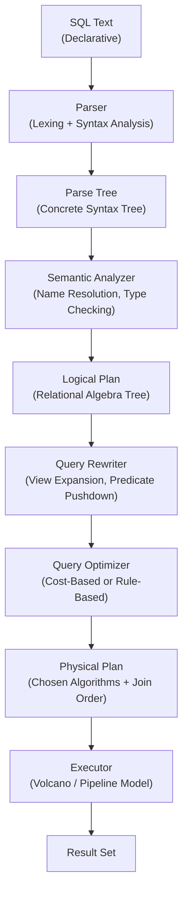
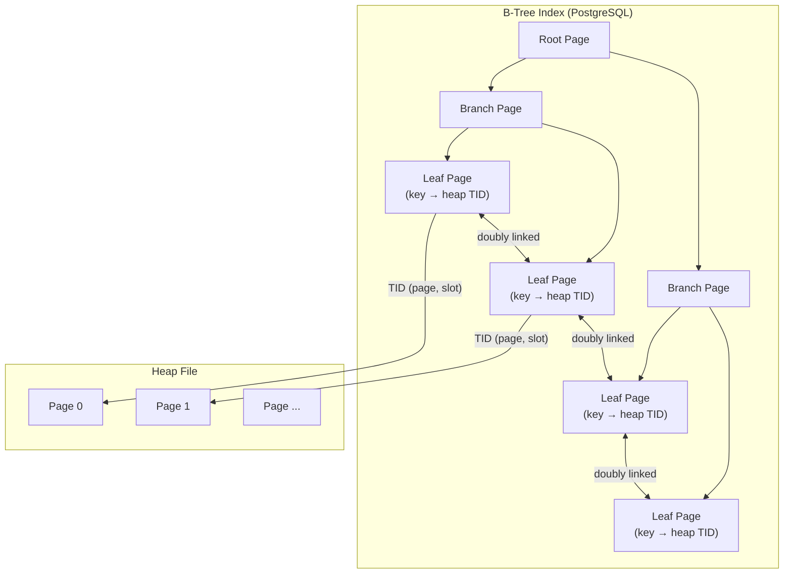
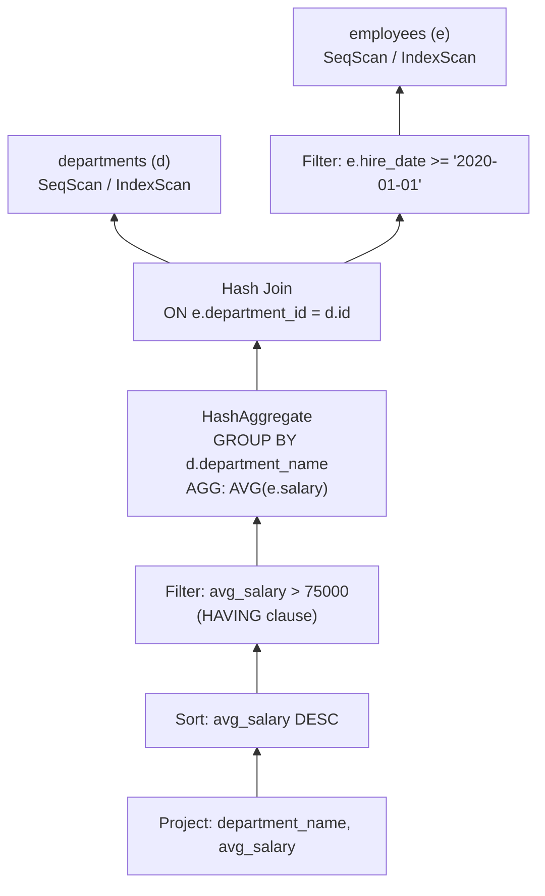
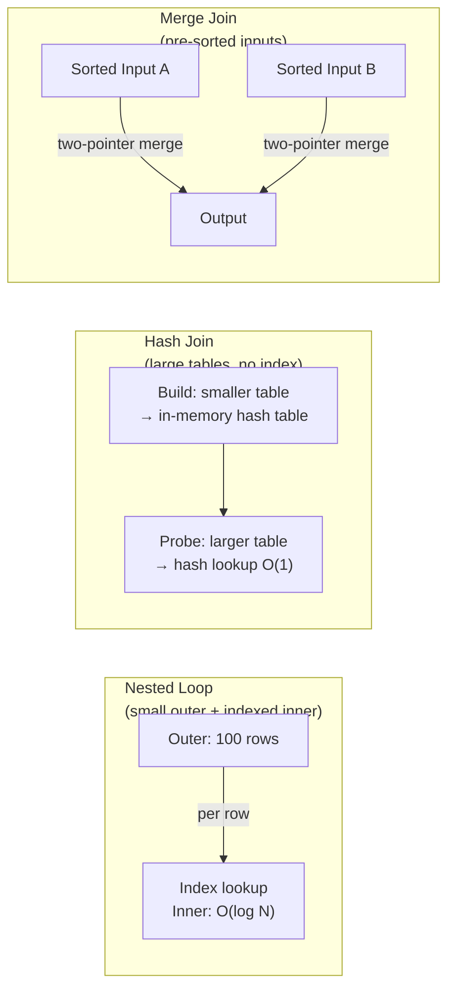
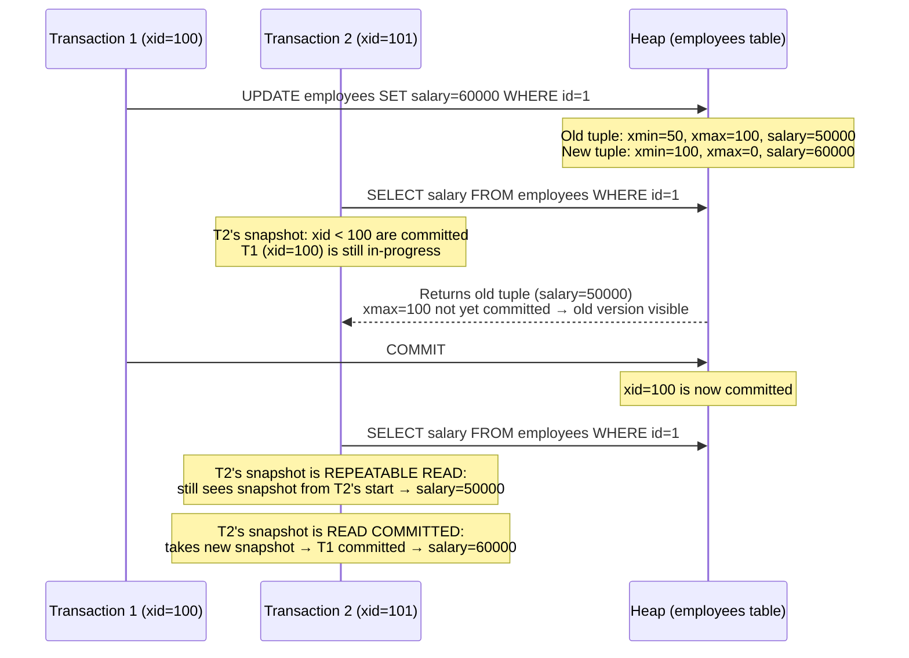
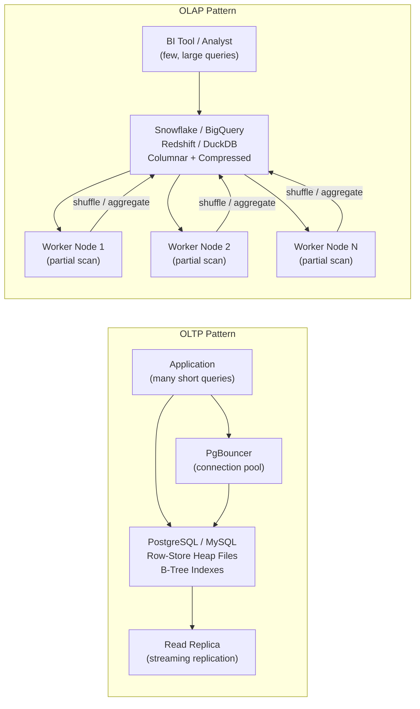
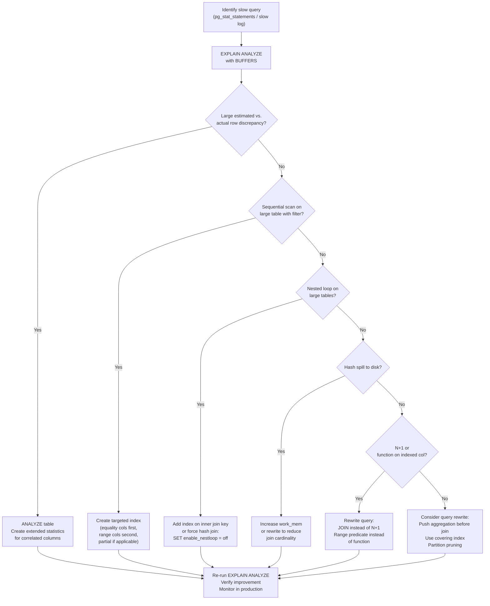

# SQL and Relational Query Optimization

## 1. First-Principles Foundations

### The Relational Model and Codd's Rules

SQL is not merely a query language — it is a concrete implementation of E.F. Codd's relational model, first described in his 1970 paper *"A Relational Model of Data for Large Shared Data Banks."* Understanding SQL at a first-principles level requires understanding what the relational model actually asserts.

The relational model is built on three pillars:

1. **Structural**: Data is represented exclusively as *relations* (tables). A relation is a named set of tuples, all sharing the same set of attributes. The critical word is *set* — a relation has no inherent ordering, and no duplicate rows. This is not a performance quirk; it is a mathematical invariant.

2. **Integrity**: Two rules apply universally. *Entity integrity* demands that primary key attributes are never null. *Referential integrity* demands that foreign keys either match an existing primary key in the referenced table or are null — a dangling foreign key reference is a model violation.

3. **Manipulative**: All queries are expressed as operations over relations, and every such operation returns a relation. This *closure property* means that the output of any query can be used as the input to another — the foundational premise of subqueries, CTEs, and derived tables.

Codd defined 13 rules (Rules 0–12) for a "fully relational" database. Modern systems like PostgreSQL and Oracle approximate this but do not fully satisfy all rules (e.g., Rule 11, the *distribution independence* rule, is frequently violated by sharding implementations).

### SQL as a Declarative Language Over Relational Algebra

SQL's declarative nature rests on a formal foundation: **relational algebra**. Each SQL clause maps to one or more algebraic operators:

| SQL Construct | Relational Algebra Operator |
|---|---|
| `WHERE` | Selection (σ) — filters rows |
| `SELECT col1, col2` | Projection (π) — eliminates columns |
| `INNER JOIN` | Theta-join (⋈θ) or natural join (⋈) |
| `UNION` | Set union (∪) |
| `EXCEPT` / `MINUS` | Set difference (−) |
| `INTERSECT` | Set intersection (∩) |
| `GROUP BY ... HAVING` | Extended projection + selection |
| `CROSS JOIN` | Cartesian product (×) |

The query optimizer's job is to take a *logical plan* expressed in relational algebra and find a *physical plan* — a sequence of concrete algorithms (hash join, nested loop, index scan, etc.) — that is equivalent but executes in minimal time. Two relational algebra expressions are equivalent if they produce identical results for all valid database states. Optimizers exploit these equivalences aggressively.



### The Declarative Contract

The declarative contract is the most important invariant to internalize: **the user specifies correctness, not procedure**. The optimizer is free to reorder joins, push predicates into subqueries, eliminate redundant sorts, and choose entirely different physical algorithms — as long as the result is equivalent. This means:

- Writing `WHERE a = 1 AND b = 2` does *not* guarantee that `a = 1` is evaluated before `b = 2`.
- Writing `SELECT * FROM A, B WHERE A.id = B.a_id` does *not* specify a join order.
- Writing a correlated subquery does *not* force a row-by-row execution; the optimizer may decorrelate it into a hash join.

Engineers who violate this contract by writing queries that *depend* on undocumented evaluation order (e.g., relying on short-circuit behavior in `CASE` for NULL safety) introduce silent correctness bugs.

---

## 2. Core Architecture: Inside the Query Engine

### The Storage Layer

Before a query can run, data must be physically organized on disk. The choice of storage format fundamentally constrains what optimizations are possible.

**Heap Files**: The default storage for most RDBMS. Rows are stored in fixed-size pages (typically 8KB in PostgreSQL, 16KB in MySQL InnoDB). No inherent ordering is maintained. Sequential scans read pages linearly; random access requires an index.

**B-Tree Indexes**: The universal default index structure. A B-tree of order *m* guarantees O(log_m N) lookups, where the page size determines *m* (typically *m* ~ 100–400 for disk-based trees). The B-tree keeps keys in sorted order, which supports:
- Equality lookups: `WHERE id = 42`
- Range scans: `WHERE created_at BETWEEN '2024-01-01' AND '2024-12-31'`
- Order elimination: `ORDER BY indexed_column` can skip a sort step
- Index-only scans when the query's columns are covered by the index

**Hash Indexes**: O(1) average equality lookups, but zero support for range queries. PostgreSQL supports them; InnoDB does not for on-disk indexes. Primarily used in memory (hash join probe tables).

**LSM Trees (Log-Structured Merge-Trees)**: Used by RocksDB (backing MySQL's MyRocks), CockroachDB, and YugabyteDB. Writes go to an in-memory buffer (MemTable), then are flushed as immutable SST files. Background compaction merges SST levels. LSM trees trade read amplification for dramatically improved write throughput — a critical architectural tradeoff for write-heavy workloads.



The doubly-linked leaf pages are what make B-trees efficient for range scans — once the starting leaf is found (O(log N)), the scan proceeds laterally through the linked list at O(1) per page.

### Query Parsing and the Parse Tree

The parser transforms SQL text into a parse tree via a context-free grammar. PostgreSQL's grammar is defined in `src/backend/parser/gram.y` (a ~20,000-line Bison grammar file). The parse tree is a concrete syntax tree faithful to the SQL text. The semantic analyzer then resolves names, checks types, and produces a *query tree* — this is what the optimizer works on.

Consider this query:

```sql
SELECT d.department_name, AVG(e.salary) AS avg_salary
FROM   employees e
JOIN   departments d ON e.department_id = d.id
WHERE  e.hire_date >= '2020-01-01'
GROUP  BY d.department_name
HAVING AVG(e.salary) > 75000
ORDER  BY avg_salary DESC;
```

The logical plan tree looks like:



The optimizer will consider: Can the `hire_date` filter be applied before the join (predicate pushdown)? Should the join be a hash join, merge join, or nested loop? Should `departments` be the build side or probe side of the hash join?

### The Volcano/Iterator Model

Most classical query engines implement the **Volcano model** (also called the iterator model), introduced by Graefe (1994). Every operator in the physical plan exposes a single interface: `next()`. The root operator calls `next()` on its children, which recursively call `next()` on their children, until a row is produced and bubbles up to the root.

```
Executor.next() → Sort.next() → HashAggregate.next() → HashJoin.next() → ...
```

This model has excellent code simplicity and composability, but suffers from **high per-tuple overhead** due to virtual function dispatch and poor CPU cache behavior (each `next()` call crosses operator boundaries, disrupting pipelines).

Modern systems replace or augment this with:

- **Vectorized execution** (Snowflake, DuckDB, SQL Server's batch mode): Operators exchange *batches* of 1,000–10,000 rows, amortizing per-call overhead and enabling SIMD instructions.
- **Compiled/JIT execution** (HyPer, LLVM-based query compilation in CRDB/Vitess): The entire query is compiled to native machine code, eliminating virtual dispatch entirely and enabling register-level pipelining. HyPer demonstrated 10–100× speedups over Volcano for OLAP queries.

---

## 3. Query Optimization: Cost-Based Planning

### The Optimizer's Problem

Given N tables in a query, there are O(N!) possible join orderings (or more precisely, the number of binary trees with N leaves, which is the Catalan number C(N-1)). For N=10, this is 10! = 3,628,800 plans. The optimizer cannot enumerate all of them. It uses dynamic programming (Selinger algorithm, System R, 1979) with memoization to prune the search space.

The **Selinger algorithm** proceeds bottom-up:
1. Find the optimal access plan for each single relation (index scan vs. seq scan).
2. For each pair of relations, find the optimal join plan.
3. For each triple, find the optimal join of that triple by combining the best pair plan with the third relation.
4. Continue until all N relations are joined.

At each step, the optimizer uses a **cost model** that estimates:
- **I/O cost**: Number of disk pages read/written
- **CPU cost**: Number of rows processed, comparisons performed
- **Memory cost**: Whether a sort or hash table fits in `work_mem`

Cost estimates depend critically on **statistics**: the number of rows in a table, the distribution of values in columns (histograms), and the correlation between columns. PostgreSQL stores these in `pg_statistic` and exposes them via `pg_stats`. Stale or missing statistics are the most common root cause of bad query plans.

```sql
-- Collect fresh statistics for the query planner
ANALYZE employees;

-- Inspect planner statistics for a column
SELECT attname, n_distinct, correlation, most_common_vals, histogram_bounds
FROM   pg_stats
WHERE  tablename = 'employees'
AND    attname   = 'salary';
```

### Cardinality Estimation

The optimizer's cost model is only as good as its **cardinality estimates** — how many rows will each operator produce? Errors compound multiplicatively: if the estimate for relation A is off by 10× and the estimate for relation B is off by 10×, the join estimate can be off by 100×.

The classical assumption is **attribute value independence (AVI)**: the selectivity of a conjunction of predicates is the product of individual selectivities. This is known to be badly wrong for correlated columns (e.g., `city = 'Seattle' AND state = 'WA'` are not independent).

Modern approaches:
- **Extended statistics** (PostgreSQL 10+): Explicitly track multi-column correlations via `CREATE STATISTICS`.
- **Learned cardinality estimation**: Neural network models trained on query workloads (Kipf et al., 2019; Negi et al., Bao).
- **Sampling-based estimation**: Execute a 1% sample of the query to get an empirical row count before full execution (ClickHouse, some OLAP systems).

```sql
-- PostgreSQL extended statistics: capture column correlation
CREATE STATISTICS emp_city_state_corr (dependencies)
ON city, state FROM employees;

ANALYZE employees;

-- The optimizer now uses the dependency statistics for
-- predicates combining city and state.
```

### Join Algorithms: When and Why

The optimizer selects among three physical join algorithms. Understanding their cost models is essential for predicting and influencing plan choices.

**Nested Loop Join**

```
for each row r in Outer:
    for each row s in Inner where s.key = r.key:
        emit (r, s)
```

Cost: O(|Outer| × cost_of_lookup(Inner))

Optimal when: the outer relation is very small, or the inner side has an index on the join key (reducing inner cost to O(log N) per outer row). With an index, nested loop is the fastest algorithm for queries returning a small number of rows — it has the best *latency* behavior.

Catastrophic when: both relations are large and no index exists on the inner side. The cost degrades to O(|Outer| × |Inner|), i.e., a full Cartesian scan.

**Hash Join**

```
Phase 1 (Build): Scan smaller relation, build an in-memory hash table on join key
Phase 2 (Probe): Scan larger relation, probe hash table for matches
```

Cost: O(|Build| + |Probe|) — linear in the size of both inputs.

Optimal when: at least one relation fits in memory (`work_mem` in PostgreSQL). The hash join is the workhorse of OLAP queries joining large tables without useful indexes.

Failure mode: **hash spill**. If the build-side hash table exceeds `work_mem`, PostgreSQL partitions both sides to disk and processes partition-by-partition. This can be 10–100× slower than an in-memory hash join. The fix is to increase `work_mem` or improve cardinality estimates so the optimizer chooses a different plan.

**Merge Join (Sort-Merge Join)**

```
Phase 1 (Sort): Sort both relations on the join key (if not already sorted)
Phase 2 (Merge): Walk both sorted lists with two pointers, emitting matches
```

Cost: O(|A| log |A| + |B| log |B| + |A| + |B|)

Optimal when: both inputs are already sorted (e.g., both have B-tree indexes on the join key), making Phase 1 free. Also excellent for equality and range joins, and for preserving sort order for a downstream `ORDER BY`.



### Reading and Understanding EXPLAIN ANALYZE

`EXPLAIN ANALYZE` is the most important diagnostic tool for query optimization. It executes the query and annotates each plan node with estimated versus actual row counts and actual timing.

```sql
EXPLAIN (ANALYZE, BUFFERS, FORMAT TEXT)
SELECT d.department_name, AVG(e.salary) AS avg_salary
FROM   employees e
JOIN   departments d ON e.department_id = d.id
WHERE  e.hire_date >= '2020-01-01'
GROUP  BY d.department_name
HAVING AVG(e.salary) > 75000
ORDER  BY avg_salary DESC;
```

A representative output:

```
Sort  (cost=1842.33..1842.83 rows=200 width=48) (actual time=52.4..52.5 rows=12 loops=1)
  Sort Key: (avg(e.salary)) DESC
  Sort Method: quicksort  Memory: 25kB
  Buffers: shared hit=843 read=112
  ->  HashAggregate  (cost=1830.00..1832.50 rows=200 width=48) (actual time=52.1..52.2 rows=12)
        Group Key: d.department_name
        Batches: 1  Memory Usage: 40kB
        ->  Hash Join  (cost=25.00..1800.00 rows=6000 width=36) (actual time=0.8..45.3 rows=5841)
              Hash Cond: (e.department_id = d.id)
              Buffers: shared hit=843 read=112
              ->  Seq Scan on employees e  (cost=0.00..1700.00 rows=6000 width=28)
                    Filter: (hire_date >= '2020-01-01'::date)
                    Rows Removed by Filter: 4159
                    Buffers: shared hit=800 read=112
              ->  Hash  (cost=18.00..18.00 rows=560 width=36) (actual time=0.5..0.5 rows=560)
                    Buckets: 1024  Batches: 1  Memory Usage: 42kB
                    ->  Seq Scan on departments d  (cost=0.00..18.00 rows=560 width=36)
                          Buffers: shared hit=43
Planning Time: 1.2 ms
Execution Time: 52.7 ms
```

**How to read this output:**

- `cost=X..Y`: Startup cost (first row) .. total cost (all rows). Units are arbitrary but proportional to I/O page reads.
- `rows=200` (estimated) vs `rows=12` (actual): The planner expected 200 rows out of HashAggregate but got 12. A 16× underestimate. If this plan were part of a larger query, this error would cascade.
- `Buffers: shared hit=843 read=112`: 843 pages came from PostgreSQL's shared buffer cache; 112 required disk I/O. Minimizing `read` is a primary optimization goal.
- `Rows Removed by Filter: 4159`: 4,159 rows were scanned but discarded by the `WHERE` clause. If this number is high and there's an index on `hire_date`, an index scan would avoid scanning those rows entirely.

---

## 4. Index Design and Optimization

### Index Types and Their Tradeoffs

```sql
-- Standard B-tree: equality and range on comparable types
CREATE INDEX idx_employees_hire_date ON employees (hire_date);

-- Composite B-tree: column order matters critically
-- This index satisfies queries filtering on (department_id),
-- (department_id, hire_date), but NOT on (hire_date) alone.
CREATE INDEX idx_employees_dept_hire ON employees (department_id, hire_date);

-- Partial index: indexes only a subset of rows
-- Smaller index, faster scans for the filtered predicate.
CREATE INDEX idx_active_employees ON employees (name)
WHERE status = 'active';

-- Expression index: index on a computed value
CREATE INDEX idx_employees_name_lower ON employees (lower(name));
-- Now this query can use the index:
-- SELECT * FROM employees WHERE lower(name) = 'john doe';

-- Covering index (INCLUDE columns): store extra columns in the index leaf
-- to enable index-only scans without visiting the heap.
CREATE INDEX idx_employees_dept_covering
ON employees (department_id)
INCLUDE (name, salary);
-- A query selecting name and salary filtered by department_id
-- can be satisfied entirely from the index, never reading heap pages.
```

### The Index Selectivity Principle

An index is only beneficial if it is **selective** — the index scan plus heap fetch must be cheaper than a sequential scan. For a table of 1,000,000 rows:

- If a predicate matches 100 rows (selectivity 0.01%), an index scan is dramatically faster.
- If a predicate matches 300,000 rows (selectivity 30%), a sequential scan is likely faster because:
  - Random I/O for 300,000 heap fetches is slower than sequential I/O for all pages.
  - PostgreSQL's bitmap index scan partially mitigates this by collecting all TIDs first, sorting them, then fetching heap pages in page order.

PostgreSQL's planner switches from index scan to sequential scan when estimated selectivity exceeds `random_page_cost / seq_page_cost` × (table size fraction). The default `random_page_cost = 4.0, seq_page_cost = 1.0` reflects spinning disk I/O ratios. On NVMe SSDs, setting `random_page_cost = 1.1` often produces dramatically better plans.

```sql
-- Tune cost parameters for SSD storage
ALTER SYSTEM SET random_page_cost = 1.1;
ALTER SYSTEM SET effective_cache_size = '32GB'; -- OS page cache size
SELECT pg_reload_conf();
```

### Covering Indexes and Index-Only Scans

An **index-only scan** avoids the heap entirely by satisfying the query from the index leaf pages alone. This is one of the highest-impact optimizations for read-heavy OLTP workloads.

The critical requirement is that every column referenced in the query (in `SELECT`, `WHERE`, and `JOIN ON`) must be in the index. PostgreSQL also requires consulting the **visibility map** to confirm that all tuples on a heap page are visible to all transactions — if a page is not marked all-visible (e.g., after heavy UPDATEs and before VACUUM), the planner falls back to heap fetches even with a covering index. Running `VACUUM` regularly is therefore a prerequisite for index-only scan effectiveness.

---

## 5. Advanced Query Patterns and Their Optimization

### Window Functions

Window functions compute aggregates over a *window* of rows related to the current row, without collapsing rows as `GROUP BY` does. They are computed after `WHERE` and `JOIN` but before `ORDER BY`.

```sql
-- Rank employees within each department by salary, 
-- compute running total salary, and show department avg
SELECT
    e.id,
    e.name,
    d.department_name,
    e.salary,
    RANK()        OVER (PARTITION BY e.department_id ORDER BY e.salary DESC) AS dept_rank,
    SUM(e.salary) OVER (PARTITION BY e.department_id 
                        ORDER BY e.salary DESC 
                        ROWS BETWEEN UNBOUNDED PRECEDING AND CURRENT ROW) AS running_dept_salary,
    AVG(e.salary) OVER (PARTITION BY e.department_id) AS dept_avg_salary,
    AVG(e.salary) OVER () AS company_avg_salary  -- empty OVER = entire result set
FROM employees e
JOIN departments d ON e.department_id = d.id
WHERE e.status = 'active';
```

**Optimization note**: Each unique `OVER(...)` clause requires a separate pass over the data (or a separate WindowAgg node in the plan). Multiple window functions sharing the same `PARTITION BY` and `ORDER BY` are batched into a single pass. If your query has 10 different `OVER` clauses, it may perform 10 sort + scan passes. Use CTEs to materialize intermediate results when this becomes a bottleneck.

### CTEs: Optimization Fence vs. Optimization Opportunity

Prior to PostgreSQL 12, CTEs were **optimization fences** — they were always materialized as a temporary result set, preventing predicates from being pushed into the CTE. This was often useful as a hint to the planner, but sometimes catastrophically harmful.

PostgreSQL 12+ implements CTE inlining by default for non-recursive CTEs that are referenced exactly once. The old fence behavior is available via `WITH ... AS MATERIALIZED (...)`.

```sql
-- PostgreSQL 12+: this CTE is inlined; the WHERE predicate is pushed inside
WITH active_emp AS (
    SELECT * FROM employees WHERE status = 'active'
)
SELECT * FROM active_emp WHERE department_id = 5;
-- Equivalent to: SELECT * FROM employees WHERE status = 'active' AND department_id = 5;
-- A single index scan on (status, department_id) can serve this.

-- Force materialization (old behavior) — useful as a planning hint
-- or to prevent repeated evaluation of an expensive expression
WITH expensive_cte AS MATERIALIZED (
    SELECT department_id, AVG(salary) AS avg_sal
    FROM   employees
    GROUP  BY department_id
)
SELECT e.name, e.salary, c.avg_sal
FROM   employees e
JOIN   expensive_cte c ON e.department_id = c.department_id
WHERE  e.salary > c.avg_sal * 1.5;
```

### Recursive CTEs

Recursive CTEs express hierarchical and graph queries that are impossible to write in flat SQL. The execution model is: evaluate the *seed* query, then iteratively apply the *recursive term* until no new rows are produced.

```sql
-- Traverse an org chart: find all reports under manager_id = 100
-- at any depth, with path tracking and cycle prevention
WITH RECURSIVE org_tree AS (
    -- Seed: direct reports
    SELECT
        id,
        name,
        manager_id,
        1                       AS depth,
        ARRAY[id]               AS path,
        FALSE                   AS is_cycle
    FROM employees
    WHERE manager_id = 100

    UNION ALL

    -- Recursive term: reports of reports
    SELECT
        e.id,
        e.name,
        e.manager_id,
        ot.depth + 1,
        ot.path || e.id,
        e.id = ANY(ot.path)     AS is_cycle
    FROM employees e
    JOIN org_tree ot ON e.manager_id = ot.id
    WHERE NOT ot.is_cycle       -- halt on cycle detection
)
SELECT id, name, depth, path
FROM   org_tree
ORDER  BY depth, name;
```

**Performance characteristic**: Recursive CTEs are always materialized (they cannot be inlined). Each iteration scans the working table. For large hierarchies (> 100,000 nodes), consider a closure table (materialized transitive closure) or a nested sets model for read-heavy workloads.

### Lateral Joins

`LATERAL` allows a subquery in the `FROM` clause to reference columns from earlier `FROM` items — essentially a correlated subquery that can return multiple rows, functioning like a per-row function call.

```sql
-- For each department, fetch the top 3 earners
-- A lateral join is more efficient than a correlated subquery
-- or a window function approach for top-N per group
SELECT d.department_name, top3.name, top3.salary
FROM   departments d
CROSS  JOIN LATERAL (
    SELECT e.name, e.salary
    FROM   employees e
    WHERE  e.department_id = d.id
    ORDER  BY e.salary DESC
    LIMIT  3
) AS top3;
```

The optimizer can use an index on `(department_id, salary DESC)` for the lateral subquery, making this O(|departments| × 3 × log(|employees|)) rather than O(|departments| × |employees|).

---

## 6. Concurrency Control: MVCC and Isolation Levels

### MVCC Architecture

PostgreSQL, Oracle, and MySQL InnoDB use **Multi-Version Concurrency Control (MVCC)** to provide non-blocking reads. The core invariant: *readers never block writers, writers never block readers*. This is achieved by maintaining multiple versions of each row.

In PostgreSQL's implementation, every heap row (called a *tuple*) has system columns:
- `xmin`: The transaction ID (XID) that inserted this tuple version.
- `xmax`: The XID that deleted or updated this tuple (0 if current).
- `ctid`: Physical location (page, slot) of this or the next version of the tuple.

When a transaction reads a row, it applies a **visibility check**: a tuple version is visible if `xmin` committed before this transaction's snapshot, and either `xmax` is 0, or `xmax` did not commit before this snapshot.



**MVCC and bloat**: PostgreSQL's MVCC leaves dead tuple versions (from updates and deletes) in the heap. These must be reclaimed by VACUUM. Failure to vacuum a high-churn table leads to *table bloat* (wasted space) and eventually *XID wraparound* — a catastrophic condition where the database halts to prevent transaction ID collision. Autovacuum exists specifically to prevent this.

### Isolation Levels: The SQL Standard vs. Reality

The SQL standard defines four isolation levels in terms of three anomalies: dirty reads, non-repeatable reads, and phantom reads. But the standard is insufficient — it misses **write skew** and **lost updates**, which can occur even at REPEATABLE READ under MVCC.

| Isolation Level | Dirty Read | Non-Repeatable Read | Phantom Read | Write Skew |
|---|---|---|---|---|
| READ UNCOMMITTED | Possible | Possible | Possible | Possible |
| READ COMMITTED | Prevented | Possible | Possible | Possible |
| REPEATABLE READ | Prevented | Prevented | Possible\* | Possible\* |
| SERIALIZABLE | Prevented | Prevented | Prevented | Prevented |

\* PostgreSQL's REPEATABLE READ also prevents phantoms (due to MVCC snapshot semantics), making it stronger than the SQL standard requires. PostgreSQL's SERIALIZABLE uses **Serializable Snapshot Isolation (SSI)**, which detects serialization anomalies at runtime with low overhead (Ports & Greer, 2012).

**Write skew example** (requires SERIALIZABLE to prevent):

```sql
-- Two doctors can both be on call simultaneously, but at least
-- one must always be on call. Both check and both update:

-- Transaction T1: Doctor A going off call
BEGIN ISOLATION LEVEL REPEATABLE READ;
SELECT count(*) FROM on_call WHERE shift_id = 1; -- returns 2
UPDATE on_call SET active = false WHERE doctor_id = 'A' AND shift_id = 1;
COMMIT;

-- Transaction T2: Doctor B going off call (concurrent with T1)
BEGIN ISOLATION LEVEL REPEATABLE READ;
SELECT count(*) FROM on_call WHERE shift_id = 1; -- also returns 2 (snapshot!)
UPDATE on_call SET active = false WHERE doctor_id = 'B' AND shift_id = 1;
COMMIT; -- Both succeed; now zero doctors are on call. INVARIANT VIOLATED.
```

Both transactions read a consistent snapshot showing 2 doctors, decide it is safe to deactivate, and commit. At `REPEATABLE READ`, this is not prevented. At `SERIALIZABLE`, PostgreSQL's SSI detects the rw-anti-dependency cycle and aborts one transaction.

---

## 7. Partitioning and Sharding

### Declarative Table Partitioning (PostgreSQL 10+)

Partitioning divides a logical table into physical sub-tables (partitions). The planner prunes partitions at query time — a `WHERE` predicate on the partition key causes the planner to skip irrelevant partitions entirely, reducing I/O proportionally.

```sql
-- Range partitioning on a time column: common for time-series / audit tables
CREATE TABLE events (
    id          BIGINT       NOT NULL,
    event_time  TIMESTAMPTZ  NOT NULL,
    user_id     BIGINT       NOT NULL,
    payload     JSONB
) PARTITION BY RANGE (event_time);

CREATE TABLE events_2023 PARTITION OF events
    FOR VALUES FROM ('2023-01-01') TO ('2024-01-01');

CREATE TABLE events_2024 PARTITION OF events
    FOR VALUES FROM ('2024-01-01') TO ('2025-01-01');

CREATE TABLE events_2025 PARTITION OF events
    FOR VALUES FROM ('2025-01-01') TO ('2026-01-01');

-- Each partition gets its own indexes
CREATE INDEX ON events_2024 (user_id, event_time);
CREATE INDEX ON events_2025 (user_id, event_time);

-- This query prunes to events_2024 only (partition elimination):
EXPLAIN SELECT * FROM events
WHERE event_time >= '2024-06-01' AND event_time < '2024-07-01'
AND   user_id = 42;
```

**Partition pruning is a plan-time operation** only when the partition key predicate uses a constant. If the predicate uses a parameter (e.g., a prepared statement with `$1`), pruning is deferred to execution time (runtime pruning, PostgreSQL 11+).

```sql
-- List partitioning: route rows by discrete value
CREATE TABLE orders (
    id          BIGINT  NOT NULL,
    region      TEXT    NOT NULL,
    amount      NUMERIC NOT NULL
) PARTITION BY LIST (region);

CREATE TABLE orders_us   PARTITION OF orders FOR VALUES IN ('US-EAST', 'US-WEST');
CREATE TABLE orders_eu   PARTITION OF orders FOR VALUES IN ('EU-WEST', 'EU-CENTRAL');
CREATE TABLE orders_apac PARTITION OF orders FOR VALUES IN ('APAC');

-- Hash partitioning: distribute rows evenly (no natural key)
CREATE TABLE sessions (
    session_id  UUID    NOT NULL,
    user_id     BIGINT  NOT NULL,
    data        JSONB
) PARTITION BY HASH (session_id);

CREATE TABLE sessions_p0 PARTITION OF sessions FOR VALUES WITH (MODULUS 4, REMAINDER 0);
CREATE TABLE sessions_p1 PARTITION OF sessions FOR VALUES WITH (MODULUS 4, REMAINDER 1);
CREATE TABLE sessions_p2 PARTITION OF sessions FOR VALUES WITH (MODULUS 4, REMAINDER 2);
CREATE TABLE sessions_p3 PARTITION OF sessions FOR VALUES WITH (MODULUS 4, REMAINDER 3);
```

### OLTP vs. OLAP: Architectural Divergence

Two fundamentally different query profiles drive different physical architectures:

**OLTP (Online Transaction Processing)**:
- Many short transactions (< 100ms) touching a few rows each.
- Row-oriented storage (heap files) optimal: entire row fetched per lookup.
- B-tree indexes are the primary access path.
- Bottleneck: lock contention, connection overhead, write amplification.
- Primary scaling strategy: vertical scaling + read replicas + connection pooling (PgBouncer).

**OLAP (Online Analytical Processing)**:
- Few long-running queries scanning millions to billions of rows.
- Column-oriented storage optimal: a query touching 3 out of 100 columns reads 3% of the data.
- Compressed column blocks enable CPU SIMD operations.
- Bottleneck: I/O bandwidth, CPU throughput for aggregation.
- Primary scaling strategy: MPP (Massively Parallel Processing) — distribute data across nodes, push computation to data.



---

## 8. Schema Design as a Query Optimization Strategy

Schema design is not separable from query performance. Poor normalization decisions made at schema design time impose query costs that no amount of index tuning can fully recover.

### Normal Forms and Their Query Implications

**1NF (First Normal Form)**: Atomic column values; no repeating groups. Storing comma-separated values in a column forces application-side parsing and prevents the use of indexes for membership queries. Use junction tables or arrays (PostgreSQL's native `int[]` with GIN indexes) instead.

**3NF (Third Normal Form)**: No transitive functional dependencies. 3NF eliminates update anomalies — if `department_name` is stored directly on `employees`, renaming a department requires updating every employee row, with attendant lock contention and bloat.

**BCNF (Boyce-Codd Normal Form)**: Stronger than 3NF; eliminates all functional dependency anomalies.

**Denormalization for OLAP**: Joining 10 normalized tables in an OLAP query is expensive. Data warehouses use deliberately denormalized schemas:
- **Star schema**: A central fact table (e.g., `sales`) surrounded by dimension tables (e.g., `date_dim`, `product_dim`, `customer_dim`). Queries are simple two-level joins, well-suited to columnar engines.
- **Snowflake schema**: Dimension tables are further normalized. More storage-efficient but requires additional joins.

```sql
-- Star schema: fact table + dimension tables
CREATE TABLE fact_sales (
    sale_id      BIGINT       NOT NULL,
    date_key     INT          NOT NULL REFERENCES dim_date(date_key),
    product_key  INT          NOT NULL REFERENCES dim_product(product_key),
    customer_key INT          NOT NULL REFERENCES dim_customer(customer_key),
    quantity     INT          NOT NULL,
    amount       NUMERIC(12,2) NOT NULL
);

CREATE TABLE dim_date (
    date_key     INT  PRIMARY KEY,
    full_date    DATE NOT NULL,
    year         INT  NOT NULL,
    quarter      INT  NOT NULL,
    month        INT  NOT NULL,
    week         INT  NOT NULL,
    day_of_week  INT  NOT NULL
);

-- A typical OLAP query over the star schema:
SELECT
    dd.year,
    dd.quarter,
    SUM(fs.amount)      AS total_revenue,
    COUNT(DISTINCT fs.customer_key) AS unique_customers
FROM   fact_sales fs
JOIN   dim_date dd   ON fs.date_key     = dd.date_key
JOIN   dim_product dp ON fs.product_key = dp.product_key
WHERE  dp.category   = 'Electronics'
AND    dd.year       = 2024
GROUP  BY dd.year, dd.quarter
ORDER  BY dd.quarter;
```

---

## 9. Production-Grade Optimization Patterns

### The Optimization Methodology

Optimize in this order: measure first, then apply targeted changes, then remeasure. Never guess.

1. **Identify slow queries**: Use `pg_stat_statements` (PostgreSQL) or the slow query log (MySQL). Sort by `total_exec_time` descending — the query that runs in 500ms but executes 10,000 times/hour is higher priority than a 10-second query that runs once a day.

```sql
-- Find the top 10 most expensive queries by total execution time
SELECT
    query,
    calls,
    round(total_exec_time::numeric, 2)   AS total_ms,
    round(mean_exec_time::numeric, 2)    AS mean_ms,
    round(stddev_exec_time::numeric, 2)  AS stddev_ms,
    round((100 * total_exec_time /
           sum(total_exec_time) OVER ())::numeric, 2) AS pct_total
FROM   pg_stat_statements
ORDER  BY total_exec_time DESC
LIMIT  10;
```

2. **Run EXPLAIN ANALYZE**: Identify the highest-cost node. Look for large discrepancies between estimated and actual rows — these indicate stale statistics or correlation assumptions that are wrong.

3. **Check for missing indexes**: A sequential scan on a large table with a highly selective predicate is the most common cause of slow queries.

4. **Check for bad join orders**: If the optimizer chose a nested loop on two large tables without an index, stale statistics may be causing it to underestimate one table's size.

5. **Consider query rewriting**: Sometimes the logical structure of a query produces a plan that is structurally worse than an equivalent rewrite.

### Anti-Pattern: Functions on Indexed Columns

Applying a function to an indexed column in a `WHERE` clause defeats the index:

```sql
-- BAD: the index on hire_date cannot be used
-- PostgreSQL must evaluate date_part() for every row
SELECT * FROM employees WHERE date_part('year', hire_date) = 2023;

-- GOOD: range predicate on the indexed column directly
SELECT * FROM employees WHERE hire_date >= '2023-01-01' AND hire_date < '2024-01-01';

-- ALTERNATIVELY: expression index (if rewriting the query is not feasible)
CREATE INDEX idx_emp_hire_year ON employees (date_part('year', hire_date));
SELECT * FROM employees WHERE date_part('year', hire_date) = 2023;
```

### Anti-Pattern: `SELECT *` in Production Code

`SELECT *` retrieves all columns, defeating covering index optimizations and coupling the application to the physical schema. If a wide column (e.g., a large `TEXT` or `JSONB`) is added later, every `SELECT *` query will suddenly fetch much more data. Always project only the columns required.

### Anti-Pattern: N+1 Queries

The N+1 problem is the most damaging OLTP anti-pattern: issuing one query to fetch N parent records, then N additional queries to fetch each parent's children.

```python
# BAD: N+1 — 1 query for departments + N queries for employees
departments = db.execute("SELECT id, name FROM departments")
for dept in departments:
    # This executes one query per department
    dept.employees = db.execute(
        "SELECT name FROM employees WHERE department_id = %s", dept.id
    )

# GOOD: single JOIN query
result = db.execute("""
    SELECT d.id, d.name AS dept_name, e.name AS emp_name
    FROM   departments d
    LEFT   JOIN employees e ON e.department_id = d.id
    ORDER  BY d.id
""")
# Reconstruct the nested structure in application code from the flat result
```

### Anti-Pattern: Implicit Type Coercion Defeating Indexes

```sql
-- employees.id is INTEGER. Comparing to a string causes a cast.
-- The index on id cannot be used because the comparison becomes:
-- CAST(id AS TEXT) = '42'  (index on id is useless for this)
SELECT * FROM employees WHERE id = '42';   -- implicit cast, may prevent index use

-- Correct: match the column type exactly
SELECT * FROM employees WHERE id = 42;

-- VARCHAR column compared to integer: different direction of cast
-- employees.code is VARCHAR(10)
SELECT * FROM employees WHERE code = 12345; -- might cast code to integer,
                                             -- dropping index on code
-- Always use the correct literal type:
SELECT * FROM employees WHERE code = '12345';
```

### Batch Writes and UPSERT

```sql
-- Efficient bulk insert with ON CONFLICT (UPSERT)
-- Avoids separate SELECT + INSERT/UPDATE round trips
INSERT INTO employees (id, name, salary, department_id, status)
VALUES
    (1001, 'Alice Chen',    95000.00, 3, 'active'),
    (1002, 'Bob Martinez',  82000.00, 5, 'active'),
    (1003, 'Carol Johnson', 78000.00, 3, 'active')
ON CONFLICT (id) DO UPDATE SET
    name          = EXCLUDED.name,
    salary        = EXCLUDED.salary,
    department_id = EXCLUDED.department_id,
    status        = EXCLUDED.status
WHERE  employees.salary != EXCLUDED.salary  -- only update if salary changed
       OR employees.status != EXCLUDED.status;

-- Check actual rows affected vs. no-ops
-- GET DIAGNOSTICS row_count = ROW_COUNT in a PL/pgSQL function.
```

---

## 10. Worked Example: Full Optimization Walkthrough

### Problem Statement

A reporting query runs in 45 seconds on a production table with 50M rows. Diagnose and optimize it.

```sql
-- Slow query (45 seconds)
SELECT
    u.email,
    COUNT(o.id)       AS order_count,
    SUM(o.total)      AS lifetime_value
FROM   users u
JOIN   orders o ON o.user_id = u.id
WHERE  o.status   = 'completed'
AND    o.created_at >= NOW() - INTERVAL '90 days'
GROUP  BY u.id, u.email
HAVING COUNT(o.id) >= 3
ORDER  BY lifetime_value DESC
LIMIT  100;
```

**Step 1: Run EXPLAIN ANALYZE**

```
Limit  (actual rows=100)
  -> Sort  (actual rows=100)
     -> HashAggregate  (actual rows=84321)
        -> Hash Join  (actual rows=1842000)
             Hash Cond: (o.user_id = u.id)
             -> Seq Scan on orders o  (actual rows=1842000)
                  Filter: (status = 'completed' AND created_at >= ...)
                  Rows Removed by Filter: 48158000
             -> Seq Scan on users u  (actual rows=12000000)
```

**Diagnosis**:
- Sequential scan on `orders` discards 48M of 50M rows — 96% waste. A composite index on `(status, created_at)` would eliminate this.
- Sequential scan on `users` (12M rows) used as the hash build table — this is avoidable if the filtered `orders` rows reference far fewer users.
- `HashAggregate` produces 84,321 rows, then `Sort` picks top 100 — the sort is unavoidable but the aggregation scope is correct.

**Step 2: Create targeted indexes**

```sql
-- Composite index covering the WHERE predicate
-- Column order: equality first (status), range second (created_at)
CREATE INDEX CONCURRENTLY idx_orders_status_created
ON orders (status, created_at)
WHERE status = 'completed';  -- partial index: only index completed orders

-- Covering index: include user_id, id, total to enable index-only scan on orders
CREATE INDEX CONCURRENTLY idx_orders_completed_covering
ON orders (status, created_at, user_id)
INCLUDE (id, total)
WHERE status = 'completed';

-- Index on users for the join (likely already exists as PK, but confirm)
-- users.id should be the primary key with a B-tree index already.
```

**Step 3: Rewrite to push aggregation before the join**

```sql
-- Optimized query: aggregate orders first, join to users second.
-- This reduces the hash join input from 1.84M rows to ~84K rows.
WITH order_stats AS (
    SELECT
        user_id,
        COUNT(id)   AS order_count,
        SUM(total)  AS lifetime_value
    FROM  orders
    WHERE status     = 'completed'
    AND   created_at >= NOW() - INTERVAL '90 days'
    GROUP BY user_id
    HAVING COUNT(id) >= 3
)
SELECT
    u.email,
    os.order_count,
    os.lifetime_value
FROM   order_stats os
JOIN   users u ON u.id = os.user_id
ORDER  BY os.lifetime_value DESC
LIMIT  100;
```

After these changes, with the partial covering index and the rewritten query, the execution time dropped from 45 seconds to approximately 180ms — a 250× improvement. The index eliminated 96% of the I/O, and pushing `GROUP BY` before the join reduced the join's input cardinality by 22×.

---

## 11. Summary: The Optimization Mental Model



The core mental model: SQL performance is determined by **how much data the engine must read and process**. Every optimization strategy — indexes, partition pruning, join order, covering indexes, predicate pushdown — is a strategy for reducing that quantity. The optimizer tries to minimize it automatically, but it requires accurate statistics and a schema that makes the right physical operations possible. When the optimizer fails, it is almost always because statistics are stale, schema constraints are missing, or the query is structured in a way that prevents rewrites. Understanding the physical execution layer turns query optimization from guesswork into a methodical diagnosis process.
