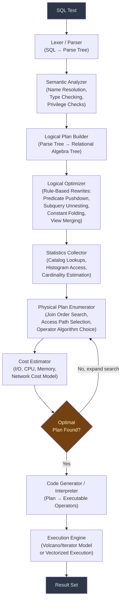
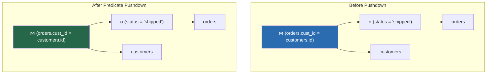
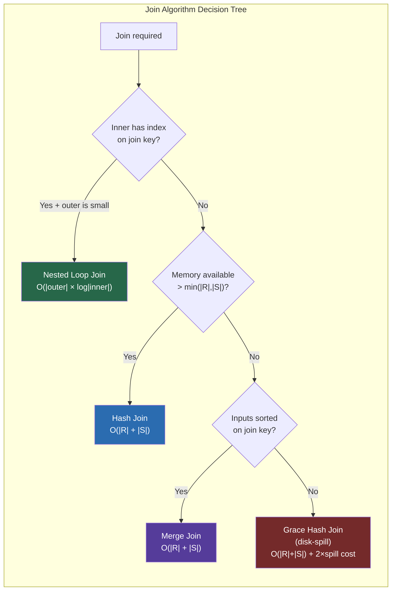
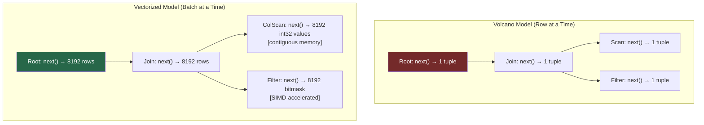
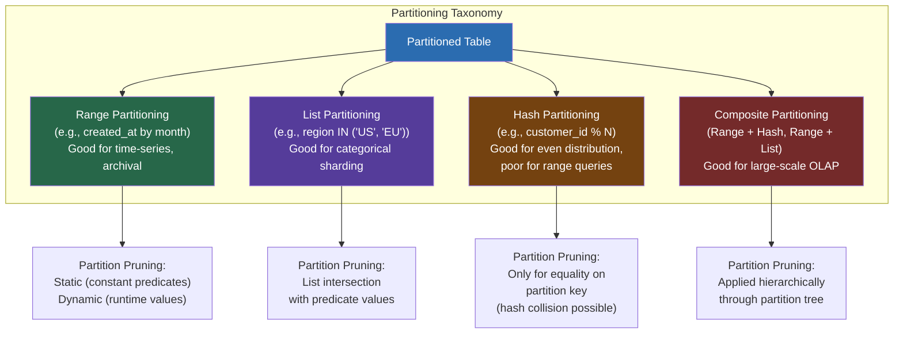
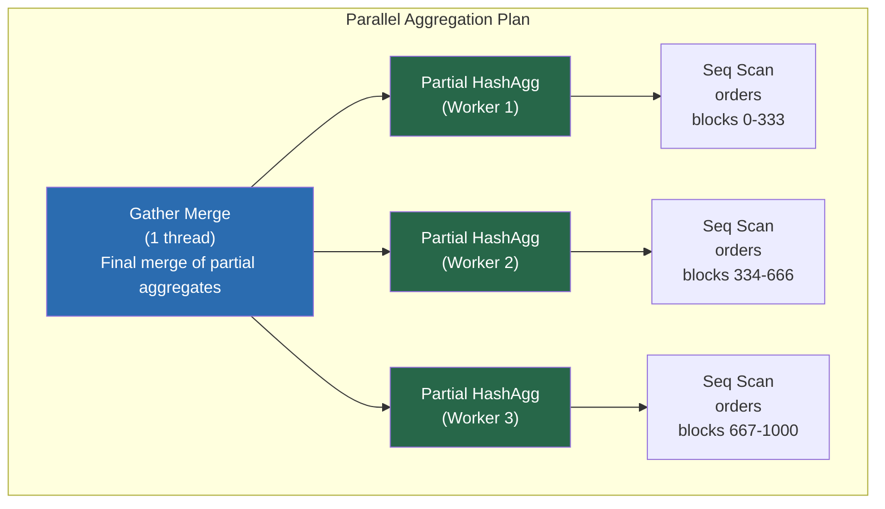
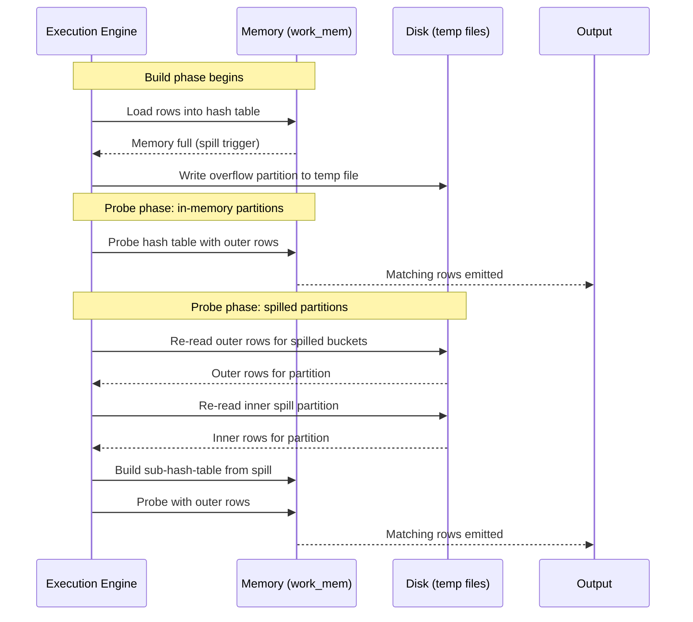
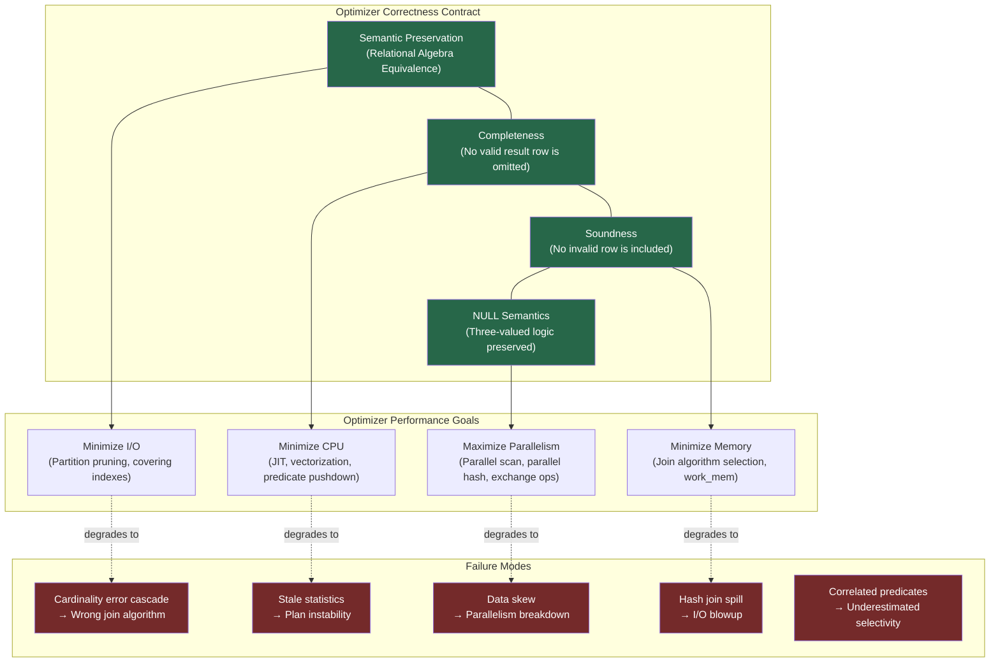

# Lesson 3: Advanced SQL Query Optimization Techniques

---

## 1. First-Principles Intuition & Invariants

### The Fundamental Tension

A SQL query is a *declarative specification of a result*, not a prescription for how to compute it. The sentence `SELECT name FROM employees WHERE department = 'Engineering'` says nothing about which index to use, in what order to scan pages, whether to parallelize, or how much memory to allocate. The gap between this declarative intent and an efficient physical execution is the central problem of query optimization—and it is a provably hard one.

Formally, finding the globally optimal join order for an n-table query is equivalent to solving a problem in the class of NP-hard combinatorial optimization (see Ibaraki & Kashiwabara, 1984; Selinger et al., 1979). The search space for join orders alone is O(n!), which means a 10-table query has over 3.6 million candidate plans before even considering index selection, parallelism, or operator algorithms. Modern optimizers do not solve this exactly—they use heuristics, dynamic programming with pruning (the Selinger algorithm), and increasingly, learned cost models.

### Relational Algebra as the Invariant Foundation

The correctness of any rewrite rule is grounded in relational algebra. The five primitive operators—selection (σ), projection (π), Cartesian product (×), union (∪), and difference (−)—form a closed algebra. All derived operators (join, semijoin, antijoin, division, outer join) are expressible as compositions of these primitives. This closure property is the fundamental invariant: any optimization must preserve the denotational semantics of the expression under all possible database states.

The key equivalences exploited by optimizers are:

**Commutativity of join:**
```text
R ⋈ S ≡ S ⋈ R
```

**Associativity of join:**
```text
(R ⋈ S) ⋈ T ≡ R ⋈ (S ⋈ T)
```

**Selection pushdown (cascading selections):**
```text
σ_p1 AND p2 (R) ≡ σ_p1(σ_p2(R))
```

**Selection-join commutativity (pushing filters below joins):**
```text
σ_p(R ⋈ S) ≡ σ_p(R) ⋈ S     [when p references only attributes of R]
```

**Projection-join interaction:**
```text
π_L(R ⋈ S) ≡ π_L(π_{L∪attr(R)}(R) ⋈ π_{L∪attr(S)}(S))
```

These are not merely syntax rules—they are theorems whose proofs rely on set-theoretic properties of relations. An optimizer that applies them incorrectly can silently return wrong answers. The correctness of NULL handling under outer joins, for instance, violates simple commutativity: `R LEFT JOIN S ≠ S LEFT JOIN R` in general.

### Cardinality Estimation: The Core Probabilistic Problem

The optimizer's decisions are almost entirely driven by cardinality estimates—predictions of how many rows each operator will produce. Almost every catastrophic query plan in production traces back to a cardinality estimation error.

The classical assumptions made by most optimizers (even modern ones) are:

1. **Attribute value independence:** The selectivity of `WHERE a = 1 AND b = 2` is estimated as `sel(a=1) × sel(b=2)`. This fails when `a` and `b` are correlated (e.g., city and zip code).
2. **Uniform distribution within a histogram bucket:** Assumes all values in a bucket appear with equal frequency.
3. **Principle of inclusion:** For a join `R ⋈ S` on attribute `k`, every value of `k` in the smaller domain also appears in the larger. This fails badly with foreign key violations or filtered joins.

The consequence of these assumptions is that errors compound multiplicatively across join levels. With 10 joins, an error of 10× per join produces an estimate that is off by 10^10. This is not hypothetical—it is the root cause of hash join spills to disk, nested loop explosions, and sort operator memory overflows in production systems.

Modern systems address this with:
- **Multi-column statistics** (PostgreSQL's `CREATE STATISTICS`, SQL Server's filtered statistics)
- **Sampling-based histograms** (most-common-values lists, equi-depth histograms)
- **Sketch-based cardinality estimation** (HyperLogLog for distinct counts, Count-Min Sketch for frequency)
- **ML-based cardinality estimators** (Naru, NeuroCard, MSCN), which learn joint distributions from data

### Materialized Views: Persistent Computation with Consistency Invariants

A materialized view (MV) is a named, stored result of a query expression over base tables. The critical invariant is **view consistency**: at any point in time (or at defined synchronization points), the materialized view must be a correct instance of its defining query applied to the current state of the base tables.

This invariant creates a maintenance problem. Given a base table update `ΔR`, we need to compute `ΔMV`—the corresponding change to the materialized view—without necessarily recomputing the entire view from scratch. This is the **incremental view maintenance (IVM)** problem.

For a view defined as `V = σ_p(R ⋈ S)`, insertion of tuple `t` into `R` produces:

```text
ΔV_insert = σ_p({t} ⋈ S)
```

For deletion of `t` from `R`:

```text
ΔV_delete = σ_p({t} ⋈ S)
```

This is straightforward for SPJ (select-project-join) views. Aggregation complicates things significantly because deleting the last row contributing to a `COUNT` requires knowing whether a group still exists, which requires either maintaining auxiliary count tables (the "delta-aggregation" approach) or re-querying the base tables.

The refresh strategies form a spectrum with well-defined tradeoffs:

| Strategy | Consistency | Write Overhead | Read Performance |
|---|---|---|---|
| Immediate (synchronous) | Full ACID consistency | Highest | Best |
| Deferred (on-demand) | Eventually consistent | None at write time | Stale until refresh |
| Incremental | Near-consistent | Moderate | Good |
| Periodic (scheduled) | Bounded staleness | Low | Stale by schedule interval |

PostgreSQL's `MATERIALIZED VIEW` uses deferred refresh (`REFRESH MATERIALIZED VIEW`). Oracle supports fast (incremental) refresh via materialized view logs. SQL Server's indexed views are maintained synchronously in the same transaction as the base table DML.

### Partitioning as Computational Domain Restriction

Partitioning transforms a single logical table into a collection of disjoint physical storage units. The fundamental optimization it enables is **partition pruning**: the elimination of entire partition scans from a query plan at planning time (static pruning) or execution time (dynamic pruning).

The invariant for partition pruning is:

> For every partition P_i, if the query predicate Q cannot be satisfied by any tuple in P_i (given the partition bounds), then P_i must not appear in the execution plan.

This is a form of constraint propagation. For range partitioning on column `ts` with predicate `ts >= '2024-01-01'`, the optimizer intersects the predicate range with each partition's range bound. For list partitioning on `region`, the optimizer intersects the predicate's value set with each partition's value list.

**Static pruning** happens at plan time and is reliable only when the predicate uses constants or parameters known before execution. **Dynamic pruning** happens during execution—critical for joins where the pruning value is the result of another operator (e.g., a hash join build phase that generates a Bloom filter used to prune the probe-side partitions).

The completeness requirement is strict: **false negatives in partition pruning are correctness violations**. Missing a partition that contains relevant data produces silently wrong results. False positives (scanning a partition unnecessarily) are only performance problems.

---

## 2. Core Architecture & Mechanics

### The Query Processing Pipeline

A SQL query passes through several distinct phases before a single row of data is read. Understanding each phase is essential for diagnosing why a particular query underperforms.



### The Relational Algebra Expression Tree

The logical plan is an expression tree where leaves are base relations (tables, views) and internal nodes are relational operators. The optimizer manipulates this tree through **transformation rules**—equivalence-preserving rewrites applied in a systematic search.



A concrete example: consider a query joining `orders`, `customers`, and `products` with a selective filter on `orders.status`. The unoptimized plan performs all three joins first, then applies the filter to the full Cartesian product. After predicate pushdown, the filter on `orders.status` is applied before the first join, dramatically reducing the number of rows flowing into subsequent operators.

### Join Algorithm Selection: Physics of Each Algorithm

The optimizer's choice of join algorithm has first-order impact on performance. The three primary algorithms have fundamentally different cost profiles:

**Nested Loop Join (NLJ)**

For each row in the outer relation R, scan the inner relation S for matching rows.

```text
Cost = |R| × Cost(scan S per probe)
     = |R| × (|S| / buffer_pages)   [without index]
     = |R| × Cost(index lookup on S)  [with index]
```

NLJ is optimal when the outer relation is tiny and the inner has an index on the join key. It degrades catastrophically when the outer is large and the inner has no index—the O(|R|×|S|) cost with page I/O.

**Hash Join**

Build phase: scan the smaller relation and build an in-memory hash table on the join key.
Probe phase: scan the larger relation and probe the hash table.

```text
Cost = Cost(scan R) + Cost(build hash table)
     + Cost(scan S) + Cost(probe hash table)
     ≈ 3 × (|R| + |S|)   [with two-pass grace hash join]
```

Hash join requires `O(min(|R|, |S|))` memory for the build phase. When memory is insufficient, the join **spills to disk** using a partitioned approach (Grace hash join), which adds a full write-and-read cycle for the spilled partitions. Memory pressure during hash joins is one of the most common causes of execution time blowup.

**Merge Join (Sort-Merge Join)**

Both relations are sorted on the join key, then merged in a single linear scan.

```text
Cost = Cost(sort R) + Cost(sort S) + Cost(merge)
     ≈ 2×|R|×log(|R|/B) + 2×|S|×log(|S|/B) + |R| + |S|
```

where B is available buffer pages. Merge join is optimal when both inputs are already sorted (from an index scan or a prior sort), making its cost purely the merge: `O(|R| + |S|)`.



### The Volcano/Iterator Model vs. Vectorized Execution

The classical execution model is the **Volcano (iterator) model**, introduced by Graefe (1994). Each operator implements a `next()` interface that returns one tuple at a time. The plan tree is a composition of iterators, and execution proceeds by pulling tuples up from leaves to the root.

```text
root_operator.next()
  → join_operator.next()
      → scan_operator.next()   // returns tuple from storage
  → filter_operator.next()
      → index_scan.next()
```

This model's elegance is its compositional simplicity. Its performance flaw is **per-tuple overhead**: every `next()` call involves a virtual function dispatch, cache-line fetches for operator state, and type-checking overhead. For analytical queries processing millions of rows, this overhead dominates execution time.

**Vectorized execution** (MonetDB/X100 architecture, Boncz et al. 2005; now used in DuckDB, Snowflake, BigQuery, ClickHouse) addresses this by processing **batches of 1,000–10,000 rows** per `next()` call. Each operator receives a column-oriented batch (a vector of values), applies a tight inner loop with no virtual dispatch, and returns a batch. This maps directly onto SIMD instructions and CPU cache lines.

The difference in CPU efficiency is not marginal: vectorized execution achieves 10–100× better cache utilization for column-scan operators, transforming L3 cache misses (200+ cycles) into L1 hits (4 cycles) by processing column data contiguously.



### Statistics Structures: Histograms and Beyond

The accuracy of cardinality estimation is bounded by the quality of statistics. The primary structures are:

**Equi-depth histograms:** Divide the value range into buckets with approximately equal tuple counts. Provides better resolution in dense regions of the distribution than equi-width histograms.

**Most-Common-Values (MCV) lists:** Store the top-k values by frequency explicitly. Critical for highly skewed distributions where a few values dominate (e.g., status codes like 'active' appearing in 90% of rows).

**HyperLogLog:** A probabilistic data structure for estimating cardinality of distinct values in O(1) space with ±2% error. Standard in distributed systems (BigQuery, Redshift, ClickHouse) for `COUNT(DISTINCT)` estimation.

**Count-Min Sketch:** A probabilistic frequency table that answers "how many times does value v appear?" in O(1) with bounded overestimation error. Used in some systems for join cardinality estimation.

The key limitation in all classical statistics is that they are **marginal** (per-column). They cannot represent correlations between columns. A query predicate `WHERE city = 'Seattle' AND state = 'TX'` will be assigned a low-but-nonzero selectivity by independent column statistics, even though it is semantically impossible (Seattle is not in Texas). Multi-column statistics (PostgreSQL 10+: `CREATE STATISTICS ... (dependencies)`) partially address this.

---

## 3. Query Rewriting & Logical Optimization Techniques

### Subquery Unnesting (Decorrelation)

Correlated subqueries are among the most damaging constructs for query performance. A naïve execution of a correlated subquery evaluates the inner query once per row of the outer query—O(|outer| × |inner|) complexity.

```sql
-- Correlated subquery: potentially O(N²)
SELECT o.order_id, o.total
FROM orders o
WHERE o.total > (
    SELECT AVG(o2.total)
    FROM orders o2
    WHERE o2.customer_id = o.customer_id  -- correlated on customer_id
);
```

The optimizer should decorrelate this by detecting that the aggregate can be pre-computed for all customers simultaneously, then joined:

```sql
-- Decorrelated equivalent: O(N) with hash join
SELECT o.order_id, o.total
FROM orders o
JOIN (
    SELECT customer_id, AVG(total) AS avg_total
    FROM orders
    GROUP BY customer_id
) avg_by_cust ON o.customer_id = avg_by_cust.customer_id
WHERE o.total > avg_by_cust.avg_total;
```

The transformation is valid because the correlated condition `o2.customer_id = o.customer_id` is an equi-join condition, and the aggregate is computed over a partition defined by that join key. Not all correlated subqueries can be mechanically decorrelated—some require the introduction of `LEFT JOIN`/`CASE` constructs to preserve NULL semantics.

### Predicate Pushdown Through Outer Joins

Predicate pushdown is not unconditionally safe across outer joins. This is a common source of incorrect manual query rewrites:

```sql
-- Original: LEFT JOIN preserves all orders, NULLs where no customer match
SELECT o.order_id, c.name
FROM orders o
LEFT JOIN customers c ON o.customer_id = c.id
WHERE c.country = 'US';  -- This predicate on the nullable side converts LEFT JOIN to INNER JOIN!
```

The predicate `c.country = 'US'` on the right side of a `LEFT JOIN` will reject rows where `c` is NULL (i.e., orders with no matching customer). This semantically converts the outer join into an inner join. A correct optimizer will recognize this and either:
1. Rewrite the `LEFT JOIN` as `INNER JOIN` (since the WHERE clause already eliminates the NULL-extension rows), or
2. Keep the predicate above the join (do not push it down into the joined subexpression)

Rule: a filter predicate on nullable-side attributes of an outer join can be pushed down only if it also explicitly handles `NULL` (e.g., `c.country = 'US' OR c.country IS NULL`).

### Common Table Expression (CTE) Materialization vs. Inlining

CTEs in SQL present an optimization decision point: should the CTE be materialized (computed once, results stored) or inlined (substituted as a subquery, potentially executed multiple times)?

PostgreSQL prior to version 12 always materialized CTEs—treating them as "optimization fences." This provided predictability but prevented predicate pushdown through the CTE boundary. From PostgreSQL 12 onwards, CTEs are inlined by default unless they are recursive or the `MATERIALIZED` keyword is explicitly used.

```sql
-- PostgreSQL 12+: this CTE will be inlined (predicate pushed through)
WITH recent_orders AS (
    SELECT * FROM orders WHERE created_at > NOW() - INTERVAL '7 days'
)
SELECT * FROM recent_orders WHERE customer_id = 42;
-- Equivalent after inlining:
-- SELECT * FROM orders WHERE created_at > NOW() - INTERVAL '7 days' AND customer_id = 42;

-- Force materialization (pre-12 behavior or explicit):
WITH recent_orders AS MATERIALIZED (
    SELECT * FROM orders WHERE created_at > NOW() - INTERVAL '7 days'
)
SELECT * FROM recent_orders WHERE customer_id = 42;
```

The tradeoff: inlining enables predicate pushdown and join reordering across the CTE boundary, improving cardinality estimates and enabling better index usage. Materialization is beneficial when the CTE result is referenced multiple times (avoiding redundant computation) or when the CTE contains expensive operations that the planner might over-estimate.

---

## 4. Physical Design: Indexes, Partitioning, and Materialized Views

### Index Architecture and Access Paths

An index is a separate data structure that provides an alternative access path to table data. The optimizer chooses an index scan over a sequential scan when the index scan's estimated cost is lower—which depends on selectivity, clustering, and I/O characteristics.

**B-tree indexes** are the workhorse: a balanced tree with O(log n) point lookups and efficient range scans. The critical property for range scans is **clustering** (also called physical order correlation). A clustered index (InnoDB's primary key index, SQL Server's clustered index) stores the actual row data in B-tree leaf pages, making range scans sequential I/O. A non-clustered (secondary) index stores only the indexed columns and a pointer (row ID or primary key) back to the heap.

The **index selectivity threshold** determines when a sequential scan beats an index scan. For a non-clustered index with random heap I/O:

```text
Cost(index scan) = Cost(index traversal) + selectivity × |table| × Cost(random page I/O)
Cost(seq scan)   = |table pages| × Cost(sequential page I/O)
```

Since random I/O is 10–1000× slower than sequential I/O on spinning disks (and ~5–50× on SSDs), index scans become inefficient at selectivities above roughly 5–20% of the table (the exact crossover depends on the storage device and row width). The optimizer estimates this using histogram selectivity and the correlation statistic (PostgreSQL's `pg_stats.correlation`).

**Covering indexes** (index-only scans) eliminate the heap fetch entirely by including all columns needed by the query in the index itself:

```sql
-- Query:
SELECT customer_id, total FROM orders WHERE status = 'shipped' AND created_at > '2024-01-01';

-- A covering index for this query:
CREATE INDEX idx_orders_cover ON orders (status, created_at) INCLUDE (customer_id, total);
-- PostgreSQL syntax; SQL Server uses INCLUDE; MySQL uses covering index implicitly when all cols are indexed
```

The `INCLUDE` clause (supported in PostgreSQL 11+, SQL Server, SQL Server 2008+) adds non-key columns to the leaf level of the B-tree without including them in the key comparison, allowing index-only scans without widening the key structure.

**Bitmap index scans** (PostgreSQL) are a hybrid: scan the index to build a bitmap of qualifying page numbers, then fetch those pages in physical order. This amortizes random I/O into sequential I/O and allows multiple index conditions to be combined with bitwise AND/OR before fetching any heap pages:

```sql
-- PostgreSQL can combine multiple indexes via bitmap AND:
-- Uses idx_on_status AND idx_on_created_at, then bitmap-fetches heap pages
EXPLAIN SELECT * FROM orders WHERE status = 'shipped' AND created_at > '2024-01-01';
```

### Partitioning Strategies in Depth



**Range partitioning** is the dominant strategy for time-series and event data. The critical implementation pattern is to always include the partitioning key in the `WHERE` clause of queries, and to never apply functions to the partitioning key that prevent pruning:

```sql
-- Partition-prunable: optimizer can determine which partition(s) to scan
SELECT * FROM events WHERE event_time >= '2024-06-01' AND event_time < '2024-07-01';

-- NOT partition-prunable in most systems: function application hides the range
SELECT * FROM events WHERE DATE_TRUNC('month', event_time) = '2024-06-01';
-- The optimizer cannot statically evaluate which partitions satisfy this without
-- scanning all partition definitions. Some systems (PostgreSQL 14+, Oracle)
-- have limited support for function-based partition pruning.
```

**Dynamic partition pruning** requires runtime knowledge. In a partitioned probe-side join:

```sql
SELECT p.*, s.sale_amount
FROM products p
JOIN sales s ON p.product_id = s.product_id
WHERE p.category = 'electronics';
```

After building the hash table from `products` (filtered to 'electronics'), the executor can generate a Bloom filter or min/max range of `product_id` values that actually appear in the build side. This filter is then applied to prune partitions of `sales` before scanning them. Apache Spark's **Dynamic Partition Pruning (DPP)** implements exactly this mechanism.

### Materialized View Query Rewriting

The highest-value use of materialized views is **transparent query rewriting**: the optimizer automatically detects that a user query can be fully or partially answered by a precomputed MV, without the user changing their query.

```sql
-- Materialized view definition:
CREATE MATERIALIZED VIEW daily_sales_summary AS
SELECT
    DATE_TRUNC('day', sale_time)  AS sale_date,
    product_id,
    SUM(amount)                   AS total_amount,
    COUNT(*)                      AS sale_count
FROM sales
GROUP BY DATE_TRUNC('day', sale_time), product_id;

-- User query (no mention of MV):
SELECT product_id, SUM(amount) AS monthly_total
FROM sales
WHERE sale_time >= '2024-01-01' AND sale_time < '2024-02-01'
GROUP BY product_id;
```

For transparent rewriting to succeed, the optimizer must verify:

1. **Output coverage:** The MV's output contains all columns needed by the query (here, `product_id` and `SUM(amount)` derived from `total_amount`).
2. **Filter subsumption:** The MV's data contains a superset of the rows needed (MV covers all days; query filters to January 2024—this is subsumed).
3. **Aggregation compatibility:** The query's aggregation can be computed from the MV's aggregation (SUM of SUMs is valid; AVG of AVGs is not—it requires original COUNT).
4. **Compensation predicates:** Any additional filtering needed can be applied to the MV output.

Oracle's Query Rewrite, PostgreSQL's pg_ivm extension, and SQL Server's indexed views (with limited automatic rewrite) implement variants of this algorithm. The formal framework is the **Goldstein-Larson algorithm** for SQL view rewriting.

---

## 5. High-Performance Execution: Parallelism and Adaptive Techniques

### Intra-Query Parallelism

Modern OLAP systems achieve high throughput by parallelizing individual queries across multiple CPU cores (intra-query parallelism) and across multiple nodes (distributed execution). The key architectural element is the **exchange operator** (also called the **Shuffle** or **Repartition** operator), which appears in parallel plans as an explicit node that redistributes data between parallel workers.



The correctness requirement for parallel aggregation is that the aggregation function must be **decomposable** (also called **algebraic** or **distributive** in Gray et al. 1996's data cube terminology):

- **Distributive:** `SUM`, `COUNT`, `MIN`, `MAX`—partial aggregates can be merged directly.
- **Algebraic:** `AVG`, `STDDEV`—requires maintaining auxiliary counts alongside partial sums; partial results cannot be directly merged without the auxiliary data.
- **Holistic:** `MEDIAN`, `RANK`, percentiles—cannot be computed from partial aggregates without the full dataset. Parallelizing these requires either approximation (T-Digest, DDSketch) or a full data shuffle.

### Adaptive Query Execution (AQE)

Classical query optimization is a **static** process: the plan is fixed at compile time and executed verbatim. This fails when runtime conditions deviate from planning-time estimates—which, as established earlier, is the norm rather than the exception.

**Adaptive Query Execution** (AQE) re-optimizes parts of the plan at runtime based on observed statistics. Apache Spark 3.0+ implements AQE with three main features:

1. **Dynamically coalescing shuffle partitions:** After a shuffle, if partitions are small (due to overestimated cardinality), AQE merges them to reduce task scheduling overhead.
2. **Dynamically switching join strategies:** If the build side of a planned sort-merge join turns out to be smaller than estimated, AQE switches to a broadcast hash join at runtime (eliminating the shuffle entirely).
3. **Dynamically optimizing skew joins:** If one shuffle partition is disproportionately large (data skew), AQE splits it into sub-tasks with replicated data from the other side.

PostgreSQL implements a related concept with **runtime parameters** and **generic vs. custom plans** for prepared statements, but does not yet implement full mid-execution re-optimization. SQL Server's **Adaptive Join** operator selects between nested loop and hash join at the first execution's row count threshold.

### Execution Engine Internals: Code Generation (JIT)

The overhead of the interpreted Volcano model can be addressed not only by vectorization but also by **JIT compilation** of query expressions. LLVM-based JIT (used in PostgreSQL 11+, Spark, DuckDB) compiles the expression evaluation portion of a query—WHERE clause predicates, projection expressions, aggregate functions—into native machine code at query start.

The benefit is primarily the elimination of:
- **Expression interpreter overhead** (switch/case dispatch per operator type per tuple)
- **Type-checking overhead** (dynamic type resolution per column per row)
- **Function pointer indirection** (virtual dispatch for operator implementations)

PostgreSQL's JIT acceleration is most effective for CPU-bound analytical queries (complex WHERE clauses, heavy aggregation) and least effective for I/O-bound queries (where the execution overhead is dominated by disk reads, not computation).

---

## 6. Production SQL: Optimization Patterns and Anti-Patterns

### Reading and Interpreting EXPLAIN Output

Understanding the query planner's output is a prerequisite for effective optimization. Here is a production PostgreSQL example with annotations:

```sql
-- Create realistic schema for demonstration
CREATE TABLE orders (
    order_id    BIGSERIAL PRIMARY KEY,
    customer_id INTEGER   NOT NULL,
    status      VARCHAR(20) NOT NULL,
    total       NUMERIC(12,2) NOT NULL,
    created_at  TIMESTAMPTZ NOT NULL DEFAULT NOW()
);

CREATE TABLE customers (
    id          INTEGER PRIMARY KEY,
    name        TEXT NOT NULL,
    country     CHAR(2) NOT NULL,
    tier        VARCHAR(10) NOT NULL
);

-- Analyze the execution plan with actual runtime statistics
EXPLAIN (ANALYZE, BUFFERS, FORMAT TEXT)
SELECT
    c.country,
    c.tier,
    COUNT(*)                                    AS order_count,
    SUM(o.total)                                AS revenue,
    AVG(o.total)                                AS avg_order_value
FROM orders o
JOIN customers c ON o.customer_id = c.id
WHERE o.status = 'shipped'
  AND o.created_at >= NOW() - INTERVAL '90 days'
  AND c.country IN ('US', 'GB', 'DE')
GROUP BY c.country, c.tier
ORDER BY revenue DESC;
```

Interpreting the plan output:

```text
HashAggregate  (cost=18420.33..18421.33 rows=100 width=72)
               (actual time=342.1..342.3 rows=15 loops=1)
  Group Key: c.country, c.tier
  Batches: 1  Memory Usage: 24kB
  Buffers: shared hit=4821 read=1203
  ->  Hash Join  (cost=1832.00..18200.11 rows=44044 width=40)
                 (actual time=12.4..318.7 rows=38201 loops=1)
        Hash Cond: (o.customer_id = c.id)
        Buffers: shared hit=4821 read=1203
        ->  Index Scan using idx_orders_status_created on orders o
              (cost=0.56..14891.22 rows=44044 width=16)
              (actual time=0.09..280.4 rows=38201 loops=1)
              Index Cond: ((status = 'shipped') AND (created_at >= ...))
              Buffers: shared hit=4512 read=1189
        ->  Hash  (cost=1740.00..1740.00 rows=7360 width=28)
                  (actual time=12.1..12.1 rows=7360 loops=1)
              Buckets: 8192  Batches: 1  Memory Usage: 489kB
              ->  Seq Scan on customers c  (cost=0.00..1740.00 rows=7360 width=28)
                    (actual time=0.03..8.4 rows=7360 loops=1)
                    Filter: (country IN ('US', 'GB', 'DE'))
                    Rows Removed by Filter: 12640
```

Key diagnostic signals:
- `rows=44044` (estimated) vs `rows=38201` (actual): estimate is within 15%—acceptable.
- `Buffers: shared read=1189` on the index scan: 1189 × 8KB = ~9.5 MB read from disk. Investigate whether a covering index would eliminate heap fetches.
- `Seq Scan on customers` with `Rows Removed by Filter: 12640`: the predicate `country IN (...)` filters out 63% of customers. A partial index or index on `country` would help if this query runs frequently.

### Index Design for Query Patterns

```sql
-- Composite index design: column ordering matters
-- Rule: equality predicates first, range predicates last, include high-cardinality first
CREATE INDEX idx_orders_shipped_recent ON orders (status, created_at DESC)
    INCLUDE (customer_id, total)
    WHERE status IN ('shipped', 'delivered');  -- Partial index: smaller, faster

-- Multi-column statistics for correlated columns (PostgreSQL 10+):
CREATE STATISTICS stat_orders_status_created ON status, created_at FROM orders;
ANALYZE orders;  -- Recompute statistics including the new multi-column stat

-- Expression index for function-based queries:
CREATE INDEX idx_orders_month ON orders (DATE_TRUNC('month', created_at));
-- Now this query can use the index:
SELECT * FROM orders WHERE DATE_TRUNC('month', created_at) = '2024-01-01';
```

### Partitioned Table Example: Time-Series Data

```sql
-- PostgreSQL declarative partitioning for a high-volume events table
CREATE TABLE events (
    event_id    BIGSERIAL,
    tenant_id   INTEGER      NOT NULL,
    event_type  VARCHAR(50)  NOT NULL,
    event_time  TIMESTAMPTZ  NOT NULL,
    payload     JSONB
) PARTITION BY RANGE (event_time);

-- Monthly partitions with automated creation
CREATE TABLE events_2024_01 PARTITION OF events
    FOR VALUES FROM ('2024-01-01') TO ('2024-02-01');

CREATE TABLE events_2024_02 PARTITION OF events
    FOR VALUES FROM ('2024-02-01') TO ('2024-03-01');

-- Index each partition (automatically inherited in PG 11+):
CREATE INDEX ON events (tenant_id, event_time) WHERE event_type IS NOT NULL;

-- Sub-partitioning for very large tables (hash by tenant_id within each month):
CREATE TABLE events_2024_01_th0 PARTITION OF events_2024_01
    FOR VALUES WITH (MODULUS 4, REMAINDER 0);
-- ... etc.

-- Verify partition pruning is happening:
EXPLAIN SELECT * FROM events
WHERE event_time >= '2024-01-15' AND event_time < '2024-01-20'
  AND tenant_id = 101;
-- Plan should show: "Seq Scan on events_2024_01" (only one partition scanned)
```

### Python: Analyzing Slow Query Logs and Plan Regressions

```python
"""
Production utility for identifying query plan regressions in PostgreSQL.
Compares pg_stat_statements snapshots to detect mean time increases.
"""
import psycopg2
import psycopg2.extras
from dataclasses import dataclass
from typing import Optional
import json


@dataclass
class QueryStats:
    queryid: int
    query: str
    calls: int
    mean_exec_time_ms: float
    total_exec_time_ms: float
    rows: int
    shared_blks_hit: int
    shared_blks_read: int


def get_slow_queries(
    conn_string: str,
    min_mean_time_ms: float = 100.0,
    min_calls: int = 10,
    top_n: int = 20,
) -> list[QueryStats]:
    """
    Retrieve top-N slowest queries by mean execution time from pg_stat_statements.
    Requires pg_stat_statements extension and appropriate permissions.
    """
    sql = """
        SELECT
            queryid,
            query,
            calls,
            mean_exec_time                                           AS mean_exec_time_ms,
            total_exec_time                                          AS total_exec_time_ms,
            rows,
            shared_blks_hit,
            shared_blks_read
        FROM pg_stat_statements
        WHERE calls >= %(min_calls)s
          AND mean_exec_time >= %(min_mean_time_ms)s
          AND query NOT LIKE '%%pg_stat_statements%%'  -- exclude self-referential queries
        ORDER BY mean_exec_time DESC
        LIMIT %(top_n)s;
    """
    results = []
    with psycopg2.connect(conn_string) as conn:
        with conn.cursor(cursor_factory=psycopg2.extras.RealDictCursor) as cur:
            cur.execute(sql, {
                "min_calls": min_calls,
                "min_mean_time_ms": min_mean_time_ms,
                "top_n": top_n,
            })
            for row in cur.fetchall():
                results.append(QueryStats(
                    queryid=row["queryid"],
                    query=row["query"],
                    calls=row["calls"],
                    mean_exec_time_ms=float(row["mean_exec_time_ms"]),
                    total_exec_time_ms=float(row["total_exec_time_ms"]),
                    rows=row["rows"],
                    shared_blks_hit=row["shared_blks_hit"],
                    shared_blks_read=row["shared_blks_read"],
                ))
    return results


def compute_cache_hit_ratio(qs: QueryStats) -> Optional[float]:
    """
    Returns the buffer cache hit ratio for this query.
    Values below 0.90 indicate heavy disk I/O pressure.
    """
    total_reads = qs.shared_blks_hit + qs.shared_blks_read
    if total_reads == 0:
        return None
    return qs.shared_blks_hit / total_reads


def capture_explain_plan(conn_string: str, query: str) -> dict:
    """
    Captures EXPLAIN (ANALYZE, BUFFERS, FORMAT JSON) output for a query.
    WARNING: This actually executes the query. Use only on read queries or in
    a transaction you will roll back.
    """
    explain_sql = f"EXPLAIN (ANALYZE, BUFFERS, FORMAT JSON) {query}"
    with psycopg2.connect(conn_string) as conn:
        conn.set_session(readonly=True, autocommit=False)
        with conn.cursor() as cur:
            try:
                cur.execute(explain_sql)
                plan = cur.fetchone()[0][0]  # JSON output is wrapped in a list
                return plan
            finally:
                conn.rollback()  # Always rollback: ANALYZE runs DML internally


def report_slow_queries(conn_string: str) -> None:
    queries = get_slow_queries(conn_string, min_mean_time_ms=200.0, min_calls=5)
    for q in queries:
        ratio = compute_cache_hit_ratio(q)
        ratio_str = f"{ratio:.1%}" if ratio is not None else "N/A"
        print(f"QueryID: {q.queryid}")
        print(f"  Mean time:       {q.mean_exec_time_ms:.1f} ms")
        print(f"  Total time:      {q.total_exec_time_ms/1000:.1f} s")
        print(f"  Calls:           {q.calls:,}")
        print(f"  Cache hit ratio: {ratio_str}")
        print(f"  Query snippet:   {q.query[:120]!r}")
        print()
```

### Go: Query Plan Hash Tracking for Regression Detection

```go
// queryplan_tracker.go
// Tracks PostgreSQL query plan changes by hashing EXPLAIN output.
// Useful for detecting optimizer regressions in CI/CD pipelines.
package queryplan

import (
	"context"
	"crypto/sha256"
	"database/sql"
	"encoding/json"
	"fmt"
	"strings"
	"time"

	_ "github.com/lib/pq"
)

// PlanNode represents a node in the PostgreSQL JSON execution plan.
type PlanNode struct {
	NodeType        string     `json:"Node Type"`
	RelationName    string     `json:"Relation Name,omitempty"`
	IndexName       string     `json:"Index Name,omitempty"`
	JoinType        string     `json:"Join Type,omitempty"`
	StartupCost     float64    `json:"Startup Cost"`
	TotalCost       float64    `json:"Total Cost"`
	PlanRows        int64      `json:"Plan Rows"`
	PlanWidth       int        `json:"Plan Width"`
	Plans           []PlanNode `json:"Plans,omitempty"`
}

// PlanSnapshot records a plan at a point in time.
type PlanSnapshot struct {
	QueryDigest string
	PlanHash    string
	CapturedAt  time.Time
	Plan        PlanNode
}

// PlanTracker captures and compares query execution plans.
type PlanTracker struct {
	db *sql.DB
}

func NewPlanTracker(connStr string) (*PlanTracker, error) {
	db, err := sql.Open("postgres", connStr)
	if err != nil {
		return nil, fmt.Errorf("open db: %w", err)
	}
	if err := db.Ping(); err != nil {
		return nil, fmt.Errorf("ping db: %w", err)
	}
	return &PlanTracker{db: db}, nil
}

// CapturePlan runs EXPLAIN (FORMAT JSON) and returns the plan structure.
// The query must be a SELECT; this method does not execute DML.
func (pt *PlanTracker) CapturePlan(ctx context.Context, query string) (*PlanSnapshot, error) {
	if err := validateReadOnlyQuery(query); err != nil {
		return nil, err
	}

	explainSQL := fmt.Sprintf("EXPLAIN (FORMAT JSON) %s", query)
	row := pt.db.QueryRowContext(ctx, explainSQL)

	var planJSON string
	if err := row.Scan(&planJSON); err != nil {
		return nil, fmt.Errorf("scan explain output: %w", err)
	}

	// Parse the JSON plan
	type planWrapper struct {
		Plan PlanNode `json:"Plan"`
	}
	var wrapper []planWrapper
	if err := json.Unmarshal([]byte(planJSON), &wrapper); err != nil {
		return nil, fmt.Errorf("parse plan JSON: %w", err)
	}
	if len(wrapper) == 0 {
		return nil, fmt.Errorf("empty plan output")
	}

	// Hash the plan structure for regression detection.
	// We hash only the structural elements (node types, relations, indexes),
	// NOT the cost estimates, to detect plan shape changes independently of
	// estimate drift.
	structuralHash := hashPlanStructure(wrapper[0].Plan)

	return &PlanSnapshot{
		QueryDigest: sha256hex(query),
		PlanHash:    structuralHash,
		CapturedAt:  time.Now().UTC(),
		Plan:        wrapper[0].Plan,
	}, nil
}

// DetectRegression compares two plan snapshots and reports structural changes.
func DetectRegression(baseline, current *PlanSnapshot) (changed bool, diff string) {
	if baseline.PlanHash == current.PlanHash {
		return false, ""
	}
	baselineOps := collectNodeTypes(baseline.Plan)
	currentOps := collectNodeTypes(current.Plan)
	return true, fmt.Sprintf(
		"Plan structure changed:\n  baseline operators: %v\n  current operators:  %v",
		baselineOps, currentOps,
	)
}

func hashPlanStructure(node PlanNode) string {
	type structuralNode struct {
		NodeType     string
		RelationName string
		IndexName    string
		JoinType     string
		Children     []structuralNode
	}

	var extract func(PlanNode) structuralNode
	extract = func(n PlanNode) structuralNode {
		s := structuralNode{
			NodeType:     n.NodeType,
			RelationName: n.RelationName,
			IndexName:    n.IndexName,
			JoinType:     n.JoinType,
		}
		for _, child := range n.Plans {
			s.Children = append(s.Children, extract(child))
		}
		return s
	}

	data, _ := json.Marshal(extract(node))
	return sha256hex(string(data))
}

func collectNodeTypes(node PlanNode) []string {
	var types []string
	var walk func(PlanNode)
	walk = func(n PlanNode) {
		label := n.NodeType
		if n.RelationName != "" {
			label += "(" + n.RelationName + ")"
		}
		if n.IndexName != "" {
			label += "[" + n.IndexName + "]"
		}
		types = append(types, label)
		for _, child := range n.Plans {
			walk(child)
		}
	}
	walk(node)
	return types
}

func sha256hex(s string) string {
	h := sha256.Sum256([]byte(s))
	return fmt.Sprintf("%x", h)
}

// validateReadOnlyQuery provides a basic safety check.
// Not a security boundary—use a read-only DB role for production use.
func validateReadOnlyQuery(query string) error {
	upper := strings.TrimSpace(strings.ToUpper(query))
	for _, prefix := range []string{"INSERT", "UPDATE", "DELETE", "DROP", "TRUNCATE", "CREATE", "ALTER"} {
		if strings.HasPrefix(upper, prefix) {
			return fmt.Errorf("query plan tracking requires a SELECT query, got: %s", prefix)
		}
	}
	return nil
}
```

---

## 7. Failure Modes and Diagnosis

### The Cardinality Estimation Cascade

The most dangerous failure mode in query optimization is **cardinality estimate error compounding**. Consider a 5-table join where each table's row estimate is off by 5×. The join cardinality estimate compounds multiplicatively:

```text
Estimated join cardinality error ≈ 5¹ × 5² × 5³ × 5⁴ = 5^(10) ≈ 10,000,000×
```

This magnitude of error will cause the optimizer to:
- Choose nested loop join over hash join (expecting tiny intermediate sets)
- Fail to choose a broadcast join when the inner side is actually large
- Allocate insufficient memory for sort and hash operations
- Underestimate parallelism requirements

**Diagnosis:** Compare `rows=X` (estimated) vs `actual rows=Y` in `EXPLAIN ANALYZE`. A ratio > 10× at any node is a red flag. Use `CREATE STATISTICS` for correlated columns, manually run `ANALYZE` after bulk loads, and investigate whether `default_statistics_target` (PostgreSQL) needs to be increased for high-cardinality columns.

### Hash Join Spill to Disk

When a hash join's build phase exhausts its memory allocation (`work_mem` in PostgreSQL), the hash join spills overflow partitions to disk using a two-pass grace hash join. This transitions the operation from memory-bound to I/O-bound, often increasing execution time by 10–100×.



**Detection:** `EXPLAIN (ANALYZE, BUFFERS)` will show `Batches: N` where N > 1 on the Hash node, plus `shared written` and `temp written` buffer counts. Increasing `work_mem` resolves this but increases per-query memory footprint—raising it globally is dangerous. Use `SET LOCAL work_mem = '256MB'` in a session or transaction for specific expensive queries.

### Data Skew and Partition Hotspots

Data skew causes parallelism breakdown: when one partition or one hash join bucket contains disproportionately many rows, the worker processing that partition becomes the bottleneck regardless of the degree of parallelism.

**Detection query for PostgreSQL partitioned tables:**

```sql
-- Identify skewed partitions: find child tables with row count > 2× the median
WITH partition_counts AS (
    SELECT
        c.relname                                         AS partition_name,
        pg_stat_get_live_tuples(c.oid)                   AS live_rows,
        pg_size_pretty(pg_relation_size(c.oid))          AS size
    FROM pg_inherits i
    JOIN pg_class p ON p.oid = i.inhparent
    JOIN pg_class c ON c.oid = i.inhrelid
    WHERE p.relname = 'events'  -- replace with your partitioned table name
),
stats AS (
    SELECT
        PERCENTILE_CONT(0.5) WITHIN GROUP (ORDER BY live_rows) AS median_rows
    FROM partition_counts
)
SELECT
    pc.partition_name,
    pc.live_rows,
    pc.size,
    ROUND(pc.live_rows::numeric / NULLIF(s.median_rows, 0), 2) AS skew_ratio
FROM partition_counts pc, stats s
ORDER BY skew_ratio DESC;
```

For hash join skew in distributed systems (Spark, Trino), the standard mitigation is **salting**: append a random integer (1..k) to the skewed key, replicate the non-skewed side k times, then join and deduplicate. This converts a single oversized partition into k balanced partitions.

### Plan Instability from Stale Statistics

The optimizer's statistics (column histograms, table row counts) can become stale after bulk loads, large deletes, or partition exchanges. When a table grows from 1 million to 100 million rows without an `ANALYZE`, the optimizer still sees the old cardinality estimate and may choose a plan appropriate for 1M rows (e.g., nested loop with index scan) that is catastrophically wrong for 100M rows.

**Mitigation strategies:**
- Configure `autovacuum` aggressively for high-churn tables: lower `autovacuum_analyze_scale_factor` (default 0.2 = 20% of table) to 0.01 for large tables where 20% churn is 20M rows.
- Run `ANALYZE` manually after bulk data operations.
- Use `pg_stat_user_tables.last_analyze` and `n_mod_since_analyze` to monitor staleness:

```sql
SELECT
    schemaname,
    tablename,
    n_live_tup,
    n_mod_since_analyze,
    last_analyze,
    last_autoanalyze,
    ROUND(100.0 * n_mod_since_analyze / NULLIF(n_live_tup, 0), 1) AS pct_modified
FROM pg_stat_user_tables
WHERE n_mod_since_analyze > 10000
ORDER BY n_mod_since_analyze DESC;
```

---

## 8. Summary: The Optimizer's Contract



The query optimizer operates under a strict contract: every transformation must preserve the semantic equivalence of the query under all possible database states, while simultaneously minimizing the cost of physical execution. These two objectives are not in conflict—correctness is non-negotiable—but the tension between accurate cost modeling and planning-time tractability is where most production performance problems originate.

The practitioner's toolkit therefore has two layers: understanding the mathematical invariants well enough to reason about whether a rewrite is legal, and understanding the statistical and physical models well enough to predict when the optimizer's cost estimates will be wrong. Both layers are necessary. Neither alone is sufficient.

**Core references for further study:**
- Selinger et al., "Access Path Selection in a Relational Database Management System," SIGMOD 1979—the foundational dynamic programming join ordering algorithm.
- Graefe, "Volcano: An Extensible and Parallel Query Evaluation System," IEEE TKDE 1994.
- Boncz et al., "MonetDB/X100: Hyper-Pipelining Query Execution," CIDR 2005—the origin of modern vectorized execution.
- Leis et al., "How Good Are Query Optimizers, Really?" VLDB 2015—empirical study of cardinality estimation errors in real workloads (the JOB benchmark).
- Ioannidis & Kang, "Randomized Algorithms for Optimizing Large Join Queries," SIGMOD 1990—heuristic join ordering under large search spaces.
- Gray et al., "Data Cube: A Relational Aggregation Operator Generalizing Group-By, Cross-Tab, and Sub-Totals," VLDB J. 1996—aggregation decomposability taxonomy.
