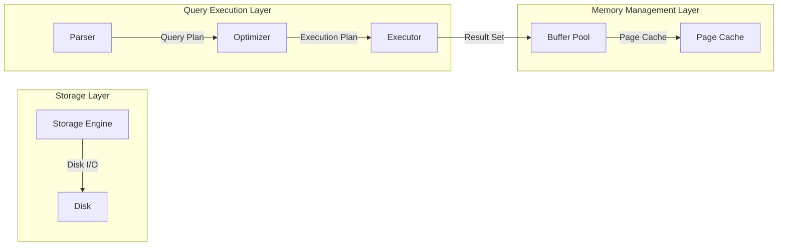

# Lesson 4: Performance Tuning

## 1. First-Principles Intuition & Invariants

As we delve into the realm of performance tuning, it's essential to establish a solid foundation rooted in first-principles intuition and invariants. The pursuit of optimization is often hindered by a lack of understanding of the underlying mechanics, leading to suboptimal solutions that may even introduce new performance bottlenecks.

At its core, performance tuning is an exercise in understanding the intricate dance between computational resources, memory access patterns, and algorithmic complexity. To grasp this, we must revisit the fundamental principles of computer science, including the trade-offs between time and space complexity, the implications of cache hierarchies, and the nuances of concurrent programming.

One of the most critical invariants in performance tuning is the concept of locality. As data is accessed and manipulated, it's essential to minimize the distance between adjacent memory accesses, thereby reducing the number of cache misses and minimizing the time spent waiting for data to be retrieved from slower memory tiers. This is particularly important in modern systems, where memory bandwidth has become a significant bottleneck.

Another invariant is the principle of temporal locality, which states that recently accessed data is more likely to be accessed again in the near future. This is why caching mechanisms, such as L1, L2, and L3 caches, are so crucial in modern processors. By storing frequently accessed data in these caches, we can significantly reduce the time spent accessing slower memory tiers.

## 2. Core Architecture & Mechanics

To better understand the performance characteristics of a system, it's essential to dissect its internal architecture and mechanics. Let's take a closer look at the internal workings of a modern relational database management system (RDBMS).

In this simplified architecture, we can see the key components involved in query execution:

1.  **Storage Layer**: This layer is responsible for storing and retrieving data from disk. The storage engine is the interface between the database and the underlying storage device.
2.  **Query Execution Layer**: This layer is responsible for parsing, optimizing, and executing queries. The parser breaks down the query into a parse tree, which is then optimized by the optimizer to produce an execution plan.
3.  **Memory Management Layer**: This layer is responsible for managing memory resources, including the buffer pool and page cache.

## 3. High-Performance Optimization & Failure Modes

Once we have a solid understanding of the system's architecture and mechanics, we can begin to apply high-performance optimization techniques. These techniques include:

*   **Concurrency**: By leveraging concurrency, we can execute multiple queries in parallel, reducing the overall execution time.
*   **Resource Scaling**: By scaling resources, such as CPU, memory, and I/O, we can ensure that the system can handle increased workloads.
*   **Boundary Edge Cases**: By identifying and optimizing for boundary edge cases, such as extreme query patterns or data distributions, we can ensure that the system performs optimally under all conditions.
*   **Failure Mitigations**: By implementing robust failure mitigations, such as retry mechanisms and circuit breakers, we can ensure that the system remains available even in the presence of failures.

However, high-performance optimization is not without its challenges. Common failure modes include:

*   **Deadlocks**: Deadlocks occur when two or more processes are blocked, waiting for each other to release resources.
*   **Starvation**: Starvation occurs when a process is unable to access a shared resource due to other processes holding onto it.
*   **Livelocks**: Livelocks occur when two or more processes are continuously contending for a shared resource, leading to a cycle of busy-waiting.

By understanding these failure modes and implementing robust failure mitigations, we can ensure that our high-performance optimized system remains reliable and available under all conditions.
