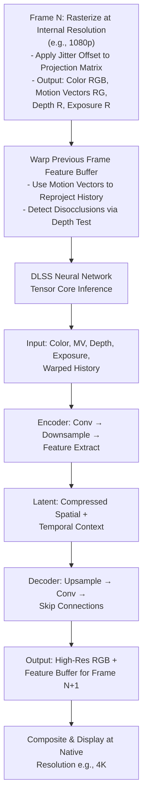

# Lesson 1: DLSS Fundamentals and Neural Upsampling Architecture

## 1. First-Principles Intuition & Invariants

Deep Learning Super Sampling represents a fundamental reconceptualization of the spatial resolution problem in real-time rendering. Traditional graphics pipelines have long faced an intractable tradeoff: achieving photorealistic image quality demands rendering at native display resolution or higher, yet the computational cost scales quadratically with linear resolution increases. Rendering at 4K (3840×2160) requires four times the fragment shader invocations of 1080p, and each additional ray in path tracing compounds this burden multiplicatively. For decades, the industry deployed temporal anti-aliasing, reconstruction filters, and checkerboard rendering as mitigation strategies, but these techniques fundamentally operate as band-limited interpolators constrained by the Nyquist-Shannon sampling theorem. They cannot synthesize high-frequency detail absent from their input signal.

DLSS breaks this constraint by reframing super-resolution as a learned inference problem rather than a deterministic signal processing task. At its core, DLSS employs a convolutional neural network trained on tens of thousands of ground-truth image pairs—low-resolution inputs rendered at reduced internal resolution paired with reference images rendered at native resolution with 64× supersampling anti-aliasing. The network learns a complex, nonlinear mapping that exploits spatial coherence, temporal stability, motion vectors, and sub-pixel jitter patterns to hallucinate plausible high-frequency details. This is not mere upscaling; the network infers geometric edge continuity, texture detail, and specular highlights that were never rasterized in the low-resolution input buffer. The mathematical operation transcends classical convolution kernels like Lanczos or bicubic filters because the learned weights encode statistical priors about natural images, material response functions, and aliasing artifacts characteristic of rasterization.

The architecture leverages tensor cores—specialized hardware execution units introduced in NVIDIA's Volta microarchitecture and refined in Turing, Ampere, and Ada Lovelace generations. Tensor cores perform fused multiply-accumulate operations on small matrix tiles, typically 4×4 or 16×16 elements, delivering an order of magnitude higher throughput than conventional CUDA cores for dense linear algebra. A single Tensor Core can execute 64 fused multiply-add operations per clock cycle on FP16 or INT8 operands, making them ideally suited for the repetitive convolution and matrix multiplication operations that dominate neural network inference. DLSS 2.x networks are optimized specifically for these hardware constraints, employing depthwise separable convolutions, residual connections, and activation functions that map cleanly to tensor core instruction sets.

The fundamental invariant governing DLSS performance is the ratio between internal render resolution and output display resolution, commonly termed the *scaling factor*. DLSS exposes four primary quality presets: Ultra Performance (3× upscale), Performance (2× upscale), Balanced (1.7× upscale), and Quality (1.5× upscale). These presets trade input fidelity for frame time budget. Ultra Performance mode renders at just 33% linear resolution per axis—meaning a 4K output is reconstructed from a 1280×720 internal buffer, reducing the pixel shading load to 11% of native 4K. Quality mode renders at 67% per axis, or 44% pixel count, providing substantially more input information to the network. The network must perform progressively more aggressive inference as the scaling factor increases, relying more heavily on temporal history buffers and motion vector guidance to compensate for missing spatial detail in the current frame.

Motion vectors form the temporal backbone of DLSS stability. Every fragment shader invocation that contributes to the final G-buffer outputs a 2D screen-space motion vector encoding the pixel's displacement between the current and previous frame. These vectors are typically stored in a dedicated render target as RG16_SNORM or RG16F textures, consuming 4 bytes per pixel. The DLSS network uses motion vectors to warp the previous frame's output, aligning historical high-resolution data with the current low-resolution input. This temporal reprojection allows the network to accumulate sub-pixel detail across multiple frames, effectively integrating information from a sliding temporal window. Without accurate motion vectors, the network must rely solely on spatial convolution, producing flickering edges and unstable specular highlights. Motion vector precision is thus critical: sub-pixel errors accumulate over time, and disocclusions—regions visible in the current frame but occluded in prior frames—require special handling via disocclusion masks derived from depth buffer analysis.

The jitter pattern applied to the camera projection matrix during low-resolution rendering introduces controlled spatial aliasing that the network exploits for super-resolution. Each frame, the engine applies a sub-pixel offset to the projection matrix, shifting the rendered image by fractions of a pixel in a deterministic sequence, typically an 8×8 Halton sequence or optimized low-discrepancy pattern. Over successive frames, these offsets cause edge pixels to sample different continuous coordinates, providing the network with sub-pixel information that would otherwise be lost to rasterization quantization. The network learns to decode this jitter pattern from the temporal sequence, reconstructing edges at higher effective sample density than any single frame contains. This technique transforms temporal samples into spatial resolution, leveraging display persistence and human visual integration to deliver perceptually sharper imagery than static single-frame upscaling could achieve.

## 2. Core Architecture & Mechanics

The DLSS 2.x network architecture implements a U-Net inspired encoder-decoder topology with skip connections, specifically optimized for real-time inference on tensor core hardware. The input stage ingests a tensor concatenating the current low-resolution color buffer (RGB), motion vectors (RG), depth buffer (R), and exposure metadata (R), forming a unified input representation typically 7-9 channels deep. Exposure normalization ensures the network remains robust across dynamic range variations, preventing overexposure or underexposure from biasing learned weights. The depth channel provides geometric context, allowing the network to distinguish edge discontinuities caused by object boundaries from texture detail, which informs edge sharpening and anti-aliasing decisions.

The encoder pathway consists of multiple convolutional blocks with stride-2 downsampling, progressively reducing spatial dimensions while expanding channel depth. Each block applies a depthwise separable convolution—factoring a standard 3×3 convolution into a depthwise 3×3 spatial filter followed by a 1×1 pointwise convolution. This factorization reduces parameter count and computational cost by an order of magnitude while preserving representational capacity, a critical optimization for real-time constraints. Activation functions between convolution layers employ leaky ReLU or PReLU variants, which prevent dying neurons during training and provide smooth gradients. The encoder compresses spatial resolution to extract hierarchical feature representations: early layers capture high-frequency texture and edge information, while deeper layers encode semantic context like object identity and scene composition.

The decoder pathway mirrors the encoder, employing transposed convolutions or bilinear upsampling followed by standard convolutions to progressively reconstruct spatial resolution. Skip connections bridge corresponding encoder and decoder layers, concatenating feature maps to preserve fine-grained spatial detail lost during downsampling. These connections are essential for reconstructing sharp edges and sub-pixel details; without them, the decoder would be forced to infer high-frequency information solely from the compressed latent representation, leading to blurred outputs. The final output layer produces an RGB tensor at the target display resolution, which is then tonemapped and written to the display buffer.

Temporal feedback introduces recurrence into the otherwise feedforward architecture. The network outputs not only the current frame's high-resolution image but also a feature buffer intended for reuse in the next frame. This feature buffer encodes persistent details like accumulated sub-pixel edge information and temporal anti-aliasing state. On the subsequent frame, this buffer is warped using the current motion vectors and concatenated with the new low-resolution input, effectively extending the network's receptive field across time. The warping operation applies bilinear or bicubic interpolation, adjusting for camera and object motion. Disocclusion detection compares warped depth values against the current depth buffer; regions with significant depth mismatch indicate newly visible surfaces that cannot rely on historical data. The network learns to weight temporal information adaptively, trusting history in stable regions while prioritizing current-frame data in disoccluded areas.

The network weights are quantized to FP16 or INT8 precision to maximize tensor core utilization and minimize memory bandwidth consumption. FP16 weights halve memory footprint compared to FP32, and modern tensor cores natively support mixed-precision arithmetic, accumulating intermediate results in FP32 to preserve numerical stability. Quantization introduces negligible perceptual quality loss because the network training process incorporates quantization-aware training, where forward passes simulate reduced precision to allow the optimizer to compensate during backpropagation. The final trained model undergoes inference optimization passes that fuse batch normalization into convolution weights, eliminate redundant operations, and tile tensor operations to fit within shared memory and register file constraints.

The DLSS SDK integrates into game engines via a thin API layer that abstracts GPU resource management and command buffer submission. The engine allocates persistent GPU resources including input and output textures, intermediate feature buffers, and constant buffers for per-frame metadata like jitter offsets and sharpening parameters. Each frame, the engine records a compute dispatch that binds these resources and invokes the DLSS inference pass. The DLSS runtime manages pipeline state, descriptor sets, and synchronization primitives, issuing compute shader dispatches that map convolution layers onto tensor core workgroups. A typical DLSS 2.x inference pass executes in 1.5–3.5 milliseconds on a mid-range RTX GPU at 4K output, consuming roughly 20–30% of the frame time budget at 60 FPS.

Sharpening is applied as a post-process to counteract the slight softness inherent in neural reconstruction. The DLSS API exposes a sharpening intensity parameter ranging from -1.0 (maximum softness) to 1.0 (maximum sharpness), with 0.0 representing the network's raw output. The sharpening filter typically employs a contrast-adaptive sharpening kernel that amplifies high-frequency edge gradients while avoiding halo artifacts and noise amplification. This filter operates in the spatial domain via a 3×3 or 5×5 kernel, detecting local contrast and adjusting luminance accordingly. Excessive sharpening introduces ringing artifacts around edges and oversharpens noise, so the default setting balances perceptual crispness against artifact visibility.

## 3. High-Performance Optimization & Failure Modes

Optimizing DLSS integration demands careful orchestration of GPU resource allocation, render pass ordering, and motion vector fidelity. The most critical performance lever is ensuring motion vectors cover all dynamic geometry, including skinned meshes, particle systems, and procedurally animated objects. Many engines initially implemented motion vectors only for opaque static and dynamic meshes, omitting particles, UI elements, and alpha-blended surfaces. When these objects move without corresponding motion vectors, DLSS cannot correctly reproject temporal history, resulting in ghosting—faint trails of previous frame positions lingering in the output. Comprehensive motion vector coverage requires modifying vertex and pixel shaders across all rendering passes to output per-pixel velocity, increasing shader complexity and register pressure. Engines typically introduce a dedicated motion vector pre-pass that rasterizes all geometry to generate a full-resolution motion vector buffer before the main color pass, ensuring complete coverage at the cost of an additional geometry submission.

Disocclusion handling represents a second-order performance challenge. When an object moves to reveal a previously occluded background region, the warped temporal history contains invalid data from the occluding object. Naive temporal reprojection smears this stale data across the newly visible region, creating objectionable ghosting. The DLSS network incorporates learned disocclusion detection by comparing warped depth against current depth, flagging mismatches exceeding a threshold. However, thin geometric features like foliage, wires, or distant geometry produce depth discontinuities that trigger false positives, causing the network to discard valid temporal history and introducing flicker. Engine-side improvements include providing a dedicated disocclusion mask render target where artists can mark known problematic regions or using stencil-based techniques to identify depth discontinuities at sub-pixel precision. Advanced implementations employ object-space motion vectors that encode 3D velocity rather than screen-space displacement, allowing the network to better reason about occlusion relationships in 3D rather than inferring them from 2D depth buffers.

Jitter pattern coherence across frames critically impacts temporal stability. The projection matrix jitter must follow a deterministic low-discrepancy sequence to ensure even spatial sampling over the temporal window. Random or poorly chosen jitter patterns introduce irregular aliasing that the network cannot reliably decode, degrading output quality. The Halton(2,3) sequence is commonly used because it distributes samples uniformly in 2D space over a modest number of frames, typically 8 to 16. Some engines implement custom blue-noise jitter patterns optimized for specific camera movement profiles or rendering techniques. The jitter offset must be applied in clip space immediately before the perspective divide, typically by adjusting the projection matrix's translation components. Incorrect jitter application—such as applying offsets in screen space after rasterization—fails to shift sub-pixel sampling positions, negating DLSS's temporal super-resolution mechanism.

Memory bandwidth saturation poses a fundamental bottleneck for DLSS inference. Each frame, the GPU must load the current low-resolution buffers, the previous high-resolution output and feature buffer, and motion vectors, then write the new high-resolution output and feature buffer. At 4K output with FP16 precision, the raw output buffer alone consumes 32 MB per frame. The network's intermediate tensors, typically residing in L2 cache and shared memory, add another 50–100 MB of transient working set. On bandwidth-constrained architectures, DLSS inference can become memory-bound rather than compute-bound, particularly when rendering at high frame rates where cache reuse is minimal. Optimizations include tiling the output image into smaller spatial regions processed sequentially to improve cache locality, compressing feature buffers with block-compression formats, and overlapping DLSS inference with other GPU work like shadow map rendering or post-processing to hide memory latency.

Failure modes manifest most visibly in scenes with extreme motion, particle-heavy effects, or transparent surfaces. Fast camera rotations exceed the motion vector representable range, causing the network to lose temporal coherence and fall back to spatial-only reconstruction, which produces a momentarily softer image until temporal history re-converges. Particle systems that spawn or die abruptly introduce temporal discontinuities that motion vectors cannot describe, leading to flickering particles. Alpha-blended surfaces like smoke, glass, or volumetric fog lack well-defined motion vectors because they represent integrated contributions from multiple depth layers, not a single surface. These materials often exhibit ghosting or instability under DLSS, requiring engine-specific heuristics like excluding alpha-blended pixels from temporal reprojection or rendering them at native resolution outside the DLSS pipeline.

Lens effects and post-processing interactions demand careful ordering. DLSS should occur before tonemapping, chromatic aberration, film grain, and vignette effects because these introduce irreversible nonlinear transformations that the network was not trained to invert. Applying DLSS after tonemapping forces the network to operate in a perceptually nonlinear color space, degrading reconstruction accuracy. Similarly, depth-of-field blur and motion blur should ideally be computed at the upscaled resolution after DLSS to preserve full detail in focused regions, though this increases post-processing cost. Some engines apply a lightweight depth-of-field pre-blur before DLSS to reduce the effective resolution of out-of-focus regions, trading slight quality loss for improved performance, since blurred regions contain less high-frequency detail the network must reconstruct.

Quality mode selection hinges on GPU headroom and target frame rate. Ultra Performance mode delivers maximum frame rate gains but requires the network to infer 9× the pixel count, often producing visible reconstruction artifacts in challenging scenes. Performance mode strikes the best balance for most titles, providing 4× pixel count reduction while maintaining competitive image quality. Quality mode approaches native rendering fidelity, sometimes exceeding it by effectively applying high-quality temporal anti-aliasing, but yields smaller performance benefits. Dynamic resolution scaling can adjust DLSS quality mode per frame based on GPU load, prioritizing frame time consistency over fixed quality levels. When GPU utilization exceeds a threshold—say 95% over the previous frame—the engine can drop from Quality to Balanced mode, reducing internal resolution and accelerating both rasterization and DLSS inference. Conversely, if utilization falls below 70%, the engine can upgrade to Quality mode, investing surplus GPU time in higher fidelity output.

The training dataset bias inevitably influences DLSS's reconstruction behavior. The network was trained predominantly on photorealistic game content featuring natural materials, human characters, and architectural geometry. Stylized art styles with hand-painted textures, cel-shading, or posterized colors may not conform to the learned priors, causing the network to over-smooth stylized details or incorrectly infer geometric edges. Games with non-photorealistic rendering often benefit from custom DLSS training runs where NVIDIA retrains the network on content specific to that title's art style, adjusting loss functions and augmentation strategies to preserve stylistic intent. This bespoke training requires submitting hundreds of training image pairs to NVIDIA months before release, representing a significant development investment.

Ultimately, DLSS achieves its performance gains by exploiting the vast overprovisioning of tensor core computational throughput relative to traditional rasterization and shading pipelines. While a high-end GPU might render a complex scene at 30 FPS at native 4K due to memory bandwidth and fragment shader bottlenecks, the same GPU can perform DLSS inference in under 3 milliseconds because tensor cores remain largely idle during conventional rendering. By shifting the resolution burden from the bandwidth-constrained rasterization pipeline to the compute-optimized tensor cores, DLSS enables frame rates that would otherwise require halving resolution or disabling expensive lighting effects. This architectural asymmetry—abundant tensor core compute but scarce memory bandwidth—defines the performance envelope within which DLSS operates, and future GPU generations will likely deepen this divide, making learned inference increasingly central to real-time graphics.
