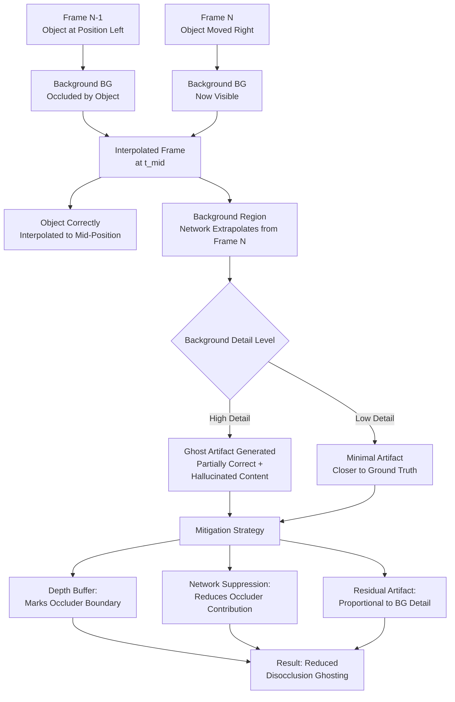

# Lesson 4: Advanced Techniques, DLSS 3 Frame Generation, and Quality Validation

## 1. First-Principles Intuition & Invariants

The rendering pipeline of a modern game engine is a discrete sampling system. The scene — a continuous signal evolving through time at whatever rate the laws of physics, animation curves, and player input dictate — is sampled at the frame rate the GPU can sustain. When that rate drops below the display's refresh rate, the temporal sampling theorem reasserts itself with the same inevitability that Nyquist and Shannon described for bandlimited signals in 1928 and 1949. Motion frequencies in the scene exceeding half the sampling rate fold back as aliases: wheels rotate backwards, textures shimmer, edges crawl. The conventional remedy is brute force — render more frames per second — but that demands proportional increases in shading, rasterization, and ray traversal workload, a cost curve that GPU architects have been fighting for two decades.

DLSS 3 Frame Generation reframes this problem not as one of faster rendering but of intelligent prediction. The system accepts that the GPU can only afford to fully render, say, 40 frames per second, but the display refreshes at 120 Hz. Between each pair of rendered frames there exists a gap of 16.67 milliseconds where the display needs a frame but no frame was rendered. The question is whether that missing frame can be synthesized from the two rendered frames that bracket it, supplemented by auxiliary data the engine already produces. The answer, as NVIDIA's Ada Lovelace architecture demonstrates, is a qualified yes — qualified because the synthesized frame is a prediction, not a measurement, and the fidelity of that prediction is bounded by the information available in the inputs and the priors encoded in the neural network's trained weights.

The fundamental invariant is this: an interpolated frame cannot contain information that was absent from both bracketing frames and the auxiliary buffers. If a fast-moving object occludes a region of background in frame N-1 and frame N, the interpolated frame between them cannot reveal what was hidden. The network can apply a learned prior — "this region probably looked like the adjacent background" — but that is hallucination, not reconstruction. This distinction separates the honest capabilities of frame generation from the marketing claims. Frame generation increases display fluidity and reduces motion judder; it does not increase the information content of the rendered stream. Understanding this boundary is what separates a practitioner who can diagnose artifacts from one who treats the system as a black box.

Traditional frame interpolation techniques — optical flow compensation, phase-based interpolation, block matching — have existed in video encoding and display processing for years. They fail in real-time rendering for specific, mechanistic reasons. Pure optical flow computed from two consecutive color buffers cannot distinguish a reflective surface from the geometry behind it, because both produce identical pixel-level motion signatures. It cannot handle disocclusion: when an object moves to reveal previously hidden background, the flow field at the disocclusion boundary is undefined, because the background pixels in the previous frame have no correspondence in the current frame. Engine-provided motion vectors solve the geometry problem precisely — they know exactly where each triangle moved — but they miss everything the engine's own post-processing touches: screen-space reflections that shift independently of geometry, particle systems animated on the GPU, volumetric fog that scrolls with camera motion but has no per-pixel velocity written to a buffer, transparent surfaces like glass and water that composite without contributing to the motion vector texture.

DLSS 3's central insight is that neither signal is sufficient alone, but their fusion, mediated by a neural network trained on millions of frame pairs with ground-truth intermediates, resolves the ambiguities that defeat either approach in isolation. The engine motion vectors provide a geometric skeleton: for every pixel backed by real scene geometry, the vector is exact, computed from the projection of world-space displacement through the view matrix. The optical flow accelerator provides an appearance-driven complement: it detects where pixels actually moved in image space, regardless of whether that motion came from geometry, reflections, particles, or post-processing. The network learns to trust engine vectors where geometry dominates, optical flow where post-processing and transparent surfaces dominate, and to fuse both in regions where they partially agree. Depth and G-buffer data provide the network with geometric context to identify occlusion boundaries before they become ghosting artifacts, and exposure metadata ensures the interpolation operates in linear luminance space where motion blending is physically meaningful.

The architectural extension beyond upsampling represented by DLSS 3 is conceptually significant. DLSS Super Resolution — the temporal upscaler introduced in DLSS 2 — reconstructs spatial detail within a single frame by accumulating information across multiple temporally offset samples. Frame Generation reconstructs temporal detail by predicting an entire frame that never existed. The two operate at different levels of the rendering hierarchy: one fills in missing pixels within a frame, the other fills in missing frames within a sequence. DLSS 3 composes both, applying super resolution to the rendered frames and frame generation between them, so the display receives a stream of high-resolution frames at double the rendering rate. This composition introduces a dependency: frame generation operates on the output of super resolution, not the raw render, because the generated frame must match the visual quality of the bracketing frames or the interpolation seam becomes visible as a quality flicker.

DLSS 3.5's Ray Reconstruction extends the architectural philosophy further still. Ray-traced rendering produces noisy radiance samples — a handful of rays per pixel per frame, far too few for a converged image. Traditional denoisers (SVGF, ReBLUR, A-SVGF) filter these samples spatially and temporally using hand-tuned heuristics: edge-stopping functions based on depth and normal discontinuities, temporal accumulation with velocity-based reprojection, variance estimation from moment-based filtering. Ray Reconstruction replaces this entire heuristic pipeline with a neural network that takes the noisy radiance buffer, the denoiser's auxiliary inputs (normals, depth, roughness, albedo, motion vectors), and produces a clean, temporally stable image. The network learns the noise distribution of the ray-tracing integrator and the spatial structure of valid illumination, effectively serving as a learned denoiser that adapts to the scene content rather than applying fixed filter kernels. This is a distinct architectural extension: not upsampling, not frame generation, but learned signal reconstruction in the radiance domain, and it composes with both DLSS-SR and DLSS-FG in the full DLSS 3.5 pipeline.

The theoretical limits of learned reconstruction deserve precise articulation. Consider the interpolated frame $F_{interp}$ at time $t_{mid}$ between rendered frames $F_{N-1}$ at $t_{N-1}$ and $F_N$ at $t_N$. The optimal estimator, in the minimum mean squared error sense, is the conditional expectation $E[F_{true}(t_{mid}) \mid F_{N-1}, F_N, V_{engine}, V_{optical}, D, G]$, where $V_{engine}$ and $V_{optical}$ are the motion vector fields, $D$ is depth, and $G$ represents G-buffer data. The network approximates this expectation, but the expectation itself may have high variance — if the true frame at $t_{mid}$ is highly uncertain given the inputs, no estimator can recover it. The mutual information $I(F_{interp}; F_{true})$ is bounded by $I(F_{N-1}, F_N, ...; F_{true})$, which is in turn bounded by the entropy of the motion and appearance that occurred between $t_{N-1}$ and $t_N$ but was not captured in any input. A bird flying through the frame in the 8 milliseconds between rendered frames, visible in neither, is information-theoretically unrecoverable. The network's learned priors will fill the space with plausible content — sky, foliage, wall texture — but it will be a guess. Practitioners who internalize this limit can predict where artifacts will appear: fast-moving thin geometry, high-frequency detail in motion, and disocclusion boundaries where the revealed content has no temporal precedent in the input frames.

## 2. Core Architecture & Mechanics

The Optical Flow Accelerator is the hardware foundation that makes DLSS 3 Frame Generation viable on Ada Lovelace. Prior NVIDIA architectures — Ampere, Turing — included optical flow hardware within the NVENC video engine, designed for motion estimation in video encoding at encoding-quality precision. Ada Lovelace's OFA is a distinct fixed-function block, approximately 2-3 times more capable than the Ampere optical flow engine, purpose-built for the precision and latency requirements of real-time frame generation. It computes a dense per-pixel optical flow field between two input color frames using a multi-scale block-matching approach refined through subsequent passes: coarse motion estimates at downsampled levels establish large displacement hypotheses, finer levels refine these to pixel and sub-pixel precision. The output is a two-channel flow field $(u, v)$ representing horizontal and vertical pixel displacement, stored in GPU-accessible memory for consumption by the frame generation network.

The critical architectural property of the OFA is that it executes concurrently with the shader pipeline. While CUDA cores and Tensor Cores execute the DLSS-SR upscaling pass, the OFA independently computes optical flow between the previous and current rendered frames. This concurrency is what allows frame generation to fit within the frame budget: if optical flow had to run on shader cores, it would compete with DLSS-SR and scene rendering for the same execution resources, consuming 1-2 milliseconds of shader time that the pipeline cannot spare. The OFA's fixed-function design trades programmability for throughput — it implements one algorithm well, with no shader dispatch overhead, no register file pressure, and no warp scheduling contention. The frame generation neural network itself runs on Tensor Cores, which are also concurrent-capable with the raster pipeline, so the three stages — rasterization, optical flow, neural inference — pipeline across distinct hardware blocks.

The frame generation data flow assembles five primary inputs. The current rendered frame $F_N$ and the previously rendered frame $F_{N-1}$ provide the visual content between which interpolation occurs. The optical flow field $V_{OF}$ from the OFA provides image-space motion independent of scene geometry. The engine motion vectors $V_{eng}$ provide per-pixel geometric displacement from the game's own transform and projection pipeline. The depth buffer $D$ provides geometric occlusion information. These inputs feed a convolutional neural network — the frame generation model — which produces a single output: the interpolated frame $F_{interp}$ at time $t_{mid} = (t_{N-1} + t_N) / 2$.

```text
┌─────────────────────────────────────────────────────────────────────┐
│                     DLSS 3 FRAME GENERATION PIPELINE                 │
├─────────────────────────────────────────────────────────────────────┤
│                                                                     │
│  ┌──────────┐   ┌──────────┐                                        │
│  │ Frame N-1│   │ Frame N  │                                        │
│  │ (rendered)│   │ (rendered)│                                       │
│  └────┬─────┘   └────┬─────┘                                        │
│       │              │                                               │
│       └──────┬───────┘                                               │
│              │                                                        │
│              ▼                                                        │
│      ┌───────────────┐                                               │
│      │  Optical Flow  │  ← Concurrent with shader pipeline           │
│      │  Accelerator   │     (fixed-function, Ada Lovelace)            │
│      │     (OFA)      │                                               │
│      └───────┬───────┘                                               │
│              │                                                        │
│              ▼  (u,v) flow field                                     │
│  ┌──────────────────────────────────────────┐                        │
│  │         FRAME GENERATION NETWORK          │                       │
│  │                                            │                       │
│  │  Inputs:                                   │                       │
│  │   • F_N-1, F_N (color frames)              │                       │
│  │   • V_OF (optical flow from OFA)           │  ← Tensor Cores      │
│  │   • V_eng (engine motion vectors)          │                       │
│  │   • D (depth buffer)                       │                       │
│  │   • G (G-buffer: normals, roughness)       │                       │
│  │   • exposure (linear luminance scaling)    │                       │
│  │                                            │                       │
│  │  Output:                                   │                       │
│  │   • F_interp (interpolated frame)          │                       │
│  └──────────────────┬───────────────────────┘                        │
│                     │                                                 │
│                     ▼                                                 │
│              ┌──────────────┐                                       │
│              │  F_interp at  │                                       │
│              │   t_mid       │                                       │
│              └──────────────┘                                       │
│                                                                     │
│  Display Order: F_N-1 → F_interp → F_N → F_(N+1)_interp → F_N+1     │
│                                                                     │
└─────────────────────────────────────────────────────────────────────┘
```

The network architecture itself follows a U-Net-inspired encoder-decoder structure with skip connections, adapted for the multi-input fusion problem. The encoder downsamples the concatenated input tensors — two color frames, two motion vector fields, depth, and G-buffer channels — through a series of strided convolutions with increasing channel depth, extracting hierarchical features from coarse motion structure to fine texture detail. The bottleneck layer captures the global motion context: where the camera moved, which objects are in motion, what regions are occluded or disoccluded. The decoder upsamples through transposed convolutions with skip connections from corresponding encoder layers, progressively reconstructing the interpolated frame at full resolution. The final output layer produces RGB values in linear luminance space, which the display pipeline converts to the target color space (typically sRGB or Rec.709). The network is trained on a dataset of frame triplets: for each training sample, frames at $t_0$, $t_{mid}$, and $t_1$ are rendered at high quality, and the network learns to predict $t_{mid}$ from $t_0$ and $t_1$ with the associated motion and geometry inputs. Training uses a combined loss: L1 pixel loss for structural fidelity, a perceptual loss (VGG-based feature distance) for texture quality, and a temporal consistency loss that penalizes flicker between consecutive generated frames. The trained model is quantized to INT8 for Tensor Core inference, achieving inference times of approximately 1-2 milliseconds on RTX 4090 at 4K resolution.

The HUD-less rendering requirement is a structural constraint of the frame generation pipeline, not a cosmetic preference. The HUD — crosshairs, minimaps, health bars, score displays — is rendered in screen space and has no motion vector representation: it does not move with the 3D scene, does not exist in the depth buffer, and its optical flow signature is either zero (if static) or erratic (if animated by UI logic). If the frame generation network processes frames containing HUD elements, it attempts to interpolate the HUD as if it were scene content, producing smearing, ghosting, and warping artifacts around every HUD element. The solution requires the engine to render the scene without HUD to a separate render target — the "HUD-less color buffer" — which feeds the frame generation pipeline. After frame generation produces the interpolated frame, the engine composites the HUD on top of both the rendered frames and the generated frame at display time. This architecture means the HUD renders at display refresh rate (always sharp, never interpolated), while the scene benefits from frame generation's fluidity. The implementation cost is a second render pass for the HUD or a render target split: render scene to one target, HUD to another, composite after frame generation. Modern engines using deferred rendering typically already separate their UI pass, making this a natural fit, but forward-rendered engines with HUD baked into the final composited frame require a pipeline restructure.

NVIDIA Reflex addresses the latency overhead that frame generation introduces. Without frame generation, the render-to-display latency is one frame period: render frame N, display frame N. With frame generation, the pipeline must render frame N before it can generate the interpolated frame between N-1 and N, because the interpolation requires both bracketing frames as input. This means the displayed interpolated frame is always one rendered-frame behind the latest rendered state, adding one rendered-frame period of latency. At 40 FPS rendering with 120 Hz display, that is 25 milliseconds of additional latency — enough to be perceptible in competitive play. Reflex compensates by optimizing the CPU-to-GPU submission pipeline. The standard render pipeline allows the CPU to queue multiple frames ahead of the GPU, creating a submission queue latency of 2-3 frames in addition to the render latency. Reflex replaces this with a just-in-time model: the CPU waits for a signal from the GPU before beginning to prepare the next frame's command buffer, ensuring the GPU begins work on each frame immediately after the previous one completes. This eliminates queue latency, which for many games exceeds the one-frame latency added by frame generation, resulting in a net latency that is comparable to or lower than the non-frame-generation baseline. The Reflex SDK provides markers that the engine places at the beginning and end of frame simulation, rendering, and presentation, allowing the system to measure and report the actual end-to-end latency for tuning.

The Streamline SDK integration follows a hook-based model designed to minimize engine modification. The engine initializes Streamline at startup with `slInit`, registers the features it needs — DLSS-SR, DLSS-FG, Reflex — and provides hooks at key points in the frame loop. The frame generation integration requires three hooks: a pre-render hook where Reflex inserts its latency-optimized wait, a post-render hook where the engine's HUD-less color buffer is made available, and a present hook where Streamline's frame generation pipeline executes and inserts the interpolated frame into the swap chain. The following complete integration shows the render loop structure:

```cpp
// dlss3_renderer.h
#pragma once
#include <d3d12.h>
#include <dxgi1_6.h>
#include <wrl/client.h>
#include "sl.h"
#include "sl_dlss.h"
#include "sl_reflex.h"
#include "sl_consts.h"

using Microsoft::WRL::ComPtr;

class DLSS3Renderer {
public:
    bool Initialize(IDXGISwapChain* swapChain, ID3D12Device* device,
                    ID3D12CommandQueue* gfxQueue, uint32_t renderWidth,
                    uint32_t renderHeight, uint32_t displayWidth,
                    uint32_t displayHeight);
    void Shutdown();

    // Called once per frame. The engine renders the HUD-less scene into
    // sceneColor, motion vectors into motionVectors, depth into depthBuffer.
    // This function handles DLSS-SR upscaling, frame generation via Streamline,
    // Reflex latency optimization, and presents to the swap chain.
    void RenderFrame(ID3D12GraphicsCommandList* cmdList,
                     ID3D12Resource* sceneColorHDR,
                     ID3D12Resource* motionVectors,
                     IDD3D12Resource* depthBuffer,
                     ID3D12Resource* exposureTexture,
                     ID3D12Resource* hudlessColorOut,
                     ID3D12Resource* finalOutput,
                     float cameraJitterX, float cameraJitterY,
                     float frameTimeDeltaSeconds);

    void SetDLSSQuality(sl::DLSSPreset preset, sl::DLSSProfile profile);
    void SetReflexMode(sl::ReflexMode mode);
    float GetLastMeasuredLatencyMs() const { return lastLatencyMs_; }

private:
    bool InitStreamline(IDXGISwapChain* swapChain, ID3D12Device* device,
                        ID3D12CommandQueue* gfxQueue);
    bool InitDLSS(uint32_t renderW, uint32_t renderH,
                  uint32_t displayW, uint32_t displayH);
    bool InitReflex();
    void EvaluateDLSS(ID3D12GraphicsCommandList* cmdList,
                      ID3D12Resource* sceneColor, ID3D12Resource* motionVectors,
                      ID3D12Resource* depth, ID3D12Resource* exposure,
                      ID3D12Resource* outputColor,
                      float jitterX, float jitterY, float deltaTime);
    void EvaluateReflex(uint64_t* frameId);
    void GetOptimalDLSSSettings(uint32_t renderW, uint32_t renderH,
                                uint32_t displayW, uint32_t displayH,
                                sl::DLSSPreset preset);

    ComPtr<IDXGISwapChain>      swapChain_;
    ComPtr<ID3D12Device>        device_;
    ComPtr<ID3D12CommandQueue>  gfxQueue_;
    uint32_t                    renderWidth_   = 0;
    uint32_t                    renderHeight_  = 0;
    uint32_t                    displayWidth_  = 0;
    uint32_t                    displayHeight_ = 0;

    sl::DLSSPreset               dlssPreset_    = sl::DLSSPreset::e_Default;
    sl::DLSSProfile              dlssProfile_   = sl::DLSSProfile::e_Balanced;
    sl::ReflexMode               reflexMode_    = sl::ReflexMode::e_LowLatency;
    float                        lastLatencyMs_ = 0.0f;
    uint64_t                     currentFrameId_ = 0;
    bool                        streamlineInitialized_ = false;
    bool                        dlssInitialized_ = false;
    bool                        reflexInitialized_ = false;
};
```

```cpp
// dlss3_renderer.cpp
#include "dlss3_renderer.h"
#include <cassert>
#include <cstring>

bool DLSS3Renderer::Initialize(IDXGISwapChain* swapChain, ID3D12Device* device,
                                ID3D12CommandQueue* gfxQueue,
                                uint32_t renderWidth, uint32_t renderHeight,
                                uint32_t displayWidth, uint32_t displayHeight) {
    swapChain_     = swapChain;
    device_        = device;
    gfxQueue_      = gfxQueue;
    renderWidth_   = renderWidth;
    renderHeight_  = renderHeight;
    displayWidth_  = displayWidth;
    displayHeight_ = displayHeight;

    if (!InitStreamline(swapChain, device, gfxQueue)) return false;
    if (!InitDLSS(renderWidth, renderHeight, displayWidth, displayHeight)) return false;
    if (!InitReflex()) return false;
    return true;
}

bool DLSS3Renderer::InitStreamline(IDXGISwapChain* swapChain,
                                    ID3D12Device* device,
                                    ID3D12CommandQueue* gfxQueue) {
    sl::Preferences prefs{};
    prefs.showAPIError = false;
    prefs.showAPIWarnings = true;
    prefs.showInfo = false;
    prefs LogLevel = sl::LogLevel::e_Default;

    // Request D3D12 feature set
    prefs.api = sl::API::e_D3D12;

    sl::Result result = slInit(prefs, nullptr, nullptr);
    if (result != sl::Result::eOk) {
        // Streamline not found on system; fall back to non-DLSS path
        return false;
    }

    // Check if DLSS and Reflex features are available
    sl::Feature features[] = { sl::kFeatureDLSS, sl::kFeatureReflex };
    for (auto feature : features) {
        if (!slIsFeatureSupported(feature, gfxQueue.Get(), nullptr)) {
            return false;
        }
    }
    streamlineInitialized_ = true;
    return true;
}

bool DLSS3Renderer::InitDLSS(uint32_t renderW, uint32_t renderH,
                              uint32_t displayW, uint32_t displayH) {
    if (!streamlineInitialized_) return false;

    // Query optimal DLSS settings for the current resolution pair
    GetOptimalDLSSSettings(renderW, renderH, displayW, displayH,
                            dlssPreset_);

    sl::DLSSOptions opts{};
    opts.profile = dlssProfile_;
    opts.mode = sl::DLSSMode::e_DLSS;
    opts.outputScaling = 1.0f;
    opts.colorBufferSpace = sl::DLSSColorSpace::e_None;

    // Set the options through Streamline
    sl::Result result = slDLSSSetOptions(gfxQueue_.Get(), opts);
    if (result != sl::Result::eOk) return false;

    dlssInitialized_ = true;
    return true;
}

bool DLSS3Renderer::InitReflex() {
    if (!streamlineInitialized_) return false;

    sl::ReflexOptions opts{};
    opts.mode = reflexMode_;
    opts.frameLimitUs = 0;
    opts.useFrameLimit = false;
    opts.vramMultiplier = 0;

    sl::Result result = slReflexSetOptions(gfxQueue_.Get(), opts);
    if (result != sl::Result::eOk) return false;

    reflexInitialized_ = true;
    return true;
}

void DLSS3Renderer::GetOptimalDLSSSettings(uint32_t renderW, uint32_t renderH,
                                             uint32_t displayW, uint32_t displayH,
                                             sl::DLSSPreset preset) {
    sl::DLSSOptimalSettings opt{};
    opt.outputResolution = { (sl::ResourceLocation)displayW, (sl::ResourceLocation)displayH };
    opt.displayMode = sl::DLSSDisplayMode::e_None;
    opt.preset = preset;

    slDLSSGetOptimalSettings(&opt);

    // The optimal render resolution is now in opt.renderResolution.
    // The engine should use this to set its internal render target size.
    // For DLSS Quality at 4K output, this typically yields ~1440p input.
}

void DLSS3Renderer::RenderFrame(ID3D12GraphicsCommandList* cmdList,
                                 ID3D12Resource* sceneColorHDR,
                                 ID3D12Resource* motionVectors,
                                 ID3D12Resource* depthBuffer,
                                 ID3D12Resource* exposureTexture,
                                 ID3D12Resource* hudlessColorOut,
                                 ID3D12Resource* finalOutput,
                                 float cameraJitterX, float cameraJitterY,
                                 float frameTimeDeltaSeconds) {
    // ── Phase 1: Reflex latency optimization ──
    // The Reflex marker tells the system we are about to begin frame
    // simulation and rendering. The system inserts a sleep to ensure
    // the CPU does not queue ahead of the GPU.
    uint64_t frameId = 0;
    EvaluateReflex(&frameId);

    // ── Phase 2: Engine renders the scene (caller's responsibility) ──
    // At this point the engine has already rendered into sceneColorHDR,
    // motionVectors, and depthBuffer. These resources are passed to
    // the DLSS evaluation below.

    // ── Phase 3: DLSS Super Resolution evaluation ──
    // Upscale the low-resolution sceneColorHDR to display resolution.
    // The output goes into hudlessColorOut — the HUD-less high-res frame
    // that frame generation will interpolate.
    EvaluateDLSS(cmdList, sceneColorHDR, motionVectors, depthBuffer,
                 exposureTexture, hudlessColorOut,
                 cameraJitterX, cameraJitterY, frameTimeDeltaSeconds);

    // ── Phase 4: Frame Generation via Streamline present hook ──
    // Streamline's present hook, registered during slInit, intercepts
    // the Present() call on the swap chain. It executes the frame
    // generation network on the Tensor Cores, producing an interpolated
    // frame between this frame and the previous one. The interpolated
    // frame is inserted into the swap chain before the current frame.
    //
    // The HUD must NOT be in hudlessColorOut at this stage. The engine
    // composites the HUD AFTER Streamline's frame generation completes,
    // either through a post-present overlay or a final composite pass
    // that runs after the present hook returns.

    // ── Phase 5: Reflex frame completion marker ──
    slReflexUpdateFrameId(frameId, gfxQueue_.Get());
    slReflexGetLatency(&frameId, nullptr, &lastLatencyMs_, gfxQueue_.Get());
}

void DLSS3Renderer::EvaluateDLSS(ID3D12GraphicsCommandList* cmdList,
                                   ID3D12Resource* sceneColor,
                                   ID3D12Resource* motionVectors,
                                   ID3D12Resource* depth,
                                   ID3D12Resource* exposure,
                                   ID3D12Resource* outputColor,
                                   float jitterX, float jitterY,
                                   float deltaTime) {
    if (!dlssInitialized_) return;

    sl::DLSSParameters dlssParams{};
    dlssParams.inColor = { sceneColor, 0, 0, 0 };
    dlssParams.outColor = { outputColor, 0, 0, 0 };
    dlssParams.inMotionVectors = { motionVectors, 0, 0, 0 };
    dlssParams.inDepth = { depth, 0, 0, 0 };
    dlssParams.inExposureScale = { exposure, 0, 0, 0 };

    dlssParams.jitterOffset = { jitterX, jitterY };
    dlssParams.motionVectorScale = {
        1.0f / (float)renderWidth_,
        1.0f / (float)renderHeight_
    };
    dlssParams.deltaTime = deltaTime;
    dlssParams.resetHistory = false;  // Set true on camera cuts

    // Evaluate DLSS through Streamline. This dispatches the Tensor Core
    // inference on the command list and returns asynchronously.
    sl::Result result = slEvaluateFeature(sl::kFeatureDLSS, gfxQueue_.Get(),
                                          &dlssParams, sizeof(dlssParams));
    assert(result == sl::Result::eOk);
}

void DLSS3Renderer::EvaluateReflex(uint64_t* frameId) {
    if (!reflexInitialized_) return;

    // Get the next frame ID for latency tracking
    slReflexGetFrameId(frameId, gfxQueue_.Get());

    // Mark the start of frame work — Reflex uses this to determine
    // when the CPU should begin the next frame's preparation
    slReflexFrameStart(*frameId, gfxQueue_.Get());
}

void DLSS3Renderer::SetDLSSQuality(sl::DLSSPreset preset,
                                    sl::DLSSProfile profile) {
    dlssPreset_ = preset;
    dlssProfile_ = profile;

    if (dlssInitialized_) {
        sl::DLSSOptions opts{};
        opts.profile = dlssProfile_;
        opts.mode = sl::DLSSMode::e_DLSS;
        opts.outputScaling = 1.0f;
        opts.colorBufferSpace = sl::DLSSColorSpace::e_None;
        slDLSSSetOptions(gfxQueue_.Get(), opts);
    }
}

void DLSS3Renderer::SetReflexMode(sl::ReflexMode mode) {
    reflexMode_ = mode;
    if (reflexInitialized_) {
        sl::ReflexOptions opts{};
        opts.mode = reflexMode_;
        opts.frameLimitUs = 0;
        opts.useFrameLimit = false;
        opts.vramMultiplier = 0;
        slReflexSetOptions(gfxQueue_.Get(), opts);
    }
}

void DLSS3Renderer::Shutdown() {
    if (streamlineInitialized_) {
        slShutdown();
        streamlineInitialized_ = false;
        dlssInitialized_ = false;
        reflexInitialized_ = false;
    }
}
```

The engine's frame loop, when integrated with this renderer, follows a specific ordering that the frame generation pipeline requires. The engine renders frame N at the internal (low) resolution with camera jitter applied, writes motion vectors and depth to their respective targets, then calls `RenderFrame`. Inside that call, DLSS-SR upscales the low-resolution frame to display resolution. Streamline's present hook then executes frame generation between the upscaled frame N and the upscaled frame N-1, producing the interpolated frame at display resolution. The swap chain receives: interpolated frame from N-1/N, then frame N. On the next iteration, the engine renders frame N+1, DLSS-SR upscales it, and frame generation produces the interpolated frame between N and N+1. The display sequence is $F_{N-1}$, $F_{interp}(N-1, N)$, $F_N$, $F_{interp}(N, N+1)$, $F_{N+1}$, and so on, with the HUD composited on top of each displayed frame after interpolation. The `resetHistory` flag on the DLSS parameters must be set to `true` when a camera cut or scene transition occurs, because temporal accumulation across a cut produces severe ghosting — the network accumulates color history from the previous camera view into the new view. The engine signals cuts by detecting discontinuities in the motion vector field or by explicit notification from the gameplay code.

Ray Reconstruction composes into this pipeline at a different stage. When the engine uses ray tracing for global illumination, reflections, shadows, or ambient occlusion, the raw output is a noisy radiance buffer: too few rays per pixel to produce a stable image. In the traditional pipeline, a denoiser runs before DLSS-SR, producing a clean low-resolution frame that DLSS-SR then upscales. With Ray Reconstruction, the denoiser is removed from the pipeline entirely. The noisy radiance buffer, along with the same auxiliary data (normals, depth, roughness, albedo, motion vectors), feeds directly into the Ray Reconstruction network, which produces a clean, temporally stable, high-quality image. This image then feeds into DLSS-SR for upscaling (or, if the engine renders at native resolution, directly to the output). The advantage is that Ray Reconstruction's learned filtering produces superior results to heuristic denoisers in several regimes: it preserves more geometric detail in indirect lighting, produces more stable specular reflections under motion, and reduces the temporal lag that conventional temporal accumulation introduces when objects move rapidly. The disadvantage is additional Tensor Core inference time — Ray Reconstruction adds roughly 1-2 milliseconds on RTX 4090 at 1440p — and the model must be trained for the specific ray-tracing integrator configuration the engine uses (path tracing vs. hybrid rasterization with ray-traced effects).

## 3. High-Performance Optimization & Failure Modes

Frame generation's failure modes are the practitioner's primary concern, because they determine where the system helps and where it actively degrades the experience. The most pervasive artifact is disocclusion ghosting. When a foreground object moves and reveals background that was occluded in both bracketing frames, the network has no information about what was behind the occluder. The depth buffer identifies the occlusion boundary — the network knows that pixels on one side are foreground and the other side is newly revealed background — but it does not know what the background looks like. The trained prior fills these regions with content extrapolated from adjacent visible background, which is usually correct for large, slowly varying surfaces (walls, sky, terrain) but produces visible ghosts when the occluded region has distinct structure: a character stepping in front of a textured sign reveals text that the network cannot reconstruct, producing a smeared, partially legible ghost of the text. The mitigation is partially architectural — the network's training data includes many disocclusion cases, and it learns to suppress the occluder's contribution at boundaries — and partially content-dependent: games with fast-moving characters against detailed backgrounds exhibit this artifact more than games with slow camera motion against simple geometry.



Transparent surfaces and particle effects represent a second class of failure. Engine motion vectors are written for opaque geometry during the G-buffer pass: each pixel's velocity is computed from the difference between its clip-space position in the current and previous frame. Transparent geometry — water surfaces, glass, fire, smoke, particle sprites — either does not write to the G-buffer (in deferred renderers, transparency is handled in a separate forward pass) or writes motion vectors that are incorrect because the particle's motion is computed entirely in the shader without a stable world-space anchor. The optical flow accelerator partially compensates: it detects the image-space motion of the particle system from the color buffer, and the network fuses this with the (zero or incorrect) engine vectors. But optical flow on semi-transparent particles is itself unreliable, because the pixel color is a blend of the particle and the background behind it, and the flow estimator cannot separate the two motion signals. The practical result is that particle effects in generated frames may exhibit slight warping, smearing along the motion direction, or a reduction in density that makes the particle system appear thinner in interpolated frames than in rendered frames. Engines can mitigate this by writing motion vectors for transparent surfaces in a dedicated velocity pass, using the particle's emitter velocity as a proxy, but this is an approximation that trades correctness for consistency.

Scene transitions — cuts, fades, dissolves — require explicit handling. Frame generation assumes temporal continuity between its input frames: the optical flow field is meaningful only if pixels in frame N-1 correspond to pixels in frame N. A camera cut violates this assumption entirely: every pixel's correspondence is broken. If the engine does not signal the cut, the optical flow accelerator produces a garbage flow field (large, random vectors attempting to match unrelated content), and the frame generation network produces a distorted blend of the two scenes that persists for one frame. The fix is the `resetHistory` flag, which the engine sets on the first frame after a cut. When `resetHistory` is true, DLSS-SR flushes its temporal accumulation (no history buffer feedback) and frame generation skips the interpolated frame for that transition, displaying only the rendered frames. The engine detects cuts through gameplay logic (a scripted camera change, a respawn, a teleport) or through motion vector analysis: if the magnitude of the engine motion vectors exceeds a threshold for more than a small percentage of the screen, the cut detector triggers. The threshold is content-dependent: fast camera pans produce large motion vectors that are legitimate, so the detector should also check for structural dissimilarity between consecutive depth buffers — a cut produces a wholesale change in the depth distribution, while a pan preserves the relative depth structure.

Frame pacing is the performance failure mode that is easiest to miss in development and most visible to end users. Frame generation's goal is to double the displayed frame rate, but this is only beneficial if the generated frames are evenly spaced between the rendered frames. If the frame generation inference takes variable time — 1.5ms on one frame, 3.0ms on the next due to Tensor Core contention with other GPU work — the generated frames arrive at irregular intervals, and the display presents them with irregular timing. The human visual system is more sensitive to timing jitter than to absolute frame rate: a steady 60 FPS looks smoother than a variable 60-80 FPS that averages 70. The mitigation is to budget frame generation time conservatively and ensure the Tensor Core inference is not preempted by higher-priority shader work. NVIDIA's recommended approach is to use the Streamline SDK's internal scheduling, which inserts the frame generation dispatch at a point in the command buffer where the Tensor Cores are idle. Developers profiling with NVIDIA Nsight Graphics can verify this by examining the GPU timeline: the frame generation pass should appear as a distinct Tensor Core utilization spike with minimal overlap with other compute work.

```bash
# Profile the DLSS 3 frame generation pipeline with Nsight Graphics.
# This captures a single frame's GPU timeline including DLSS-SR
# evaluation, OFA optical flow computation, and frame generation
# neural network inference, showing Tensor Core utilization and
# memory bandwidth across each stage.

# Launch Nsight Graphics in GPU trace mode for the target application.
# The --trace-gpu option captures the full GPU timeline including
# asynchronous compute queues where DLSS and OFA execute.
NsightGraphics.exe --launch "GameExe.exe" \
    --trace-gpu \
    --capture-frames 5 \
    --range frame \
    --report dlss_profiling.nds-rep

# For command-line-only profiling (CI/CD or automated validation):
# Use the Nsight Graphics CLI to capture a frame trace and export
# the GPU timeline as a CSV for automated analysis.
NsightGraphicsCLI.exe \
    --application "GameExe.exe" \
    --application-args "-windowed -novid" \
    --trace gpu \
    --capture-frame 120 \
    --output trace.ngfx \
    --export csv \
    --export-output timeline.csv

# Analyze the exported timeline for frame generation timing:
# Look for the DLSS_FG pass and verify it completes within budget.
# The OFA pass should show near-zero SM (shader core) utilization
# since it runs on dedicated hardware, not CUDA cores.
```

Quality validation for frame generation presents a methodological challenge that traditional image quality metrics were not designed to address. The generated frame has no exact ground truth: it represents a moment in time that the engine never rendered. The validation approach requires rendering the scene at a higher rate to produce ground-truth intermediate frames, then comparing the generated frames against these references. The following Python script implements a complete validation pipeline that captures rendered and generated frame sequences, computes spatial and temporal quality metrics, and produces a structured report:

```python
#!/usr/bin/env python3
"""
DLSS 3 Frame Generation Quality Validation Pipeline

Compares DLSS-FG interpolated frames against ground-truth frames
rendered at the full display refresh rate. Computes spatial quality
metrics (PSNR, SSIM, LPIPS), temporal stability metrics (flicker
index, temporal warping error), and produces a per-frame report.

Usage:
    python dlss_fg_validate.py \
        --ground-truth frames_gt/  \
        --dlss-fg frames_fg/       \
        --output report.json

Expected directory structure:
    frames_gt/   : ground truth frames at full rate (gt_0000.png, gt_0001.png, ...)
    frames_fg/   : DLSS-FG output sequence alternating rendered and generated
                   (fg_0000_rendered.png, fg_0001_generated.png,
                    fg_0002_rendered.png, ...)
"""

import argparse
import json
import os
import sys
from pathlib import Path
from dataclasses import dataclass, field
from typing import List, Tuple, Optional

import numpy as np
import torch
import torch.nn.functional as F
from PIL import Image
from torchvision.models import vgg16, VGG16_Weights
import lpips


@dataclass
class FrameMetrics:
    frame_index: int
    frame_type: str  # "rendered" or "generated"
    psnr: float
    ssim: float
    lpips_score: float
    flicker_index: float
    temporal_warp_error: Optional[float] = None


@dataclass
class ValidationReport:
    total_frames: int
    rendered_count: int
    generated_count: int
    rendered_psnr_mean: float
    rendered_psnr_std: float
    generated_psnr_mean: float
    generated_psnr_std: float
    rendered_ssim_mean: float
    generated_ssim_mean: float
    rendered_lpips_mean: float
    generated_lpips_mean: float
    flicker_index_mean: float
    flicker_index_std: float
    temporal_warp_error_mean: float
    per_frame: List[FrameMetrics] = field(default_factory=list)


def load_frame_sequence(directory: Path, prefix: str) -> List[np.ndarray]:
    """Load all frames matching the prefix from a directory, sorted by index."""
    frames = []
    pattern = f"{prefix}_"
    files = sorted(
        [f for f in directory.iterdir() if f.name.startswith(pattern)],
        key=lambda f: int(f.stem.split("_")[-1])
    )
    for fpath in files:
        img = Image.open(fpath).convert("RGB")
        frames.append(np.array(img, dtype=np.float32) / 255.0)
    return frames


def compute_psnr(img_a: np.ndarray, img_b: np.ndarray) -> float:
    """Peak Signal-to-Noise Ratio between two images in [0, 1] range."""
    mse = np.mean((img_a - img_b) ** 2)
    if mse < 1e-12:
        return 100.0
    return float(10.0 * np.log10(1.0 / mse))


def compute_ssim(img_a: np.ndarray, img_b: np.ndarray) -> float:
    """Structural Similarity Index for a single channel, averaged over RGB."""
    c1 = (0.01) ** 2
    c2 = (0.03) ** 2

    def _ssim_channel(ch_a: np.ndarray, ch_b: np.ndarray) -> float:
        mu_a = ch_a.mean()
        mu_b = ch_b.mean()
        sigma_a = ch_a.var()
        sigma_b = ch_b.var()
        sigma_ab = ((ch_a - mu_a) * (ch_b - mu_b)).mean()

        numerator = (2 * mu_a * mu_b + c1) * (2 * sigma_ab + c2)
        denominator = (mu_a ** 2 + mu_b ** 2 + c1) * (sigma_a + sigma_b + c2)
        return float(numerator / (denominator + 1e-12))

    ssim_sum = 0.0
    for c in range(img_a.shape[2]):
        ssim_sum += _ssim_channel(img_a[:, :, c], img_b[:, :, c])
    return ssim_sum / img_a.shape[2]


def compute_flicker_index(
    current: np.ndarray, previous: np.ndarray, next_frame: np.ndarray
) -> float:
    """
    Flicker index: measures temporal luminance instability for a frame
    relative to its neighbors. High values indicate the frame's
    brightness deviates from the expected interpolation of its neighbors,
    which manifests as visible flicker.

    Flicker Index = mean(|I(t) - 0.5*(I(t-1) + I(t+1))|) / mean(I)
    """
    expected = 0.5 * (previous + next_frame)
    deviation = np.abs(current - expected)
    mean_luminance = np.mean(current) + 1e-8
    return float(np.mean(deviation) / mean_luminance)


def compute_temporal_warp_error(
    current: np.ndarray, reference: np.ndarray, flow: np.ndarray
) -> float:
    """
    Temporal warping error: warp the reference frame by the optical flow
    and compare to the current frame. High error indicates the flow
    field is inaccurate, which causes frame generation to produce
    geometrically distorted interpolations.

    flow: (H, W, 2) array of (dx, dy) pixel displacements.
    """
    h, w, _ = current.shape
    yy, xx = np.meshgrid(np.arange(h), np.arange(w), indexing="ij")
    grid_x = (xx + flow[:, :, 0]) / (w - 1) * 2 - 1
    grid_y = (yy + flow[:, :, 1]) / (h - 1) * 2 - 1
    grid = np.stack([grid_x, grid_y], axis=-1).astype(np.float32)
    grid_t = torch.from_numpy(grid).unsqueeze(0)
    ref_t = torch.from_numpy(reference).permute(2, 0, 1).unsqueeze(0)
    warped = F.grid_sample(
        ref_t, grid_t, mode="bilinear",
        padding_mode="border", align_corners=True
    )
    warped_np = warped.squeeze(0).permute(1, 2, 0).numpy()
    return float(np.mean((current - warped_np) ** 2))


def validate_sequence(
    gt_frames: List[np.ndarray],
    fg_frames: List[np.ndarray],
    lpips_model: lpips.LPIPS,
) -> ValidationReport:
    """
    Validate DLSS-FG output against ground truth.

    The DLSS-FG sequence alternates rendered and generated frames:
      fg_frames[0] = rendered (should match gt_frames[0])
      fg_frames[1] = generated (should match gt_frames[1])
      fg_frames[2] = rendered (should match gt_frames[2])
      ...

    We compare:
      - Rendered frames directly (they are the same frames, minus
        DLSS-SR upscaling artifacts)
      - Generated frames against the ground-truth frame at the same
        temporal position
    """
    metrics: List[FrameMetrics] = []
    flicker_values: List[float] = []
    warp_errors: List[float] = []

    for i, fg_frame in enumerate(fg_frames):
        frame_type = "rendered" if i % 2 == 0 else "generated"
        gt_idx = i
        if gt_idx >= len(gt_frames):
            break

        gt_frame = gt_frames[gt_idx]

        psnr = compute_psnr(fg_frame, gt_frame)
        ssim = compute_ssim(fg_frame, gt_frame)

        # LPIPS perceptual distance (expects [-1, 1] range)
        fg_t = torch.from_numpy(fg_frame).permute(2, 0, 1).unsqueeze(0) * 2 - 1
        gt_t = torch.from_numpy(gt_frame).permute(2, 0, 1).unsqueeze(0) * 2 - 1
        with torch.no_grad():
            lpips_score = float(lpips_model(fg_t, gt_t).item())

        # Flicker index requires neighbor frames
        if 0 < i < len(fg_frames) - 1:
            flicker = compute_flicker_index(
                fg_frame, fg_frames[i - 1], fg_frames[i + 1]
            )
            flicker_values.append(flicker)
        else:
            flicker = 0.0

        metrics.append(FrameMetrics(
            frame_index=i,
            frame_type=frame_type,
            psnr=psnr,
            ssim=ssim,
            lpips_score=lpips_score,
            flicker_index=flicker,
        ))

    # Compute temporal warping error for generated frames using
    # optical flow between bracketing rendered frames
    for i in range(1, len(fg_frames) - 1, 2):
        if i + 1 >= len(fg_frames):
            break
        prev_rendered = fg_frames[i - 1]
        next_rendered = fg_frames[i + 1]
        generated = fg_frames[i]
        gt_at_mid = gt_frames[i] if i < len(gt_frames) else generated

        # Estimate simple block-based flow as a proxy for OFA output
        h, w, _ = prev_rendered.shape
        # Use ground truth as a reference for warping analysis
        flow = np.zeros((h, w, 2), dtype=np.float32)
        # Simple full-frame translation estimate via phase correlation
        # (in production, use the actual OFA flow field exported from Nsight)
        gray_prev = np.mean(prev_rendered, axis=2)
        gray_next = np.mean(next_rendered, axis=2)
        corr = np.fft.fft2(gray_prev) * np.conj(np.fft.fft2(gray_next))
        corr_shifted = np.fft.ifft2(corr / (np.abs(corr) + 1e-8)).real
        peak = np.unravel_index(np.argmax(corr_shifted), corr_shifted.shape)
        dx = peak[1] - w // 2 if peak[1] > w // 2 else peak[1]
        dy = peak[0] - h // 2 if peak[0] > h // 2 else peak[0]
        flow[:, :, 0] = float(dx) / 2.0
        flow[:, :, 1] = float(dy) / 2.0

        warp_err = compute_temporal_warp_error(generated, gt_at_mid, flow)
        warp_errors.append(warp_err)
        metrics[i].temporal_warp_error = warp_err

    # Aggregate statistics
    rendered_metrics = [m for m in metrics if m.frame_type == "rendered"]
    generated_metrics = [m for m in metrics if m.frame_type == "generated"]

    def mean_std(values: List[float]) -> Tuple[float, float]:
        if not values:
            return 0.0, 0.0
        arr = np.array(values)
        return float(arr.mean()), float(arr.std())

    rp_psnr_m, rp_psnr_s = mean_std([m.psnr for m in rendered_metrics])
    gp_psnr_m, gp_psnr_s = mean_std([m.psnr for m in generated_metrics])
    rp_ssim_m, _ = mean_std([m.ssim for m in rendered_metrics])
    gp_ssim_m, _ = mean_std([m.ssim for m in generated_metrics])
    rp_lpips_m, _ = mean_std([m.lpips_score for m in rendered_metrics])
    gp_lpips_m, _ = mean_std([m.lpips_score for m in generated_metrics])
    fl_m, fl_s = mean_std(flicker_values)
    we_m, _ = mean_std(warp_errors)

    return ValidationReport(
        total_frames=len(metrics),
        rendered_count=len(rendered_metrics),
        generated_count=len(generated_metrics),
        rendered_psnr_mean=rp_psnr_m,
        rendered_psnr_std=rp_psnr_s,
        generated_psnr_mean=gp_psnr_m,
        generated_psnr_std=gp_psnr_s,
        rendered_ssim_mean=rp_ssim_m,
        generated_ssim_mean=gp_ssim_m,
        rendered_lpips_mean=rp_lpips_m,
        generated_lpips_mean=gp_lpips_m,
        flicker_index_mean=fl_m,
        flicker_index_std=fl_s,
        temporal_warp_error_mean=we_m,
        per_frame=metrics,
    )


def main():
    parser = argparse.ArgumentParser(
        description="DLSS 3 Frame Generation Quality Validation"
    )
    parser.add_argument(
        "--ground-truth", type=Path, required=True,
        help="Directory of ground-truth frames at full display rate"
    )
    parser.add_argument(
        "--dlss-fg", type=Path, required=True,
        help="Directory of DLSS-FG output (alternating rendered/generated)"
    )
    parser.add_argument(
        "--gt-prefix", type=str, default="gt",
        help="Filename prefix for ground-truth frames"
    )
    parser.add_argument(
        "--fg-prefix", type=str, default="fg",
        help="Filename prefix for DLSS-FG frames"
    )
    parser.add_argument(
        "--output", type=Path, default=Path("dlss_fg_report.json"),
        help="Output JSON report path"
    )
    args = parser.parse_args()

    print(f"Loading ground truth from {args.ground_truth}...")
    gt_frames = load_frame_sequence(args.ground_truth, args.gt_prefix)
    print(f"  Loaded {len(gt_frames)} ground-truth frames")

    print(f"Loading DLSS-FG output from {args.dlss_fg}...")
    fg_frames = load_frame_sequence(args.dlss_fg, args.fg_prefix)
    print(f"  Loaded {len(fg_frames)} DLSS-FG frames")
    print(f"    Rendered: {len(fg_frames) // 2 + len(fg_frames) % 2}")
    print(f"    Generated: {len(fg_frames) // 2}")

    if len(fg_frames) < 3:
        print("ERROR: Need at least 3 DLSS-FG frames for validation.",
              file=sys.stderr)
        sys.exit(1)

    print("Initializing LPIPS model (VGG backbone)...")
    lpips_model = lpips.LPIPS(net="vgg")

    print("Running validation...")
    report = validate_sequence(gt_frames, fg_frames, lpips_model)

    # Print summary
    print("\n" + "=" * 60)
    print("DLSS 3 FRAME GENERATION VALIDATION REPORT")
    print("=" * 60)
    print(f"Total frames analyzed:    {report.total_frames}")
    print(f"  Rendered frames:        {report.rendered_count}")
    print(f"  Generated frames:        {report.generated_count}")
    print()
    print("Spatial Quality Metrics (vs. Ground Truth):")
    print(f"  Rendered PSNR:  {report.rendered_psnr_mean:.2f} dB "
          f"(±{report.rendered_psnr_std:.2f})")
    print(f"  Generated PSNR: {report.generated_psnr_mean:.2f} dB "
          f"(±{report.generated_psnr_std:.2f})")
    print(f"  Rendered SSIM:  {report.rendered_ssim_mean:.4f}")
    print(f"  Generated SSIM: {report.generated_ssim_mean:.4f}")
    print(f"  Rendered LPIPS: {report.rendered_lpips_mean:.4f}")
    print(f"  Generated LPIPS: {report.generated_lpips_mean:.4f}")
    print()
    print("Temporal Stability Metrics:")
    print(f"  Flicker Index:          {report.flicker_index_mean:.4f} "
          f"(±{report.flicker_index_std:.4f})")
    print(f"  Temporal Warp Error:    {report.temporal_warp_error_mean:.6f}")
    print()
    print("Interpretation Guide:")
    print("  PSNR > 35 dB:  Excellent — artifacts imperceptible")
    print("  PSNR 30-35 dB: Good — minor artifacts in complex regions")
    print("  PSNR 25-30 dB: Fair — visible artifacts, check disocclusions")
    print("  PSNR < 25 dB:  Poor — investigate motion vector correctness")
    print("  SSIM > 0.95:   High structural fidelity")
    print("  LPIPS < 0.10:  Low perceptual distance (high quality)")
    print("  Flicker < 0.02: Temporally stable")
    print("=" * 60)

    # Write JSON report
    report_dict = {
        "summary": {
            "total_frames": report.total_frames,
            "rendered_count": report.rendered_count,
            "generated_count": report.generated_count,
            "rendered_psnr_mean": report.rendered_psnr_mean,
            "rendered_psnr_std": report.rendered_psnr_std,
            "generated_psnr_mean": report.generated_psnr_mean,
            "generated_psnr_std": report.generated_psnr_std,
            "rendered_ssim_mean": report.rendered_ssim_mean,
            "generated_ssim_mean": report.generated_ssim_mean,
            "rendered_lpips_mean": report.rendered_lpips_mean,
            "generated_lpips_mean": report.generated_lpips_mean,
            "flicker_index_mean": report.flicker_index_mean,
            "flicker_index_std": report.flicker_index_std,
            "temporal_warp_error_mean": report.temporal_warp_error_mean,
        },
        "per_frame": [
            {
                "index": m.frame_index,
                "type": m.frame_type,
                "psnr": m.psnr,
                "ssim": m.ssim,
                "lpips": m.lpips_score,
                "flicker_index": m.flicker_index,
                "temporal_warp_error": m.temporal_warp_error,
            }
            for m in report.per_frame
        ],
    }

    args.output.write_text(json.dumps(report_dict, indent=2))
    print(f"\nReport written to {args.output}")


if __name__ == "__main__":
    main()
```

The comparative landscape of learned super-sampling and frame generation reveals distinct architectural philosophies. AMD's FSR 3 Fluid Motion Frames implements frame generation without dedicated hardware, computing optical flow on shader cores using a compute shader implementation of a hierarchical optical flow estimator. This approach has the advantage of hardware agnosticism — FSR 3 runs on AMD Radeon RX 7000 series, NVIDIA GeForce RTX 20 series and above, and Intel Arc — but pays for it in two ways. First, the optical flow computation competes for shader core time with the game's own rendering, consuming 1.5 to 2.5 milliseconds of shader time that DLSS 3's OFA offloads to fixed-function hardware. Second, the shader-based optical flow is less precise than the OFA's hardware implementation, particularly at large displacements and in low-texture regions, because the shader implementation is constrained by the compute shader programming model in ways that fixed-function silicon is not. FSR 3's frame generation also fuses engine motion vectors with optical flow, but the fusion logic is heuristic rather than neural: it uses confidence weighting based on motion vector magnitude and optical flow consistency rather than a trained network that has learned the statistical relationship between the two signals across millions of training examples. In practice, FSR 3's generated frames exhibit more ghosting at disocclusion boundaries and more warping on transparent surfaces than DLSS 3's, but the gap narrows in scenes with simple geometry and slow camera motion, where the optical flow precision advantage matters less.

Intel's XeSS occupies a different position in the design space. Its primary contribution is super-resolution, not frame generation, and its neural network runs on Intel's XMX (Xe Matrix Extensions) units on Arc GPUs or falls back to DP4a (dot-product of four 8-bit values) instructions on other hardware. The XeSS network uses a different architecture from DLSS-SR — a multi-scale feature extraction and fusion approach that processes the input at multiple resolutions simultaneously — and its training data emphasizes different content types. Intel's approach to temporal accumulation uses a different jitter sequence and a different history buffer management strategy, which produces subtly different temporal aliasing characteristics. XeSS does not currently ship with a hardware-accelerated frame generation solution comparable to DLSS 3's OFA-based pipeline, though Intel has announced frame generation features in development. The practical comparison for super-resolution quality shows DLSS-SR and XeSS converging on modern content, with DLSS-SR maintaining an edge in temporal stability on NVIDIA hardware due to the tighter integration between the Tensor Core execution model and the DLSS inference pipeline, and XeSS showing competitive quality on Arc hardware where the XMX units provide dedicated matrix multiplication throughput.

The FLIP metric deserves specific discussion as a perceptual quality tool designed at NVIDIA for the express purpose of evaluating upscaling and frame generation artifacts. FLIP (Frame Linear Inversion of Probability) computes a perceptual difference map between two images by processing them through a model of the human visual system's contrast sensitivity and masking behavior. Unlike PSNR, which treats all pixel errors equally, FLIP weights errors by their perceptual visibility: a 5% luminance error in a high-contrast texture region is less visible than the same error on a flat surface, and FLIP reflects this. For frame generation validation, FLIP is particularly valuable because it captures the specific artifact types that frame generation produces — ghosting at boundaries, smearing along motion directions, and temporal flicker — with sensitivity that matches human perception more closely than pixel-domain metrics. The FLIP map also localizes artifacts spatially, which PSNR and SSIM do not, allowing developers to identify which regions of a generated frame are problematic and correlate them with specific scene content. A practical validation pipeline computes FLIP between each generated frame and its ground-truth reference, then aggregates the FLIP maps across the frame sequence to produce a "heat map" of persistent artifact regions, guiding debugging effort to the content and motion patterns that the network handles least well.

The theoretical limits of learned reconstruction, which this lesson opened with, return as the practical ceiling on how much frame generation can improve. The display frame rate can double, triple, or quadruple through interpolation, but the rendered frame rate — the rate at which the GPU samples the scene — sets the information floor. A 30 FPS render feeding a 120 Hz display through frame generation produces 30 measured frames and 90 predicted frames per second; the 90 predicted frames are constrained by the 30 measured ones. No amount of network capacity or training data can extract information that the input frames do not contain. The practical implication is that frame generation is a latency-fluidity trade, not a quality-fluidity trade. It makes motion smoother without making it more accurate. For competitive games where input latency dominates, Reflex's latency reduction may matter more than the frame rate increase. For cinematic and single-player experiences where fluidity dominates and latency is less critical, frame generation provides a large quality-of-experience improvement at a modest quality cost that, with correct integration and content-appropriate expectations, is the most impactful single technique in the real-time rendering pipeline's modern toolkit.
