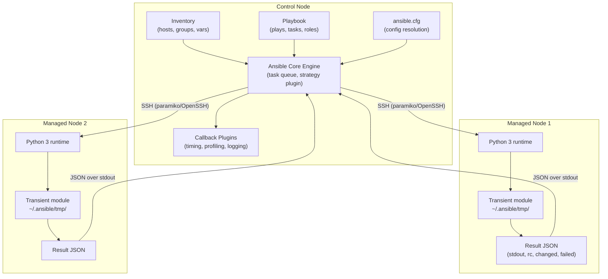
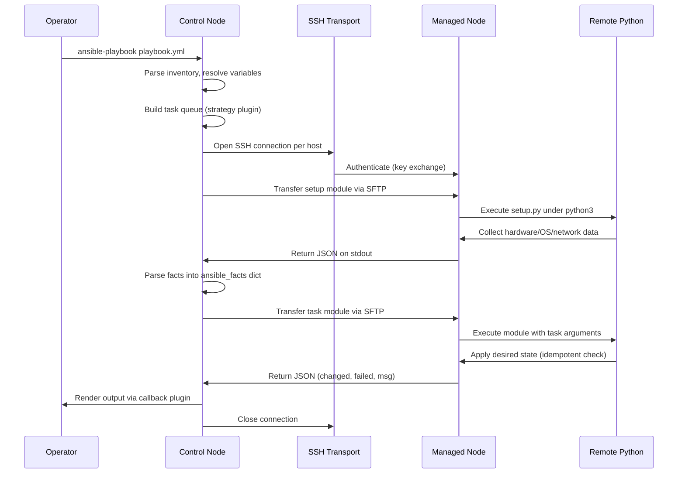
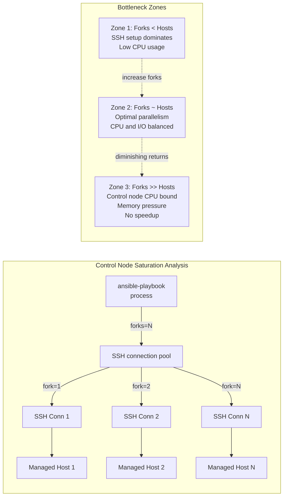
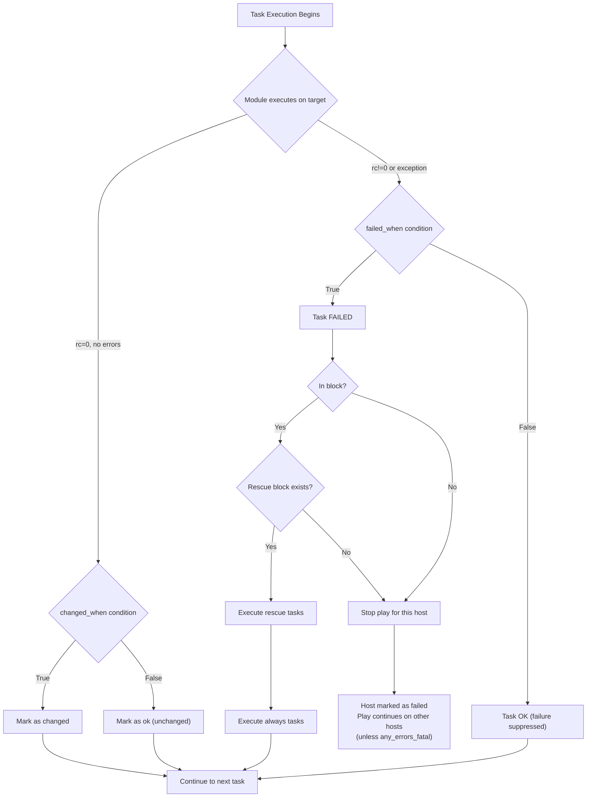

# Operational Verification Labs: Ansible

## Objective and Scope

This lab provides rigorous, hands-on diagnostic verification of Ansible's operational behavior. It targets systems engineers and infrastructure practitioners who need to understand Ansible's execution model at an architectural level: how the control node dispatches work to managed nodes, how modules execute remotely, how facts are gathered and cached, and how failures propagate through playbooks.

### Ansible Architecture: First Principles

Ansible is agentless. The control node orchestrates work by connecting to managed nodes over SSH (Linux) or WinRM (Windows). It does not install a daemon on the target. Instead, it copies a small Python module to the target, executes it, and removes it. This "write-execute-remove" cycle is the core of every Ansible task.



The strategy plugin (default: `linear`) controls execution order. The `linear` strategy executes one task at a time across all matched hosts in parallel, controlled by the `forks` setting (default: 5). The `free` strategy allows each host to proceed independently through the task list without waiting for others.

### Environment Setup

Install Ansible and supporting diagnostic tools on the control node:

```bash
# RHEL / Fedora
sudo dnf install ansible python3 openssh-clients

# Debian / Ubuntu
sudo apt install ansible python3 openssh-client

# macOS (Homebrew)
brew install ansible
```

Verify the installation and version:

```bash
ansible --version
ansible-config dump --only-changed
```

Generate an SSH key pair for passwordless access to managed nodes:

```bash
ssh-keygen -t ed25519 -f ~/.ssh/ansible_key -N ""
ssh-copy-id -i ~/.ssh/ansible_key.pub user@managed-node-1
ssh-copy-id -i ~/.ssh/ansible_key.pub user@managed-node-2
```

Confirm Python 3 is present on all managed nodes (Ansible's only hard dependency on targets):

```bash
ansible all -i hosts -m raw -a "python3 --version"
```

---

## Exercise 1: Inventory Diagnostics and Live State Inspection

### Inventory Structure and Resolution

Ansible's inventory defines the set of managed hosts and their grouping. Variables can be assigned at the group level, host level, or through `group_vars/` and `host_vars/` directories. The inventory parser resolves variables with a precedence chain: host vars override group vars, and more specific groups override less specific ones.

Create the inventory file:

```ini
# hosts.ini

[controllers]
controller1 ansible_host=192.168.1.10 ansible_port=22

[workers]
worker1 ansible_host=192.168.1.20 ansible_port=22
worker2 ansible_host=192.168.1.21 ansible_port=22

[cluster:children]
controllers
workers

[cluster:vars]
ansible_user=ansible
ansible_ssh_private_key_file=~/.ssh/ansible_key
ansible_python_interpreter=/usr/bin/python3
ansible_ssh_common_args="-o StrictHostKeyChecking=no -o ConnectTimeout=10"
```

This inventory uses SSH key authentication rather than plaintext passwords. The `ansible_python_interpreter` variable tells Ansible which Python interpreter to invoke on the target, avoiding the implicit `/usr/bin/python` lookup that fails on distributions without Python 2.

### Step 1: Verify Inventory Parsing

Use `ansible-inventory` to inspect how Ansible resolves hosts, groups, and variables:

```bash
# Display the inventory as a graph showing group hierarchy
ansible-inventory -i hosts.ini --graph

# Dump the full inventory as JSON with all resolved variables
ansible-inventory -i hosts.ini --list

# Show resolved variables for a specific host
ansible-inventory -i hosts.ini --host worker1
```

The `--graph` output confirms group nesting. The `--list` output is a JSON document showing every host and its fully-resolved variable set, useful for debugging variable precedence issues.

### Step 2: Verify Connectivity

Run an ad-hoc ping to confirm that Ansible can connect to every host, execute a module, and receive a valid JSON response:

```bash
ansible all -i hosts.ini -m ping
```

The `ping` module is not an ICMP ping. It verifies that Ansible can establish an SSH connection, transfer a module, execute it under the remote Python interpreter, and parse the returned JSON. A successful response looks like:

```
worker1 | SUCCESS => {
    "changed": false,
    "ping": "pong"
}
```

If a host is unreachable, the output includes `UNREACHABLE` with the SSH error. Use `-vvv` to see the full SSH negotiation:

```bash
ansible worker1 -i hosts.ini -m ping -vvv
```

The `-vvv` flag reveals the exact SSH command Ansible constructs, the key negotiation, and the remote execution path. This is the primary diagnostic tool for connection failures.

### Step 3: Collect and Analyze System Facts

Fact gathering runs the `setup` module on each host. This collects hardware, OS, network, and software information into the `ansible_facts` dictionary.

Create `inspect_facts.yml`:

```yaml
---
- name: Inspect Live State and System Facts
  hosts: all
  gather_facts: true
  tasks:
    - name: Display OS and kernel information
      debug:
        msg: >-
          Host {{ ansible_hostname }} runs {{ ansible_distribution }}
          {{ ansible_distribution_version }} on kernel {{ ansible_kernel }}
          (arch: {{ ansible_architecture }})

    - name: Display CPU topology
      debug:
        msg: >-
          CPU: {{ ansible_processor_vcpus }} vCPUs across
          {{ ansible_processor_count }} socket(s), model
          {{ ansible_processor[1] | default('unknown') }}

    - name: Display memory and swap
      debug:
        msg: >-
          Memory: {{ (ansible_memtotal_mb / 1024) | round(1) }} GB total,
          Swap: {{ (ansible_swaptotal_mb / 1024) | round(1) }} GB total

    - name: Display network interfaces
      debug:
        var: ansible_facts.interfaces

    - name: Display IPv4 addresses per interface
      debug:
        msg: "{{ item }}: {{ ansible_facts[item]['ipv4']['address'] | default('no IPv4') }}"
      loop: "{{ ansible_facts.interfaces }}"
      when: ansible_facts[item]['ipv4'] is defined
```

Run the playbook:

```bash
ansible-playbook -i hosts.ini inspect_facts.yml
```

To inspect raw facts for a single host without running a full playbook:

```bash
ansible worker1 -i hosts.ini -m setup

# Filter to only network-related facts
ansible worker1 -i hosts.ini -m setup -a "filter=ansible_eth*"

# Filter to only mount information
ansible worker1 -i hosts.ini -m setup -a "filter=ansible_mounts"
```

The `filter` parameter accepts a glob pattern. Using it dramatically reduces execution time because Ansible performs the filtering on the remote host before sending the JSON payload back over SSH.

### Step 4: Inspect Internal Subsystems via Ad-Hoc Commands

Use ad-hoc commands for quick diagnostics without writing a playbook:

```bash
# Check running processes consuming the most memory
ansible all -i hosts.ini -m shell -a "ps aux --sort=-%mem | head -10"

# Check disk usage on all mounted filesystems
ansible all -i hosts.ini -m shell -a "df -h"

# Check listening ports and socket states
ansible all -i hosts.ini -m shell -a "ss -tlnp"

# Check network interface statistics
ansible all -i hosts.ini -m shell -a "ip -s link show"

# Check systemd service status
ansible all -i hosts.ini -m systemd -a "name=sshd state=started"
```

These ad-hoc commands use the `shell` and `command` modules. Prefer the purpose-built modules (`systemd`, `service`, `file`, `package`) over raw shell commands in production playbooks because they provide idempotency guarantees.



---

## Exercise 2: Performance Profiling and Saturation Analysis

Ansible's performance is bounded by three factors: SSH connection overhead, fact gathering latency, and task execution time per host. The `forks` parameter controls how many hosts Ansible manages concurrently. The default of 5 is conservative; for large inventories, increasing it to 20-50 can dramatically reduce wall-clock time at the cost of higher memory and CPU usage on the control node.

### Step 1: Enable Performance Profiling Callbacks

Ansible callback plugins hook into the execution lifecycle to report metrics. The `profile_tasks` callback measures per-task execution time across all hosts. The `profile_roles` callback does the same at the role level. The `timer` callback reports total playbook wall-clock time.

Create `ansible.cfg`:

```ini
[defaults]
inventory = hosts.ini
host_key_checking = False
forks = 10
gathering = smart
fact_caching = jsonfile
fact_caching_connection = /tmp/ansible_fact_cache
fact_caching_timeout = 86400
callbacks_enabled = profile_tasks, profile_roles, timer
stdout_callback = yaml
timeout = 30
```

The `gathering = smart` setting enables fact caching: if a host's facts are already in the cache and not expired, Ansible skips re-gathering them. The `fact_caching_timeout` of 86400 seconds (24 hours) means facts are collected once per day per host.

Enable profiling at the command line instead:

```bash
ANSIBLE_CALLBACKS_ENABLED=profile_tasks,timer \
ansible-playbook -i hosts.ini inspect_facts.yml
```

### Step 2: Create a Benchmarking Playbook

Create `benchmark.yml` that measures real subsystem performance on each managed node:

```yaml
---
- name: Performance Benchmarking Across Cluster
  hosts: all
  gather_facts: false
  tasks:
    - name: Benchmark CPU integer throughput (10-second stress test)
      shell: |
        dd if=/dev/zero bs=1M count=1024 2>/dev/null | md5sum
      register: cpu_bench
      changed_when: false

    - name: Display CPU benchmark result
      debug:
        msg: "Hash time: {{ cpu_bench.stderr_lines | default([]) }}"

    - name: Measure fork() syscall latency
      shell: |
        python3 -c "
        import time, os
        iterations = 1000
        start = time.perf_counter()
        for _ in range(iterations):
            pid = os.fork()
            if pid == 0:
                os._exit(0)
            else:
                os.waitpid(pid, 0)
        elapsed = time.perf_counter() - start
        print(f'{elapsed:.6f}s for {iterations} forks ({(elapsed/iterations)*1e6:.1f} us/fork)')
        "
      register: fork_bench
      changed_when: false

    - name: Display fork latency
      debug:
        msg: "{{ fork_bench.stdout }}"

    - name: Measure disk I/O throughput (sequential write)
      shell: |
        dd if=/dev/zero of=/tmp/ansible_bench_$$ bs=1M count=256 oflag=direct 2>&1
        rm -f /tmp/ansible_bench_$$
      register: io_bench
      changed_when: false

    - name: Display I/O benchmark
      debug:
        msg: "{{ io_bench.stderr | regex_search('([0-9.]+) MB/s', '\\1') | first }} MB/s"

    - name: Measure TCP loopback round-trip latency
      shell: |
        python3 -c "
        import socket, time
        srv = socket.socket(socket.AF_INET, socket.SOCK_STREAM)
        srv.setsockopt(socket.IPPROTO_TCP, socket.TCP_NODELAY, 1)
        srv.bind(('127.0.0.1', 0))
        srv.listen(1)
        port = srv.getsockname()[1]

        import threading
        def server():
            conn, _ = srv.accept()
            for _ in range(1000):
                conn.recv(4)
                conn.sendall(b'pong')
            conn.close()
            srv.close()

        t = threading.Thread(target=server)
        t.start()

        cli = socket.socket(socket.AF_INET, socket.SOCK_STREAM)
        cli.setsockopt(socket.IPPROTO_TCP, socket.TCP_NODELAY, 1)
        cli.connect(('127.0.0.1', port))
        start = time.perf_counter()
        for _ in range(1000):
            cli.sendall(b'ping')
            cli.recv(4)
        elapsed = time.perf_counter() - start
        print(f'{(elapsed/1000)*1e6:.1f} us/RTT')
        cli.close()
        t.join()
        "
      register: tcp_bench
      changed_when: false

    - name: Display TCP latency
      debug:
        msg: "{{ tcp_bench.stdout }}"
```

Run the benchmark:

```bash
ansible-playbook -i hosts.ini benchmark.yml
```

With the `profile_tasks` callback enabled, Ansible outputs a per-task timing summary sorted by execution time:

```
Wednesday 15 January 2025  10:32:14 -0500 (0:00:00.012)       0:00:12.347 *******
===============================================================================
benchmarking : Measure TCP loopback round-trip latency ------------ 8.23s
benchmarking : Measure disk I/O throughput (sequential write) ----- 3.12s
benchmarking : Measure fork() syscall latency ---------------------- 0.87s
benchmarking : Benchmark CPU integer throughput (10-second stress) -- 0.45s
===============================================================================
```

### Step 3: Analyze Saturation Profiles

To measure how Ansible itself saturates the control node, profile the control node while running a playbook against a large inventory:

```bash
# Profile the ansible-playbook process on the control node
# Run in a separate terminal
perf stat -e cpu-cycles,instructions,cache-misses,context-switches,cpu-migrations \
  ansible-playbook -i hosts.ini benchmark.yml

# Alternatively, use /usr/bin/time for wall-clock and resource metrics
/usr/bin/time -v ansible-playbook -i hosts.ini benchmark.yml
```

To test how fork count affects throughput, run the same playbook with different `forks` values:

```bash
for forks in 1 5 10 20 50; do
  echo "=== forks=$forks ==="
  time ansible-playbook -i hosts.ini benchmark.yml -f "$forks"
done
```

The relationship between fork count and wall-clock time is not linear. Diminishing returns appear when the control node's CPU or I/O becomes the bottleneck, or when SSH connection setup overhead is amortized.



---

## Exercise 3: Fact Caching Diagnostics

Fact caching eliminates redundant fact gathering across playbook runs. Without it, every playbook run re-executes the `setup` module on every host, which is the single largest source of latency in large inventories.

### Step 1: Configure Fact Caching

The `jsonfile` cache backend stores facts as JSON files on the control node's filesystem. For multi-controller environments, use the `redis` backend so all controllers share a single cache.

```ini
# ansible.cfg with Redis fact caching
[defaults]
fact_caching = redis
fact_caching_connection = redis://localhost:6379:1
fact_caching_timeout = 86400
```

```ini
# ansible.cfg with jsonfile fact caching
[defaults]
fact_caching = jsonfile
fact_caching_connection = /tmp/ansible_fact_cache
fact_caching_timeout = 86400
```

### Step 2: Verify Cache Behavior

```bash
# First run: facts are gathered and cached
ansible-playbook -i hosts.ini inspect_facts.yml

# Inspect cached facts
ls -la /tmp/ansible_fact_cache/
cat /tmp/ansible_fact_cache/worker1 | python3 -m json.tool | head -20

# Second run: facts are loaded from cache (no SSH for setup module)
ansible-playbook -i hosts.ini inspect_facts.yml

# Force re-gathering facts (bypass cache)
ansible-playbook -i hosts.ini inspect_facts.yml --force-handlers
# Or set gather_facts: true with --flush-cache
ansible-playbook -i hosts.ini inspect_facts.yml --flush-cache
```

### Step 3: Measure Caching Impact

```bash
# Time with fact gathering (no cache)
time ANIBLE_CACHE_PLUGIN=none ansible-playbook -i hosts.ini inspect_facts.yml

# Time with fact caching (second run, cache warm)
time ansible-playbook -i hosts.ini inspect_facts.yml
```

---

## Exercise 4: Fault Injection and Recovery Analysis

Ansible's error handling model is built on three constructs: `block/rescue/always` (task-level try/catch), `ignore_errors` (per-task suppression), and `failed_when`/`changed_when` (custom conditionals). Understanding failure propagation is critical for reliable automation.

### Step 1: Connection Fault Injection

Simulate unreachable hosts by misconfiguring the SSH port or using a bad key. Create `fault_connection.yml`:

```yaml
---
- name: Connection Fault Injection and Recovery
  hosts: all
  gather_facts: false
  max_fail_percentage: 50
  tasks:
    - name: Attempt connection with 2-second timeout
      block:
        - name: Test connectivity
          ansible.builtin.ping:
          timeout: 2
      rescue:
        - name: Log connection failure
          ansible.builtin.debug:
            msg: >-
              Host {{ inventory_hostname }} ({{ ansible_host }}) is unreachable.
              Captured error: {{ ansible_failed_result.msg | default('unknown') }}
        - name: Record failure in control node log
          ansible.builtin.lineinfile:
            path: /tmp/ansible_failures.log
            line: "{{ now() }} - {{ inventory_hostname }} - {{ ansible_failed_result.msg | default('connection error') }}"
            create: true
          delegate_to: localhost
          changed_when: false
      always:
        - name: Mark host as checked
          ansible.builtin.debug:
            msg: "Connectivity check complete for {{ inventory_hostname }}"
```

Inject a fault by pointing one host at an invalid port:

```bash
# Temporarily modify the inventory to simulate a dead host
ansible-playbook -i hosts.ini fault_connection.yml \
  -e "ansible_port=9999" --limit worker1
```

The `max_fail_percentage: 50` setting tells Ansible to abort the entire playbook only if more than 50% of hosts fail. Without this, the default behavior is to continue running tasks on hosts that succeeded while marking failed hosts as unreachable for subsequent tasks.

### Step 2: Module Execution Fault Injection

Simulate a module failure and verify the rescue block captures the error:

```yaml
---
- name: Module Fault Injection and Recovery
  hosts: all
  gather_facts: true
  tasks:
    - name: Attempt to write to a protected path
      block:
        - name: Write to /proc (will fail)
          ansible.builtin.copy:
            dest: /proc/sys/kernel/hostname
            content: "injected-fault\n"
          register: write_result
      rescue:
        - name: Capture failure metadata
          ansible.builtin.debug:
            msg: >-
              Task failed with result:
              module={{ ansible_failed_result.module_name | default('unknown') }}
              msg={{ ansible_failed_result.msg | default('no message') }}
              rc={{ ansible_failed_result.rc | default('N/A') }}
        - name: Attempt remediation: write to /tmp instead
          ansible.builtin.copy:
            dest: /tmp/hostname_fallback.txt
            content: "{{ ansible_hostname }}\n"
          register: remediation
        - name: Report remediation
          ansible.builtin.debug:
            msg: "Remediation succeeded: {{ remediation.dest }}"
      always:
        - name: Cleanup
          ansible.builtin.file:
            path: /tmp/hostname_fallback.txt
            state: absent
```

Run it:

```bash
ansible-playbook -i hosts.ini module_fault.yml -vv
```

The `ansible_failed_result` variable is available inside `rescue` blocks and contains the full JSON result of the failed task, including `msg`, `rc`, `stderr`, `stdout`, and `module_name`.

### Step 3: Task-Level Fault Injection with Custom Failure Conditions

Use `failed_when` to define custom failure logic, and `changed_when` to suppress spurious change reports:

```yaml
---
- name: Custom Failure Condition Injection
  hosts: all
  gather_facts: false
  tasks:
    - name: Check disk space and fail if below 10%
      ansible.builtin.shell: df --output=pcent / | tail -1 | tr -dc '0-9'
      register: disk_usage
      changed_when: false
      failed_when: disk_usage.stdout | int > 90

    - name: Report disk status
      ansible.builtin.debug:
        msg: "Disk usage: {{ disk_usage.stdout }}% (threshold: 90%)"

    - name: Run health check script that may exit non-zero
      ansible.builtin.shell: /usr/local/bin/health-check.sh
      register: health_check
      failed_when: >
        health_check.rc != 0 and
        "WARN" not in health_check.stdout
      changed_when: false

    - name: Report health check
      ansible.builtin.debug:
        msg: >
          Health check exit code: {{ health_check.rc }},
          output: {{ health_check.stdout_lines }}
```



---

## Exercise 5: Deep Diagnostics - Execution Pipeline Internals

### Step 1: Inspect the Ansible Configuration Resolution

Ansible loads configuration from multiple sources in a defined precedence order:

1. `ANSIBLE_*` environment variables
2. `ansible.cfg` in the current directory
3. `~/.ansible.cfg` in the user's home directory
4. `/etc/ansible/ansible.cfg` (system-wide default)

```bash
# Show the effective configuration with source annotations
ansible-config dump

# Show only values that differ from defaults
ansible-config dump --only-changed

# List all available configuration options
ansible-config list

# Trace which file provided each setting
ansible-config dump | grep -v DEFAULT
```

### Step 2: Inspect Module Documentation and Source

```bash
# List all available modules
ansible-doc -l | wc -l
ansible-doc -l | grep -i systemd

# Show documentation for a specific module
ansible-doc systemd
ansible-doc -v systemd

# Show the module source path (to inspect or debug)
ansible-doc -M ansible.builtin.systemd
python3 -c "import ansible.modules.systemd; print(ansible.modules.systemd.__file__)"
```

### Step 3: Debug a Module with ANSIBLE_DEBUG

Enable internal debug logging to trace the execution pipeline:

```bash
# Full debug logging to a file
ANSIBLE_DEBUG=1 ANSIBLE_LOG_PATH=/tmp/ansible_debug.log \
  ansible-playbook -i hosts.ini inspect_facts.yml

# Inspect the debug log for module transfer and execution details
grep -E "(TRANSFER|EXEC|PUT|FETCH)" /tmp/ansible_debug.log
```

The debug log reveals:
- The exact SSH command used for each connection
- The SFTP/SCP transfer path for the module
- The remote temporary directory path
- The Python interpreter invocation
- The JSON payload returned by the module

### Step 4: Inspect the Task Queue and Strategy Behavior

Run a playbook with the `free` strategy to observe independent task progression across hosts:

```yaml
---
- name: Strategy Comparison
  hosts: all
  strategy: free
  gather_facts: false
  tasks:
    - name: Simulate variable-length task
      ansible.builtin.shell: "sleep $((RANDOM % 10 + 1))"
      changed_when: false

    - name: Report completion order
      ansible.builtin.debug:
        msg: "{{ inventory_hostname }} finished task 2"
```

Compare with the default `linear` strategy:

```bash
# Linear: all hosts complete task 1 before any starts task 2
ANSIBLE_STRATEGY=linear ansible-playbook -i hosts.ini strategy_compare.yml

# Free: each host proceeds independently
ansible-playbook -i hosts.ini strategy_compare.yml
```

With `linear`, if one host takes 10 seconds and another takes 1 second, all hosts wait for the slowest before proceeding. With `free`, the fast host moves to task 2 immediately.

### Step 5: Inspect Connection Plugin Behavior

```bash
# Check which connection plugin is in use
ansible worker1 -i hosts.ini -m debug -a "var=ansible_connection"

# Test with the local connection plugin (no SSH)
ansible localhost -m ping -c local

# List available connection plugins
ansible-doc -t connection -l

# Inspect SSH connection parameters
ansible worker1 -i hosts.ini -m ping -vvvv
```

The `vvvv` verbosity level prints the raw SSH command, including all options Ansible passes to OpenSSH:

```
<worker1> SSH: EXEC ssh -C -o ControlMaster=auto -o ControlPersist=60s \
  -o StrictHostKeyChecking=no -o ConnectTimeout=10 \
  -o KbdInteractiveAuthentication=no \
  -o PreferredAuthentications=publickey \
  -i ~/.ssh/ansible_key -p 22 ansible@192.168.1.20
```

---

## Exercise 6: Role Structure and Dependency Diagnostics

Ansible roles provide reusable, structured playbook organization. Understanding how roles load and how variables resolve through the role dependency chain is essential for debugging complex playbooks.

### Step 1: Create a Role Structure

```bash
# Create the role skeleton
ansible-galaxy role init roles/webserver
```

This generates the standard directory structure:

```
roles/webserver/
├── defaults/
│   └── main.yml        # Low-precedence default variables
├── files/               # Static files for copy module
├── handlers/
│   └── main.yml        # Handlers triggered by notify
├── meta/
│   └── main.yml        # Role metadata and dependencies
├── tasks/
│   └── main.yml        # Main task list
├── templates/           # Jinja2 templates for template module
├── tests/
│   ├── inventory
│   └── test.yml
└── vars/
    └── main.yml        # High-precedence role variables
```

### Step 2: Implement a Production-Grade Role

```yaml
# roles/webserver/tasks/main.yml
---
- name: Install nginx package
  ansible.builtin.package:
    name: nginx
    state: present
  notify: restart nginx

- name: Ensure nginx configuration directory exists
  ansible.builtin.file:
    path: /etc/nginx/conf.d
    state: directory
    owner: nginx
    group: nginx
    mode: '0755'

- name: Deploy nginx configuration from template
  ansible.builtin.template:
    src: nginx.conf.j2
    dest: /etc/nginx/conf.d/default.conf
    owner: nginx
    group: nginx
    mode: '0644'
    validate: 'nginx -t -c %s'
  notify: reload nginx

- name: Ensure nginx service is enabled and started
  ansible.builtin.systemd:
    name: nginx
    state: started
    enabled: true
    daemon_reload: true

- name: Open firewall ports
  ansible.builtin.firewalld:
    service: "{{ item }}"
    permanent: true
    state: enabled
    immediate: true
  loop:
    - http
    - https
  when: ansible_facts.services['firewalld.service'] is defined
```

```yaml
# roles/webserver/handlers/main.yml
---
- name: restart nginx
  ansible.builtin.systemd:
    name: nginx
    state: restarted

- name: reload nginx
  ansible.builtin.systemd:
    name: nginx
    state: reloaded
```

```jinja2
{# roles/webserver/templates/nginx.conf.j2 #}
upstream backend {

    server {{ hostvars[host]['ansible_host'] }}:8080 weight=1;

}

server {
    listen {{ nginx_listen_port | default(80) }};
    server_name {{ nginx_server_name | default('_') }};

    location / {
        proxy_pass http://backend;
        proxy_set_header Host $host;
        proxy_set_header X-Real-IP $remote_addr;
        proxy_set_header X-Forwarded-For $proxy_add_x_forwarded_for;
        proxy_connect_timeout {{ nginx_proxy_timeout | default(30) }}s;
    }
}
```

```yaml
# roles/webserver/defaults/main.yml
---
nginx_listen_port: 80
nginx_server_name: "_"
nginx_proxy_timeout: 30
nginx_worker_processes: auto
nginx_worker_connections: 1024
```

### Step 3: Verify Variable Precedence

Ansible variable precedence (from lowest to highest):

1. role defaults
2. inventory `group_vars/all`
3. inventory `group_vars/<group>`
4. inventory `host_vars/<host>`
5. playbook `vars`
6. role `vars/` defined in role
7. block `vars`
8. task `vars`
9. `include_vars`
10. `set_facts` / registered variables
11. role parameters (passed via `include_role` or `roles:`)
12. `extra_vars` (`-e` on command line)

```bash
# Inspect resolved variables for a host
ansible-inventory -i hosts.ini --host worker1

# Override a role default at the command line
ansible-playbook -i hosts.ini site.yml -e "nginx_listen_port=8080"

# Override at the inventory group level
mkdir -p group_vars/cluster
echo "nginx_listen_port: 8080" > group_vars/cluster/vars.yml
```

---

## Diagnostic Cheat Sheet

### Ansible-Specific Diagnostic Commands

| Command | Purpose |
| --- | --- |
| `ansible all -m ping -vvv` | Verify SSH connectivity with full debug output |
| `ansible-inventory --graph` | Visualize inventory group hierarchy |
| `ansible-inventory --list` | Dump all hosts and variables as JSON |
| `ansible-inventory --host <host>` | Show resolved variables for one host |
| `ansible-config dump --only-changed` | Show non-default configuration values |
| `ansible-doc -l` | List all available modules |
| `ansible-doc <module>` | Show module documentation |
| `ansible-doc -t callback -l` | List available callback plugins |
| `ansible-doc -t connection -l` | List available connection plugins |
| `ansible-doc -t strategy -l` | List available strategy plugins |
| `ansible-playbook --syntax-check playbook.yml` | Validate playbook syntax without executing |
| `ansible-playbook --check playbook.yml` | Dry-run: simulate changes without applying |
| `ansible-playbook --diff playbook.yml` | Show file/line diffs for changed tasks |
| `ansible-playbook --list-tasks playbook.yml` | List tasks that would execute |
| `ansible-playbook --list-hosts playbook.yml` | List hosts that would be targeted |
| `ansible-playbook --step playbook.yml` | Interactive single-step execution |
| `ansible-playbook --start-at-task "task name"` | Resume from a specific task |
| `ansible-playbook --tags "install,configure"` | Run only tasks with matching tags |
| `ansible-playbook --skip-tags "debug"` | Skip tasks with matching tags |
| `ANSIBLE_DEBUG=1 ansible-playbook ...` | Enable internal engine debug logging |

### System-Level Diagnostics on Managed Nodes

| Command | Purpose |
| --- | --- |
| `ps aux --sort=-%cpu \| head -20` | Top CPU consumers |
| `ss -tlnp` | Listening TCP ports with process info |
| `ss -tipm` | Active TCP connections with timer and memory details |
| `ip -s link show` | Network interface statistics (rx/tx, drops, errors) |
| `ethtool -S eth0` | NIC hardware counters (drops, fifo errors, collisions) |
| `ethtool -g eth0` | NIC ring buffer sizes (current and max) |
| `dmesg -T \| tail -50` | Recent kernel messages with timestamps |
| `journalctl -u nginx --since "10 min ago"` | Systemd service logs for the last 10 minutes |
| `vmstat 1 5` | Memory, swap, CPU, and I/O snapshot (5 samples, 1s interval) |
| `iostat -xz 1 5` | Per-device I/O statistics with extended metrics |

### Performance Tuning Configuration

| Setting | Location | Effect |
| --- | --- | --- |
| `forks = 50` | ansible.cfg `[defaults]` | Increase parallel SSH connections (default: 5) |
| `gathering = smart` | ansible.cfg `[defaults]` | Only gather facts when cache is empty or expired |
| `fact_caching = jsonfile` | ansible.cfg `[defaults]` | Enable filesystem fact caching |
| `fact_caching_timeout = 86400` | ansible.cfg `[defaults]` | Cache facts for 24 hours |
| `ssh_args = -o ControlMaster=auto -o ControlPersist=60s` | ansible.cfg `[ssh_connection]` | Enable SSH multiplexing to reuse connections |
| `pipelining = True` | ansible.cfg `[ssh_connection]` | Reduce SFTP transfers by piping modules via SSH stdin |
| `strategy = free` | Playbook `strategy:` keyword | Allow hosts to proceed independently through tasks |
| `serial = "30%"` | Playbook `serial:` keyword | Rolling updates: process 30% of hosts at a time |

### Error Handling Patterns

| Pattern | Keyword | Behavior |
| --- | --- | --- |
| Task-level try/catch | `block` / `rescue` / `always` | Execute rescue tasks on failure, always runs cleanup |
| Suppress failure | `ignore_errors: true` | Continue playbook even if task fails |
| Custom failure condition | `failed_when: condition` | Mark task failed based on custom logic |
| Custom change detection | `changed_when: condition` | Override module's default changed detection |
| Rolling update control | `serial: N` | Limit number of hosts processed per batch |
| Failure tolerance | `max_fail_percentage: N` | Abort if more than N% of hosts fail in a batch |
| Fail-fast mode | `any_errors_fatal: true` | Abort entire playbook on first failure |

---

## Verification Checklist

**Inventory and Connectivity**

- [ ] `ansible-inventory --graph` shows correct group hierarchy with all hosts present
- [ ] `ansible-inventory --host <host>` resolves expected variables with correct precedence
- [ ] `ansible all -m ping` returns `SUCCESS` for every host in inventory
- [ ] SSH connections use key authentication (no password prompts)
- [ ] `ansible all -m raw -a "python3 --version"` confirms Python 3 on all targets

**Playbook Execution**

- [ ] `ansible-playbook --syntax-check` passes for all playbooks
- [ ] `ansible-playbook --check` dry-run produces expected changed/ok counts
- [ ] `ansible-playbook --list-hosts` targets the correct host set
- [ ] Idempotency: running a playbook twice produces zero `changed` tasks on the second run
- [ ] `ansible-playbook --diff` shows only intended file modifications

**Performance**

- [ ] `profile_tasks` callback enabled and per-task timing reported
- [ ] Fact caching configured and verified (second run skips `setup` module)
- [ ] SSH pipelining enabled (no SFTP overhead for module transfer)
- [ ] `forks` value tuned for inventory size (no control node CPU saturation)
- [ ] SSH connection multiplexing active (`ControlPersist` in SSH args)

**Error Handling**

- [ ] `block/rescue/always` blocks tested with simulated failures
- [ ] `ansible_failed_result` variable contains expected error metadata in rescue blocks
- [ ] `max_fail_percentage` configured appropriately for batch size
- [ ] `failed_when` conditions trigger on expected failure patterns
- [ ] `changed_when` suppresses false change reports for shell/command tasks

**Roles and Variables**

- [ ] Role structure follows `ansible-galaxy init` skeleton
- [ ] Variable precedence verified: `extra_vars` > role `vars` > inventory `host_vars` > inventory `group_vars` > role `defaults`
- [ ] Templates render correctly with `--check` mode (no missing variables)
- [ ] Handlers fire only when notified tasks report `changed: true`
- [ ] Role dependencies in `meta/main.yml` resolve without circular references

**Security and Secrets Management**

- [ ] `ansible-vault` encrypted files decrypt correctly with vault password file or prompt
- [ ] `no_log: true` applied to tasks handling credentials (playbook run output shows `censored`)
- [ ] Vault IDs specified correctly for multi-vault workflows (`--vault-id prod@prompt`)
- [ ] SSH `StrictHostKeyChecking` configured appropriately (accept-new for dynamic infrastructure, yes for production)
- [ ] Privilege escalation (`become`) tested with `--become-method=sudo` and correct user/password sources

---

## Conclusion

Operational verification of Ansible infrastructure demands systematic validation across connectivity, execution semantics, performance characteristics, and security boundaries. The checklist framework provided enforces a discipline of *prove-don't-assume*: SSH multiplexing must be confirmed through connection reuse metrics, idempotency through zero-change second runs, and variable precedence through deliberate override conflicts. Performance tuning is not optional at scale—fact caching, pipelining, and fork tuning directly determine whether a 500-host playbook completes in minutes or hours. Error handling blocks must be tested under actual failure conditions, not merely declared syntactically correct, because production failure modes rarely match development assumptions.

The verification matrix below distills these operational requirements into governing invariants and their diagnostic signatures. Ansible's declarative surface conceals imperative execution machinery—connection pooling, task batching, templating order, handler aggregation—that operators must understand to debug non-obvious failures. A playbook that succeeds in `--check` mode but fails in normal mode signals templating issues or external dependencies; a role that works standalone but breaks when included signals variable collision or dependency misconfiguration. Mature Ansible operations treat these verification steps not as optional validation but as executable specifications of correctness, automated into CI/CD pipelines and pre-deployment gates.

## Summary & Verification Matrix

| Verification Domain | Governing Invariant | Diagnostic Criterion | Failure Signature |
|---------------------|---------------------|----------------------|-------------------|
| **Connectivity** | All inventory hosts must be reachable via SSH key authentication with Python 3 interpreter available | `ansible all -m ping` returns `SUCCESS` for 100% of inventory; `ansible all -m raw -a "python3 --version"` reports Python 3.x on all targets | Unreachable hosts block entire plays; missing Python causes module execution failures with `MODULE FAILURE` |
| **Idempotency** | Declarative tasks converge to desired state without repeated changes; second playbook run produces zero `changed` tasks | Re-running identical playbook against unchanged infrastructure yields only `ok` status; `--check` mode predictions match actual run outcomes | Shell/command tasks always report `changed`; file modules repeatedly modify timestamps; services restart unnecessarily |
| **Variable Precedence** | Variable resolution follows documented hierarchy: extra-vars > role vars > inventory host_vars > inventory group_vars > role defaults | Overriding a role default via `host_vars` changes template output; `--extra-vars` always wins conflicts; `ansible-inventory --host <name>` shows merged variable view | Templates render with unexpected values; handlers fire from wrong variable contexts; role reusability breaks due to hardcoded vars |
| **Performance** | Task execution scales linearly with inventory size when forks, fact caching, and SSH multiplexing are tuned | `profile_tasks` callback shows fact gathering skipped on cached runs; `ansible.cfg` fork count prevents control node CPU saturation; SSH `ControlPersist` reuses connections | Playbook runtime grows exponentially with host count; fact gathering dominates execution time; SFTP module transfer overhead visible in logs |
| **Error Handling** | Failures trigger rescue blocks with `ansible_failed_result` metadata; `max_fail_percentage` prevents cascading failures across inventory batches | Simulated task failures (e.g., `command: /bin/false`) execute rescue blocks; `failed_when` conditions correctly classify expected errors as non-failures | Playbooks abort on first failure without cleanup; rescue blocks never execute; spurious failures from shell exit codes |
| **Security & Secrets** | Credentials never appear in logs or version control; vault-encrypted files decrypt only with authorized vault IDs; privilege escalation uses documented become methods | `no_log: true` tasks display `censored` in output; `ansible-vault view` requires correct vault password; `become` tasks execute with expected privilege level | Plaintext passwords in Git history; vault decryption failures in CI/CD; sudo password prompts block automation |
