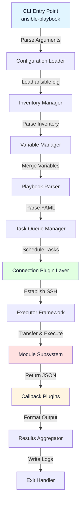
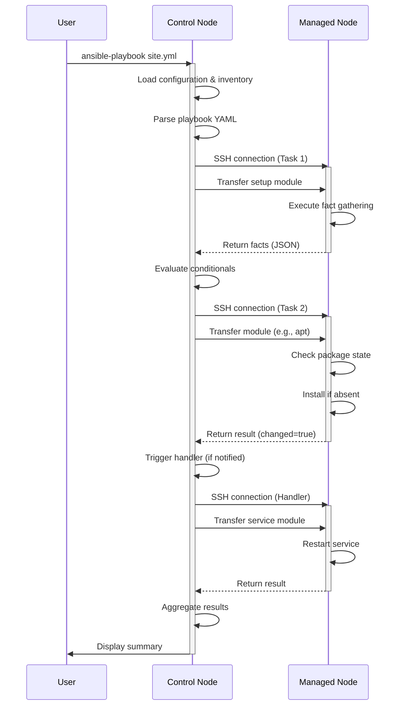

# Lesson 1: Foundations & Kernel/System Invariants

## Curriculum Roadmap

This lesson establishes the theoretical foundation for Ansible, a configuration management and orchestration system. We examine the first-principles problem space that Ansible addresses, the execution boundaries it operates within, and the non-negotiable system invariants that govern its behavior. These concepts form the bedrock for understanding Ansible's architecture, operational semantics, and suitability for infrastructure automation at scale.

## 1. First-Principles Problem Space & Execution Boundaries

### The Configuration Management Problem

At its core, Ansible solves the **distributed state reconciliation problem**: given a declarative specification of desired system state and a set of managed nodes in unknown or inconsistent states, transform each node to match the specification with minimal disruption and guaranteed convergence. This problem is NP-hard in the general case due to complex dependencies, ordering constraints, and the need to maintain system availability during transitions.

Traditional approaches to this problem—imperative shell scripts, manual configuration, or agent-based systems—suffer from fundamental limitations:

**Imperative Scripts**: Procedural logic tightly couples "what" with "how," making scripts brittle and difficult to reason about. State drift accumulates over time because scripts lack intrinsic idempotence guarantees. Retrying a failed script may corrupt system state.

**Agent-Based Systems**: Require persistent daemon processes on managed nodes, introducing ongoing resource consumption, security surface expansion (attack vector), and operational complexity (agent upgrades, certificate management, network connectivity requirements). The control plane becomes a distributed system itself, inheriting all associated failure modes.

**Manual Configuration**: Does not scale beyond small deployments, lacks auditability, and cannot provide reproducibility guarantees.

### Ansible's Architectural Response

Ansible's architecture addresses these limitations through several key design decisions:

**Push-Based, Agentless Model**: Ansible operates on a push model where a control node initiates SSH (or WinRM for Windows) connections to managed nodes, executes Python modules remotely, and collects results. No persistent agent runs on managed nodes. This eliminates the agent lifecycle management problem and reduces the attack surface to the standard SSH daemon already present on most Unix-like systems.

**Declarative, Resource-Oriented DSL**: Ansible playbooks define desired state using YAML syntax that maps to internal resource abstractions (files, packages, services, users, etc.). The execution engine computes the minimal set of operations required to reconcile current state with desired state. This separation of specification from implementation allows Ansible to optimize execution and provide idempotence guarantees.

**Batteries-Included Module System**: Ansible ships with over 3,000 modules covering operating systems, cloud providers, network devices, and application platforms. Each module encapsulates domain-specific logic for idempotent state management. For example, the `apt` module understands Debian package manager semantics and can safely add/remove packages without manual state checking.

### Execution Boundaries and Constraints

Ansible's execution model imposes several hard constraints derived from its architectural choices:

**SSH as Transport Layer**: Ansible relies on SSH for remote execution. This means:
- Managed nodes must run an SSH daemon (typically OpenSSH)
- Network connectivity from control node to managed nodes is required (direct or via bastion hosts)
- Authentication credentials (passwords, SSH keys, or Kerberos tickets) must be provisioned
- SSH configuration affects Ansible behavior (connection timeouts, multiplexing, key algorithms)

The SSH dependency provides strong authentication and encryption but introduces latency overhead. Each task execution involves:
1. SSH connection establishment (TCP three-way handshake, key exchange, authentication)
2. Python interpreter discovery on remote node
3. Module transfer over SFTP/SCP
4. Module execution in a fork/exec subprocess
5. JSON result serialization and retrieval
6. SSH connection teardown

**Python Interpreter Requirement**: Ansible modules are Python scripts executed on managed nodes. By default, Ansible searches for `/usr/bin/python`, `/usr/bin/python3`, or other common paths. Systems without Python (embedded devices, minimal containers) require either:
- Pre-installation of Python
- Use of `raw` module for bootstrapping
- Use of specialized connection plugins (for network devices running proprietary OS)

**Control Node Single-Threaded Orchestration**: Within a single playbook run, Ansible's control node executes tasks sequentially (one task at a time) but parallelizes across hosts (default 5 forks). This means:
- Task N+1 does not begin until task N completes on all targeted hosts
- Slow hosts create head-of-line blocking
- Parallelism is bounded by the `forks` configuration parameter

This execution model simplifies reasoning about task ordering and dependencies but limits horizontal scalability. Large inventories (thousands of nodes) require tuning fork count, SSH connection multiplexing (`ControlPersist`), and pipelining to achieve acceptable performance.

**Stateless Execution Model**: Each Ansible run is stateless from the control node's perspective. Ansible does not maintain a persistent database of managed node states or track drift between runs. Every execution:
1. Gathers facts (system information) from managed nodes
2. Evaluates conditionals and constructs the task graph
3. Executes tasks
4. Reports results

This statelessness provides operational simplicity (no database to backup/restore) but means Ansible cannot provide historical state tracking or drift detection without external tooling.

## 2. Fundamental System Guarantees & Non-Negotiable Invariants

Ansible's reliability and correctness depend on maintaining several critical invariants:

### Idempotence

**Definition**: An operation is idempotent if applying it multiple times produces the same result as applying it once. Mathematically, if `f` is an operation and `S` is a system state, then `f(S) = f(f(S)) = f(f(f(S)))`.

**Ansible's Guarantee**: All well-written Ansible modules must be idempotent. Executing the same playbook multiple times against the same system should result in state convergence after the first run, with subsequent runs making no changes (reporting `ok` rather than `changed`).

**Implementation Mechanism**: Modules achieve idempotence through state inspection before modification:

```python
# Pseudocode for idempotent file creation
def ensure_file_present(path, content):
    if os.path.exists(path):
        current_content = read_file(path)
        if current_content == content:
            return (changed=False, msg="File already exists with correct content")
        else:
            write_file(path, content)
            return (changed=True, msg="File content updated")
    else:
        write_file(path, content)
        return (changed=True, msg="File created")
```

The module first checks whether the desired state already exists. If so, it returns immediately without modification. If not, it performs the minimal operation required to achieve the desired state.

**Why Idempotence Matters**: Idempotence enables safe retries after transient failures (network interruptions, temporary resource unavailability) without risk of corruption. It also allows playbooks to serve as both initial provisioning scripts and ongoing configuration enforcement tools.

**Limitations**: Idempotence is a contract, not a language-level guarantee. Poorly written custom modules or use of the `shell`/`command` modules with stateful operations can violate idempotence. The `creates` and `removes` parameters provide basic idempotence hints for shell commands:

```yaml
- name: Download file (idempotent via creates)
  ansible.builtin.shell: curl -o /tmp/data.json https://api.example.com/data
  args:
    creates: /tmp/data.json
```

### Determinism

**Definition**: An operation is deterministic if the same inputs always produce the same outputs. For Ansible, this means a playbook executed against the same initial system state should always produce the same final system state and sequence of changes.

**Ansible's Guarantee (Qualified)**: Ansible provides determinism within the scope of explicitly declared dependencies. Tasks execute in the order defined in the playbook, and roles/includes maintain their specified ordering. However, several factors can introduce non-determinism:

**Unordered Collections**: Python dictionaries (pre-3.7) and sets do not guarantee iteration order. Ansible mitigates this by using ordered data structures where ordering matters, but custom module implementations may still introduce non-determinism.

**Concurrency**: When Ansible executes tasks across multiple hosts in parallel (via forks), the interleaving of operations across hosts is non-deterministic. If hosts interact with shared resources (databases, file locks, APIs), race conditions can occur.

**External State Changes**: Ansible has no mechanism to prevent out-of-band modifications to managed nodes. If another process or user modifies system state between Ansible runs, subsequent runs may observe and react to that state differently.

**Time-Dependent Behavior**: Some modules or tasks may behave differently based on time (e.g., date-based conditionals, TLS certificate expiration checks, API rate limits).

**Best Practices for Determinism**:
- Use explicit task dependencies (`notify`, `handlers`, task `when` conditionals)
- Avoid shared mutable state across hosts within a playbook
- Use `serial` to limit concurrency when tasks interact with shared resources
- Implement locking mechanisms for critical sections accessing shared state

### Atomicity and Transaction Semantics

**Ansible's Model**: Ansible tasks are atomic at the module level but not at the playbook level. Each module execution either succeeds completely or fails completely—there are no partial successes within a single module invocation.

However, if a playbook fails mid-execution, Ansible does **not** automatically roll back previous tasks. The system is left in a partially-configured state. This behavior differs from transactional systems (databases, configuration management tools with rollback support).

**Example Failure Scenario**:

```yaml
- name: Install package
  ansible.builtin.apt:
    name: nginx
    state: present
  # Succeeds: nginx is now installed

- name: Copy configuration
  ansible.builtin.copy:
    src: nginx.conf
    dest: /etc/nginx/nginx.conf
  # Succeeds: config file is copied

- name: Start service
  ansible.builtin.systemd:
    name: nginx
    state: started
  # Fails: invalid configuration causes nginx to fail to start
```

After this failure, the system has nginx installed with a broken configuration but the service not running. Ansible will not automatically uninstall nginx or restore the previous configuration.

**Mitigation Strategies**:
- Use `block`/`rescue`/`always` constructs for error handling and cleanup
- Implement validation tasks before committing changes (e.g., `nginx -t` to validate config)
- Use `--check` mode for dry-run validation
- Maintain configuration version control and implement rollback playbooks
- Use handlers for service restarts only after all configuration changes succeed

### Consistency Models

Ansible provides **eventual consistency** within a single playbook run but does not provide strong consistency across multiple concurrent runs or across time.

**Within a Run**: When executing a playbook against multiple hosts, Ansible ensures that all targeted hosts will eventually reach the desired state (assuming no fatal errors). However, at any given moment during execution, hosts may be in different intermediate states.

**Across Runs**: Ansible does not provide linearizability or serializability across multiple concurrent playbook runs. If two users execute playbooks that modify overlapping resources simultaneously, the final state depends on timing and may be inconsistent.

**Example Consistency Issue**:

```yaml
# User A runs this playbook
- name: Set max_connections to 100
  ansible.builtin.lineinfile:
    path: /etc/postgresql/postgresql.conf
    regexp: '^max_connections'
    line: 'max_connections = 100'

# User B runs this concurrently
- name: Set max_connections to 200
  ansible.builtin.lineinfile:
    path: /etc/postgresql/postgresql.conf
    regexp: '^max_connections'
    line: 'max_connections = 200'
```

The final value of `max_connections` depends on which playbook executes last—a classic race condition. Ansible provides no built-in distributed locking or coordination mechanism to prevent this.

## 3. High-Level Process & Subsystem Architecture

Ansible's architecture consists of several interconnected subsystems that collectively implement the configuration management workflow.



### Subsystem Breakdown

**CLI Entry Point (`ansible-playbook`, `ansible`, `ansible-console`)**

The command-line interface processes user input, validates arguments, and bootstraps the Ansible runtime. Key responsibilities:
- Parse command-line flags (`-i` for inventory, `-e` for extra variables, `--limit` for host targeting)
- Initialize logging and output verbosity
- Load configuration from `ansible.cfg` (searched in current directory, `~/.ansible.cfg`, `/etc/ansible/ansible.cfg`)
- Instantiate the playbook executor

**Configuration Loader**

Ansible's configuration system follows a precedence hierarchy:
1. Command-line flags (highest priority)
2. Environment variables (`ANSIBLE_*`)
3. `ansible.cfg` in current directory
4. `~/.ansible.cfg`
5. `/etc/ansible/ansible.cfg` (lowest priority)

Configuration controls behavior such as:
- Default inventory path
- Fork count (parallelism)
- SSH connection settings (timeouts, multiplexing)
- Callback plugins (output formatting)
- Fact caching backend

**Inventory Manager**

The inventory manager resolves the set of hosts that playbooks will target. Inventories can be:

**Static (INI or YAML format)**:

```ini
[webservers]
web1.example.com ansible_host=192.168.1.10
web2.example.com ansible_host=192.168.1.11

[databases]
db1.example.com ansible_host=192.168.1.20

[production:children]
webservers
databases
```

**Dynamic (executable scripts)**:

Dynamic inventory scripts query external sources (AWS, GCP, Azure, VMware, CMDB) and return JSON-formatted host lists. When Ansible encounters an executable inventory file, it invokes it with `--list` to retrieve all hosts and `--host <hostname>` to retrieve per-host variables.

```python
#!/usr/bin/env python3
import json
import boto3

def get_aws_inventory():
    ec2 = boto3.client('ec2')
    reservations = ec2.describe_instances(Filters=[{'Name': 'instance-state-name', 'Values': ['running']}])
    
    inventory = {'_meta': {'hostvars': {}}}
    for reservation in reservations['Reservations']:
        for instance in reservation['Instances']:
            hostname = instance['PrivateIpAddress']
            inventory['_meta']['hostvars'][hostname] = {
                'ansible_host': hostname,
                'instance_id': instance['InstanceId'],
                'instance_type': instance['InstanceType']
            }
    
    return inventory

if __name__ == '__main__':
    print(json.dumps(get_aws_inventory()))
```

The inventory manager also handles host patterns (wildcards, slices) and group membership resolution.

**Variable Manager**

Ansible's variable system is a multi-tiered precedence hierarchy (22 levels in total). Variables can be defined in:
- Playbook `vars` sections
- Variable files (`vars_files`, `include_vars`)
- Inventory (host/group variables)
- Role defaults and variables
- Facts (gathered from managed nodes)
- Command-line (`-e` flag)

The variable manager merges all sources according to precedence rules and provides a unified namespace for template rendering and conditional evaluation. Variable precedence (lowest to highest):
1. Role defaults (`roles/*/defaults/main.yml`)
2. Inventory file group variables
3. Inventory file host variables
4. Playbook `group_vars/all`
5. Playbook `group_vars/*`
6. Playbook `host_vars/*`
7. Host facts
8. Registered variables
9. Play `vars`
10. Play `vars_files`
11. Role and include variables
12. Block variables
13. Task variables
14. Extra variables (`-e` flag, highest priority)

**Playbook Parser**

The playbook parser reads YAML playbook files and constructs an internal representation (abstract syntax tree) of plays, roles, tasks, and handlers. The parser:
- Validates YAML syntax
- Expands includes and roles
- Resolves template variables in task definitions (using Jinja2)
- Constructs dependency graphs for task ordering

**Task Queue Manager**

The task queue manager orchestrates task execution across the inventory. It implements Ansible's concurrency model:

1. For each play, determine the set of targeted hosts
2. For each task in the play:
   - Create worker processes (up to `forks` count)
   - Assign hosts to workers in a round-robin fashion
   - Wait for all workers to complete before proceeding to the next task

The task queue manager also handles:
- Serial execution (when `serial` is specified in the play)
- Batch processing (executing against subsets of hosts)
- Failure threshold enforcement (`max_fail_percentage`)

**Connection Plugin Layer**

Connection plugins abstract transport mechanisms. Ansible includes built-in plugins for:
- `ssh`: Standard SSH connection (uses OpenSSH binary or Paramiko library)
- `local`: Executes tasks on the control node
- `docker`: Executes tasks inside Docker containers
- `winrm`: Windows Remote Management for Windows hosts
- `network_cli`: Network device CLI over SSH
- `httpapi`: RESTful API calls for network devices

Connection plugins handle:
- Authentication (key-based, password, Kerberos)
- Connection pooling and multiplexing (`ControlPersist`)
- File transfer (SFTP, SCP, or specialized protocols)
- Privilege escalation (`become` support)

**Executor Framework**

The executor framework runs on worker processes and coordinates:
1. Connection establishment to managed nodes
2. Fact gathering (`setup` module)
3. Module transfer to remote `/tmp/.ansible-<user>/tmp/ansible-tmp-*`
4. Module execution via SSH `exec` or equivalent
5. Result capture (stdout/stderr parsing)
6. Connection cleanup

**Module Subsystem**

Modules are the units of work in Ansible. Each module is a self-contained Python script that:
- Accepts parameters via JSON (passed as a file or embedded in the script)
- Performs the requested operation
- Returns a JSON result with `changed`, `failed`, `msg`, and other fields

Module execution flow:

```python
# Simplified module structure
from ansible.module_utils.basic import AnsibleModule

def main():
    module = AnsibleModule(
        argument_spec=dict(
            name=dict(type='str', required=True),
            state=dict(type='str', choices=['present', 'absent'], default='present')
        )
    )
    
    name = module.params['name']
    state = module.params['state']
    
    # Check current state
    current_state = check_state(name)
    
    if current_state == state:
        module.exit_json(changed=False, msg=f"{name} already in desired state")
    
    # Perform operation
    if state == 'present':
        create_resource(name)
    else:
        delete_resource(name)
    
    module.exit_json(changed=True, msg=f"{name} state changed to {state}")

if __name__ == '__main__':
    main()
```

Modules use `module_utils` (shared library code) for common operations like file manipulation, HTTP requests, and command execution. This provides code reuse and consistency across modules.

**Callback Plugins**

Callback plugins receive events during playbook execution and format output. Built-in callbacks include:
- `default`: Standard terminal output
- `json`: Machine-readable JSON output
- `junit`: JUnit XML for CI/CD integration
- `profile_tasks`: Task timing and performance profiling
- `log_plays`: Write execution logs to files

Custom callback plugins can integrate Ansible with external systems (ChatOps, monitoring, CMDB updates).

### Data Flow Through the System



### Performance Characteristics

**SSH Connection Overhead**: Each task execution requires establishing an SSH connection. Without connection multiplexing, this overhead dominates execution time for small tasks. Enable ControlMaster and ControlPersist in SSH config:

```ini
# ansible.cfg
[ssh_connection]
ssh_args = -o ControlMaster=auto -o ControlPersist=60s
pipelining = True
```

Pipelining reduces the number of SSH operations by executing modules without writing to disk on the remote node (requires `requiretty` disabled in sudoers).

**Parallelism Tuning**: The `forks` parameter controls concurrency. Default is 5, which is conservative. For large inventories with reliable networks:

```ini
[defaults]
forks = 50
```

Higher fork counts increase control node CPU and memory usage. Monitor resource utilization when tuning.

**Fact Caching**: Gathering facts on every run is expensive. Enable fact caching to persist facts between runs:

```ini
[defaults]
gathering = smart
fact_caching = jsonfile
fact_caching_connection = /tmp/ansible_facts
fact_caching_timeout = 86400
```

**Module Performance**: Some modules are inherently slow (package installation, file transfers). Use `async` and `poll` for long-running tasks:

```yaml
- name: Long-running task
  ansible.builtin.command: /usr/bin/long_task.sh
  async: 3600  # Run for up to 1 hour
  poll: 0      # Fire and forget

- name: Check on async task later
  async_status:
    jid: "{{ async_result.ansible_job_id }}"
  register: job_result
  until: job_result.finished
  retries: 30
  delay: 60
```

### Security Model

**Control Node Security**: The control node holds SSH private keys and credentials for all managed nodes. Compromise of the control node grants access to the entire infrastructure. Best practices:
- Use hardware security modules (HSMs) or secrets management systems (Vault, AWS Secrets Manager) for key storage
- Enable multi-factor authentication for control node access
- Use bastion hosts for network isolation
- Run Ansible in ephemeral CI/CD environments rather than persistent control nodes

**Privilege Escalation**: Ansible supports `become` for privilege escalation (sudo, su, runas). Configure carefully to minimize risk:

```yaml
- name: Task requiring root
  ansible.builtin.apt:
    name: nginx
    state: present
  become: yes
  become_method: sudo
  become_user: root
```

Audit `sudoers` configuration to ensure users cannot escalate to arbitrary commands.

**Secrets Management**: Ansible Vault encrypts sensitive data (passwords, keys) in playbooks:

```bash
ansible-vault encrypt_string 'secret_password' --name 'db_password'
```

Store vault passwords in secure credential stores, not in version control. Use `--vault-password-file` to provide the decryption key at runtime.

**Network Security**: Ansible transmits data over SSH, providing encryption in transit. Ensure SSH daemon configuration follows hardening guidelines (disable root login, use key-based authentication, restrict ciphers to modern algorithms).

---

By understanding Ansible's architectural foundations—the problem space it addresses, the execution model it employs, and the invariants it maintains—practitioners can make informed decisions about when and how to use Ansible in production systems. This lesson provides the theoretical grounding for subsequent practical lessons on playbook authoring, role development, and advanced orchestration patterns.
