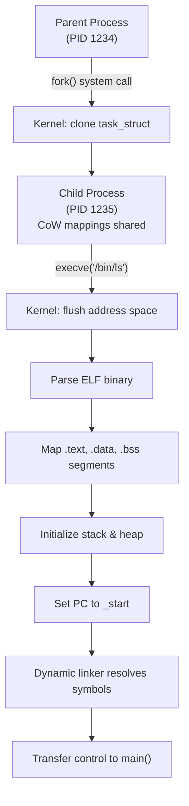
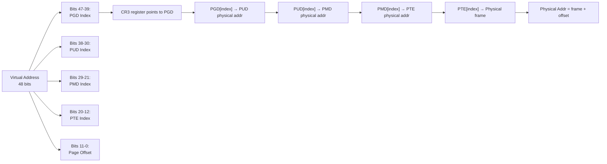
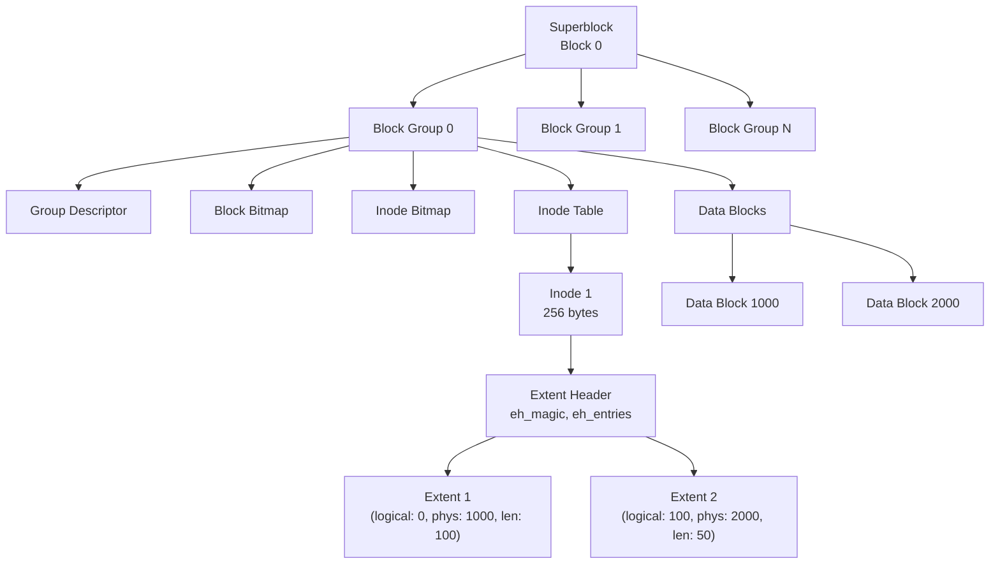
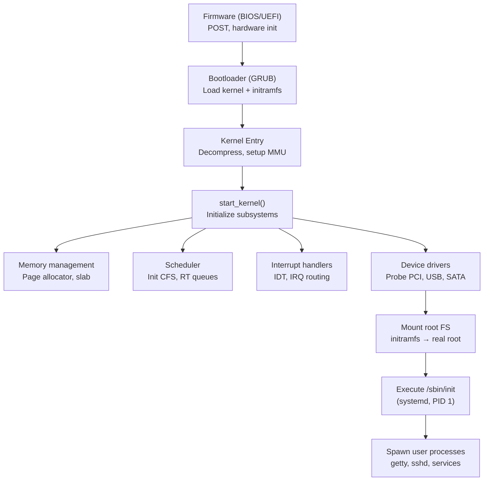
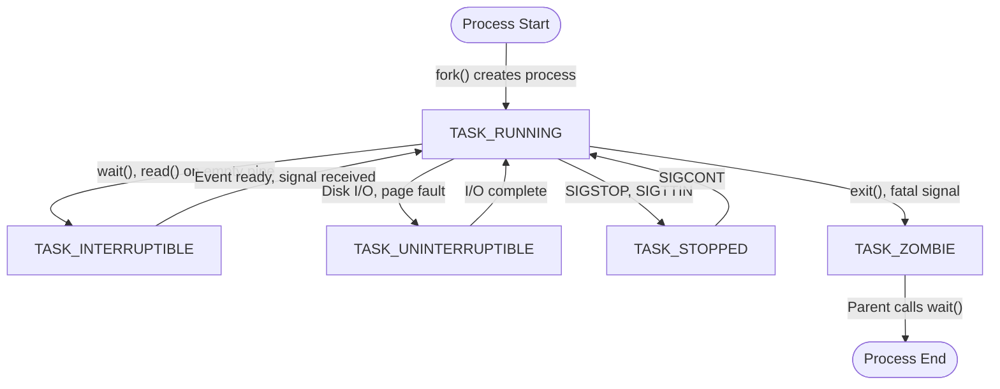
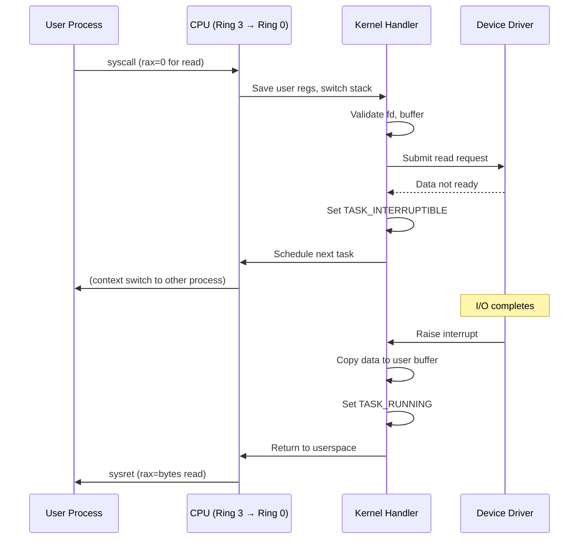

# Lesson 2: Core Architecture & Memory/Execution Models

## 1. Process, Threading, and Execution Lifecycles

A process is an isolated instance of an executing program, comprising a virtual address space, open file descriptors, process credentials, and kernel-managed metadata encapsulated in the Process Control Block (PCB). On Linux, the kernel represents processes and threads uniformly as tasks, each described by a `struct task_struct` that holds scheduling state, memory mappings, signal handlers, and resource limits.

### Process Creation and Address Space Semantics

Process creation on Unix-like systems follows the fork-exec pattern. The `fork()` system call clones the calling process by duplicating its `task_struct` and establishing copy-on-write (CoW) mappings for memory pages. The child initially shares physical pages with the parent; writes trigger page faults that allocate new physical frames, lazily copying data only when modified. This mechanism, implemented via the `VM_MAYWRITE` and `VM_SHARED` flags in Virtual Memory Area (VMA) descriptors, minimizes memory overhead and creation latency.

The `execve()` system call replaces the current address space with a new one built from an ELF binary. The kernel parses the ELF header, maps text (read-only, executable), data (read-write), and BSS segments into the process address space, then initializes the stack and heap. The program counter is set to the ELF entry point, typically `_start`, which invokes dynamic linker (`ld-linux.so`) for shared library resolution before transferring control to `main()`.



### Threading Models and Scheduler Internals

Threads share the same address space and file descriptor table but maintain separate stacks, thread-local storage (TLS), and register state. Linux implements threads via the `clone()` system call with flags like `CLONE_VM` (share memory), `CLONE_FILES` (share file descriptors), and `CLONE_THREAD` (share thread group). The NPTL (Native POSIX Thread Library) uses one-to-one mapping, where each userspace thread corresponds to a kernel task.

The Completely Fair Scheduler (CFS) allocates CPU time proportionally to task weights derived from nice values. CFS maintains a red-black tree keyed by virtual runtime (`vruntime`), a weighted measure of actual CPU time consumed. The leftmost node (minimum `vruntime`) is selected next. When a task runs for a timeslice, its `vruntime` increases by `(weight_0 / weight_task) × Δt`, ensuring fairness. CFS handles real-time tasks separately via FIFO and round-robin classes with strict priority.

```c
// Kernel's task selection in CFS (simplified logic)
struct sched_entity *__pick_first_entity(struct cfs_rq *cfs_rq) {
    struct rb_node *left = rb_first_cached(&cfs_rq->tasks_timeline);
    if (!left)
        return NULL;
    return rb_entry(left, struct sched_entity, run_node);
}
```

Ansible control nodes fork worker processes to execute tasks concurrently. Each worker establishes SSH connections, transfers modules, and executes Python interpreters on managed nodes. Threading within Ansible is limited; the `forks` parameter controls process-level parallelism to balance throughput against resource consumption.

### Exercise 1: Process Creation, Execution, and Inspection

This exercise demonstrates fork-exec mechanics and PCB inspection. The parent forks a child that executes `/bin/ls`, while the parent waits for termination and retrieves the exit status via `waitpid()`.

```c
#include <stdio.h>
#include <stdlib.h>
#include <unistd.h>
#include <sys/types.h>
#include <sys/wait.h>

int main() {
    pid_t pid = fork();
    
    if (pid == -1) {
        perror("fork failed");
        exit(EXIT_FAILURE);
    } else if (pid == 0) {
        // Child process: replace address space with /bin/ls
        printf("[Child PID %d] Executing /bin/ls\n", getpid());
        execl("/bin/ls", "ls", "-l", "/proc/self", NULL);
        
        // execl only returns on failure
        perror("execl failed");
        exit(EXIT_FAILURE);
    } else {
        // Parent process: wait for child termination
        printf("[Parent PID %d] Created child PID %d\n", getpid(), pid);
        
        int status;
        pid_t terminated = waitpid(pid, &status, 0);
        
        if (WIFEXITED(status)) {
            printf("[Parent] Child %d exited with status %d\n", 
                   terminated, WEXITSTATUS(status));
        } else if (WIFSIGNALED(status)) {
            printf("[Parent] Child %d terminated by signal %d\n", 
                   terminated, WTERMSIG(status));
        }
    }
    
    return EXIT_SUCCESS;
}
```

Compile and execute:

```bash
gcc -Wall -Wextra -O2 -o process_lifecycle process_lifecycle.c
./process_lifecycle
```

Inspect the process hierarchy and state transitions:

```bash
# Capture process snapshot during execution
ps -eLf | grep process_lifecycle

# Examine kernel task_struct fields (requires root or relaxed ptrace restrictions)
cat /proc/$(pgrep process_lifecycle)/status
cat /proc/$(pgrep process_lifecycle)/stat
```

The `/proc/[pid]/status` file exposes scheduling policy, context switch counts, and voluntary/involuntary preemption statistics. The `Mems_allowed` field shows CPU affinity masks.

## 2. Memory Subsystems and Buffer Management

Modern operating systems implement virtual memory to provide isolation, overcommitment, and security. Each process perceives a contiguous address space, typically 48 bits on x86-64 (256 TiB theoretical, with canonical address checks). The Memory Management Unit (MMU) translates virtual addresses to physical addresses using multi-level page tables.

### Page Tables and Address Translation

On x86-64, a four-level page table hierarchy translates 48-bit virtual addresses: Page Global Directory (PGD), Page Upper Directory (PUD), Page Middle Directory (PMD), and Page Table Entry (PTE). Each level indexes into a 4 KiB page holding 512 8-byte entries. The CR3 register points to the PGD physical address. The Translation Lookaside Buffer (TLB) caches recent translations to avoid expensive page walks.



Page table entries encode permission bits (R/W/X), dirty/accessed flags, and Present bit. A page fault occurs when the Present bit is clear or permissions are violated. The kernel's page fault handler (`do_page_fault()`) resolves faults by allocating frames (demand paging), loading data from swap (page-in), or copying CoW pages.

### Virtual Memory Areas and Memory Regions

The kernel partitions a process address space into Virtual Memory Areas (VMAs), each represented by `struct vm_area_struct` in a red-black tree keyed by start address. VMAs describe contiguous regions with uniform permissions and backing stores (anonymous memory, file mappings, shared libraries). Common regions include:

- **Text segment** (0x400000 on x86-64): ELF `.text`, read-only, executable
- **Data segment**: ELF `.data` and `.bss`, read-write
- **Heap**: dynamically grows upward via `brk()` or `mmap(MAP_ANONYMOUS)`
- **Memory-mapped files**: `mmap()` with file descriptor
- **Stack**: grows downward from high addresses, guard page prevents overflow

### Page Cache and Buffer Cache Unification

The page cache serves as a unified buffer for file data and metadata. When a process reads a file, the kernel checks the page cache before issuing disk I/O. Dirty pages are written back asynchronously by `pdflush`/`kworker` threads using write-behind policy. The kernel balances page cache size against application memory via the page frame reclamation algorithm (LRU lists, active/inactive pages).

The buffer cache, historically separate, is now integrated into the page cache. Block devices use buffer heads (`struct buffer_head`) to track individual disk blocks within pages. File systems like ext4 use the page cache for data and the buffer cache abstraction for metadata (inodes, bitmaps, superblocks).

### Exercise 2: Memory Allocation, Leak Detection, and Profiling

This exercise demonstrates dynamic memory allocation with explicit error handling and validation using Valgrind's Memcheck tool to detect leaks, invalid accesses, and uninitialized reads.

```c
#include <stdio.h>
#include <stdlib.h>
#include <string.h>
#include <errno.h>

typedef struct {
    int *data;
    size_t size;
    size_t capacity;
} DynamicArray;

DynamicArray* create_array(size_t initial_capacity) {
    DynamicArray *arr = malloc(sizeof(DynamicArray));
    if (!arr) {
        fprintf(stderr, "Failed to allocate array structure: %s\n", strerror(errno));
        return NULL;
    }
    
    arr->data = calloc(initial_capacity, sizeof(int));
    if (!arr->data) {
        fprintf(stderr, "Failed to allocate data buffer: %s\n", strerror(errno));
        free(arr);
        return NULL;
    }
    
    arr->size = 0;
    arr->capacity = initial_capacity;
    return arr;
}

int append_element(DynamicArray *arr, int value) {
    if (arr->size >= arr->capacity) {
        size_t new_capacity = arr->capacity * 2;
        int *new_data = realloc(arr->data, new_capacity * sizeof(int));
        if (!new_data) {
            fprintf(stderr, "Failed to reallocate: %s\n", strerror(errno));
            return -1;
        }
        arr->data = new_data;
        arr->capacity = new_capacity;
    }
    
    arr->data[arr->size++] = value;
    return 0;
}

void destroy_array(DynamicArray *arr) {
    if (arr) {
        free(arr->data);
        free(arr);
    }
}

int main() {
    DynamicArray *arr = create_array(4);
    if (!arr) {
        return EXIT_FAILURE;
    }
    
    for (int i = 0; i < 10; i++) {
        if (append_element(arr, i * 10) < 0) {
            destroy_array(arr);
            return EXIT_FAILURE;
        }
    }
    
    printf("Array contents: ");
    for (size_t i = 0; i < arr->size; i++) {
        printf("%d ", arr->data[i]);
    }
    printf("\n");
    
    destroy_array(arr);
    return EXIT_SUCCESS;
}
```

Compile with debug symbols and run Valgrind:

```bash
gcc -Wall -Wextra -g -O0 -o memory_management memory_management.c
valgrind --leak-check=full --show-leak-kinds=all --track-origins=yes ./memory_management
```

Valgrind output analysis:

```bash
==12345== HEAP SUMMARY:
==12345==     in use at exit: 0 bytes in 0 blocks
==12345==   total heap usage: 3 allocs, 3 frees, 1,088 bytes allocated
==12345== 
==12345== All heap blocks were freed -- no leaks are possible
```

To demonstrate leak detection, comment out `destroy_array(arr)` and re-run Valgrind. The tool will report definitely lost blocks with allocation backtraces.

Profile memory usage with `massif`:

```bash
valgrind --tool=massif ./memory_management
ms_print massif.out.<pid>
```

Massif generates a timeline of heap allocations, identifying peak memory usage and allocation sites.

## 3. Data Structures and On-Disk/In-Kernel Binary Layouts

### In-Kernel Data Structures

The kernel employs specialized data structures optimized for concurrent access and cache efficiency. Key structures include:

- **Red-black trees** (`lib/rbtree.c`): Self-balancing BSTs used for VMAs, CFS runqueues, and timer management. Guarantees O(log n) insertion/deletion with at most two rotations per operation.
- **Radix trees** (`lib/radix-tree.c`): Compact integer-keyed trees used for page cache indexing and IDR (ID allocation).
- **Hash tables** (`lib/hashtable.h`): Chained or open-addressed tables for quick lookups (dentries, inodes, network connections).
- **Linked lists** (`include/linux/list.h`): Intrusive doubly-linked lists with container_of macro for embedding within structures.

Example: CFS uses a red-black tree keyed by `vruntime` for O(log n) task selection. The `task_struct` embeds a `sched_entity` containing the RB node:

```c
struct sched_entity {
    struct load_weight  load;
    struct rb_node      run_node;
    u64                 vruntime;
    u64                 sum_exec_runtime;
    // ... additional fields
};

struct task_struct {
    struct sched_entity se;
    // ... thousands of other fields
};
```

### File System On-Disk Layouts: ext4 Case Study

The ext4 file system organizes data into block groups, each containing a superblock copy (on some groups), group descriptors, block and inode bitmaps, inode table, and data blocks. The superblock stores critical metadata: block size, inode count, mount time, feature flags, and journal location.

Inodes are fixed-size structures (typically 256 bytes) storing file metadata: mode, UID/GID, size, timestamps, and block pointers. ext4 uses extents (contiguous block ranges) instead of indirect blocks for efficient large-file representation. An extent is a `(logical_block, physical_block, length)` tuple, stored in an extent tree rooted in the inode.



The journal (JBD2) provides crash consistency by logging metadata changes before applying them in-place. Transactions are committed atomically; on crash recovery, the journal is replayed to restore file system integrity.

### ELF Binary Format and Linking

The Executable and Linkable Format (ELF) is the standard binary format on Linux. An ELF file contains:

- **ELF header**: magic number, class (32/64-bit), architecture, entry point, program/section header offsets
- **Program headers**: describe segments for the loader (PT_LOAD, PT_DYNAMIC, PT_INTERP)
- **Section headers**: describe sections for the linker (.text, .data, .symtab, .strtab, .rel.dyn)

The dynamic linker (`ld-linux.so`) resolves symbols via the Global Offset Table (GOT) and Procedure Linkage Table (PLT). The GOT stores addresses of external functions; the PLT contains stubs that lazily resolve symbols on first call (lazy binding). Position-independent executables (PIE) enable ASLR by using PC-relative addressing.

```bash
# Inspect ELF structure
readelf -h /bin/ls              # ELF header
readelf -l /bin/ls              # Program headers
readelf -S /bin/ls              # Section headers
objdump -d /bin/ls | less       # Disassembly
nm -D /bin/ls                   # Dynamic symbols
ldd /bin/ls                     # Shared library dependencies
```

### Exercise 3: Lock-Free Data Structure Implementation

This exercise implements a lock-free stack using atomic compare-and-swap (CAS) operations, demonstrating concurrent data structure design without mutexes.

```c
#include <stdio.h>
#include <stdlib.h>
#include <stdatomic.h>
#include <pthread.h>

typedef struct Node {
    int data;
    struct Node *next;
} Node;

typedef struct {
    _Atomic(Node*) head;
} LockFreeStack;

void stack_init(LockFreeStack *stack) {
    atomic_store(&stack->head, NULL);
}

void stack_push(LockFreeStack *stack, int value) {
    Node *new_node = malloc(sizeof(Node));
    if (!new_node) {
        perror("malloc failed");
        exit(EXIT_FAILURE);
    }
    new_node->data = value;
    
    Node *old_head = atomic_load(&stack->head);
    do {
        new_node->next = old_head;
    } while (!atomic_compare_exchange_weak(&stack->head, &old_head, new_node));
}

int stack_pop(LockFreeStack *stack, int *value) {
    Node *old_head = atomic_load(&stack->head);
    Node *new_head;
    
    do {
        if (old_head == NULL) {
            return 0; // Stack empty
        }
        new_head = old_head->next;
    } while (!atomic_compare_exchange_weak(&stack->head, &old_head, new_head));
    
    *value = old_head->data;
    free(old_head);
    return 1;
}

void* worker_thread(void *arg) {
    LockFreeStack *stack = (LockFreeStack*)arg;
    
    // Push 1000 elements
    for (int i = 0; i < 1000; i++) {
        stack_push(stack, i);
    }
    
    // Pop 500 elements
    int value;
    for (int i = 0; i < 500; i++) {
        stack_pop(stack, &value);
    }
    
    return NULL;
}

int main() {
    LockFreeStack stack;
    stack_init(&stack);
    
    const int NUM_THREADS = 8;
    pthread_t threads[NUM_THREADS];
    
    // Spawn worker threads
    for (int i = 0; i < NUM_THREADS; i++) {
        if (pthread_create(&threads[i], NULL, worker_thread, &stack) != 0) {
            perror("pthread_create failed");
            exit(EXIT_FAILURE);
        }
    }
    
    // Wait for completion
    for (int i = 0; i < NUM_THREADS; i++) {
        pthread_join(threads[i], NULL);
    }
    
    // Count remaining elements
    int count = 0, value;
    while (stack_pop(&stack, &value)) {
        count++;
    }
    
    printf("Remaining elements in stack: %d\n", count);
    printf("Expected: %d (8 threads × 500 net pushes)\n", NUM_THREADS * 500);
    
    return EXIT_SUCCESS;
}
```

Compile and run with thread sanitizer to verify correctness:

```bash
gcc -Wall -Wextra -O2 -pthread -fsanitize=thread -g -o lockfree_stack lockfree_stack.c
./lockfree_stack
```

The `atomic_compare_exchange_weak` function performs CAS: it updates `stack->head` to `new_node` only if it still equals `old_head`, preventing ABA problems. ThreadSanitizer detects data races and deadlocks during concurrent execution.

## 4. The Critical Execution Lifecycle: From Power-On to Process Termination

### Boot Sequence and Kernel Initialization

The boot process begins with firmware (BIOS/UEFI) performing Power-On Self-Test (POST), initializing hardware, and loading the bootloader (GRUB) from the Master Boot Record (MBR) or EFI System Partition (ESP). The bootloader loads the kernel image (vmlinuz) and initial RAM disk (initramfs) into memory, then transfers control to the kernel entry point.

The kernel decompresses itself, initializes the MMU, sets up page tables, and begins early boot initialization. The `start_kernel()` function orchestrates subsystem initialization: trap handlers, memory management, scheduler, timers, and device drivers. The kernel mounts the root file system, either from initramfs or a real device, and executes the init process (systemd, PID 1).



### Process Lifecycle State Transitions

A process transitions through multiple states managed by the scheduler. The primary states are:

- **TASK_RUNNING** (R): Executing on CPU or ready to run
- **TASK_INTERRUPTIBLE** (S): Sleeping, waiting for event (signal wakes it)
- **TASK_UNINTERRUPTIBLE** (D): Sleeping, ignoring signals (I/O wait)
- **TASK_STOPPED** (T): Stopped by SIGSTOP or debugger
- **TASK_ZOMBIE** (Z): Terminated, awaiting parent to reap exit status

State transitions occur via system calls, signals, and scheduler decisions:



A zombie process retains its PID and minimal metadata until the parent reaps it via `wait()` or `waitpid()`. If the parent exits first, init adopts orphaned children and automatically reaps zombies.

### System Call Execution Path

System calls transition from user mode to kernel mode via a trap instruction (`syscall` on x86-64). The CPU switches to the kernel stack, saves user registers, and invokes the system call handler based on the syscall number in `%rax`. Arguments are passed in registers (`%rdi`, `%rsi`, `%rdx`, `%r10`, `%r8`, `%r9`).

The kernel validates arguments, performs the requested operation (e.g., `sys_read()` copies data from kernel buffers to userspace), updates task state if blocking, and returns. The CPU restores user registers and returns to userspace via `sysret`.



### Process Termination and Resource Cleanup

Termination begins with `exit()` or a fatal signal (SIGSEGV, SIGKILL). The kernel invokes `do_exit()`, which:

1. Sets task state to TASK_ZOMBIE
2. Closes open file descriptors (decrement reference counts)
3. Releases memory mappings (unmaps VMAs, frees page tables)
4. Detaches from shared resources (IPC, semaphores)
5. Notifies parent via SIGCHLD
6. Yields CPU permanently

The parent retrieves exit status via `wait()`, allowing the kernel to reclaim the `task_struct` and PID. If the parent ignores SIGCHLD, the zombie persists until the parent terminates or explicitly waits.

### Ansible's Process Model in Context

Ansible's control node spawns worker processes (default 5, configurable via `forks`) to execute tasks in parallel. Each worker:

1. Forks from the main Ansible process
2. Establishes an SSH connection to a managed node (or uses local execution)
3. Transfers the module code (Python script) and JSON arguments via stdin or temp file
4. Executes the module in a Python interpreter on the remote node
5. Captures stdout (JSON result) and stderr (errors/warnings)
6. Closes the SSH connection and exits

The control node waits for all workers, aggregates results, and proceeds to the next task. This process model balances parallelism (limited by `forks` to avoid overwhelming targets or the control node) with isolation (each worker is independent, failures don't cascade).

SSH connection reuse (ControlMaster/ControlPersist) amortizes connection setup cost across multiple tasks.

## Conclusion

Ansible's architecture is a deliberate exploitation of Unix process and memory fundamentals to achieve robust, scalable automation. By forking worker processes, Ansible gains memory isolation (each worker operates in its own address space, preventing cross-contamination of state), failure containment (a crashed worker cannot corrupt the control node's state or other workers), and natural parallelism without the complexity of threading or shared memory synchronization. The `forks` parameter directly maps to the kernel's scheduler load: each worker is a distinct scheduling entity, and the control node avoids saturating either its own CPU or the managed nodes' SSH daemons by bounding concurrency. SSH connection reuse via ControlMaster/ControlPersist transforms what would be a catastrophic overhead (public-key handshake, Diffie-Hellman exchange, authentication) into a one-time cost amortized across an entire playbook run, reducing task latency from seconds to tens of milliseconds for subsequent operations on the same host.

The memory model underlying Ansible's execution—copy-on-write forking, page table inheritance, and demand paging—ensures efficient use of physical RAM even when hundreds of tasks execute across dozens of hosts. The control node's parent process holds the shared code and data segments (Python interpreter, Ansible libraries, playbook AST), and each worker inherits read-only mappings without duplicating physical pages until writes occur. This deferred copying, combined with the transient nature of workers (they exit after each task batch), keeps the control node's memory footprint proportional to the working set of active connections rather than the total playbook size. The kernel's VMA-based memory management transparently handles cleanup during worker termination, preventing leaks and ensuring predictable resource consumption across long-running automation campaigns. Understanding these invariants is critical for diagnosing performance pathologies—stalled playbooks often trace to scheduler starvation (too many forks), memory pressure (excessive parallelism forcing page eviction), or SSH multiplexing failures (ControlPath exhaustion or stale sockets).

## Summary & Verification Matrix

| **Invariant/Mechanism** | **Governing Principle** | **Observable Artifact** | **Diagnostic Command/Criterion** |
|-------------------------|------------------------|-------------------------|----------------------------------|
| **Process Fork Model** | Each Ansible worker is an independent process with isolated address space; control node spawns `forks` workers in parallel per batch. | Worker PIDs visible during execution; no shared memory between workers. | `ps aux \| grep ansible` shows multiple child processes; `strace -f ansible-playbook` reveals `clone()` syscalls; `forks` parameter in `ansible.cfg`. |
| **Copy-on-Write Memory Sharing** | Forked workers inherit parent's page tables with COW flags; physical pages duplicated only on write, minimizing memory overhead. | RSS remains low until workers modify state; shared code/library pages not duplicated. | `pmap <parent_pid>` and `pmap <worker_pid>` show overlapping address ranges; `/proc/<pid>/smaps` reveals shared vs. private dirty pages; memory usage grows sublinearly with worker count. |
| **SSH Connection Reuse (ControlMaster)** | Unix domain socket acts as persistent SSH channel; subsequent connections multiplex over existing session, avoiding handshake overhead. | ControlPath socket exists in `/tmp` or `~/.ansible/cp/`; connection latency drops to < 50ms after first task. | `ls ~/.ansible/cp/` shows active sockets; `ssh -O check <host>` confirms master status; `time ssh <host> true` (first run vs. subsequent) shows 10-100× speedup. |
| **Blocking I/O and Task Scheduling** | Workers block in `read()` waiting for SSH output; kernel transitions task to TASK_INTERRUPTIBLE, yielding CPU until data arrives. | Workers show `S` (sleeping) state in `ps`; low CPU usage during network I/O; completion order non-deterministic across hosts. | `ps aux \| grep ansible` shows `S` state for waiting workers; `strace -p <worker_pid>` reveals `read()` blocking on socket FD; `iotop` shows minimal disk I/O. |
| **Resource Cleanup on Termination** | Worker `exit()` triggers `do_exit()`: closes FDs (SSH sockets, temp files), unmaps VMAs, releases PIDs; parent collects status via `wait()`. | No lingering SSH connections or temp files after playbook completes; zombie processes cleared immediately. | `lsof -p <worker_pid>` shows open FDs released post-exit; `netstat -anp \| grep :22` confirms closed SSH connections; no `<defunct>` processes in `ps aux`. |
| **Parallelism vs. Overhead Trade-off** | `forks` parameter balances throughput (more parallelism) against control node CPU/memory and target SSH daemon capacity. | Optimal `forks` depends on network latency, task duration, and host count; too high causes scheduler thrashing or SSH refusals. | Benchmark with varying `forks`: `time ansible-playbook -f 5 vs. -f 50`; monitor control node load (`uptime`, `vmstat 1`); check target `/var/log/auth.log` for `sshd` rate limiting or MaxStartups errors. |
