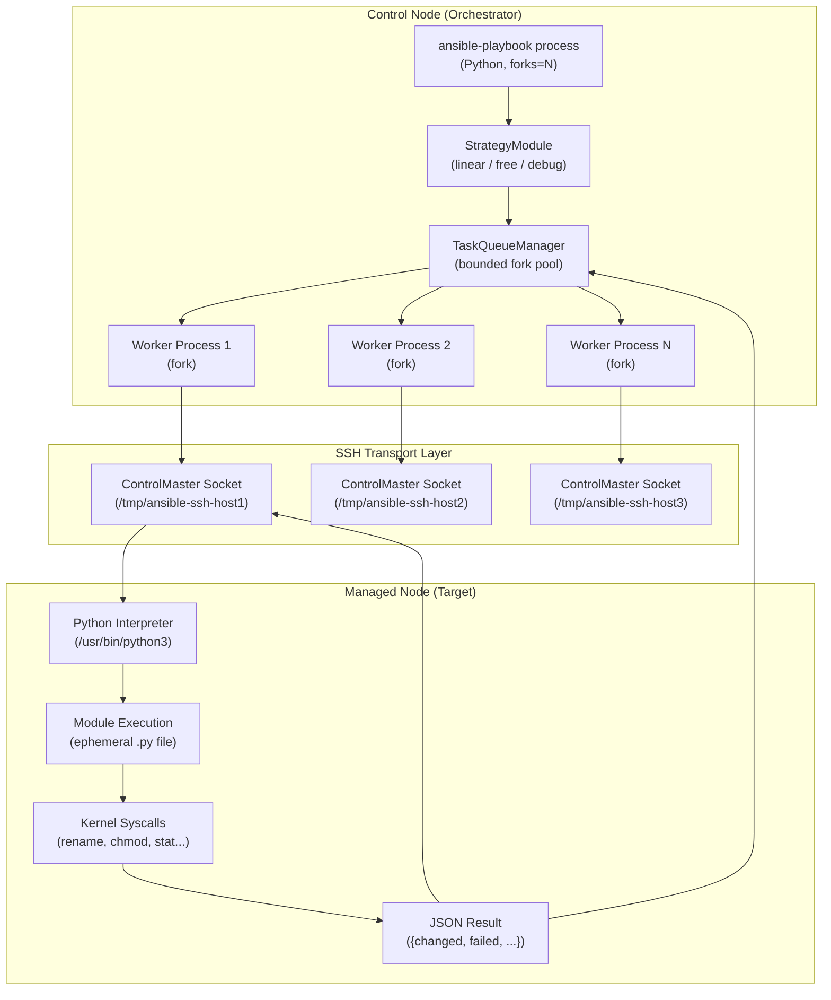
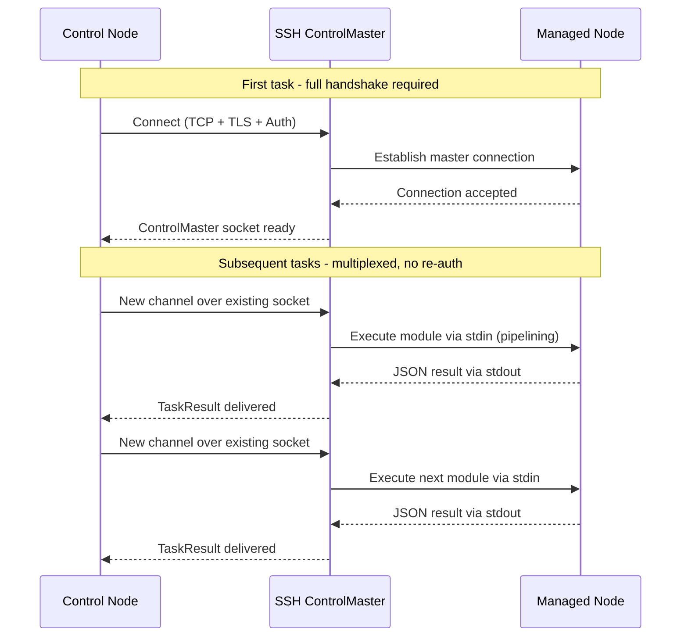
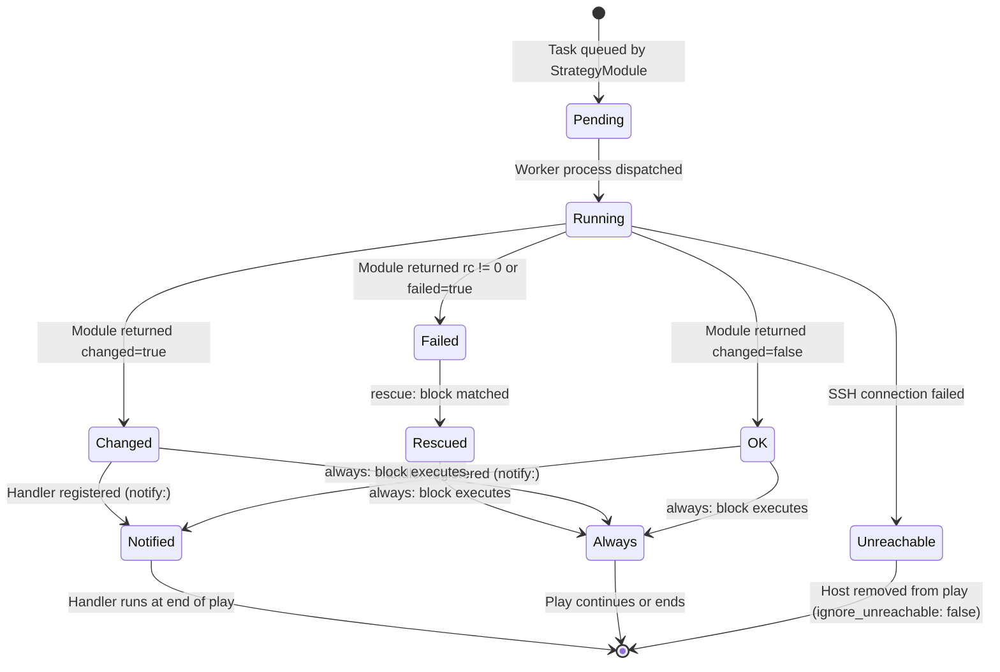

# Lesson 3: Advanced Internal Mechanics, Concurrency & Recovery

Ansible is often characterized as a simple, agentless configuration management tool, yet beneath its declarative YAML syntax lies a sophisticated distributed state reconciliation engine. To the principal infrastructure architect or kernel specialist, Ansible is not merely a script runner—it is a **level-triggered control plane** that orchestrates remote execution through SSH, manages concurrency via bounded fork pools, and relies on the POSIX semantics of the target operating system to guarantee atomicity.

Understanding Ansible at this depth requires dissecting its concurrency control mechanisms, its state machine transitions, its ephemeral resource accounting, and the Byzantine failure domains that emerge when distributed systems interact with unreliable networks. This lesson approaches those mechanics from first principles, tracing execution from Python process fork through SSH multiplexing to POSIX kernel call.

---

## 1. Architectural Overview: The Control Plane Model

Before examining individual subsystems, it is essential to establish a precise mental model of Ansible's runtime architecture. Ansible is a **push-based, ephemeral orchestrator**. There is no persistent daemon on either the control node or the managed nodes. Every playbook run is a discrete, self-contained execution process that terminates upon completion or failure.

The following diagram captures the high-level architecture across a single playbook run:



The critical architectural insight is that the **worker processes are forked from the main `ansible-playbook` process**, not threaded. This distinction has profound implications for Python's Global Interpreter Lock (GIL), memory layout, and resource isolation, explored in depth in Section 2.

---

## 2. Concurrency Control: Fork Pools, the GIL, and SSH Multiplexing

### 2.1 Why Forks, Not Threads

Ansible's concurrency model uses `os.fork()` rather than `threading.Thread`. This is not an accident of history—it is a deliberate architectural decision motivated by Python's GIL.

The GIL is a mutex internal to CPython that prevents more than one thread from executing Python bytecode simultaneously. For CPU-bound workloads, threading in CPython provides no parallelism. However, Ansible's worker workload is dominated by I/O: SSH handshakes, data serialization over sockets, and waiting for remote process completion. The GIL is released during I/O system calls, so threaded I/O-bound code does achieve concurrency in CPython, but it does **not** achieve true parallelism for the Python-layer processing that wraps those I/O calls (result parsing, Jinja2 rendering, variable interpolation).

By using `os.fork()`, each worker process gets its own Python interpreter state, its own GIL, and its own memory space. This achieves true parallelism for the Python-layer processing. The cost is a higher memory footprint—each forked process inherits a copy-on-write (CoW) mapping of the parent's address space—but for infrastructure workloads targeting hundreds of nodes, this is an acceptable trade-off.

The `forks` parameter in `ansible.cfg` (default: `5`) is the upper bound on simultaneously active worker processes:

```ini
# ansible.cfg
[defaults]
forks = 50               # Raise for large inventories; bound by control node ulimits
host_key_checking = True
pipelining = True        # Critical for performance; see Section 2.3
timeout = 30
```

The practical ceiling for `forks` is determined by:

1. The control node's open file descriptor limit (`ulimit -n`), since each SSH connection consumes at least two file descriptors (stdin/stdout of the SSH subprocess).
2. The control node's process table limit (`ulimit -u`).
3. The network bandwidth available for SSH data transfer.
4. The managed nodes' capacity to accept concurrent connections (`MaxStartups` in `sshd_config`).

A common production failure mode is raising `forks` to 200 without raising `ulimit -n` correspondingly, resulting in `OSError: [Errno 24] Too many open files` during the fork or SSH connection phase.

### 2.2 The TaskQueueManager and Internal Queue Mechanics

The `TaskQueueManager` (defined in `lib/ansible/executor/task_queue_manager.py` in the Ansible source) is the central coordinator. It maintains:

- A `multiprocessing.Queue` for dispatching `TaskResult` objects from worker processes back to the main process.
- A list of active `WorkerProcess` instances, bounded by `forks`.
- A `StrategyModule` reference that determines task dispatch ordering.

The producer-consumer relationship is as follows: the `StrategyModule` (e.g., `linear`) acts as the producer, iterating over hosts and tasks to construct `HostState` objects and place them into the work queue. The `WorkerProcess` instances are consumers that pick up work, execute the task against the target host, and place a `TaskResult` back onto the results queue. The main process spins in a polling loop consuming `TaskResult` objects and driving the strategy forward.

This architecture is **not** a lock-free queue in the strict computer science sense—it uses `multiprocessing.Queue`, which is backed by a `Pipe` and a `Lock`. It is "lockless at the control plane level" only in the sense that there is no distributed lock coordinating access across managed nodes. The local queue itself uses POSIX mutexes.

### 2.3 SSH Multiplexing: ControlMaster and Pipelining

Each `WorkerProcess` communicates with its assigned managed node over SSH. Without optimization, every task execution requires:

1. A new TCP three-way handshake.
2. An SSH protocol version exchange.
3. An SSH key exchange (Diffie-Hellman or ECDH).
4. User authentication (public key signature verification).
5. Channel establishment.

For a playbook with 50 tasks on 100 nodes, this means up to 5,000 full SSH handshakes, each taking 50–200ms on a typical LAN. This is the primary performance bottleneck in unoptimized Ansible deployments.

**SSH ControlMaster** solves the handshake overhead by establishing one master connection per host and multiplexing all subsequent SSH sessions over the existing TCP connection and authenticated SSH transport. The control socket is a UNIX domain socket typically created at a path like `/tmp/ansible-ssh-%h-%p-%r`.

```ini
# ~/.ssh/config (or via ansible.cfg ssh_args)
Host *
    ControlMaster     auto
    ControlPath       /tmp/ansible-ssh-%C
    ControlPersist    60s
```

The `%C` token is a hash of the connection parameters (host, port, user), preventing socket path length issues for long hostnames.

**SSH Pipelining** (`pipelining = True`) is a complementary optimization. By default, Ansible transfers the module as a file to the remote node, then executes it in a second SSH session, then cleans up in a third. With pipelining enabled, the module Python code is sent directly over `stdin` of the SSH connection and executed without touching the filesystem—collapsing three round trips into one. The requirement for pipelining is that `requiretty` must be disabled in `/etc/sudoers` on managed nodes, since `sudo` without a TTY cannot prompt for a password.

The combined effect of ControlMaster and pipelining can reduce task execution latency by 60–80% compared to default settings in a typical data center environment.



---

## 3. The `atomic_move` Pattern and POSIX Rename Semantics

One of Ansible's most critical correctness guarantees is its file write atomicity model, embodied in the `atomic_move` function used by the `copy`, `template`, `blockinfile`, `lineinfile`, and `assemble` modules.

### 3.1 The Problem: Torn Reads

Without atomic writes, a file modification follows this sequence:

1. Open destination file for writing (`O_WRONLY | O_TRUNC`).
2. Write new content.
3. Close file.

Between steps 1 and 3, any process reading the file will observe a partially written, internally inconsistent state. For configuration files—`/etc/nginx/nginx.conf`, `/etc/pam.d/sshd`, kernel module load lists—a partially written file read by a daemon at the wrong moment can cause silent misconfiguration or a hard crash.

### 3.2 The Solution: `rename(2)` Atomicity

The POSIX specification for `rename(2)` guarantees: "If the rename is successful, the named file shall be accessible by both names simultaneously, or by neither name. If the rename is unsuccessful, the named file shall be accessible by neither name." In practice on Linux with local filesystems (ext4, XFS, btrfs), `rename(2)` is implemented as an atomic metadata operation: it updates the directory entry in a single filesystem transaction. No reader can observe a state where the old file has been removed but the new file has not yet appeared.

Ansible's `atomic_move` implementation (in `lib/ansible/module_utils/basic.py`) follows this pattern precisely:

```python
# Simplified representation of Ansible's atomic_move logic
# Source: lib/ansible/module_utils/basic.py

import os
import tempfile
import shutil

def atomic_move(self, src, dest, unsafe_writes=False):
    """
    Atomically replace `dest` with the content of `src`.
    Both paths must reside on the same filesystem for rename(2) atomicity.
    Falls back to shutil.copy2 + os.rename if cross-device.
    """
    dest_dir = os.path.dirname(dest)

    # Preserve destination permissions if it already exists
    if os.path.exists(dest):
        dest_stat = os.stat(dest)
        os.chmod(src, dest_stat.st_mode)
        try:
            os.chown(src, dest_stat.st_uid, dest_stat.st_gid)
        except OSError:
            pass  # May lack privilege; SELinux context restored separately

    # Attempt same-filesystem rename (atomic)
    try:
        os.rename(src, dest)
    except OSError as e:
        # Cross-device link (errno 18 / EXDEV): src and dest on different filesystems
        # Must copy then rename within dest's filesystem
        if e.errno == errno.EXDEV:
            tmp_dest = tempfile.NamedTemporaryFile(
                dir=dest_dir, delete=False, prefix='.ansible_tmp'
            )
            try:
                shutil.copy2(src, tmp_dest.name)
                os.rename(tmp_dest.name, dest)   # Now same filesystem: atomic
            finally:
                if os.path.exists(tmp_dest.name):
                    os.unlink(tmp_dest.name)
        else:
            raise
```

The critical correctness constraint is that the **temporary file must be on the same filesystem as the destination**. If `/tmp` is a `tmpfs` mount and the destination is on `/etc` (ext4), `os.rename()` will raise `EXDEV` (cross-device link). Ansible handles this by creating the temporary file in the destination's parent directory, guaranteeing same-filesystem placement.

### 3.3 SELinux and Extended Attribute Preservation

On SELinux-enforcing systems (RHEL, CentOS, Fedora), `rename(2)` preserves the security context (xattr `security.selinux`) of the **source** file, which was created in a temporary location and therefore carries the wrong SELinux type label. Ansible calls `restorecon` or uses the `selinux` Python bindings to restore the correct context after the rename. This is why the `copy` module has the `seuser`, `serole`, `setype`, and `selevel` parameters—they are not convenience options but correctness requirements on SELinux-enforcing systems.

---

## 4. State Reconciliation Engine: Level-Triggered vs. Edge-Triggered

### 4.1 The Level-Triggered Model

The term "level-triggered" is borrowed from hardware interrupt semantics and from the Linux `epoll` API. A level-triggered system asserts a signal as long as a condition holds true, while an edge-triggered system fires only when a condition transitions. Ansible is level-triggered in the sense that each module independently evaluates the **current state** of the managed node and applies the minimum delta required to reach the desired state, regardless of how the system arrived at its current state.

This is architecturally significant: an Ansible playbook is **declarative** in intent (describe the desired end state) but **imperative** in mechanism (execute Python modules that perform explicit checks and mutations). The idempotency guarantee is not provided by the Ansible framework itself—it is a contract that each module author must uphold.

Compare this to Kubernetes controllers, which are also level-triggered but maintain a persistent reconciliation loop via informers and work queues. Ansible's loop is ephemeral: it fires once per playbook invocation and exits.

### 4.2 The Task Execution State Machine

Each task transitions through a well-defined state machine on the control node:



The `Unreachable` state is distinct from `Failed` and is handled differently. An unreachable host is removed from the active host set for the remainder of the play. Subsequent tasks will not attempt to execute against it. This is controlled by the `ignore_unreachable` task parameter and the `any_errors_fatal` play parameter.

### 4.3 Return Value Protocol: The JSON Contract

The interface between a module executing on the managed node and the Ansible control node is a **JSON payload printed to stdout**. This is the fundamental IPC contract of the Ansible module system. Every module must print exactly one JSON object to stdout before exiting. The minimum schema for this object is:

```json
{
  "changed": false,
  "failed": false,
  "msg": "Human-readable status message",
  "rc": 0
}
```

A module signals failure by either setting `"failed": true` and exiting with any return code, or by exiting with a non-zero return code without printing valid JSON (Ansible will synthesize a failure result). The `changed` key drives handler notification and the play's overall changed-host count.

A production-grade custom module in Python using `AnsibleModule` looks like this:

```python
#!/usr/bin/python3
# -*- coding: utf-8 -*-
# Custom module: library/ensure_kernel_param.py
# Ensures a sysctl parameter is set at the desired value with persistence.

from __future__ import absolute_import, division, print_function
__metaclass__ = type

DOCUMENTATION = r"""
---
module: ensure_kernel_param
short_description: Idempotently set a sysctl kernel parameter
description:
  - Reads the current value via sysctl(8), compares to desired,
    and applies the change only if necessary. Writes to /etc/sysctl.d/
    for persistence across reboots.
options:
  name:
    description: sysctl key, e.g. net.ipv4.ip_forward
    required: true
    type: str
  value:
    description: Desired string value
    required: true
    type: str
  persist:
    description: Write to /etc/sysctl.d/99-ansible-managed.conf
    default: true
    type: bool
"""

from ansible.module_utils.basic import AnsibleModule
import os
import re


def get_current_value(module, key):
    rc, stdout, stderr = module.run_command(
        ["sysctl", "-n", key], check_rc=False
    )
    if rc != 0:
        return None
    return stdout.strip()


def set_value(module, key, value):
    rc, stdout, stderr = module.run_command(
        ["sysctl", "-w", f"{key}={value}"], check_rc=False
    )
    if rc != 0:
        module.fail_json(
            msg=f"sysctl -w failed: {stderr}",
            rc=rc,
            key=key,
            value=value,
        )


def persist_value(module, key, value):
    conf_path = "/etc/sysctl.d/99-ansible-managed.conf"
    # Read existing content, replace or append the key
    lines = []
    if os.path.exists(conf_path):
        with open(conf_path, "r") as f:
            lines = f.readlines()

    new_lines = []
    found = False
    pattern = re.compile(r"^\s*" + re.escape(key) + r"\s*=")
    for line in lines:
        if pattern.match(line):
            new_lines.append(f"{key} = {value}\n")
            found = True
        else:
            new_lines.append(line)
    if not found:
        new_lines.append(f"{key} = {value}\n")

    # Write atomically using a temp file in the same directory
    import tempfile
    dir_path = os.path.dirname(conf_path)
    fd, tmp_path = tempfile.mkstemp(dir=dir_path, prefix=".ansible_tmp_")
    try:
        with os.fdopen(fd, "w") as f:
            f.writelines(new_lines)
        os.rename(tmp_path, conf_path)   # atomic_move equivalent
    except Exception as e:
        os.unlink(tmp_path)
        module.fail_json(msg=f"Failed to write {conf_path}: {e}")


def main():
    module = AnsibleModule(
        argument_spec=dict(
            name=dict(type="str", required=True),
            value=dict(type="str", required=True),
            persist=dict(type="bool", default=True),
        ),
        supports_check_mode=True,
    )

    key = module.params["name"]
    desired = module.params["value"]
    persist = module.params["persist"]

    current = get_current_value(module, key)

    if current is None:
        module.fail_json(msg=f"sysctl key '{key}' does not exist on this system")

    changed = current != desired

    if module.check_mode:
        module.exit_json(
            changed=changed,
            current_value=current,
            desired_value=desired,
            msg="Check mode: no changes applied",
        )

    if changed:
        set_value(module, key, desired)
        if persist:
            persist_value(module, key, desired)

    module.exit_json(
        changed=changed,
        key=key,
        previous_value=current,
        current_value=desired if changed else current,
    )


if __name__ == "__main__":
    main()
```

This module demonstrates the full contract: idempotency via pre-flight state check, `check_mode` support, atomic file writes, structured JSON output via `exit_json`, and explicit failure reporting via `fail_json`.

---

## 5. The Strategy Plugin Architecture: Linear, Free, and Beyond

The `StrategyModule` determines the order in which tasks are dispatched to worker processes. This is not a minor scheduling detail—it fundamentally changes the execution semantics of the playbook.

### 5.1 Linear Strategy (Default)

The `linear` strategy (the default) enforces a **global synchronization barrier** between tasks. All hosts must complete task N before any host begins task N+1. This provides deterministic, easy-to-reason-about execution but introduces a **convoy effect**: the slowest host in the inventory becomes the rate-limiting factor for every task transition.

```
Time →

Host 1: [Task 1 ████]  [Task 2 ████████]  [Task 3 ██]
Host 2: [Task 1 ██]    [wait...]          [Task 2 ████████]  [Task 3 ████]
Host 3: [Task 1 ████████] ...
```

With `linear`, Host 2 and Host 3 sit idle waiting for the barrier at Task 1 completion before Task 2 is dispatched to any host.

### 5.2 Free Strategy

The `free` strategy removes the synchronization barrier. Each host advances through the task list as fast as it can, independently of all other hosts. This maximizes throughput but breaks the implicit ordering guarantee that `notify`/handler semantics depend on.

```yaml
- name: Deploy application tier
  hosts: app_servers
  strategy: free          # Each host runs at its own pace
  tasks:
    - name: Pull container image
      community.docker.docker_image:
        name: "myapp:{{ version }}"
        source: pull
    - name: Restart service
      systemd:
        name: myapp
        state: restarted
```

A handler registered by host A's task may fire before host B has even reached the notifying task. For
