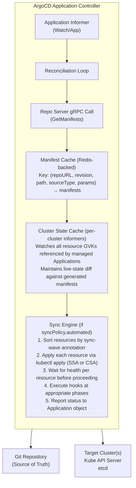

# Lesson 2: Application Resources and Declarative Configuration

## 1. First-Principles Intuition & Invariants

The fundamental architectural problem that ArgoCD solves is one of state convergence across distributed systems with inherent lag and partial failure. A Kubernetes cluster is a continuously running state machine whose current state is the union of all live API objects stored in etcd. A Git repository is a versioned, append-only log of intended state. Between these two systems sits a gap: the cluster's live state drifts through manual interventions, controller mutations, autoscaling events, and admission webhook modifications, while the Git repository advances through commits that encode new intentions. ArgoCD's entire architecture exists to close this gap through a continuous reconciliation loop, and the Application custom resource definition is the atomic typed contract that governs how that loop operates for a single unit of deployment.

The Application CRD is not merely a configuration file. It is a Kubernetes custom resource that the ArgoCD application controller watches, just as the kube-controller-manager watches ReplicaSets or StatefulSets. When you create an Application object in the argocd namespace, the application controller's informer cache receives an event, the controller reconciles that event against its internal state machine, and the result is a series of concrete actions: fetch the source repository, generate manifests, compare against live cluster state, optionally apply changes, and report status. This design inherits directly from the Kubernetes controller pattern, where every custom controller implements a level-triggered reconciliation loop rather than edge-triggered event handling. Level-triggered means the controller does not react to individual events—a commit, a pod deletion, a namespace change—but instead continuously evaluates the current observed state against the desired state and takes corrective action whenever the two diverge. This is a critical invariant because it means ArgoCD is resilient to missed events, network partitions, and controller restarts: on recovery, it simply re-evaluates the full current state and reconciles.

The second invariant is that Git is the sole source of truth. This is not a recommendation within ArgoCD's model; it is an architectural constraint enforced by the controller. When `syncPolicy.automated.selfHeal` is enabled, any out-of-band mutation to a live resource—whether from `kubectl apply`, a mutating admission webhook, or a manual edit through `kubectl edit`—will be detected by the next reconciliation cycle and reverted to match the Git state. This is the mechanism by which ArgoCD enforces convergence: the live state is ephemeral and correctable, while the desired state in Git is authoritative and immutable. The practical consequence is that operators must never make direct changes to cluster resources that are under ArgoCD management. If a change is needed, it must be committed to Git, and ArgoCD will propagate it.

The third invariant is deterministic manifest generation. ArgoCD does not apply raw files from a Git repository directly to the cluster. It runs a manifest generation pipeline that transforms repository contents into valid Kubernetes manifests before applying them. This pipeline must be deterministic: given the same repository URL, revision, path, and generation parameters, the output must always be identical. This is why ArgoCD pins manifest generation tools (Kustomize, Helm) to specific versions bundled into the repository server, and why the `targetRevision` field is critical. A floating reference like `main` means the generated manifests can change on every reconciliation if new commits land, while a pinned tag like `v2.1.4` guarantees immutability across reconciliations until an operator deliberately updates the field.

These three invariants—level-triggered reconciliation, Git as source of truth, and deterministic manifest generation—form the contract that the Application CRD expresses. Every field in the Application spec exists to parameterize one of them: which Git state to read, how to generate manifests from it, which cluster and namespace to target, whether to auto-reconcile or require human approval, and how to handle failure and ordering.

## 2. Core Architecture & Mechanics

### The Application CRD: Structural Anatomy

The Application custom resource is registered under the `argoproj.io` API group. Every Application object lives in the `argocd` namespace (or whichever namespace ArgoCD is installed in), regardless of which namespace it deploys resources to. This separation is deliberate: the Application object's namespace determines which ArgoCD instance manages it, while `spec.destination.namespace` determines where the generated manifests are applied.

Consider a complete, production-grade Application manifest for a stateless API service deployed via Kustomize:

```yaml
apiVersion: argoproj.io/v1alpha1
kind: Application
metadata:
  name: api-server-prod
  namespace: argocd
  labels:
    app.kubernetes.io/name: api-server
    app.kubernetes.io/environment: production
  finalizers:
    - resources-finalizer.argocd.argoproj.io
spec:
  project: production
  source:
    repoURL: https://github.com/example/platform-config.git
    targetRevision: v2.1.4
    path: overlays/production
    kustomize:
      images:
        - ghcr.io/example/api-server:v2.1.4
      commonLabels:
        app.kubernetes.io/managed-by: argocd
      commonAnnotations:
        argocd.argoproj.io/sync-wave: "10"
  destination:
    server: https://kubernetes.default.svc
    namespace: production
  syncPolicy:
    automated:
      prune: true
      selfHeal: true
    syncOptions:
      - CreateNamespace=true
      - PrunePropagationPolicy=foreground
      - ApplyOutOfSyncOnly=true
    retry:
      limit: 5
      backoff:
        duration: 5s
        factor: 2
        maxDuration: 3m0s
  revisionHistoryLimit: 20
```

The `metadata.finalizers` field includes `resources-finalizer.argocd.argoproj.io`, which is critical for safe deletion. When this finalizer is present, deleting the Application does not immediately remove it from etcd. Instead, the application controller intercepts the deletion, performs a cascade deletion of all resources that this Application managed (identified by the `argocd.argoproj.io/tracking-id` label), removes the finalizer, and then the object is garbage-collected. Without this finalizer, deleting an Application leaves orphaned resources in the target namespace.

The `spec.project` field references an ArgoCD AppProject, which acts as a security boundary. AppProjects define which Git repositories are allowed, which clusters can be targeted, which namespaces are permitted, and which RBAC rules apply. In a multi-tenant ArgoCD installation, the AppProject is the isolation unit. An Application referencing `project: production` can only deploy to clusters and namespaces that the `production` AppProject explicitly allows. If the AppProject does not exist or does not grant access to the specified source or destination, the application controller reports a validation error in the Application's status and refuses to sync.

### Source Specification: The Manifest Generation Pipeline

The `spec.source` block tells the repository server exactly which Git state to fetch and how to transform it into Kubernetes manifests. Three source types are supported: plain directory, Kustomize, and Helm. The `repoURL` accepts any URL that `git clone` supports: HTTPS, SSH, or the Git protocol. For private repositories, credentials are configured at the ArgoCD system level via repository secrets, not in the Application manifest itself, maintaining the security principle that secrets never appear in Git.

The `targetRevision` field accepts any Git reference: a branch name (`main`), a tag (`v2.1.4`), a commit SHA (`a1b2c3d4e5f6`), or a semver expression (`v2.1.x`). In production, pinning to a tag or commit SHA is strongly preferred because it guarantees that the manifest generation pipeline receives identical input on every reconciliation. A branch reference introduces volatility: every push to the branch changes the desired state, and if `syncPolicy.automated` is enabled, ArgoCD will apply the new state without human approval.

The `path` field specifies the subdirectory within the repository that contains the manifests or the Kustomize/Helm entry point. ArgoCD does not apply files outside this path. If the path contains a `kustomization.yaml` file, the repository server automatically invokes Kustomize. If it contains a `Chart.yaml` file, it invokes Helm. If neither is present, it treats the directory as a plain manifest directory and applies all `.yaml`, `.yml`, and `.json` files within it, non-recursively by default.

For Kustomize-based sources, the `spec.source.kustomize` block allows overriding Kustomize behavior without modifying the repository. The most common override is `images`, which replaces image tags in the generated manifests. This is how ArgoCD implements GitOps-friendly image updates: the Kustomize overlay in Git defines the base structure, and ArgoCD's `images` field can be updated programmatically by CI/CD pipelines or by ArgoCD Image Updater to point to new image tags without requiring a commit to the Kustomize overlay itself. The `namePrefix`, `nameSuffix`, `commonLabels`, and `commonAnnotations` fields pass through to Kustomize's equivalent options, allowing label injection for resource tracking and multi-environment disambiguation.

A complete Kustomize overlay structure for a production deployment would look like this:

```yaml
# overlays/production/kustomization.yaml
apiVersion: kustomize.config.k8s.io/v1beta1
kind: Kustomization

resources:
  - ../../base

namespace: production

configMapGenerator:
  - name: api-server-config
    literals:
      - LOG_LEVEL=info
      - METRICS_PORT=9090
      - DB_POOL_SIZE=20

patches:
  - target:
      kind: Deployment
      name: api-server
    patch: |
      - op: replace
        path: /spec/replicas
        value: 3
      - op: replace
        path: /spec/template/spec/containers/0/resources
        value:
          requests:
            cpu: 500m
            memory: 512Mi
          limits:
            cpu: 1000m
            memory: 1Gi
```

```yaml
# base/kustomization.yaml
apiVersion: kustomize.config.k8s.io/v1beta1
kind: Kustomization

resources:
  - deployment.yaml
  - service.yaml
  - configmap.yaml
  - serviceaccount.yaml
```

```yaml
# base/deployment.yaml
apiVersion: apps/v1
kind: Deployment
metadata:
  name: api-server
  labels:
    app.kubernetes.io/name: api-server
    app.kubernetes.io/component: api
spec:
  replicas: 1
  selector:
    matchLabels:
      app.kubernetes.io/name: api-server
  template:
    metadata:
      labels:
        app.kubernetes.io/name: api-server
    spec:
      serviceAccountName: api-server
      containers:
        - name: api-server
          image: ghcr.io/example/api-server:v2.1.4
          ports:
            - name: http
              containerPort: 8080
              protocol: TCP
            - name: metrics
              containerPort: 9090
              protocol: TCP
          env:
            - name: LOG_LEVEL
              valueFrom:
                configMapKeyRef:
                  name: api-server-config
                  key: LOG_LEVEL
            - name: DB_POOL_SIZE
              valueFrom:
                configMapKeyRef:
                  name: api-server-config
                  key: DB_POOL_SIZE
            - name: METRICS_PORT
              value: "9090"
          readinessProbe:
            httpGet:
              path: /healthz
              port: http
            initialDelaySeconds: 5
            periodSeconds: 10
          livenessProbe:
            httpGet:
              path: /livez
              port: http
            initialDelaySeconds: 15
            periodSeconds: 20
          resources:
            requests:
              cpu: 100m
              memory: 128Mi
            limits:
              cpu: 250m
              memory: 256Mi
```

```yaml
# base/service.yaml
apiVersion: v1
kind: Service
metadata:
  name: api-server
  labels:
    app.kubernetes.io/name: api-server
spec:
  type: ClusterIP
  selector:
    app.kubernetes.io/name: api-server
  ports:
    - name: http
      port: 8080
      targetPort: http
      protocol: TCP
    - name: metrics
      port: 9090
      targetPort: metrics
      protocol: TCP
```

```yaml
# base/configmap.yaml
apiVersion: v1
kind: ConfigMap
metadata:
  name: api-server-config
data:
  LOG_LEVEL: debug
  METRICS_PORT: "9090"
  DB_POOL_SIZE: "5"
```

```yaml
# base/serviceaccount.yaml
apiVersion: v1
kind: ServiceAccount
metadata:
  name: api-server
```

When the repository server processes this source, it executes `kustomize build overlays/production/` using the Kustomize version bundled with the ArgoCD repository server. The output is a single stream of YAML documents that ArgoCD compares against the live cluster state and, if automated sync is enabled, applies to the target cluster.

For Helm-based sources, the `spec.source.helm` block provides parallel control. Helm sources can point to either a Helm chart directory within a Git repository (using `path` to specify the chart location) or to a Helm chart repository (using `chart` instead of `path`). Here is a complete Helm-based Application:

```yaml
apiVersion: argoproj.io/v1alpha1
kind: Application
metadata:
  name: payment-service-prod
  namespace: argocd
  finalizers:
    - resources-finalizer.argocd.argoproj.io
spec:
  project: production
  source:
    repoURL: https://github.com/example/helm-charts.git
    targetRevision: main
    path: charts/payment-service
    helm:
      releaseName: payment-service
      valueFiles:
        - values.yaml
        - values-production.yaml
      parameters:
        - name: image.repository
          value: ghcr.io/example/payment-service
        - name: image.tag
          value: v3.0.1
        - name: replicaCount
          value: "5"
        - name: serviceAccount.create
          value: "true"
        - name: autoscaling.enabled
          value: "true"
        - name: autoscaling.minReplicas
          value: "3"
        - name: autoscaling.maxReplicas
          value: "10"
        - name: autoscaling.targetCPUUtilizationPercentage
          value: "70"
      ignoreMissingValueFiles: false
      skipCrds: false
      namespace: production
  destination:
    server: https://kubernetes.default.svc
    namespace: production
  syncPolicy:
    automated:
      prune: true
      selfHeal: true
    syncOptions:
      - CreateNamespace=true
      - ServerSideApply=true
    retry:
      limit: 3
      backoff:
        duration: 10s
        factor: 2
        maxDuration: 1m0s
  revisionHistoryLimit: 10
```

The `helm.parameters` array overrides individual Helm values, equivalent to `--set` on the Helm CLI. Each parameter name uses dot notation to traverse the values structure, and every value must be a string because Helm's `--set` mechanism operates on string interpolation. The `helm.valueFiles` array specifies which value files to apply, in order, with later files overriding earlier ones. This mirrors Helm's `-f` flag behavior. The `helm.releaseName` sets the Helm release name, which becomes the prefix for all rendered resource names unless the chart's templates override this. The `helm.namespace` field sets the namespace passed to `helm template --namespace`, which some charts use in their templates for cross-resource references.

For Helm chart repositories (as opposed to charts stored in Git), the source configuration changes:

```yaml
spec:
  source:
    repoURL: https://charts.example.com
    targetRevision: 3.0.1
    chart: payment-service
    helm:
      valueFiles:
        - values-production.yaml
      parameters:
        - name: image.tag
          value: v3.0.1
```

Here, `repoURL` points to the chart repository URL (registered in ArgoCD as a Helm repository via `argocd repo add`), `chart` specifies the chart name, and `targetRevision` specifies the chart version. The repository server fetches the chart from the chart repository, runs `helm template` with the specified values and parameters, and returns the rendered manifests.

### Destination Specification and Multi-Cluster Targeting

The `spec.destination` block determines where generated manifests are applied. The `server` field accepts either the in-cluster API server URL (`https://kubernetes.default.svc`) or the API server URL of a remote cluster registered with ArgoCD. Remote clusters are registered using `argocd cluster add`, which creates a Kubernetes secret in the argocd namespace containing the cluster's CA certificate, bearer token, and API server endpoint. ArgoCD's application controller uses these secrets to communicate with remote clusters via their Kubernetes API, maintaining a separate informer cache per registered cluster.

The `destination.namespace` field sets the target namespace. If the namespace does not exist and `CreateNamespace=true` is in `syncOptions`, ArgoCD will create it as part of the sync operation. If `CreateNamespace` is not set and the namespace is absent, the sync will fail for namespaced resources. An important subtlety: if a manifest in the generated output has its own `metadata.namespace` set, that value takes precedence over `spec.destination.namespace`. ArgoCD does not force-override the namespace of every resource to match the destination. This is by design, because some manifests need to target specific namespaces.

### Sync Policy: The Reconciliation Contract

The `spec.syncPolicy` block defines how ArgoCD transitions from the desired state (Git manifests) to the live state (cluster resources). Without `syncPolicy.automated`, ArgoCD operates in manual mode: it detects drift and reports it as `OutOfSync`, but does not apply changes until a human triggers a sync operation. When `syncPolicy.automated` is present, ArgoCD automatically initiates sync operations whenever it detects that the live state does not match the desired state.

The `prune: true` option tells ArgoCD to delete resources that exist in the cluster but are no longer present in the Git manifests. Without prune, old resources are left orphaned when they are removed from Git. The `selfHeal: true` option tells ArgoCD to re-apply the desired state whenever the live state diverges, even if the last sync was manual. This is the enforcement mechanism for the Git-as-source-of-truth invariant. With `selfHeal: false`, ArgoCD will sync when new commits arrive but will not revert manual mutations between syncs. With `selfHeal: true`, any drift is immediately corrected.

The `syncOptions` array controls fine-grained behavior during sync operations. `CreateNamespace=true` creates the target namespace if it does not exist. `PrunePropagationPolicy=foreground` controls how Kubernetes garbage collection handles pruned resources: foreground deletion waits for dependents to be deleted before removing the parent, while background deletion deletes the parent immediately and lets the garbage collector clean up dependents asynchronously. `ApplyOutOfSyncOnly=true` is a performance optimization that tells ArgoCD to only apply resources that are actually out of sync, skipping resources that are already in sync, which reduces API server load during large syncs. `ServerSideApply=true` uses server-side apply mode, which tracks field ownership and prevents conflicts when multiple controllers manage the same resource.

The `retry` block configures exponential backoff for failed sync operations. When a sync fails because a webhook rejects a resource or a dependent resource is not ready, ArgoCD retries with increasing delays. The `duration` is the initial wait, `factor` is the multiplier for each retry, and `maxDuration` is the upper bound. With `limit: 5`, `duration: 5s`, and `factor: 2`, the retry sequence is 5s, 10s, 20s, 40s, 80s, with a maximum of 3 minutes per wait.

### The Reconciliation Control Loop

The application controller is the central component that drives reconciliation. Its internal architecture follows the standard Kubernetes controller pattern with ArgoCD-specific extensions. The following diagram illustrates the data flow during a single reconciliation cycle:



The reconciliation cycle proceeds as follows. The application controller's informer receives an event—either a change to the Application object itself, a Git commit notification from the repository server, or a change to a live cluster resource that the Application manages. The controller then requests generated manifests from the repository server via a gRPC `GetManifests` call, passing the source specification. The repository server clones or fetches the Git repository (using its local cache if the revision is already present), runs the appropriate manifest generation tool, and returns the rendered manifests. The controller queries the live cluster state for every resource referenced in the generated manifests, using its per-cluster informer caches, and computes a diff. If the diff is non-empty and automated sync is enabled, the controller initiates a sync operation.

The sync engine sorts resources by their `argocd.argoproj.io/sync-wave` annotation (defaulting to 0 if absent), applies them in wave order, and waits for each resource to become healthy before proceeding to the next wave. This ordering mechanism is critical for dependencies: a Job that seeds a database must complete before the Deployment that depends on that database starts. Resources without explicit wave annotations are assigned wave 0 and applied simultaneously.

### Health Assessment and Status Reporting

After each sync, ArgoCD evaluates the health of every managed resource. Health is distinct from sync status: a resource can be `Synced` (manifests match) but `Degraded` (the Deployment has insufficient ready replicas), or `OutOfSync` (manifests diverge) but `Healthy` (the current live state is functional). ArgoCD ships with built-in health checks for common Kubernetes resources—Deployment, StatefulSet, Service, Job, DaemonSet—and allows custom health checks via Lua scripts configured in the `argocd-cm` ConfigMap.

The Application's `status` field is updated by the controller after each reconciliation. Key status fields include `status.sync.status` (`Synced`, `OutOfSync`, `Unknown`), `status.health.status` (`Healthy`, `Progressing`, `Degraded`, `Suspended`, `Missing`), `status.operationState` (details of the last sync operation), and `status.resources` (per-resource sync and health status). This status is what the ArgoCD dashboard displays and what external alerting systems query via the ArgoCD API.

### Multi-Source Applications

ArgoCD 2.6 introduced multi-source Applications, which allow combining manifests from multiple Git repositories or chart sources into a single Application. This is particularly useful for separating chart sources from value sources—a pattern where the chart is maintained by a platform team and the values are maintained by application teams:

```yaml
apiVersion: argoproj.io/v1alpha1
kind: Application
metadata:
  name: checkout-service-prod
  namespace: argocd
  finalizers:
    - resources-finalizer.argocd.argoproj.io
spec:
  project: production
  sources:
    - repoURL: https://github.com/example/team-configs.git
      targetRevision: main
      path: checkout-service/values
      ref: teamValues
    - repoURL: https://charts.example.com
      targetRevision: 4.2.0
      chart: checkout-service
      helm:
        valueFiles:
          - $teamValues/values/production.yaml
        parameters:
          - name: image.tag
            value: v4.2.0
        releaseName: checkout-service
        namespace: production
  destination:
    server: https://kubernetes.default.svc
    namespace: production
  syncPolicy:
    automated:
      prune: true
      selfHeal: true
    syncOptions:
      - CreateNamespace=true
      - ServerSideApply=true
    retry:
      limit: 3
      backoff:
        duration: 5s
        factor: 2
        maxDuration: 2m0s
```

The `ref: teamValues` field in the first source creates an alias that the second source can reference using the `$teamValues` prefix in its `valueFiles` list. The repository server clones both repositories, uses the first source to provide value files, and feeds those value files into the Helm template execution of the second source. This decouples the chart from the values while keeping both under GitOps control.

## 3. High-Performance Optimization & Failure Modes

### Sync Waves and Resource Hooks for Controlled Deployment

In complex deployments, resource ordering is a correctness requirement. Consider a service that requires a database migration before the new application version can start, or a certificate that must be issued before the ingress can reference it. ArgoCD addresses this through two complementary mechanisms: sync waves and resource hooks.

Sync waves are integer-valued annotations that control the order in which resources are applied during a sync. Resources are sorted by their `argocd.argoproj.io/sync-wave` annotation value in ascending order, and resources within the same wave are applied in parallel. The controller waits for all resources in a wave to become healthy before proceeding to the next wave. Negative waves are supported, allowing pre-deployment tasks to run before the main resources:

```yaml
# overlays/production/job-db-migration.yaml
apiVersion: batch/v1
kind: Job
metadata:
  name: db-migration
  annotations:
    argocd.argoproj.io/sync-wave: "-1"
spec:
  ttlSecondsAfterFinished: 86400
  backoffLimit: 3
  template:
    spec:
      restartPolicy: OnFailure
      containers:
        - name: migrator
          image: ghcr.io/example/db-migrator:v2.1.4
          command: ["/app/migrate"]
          args: ["--up", "--timeout=120s"]
          env:
            - name: DATABASE_URL
              valueFrom:
                secretKeyRef:
                  name: db-credentials
                  key: url
          resources:
            requests:
              cpu: 200m
              memory: 256Mi
            limits:
              cpu: 500m
              memory: 512Mi
```

This Job carries `sync-wave: "-1"`, ensuring it runs before any wave-0 resources. ArgoCD applies the Job, waits for it to complete successfully (the built-in health check for Job resources checks for a successful completion status), and only then proceeds to apply the Deployment.

Resource hooks extend this model by allowing specific resources to execute at defined phases of the sync lifecycle rather than as permanent cluster objects. A resource annotated with `argocd.argoproj.io/hook: PreSync` executes before the main sync begins, and the resource itself is not retained in the cluster after the sync. A `PostSync` hook runs after all resources are synced and healthy. A `SyncFail` hook runs if the sync fails, enabling cleanup or notification:

```yaml
apiVersion: batch/v1
kind: Job
metadata:
  name: pre-sync-check
  annotations:
    argocd.argoproj.io/hook: PreSync
    argocd.argoproj.io/hook-delete-policy: HookSucceeded
spec:
  ttlSecondsAfterFinished: 3600
  backoffLimit: 0
  template:
    spec:
      restartPolicy: Never
      containers:
        - name: readiness-check
          image: curlimages/curl:8.5.0
          command:
            - /bin/sh
            - -c
            - |
              set -euo pipefail
              echo "Checking dependency service availability..."
              for i in $(seq 1 30); do
                if curl -sf http://postgres.production.svc.cluster.local:5432/healthz; then
                  echo "Dependency is ready."
                  exit 0
                fi
                echo "Attempt $i: dependency not ready, retrying in 5s..."
                sleep 5
              done
              echo "ERROR: Dependency did not become ready within timeout."
              exit 1
```

The `hook-delete-policy: HookSucceeded` annotation tells ArgoCD to delete this Job resource after it completes successfully, keeping the cluster clean. If the hook fails, the Job remains for debugging, and the sync operation is aborted with a `Failed` status.

### The App-of-Apps Pattern for Fleet-Scale Management

When managing dozens or hundreds of applications across multiple environments, creating each Application individually becomes operationally infeasible. The App-of-Apps pattern treats Application objects themselves as Kubernetes manifests that are managed by a parent Application. The parent Application points to a Git directory containing child Application manifests, and ArgoCD applies those child Applications just as it would any other Kubernetes resource.

```yaml
apiVersion: argoproj.io/v1alpha1
kind: Application
metadata:
  name: platform-root
  namespace: argocd
  finalizers:
    - resources-finalizer.argocd.argoproj.io
spec:
  project: default
  source:
    repoURL: https://github.com/example/platform-config.git
    targetRevision: main
    path: applications/
  destination:
    server: https://kubernetes.default.svc
    namespace: argocd
  syncPolicy:
    automated:
      prune: true
      selfHeal: true
    syncOptions:
      - CreateNamespace=true
    retry:
      limit: 5
      backoff:
        duration: 5s
        factor: 2
        maxDuration: 3m0s
```

The `applications/` directory in the Git repository contains individual Application manifests:

```yaml
# applications/api-server.yaml
apiVersion: argoproj.io/v1alpha1
kind: Application
metadata:
  name: api-server-prod
  namespace: argocd
  labels:
    app.kubernetes.io/name: api-server
    app.kubernetes.io/environment: production
  finalizers:
    - resources-finalizer.argocd.argoproj.io
spec:
  project: production
  source:
    repoURL: https://github.com/example/platform-config.git
    targetRevision: v2.1.4
    path: overlays/production
    kustomize:
      images:
        - ghcr.io/example/api-server:v2.1.4
  destination:
    server: https://kubernetes.default.svc
    namespace: production
  syncPolicy:
    automated:
      prune: true
      selfHeal: true
    syncOptions:
      - CreateNamespace=true
```

```yaml
# applications/payment-service.yaml
apiVersion: argoproj.io/v1alpha1
kind: Application
metadata:
  name: payment-service-prod
  namespace: argocd
  labels:
    app.kubernetes.io/name: payment-service
    app.kubernetes.io/environment: production
  finalizers:
    - resources-finalizer.argocd.argoproj.io
spec:
  project: production
  source:
    repoURL: https://github.com/example/helm-charts.git
    targetRevision: main
    path: charts/payment-service
    helm:
      releaseName: payment-service
      valueFiles:
        - values.yaml
        - values-production.yaml
      parameters:
        - name: image.tag
          value: v3.0.1
        - name: replicaCount
          value: "5"
  destination:
    server: https://kubernetes.default.svc
    namespace: production
  syncPolicy:
    automated:
      prune: true
      selfHeal: true
    syncOptions:
      - CreateNamespace=true
      - ServerSideApply=true
```

When `platform-root` syncs, it creates or updates these child Application objects in the argocd namespace. The application controller's informer detects the new Application objects and begins reconciling them independently. This creates a recursive delegation: the root application manages the set of child applications, and each child application manages its own set of Kubernetes resources. Changes to the child Application manifests in Git propagate through the root application into the child applications, which then propagate into the target namespaces. A single Git commit can bootstrap an entire cluster.

### Performance Optimization at Scale

At fleet scale, the repository server becomes a potential bottleneck because it performs CPU-intensive manifest generation. Each unique combination of repoURL, targetRevision, path, and generation parameters results in a `kustomize build` or `helm template` execution, which involves file I/O, YAML parsing, and template rendering. ArgoCD mitigates this through Redis-based caching: generated manifests are cached in Redis keyed by the source parameters, and subsequent reconciliations with the same parameters return cached results without re-running the generation pipeline.

The cache is invalidated when the targetRevision changes. For applications pinned to a specific tag or commit, the cache hit rate is high because the revision never changes between syncs. For applications tracking a branch, the cache is invalidated on every new commit, which can cause frequent re-generation if the branch is active.

Several tuning strategies address repository server performance in production. The repository server is stateless and horizontally scalable, so increasing the number of replicas directly increases manifest generation throughput. Each replica maintains its own Git cache on local disk. A practical starting point is one replica per 50 active Applications, with monitoring of CPU utilization and gRPC latency. For large repositories, shallow clones reduce clone time and disk usage. The `ARGOCD_GIT_SHALLOW_CLONE_DEPTH` environment variable on the repository server deployment controls clone depth. Enabling `ApplyOutOfSyncOnly=true` in sync options reduces API server load by skipping resources that are already in sync, which can reduce sync time by an order of magnitude for Applications with hundreds of resources where only a few have changed. Setting `revisionHistoryLimit` to a reasonable value (10 to 20) prevents excessive memory and etcd consumption, since each sync operation creates a revision history entry.

### Failure Modes and Remediation

The most common failure mode is the `OutOfSync` state, indicating that the live cluster state does not match the Git manifests. Manual drift is the most frequent cause: an operator runs `kubectl edit deployment api-server` to temporarily change a replica count, and the next reconciliation detects the divergence. With `selfHeal: true`, ArgoCD automatically reverts the change. With `selfHeal: false`, the Application remains `OutOfSync` until a manual sync is triggered or the Git state is updated to match. The diagnostic command shows the exact diff:

```bash
argocd app diff api-server-prod --revision=v2.1.4
```

Controller-side mutations cause persistent `OutOfSync` states that ArgoCD cannot resolve by re-syncing. The Horizontal Pod Autoscaler modifies `spec.replicas` on Deployments based on CPU metrics. If the Git manifest specifies `replicas: 3` but the HPA has scaled it to 7, ArgoCD detects the divergence and, with `selfHeal: true`, reverts the replica count to 3, which the HPA then scales back up, creating an oscillation. The solution is to use the `ignoreDifferences` field to tell ArgoCD to ignore the `spec.replicas` field for HPA-managed Deployments:

```yaml
spec:
  ignoreDifferences:
    - group: apps
      kind: Deployment
      name: api-server
      namespace: production
      jsonPointers:
        - /spec/replicas
    - group: apps
      kind: Deployment
      name: payment-service
      namespace: production
      jsonPointers:
        - /spec/replicas
```

With this configuration, ArgoCD does not compare the `spec.replicas` field when computing the diff, and the HPA can operate freely without triggering reconciliation loops.

The `Degraded` health state indicates that resources are synced but not healthy, typically because of a runtime problem: a CrashLoopBackOff, a failed readiness probe, or insufficient resources to schedule pods. ArgoCD reports health status per resource, and the CLI provides the full health tree:

```bash
argocd app get api-server-prod
```

For deeper diagnosis, stream logs from all pods managed by the Application:

```bash
argocd app logs api-server-prod --container=api-server --follow
```

Sync failures occur when the `kubectl apply` operation itself fails. Common causes include invalid manifests, webhook rejections, and resource conflicts. The sync operation's status is recorded in `status.operationState`, and the CLI provides detailed error reporting and several operational modes:

```bash
argocd app sync api-server-prod --dry-run
argocd app sync api-server-prod --timeout=300
argocd app sync api-server-prod --force
```

The `--dry-run` flag performs a server-side dry run, validating manifests against admission webhooks without applying changes. The `--force` flag forces a sync even if the Application is already in a `Synced` state, useful for recovering from stuck states. The `--timeout` flag sets the maximum duration for the sync operation.

For rollback scenarios, ArgoCD maintains revision history. Each history entry corresponds to a previous sync operation with its targetRevision. Rolling back creates a new sync operation targeting the previous revision:

```bash
argocd app history api-server-prod
argocd app rollback api-server-prod 3
```

Rollback is not available for automated-sync Applications because the controller would immediately re-sync to the current targetRevision, undoing the rollback. For automated Applications, the correct rollback procedure is to update `spec.source.targetRevision` in Git to the desired historical revision and let the controller reconcile.

### Sync Windows for Maintenance Control

In production environments with strict change windows, ArgoCD's sync windows provide a governance mechanism that prevents syncs during restricted periods. Sync windows are defined at the AppProject level:

```yaml
apiVersion: argoproj.io/v1alpha1
kind: AppProject
metadata:
  name: production
  namespace: argocd
spec:
  description: Production environment deployment project
  sourceRepos:
    - https://github.com/example/*
  destinations:
    - server: https://kubernetes.default.svc
      namespace: production
  syncWindows:
    - kind: allow
      schedule: "0 9 * * 1-5"
      duration: 8h
      applications:
        - "*"
      namespaces:
        - production
      clusters:
        - https://kubernetes.default.svc
      manualSync: false
    - kind: deny
      schedule: "0 17 * * 1-5"
      duration: 16h
      applications:
        - "*"
      namespaces:
        - production
      clusters:
        - https://kubernetes.default.svc
      manualSync: true
```

The `allow` window permits syncs from 09:00 to 17:00 on weekdays, and the `deny` window blocks all automated syncs outside that period. The `manualSync: true` on the deny window means that manual syncs are still allowed during the deny period, but automated syncs are suppressed. This gives operators the ability to make emergency changes during the deny window while preventing automated drift correction from deploying changes during off-hours. The schedule uses standard cron syntax, and the duration is specified in Go's duration format.

### CLI Operations for Day-to-Day Management

The `argocd` CLI provides the operational interface for interacting with Applications beyond Git commits. The essential commands for managing the Application lifecycle:

```bash
# List all applications with sync and health status
argocd app list -o wide

# Get detailed status of a specific application
argocd app get api-server-prod --show-params

# Trigger a manual sync with wave-by-wave output
argocd app sync api-server-prod --timeout=300

# Sync only specific resources (useful for partial syncs)
argocd app sync api-server-prod --resource=apps:Deployment:api-server

# Diff between current Git state and live cluster state
argocd app diff api-server-prod

# Wait for an application to reach a specific state
argocd app wait api-server-prod --sync --health --timeout=300

# View sync history
argocd app history api-server-prod

# Rollback to a previous revision
argocd app rollback api-server-prod 3

# Refresh application state (force re-fetch from Git)
argocd app refresh api-server-prod

# Force refresh and re-sync
argocd app sync api-server-prod --refresh
```

The `--refresh` flag forces the application controller to re-fetch from Git, bypassing the cache. This is useful when the repository server's cache is stale or when a new commit has been pushed that the controller has not yet detected. The `--resource` flag on `argocd app sync` allows partial syncs, which apply only specified resources, reducing the blast radius of changes.

For managing Applications declaratively through Git, the standard workflow is to commit the Application manifest to the GitOps repository and let the parent Application or the ArgoCD controller's built-in Application informer detect the new object. For bootstrapping or emergency changes, the CLI provides direct creation that produces the same Application object:

```bash
argocd app create api-server-prod \
  --repo https://github.com/example/platform-config.git \
  --revision v2.1.4 \
  --path overlays/production \
  --dest-server https://kubernetes.default.svc \
  --dest-namespace production \
  --project production \
  --sync-policy automated \
  --auto-prune \
  --self-heal \
  --sync-option CreateNamespace=true \
  --sync-option ApplyOutOfSyncOnly=true
```

The choice between declarative and imperative creation is a matter of workflow. For GitOps purity, declarative is preferred. For rapid iteration and testing, the CLI is faster. In both cases, the resulting Application object is identical, and the controller reconciles it the same way.
